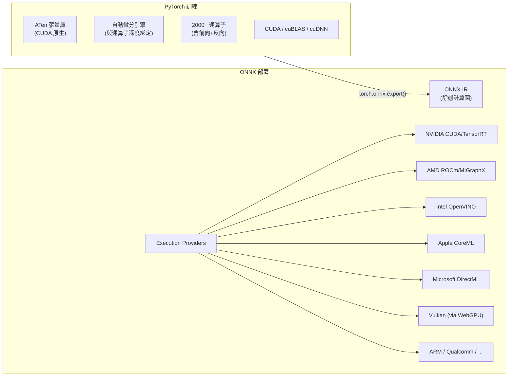

# PyTorch 高度綁定 CUDA、ONNX 支援多重硬體後端之技術與歷史原因分析

## 摘要

PyTorch 與 CUDA 深度綁定，而 ONNX 天生支援 Vulkan、DirectML、OpenVINO 等多種硬體後端，兩者差異根源於**架構定位與歷史脈絡**：PyTorch 是 2016 年誕生的**訓練優先、Eager Execution 框架**，其張量庫 ATen、自動微分引擎與運算子調度系統從底層與 NVIDIA CUDA 生態緊密耦合；ONNX 則是 2017 年由 Facebook 與 Microsoft 共同創立的**供應商中立中間表示格式**，其靜態圖與可插拔 Execution Provider 架構自然支援多重後端部署。PyTorch 2.0 引入的 PrimTorch/TorchInductor 編譯棧正在逐步降低後端移植門檻，但現階段 PyTorch 的非 NVIDIA 硬體部署仍高度依賴匯出至 ONNX 或使用 ROCm（AMD）等相容方案。

## 1. 引言

深度學習框架的硬體加速支援策略存在顯著分歧：PyTorch 對 CUDA 的依賴深入骨髓，而非 NVIDIA GPU（如 AMD、Intel、Apple Silicon）的支援要麼是後加之物，要麼依賴外部轉換層；相較之下，ONNX Runtime 原生支援十餘種 Execution Provider，從 NVIDIA TensorRT、AMD ROCm 到 Apple CoreML、Microsoft DirectML 一應俱全。本文從架構設計、歷史背景、技術取捨三個面向深入探討此差異的根本原因。

## 2. PyTorch 的 CUDA 深度耦合

### 2.1 ATen 張量庫的核心地位

PyTorch 的張量操作建立在 **ATen**（A Tensor library）之上，這是 PyTorch 最底層的張量計算基礎庫。ATen 從開發之初就以 CUDA 為首要 GPU 後端進行設計，其 GPU 裝置抽象層本質上就是 CUDA 抽象層。Wikipedia 將 CUDA 列為 PyTorch 的核心實現語言之一（與 Python、C++ 並列）[^wiki-pytorch]。

### 2.2 `torch.cuda` 作為唯一 GPU 入口

PyTorch 的 GPU 裝置模型完全圍繞 `torch.cuda` API 建構（`torch.device('cuda')`、`tensor.cuda()`、`torch.cuda.is_available()` 等）。這不僅是命名慣例——即使是 AMD ROCm/HIP 支援，也**刻意重用既有的 `torch.cuda` 介面**。官方文件明確指出[^pytorch-hip]：

> "PyTorch for HIP intentionally reuses the existing `torch.cuda` interfaces. This helps to accelerate the porting of existing PyTorch code and models because very few code changes are necessary, if any."

並且進一步說明：`'rocm'` 或 `'hip'` 都不是有效的裝置名稱，請使用 `'cuda'`。這意味著在 AMD GPU 上執行時，開發者仍須使用 `torch.device('cuda')`。

### 2.3 原生 CUDA Kernel 的依賴

PyTorch 的核心計算路徑直接連結 NVIDIA 的專有函式庫——cuBLAS（線性代數）、cuDNN（深度神經網路）、cuFFT（傅立葉變換）等。這些庫提供高度最佳化的 GPU Kernel，PyTorch 大量依賴它們以達到頂尖訓練效能。任何非 NVIDIA 後端都必須從頭實現同等級的 Kernel 最佳化。

## 3. PyTorch 的非 CUDA GPU 後端現狀

### 3.1 ROCm（AMD）——相容 CUDA API 的方案

AMD GPU 透過 ROCm/HIP 獲得支援，但要點在於它**重用了 CUDA API 表面**。開發者需檢查 `torch.version.hip` 以區分 CUDA 與 ROCm 環境。支援的功能包括 MI300 上的 TF32、快取記憶體分配器、NCCL/gloo 分散式後端。ROCm 可透過預編譯二進位檔安裝，或使用 `USE_ROCM=1` 從原始碼建構[^pytorch-hip]。

### 3.2 MPS（Apple Silicon）——原生獨立後端

`torch.device("mps")` 是 Apple Metal Performance Shaders 的原生支援，擁有自己的裝置名稱與 API。這是少數不需繞道 CUDA 介面的獨立後端，於 macOS 14.0+ 上可用[^pytorch-mps]。

### 3.3 Vulkan——實驗性、非生產等級

PyTorch 原始碼樹中存在 Vulkan 相關檔案（`aten/src/ATen/vulkan/`）[^pytorch-vulkan]，但 Vulkan 支援**從未達到生產等級**。官方文件中 Vulkan 頁面回傳 404[^pytorch-vulkan-404]，Get Started 頁面僅列出 CUDA、ROCm、CPU 三種計算平台[^pytorch-getstarted]。Vulkan 的主要探索方向是**行動裝置與邊緣推論**（透過 PyTorch Mobile / ExecuTorch），而非訓練。

### 3.4 DirectML——非原生支援

Microsoft DirectML 不是 PyTorch 的原生後端。其支援僅能透過 ONNX Runtime 的 DirectML Execution Provider 取得，不存在於 PyTorch 官方生態中[^pytorch-directml]。

### 3.5 其他後端

XLA 後端（Google TPU）與 Torch-TensorRT（NVIDIA TensorRT 整合）皆為獨立專案，並非 PyTorch 核心的一級公民。

## 4. ONNX 的多重後端架構

### 4.1 中間表示（IR）的設計定位

ONNX（Open Neural Network Exchange）從第一天起就被設計為**神經網路的中間表示格式**。它使用 Protocol Buffers 定義計算圖模型，包含標準化的運算子集合與資料型別。計算圖是一個由節點組成的有向無環圖，每個節點代表一個運算子呼叫。這種**靜態、可序列化**的格式天然地將「計算什麼」與「如何計算」分離[^wiki-onnx]。

### 4.2 Execution Provider 抽象層

ONNX Runtime 的核心設計是可插拔的 **Execution Provider（EP）** 框架。每個 EP 透過 `GetCapability()` 介面宣告自己能執行哪些節點或子圖，執行階段自動將圖分割並分配給對應的 EP。支援的 EP 包括[^onnx-ep]：

| 類別 | 提供者 |
|------|--------|
| **NVIDIA** | CUDA、TensorRT |
| **AMD** | ROCm（已棄用）、MIGraphX、Vitis-AI |
| **Intel** | OpenVINO、oneDNN |
| **Apple** | CoreML |
| **Microsoft** | DirectML |
| **行動/邊緣** | NNAPI、XNNPACK、QNN、WebGPU |
| **其他** | Arm Compute Library、CANN、TVM |

### 4.3 統一 API 與優先級排序

開發者只需指定 Provider 優先級列表即可跨硬體部署[^onnx-ep]：

```python
EP_list = ['CUDAExecutionProvider', 'CPUExecutionProvider']
sess = rt.InferenceSession("model.onnx", providers=EP_list)
```

### 4.4 歷史脈絡：ONNX 由 PyTorch 團隊創造

ONNX 最初名為 **"Toffee"**，由 Facebook 的 PyTorch 團隊開發，2017 年 9 月改名 ONNX 並與 Microsoft 共同發布。PyTorch 的 `torch.onnx.export()` 是產生 ONNX 模型的主要方式。換言之，PyTorch 團隊**刻意創造了 ONNX 來解決跨硬體部署問題**——訓練留在 PyTorch（CUDA 最佳化），部署交給 ONNX（多後端）[^wiki-onnx]。

## 5. 技術根源：為什麼訓練框架難以解耦

### 5.1 Eager Execution 的固有限制

PyTorch 的 Define-by-Run 模式讓運算在定義時立即執行。每個張量運算都必須有當下的硬體實現——這使得從特定後端解耦極其困難。相較之下，ONNX 的靜態圖在匯出時就完成了計算描述，執行階段可以將整個圖編譯成目標硬體的最佳化程式碼[^pytorch-20]。

### 5.2 運算子數量爆炸

PyTorch 擁有 **1200+ 運算子與 2000+ 多載**。撰寫一個完整的後端必須實作所有這些運算子的前向與反向傳播。PyTorch 2.0 文件承認[^pytorch-20]：

> "Writing a backend or a cross-cutting feature becomes a draining endeavor."

### 5.3 自動微分的依賴

PyTorch 的自動微分引擎與運算子實現深度綁定。支援一個新後端不僅要實現前向運算，還要實現所有運算子的反向傳播（梯度計算），工作量翻倍。

### 5.4 歷史時機與激勵機制

- PyTorch 誕生於 2016 年，當時 NVIDIA 在深度學習 GPU 市場佔有率超過 95%
- AMD ROCm 於 2016 年推出，但數年後才達到實用等級
- Meta AI 大量投資 NVIDIA 硬體訓練大型模型，缺乏深度投資替代後端的商業誘因[^wiki-pytorch]

## 6. PyTorch 2.0 編譯棧：後端泛化的突破嘗試

### 6.1 PrimTorch —— 運算子縮減

PyTorch 2.0 引入 **PrimTorch**，將 2000+ 運算子縮減為約 **250 個基本運算子（Prims）** 的封閉集合。這大幅降低了後端移植門檻——後端供應商只需實作約 250 個運算子而非 2000+。

### 6.2 TorchInductor —— 多後端編譯器

**TorchInductor** 是一個基於 Python 的深度學習編譯器，採用 Define-by-Run 的迴圈級中間表示（僅約 50 個運算子），可為 Triton（GPU）與 C++/OpenMP（CPU）產生程式碼。後端供應商可以在 TorchDynamo 層（接收 ATen/Prims IR 的 FX Graph）或 Inductor 層（將迴圈級 IR 對應到硬體特定程式碼）進行整合[^pytorch-20]。

### 6.3 現狀限制

截至 PyTorch 2.0 公告，TorchInductor 支援 CPU 與 NVIDIA Volta/Ampere GPU，但**尚未支援其他 GPU、xPU 或舊款 NVIDIA GPU**。此編譯棧仍處於早期階段。

## 7. 結論



PyTorch 與 CUDA 的深度綁定源於其**訓練優先的 Eager Execution 架構**與**誕生於 CUDA 獨占時代**的歷史脈絡。ATen 張量庫、自動微分引擎與數千個運算子的實現都圍繞 NVIDIA 生態建構。相較之下，ONNX 從設計之初就是**供應商中立的中間表示格式**，其靜態圖與可插拔 Execution Provider 架構自然支援多重硬體後端。PyTorch 2.0 的 PrimTorch/TorchInductor 編譯棧正在逐步改變此格局，但現階段 PyTorch 的非 NVIDIA 硬體部署策略仍然高度依賴「PyTorch 訓練 → ONNX 匯出 → ONNX Runtime 多後端部署」的管線。

## 參考文獻

[^wiki-pytorch]: Wikipedia. (n.d.). PyTorch. Retrieved 2026-10-09, from https://en.wikipedia.org/wiki/PyTorch

[^pytorch-hip]: PyTorch. (n.d.). HIP (ROCm) semantics. Retrieved 2026-10-09, from https://pytorch.org/docs/2.14/notes/hip.html

[^pytorch-mps]: PyTorch. (n.d.). MPS backend. Retrieved 2026-10-09, from https://pytorch.org/docs/2.14/notes/mps.html

[^pytorch-vulkan]: GitHub. (n.d.). PyTorch Vulkan backend source. Retrieved 2026-10-09, from https://github.com/pytorch/pytorch/tree/main/aten/src/ATen/vulkan

[^pytorch-vulkan-404]: PyTorch. (n.d.). Vulkan docs page (returns 404). Retrieved 2026-10-09, from https://pytorch.org/docs/stable/vulkan.html

[^pytorch-getstarted]: PyTorch. (n.d.). Get Started. Retrieved 2026-10-09, from https://pytorch.org/get-started/locally/

[^pytorch-directml]: Microsoft. (n.d.). DirectML Execution Provider. Retrieved 2026-10-09, from https://onnxruntime.ai/docs/execution-providers/DirectML-ExecutionProvider.html

[^pytorch-20]: PyTorch. (n.d.). PyTorch 2.0 documentation. Retrieved 2026-10-09, from https://pytorch.org/get-started/pytorch-2-0/

[^wiki-onnx]: Wikipedia. (n.d.). Open Neural Network Exchange. Retrieved 2026-10-09, from https://en.wikipedia.org/wiki/Open_Neural_Network_Exchange

[^onnx-ep]: ONNX Runtime. (n.d.). Execution Providers. Retrieved 2026-10-09, from https://onnxruntime.ai/docs/execution-providers/