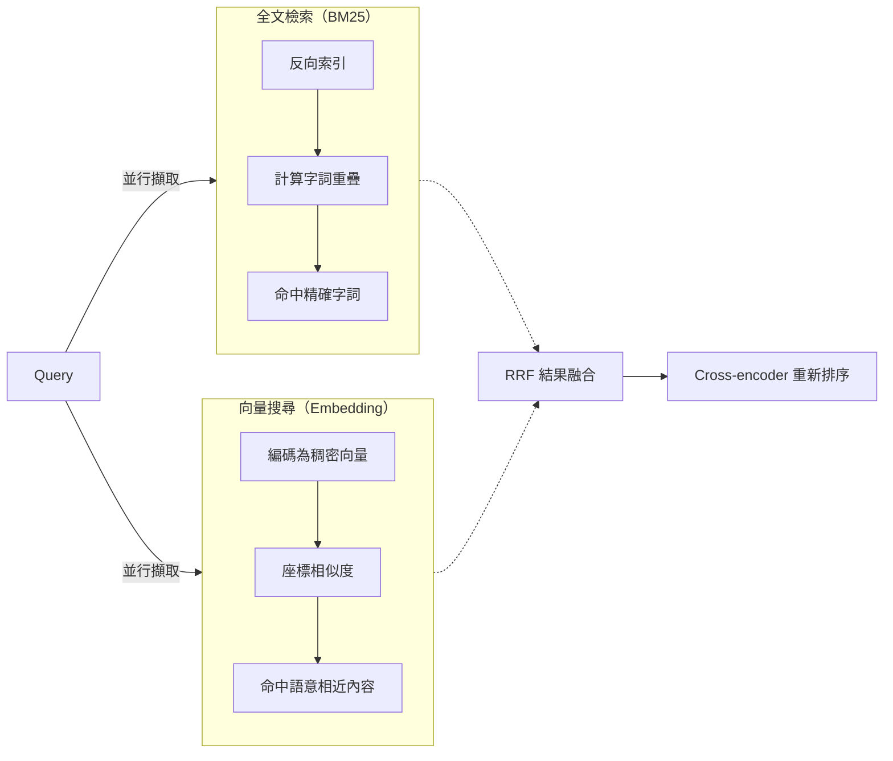

# 向量搜尋與全文檢索的優缺點比較

本文以繁體中文（zh_TW）撰寫，旨在比較**向量搜尋（semantic / vector search）**與**全文檢索（full-text / keyword / BM25）**兩類搜尋技術的運作原理、優缺點與適用情境。所有事實皆以註腳標示來源，報告內容自成一體，不依賴任何先前對話脈絡。

## 背景：兩類搜尋的定義

- **全文檢索（也稱 lexical / keyword search）**：以**反向索引（inverted index）**為核心，將文件拆成詞項（term），再以 **BM25** 等機率式評分函數依「詞頻 × 逆文檔頻率 × 長度正規化」計算相關度。它回答的問題是：「這份文件是否**包含**這些字詞？」[^atlan][^knovo]
- **向量搜尋（也稱 semantic search）**：將文件與查詢各自編碼為稠密向量（embedding），存入向量資料庫（如 HNSW 圖結構的近似最近鄰索引，ANN），再以餘弦相似度或內積計算語意相近程度。它回答的問題是：「這份文件的**意思**是否與此查詢相近？」[^atlan][^knovo][^wiki]

主流實作：全文檢索見於 Elasticsearch、OpenSearch、Solr、PostgreSQL `tsvector`；向量搜尋見於 Pinecone、Weaviate、Qdrant、Milvus、pgvector、Chroma。[^atlan][^knovo]

## 全文檢索的優點

1. **速度快**：大部分查詢在 1–50ms 內完成，純 CPu 運作、無需神經推論。[^hakia]
2. **基礎設施成本低**：稀疏索引不需 GPU 推論；其索引大小約為稠密向量索引的 10.4%。[^opensearch][^atlan]
3. **可解釋、可稽核**：使用者與稽核人員能直接看到命中的詞項，符合監管與合規需求。[^atlan]
4. **確定性高**：相同查詢必定回傳相同結果。[^hakia]
5. **精確字詞匹配能力強**：對產品料號（SKU）、錯誤碼、法規條文、人名等精確識別碼特別有效，精確匹配準確度約 95%。[^hakia][^knovo]
6. **成熟度高**：Elasticsearch、OpenSearch、Solr 具數十年營運成熟度；2024 年關鍵字搜尋仍佔企業搜尋營收的 41.60%。[^atlan]
7. **零樣本基準表現佳**：在 BEIR 基準的 18 個資料集中，BM25 在 9 個資料集勝過稠密檢索。[^beir][^atlan]

## 全文檢索的缺點

1. **詞彙不匹配問題（vocabulary mismatch）**：無法處理同義詞與換句話說，搜尋「data pipeline failures」會漏掉標題為「ETL incident root causes」的文件。[^atlan]
2. **缺乏語意理解**：本質上是詞袋（bag-of-words）模型，不理解意義。[^devto]
3. **自然語言查詢表現差**：在複雜自然語言查詢上準確度僅約 60–70%。[^hakia]
4. **跨語言檢索困難**：需要為每種語言配置大量字典與分析器。[^atlan]
5. **「沉默漏失」**：遇到同義詞或換句話說時，關鍵字搜尋直接回傳無結果，使用者無從得知漏掉了什麼。[^atlan]

## 向量搜尋的優點

1. **天生處理同義詞與換句話說**：「cancel my plan」能命中「subscription termination」。[^knovo][^atlan]
2. **支援自然語言查詢**：可用對話式方式檢索，同義詞密集查詢的精確度較關鍵字基準提升 25–35%。[^atlan]
3. **跨語言檢索**：嵌入座標空間共享，無需翻譯即可跨語言匹配。[^knovo]
4. **概念式／意圖式匹配**：即使措辭不同也能找到相關內容，自然語言查詢準確度約 85–95%。[^hakia]
5. **多模態支援**：同一套 ANN 機制可索引文字、圖像、音訊、程式碼。[^asoasis]
6. **RAG（檢索增強生成）的基石**：是多數 RAG 管線擷取層的主流方式。[^wiki][^atlan]
7. **適合探索性檢索**：使用者不需知道確切詞彙即可找到相關內容。[^atlan]

## 向量搜尋的缺點

1. **基礎設施成本高**：需要 GPU 推論編碼、向量索引儲存與 ANN 搜尋，儲存成本約為文字索引的 5–10 倍。[^hakia]
2. **延遲較高**：典型 50–500ms，高於全文檢索的 1–50ms。[^hakia]
3. **精確匹配精確度較低**：約 85%，低於關鍵字的 95%。[^hakia]
4. **可解釋性低**：無法直觀說明命中原因，稽核困難。[^atlan]
5. **「自信的錯誤結果」**：可能以高信心回傳看似合理卻錯誤的匹配，使失敗比關鍵字的沉默漏失更難察覺。[^atlan]
6. **極度依賴語料品質**：嵌入品質受限於文件描述豐富度。Gartner（2024）指出 **65% 的企業語意搜尋實作未達預期**，主因即中繼資料品質不良；豐富描述可把 Context@5 從 33% 提升到 55%。[^atlan][^arxiv2]
7. **記憶體瓶頸**：即使號稱「磁碟式」的向量資料庫仍需可觀記憶體比例，部分系統在 30% 記憶體比例以下無法運作。[^redis]
8. **嵌入漂移（embedding drift）**：資料異動與模型更新會使搜尋品質靜默衰退。[^redis]
9. **同步成本高**：來源資料高頻異動時，重新編碼與重建索引昂貴，批次更新會造成向量庫與真實來源暫時失序。[^redis]
10. **水平擴展瓶頸**：分散式向量搜尋常受限於網路頻寬，因運算頻寬成長快於網路頻寬。[^redis]

## 誰勝誰負？基準與實務數據

| 指標 | 全文檢索（BM25） | 向量搜尋 | 來源 |
|---|---|---|---|
| BEIR 零樣本勝場 | 18 中勝 9 | 18 中勝 9 | [^beir] |
| 2024 企業搜尋營收占比 | 41.60% | 成長中 | [^atlan] |
| 索引大小（相對稠密） | 約 10.4% | 基準 | [^opensearch] |
| 精確匹配準確度 | 約 95% | 約 85% | [^hakia] |
| 自然語言準確度 | 約 60–70% | 約 85–95% | [^hakia] |
| 查詢延遲 | 1–50ms | 50–500ms | [^hakia] |
| 企業使用案例中混合搜尋勝利比例 | — | 混合搜尋勝 73% | [^weaviate] |

在 WANDS 電子商務基準上，單獨 BM25 的 NDCG 為 0.698，單獨 KNN 為 0.695，而基本 RRF 混合搜尋為 0.707，經欄位加權後達到 0.750——比任一種單獨方式高出 7.4%。[^digital][^atlan]

## 結論：混合搜尋是實務主流

沒有任何單一方法能全面勝出；兩者的失敗模式互補——BM25 補足語意搜尋在精確詞彙上的不足，向量搜尋補足 BM25 在換句話說上的不足。實務上常用三階段管線[^data][^digital]：

1. **雙軌擷取**：BM25（稀疏）與稠密向量搜尋並行，各自回傳前 50–500 筆候選。
2. **結果融合**：以 **RRF（Reciprocal Rank Fusion，k=60）** 合併排名清單，可回避兩者評分尺度不相容的問題（BM25 為無界正整數，餘弦相似度介於 -1 與 1）。[^arxiv][^digital]
3. **重新排序（選用）**：以 cross-encoder 對前 50–200 筆重新計分以提升精確度。[^digital]

Anthropic 的脈絡檢索實驗顯示，結合脈絡嵌入與脈絡 BM25 可將前 20 名擷取失敗率降低 49%（搭配 reranker 可達 67%）。[^digital]

## 選擇建議

- **建議使用全文檢索**：需要精確識別碼（SKU、錯誤碼、法規條文、姓名）、稀有術語、可稽核的合規環境、或資源受限無 GPU 的環境。
- **建議使用向量搜尋**：自然人機客服、RAG 管線、跨語言檢索、探索性內容發掘、推薦系統。
- **建議使用混合搜尋**：生產級企業搜尋、電子商務、客服支援——同時涵蓋精確查詢與自然語言查詢。關鍵前提是**語料與中繼資料品質足夠好**，否則任何搜尋策略都難以發揮。[^atlan]

---

## 參考資料

[^atlan]: Atlan. (n.d.). *Semantic Search vs. Keyword Search*. Retrieved 2026-10-09, from https://atlan.com/know/semantic-search-vs-keyword-search/
[^knovo]: Knovo. (n.d.). *Semantic Search vs Keyword Search*. Retrieved 2026-10-09, from https://www.knovo.dev/guides/semantic-search-vs-keyword
[^wiki]: *Vector database*. (n.d.). Retrieved 2026-10-09, from https://en.wikipedia.org/wiki/Vector_database
[^hakia]: Hakia. (n.d.). *Semantic vs Keyword Search*. Retrieved 2026-10-09, from https://hakia.com/compare/semantic-vs-keyword-search/
[^opensearch]: OpenSearch Labs. (n.d.). *Improving document retrieval with sparse semantic encoders*. Retrieved 2026-10-09, from https://opensearch.org/blog/improving-document-retrieval-with-sparse-semantic-encoders/
[^beir]: Thakur, N., Reimers, N., Rücklé, A., Srivastava, A., & Gurevych, I. (2021). *BEIR: A Heterogeneous Benchmark for Zero-shot Evaluation of Information Retrieval Models*. Retrieved 2026-10-09, from https://arxiv.org/abs/2104.08663
[^devto]: Necessary, A. (n.d.). *BM25 vs Vector Search: Choosing the Right Retrieval Strategy for Production Systems*. Retrieved 2026-10-09, from https://dev.to/aloknecessary/bm25-vs-vector-search-choosing-the-right-retrieval-strategy-for-production-systems-599n
[^asoasis]: ASOasis. (2026, April 18). *Vector Search vs Keyword Search: A Practical Guide*. Retrieved 2026-10-09, from https://asoasis.tech/articles/2026-04-18-0853-vector-search-vs-keyword-search-comparison/
[^redis]: Redis. (n.d.). *Common Challenges Working with Vector Databases*. Retrieved 2026-10-09, from https://redis.io/blog/common-challenges-working-with-vector-databases/
[^weaviate]: Weaviate. (n.d.). *Hybrid Search Explained*. Retrieved 2026-10-09, from https://weaviate.io/blog/hybrid-search-explained
[^arxiv]: Benham, R., & Culpepper, J. S. (2018). *Risk-Reward Trade-offs in Rank Fusion*. Retrieved 2026-10-09, from https://arxiv.org/abs/1811.06147
[^arxiv2]: *Describing metadata augmentation for retrieval* (2025). Retrieved 2026-10-09, from https://arxiv.org/html/2509.14457v1
[^digital]: Digital Applied. (2026). *Hybrid Search: BM25, Vector & Reranking Reference*. Retrieved 2026-10-09, from https://www.digitalapplied.com/blog/hybrid-search-bm25-vector-reranking-reference-2026
[^data]: Data Studios. (n.d.). *Elasticsearch Hybrid Search: BM25, Dense Vectors, RRF and Reranking*. Retrieved 2026-10-09, from https://www.datastudios.org/post/elasticsearch-hybrid-search-bm25-dense-vectors-rrf-and-reranking
