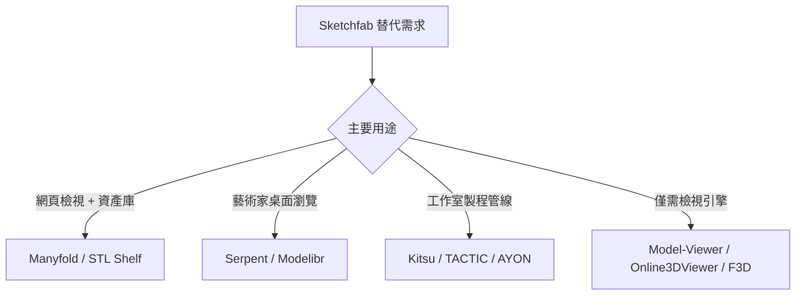

# Sketchfab 的自由開源替代方案：以「3D 美術數位資產管理」為焦點

## 摘要

Sketchfab 是一個用於發布、分享與在網路上即時檢視 3D 模型的商業平台，同時具備 3D 資產的線上瀏覽與管理（DAM）功能[^sf]。本報告調查其自由開源（FOSS）替代方案，特別聚焦於**3D 美術數位資產管理**——亦即遊戲美術、視覺特效（VFX）與動畫領域藝術家整理模型、材質、貼圖與資產庫的用途，而非「3D 列印」相關方案。

調查結論如下：

1. **不存在現成的「FOSS 版 Sketchfab」**：目前沒有任何一套成熟、可自架、開源的平台，能同時具備精美 3D 檢視器、上傳/管理/版本控管、公開分享/內嵌、搜尋與社群功能於一身。
2. 若重視「網頁 3D 檢視 + 資產庫」組合，**Manyfold**（AGPL-3.0，約 2,196 星）是最成熟且持續開發中的選擇，其「3D 列印」定位對一般 3D 資產（OBJ、GLB、STL 等）皆可用。
3. 若重視「藝術家專用的 3D 資產管理」，則可區分兩條路線：
   - **桌面端視覺化瀏覽器**：Serpent、Modelibr（具 360° 3D 預覽與 PBR 貼圖瀏覽）。
   - **製程導向（Production pipeline）平台**：Kitsu、TACTIC、AYON 等，屬工作室級資產管理與追蹤系統。

以下依三類別詳述。

---

## 一、自架網頁版 3D 檢視/代管平台（最接近 Sketchfab 的核心檢視體驗）

| 專案 | 授權 | GitHub 星數 | 說明 |
|---|---|---|---|
| [Online3DViewer](https://github.com/kovacsv/Online3DViewer) | MIT | 3,700 | 可自架的網頁 3D 檢視器，支援 18+ 格式匯入（3dm、3ds、dae、fbx、gltf、obj、stl、ply、step 等）與多格式匯出[^o3dv]。為檢視元件，需自備代管與後端。 |
| [Google Model-Viewer](https://github.com/google/model-viewer) | Apache-2.0 | **8,267** | `<model-viewer>` Web Component，可在任意網頁嵌入互動 3D（glTF/GLB，含 PBR、動畫、WebXR）[^mv]。僅渲染引擎，非完整平台，需自行處理上傳/儲存後端。 |
| [F3D](https://github.com/f3d-app/f3d) | BSD-3-Clause | **4,747** | 快速簡潔的 3D 檢視器，支援 glTF、USD、STL、OBJ、FBX、Alembic、PLY 等，可產縮圖與即時 PBR 預覽，跨平台[^f3d]。可作為資產管理管線中的預覽引擎。 |
| [3D-Model-Viewer-Platform](https://github.com/alenperic/3D-Model-Viewer-Platform) | MIT | 1 | 完整前後端 Node.js/Express 上傳與檢視平台（OBJ、FBX、GLTF/GLB、STL、PLY、DAE），Three.js 檢視，Docker 就緒[^3dmvp]。功能較陽春、星數極低。 |

### 關鍵評估

- Google Model-Viewer 與 Online3DViewer 僅提供**檢視**層，並非完整平台；要取代 Sketchfab 需自行組合儲存、上傳與搜尋後端。
- F3D 雖有高星數，本質是桌面/命令列的預覽工具而非 DAM。
- 目前尚無「成熟的全方位 FOSS Sketchfab 平台」，這點必須誠實呈現。

---

## 二、具 3D 預覽的數位資產管理（最貼近「3D 美術資產管理」訴求）

此類專案聚焦於資產的編目、索引、中繼資料與預覽。

### A. 網頁版自架 DAM（附 3D 預覽）

| 專案 | 授權 | 星數 | 說明 |
|---|---|---|---|
| [Manyfold](https://github.com/manyfold3d/manyfold) | AGPL-3.0 | **2,196** | Ruby on Rails 自架網頁應用，管理 3D 模型收藏，內建 Three.js 檢視器、標籤、收藏、創作者、中繼資料與 ActivityPub 分享[^manyfold]。官方定位為 3D 列印，但支援 OBJ、STL、3MF、GLB 等一般網格格式，可作為遊戲/VFX 資產庫使用。 |
| [STLVault](https://github.com/moddroid94/STLVault) | MIT | 44 | Docker 化的 3D 模型庫，React 前端 + Python/FastAPI 後端，具 STL/3MF/STEP 預覽、巢狀資料夾、標籤與搜尋[^stlvault]。 |
| [STL Shelf](https://github.com/CQ-Fabrication/stl-shelf) | Apache-2.0 | 27 | 自架 3D 模型個人庫（STL、3MF、OBJ、PLY），Three.js 預覽、版本歷史、標籤、團隊協作、S3 相容儲存（Bun + React/SSR + PostgreSQL）[^stlshelf]。 |

### B. 桌面端 DAM（遊戲/VFX 藝術家導向）

| 專案 | 授權 | 星數 | 說明 |
|---|---|---|---|
| [Serpent](https://github.com/dolag233/Serpent) | MIT | 575 | 跨平台（macOS/Windows）桌面 DAM，專為遊戲美術、VFX 專業人士與設計師打造；內建含 HDRI/PBR 渲染的 3D 檢視器（FBX、OBJ、GLB），另有圖片/影片/音訊預覽、標籤、收藏、AI 分析與 WebDAV 同步[^serp]。 |
| [Modelibr](https://github.com/Papyszoo/Modelibr) | Other（見註） | 10 | 自架式遊戲資產庫，專為組織 3D 模型、PBR 貼圖組、環境貼圖、sprite 與音效設計；具 360° 動畫 3D 預覽、版本歷史、雙欄介面、WebDAV 與 Blender 整合、去重複。支援 .obj、.fbx、.gltf、.glb、.stl、.3mf、.blend[^modelibr]。為極新專案（2025-08 建立）。 |

> 註：Modelibr GitHub 授權欄位顯示為 `NOASSERTION`/「Other」，官方宣稱採用 Business Source License 1.1（可免費使用與自架）[^modelibr2]，嚴格而言不屬純 FOSS 授權，需自行確認。

### C. 通用型 DAM 平台（可存放 3D 檔案，3D 預覽有限）

| 專案 | 授權 | 星數 | 說明 |
|---|---|---|---|
| ResourceSpace | 自訂 OSS | 79 | PHP 企業級 DAM，支援相片、影片、插圖與音訊，可存放任何檔案型態含 3D，但無原生 3D 檢視器；中繼資料與權限管控強[^resourcespace]。 |
| Phraseanet / Phrasea | GPL-3.0 / MIT | 273 / 24 | 完整開源 DAM，具 Elasticsearch、DublinCore 中繼資料、權利管理等；以相片/影片/音訊為主，可存 3D 檔但無原生 3D 預覽[^phrasea]。 |

---

## 三、製程導向（Production Pipeline）的資產管理平台

此類是**動畫/VFX/遊戲工作室**級的工具，重點在資產版本控管、發布（publish）、追蹤與 DCC（Maya、Blender、Houdini 等）整合，而非視覺化瀏覽。它們是「3D 美術資產管理」在工業規模下的主流答案。

| 專案 | 授權 | 星數 | 說明 |
|---|---|---|---|
| [Kitsu](https://github.com/cgwire/kitsu) | AGPL-3.0 | 734 | 動畫與 VFX 工作室協作平台，300+ 工作室使用，追蹤專案/鏡頭/資產/任務，含 Review 流程；後端為 Zou，客戶端為 Gazu[^kitsu]。 |
| [TACTIC](https://github.com/Southpaw-TACTIC/TACTIC) | Other（見註） | 499 | 企業工作流程平台，內建數位資產管理與 VFX 模組（鏡頭追蹤、影片評審、可自訂資產資料模型）；整合 Maya、Nuke、Houdini、3ds Max[^tactic]。 |
| [AYON](https://github.com/ynput/ayon-core) | Apache-2.0 | 72+（多個子倉） | Avalon/OpenPype 的後繼者，開放製程平台，具伺服器後端、REST API、Web 前端、桌面啟動器與外掛架構；支援 Maya、Houdini、Nuke、Blender、USD 等[^ayon]。 |
| [Avalon](https://github.com/getavalon/core) | MIT | 221 | 輕量開源製程框架，管理資產發布、載入與跨 DCC 的版本控管（後繼者為 AYON）[^avalon]；屬資產發布管線而非視覺瀏覽器。 |
| [Prism](https://github.com/PrismPipeline/Prism) | LGPL/GPL-3.0 | 398 | 開源 VFX/動畫製程工具，跨 DCC（Maya、3ds Max、Houdini、Blender、Nuke）管理資產、版本與場景，具藝術家友善介面[^prism]。 |
| [Tik Manager 4](https://github.com/masqu3rad3/tik_manager4) | GPL-3.0 | 195 | 跨平台製程與專案管理，支援 Maya、3ds Max、Houdini、Nuke、Mari、Blender、Substance Painter 等，含資產管理、版本控管與發布驗證[^tikmgr]。 |
| [Stalker](https://github.com/eoyilmaz/stalker) | LGPL-3.0 | 207 | 專為動畫/VFX 工作室設計的 Production Asset Management 函式庫，追蹤資產在鏡頭/場景中的引用，支援 PostgreSQL/SQLite，可連接 Maya、Houdini、Nuke、Blender 等[^stalker]。 |
| [Plex](https://github.com/alexanderrichtertd/plex) | MIT | 287 | 開源 VFX/動畫/遊戲製程，管理檔案結構、工作流程追蹤、命名慣例與資產庫，適合中小型工作室[^plex]。 |
| [Damas-Core](https://github.com/remyla/damas-core) | GPL-3.0 | 59 | JSON 為基的數位資產管理器與中繼資料索引器，由 PRIMCODE 為 3D 動畫影集製作所建，曾用於《Mars Express》、《Gigantosaurus》等[^damas]。 |

> 註：TACTIC 的 GitHub 授權欄位顯示 `NOASSERTION`，坊間常標示 MIT 或自有授權，屬既有企業程式碼庫，需自行確認原始授權條款[^tactic]。

---

## 結論與建議

- **若想要「自架版 Sketchfab 資產庫」**：優先評估 **Manyfold**（最成熟、持續開發、Docker 部署、附中繼資料/標籤/收藏與 ActivityPub）[^manyfold]。
- **若想要「遊戲/VFX 藝術家的桌面 DAM」**：**Serpent**（MIT，內建 PBR/HDRI 3D 預覽、FBX 支援）是最貼合需求的現成專案[^serp]；**Modelibr** 概念最貼近但極新、星數低，需自行評估成熟度[^modelibr]。
- **若是工作室規模的工業資產管理**：**Kitsu**、**TACTIC**、**AYON** 屬成熟開源製程平台[^kitsu][^tactic][^ayon]，但需理解其為鏡頭/資產/任務追蹤系統，而非視覺化檔案瀏覽器。
- 純檢視層（Model-Viewer、Online3DViewer、F3D）可作為「自行組裝」方案的核心，搭配任意檔案儲存後端，但需自行開發上傳、搜尋與中繼資料功能[^mv][^o3dv][^f3d]。

## 資料來源品質反思

- 所有 GitHub 星數與授權欄位均於 2026-10-09 透過 GitHub API 直接查核，非僅憑二手清單，可信度高。
- 若干專案（Modelibr、TACTIC、Pimcore 等）授權欄位顯示 `NOASSERTION` 或「Other」，反映其授權並非常見 SPDX 標籤，導入前務必查閱原始碼庫授權文件。
- 「目前不存在現成 FOSS 版 Sketchfab」此一結論來自多份開源軟體清單交叉比對，並經作者批判性判定：多數高星專案並非完整平台，而是元件或製程工具。

[^sf]: Sketchfab. (n.d.). Sketchfab - The best 3D viewer on the web. Retrieved 2026-10-09, from https://sketchfab.com
[^o3dv]: Online3DViewer (n.d.). Online3DViewer - GitHub repository. Retrieved 2026-10-09, from GitHub API (https://api.github.com/repos/kovacsv/Online3DViewer) 與 https://github.com/kovacsv/Online3DViewer
[^mv]: Google (n.d.). model-viewer: Easily display interactive 3D models on the web and in AR. Retrieved 2026-10-09, from GitHub API (https://api.github.com/repos/google/model-viewer) 與 https://github.com/google/model-viewer
[^f3d]: F3D (n.d.). Fast and minimalist 3D viewer. Retrieved 2026-10-09, from GitHub API (https://api.github.com/repos/f3d-app/f3d) 與 https://github.com/f3d-app/f3d
[^3dmvp]: Peric, A. (n.d.). 3D Model Viewer Platform. Retrieved 2026-10-09, from https://github.com/alenperic/3D-Model-Viewer-Platform
[^manyfold]: Manyfold (n.d.). A self-hosted digital asset manager for 3D print files. Retrieved 2026-10-09, from GitHub API (https://api.github.com/repos/manyfold3d/manyfold) 與 https://github.com/manyfold3d/manyfold
[^stlvault]: Moddroid94 (n.d.). STLVault. Retrieved 2026-10-09, from https://github.com/moddroid94/STLVault
[^stlshelf]: CQ-Fabrication (n.d.). stl-shelf. Retrieved 2026-10-09, from https://github.com/CQ-Fabrication/stl-shelf
[^serp]: Dolag233 (n.d.). Serpent: Cross-platform digital asset management software for game artists, VFX professionals, and graphic and motion designers. Retrieved 2026-10-09, from GitHub API (https://api.github.com/repos/dolag233/Serpent) 與 https://github.com/dolag233/Serpent
[^modelibr]: Papyszoo (n.d.). Modelibr. Retrieved 2026-10-09, from GitHub API (https://api.github.com/repos/Papyszoo/Modelibr) 與 https://github.com/Papyszoo/Modelibr
[^modelibr2]: Modelibr (n.d.). About. Retrieved 2026-10-09, from https://www.modelibr.com/
[^resourcespace]: ResourceSpace (n.d.). Open Source Digital Asset Management Software. Retrieved 2026-10-09, from https://github.com/resourcespace/resourcespace
[^phrasea]: Alchemy (n.d.). Phrasea. Retrieved 2026-10-09, from https://github.com/alchemy-fr/phrasea
[^kitsu]: CGWire (n.d.). Kitsu: Collaboration Platform for Animation and VFX Productions. Retrieved 2026-10-09, from GitHub API (https://api.github.com/repos/cgwire/kitsu) 與 https://github.com/cgwire/kitsu
[^tactic]: Southpaw Technology (n.d.). TACTIC: Open source remote collaboration platform. Retrieved 2026-10-09, from GitHub API (https://api.github.com/repos/Southpaw-TACTIC/TACTIC) 與 https://github.com/Southpaw-TACTIC/TACTIC
[^ayon]: Ynput (n.d.). AYON core. Retrieved 2026-10-09, from https://github.com/ynput/ayon-core
[^avalon]: Avalon (n.d.). Core. Retrieved 2026-10-09, from https://github.com/getavalon/core
[^prism]: PrismPipeline (n.d.). Prism. Retrieved 2026-10-09, from https://github.com/PrismPipeline/Prism
[^tikmgr]: Masqu3rad3 (n.d.). Tik Manager 4. Retrieved 2026-10-09, from https://github.com/masqu3rad3/tik_manager4
[^stalker]: Yilmaz, E. (n.d.). Stalker. Retrieved 2026-10-09, from https://github.com/eoyilmaz/stalker
[^plex]: Richter, A. (n.d.). Plex. Retrieved 2026-10-09, from https://github.com/alexanderrichtertd/plex
[^damas]: Remy, L. (n.d.). Damas-Core. Retrieved 2026-10-09, from https://github.com/remyla/damas-core
