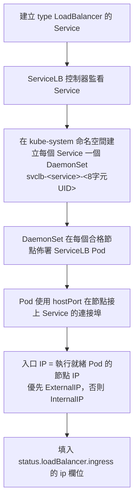

# k3s 內建的 ServiceLB 是什麼？

## 概述

ServiceLB（舊稱 **Klipper LoadBalancer**）是 k3s（以及 RKE2）**內建、預設啟用**的 LoadBalancer 控制器，由 K3s 嵌入的 **Cloud Controller Manager (CCM)** 負責運作。它讓使用者不需要任何雲端供應商（cloud provider）或額外的負載平衡器整合（例如 MetalLB），即可直接建立 `type: LoadBalancer` 的 Service，並取得對外存取能力[^k3s-networking]。

上游 Kubernetes 允許建立 `type: LoadBalancer` 的 Service，但本身並未內建負載平衡器的實作，因此這類 Service 在載入任何負載平衡器之前會一直停留在 `pending` 狀態；許多託管服務需要 Amazon EC2、Microsoft Azure 等雲端供應商來提供外部負載平衡器。相比之下，k3s 的 ServiceLB 讓使用者不需要雲端供應商或額外設定，就能使用 LoadBalancer Service[^k3s-networking]。

ServiceLB 的控制器實作位於 k3s 原始碼的 [`pkg/cloudprovider/servicelb.go`](https://github.com/k3s-io/k3s/blob/main/pkg/cloudprovider/servicelb.go)，其執行期間用的 Pod 映像則來自 [`k3s-io/klipper-lb`](https://github.com/k3s-io/klipper-lb) 這一路的專案（預設映像為 `rancher/klipper-lb`）[^servicelb-go][^klipper-lb]。

## 運作原理

ServiceLB 採用與 MetalLB 截然不同的機制。MetalLB 會管理虛擬 IP（VIP）或 IP 池，而 ServiceLB **不分配虛擬 IP、不管理 IP 池**，它直接使用節點的實體 IP 作為對外入口位址[^servicelb-go]。

### 流程

### 詳細機制

1. **建立 DaemonSet**：針對每個 LoadBalancer Service，ServiceLB 控制器會在 `kube-system` 命名空間建立一個名為 `svclb-<service名稱>-<8字元UID字首>` 的 DaemonSet[^k3s-networking]。

2. **使用 hostPort 綁定連接埠**：DaemonSet 產生的 ServiceLB Pod 利用 **hostPort** 機制，把 Service 的連接埠直接綁定在節點的網路介面上。因為此機制，Pod 只會部署到該連接埠「可用」的節點上；若沒有任何節點有空閒的連接埠，DaemonSet 的 Pod 會保持在 `Pending` 狀態，且 LoadBalancer 的 ingress 位址會空無一物（並產生 `UnAvailableLoadBalancer` 事件）[^k3s-networking][^servicelb-go]。

3. **入口 IP 就是節點 IP**：ServiceLB 的入口 IP 就是執行「就緒（ready）ServiceLB Pod」的那些節點的 IP。邏輯為[^servicelb-go]：
   - 優先收集所有節點的 `NodeExternalIP`；
   - 若沒有任何節點有 `NodeExternalIP`，則退回使用 `NodeInternalIP`；
   - 依 Service 的 `spec.IPFamilies` 過濾位址（支援雙棧、dual-stack）；
   - 填入 `status.loadBalancer.ingress[].ip`。

4. **`ipMode: VIP`**：當節點設定了 ExternalIP，ingress 項目會標記 `ipMode: VIP`，表示流量直接使用該外部 IP；反之則使用節點的內部 IP[^servicelb-go][^k3s-networking]。

5. **Rootless（無 root）模式**：當 k3s 以 rootless 執行且至少有一個 Pod 在跑，ServiceLB 只會回傳 `["127.0.0.1"]` 作為唯一的 ingress IP；低於 1024 的連接埠會被加上 10000 位移（例如 80 → 10080）[^servicelb-go]。

### 流量轉送模型：iptables / nftables

klipper-lb Pod 內的 entry script 是轉送引擎，會偵測主機用的 iptables 或 nftables，再依流量路徑分兩種模式處理[^klipper-lb]：

- **模式 A（無 NAT）**：當流量直接以 LoadBalancer 位址為目的地到達節點、且沒有經過 NAT（例如叢集內部流量）時，由節點上 kube-proxy 既有的 iptables/IPVS 規則負責把流量轉送到 Service 的 ClusterIP，ServiceLB Pod 不需要再加入 DNAT 規則[^k3s-networking][^klipper-lb]。

- **模式 B（有 NAT）**：當流量是經 NAT 進入（例如公有雲上使用節點的 public IP 作為 external IP）時，entry script 會對每個 DEST_IP（Service 的 ClusterIP）建立[^klipper-lb]：
  - `iptables -t nat -I PREROUTING` 的 DNAT 規則，把流量轉送到 `<DEST_IP>:<DEST_PORT>`；
  - `POSTROUTING` 的 MASQUERADE 規則；
  - `FORWARD` 鏈中額外的 DROP 規則。

關鍵環境變數由控制器傳給 klipper-lb container[^servicelb-go]：

| 變數 | externalTrafficPolicy=Cluster（預設） | externalTrafficPolicy=Local |
|---|---|---|
| `DEST_IPS` | Service 的 `ClusterIPs` | 節點 IP（`status.hostIPs`） |
| `DEST_PORT` | Service port | NodePort |

當 `externalTrafficPolicy=Local` 時，DEST_IPS 是節點自己的 IP、DEST_PORT 是 NodePort，流量直接轉送到該節點本地的 endpoint，可保留來源 IP；當 `externalTrafficPolicy=Cluster`（預設）時，DEST_IPS 是 ClusterIP、DEST_PORT 是 Service port，交由 kube-proxy 在所有 Pod 之間做負載平衡[^servicelb-go]。

### hostPort 的排程特性

由於 ServiceLB 使用 hostPort，Kubernetes 排程器只會把 Pod 放在該連接埠「空閒」的節點上。這是它與 NodePort 服務本質上的差別：**是由排程器而非 IPAM 系統決定放置位置**[^servicelb-go]。

## 預設行為與控制方式

### 預設行為

- **預設所有節點都合格**：節點預設「不會」被標上 `svccontroller.k3s.cattle.io/enablelb` 標籤。當沒有任何節點帶有此標籤時，**所有連接埠空閒的節點**都會被用來佈署 ServiceLB Pod[^k3s-networking][^servicelb-go]。

- **允許清單（allow-list）模式**：只要有任何節點被標上 `svccontroller.k3s.cattle.io/enablelb=true`，就切換到允許清單模式——**只有被標記的節點**會被使用，DaemonSet 會帶有 `nodeSelector: svccontroller.k3s.cattle.io/enablelb=true`[^servicelb-go]。

- **Node Pool（節點池）**：
  - 在節點標上 `svccontroller.k3s.cattle.io/lbpool=<名稱>` 與 `enablelb=true`；
  - 在 Service 標上 `svccontroller.k3s.cattle.io/lbpool=<名稱>`；
  - DaemonSet 就會用 node affinity 把 Pod 限制在該池的成員節點上；
  - 池標籤有兩種形式可互用：`lbpool=<池>` 或 `lbpool.svccontroller.k3s.cattle.io/<池>=true`[^k3s-networking][^servicelb-go]。

- **DaemonSet 命名**：`svclb-<service名稱>-<8字元UID>`（service 名稱會截斷至 48 字元）[^servicelb-go]。

- **優先級**：預設為 `system-node-critical`，可透過 annotation `svccontroller.k3s.cattle.io/priorityclassname` 調整[^servicelb-go]。

- **容忍（Tolerations）**：預設容忍 `node-role.kubernetes.io/control-plane` 與 `CriticalAddonsOnly`，可透過 annotation `svccontroller.k3s.cattle.io/tolerations` 額外注入[^servicelb-go]。

- **更新策略**：rolling update，`maxUnavailable=1`[^servicelb-go]。

- **雙棧（Dual-stack）**：依 Service 的 `spec.IPFamilies` 過濾節點 IP；IPv6 時若預設來源範圍為 `0.0.0.0/0`，會加上 `::/0`[^servicelb-go]。

- **防火牆來源範圍**：由標準欄位 `spec.loadBalancerSourceRanges` 控制，會為每個來源範圍建立 iptables FORWARD 規則[^servicelb-go]。

### 控制方式

- **停用 ServiceLB**：必須在叢集中**所有 server** 以 `--disable=servicelb` 旗標設定。若要改用其他負載平衡器（例如 MetalLB），務必先這樣停用[^k3s-networking]。

- **限縮節點選擇**：在節點加上 `svccontroller.k3s.cattle.io/enablelb=true` 標籤切換到允許清單模式，或搭配 `lbpool` 標籤建立節點池[^k3s-networking]。

## 已知限制

1. **hostPort 衝突**：因為 ServiceLB 使用 hostPort，兩個使用**相同連接埠**的 Service 無法在同一個節點上執行。這是最顯著的限制——連接埠空間以「節點」為單位，而非叢集範圍；不同節點仍可在同一連接埠上承載不同的 Service[^servicelb-go]。

2. **沒有真正的虛擬 IP**：ServiceLB 不提供單一穩定的虛擬 IP。入口 IP 就是節點 IP，節點增減或使用者變更 `--node-ip`/`--node-external-ip` 時就會改變，每個節點的 IP 是各自獨立對外散布的[^servicelb-go]。

3. **`externalTrafficPolicy=Local` + `node-external-ip` 在 NAT 情境下失效**：依 k3s 官方文件，若外部流量經 NAT 到達節點（例如公有雲），且你需要 `externalTrafficPolicy=local`（例如為了保留用戶端來源 IP），請勿在任何節點定義 k3s config 的 `node-external-ip`，否則無法正確運作[^k3s-networking]。

4. **不跨節點做負載平衡**：ServiceLB 不會在節點之間分配流量，而是由外部用戶端自行選擇要連哪個節點 IP；內建沒有 BGP、沒有 VIP failover，也沒有以 DNS 為基礎的健康檢查[^servicelb-go]。

5. **需要 `NET_ADMIN` 權限**：klipper-lb container 以特權方式執行並取得 `NET_ADMIN`，以便修改 iptables/nftables 規則；同時會透過 sysctl 啟用 IP 轉送（`net.ipv4.ip_forward=1` 等）[^servicelb-go][^klipper-lb]。

6. **僅限 L4**：ServiceLB 只是 TCP/UDP 的 Layer-4 負載平衡器，不支援 L7 或 TLS 終止[^servicelb-go]。

7. **Rootless 模式限制**：rootless 模式下只回傳 `127.0.0.1` 作為入口 IP，且小於 1024 的連接埠會位移 +10000[^servicelb-go]。

8. **沒有 BGP / VRRP / ARP**：與 MetalLB（Layer 2/BGP 模式）不同，ServiceLB 沒有任何透過 ARP 或 BGP 對外散布位址的機制，純粹依賴用戶端直接連到節點 IP[^servicelb-go]。

9. **無法與 MetalLB 共存的預設**：必須先在所有 server 用 `--disable=servicelb` 明確停用，才能部署其他負載平衡器控制器[^k3s-networking]。

10. **不支援 `loadBalancerClass`**：ServiceLB 沒有實作 Kubernetes 的 `loadBalancerClass` 欄位——它會攔截所有未設定 `spec.loadBalancerClass` 的 `type: LoadBalancer` Service[^servicelb-go]。

## 總結對照表

| 面向 | 細節 |
|---|---|
| **機制** | 每個 Service 一個 DaemonSet → 帶 hostPort 的 Pod → iptables DNAT 到 ClusterIP |
| **IP 分配** | 節點的 ExternalIP（優先）或 InternalIP，取自執行就緒 Pod 的節點 |
| **連接埠分配** | 由 Kubernetes 排程器尋找空閒的 host port |
| **流量路徑（NAT）** | 用戶端 → NodeIP:Port → iptables DNAT → ClusterIP:Port → kube-proxy → Pod |
| **流量路徑（直接）** | 用戶端 → NodeIP:Port → kube-proxy iptables/IPVS → Pod |
| **控制方式** | `--disable=servicelb`、節點標籤、lbpool 節點池標籤 |
| **預設映像** | `rancher/klipper-lb` |

[^k3s-networking]: K3s Project. (2026). Service Load Balancer. In *Networking Services*. Retrieved 2026-10-09, from https://docs.k3s.io/networking/networking-services
[^servicelb-go]: K3s Project. (n.d.). *pkg/cloudprovider/servicelb.go*. Retrieved 2026-10-09, from https://github.com/k3s-io/k3s/blob/main/pkg/cloudprovider/servicelb.go
[^klipper-lb]: K3s Project. (n.d.). *k3s-io/klipper-lb*. Retrieved 2026-10-09, from https://github.com/k3s-io/klipper-lb
