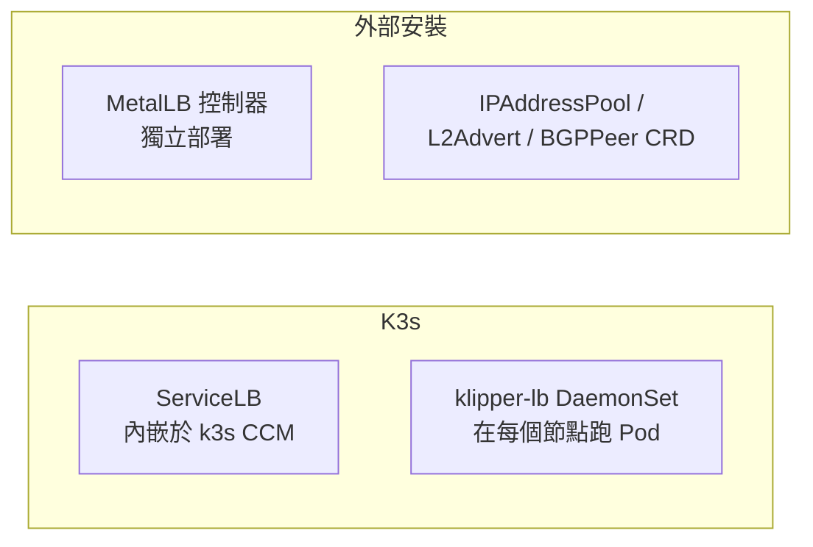

# k3s 內建的 ServiceLB 與 MetalLB 的差異比較

## 概述

k3s **內建、預設啟用**一個輕量級的 LoadBalancer 實作，稱為 **ServiceLB**（舊稱 **Klipper LoadBalancer**），讓使用者不依賴雲端供應商即可直接建立 `type: LoadBalancer` 的 Service[^k3s-networking]。而 **MetalLB** 是 CNCF 沙箱（sandbox）級別、需**額外安裝**的裸機（bare-metal）負載平衡器，提供真正獨立的虛擬 IP（VIP）與標準路由協定支援[^metallb-site]。

本報告聚焦兩者的**核心差異**，並以比較表輔助說明。針對 ServiceLB 本身更詳細的運作原理（DaemonSet、hostPort、iptables 轉發）可參閱既有報告 `00469`，本篇不重複贅述。

## 定位與安裝方式的根本差異

兩者最大的差異在於**架構定位**：

- **ServiceLB** 直接內嵌於 k3s 的 Cloud Controller Manager（CCM），**零設定、隨裝即用**。要改用其他 LB（如 MetalLB）時，必須在**所有 server 節點**加上 `--disable=servicelb` 旗標，否則兩者會衝突[^k3s-networking]。
- **MetalLB** 是**外部獨立控制器**，需自行以 Helm / manifest 安裝，可搭配任何 CCM 或完全不使用 CCM[^metallb-install]。

## 對外 IP 的來源與管理

| 面向 | ServiceLB | MetalLB |
|---|---|---|
| **IP 來源** | 直接使用節點的實體 IP（優先 `ExternalIP`，否則 `InternalIP`）[^servicelb-go] | 由使用者定義的**專屬 IP 位址池**（`IPAddressPool` CRD，CIDR 區段或單一 IP）[^metallb-pool] |
| **是否有專屬 VIP** | ❌ 無，流量直接打到節點 IP | ✅ 每個 Service 從池中取得一個獨立虛擬 IP |
| **IP 穩定性** | 隨節點 IP 變動而變，**無法指定固定 VIP** | 固定、獨立的 VIP，不依附任何特定節點 |
| **同時可有多個 IP** | 可列出多個節點 IP（每個執行 Pod 的節點各一個） | 可從一或多個池分配多個 VIP |

ServiceLB **不管理 IP 池**，這是與 MetalLB 最明顯的功能分界[^servicelb-go][^metallb-pool]。

## 負載平衡與容錯行為

| 面向 | ServiceLB | MetalLB L2 模式 | MetalLB BGP 模式 |
|---|---|---|---|
| **真實跨節點負載平衡** | ❌ 無 | ❌ 無（單節點） | ✅ 有（ECMP） |
| **對外機制** | 用戶自行選擇節點 IP | ARP/NDP 單一節點應答（failover 機制） | BGP 向路由公布,路由器做 ECMP 分流 |
| **單節點瓶頸** | 各節點各自接收流量 | 所有流量集中在單一節點 | 可分散到所有節點 |
| **故障轉移** | DaemonSet 確保 Pod 各節點都在 | 自動 leader 重選（memberlist） | BGP 撤銷連線（現有連線中斷） |

關鍵點：ServiceLB 將所有節點 IP 填入 `status.loadBalancer.ingress`，但**沒有分配機制**——用哪個 IP 由客戶端決定，因此**不算真正的負載平衡器**[^k3s-networking][^k3s-servicelb-go]。MetalLB L2 模式官方文件也明確指出：*「L2 模式並非負載平衡器，而是 failover 機制」（all traffic for a service IP goes to one node）*[^metallb-l2]。只有 MetalLB 的 **BGP 模式**（搭配 FRR/FRR-K8s）能經由 ECMP 做到真正多節點分流[^metallb-bgp]。

## 連接埠處理與協定支援

| 面向 | ServiceLB | MetalLB |
|---|---|---|
| **連接埠綁定** | 用 **hostPort** 直接綁到節點原生連接埠（`30000–32767` 範圍，可改）[^k3s-networking] | 不打 hostPort，流量到 VIP 後由 kube-proxy 轉送 |
| **相同連接埠衝突** | 同一節點上兩個 Service **不能同連接埠**（否則維持 `Pending`）[^k3s-networking] | 不同 VIP 可自由共用相同連接埠 |
| **ARP / NDP（L2）** | ❌ 無 | ✅ L2 模式完整支援 |
| **BGP** | ❌ 無 | ✅ 完整支援（含 iBGP / eBGP / 多協定） |
| **BFD 快速容錯** | ❌ 無 | ✅ 可搭配 FRR-K8s 使用 |
| **IPv6 / dual-stack** | ✅ 支援 | ✅ 支援 |

## 組態與客製化

| 面向 | ServiceLB | MetalLB |
|---|---|---|
| **節點限制** | 靠標籤：`svccontroller.k3s.cattle.io/enablelb=true`（allow-list）與 `svccontroller.k3s.cattle.io/lbpool=<name>`（具名池）[^k3s-networking] | 透過 IP 池上的 node selector |
| **組態方式** | 極簡（標籤 / annotation） | 豐富 CRD：`IPAddressPool`、`L2Advertisement`、`BGPAdvertisement`、`BGPPeer`、`BFDProfile`[^metallb-config] |
| **流量來源過濾** | 以 env 傳給 klipper-lb 的 iptables 規則實現 | 支援 |
| **外部流量政策** | ✅ 支援 `externalTrafficPolicy: Local` | ✅ 支援 |
| **部署複雜度** | 非常低 | 中等到高 |

## 適合場景與結論

- **ServiceLB**：適合實驗環境、單節點叢集、或所有節點彼此可直接連通的簡單網路。優點是內建零設定；缺點是無 VIP、無 IP 池控制、無 L2/BGP 協定、且無法真正跨節點分流。
- **MetalLB**：適合需要**單一穩定 VIP**、有上游路由器、需要 BGP 流量調度或 L2 failover 的生產裸機叢集。代價是需要額外安裝與較高的組態複雜度。

**結論**：當你需要獨立虛擬 IP、可控制的 IP 池、或標準路由協定（ARP/BGP）時，應停用 ServiceLB（`--disable=servicelb` 於所有 server 節點）並改用 MetalLB；否則預設的 ServiceLB 已足以涵蓋簡單的負載平衡需求[^k3s-networking]。

## 專案規模參考

| 專案 | GitHub 星數 |
|---|---|
| k3s-io/k3s | 約 34.2k |
| k3s-io/klipper-lb（ServiceLB 執行映像） | 約 437 |
| metallb/metallb | 約 8.4k |

*k3s 的 ServiceLB 控制器實作內嵌於主儲存庫（`pkg/cloudprovider/servicelb.go`），klipper-lb 僅作為執行期間映像，二者為整體關係而非獨立候選[^k3s-repo][^klipper-lb]。*

---

[^k3s-networking]: SUSE Rancher. (n.d.). *K3s Networking — Service Load Balancer*. Retrieved 2026-10-09, from https://docs.k3s.io/networking/networking-services

[^servicelb-go]: k3s-io. (n.d.). *servicelb.go*. Retrieved 2026-10-09, from https://github.com/k3s-io/k3s/blob/main/pkg/cloudprovider/servicelb.go

[^k3s-servicelb-go]: k3s-io. (n.d.). *pkg/cloudprovider/servicelb.go（IP 收集與分配邏輯）*. Retrieved 2026-10-09, from https://github.com/k3s-io/k3s/blob/main/pkg/cloudprovider/servicelb.go

[^klipper-lb]: k3s-io. (n.d.). *Klipper-lb — k3s / RKE2 內建 LoadBalancer 執行映像*. Retrieved 2026-10-09, from https://github.com/k3s-io/klipper-lb

[^metallb-site]: MetalLB. (n.d.). *MetalLB — bare metal load-balancer for Kubernetes*. Retrieved 2026-10-09, from https://metallb.universe.tf/

[^metallb-install]: MetalLB. (n.d.). *Installation*. Retrieved 2026-10-09, from https://metallb.universe.tf/installation/

[^metallb-pool]: MetalLB. (n.d.). *Configuration — IPAddressPool*. Retrieved 2026-10-09, from https://metallb.universe.tf/configuration/

[^metallb-l2]: MetalLB. (n.d.). *Layer 2 configuration*. Retrieved 2026-10-09, from https://metallb.universe.tf/concepts/layer2/

[^metallb-bgp]: MetalLB. (n.d.). *BGP configuration*. Retrieved 2026-10-09, from https://metallb.universe.tf/concepts/bgp/

[^metallb-config]: MetalLB. (n.d.). *MetalLB concepts — IPAddressPool, L2Advertisement, BGPAdvertisement, BGPPeer, BFDProfile*. Retrieved 2026-10-09, from https://metallb.universe.tf/concepts/

[^k3s-repo]: k3s-io. (n.d.). *k3s — Lightweight Kubernetes*. Retrieved 2026-10-09, from https://github.com/k3s-io/k3s
