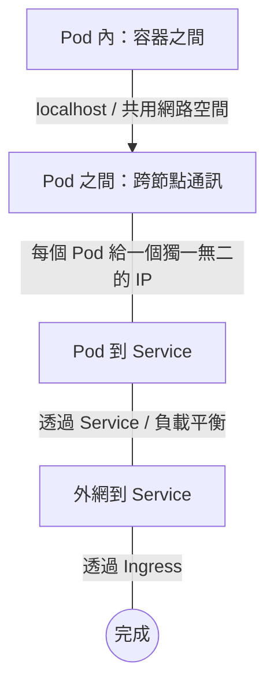
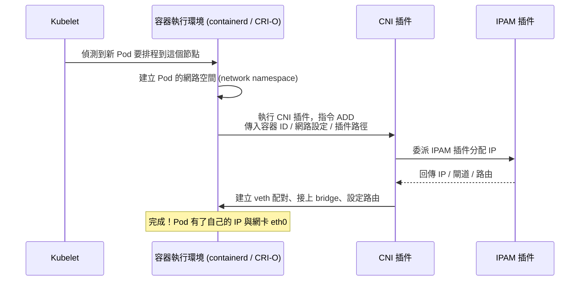
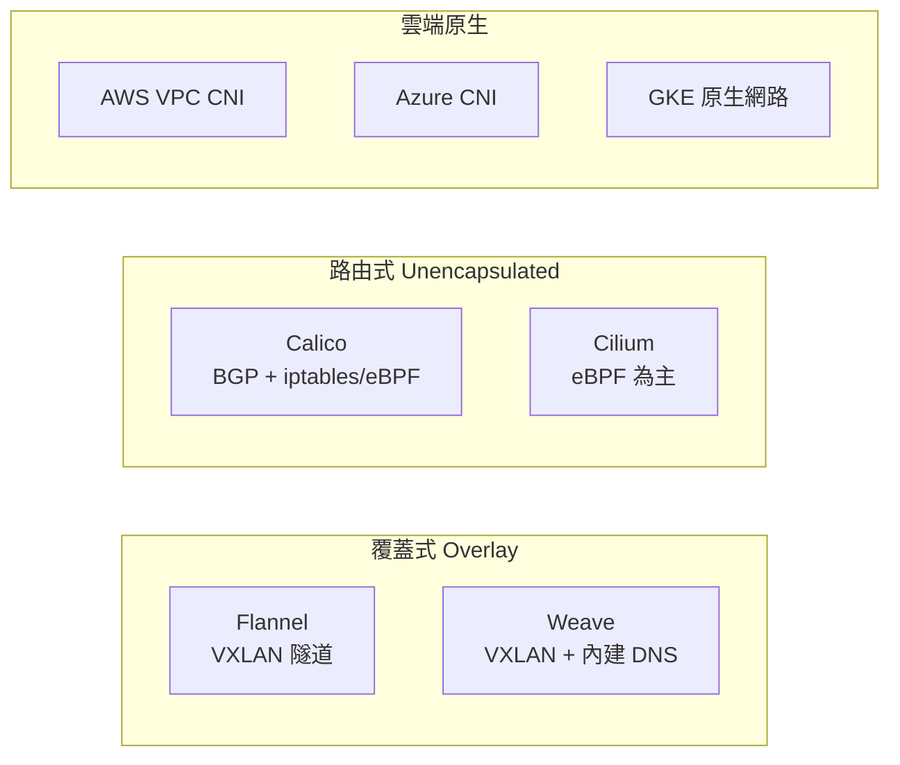

# 用通俗的方式解釋 Kubernetes 中的 CNI（Container Network Interface）

## 前言

這份報告用生活化的比喻，向第一次接觸 Kubernetes 網路的人解釋「CNI（Container Network Interface，容器網路介面）」是什麼。全篇基於官方文件與權威網站，所有事實皆附註腳，不需任何前備知識即可閱讀。

## 一、CNI 到底是什麼？先用比喻說清楚

想像你把一群 Pod（Kubernetes 裡的最小運算單位）當作「一棟公寓裡的一間間房間」。這些房間需要互相講話、也要能跟外界聯絡，所以要接網路線。問題是：**每個使用者對「房間怎麼上網」的想法可能完全不同**——有人要牆壁要有防火材質、有人要自己的路由器、有人只要最基本的插頭。

CNI 的角色，就是一套**「插座的規格說明書」**：它不幫你拉線，也不決定用哪種網路，只規定「插座長什麼形狀」。任何符合這個形狀的網路設備（＝網路插件，plugin）都可以插上，任何容器執行環境（＝runtime）也知道怎麼接[^cni-spec][^cni-readme]。

官方對 CNI 的定義是：

> 「CNI 只關注容器的網路連線，以及在容器被刪除時釋放相關資源。正因為如此聚焦，CNI 適用範圍很廣，規範也簡單易於實作。」[^cni-readme]

白話來說：**CNI 是容器世界裡的「USB 規格」**——只要大家都遵守同一個介面，不同廠商的網卡（網路方案）隨時可以抽換，不用改動作業系統（Kubernetes）本身。

## 二、為什麼 Kubernetes 需要 CNI？

Kubernetes 對網路有四個基本要求[^k8s-networking]：

其中最難的是第二項「**Pod 之間跨節點通訊**」[^k8s-networking]。當節點 1 上的 Pod A 想跟節點 2 上的 Pod B 講話時，系統需要：

1. 幫 Pod B 分配一個 IP 位址。
2. 在 Pod B 的網路空間（network namespace）裡建立一張虛擬網卡。
3. 設定路由，讓節點 1 的網路封包能送到節點 2 的 Pod B。

Kubernetes 把這件事**刻意抽離出來，不寫死在核心內部**，而是開放成一個插槽，讓各種網路方案可以替換。官方文件說明：

> 「網路模型由每個節點上的容器執行環境來實作。最常見的容器執行環境使用 CNI 插件管理其網路與安全能力。」[^k8s-networking]

因為不同的環境（自建機房、AWS、GCP、Azure）網路需求不同，有了 CNI，使用者就能挑選最適合的解決方案[^k8s-networking]。

## 三、CNI 實際怎麼運作？以「Pod 建立與刪除」為例

### Pod 建立時的流程

實際步驟[^cni-spec]：

1. **Kubelet** 偵測到新 Pod 被排程到這個節點。
2. **容器執行環境**（containerd 或 CRI-O）建立一個給 Pod 用的網路空間。
3. 執行環境查閱它的 CNI 設定（通常位於 `/etc/cni/net.d/`），決定該呼叫哪個插件。
4. 執行環境以 **`ADD`** 指令執行 CNI 插件，並透過環境變數傳入容器 ID、網路設定（JSON）、插件路徑（`CNI_PATH`）等參數[^cni-spec]。
5. 插件接著：
   - 建立一條 **veth 虛擬網路線**（一端在 Pod 網路空間內，一端在宿主主機上）
   - 將主機端接到一個 Linux bridge（虛擬交換器）上，或設定路由
   - 呼叫 **IPAM**（IP 位址管理）插件分配 IP
   - 加入路由，讓封包能流通[^cni-bridge]

### IPAM：誰來發 IP？

CNI 把「發 IP」這件事拆成另一支插件（IPAM）處理，由主插件委派執行。常見幾種[^cni-docs]：

| IPAM 插件 | 說明 |
|---|---|
| `host-local` | 在每個節點的本地子網路範圍內分配 IP，存成本地資料庫 |
| `dhcp` | 在宿主主機上跑一個 daemon，替容器發出 DHCP 請求 |
| `static` | 分配一個固定的靜態 IP，主要用於除錯 |

### Pod 刪除時

執行環境以 **`DEL`** 指令呼叫同一個插件，插件會拆掉 veth 配對、把 IP 釋回給 IPAM 的池子[^cni-spec]。

### 其他操作

CNI 規範還定義了 `CHECK`（確認 Pod 網路仍正確）、`STATUS`（查插件健康狀態）、`GC`（清理陳舊資源）、`VERSION`（探測插件支援的規範版本）等指令[^cni-spec][^cni-docs]。

## 四、CNI、Kubernetes 與各家網路方案（Calico、Flannel 等）的關係

**這些都是 CNI 插件**。Kubernetes 不care你選哪一個，它只呼叫 CNI 介面，由插件負責細節[^k8s-networking]。主要分為幾大類[^tigera-guide]：

- **覆蓋式（Overlay）**：在現有基礎設施之上建立一層虛擬二層網路。例如 **Flannel** 用 VXLAN 隧道，設定簡單、適合初學者；**Weave** 額外內建 DNS[^tigera-guide]。
- **路由式（Unencapsulated）**：直接在節點間設定三層路由，沒有封裝包袱。例如 **Calico** 用 BGP 路由加上 iptables/eBPF 防火牆，效能高、網路政策強；**Cilium** 以 eBPF 見長，效能與可觀測性突出[^tigera-guide]。
- **雲端原生**：雲端業者提供與自家基礎設施深度整合的插件，例如 AWS VPC CNI 讓每個 Pod 直接拿到 VPC 子網路的 IP[^tigera-guide]。

關鍵洞見：**同一套 CNI 介面，後面可以放完全不同的實作**，這就是抽象化的威力[^k8s-networking]。

## 五、CNI 與舊的 kubenet 網路模型有何不同？

在 Kubernetes 全面改用 CNI（約 1.3–1.7 版期間）之前，曾存在一種內建、極簡的「kubenet」網路方案[^k8s-networking]。兩者差異[^k8s-network-plugins]：

| 項目 | Kubenet（舊） | CNI（現行） |
|---|---|---|
| 架構 | 單體式，內建於 kubelet | 可插拔，獨立插件 |
| 插件生態 | 只有 kubenet | 眾多社群插件 |
| IPAM | 極簡（每節點一個 IP 範圍） | 完整（host-local / DHCP / 雲端原生） |
| 跨節點路由 | 需手動設定或靠雲端供應商 | 由插件自動處理 |
| 網路政策（Network Policy） | 不支援 | 完整支援（如 Calico、Cilium） |
| 設定方式 | kubelet 指令列旗標 | `/etc/cni/net.d/` 下的 JSON 設定檔 |

簡而言之：kubenet 是能用但不靈活的內建陽春方案；Kubernetes 採用 CNI，是因為需要一個可以讓專業網路方案隨插即用的生態系，而不必改核心程式碼[^k8s-networking][^k8s-network-plugins]。

## 六、現況：CNI 已是現代 Kubernetes 唯一的網路方式

- **Kubernetes 1.24 起**，kubelet 的 `--network-plugin` 與 `--cni-bin-dir` 旗標已被移除，CNI 的建置管理完全交給容器執行環境[^k8s-network-plugins][^k8s-124-blog]。
- 所有主流執行環境（containerd、CRI-O）原生都走 CNI。
- 各大雲端（EKS、AKS、GKE）預設也都使用 CNI 插件。

官方文件明確表示：

> 「Kubernetes（1.3 到最新版本，之後應該也會）讓你使用 CNI 插件做叢集網路。」[^k8s-networking]

實務上，**沒有安裝 CNI 插件，現代 Kubernetes 叢集根本跑不起來**——它就像容器執行環境本身一樣不可或缺[^k8s-networking][^k8s-network-plugins]。

## 結論（一句話總結）

CNI 是 Kubernetes 的「網路插座標準」：它不自己上網，而是定義一套介面，讓 Calico、Flannel、Cilium 等網路方案可以隨插即用，幫每個 Pod 拿 IP、接網卡、通路由，同時在 Pod 消失時把一切資源收回。

## 參考資料

[^cni-readme]: Container Networking. (n.d.). *CNI - Container Network Interface*. Retrieved 2026-10-09, from https://github.com/containernetworking/cni
[^cni-spec]: Container Networking. (n.d.). *CNI Specification v1.0.0*. Retrieved 2026-10-09, from https://github.com/containernetworking/cni/blob/spec-v1.0.0/SPEC.md
[^k8s-networking]: Kubernetes Documentation. (n.d.). *Cluster Networking*. Retrieved 2026-10-09, from https://kubernetes.io/docs/concepts/cluster-administration/networking/
[^k8s-network-plugins]: Kubernetes Documentation. (n.d.). *Network Plugins*. Retrieved 2026-10-09, from https://kubernetes.io/docs/concepts/extend-kubernetes/compute-storage-net/network-plugins/
[^cni-bridge]: Container Networking. (n.d.). *Bridge plugin*. Retrieved 2026-10-09, from https://www.cni.dev/plugins/current/main/bridge/
[^cni-docs]: CNI Project. (n.d.). *CNI Documentation*. Retrieved 2026-10-09, from https://www.cni.dev/docs/
[^tigera-guide]: Tigera. (n.d.). *Kubernetes CNI Explained*. Retrieved 2026-10-09, from https://www.tigera.io/learn/guides/kubernetes-networking/kubernetes-cni/
[^k8s-124-blog]: Kubernetes Blog. (2022, April 7). *Upcoming changes in Kubernetes 1.24*. Retrieved 2026-10-09, from https://kubernetes.io/blog/2022/04/07/upcoming-changes-in-kubernetes-1-24/
