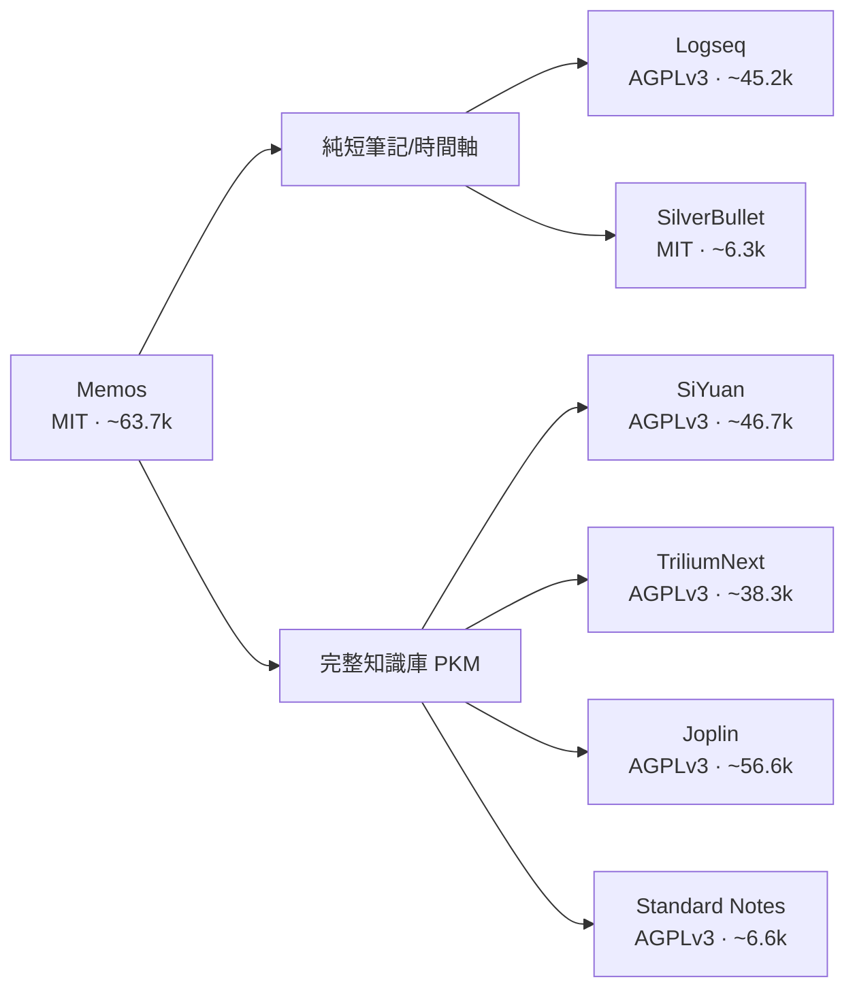

# Memos（usememos/memos）的自由開源替代方案調查

## 摘要

本報告調查 GitHub 專案 [usememos/memos](https://github.com/usememos/memos) 的自由開源（FOSS）替代方案。Memos 是一款以「時間軸式短筆記」為主、可自行架設、重視隱私的開源筆記工具，類似 flomo，採用 MIT 授權、約 63.7k stars[^memos-overview]。以下列出具相近定位或可勝任其功能的開放原始碼專案，並比較授權、自行架設能力、特色與受歡迎程度（stars）。

## 最相似的替代方案（時間軸／快速短筆記）

### Logseq
本地優先（local-first）的綱要式（outliner）知識圖譜工具，內建日記／每日筆記功能，與 Memos 的時間軸概念相近。支援雙向連結、PDF 註記、Markdown 與 Org-mode、任務管理、外掛與主題。授權 AGPLv3，約 45.2k stars，可自行架設（透過 Git 或 DB 同步）[^logseq]。

### SilverBullet
以瀏覽器為基礎的 Markdown 筆記工具，提供即時預覽、維基式雙向連結、內建資料庫與查詢語言（SLIQ）、Lua 腳本與頁面模板。以純 `.md` 檔案儲存資料，適合快速筆記，但較偏開發者取向。授權 MIT，約 6.3k stars，可自行架設（Docker、二進位檔）[^silverbullet]。

## 完整的知識庫／個人筆記管理（PKM）替代方案

### SiYuan（思源筆記）
區塊級所見即所得編輯器，支援雙向連結、反鏈、間隔重複（閃卡）、PDF 註記、網頁剪藏、資料庫表格視圖與社群外掛市集，並有 Android／iOS／HarmonyOS 應用。功能較 Memos 完整，屬完整 PKM 系統而非純 memo 工具。授權 AGPLv3，約 46.7k stars，可自行架設[^siyuan]。

### Trilium Notes（現為 TriliumNext）
階層式筆記樹並支援 clone、所見即所得編輯器、筆記加密、關聯／連結圖、心智圖、腳本、REST API、網頁剪藏與行動前端。較偏向個人知識庫而非快速 memo。授權 AGPLv3，約 38.3k stars（TriliumNext 社群分支），可自行架設[^trilium]。

### Joplin
跨平台（Windows／Mac／Linux／Android／iOS）筆記應用，以 Notebook 結構儲存 Markdown 筆記，支援待辦清單、標籤、端對端加密與網頁剪藏；同步可透過自行架設伺服器、Nextcloud、Dropbox、OneDrive 或 S3 等。結構較 Memos 更接近傳統筆記本而非時間軸。授權 AGPLv3（部分子專案為其他授權），約 56.6k stars[^joplin]。

### Standard Notes
預設端對端加密的跨平台筆記應用，設計極簡，提供 Markdown、程式碼、試算表等編輯器，並可透過「Listed」發布部落格。強調隱私加密，但高階功能需付費方案。授權 AGPLv3，約 6.6k stars，可自行架設同步伺服器[^standardnotes]。

## 其他相關但定位不同之項目

### AppFlowy
Notion 風格的個人工作區，提供文件、資料庫、看板與 wiki，支援 AI、即時協作、跨平台（Rust + Flutter 引擎）。屬完整工作區／Notion 替代而非純 memo 工具。授權 AGPLv3，約 77.2k stars[^appflowy]。

### AFFiNE
混合文件與白板（Notion 結合 Miro）的專案，提供資料庫視圖、AI 助理、本地優先與即時協作、跨平台。社群版授權 MIT，約 73.3k stars[^affine]。

### HedgeDoc（前身 CodiMD／HackMD CE）
即時協作的 Markdown 筆記工具，支援圖表、簡報模式、版本控制與分享。較偏向團隊協作筆記而非個人 memo。授權 AGPLv3，約 7.5k stars[^hedgedoc]。

### TiddlyWiki
單檔式 wiki，授權 MIT，可自行架設，具備獨特且強大的功能，但使用者體驗與 Memos 差異較大[^tiddlywiki]。

## 並非完全開源的相近工具（僅供參考）

- **Obsidian**：核心為專有軟體，僅部分外掛為 FOSS，非完全開源，但為熱門 PKM[^memos-compare]。
- **Anytype**：部分開源（核心專有、部分元件開源），類似 Notion[^agent-2]。
- **Outline**：授權 BSL 1.1（source-available，非完全 FOSS），團隊導向的知識庫／wiki[^outline]。
- **Notesnook**：AGPLv3、跨平台、端對端加密，接近 Joplin／Standard Notes[^agent-2]。

## 結論與建議

Memos 定位為「輕量、自行架設、以時間軸記錄短筆記」，若是追求**純短筆記／微部落格式**體驗，Logseq 的日記功能與 SilverBullet 的快速捕捉最接近；若需要**更完整的知識庫／PKM**，則 SiYuan、TriliumNext、Joplin 與 Standard Notes 是成熟的開放原始碼選擇。就「純 memo 時間軸」這個定位而言，Memos 在開源專案中幾乎處於獨立的一類，多數替代方案偏向完整 PKM 或傳統筆記本架構[^agent-2]。

## 參考資料

[^memos-overview]: USEMEMOS (n.d.). *Memos - A privacy-first, self-hosted personal timeline.* Retrieved 2026-10-09, from https://github.com/usememos/memos
[^memos-compare]: USEMEMOS (n.d.). *Compare Memos with other tools.* Retrieved 2026-10-09, from https://usememos.com/compare
[^logseq]: Logseq (n.d.). *Logseq - A privacy-first, open-source platform for knowledge sharing and management.* Retrieved 2026-10-09, from https://github.com/logseq/logseq
[^silverbullet]: SilverBullet (n.d.). *SilverBullet - An extendable open-source note-taking platform.* Retrieved 2026-10-09, from https://github.com/silverbulletmd/silverbullet
[^siyuan]: SiYuan (n.d.). *SiYuan - A privacy-first, self-hosted, fully open source personal knowledge management software.* Retrieved 2026-10-09, from https://github.com/siyuan-note/siyuan
[^trilium]: TriliumNext (n.d.). *Trilium Notes - Build your personal knowledge base with Trilium Notes.* Retrieved 2026-10-09, from https://github.com/TriliumNext/Trilium
[^joplin]: Joplin (n.d.). *Joplin - An open source note taking and to-do application with synchronisation capabilities.* Retrieved 2026-10-09, from https://github.com/laurent22/joplin
[^standardnotes]: Standard Notes (n.d.). *Standard Notes - An end-to-end encrypted notes app.* Retrieved 2026-10-09, from https://github.com/standardnotes/app
[^appflowy]: AppFlowy (n.d.). *AppFlowy - An open-source alternative to Notion.* Retrieved 2026-10-09, from https://github.com/AppFlowy-IO/AppFlowy
[^affine]: AFFiNE (n.d.). *AFFiNE - A next-gen knowledge base that brings planning, sorting and creating together.* Retrieved 2026-10-09, from https://github.com/toeverything/AFFiNE
[^hedgedoc]: HedgeDoc (n.d.). *HedgeDoc - The best platform to write and share markdown.* Retrieved 2026-10-09, from https://github.com/hedgedoc/hedgedoc
[^tiddlywiki]: TiddlyWiki (n.d.). *TiddlyWiki - A non-linear personal web notebook.* Retrieved 2026-10-09, from https://github.com/Jermolene/TiddlyWiki5
[^outline]: Outline (n.d.). *Outline - The fastest knowledge base for growing teams.* Retrieved 2026-10-09, from https://github.com/outline/outline
[^agent-2]: OpenAlternative (n.d.). *Memos alternatives.* Retrieved 2026-10-09, from https://openalternative.co/alternatives/memos
