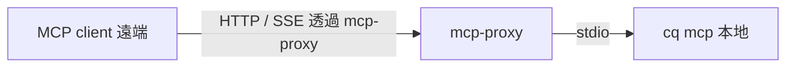

# cq 遠端 MCP 直連可行性研究

> 可否將 MCP client（如 Crush、Claude Desktop、Cursor）直接連到 mozilla-ai/cq 的 server，而不透過 stdio proxy？

## 結論

**不可以直接連。** cq 沒有任何會講 MCP 協議的遠端 server；它只有一個 `cq mcp` 命令，且**固定走 stdio**。cq 的遠端 server 元件（`server/`、`cq.exchange`）是 **REST API，而非 MCP server**。因此想讓 MCP client 遠端連上，唯一途徑仍是先把本地 `cq mcp` 透過第三方 stdio→HTTP bridge（如 `mcp-proxy`）暴露出去。

## 1. 常見誤解：cq 的「server」有兩個

cq 架構是三層分離的，其中 **MCP 協議只存在於 agent 與本地 `cq mcp` 之間**： [^arch]

```
MCP client (Crush / Claude)
    │  MCP 協議，固定走 stdio
    ▼
cq mcp  (本地 Go 程序，擁有本地 SQLite)
    │  一般 HTTP / REST
    ▼
cq server / cq.exchange  (FastAPI Docker，遠端知識庫)
```

- **MCP server**：由 `cq mcp` 命令啟動，只透過 `ServeStdio()` 服務，永遠在本機執行。[^mcpgo]
- **遠端 server**：`server/` 元件與 `cq.exchange` 是 FastAPI REST 服務（`GET/POST /api/v1/knowledge`），供本地 MCP 程序做知識同步，**不講 MCP 協議**。[^server]

## 2. `cq mcp` 是 stdio only

`cli/cmd/mcp.go` 的 `NewMCPCmd()` 是空的 Cobra command：**沒有子命令、沒有 `--transport` flag**，直接呼叫 `server.ServeStdio()`：[^mcpgo]

```go
srv := mcpserver.New(c, version.Version())
if err := server.ServeStdio(srv.MCPServer()); err != nil {
    return fmt.Errorf("mcp server error: %w", err)
}
```

命令樹中唯一的 MCP 命令是 `cq mcp`，底下沒有 `http`、`sse` 等子命令。[^maingo]

## 3. 底層函式庫支援，但 cq 沒用

cq 依賴 `github.com/mark3labs/mcp-go`，該函式庫本身提供 `NewSSEServer()` 與 Streamable HTTP server。[^pkg] 但 cq 的 `cli/mcpserver/server.go` 只暴露 `MCPServer()` 並在 `mcp.go` 交給 `ServeStdio`，**從未建構 SSE 或 Streamable HTTP server**。[^clsrv] 整個 cq repo 與文件搜尋不到任何 SSE / Streamable HTTP / http transport 的參考。[^search]

## 4. `CQ_ADDR` 是 REST 端點，不是 MCP 端點

`CQ_ADDR` 指向的是遠端 **REST API** 網址（`https://cq.exchange` 或自架 server），而非 MCP transport endpoint。MCP client 不能把 `url` 欄位指到 `cq.exchange`——它不會理解 MCP JSON-RPC。[^inst]

## 5. 可行方案

| 方案 | 說明 |
|------|------|
| **本地 stdio（官方預設、無法繞過）** | MCP client 直接以 stdio 啟動 `cq mcp`，靠 `CQ_ADDR` 同步遠端知識庫。[^inst] |
| **stdio → HTTP bridge（第三方）** | 用 `mcp-proxy` / `mcp-stdio` 把 stdio 轉成 HTTP，使遠端 MCP client 連得上。這屬於泛用橋接，非 cq 原生功能。[^prox] |



## 參考文獻

[^arch]: Mozilla.ai. (n.d.). cq — Guide: Architecture. Retrieved 2025-10-09, from https://docs.mozilla.ai/cq/guides/architecture
[^mcpgo]: Mozilla.ai. (n.d.). cq — cli/cmd/mcp.go. Retrieved 2025-10-09, from https://github.com/mozilla-ai/cq/blob/main/cli/cmd/mcp.go
[^clsrv]: Mozilla.ai. (n.d.). cq — cli/mcpserver/server.go. Retrieved 2025-10-09, from https://github.com/mozilla-ai/cq/blob/main/cli/mcpserver/server.go
[^maingo]: Mozilla.ai. (n.d.). cq — cli/main.go. Retrieved 2025-10-09, from https://github.com/mozilla-ai/cq/blob/main/cli/main.go
[^server]: Mozilla.ai. (n.d.). cq — Component: Server. Retrieved 2025-10-09, from https://docs.mozilla.ai/cq/components/server
[^pkg]: Mark3labs. (n.d.). mcp-go — server package. Retrieved 2025-10-09, from https://pkg.go.dev/github.com/mark3labs/mcp-go/server
[^inst]: Mozilla.ai. (n.d.). cq — Guide: Install. Retrieved 2025-10-09, from https://docs.mozilla.ai/cq/guides/install
[^prox]: punkpeye. (n.d.). mcp-proxy. Retrieved 2025-10-09, from https://github.com/punkpeye/mcp-proxy
[^search]: Mozilla.ai. (n.d.). cq — README & docs (搜尋 SSE/Streamable HTTP 所得). Retrieved 2025-10-09, from https://github.com/mozilla-ai/cq
