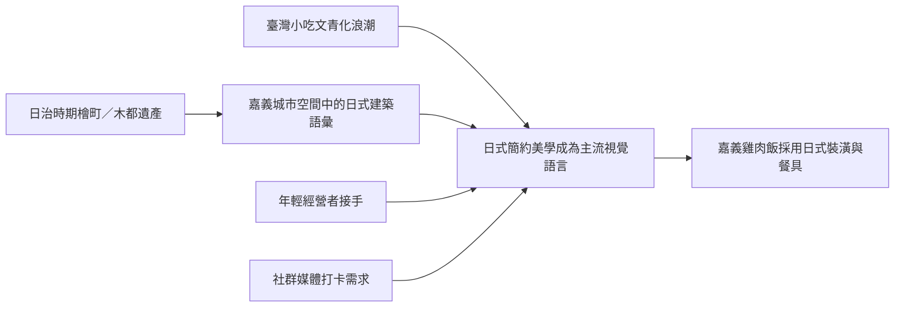

# 嘉義雞肉飯為何常伴隨日式設計（裝潢或餐具）？

## 摘要

嘉義雞肉飯店家——尤其是新一代經營者——經常採用日式風格的裝潢與餐具，這一現象並非單純的模仿或跟風，而是源自嘉義深厚的日治時期歷史底蘊、木都建築遺產、餐飲業世代交替的「文青化」趨勢，以及臺灣傳統小吃整體走向簡約日系美學的浪潮。

---

## 一、歷史根源：檜町記憶與嘉義木都身份

嘉義在日治時期（1895–1945）屬臺南州嘉義市，其中一個行政區名為**檜町**（檜町／ひのきちょう），因阿里山盛產紅檜（檜木）而得名。檜町區域擁有當時號稱「東洋最大」的木材集散場，嘉義也因此被稱為**「木都」**[^hinoki-town]。

至今嘉義仍保留**超過 6,000 棟木造建築**，為臺灣木造建築密度最高的城市[^wooden-buildings]。其中**檜意森活村**是全臺最大規模的日式木造建築群，常被稱為**「台版小京都」**[^hinoki-village]。北門驛、阿里山森林鐵路等日治時期基礎設施，至今仍深刻影響嘉義的城市景觀。

最具代表性的案例——**檜町火雞肉飯**——店名直接取自日治時期的檜町地名，店主解釋「日治時代確實有此地名」。其側面採用日本傳統建築工法**雨淋板（下見板張り）**，店主表示這是「呼應嘉義木都的城市精神」[^hinokicho-story]。部落客也形容其日式設計「帶有檜意生活村的味道」[^hinokicho-walkerland]。

## 二、世代交替：從傳統油膩到文青清新

傳統嘉義雞肉飯店多為老字號，環境較為簡樸、油膩、以實用為導向。然而近十年出現一批由**年輕經營者**接手或創立的雞肉飯店，刻意選擇**文青風（文青／Wenqing／Literati Aesthetic）** 的設計語言。

以檜町火雞肉飯為例：

- **第一代店主**本身從事**室內裝修／設計**，他表示：「既然自己是做裝潢的，把餐廳弄得漂漂亮亮，十分合理。」[^hinokicho-story]
- **第二代店主**（2022 年接手）原本是**常客**，因為喜歡這家店乾淨明亮的日式環境，決定辭去公職接手經營[^hinokicho-story]。

這種「白牆 × 木作家具 × 暖色照明 × 植栽點綴 × 簡約品牌視覺」的設計組合，被形容為「文青又帶點日系」[^hinokicho-poposlife]。**郭家火雞肉飯**搬遷後也以文青風重新裝潢，採用明亮的白色系與簡約設計。

## 三、社群媒體驅動：Instagram 時代的視覺競爭

文青日系設計的另一關鍵驅力是**社群媒體行銷**。一篇探討臺灣新一代路邊攤的報導指出，許多店家經營者明確表示「很多客人是看 Instagram 來的」，願意犧牲幾個座位換取更好的視覺環境[^verse-street-food]。

檜町火雞肉飯的「網美牆」、可愛小雞 Logo、精緻的擺盤與「餐具也很可愛」的評價，都在社群媒體上形成傳播效應[^hinokicho-amon]。日式簡約風格自帶「打卡性」，有效吸引年輕族群。

## 四、臺灣小吃「文青化」的整體現象

嘉義雞肉飯並非特例。近年臺灣各地傳統小吃——滷肉飯、蚵仔麵線、鹽水鴨、羊肉湯等——都出現以**日式簡約美學（MUJI 風、日光日式）** 重新包裝的案例[^verse-street-food]。這套設計語言已成為臺灣餐飲業瞄準年輕都市消費者的主流視覺方案。

## 五、總結

嘉義雞肉飯的日式設計現象，源於多重因素的匯流：

1. **歷史縱深**：嘉義的檜町日治身份與木都遺產，提供了真實的文化底蘊
2. **物質遺產**：超過 6000 棟木造建築，使日式設計語言在嘉義具有在地正當性
3. **世代交替**：年輕店主用文青日系風格與傳統油膩環境做出區隔
4. **社群媒體**：Instagram 時代，視覺美學直接轉化為行銷優勢
5. **整體浪潮**：臺灣傳統小吃全面「文青化」，日式簡約風格已成標準答案

正如一篇食記所言：「好吃的平民美食火雞肉飯也可以很文青。」[^hinokicho-poposlife]

---

[^hinoki-town]: 維基百科。檜町。取自 2026-10-09，https://zh.wikipedia.org/wiki/%E6%AA%9C%E7%94%BA

[^wooden-buildings]: 微笑臺灣。〈嘉義超過 6000 棟木造建築，全臺密度最高〉。取自 2026-10-09，https://smiletaiwan.cw.com.tw/article/3558

[^hinoki-village]: TVBS 新聞。〈檜意森活村——臺灣小京都〉。取自 2026-10-09，https://news.tvbs.com.tw/life/2250337

[^hinokicho-story]: 瑪格。〈嘉義檜町火雞肉飯——呼應木都精神的日式設計〉。取自 2026-10-09，https://margaret.tw/chiayi-hinokicho/

[^hinokicho-walkerland]: WalkerLand。〈檜町火雞肉飯——帶有檜意生活村的味道〉。取自 2026-10-09，https://www.walkerland.com.tw/article/view/354539

[^hinokicho-poposlife]: Popo's Life。〈嘉義「檜町火雞肉飯」文青風的雞肉飯店〉。取自 2026-10-09，https://poposlife.com/嘉義「檜町火雞肉飯」文青風的雞肉飯店/

[^hinokicho-amon]: 阿Mon。〈檜町火雞肉飯——日式小清新風格〉。取自 2026-10-09，https://amonblog.com/blog/post/61289

[^verse-street-food]: VERSE。〈傳統路邊攤的新世代革命〉。取自 2026-10-09，https://www.verse.com.tw/article/street-food-new-generation