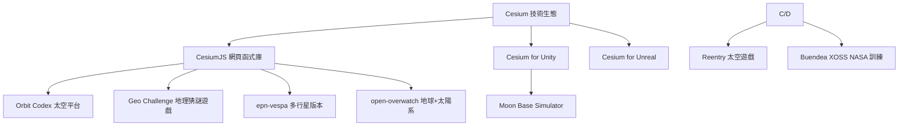

# 使用 CesiumJS 打造行星遊戲的專案調查

## 摘要

Cesium 是一套基於 WebGL 的 3D 地理空間（geospatial）視覺化技術，主打高精度的地球儀與動態資料展示。本報告調查是否存在以 Cesium（含 CesiumJS 網頁函式庫，以及 Cesium for Unity / Cesium for Unreal 遊戲引擎外掛）打造「行星遊戲」的專案。

**核心結論**：目前**幾乎沒有**以 CesiumJS 直接打造的商業或娛樂型「多行星探險遊戲」，主因是 CesiumJS 引擎先天只支援「單一中心天體/地球儀」，無法在同一場景內無縫切換多顆行星。現有的行星太空遊戲（如 Reentry）其實是使用 Cesium for Unity / Unreal 等遊戲引擎外掛，而非 CesiumJS，並主要聚焦單一天體（月球或火星）。

---

## 現況總覽

上圖說明：Cesium 技術可分成網頁函式庫（CesiumJS）與遊戲引擎外掛（Cesium for Unity / Unreal）。真正「行星遊戲」多半走引擎外掛路線，而非純 CesiumJS[^mermaid]。

---

## 一、使用 Cesium 的行星 / 太空作品

### 1. Reentry – A Space Flight Simulator（商業遊戲）

一個在 Steam 上發售的寫實太空飛行模擬遊戲（2018 年搶先體驗），玩家體驗 NASA 水星、雙子星、阿波羅計畫與登月任務。遊戲**使用 Cesium for Unity** 與 **Cesium Moon Terrain**（月球地形）來渲染月球地表，並從軌道觀看地球。開發者 Petri Wilhelmsen 在短短約 30 分鐘內就以 Cesium 月亮地形替換了他自行開發的月球渲染器[^reentry]。持續開發中，由 Lyra Creative 工作室全職維護[^reentry2]。

- 官方網站：<https://reentrygame.com/>
- Steam 頁面：<https://store.steampowered.com/app/882140/>

### 2. Buendea XOSS（NASA 太空人訓練模擬）

Buendea 與 NASA 先進任務概念實驗室（NAOCL）合作的 XR 訓練模擬系統，使用 **Cesium for Unreal** 搭配 **Cesium Moon Terrain**，在 Unreal Engine 中打造精確的 3D 月球環境，用於月球漫步、探測車操作與設備維修訓練，支援 9 個南極候選登陸點。屬於「嚴肅/訓練模擬」範疇，並非娛樂型遊戲[^xoss]。

- 官方網站：<https://www.buendea.com/xoss>

### 3. Moon Base Simulator（開源月面基地模擬，GitHub 2 星）

以 **Unity 6 + Cesium for Unity** 打造的月面基地規劃與探索模擬器。串流 NASA LRO 資料的 Cesium Moon Terrain（Cesium ion asset ID 2684829），提供水冰沉積、日照時數資料圖層、拖放式基地模組放置與月球重力（1.62 m/s²）下的探測車駕駛模式。具 MIT 授權與完整遊戲設計文件（GDD）[^moonbase]。

- GitHub：<https://github.com/Jastman/moon-base-simulator>（2 stars）

### 4. epn-vespa/cesium（多行星版 CesiumJS，GitHub 4 星）

由歐洲 Europlanet H2020 / VESPA 計畫資助，對 CesiumJS 進行的**多行星支援分支**。實作太陽系所有行星與衛星的自訂橢球體（依 IAU 建議），並串接 USGS Astrogeology 影像圖層，可切換觀看水星到海王星。但該分支自約 2018 年後**已停滯**，且官方明確表示「未來資金不確定」，從未被合併回 CesiumJS 主線[^epn][^issue6419]。

- GitHub：<https://github.com/epn-vespa/cesium>（4 stars，6 forks）

### 5. Orbit Codex（CesiumJS 太空平台，非遊戲）

以 **CesiumJS** 打造的大型太空活動資料庫與視覺化平台，收錄 1.4 萬個以上太空實體（火箭、衛星、太空垃圾、任務、月球基地、探測車、八大行星）。即時追蹤如 Artemis II 等真實太空船，並展示 Cesium Moon / Mars 地形。商業平台，非遊戲[^orbitcodex]。

- 官方網站：<https://orbitcodex.com/>

### 6. open-overwatch（CesiumJS 地球 + three.js 太陽系，GitHub 0 星）

一個使用 **CesiumJS**（地球儀視圖）與 **three.js**（太陽系視圖）的開放資料視覺化專案，可在兩視圖間無縫切換相機與時鐘。涵蓋 157 萬顆小行星、6,339 顆系外行星、1.8 萬顆以 SGP4 傳播的人造衛星。MIT 授權。屬視覺化工具而非遊戲[^openoverwatch]。

- GitHub：<https://github.com/destinjones/open-overwatch>（0 stars）

### 7. Geo Challenge（CesiumJS 地理猜謎遊戲，Earth 限定）

由 Camptocamp 於 2026 年推出的瀏覽器遊戲，玩家根據 3D 地形畫面猜測瑞士、法國或德國的地點。使用 swisstopo 與 Google 攝影測量 3D Tiles。這是**少數以 CesiumJS 直接打造的「遊戲」**，但內容是地球地理猜謎，非太空/行星[^geochallenge]。

- 官方網站：<https://geo-challenge.labs.camptocamp.com/>

### 8. Line of Sight（CesiumJS 街機遊戲，Earth 限定）

Cesium 團隊 2018 年釋出的內部街機示範，玩家在芝加哥、東京、舊金山 3D 城市中飛行無人機。同樣是地球場景，非行星[^los]。

---

## 二、CesiumJS 打造行星遊戲的技術限制

CesiumJS 核心引擎自始即**只支援單一中心天體（地球的 WGS84 橢球體）**。Cesium 開發者在 2018 年的 GitHub Issue #6419「Solar System Sandcastle Example」中明確回覆：

> "Cesium can currently only have one central body/globe. ... non-earth ellipsoid support is a little unpredictable right now."

即「Cesium 目前只能有一個中心天體/地球儀，非地球橢球體支援目前仍有些不穩定」[^issue6419]。這使得 CesiumJS 難以在不做大幅改寫的情況下，在同一場景內讓玩家於多顆行星之間移動。

除此之外，CesiumJS **並非遊戲引擎**，缺乏遊戲所需的碰撞偵測、物理引擎、輸入管理、音效、粒子系統與 AI 等功能，本質上是地理視覺化函式庫[^assessment]。社群亦回報在 CesiumJS 中使用自訂橢球體搭配 3D Tiles 地形會產生地平線剔除法（horizon culling）的問題[^ellipsoid][^triaxial]。

**因此，真正的「行星遊戲」多半轉而使用 Cesium for Unity 或 Cesium for Unreal**——將 Cesium 的高精度天體地形整合進遊戲引擎，才能兼顧引擎能力與太空資料。

---

## 三、新趨勢：Cesium Moon / Mars 地形產品

Cesium 官方於 2024 年 8 月推出 **Cesium Moon**、2025 年 9 月推出 **Cesium Mars** 兩項地形 tileset，可透過 CesiumJS 與各引擎外掛消費。這降低了開發「單一天體」行星遊戲的技術門檻，現有作品（Reentry、XOSS、Moon Base Simulator）多以此為基礎[^cmoon][^cmars]。

---

## 四、結論

| 類型 | 專案 | 使用技術 |
|---|---|---|
| 商業行星遊戲 | Reentry | Cesium for Unity + Cesium Moon |
| 訓練模擬 | Buendea XOSS | Cesium for Unreal + Cesium Moon |
| 開源模擬遊戲 | Moon Base Simulator | Cesium for Unity + Cesium Moon |
| 多行星 CesiumJS 分支 | epn-vespa/cesium（已停滯） | CesiumJS fork |
| CesiumJS 太空平台 | Orbit Codex / open-overwatch | CesiumJS（非遊戲） |
| CesiumJS 遊戲（Earth） | Geo Challenge / Line of Sight | CesiumJS |

**回答「是否有專案用 CesiumJS 做行星遊戲」**：嚴格來說，**沒有**以 CesiumJS 直接打造、且能在多顆行星間遊玩的大型行星遊戲——因 CesiumJS 只支援單一中心天體。真正稱得上「行星遊戲」的作品（Reentry、Moon Base Simulator）皆改用 **Cesium for Unity / Unreal 外掛**，並專注單一天體（月球）。若目標是「Cesium 技術上做的太空/行星遊戲」，可參考 Reentry 與 Moon Base Simulator；若目標是「純 CesiumJS 多行星」，則只有停滯的 epn-vespa 分支，且需自行克服單一天體限制。

---

[^mermaid]: 由本報告自行整理之流程示意圖，非引述第三方文獻；使用 mermaid 語法繪製。
[^reentry]: Cesium. (2024, October 8). Reentry blends gaming and training with Cesium Moon terrain. Retrieved 2026-10-09, from https://cesium.com/blog/2024/10/08/reentry-blends-gaming-and-training-with-cesium-moon-terrain/
[^reentry2]: Reentry: An Orbital Simulation (n.d.). Retrieved 2026-10-09, from https://store.steampowered.com/app/882140/Reentry__A_Space_Flight_Simulator/
[^xoss]: Cesium. (2025, April 8). Buendea supports NASA with Cesium Moon terrain. Retrieved 2026-10-09, from https://cesium.com/blog/2025/04/08/buendea-supports-nasa-with-cesium-moon-terrain/
[^moonbase]: Jastman. (n.d.). Moon Base Simulator: Unity 6 Moon Base Simulator with Cesium for real lunar terrain. Retrieved 2026-10-09, from https://github.com/Jastman/moon-base-simulator
[^epn]: epn-vespa. (n.d.). cesium: An open-source JavaScript library for world-class 3D globes and maps. Retrieved 2026-10-09, from https://github.com/epn-vespa/cesium
[^issue6419]: CesiumGS. (2018, April 3). Solar System Sandcastle Example, Issue #6419. Retrieved 2026-10-09, from https://github.com/CesiumGS/cesium/issues/6419
[^orbitcodex]: Cesium. (2026, April 9). Orbit Codex tracks Artemis II in CesiumJS. Retrieved 2026-10-09, from https://cesium.com/blog/2026/04/09/orbit-codex-tracks-artemis-ii-in-cesiumjs/
[^openoverwatch]: destinjones. (n.d.). open-overwatch: The whole planet, live. Retrieved 2026-10-09, from https://github.com/destinjones/open-overwatch
[^geochallenge]: Cesium. (2026, March 12). Cesium powers Camptocamp's Geo Challenge game. Retrieved 2026-10-09, from https://cesium.com/blog/2026/03/12/cesium-powers-camptocamps-geo-challenge-game/
[^los]: Cesium. (2018, March 9). Line of Sight arcade game. Retrieved 2026-10-09, from https://cesium.com/blog/2018/03/09/line-of-sight-arcade-game/
[^assessment]: 綜合本調查所蒐集之官方 Blog、GitHub Issue、社群回覆歸納之技術評估，非單一文獻之引述。
[^ellipsoid]: Cesium. (n.d.). Use custom ellipsoid when generating 3D terrain on Cesium ion. Retrieved 2026-10-09, from https://community.cesium.com/t/use-custom-ellipsoid-when-generating-3d-terrain-on-cesium-ion/4299
[^triaxial]: CesiumGS. (n.d.). Triaxial ellipsoid support, Issue #12110. Retrieved 2026-10-09, from https://github.com/CesiumGS/cesium/issues/12110
[^cmoon]: Cesium. (n.d.). Cesium Moon. Retrieved 2026-10-09, from https://cesium.com/platform/cesium-ion/content/cesium-moon/
[^cmars]: Cesium. (2025, September 3). Lift off to Cesium Mars. Retrieved 2026-10-09, from https://cesium.com/blog/2025/09/03/lift-off-to-cesium-mars/
