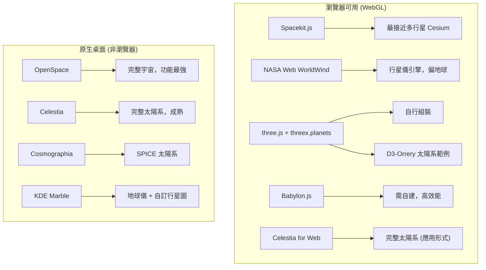

# CesiumJS 之多行星支援替代方案研究

## 摘要

CesiumJS 是常見的網頁端 3D 地球與地理空間視覺化引擎，但其架構先天限制為**一個場景只能有一個 `Globe`**，因此無法在同一視圖中同時渲染多顆具有地形與影像圖層的行星（例如地球、火星、月球同畫面）。本報告調查支援「多行星」渲染的 CesiumJS 替代方案，區分「瀏覽器（WebGL）可用」與「原生桌面應用」兩類，並針對每一候選方案記錄其多行星支援能力、授權、技術棧與 GitHub 星數。

核心結論：目前並不存在「多行星版 Cesium」的直接對應物；最接近的瀏覽器方案是 **Spacekit.js**（以 three.js 為基礎、內建八大行星與開普勒軌道），其次是 **NASA Web WorldWind**（行星儀引擎但以地球為中心），以及使用 **three.js / Babylon.js** 自行組裝多行星場景。具備完整太陽系視覺化的 OpenSpace 與 Celestia 則是功能最強但**非瀏覽器**的原生應用。

## CesiumJS 的多行星限制

CesiumJS 的 `Scene` 類別只擁有單一的 `globe` 屬性，沒有 `globes` 集合或 `addGlobe()` 方法[^scene][^globe]。`Globe` 管理單一橢球體的八叉樹地形圖磚系統與影像圖層堆疊，其渲染管線（攝影機、視錐剔除、大氣、太陽光照、深度平面）皆以單一地球中心座標系統為預設[^issue9295][^arch]。

月亮（Moon）在 CesiumJS 中並非完整的 `Globe`，而是以帶有單一靜態紋理的 `EllipsoidPrimitive` 呈現，沒有地形 Provider、影像圖層或圖磚管理[^moon]。官方 GitHub issue #9295 中，貢獻者明確回應：「Cesium 場景目前只支援單一 `Globe`，我們用帶紋理的 `EllipsoidPrimitive` 來加入月亮。」[^issue9295] 多視埠（multiple viewports，即允許不同天體各別一個 Scene）的 roadmap issue #5214 自 2017 年提出後至今仍未實作[^issue5214]。

Cesium 商業端近期推出的 **Cesium Moon Terrain**（2024）[^cesiummoon] 與 **Cesium Mars**（2025）[^cesiummars] 為透過 Cesium ion 取得的 3D Tiles 圖資，使用者可以在**不同檢視**間切換使用，但無法在同一畫面同時渲染多顆行星。若需要同時顯示多顆行星且每顆都具有地形與影像圖層，CesiumJS 並非合適選擇。

## 瀏覽器（WebGL）替代方案

以下方案皆可在瀏覽器中執行，適合嵌入網頁應用。

### Spacekit.js

- **首頁**：https://typpo.github.io/spacekit/ ，**GitHub**：https://github.com/typpo/spacekit
- **授權**：MIT（開放原始碼）
- **技術棧**：JavaScript/TypeScript、Three.js（WebGL）
- **GitHub 星數**：約 583[^spacekit]
- **多行星支援**：✅ 是。定位即為太陽系與更遠天體的 3D 視覺化，內建太陽、水星、金星、地球、火星、木星、土星、天王星、海王星等預設，支援開普勒軌道元素（epoch、半長軸、離心率、傾角等），並提供 `SphereObject`、`ShapeObject`、`RotatingObject`、`KeplerParticles`、`BlackHole`、`Skybox`、`Stars` 等類別[^spacekit][^spacekitdocs]。

這是與「多行星 Cesium」最接近的瀏覽器程式庫。注意其天體為**完美球體**（`SphereObject`），原生不處理橢球體扁平化；若要精確呈現火星（扁平率約 0.00589）、月球（約 0.00125）、金星（約 0），需自行用非均勻縮放（`mesh.scale.set(1, polarRadius/equatorialRadius, 1)`）[^spacekit][^ellipsoid]。

### NASA Web WorldWind

- **首頁**：https://worldwind.arc.nasa.gov/web/ ，**GitHub**：https://github.com/NASAWorldWind/WebWorldWind
- **授權**：Apache 2.0
- **技術棧**：JavaScript、WebGL
- **GitHub 星數**：約 1,000[^webworldwind]
- **多行星支援**：⚠️ 有限。其定位為行星**儀**引擎（planetary globe engine），官方文件描述可將資料視覺化於「任何有資料的其他行星上」，但實際以地球為中心。Java 版（WorldWindJava）有明確的 `Globe` 子類用於地球、火星與月球；JavaScript 版主要服務地球，可透過 3D Tiles / COLLADA 顯示月球與火星[^webworldwind][^worldwindjava]。

### three.js 生態系（自行組裝）

three.js 本身是一般 3D 引擎，需自行建立行星網格，但有大量現成的太陽系範例與輔助程式庫可供參考：

- **threex.planets**（jeromeetienne，MIT，約 253★）：提供 `createSun()`、`createMercury()`、`createEarth()`、`createMars()`、`createSaturn()`（含行星環）、`createMoon()`、`createStarfield()` 等工廠函式，可快速產生帶紋理的行星網格[^threexplanets][^threexplanets2]。
- **D3-Orrery**（ofrohn，BSD-3-Clause，約 39★）：以 D3.js + three.js 製作的互動太陽系模擬，含軌道與小行星帶，使用 JPL 軌道元素[^d3orrery]。
- **threejs-solar-system**（sanderblue，Apache 2.0，約 413★）：按比例建模的太陽系範例（太陽、八大行星、衛星、小行星帶、星群）[^sanderblue]。
- **threejs-procedural-planets**（dgreenheck，MIT，約 298★）：程序化生成帶大氣、雲層與地形的行星，可作為渲染技術參考，但不是基於真實行星資料[^procedural]。
- **three-globe**（vasturiano，MIT，約 1.6k★）與 **globe.gl**（vasturiano，MIT，約 3.2k★）：皆為**單一地球**資料視覺化的底層組件，非多行星方案，但常用於數據弧線、國家多邊形等地球視覺化，可作為參考[^threeglobe][^globegl]。

### Babylon.js

- **首頁**：https://www.babylonjs.com/ ，**GitHub**：https://github.com/BabylonJS/Babylon.js
- **授權**：Apache 2.0 / MIT
- **技術棧**：JavaScript/TypeScript、WebGL/WebGPU
- **GitHub 星數**：約 23,000[^babylon]
- **多行星支援**：✅ 需自行建造。Babylon.js 核心非天文導向，但社群有完整太陽系示範，如 **SolSys View**（cienzorama，含 35 個天體與精確運動模型）[^solsysview]。適合需要高效能渲染或 WebGPU，並願意自行打造行星系統的場景。

## 原生桌面（非瀏覽器）替代方案

### OpenSpace

- **首頁**：https://openspaceproject.com/ ，**GitHub**：https://github.com/OpenSpace/OpenSpace
- **授權**：MIT
- **技術棧**：C++（C++23）、OpenGL 4.6、Lua/JavaScript/Python 腳本介面
- **GitHub 星數**：約 1,300[^openspace]
- **多行星支援**：✅ 完整。可視覺化已知宇宙與太陽系，提供地球、月球、火星、金星等高解析行星影像，並含 AMNH Digital Universe 星表。由 NASA、林雪平大學與 AMNH 合作開發，用於天文館與穹頂投影。
- **非瀏覽器**：原生桌面應用（Windows、Linux），需 OpenGL 4.6，不支援 macOS（Apple Silicon）[^openspace]。

### Celestia

- **首頁**：https://celestiaproject.space/ ，**GitHub**：https://github.com/CelestiaProject/Celestia
- **授權**：GPL v2
- **技術棧**：C++、OpenGL/OpenGL ES
- **GitHub 星數**：約 2,400[^celestia]
- **多行星支援**：✅ 完整。支援行星、衛星、太空船、小行星、彗星，可透過 SSC/STC/DSC 目錄檔自訂天體。有 Web 移植版 **Celestia for Web**（https://celestia.mobi/web ）可在瀏覽器執行，但以應用形式提供而非可嵌入程式庫[^celestiaweb]。

### Cosmographia

- **首頁**：https://naif.jpl.nasa.gov/naif/cosmographia.html ，**GitHub**：https://github.com/claurel/cosmographia
- **授權**：免費（NASA NAIF，含商業用途）
- **技術棧**：C++（Qt）、SPICE 核心、JSON 目錄檔
- **GitHub 星數**：約 28[^cosmographia]
- **多行星支援**：✅ 完整。使用 SPICE kernel 渲染整個太陽系，含行星、衛星、太空船軌跡與儀器視野，曾被 NASA/ESA 任務視覺化使用（Cassini、MRO、JUICE）。非瀏覽器原生桌面應用[^cosmographia]。

### KDE Marble

- **首頁**：https://marble.kde.org/ （Android/KDE 應用 https://apps.kde.org/marble/ ），**GitHub**：https://github.com/KDE/marble
- **授權**：LGPL-2.1-or-later（多種 KDE 授權）
- **技術棧**：C++/Qt、OpenGL
- **GitHub 星數**：約 170[^marble]
- **多行星支援**：✅ 有限。主打地球虛擬地球儀/世界地圖集，但透過 **CustomPlanetMaps** 功能可建立月球、火星、金星等天體的地圖主題，內部含 `PlanetFactory` 與 `solarsystem.h` 行星常數[^marble][^marblecustom]。非瀏覽器原生桌面應用。

## 比較總表

| 候選方案 | 瀏覽器/WebGL | 多行星 | 可嵌入程式庫 | GitHub 星數 | 授權 |
|---|---|---|---|---|---|
| **Spacekit.js** | ✅ | ✅ 完整 | ✅ | ~583 | MIT |
| **CesiumJS** | ✅ | ⚠️ 單一 Globe | ✅ | ~13k | Apache 2.0 |
| **NASA Web WorldWind** | ✅ | ⚠️ 有限（偏地球） | ✅ | ~1.0k | Apache 2.0 |
| **three.js + threex.planets** | ✅ | ✅ 完整（用於自建） | ✅ | ~253（擴充） | MIT |
| **D3-Orrery** | ✅ | ✅ 完整 | ✅ | ~39 | BSD-3 |
| **Babylon.js** | ✅ | ✅ 需自建 | ✅ | ~23k | Apache 2.0 / MIT |
| **Celestia for Web** | ✅（埠） | ✅ 完整 | ❌ 應用形式 | ~2.4k | GPL v2 |
| **OpenSpace** | ❌ | ✅ 完整 | ❌ 原生應用 | ~1.3k | MIT |
| **Cosmographia** | ❌ | ✅ 完整 | ❌ 原生應用 | ~28 | NASA 免費 |
| **KDE Marble** | ❌ | ✅ 有限 | ❌ 桌面 | ~170 | LGPL/GPL |

## 建議與取捨

1. **需要網頁嵌入且「開箱即用」多行星** → 選 **Spacekit.js**（MIT、瀏覽器、內建八大行星預設與開普勒軌道）。缺點：天體為完美球體，需自行處理橢球體扁平化與地形圖資流式載入。
2. **主要需求是「單一行星」的地形與影像圖層並偶爾展示月球/火星** → 保留 **CesiumJS**（使用 `EllipsoidPrimitive` 呈現裝飾性天體）或 **NASA Web WorldWind**。
3. **需要最大控制權客製多行星系統** → 以 **three.js**（配合 threex.planets、threejs-solar-system 等參考）或 **Babylon.js（SolSys View）** 自行組裝，可精確控制橢球體參數。
4. **需要最高科學精度與完整太陽系但能接受非瀏覽器** → **OpenSpace**（功能最全面）或 **Celestia**（成熟、含 Web 埠）。
5. 若需以真實橢球體參數渲染火星、月球、金星，所有「開箱即用」瀏覽器程式庫目前皆未直接支援，需以非均勻縮放球體（`scale.y = polarRadius / equatorialRadius`）自行實作[^ellipsoid]。

## 對來源的批判性反思

- 本文多數資訊來自專案官方文件與 GitHub 頁面，屬一級來源，可信度較高；GitHub 星數為擷取當下數值，會隨時間變動。
- **Spacekit.js** 作者為 Ian Webster（`typpo`），先前曾被人誤植為 Tyler Morgan-Wall；本報告以官方 repo 為準[^spacekit]。
- CesiumJS 單一 Globe 限制出自官方 GitHub issue #9295 貢獻者回應與 `Scene.globe` 文件，屬權威來源[^issue9295][^scene]。
- 部分 star 數極低的專案（如 D3-Orrery 約 39★、threejs-solar-system 0★）雖低於本專案設定之「約 100★」門檻，但因其在「多行星」此一特定領域具參考價值，故仍依規則報導並附上文脈說明。

## 參考資料

[^scene]: CesiumGS. (n.d.). *Scene — CesiumJS Reference Documentation*. Retrieved 2026-10-09, from https://cesium.com/learn/cesiumjs/ref-doc/Scene.html
[^globe]: CesiumGS. (n.d.). *Globe — CesiumJS Reference Documentation*. Retrieved 2026-10-09, from https://cesium.com/learn/cesiumjs/ref-doc/Globe.html
[^issue9295]: CesiumGS. (2020, December). *Multiple globes? #9295*. Retrieved 2026-10-09, from https://github.com/CesiumGS/cesium/issues/9295
[^issue5214]: CesiumGS. (2017). *Multiple viewports #5214*. Retrieved 2026-10-09, from https://github.com/CesiumGS/cesium/issues/5214
[^arch]: CesiumGS. (2015). *Architecture - Cesium Wiki*. Retrieved 2026-10-09, from https://github.com/CesiumGS/cesium/wiki/Architecture
[^moon]: CesiumGS. (n.d.). *Moon.js — CesiumJS Engine Source*. Retrieved 2026-10-09, from https://github.com/CesiumGS/cesium/blob/main/packages/engine/Source/Scene/Moon.js
[^cesiummoon]: Cesium. (2024, August 6). *Introducing Cesium Moon Terrain*. Retrieved 2026-10-09, from https://cesium.com/blog/2024/08/06/introducing-cesium-moon-terrain/
[^cesiummars]: Cesium. (2025, September 3). *Lift Off to Cesium Mars*. Retrieved 2026-10-09, from https://cesium.com/blog/2025/09/03/lift-off-to-cesium-mars/
[^spacekit]: Webster, I. (n.d.). *Spacekit*. Retrieved 2026-10-09, from https://github.com/typpo/spacekit
[^spacekitdocs]: Webster, I. (n.d.). *Spacekit Documentation*. Retrieved 2026-10-09, from https://typpo.github.io/spacekit/
[^webworldwind]: NASA. (n.d.). *Web WorldWind*. Retrieved 2026-10-09, from https://github.com/NASAWorldWind/WebWorldWind
[^worldwindjava]: NASA. (n.d.). *WorldWind Java*. Retrieved 2026-10-09, from https://worldwind.arc.nasa.gov/java/
[^threexplanets]: Etienne, J. (n.d.). *threex.planets*. Retrieved 2026-10-09, from https://github.com/jeromeetienne/threex.planets
[^threexplanets2]: Frohn, O. (n.d.). *threex.planets (extended fork)*. Retrieved 2026-10-09, from https://github.com/ofrohn/threex.planets
[^d3orrery]: Frohn, O. (n.d.). *D3-Orrery*. Retrieved 2026-10-09, from https://github.com/ofrohn/d3-orrery
[^sanderblue]: Blue, S. (n.d.). *Solar System - three.js (to scale)*. Retrieved 2026-10-09, from https://github.com/sanderblue/solar-system-threejs
[^procedural]: Heck, D. (n.d.). *threejs-procedural-planets*. Retrieved 2026-10-09, from https://github.com/dgreenheck/threejs-procedural-planets
[^threeglobe]: Vasturiano. (n.d.). *three-globe*. Retrieved 2026-10-09, from https://github.com/vasturiano/three-globe
[^globegl]: Vasturiano. (n.d.). *globe.gl*. Retrieved 2026-10-09, from https://github.com/vasturiano/globe.gl
[^babylon]: BabylonJS. (n.d.). *Babylon.js*. Retrieved 2026-10-09, from https://github.com/BabylonJS/Babylon.js
[^solsysview]: Cenzorama. (n.d.). *SolSysView*. Retrieved 2026-10-09, from https://github.com/cienzorama/SolSysView
[^openspace]: OpenSpace Project. (n.d.). *OpenSpace*. Retrieved 2026-10-09, from https://github.com/OpenSpace/OpenSpace
[^celestia]: Celestia Project. (n.d.). *Celestia*. Retrieved 2026-10-09, from https://github.com/CelestiaProject/Celestia
[^celestiaweb]: Celestia. (n.d.). *Celestia for Web*. Retrieved 2026-10-09, from https://celestia.mobi/web
[^cosmographia]: Laurel, C. (n.d.). *Cosmographia*. Retrieved 2026-10-09, from https://github.com/claurel/cosmographia
[^marble]: KDE. (n.d.). *Marble*. Retrieved 2026-10-09, from https://github.com/KDE/marble
[^marblecustom]: KDE. (n.d.). *Marble/CustomPlanetMaps*. Retrieved 2026-10-09, from https://techbase.kde.org/Marble/CustomPlanetMaps
[^ellipsoid]: StackOverflow. (n.d.). *How to draw the ellipsoid using three.js*. Retrieved 2026-10-09, from https://stackoverflow.com/questions/75013500/how-to-draw-the-ellipsoid-using-three-js
