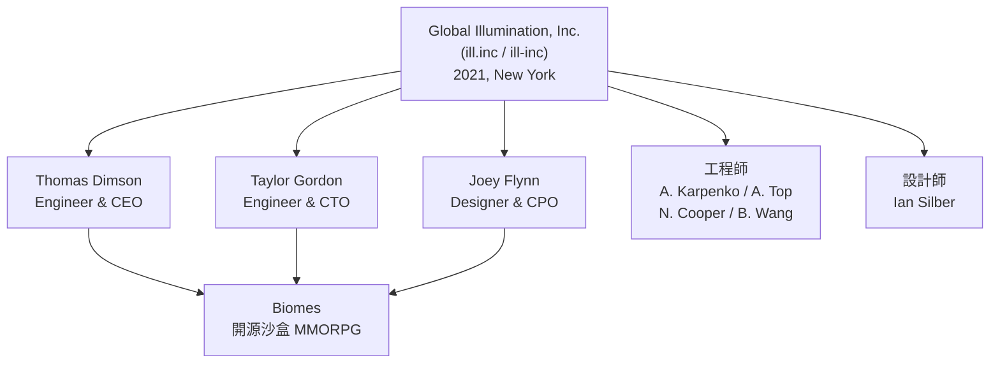
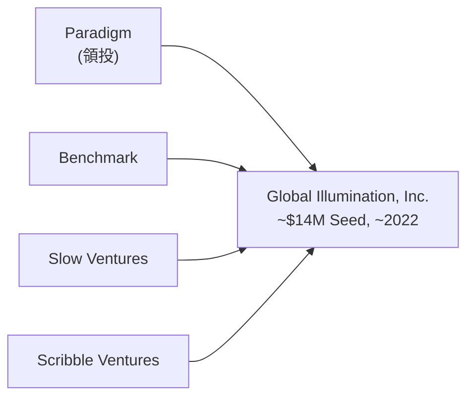
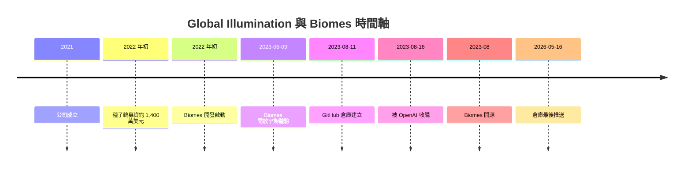

# Biomes（ill-inc/biomes-game）專案背景調查

## 摘要

`ill-inc/biomes-game` 是一套開源、可在瀏覽器執行的沙盒式 MMORPG（大型多人線上角色扮演遊戲）**Biomes** 的原始碼倉庫[^repo]。其背後的開發公司為註冊於美國紐約的 **Global Illumination, Inc.**（網域 `ill.inc`，GitHub 組織名 `ill-inc`），成立於 2021 年[^openai][^tracxn]。該公司由三位前 Instagram／Facebook 資深成員創立，並獲得約 1,400 萬美元的種子輪資金[^siliconangle]。2023 年 8 月 16 日，Global Illumination 被 **OpenAI 收購**，成為 OpenAI 成立以來首宗公開收購案；整個團隊加入 OpenAI 後，Biomes 開發停擺並轉為開源專案[^openai][^techcrunch]。

本報告整理該專案的公司、創投、團隊、社群與資金等背景資訊，所有事實均附上引用來源。

---

## 一、公司概況

| 項目 | 內容 |
| --- | --- |
| 正式名稱 | Global Illumination, Inc.[^illinc] |
| 常見簡稱 | ill.inc、ill-inc（GitHub 組織）[^repo][^illinc] |
| 成立年份 | 2021 年[^openai][^tracxn] |
| 總部 | 美國紐約（New York）[^openai][^techcrunch] |
| 產業定位 | 數位產品公司／AI 設計工作室（digital product company）[^illinc][^siliconangle] |
| 代表產品 | 開源沙盒 MMORPG **Biomes**[^illinc] |
| 目前狀態 | 2023 年 8 月被 OpenAI 收購，團隊併入 OpenAI[^openai] |

公司官方網站自述：「Global Illumination is a digital product company based in New York most recently working on Biomes.」[^illinc] OpenAI 則將其描述為「一家運用 AI 打造創意工具、基礎設施與數位體驗的公司」[^openai]。SiliconANGLE 的報導稱其為「一家專注於提供創造力誘因、製作數位產品的小型數位公司」[^siliconangle]。

---

## 二、創辦人與團隊

### 三位共同創辦人

Global Illumination 由三位共同創辦人於 2021 年成立[^openai]：

- **Thomas Dimson（工程師 & CEO）**：曾任 Instagram 工程總監（Director of Engineering），是 Instagram 探索（Explore）分頁、動態與限時動態排序（feed and Stories ranking）、IGTV 等探索演算法的重要推手，並參與共同創作 Instagram Hyperlapse[^illinc][^techcrunch]。
- **Taylor Gordon（工程師 & CTO）**[^illinc]。
- **Joey Flynn（設計師 & CPO）**[^illinc]。

### 團隊成員

官方網站列出的團隊包含：Thomas Dimson、Taylor Gordon、Joey Flynn，以及工程師 Alexei Karpenko、Andrew Top、Nick Cooper、Brandon Wang 與設計師 Ian Silber[^illinc]。OpenAI 表示該團隊「先前在 Instagram 與 Facebook 早期設計並打造產品，也曾對 YouTube、Google、Pixar、Riot Games 等知名公司做出重大貢獻」[^openai][^siliconangle]。

Biomes 遊戲網站的製作名單另列出：美術由 Luis Gustavo Barbosa Tavares、Thais Torres、Lotto 負責；音樂由 Kyle Flynn、Morgan Herrell 負責；另有 Matthew Haines、Tanson Lee、Devin Leamy、Enid Hwang 的額外貢獻[^biomesgg]。收購當時公司規模約八名員工[^tracxn]。

---

## 三、資金與創投

Global Illumination 為創投支持的公司，據 PitchBook 資料，其**總募資額約 1,400 萬美元**，且這是公司唯一一輪融資[^siliconangle]。該輪為**種子輪（Seed）**，時間約在 2022 年初（報導多指向 2022 年 1 月，部分資料列為 2022 年 2 月）[^aibusiness][^aimarketwatch]。

已知的機構投資人包括：

| 投資機構 | 說明 |
| --- | --- |
| **Paradigm**（Paradigm Capital LP） | 領投方[^siliconangle][^aimarketwatch] |
| **Benchmark**（Benchmark Capital Corp.） | 參與投資[^siliconangle][^techcrunch] |
| **Slow Ventures**（Slow Ventures LLC） | 參與投資[^siliconangle][^techcrunch] |
| **Scribble Ventures** | 部分資料庫列為投資人[^tracxn][^cbinsights] |
| **Radical Ventures** | 僅見於部分資料庫，可信度較低[^aimarketwatch] |

TechCrunch 報導指出：「Backed by VC firms Paradigm, Benchmark and Slow...」[^techcrunch]。AI Market Watch 的資料另列出天使投資人 Nat Friedman（前 GitHub CEO）與 Tobias Lütke（Shopify CEO），但此二人與 Radical Ventures 的資訊僅見於單一聚合資料庫，未能從主要新聞媒體獨立佐證，應謹慎看待[^aimarketwatch]。

---

## 四、OpenAI 收購與專案現況

### 收購事件

2023 年 8 月 16 日，OpenAI 宣布收購 Global Illumination 團隊[^openai]。OpenAI 官方公告全文為：「OpenAI has acquired the team at Global Illumination, a company founded by Thomas Dimson, Taylor Gordon, and Joey Flynn. The entire team has joined OpenAI to work on our core products including ChatGPT.」[^openai]

多個來源指出，這是 OpenAI 成立約七年來的**首宗公開收購**：TechCrunch 稱其為「OpenAI's first public acquisition in its roughly seven-year history」[^techcrunch]；路透社（Reuters）稱其為「the first known acquisition by the storied artificial intelligence firm」[^reuters]。交易金額未揭露；SiliconANGLE 推測價格可能與其先前募資金額（約 1,400 萬美元）相去不遠[^siliconangle]。此次收購被普遍解讀為**人才收購（acqui-hire / talent acquisition）**，而非為了遊戲產品本身[^siliconangle]。

### Biomes 專案現況

Biomes 是公司開發的旗艦產品，為一套「open source sandbox MMORPG built for the web」，採用 Next.js、TypeScript、React 與 WebAssembly 等網頁技術[^repo]。遊戲以 MIT 授權開源[^faq]。其開發始於 2022 年初[^faq]，並於 2023 年 6 月 9 日開放早期體驗（Early Access），主打免費、瀏覽器直接遊玩、免下載[^moddb]。

| 專案指標 | 數值（截至 2026 年查詢） |
| --- | --- |
| GitHub 倉庫 | ill-inc/biomes-game[^repo] |
| Star 數 | 約 2,685（顯示為 2.7k）[^ghapi] |
| Fork 數 | 344[^ghapi] |
| 關注者（watchers） | 29[^ghapi] |
| 授權條款 | MIT License[^ghapi] |
| 主要語言 | TypeScript（約 85%），另有 C++、Rust、Python[^ghapi] |
| 倉庫建立日 | 2023-08-11[^ghapi] |
| 最後推送 | 2026-05-16[^ghapi] |
| 未結議題 | 約 14 件[^ghapi] |

收購後團隊無法獨力繼續開發 Biomes，官方路線圖說明：「Global Illumination, the company behind Biomes, was recently acquired. New responsibilities have meant that the team cannot continue Biomes development alone... Biomes has been open sourced and we are currently working to build and recruit the required community resources.」[^roadmap] 官方 FAQ 也指出：早期體驗期間建立帳號的玩家仍可登入遊玩，新玩家則須自行在本機執行；邀請碼已不再持續發放[^faq]。

---

## 五、社群

Biomes 主要社群管道如下：

- **Discord**：官方開發者社群 `discord.gg/biomes`，官方鼓勵在此回報問題、提供回饋並參與開源貢獻[^faq][^roadmap]。
- **GitHub**：`github.com/ill-inc/biomes-game`，開源開發與 PR 的主要場所[^repo]。
- **X（Twitter）**：官方帳號 `@illdotinc`（公司）[^illinc]。
- **文件站**：Biomes 官方文件與路線圖[^roadmap][^faq]。

官方在網站上感謝「the amazing Biomes community」，並搭配大量玩家截圖展示社群創作[^biomesgg]。整體而言，Biomes 社群的活動重心在 Discord 與 GitHub 兩個開發者導向的平台上，並以延續開源開發為目標[^roadmap]。

---

## 六、批判性來源反思

- **募資金額與投資人名單**：多數媒體（TechCrunch、SiliconANGLE）一致提及 Paradigm、Benchmark、Slow Ventures 與約 1,400 萬美元金額，可信度較高（惟金額源自 PitchBook 二手引用）。但 **Radical Ventures、天使投資人 Nat Friedman 與 Tobias Lütke** 僅見於 AI Market Watch 單一聚合來源，未獲主要新聞媒體佐證，屬低可信度資訊，已於報告中標註[^aimarketwatch]。
- **收購敘事**：OpenAI 官方公告屬一手來源，最為可信；TechCrunch、Reuters 對「首宗公開收購」的敘述一致，惟 Reuters 用語較保守（"first known"）[^reuters][^techcrunch]。需注意收購金額從未公開，媒體僅為推測。
- **公司是否「倒閉」**：並非倒閉，而是被 OpenAI 收購、團隊併入 OpenAI；Biomes「遊戲」則停止官方開發並開源[^openai][^roadmap]。部分二手資料將其描述為「關閉」，易造成誤解。
- **資料時效**：倉庫指標（star／fork 等）為查詢當下的快照，會隨時間變動[^ghapi]。

---

## 參考文獻

[^repo]: GitHub. (n.d.). *ill-inc/biomes-game*. Retrieved 2026-10-11, from https://github.com/ill-inc/biomes-game

[^illinc]: Global Illumination, Inc. (n.d.). *Global Illumination, Inc.*. Retrieved 2026-10-11, from https://ill.inc/

[^openai]: OpenAI. (2023, August 16). *OpenAI acquires Global Illumination*. Retrieved 2026-10-11, from https://openai.com/index/openai-acquires-global-illumination/

[^techcrunch]: Wiggers, K. (2023, August 16). *OpenAI acquires AI design studio Global Illumination*. TechCrunch. Retrieved 2026-10-11, from https://techcrunch.com/2023/08/16/openai-acquires-ai-design-studio-global-illumination/

[^siliconangle]: Riley, D. (2023, August 16). *OpenAI acquires digital products company Global Illumination for undisclosed price*. SiliconANGLE. Retrieved 2026-10-11, from https://siliconangle.com/2023/08/16/openai-acquires-digital-products-company-global-illumination-undisclosed-price/

[^reuters]: Reuters. (2023, August 16). *OpenAI acquires startup Global Illumination to work on core products, ChatGPT*. Retrieved 2026-10-11, from https://www.reuters.com/markets/deals/openai-acquires-start-up-global-illumination-work-core-products-chatgpt-2023-08-16/

[^theverge]: Peters, J. (2023, August 16). *OpenAI bought the makers of a Minecraft clone*. The Verge. Retrieved 2026-10-11, from https://www.theverge.com/2023/8/16/23834645/openai-global-illumination-acquisition-minecraft-clone-chatgpt

[^biomesgg]: Global Illumination, Inc. (2024). *Biomes — Join the community shaping a new world*. Retrieved 2026-10-11, from https://www.biomes.gg/

[^faq]: Biomes. (n.d.). *F.A.Q.*. Retrieved 2026-10-11, from https://docs.biomes.gg/faq

[^roadmap]: Biomes. (n.d.). *Roadmap*. Retrieved 2026-10-11, from https://docs.biomes.gg/roadmap

[^moddb]: ModDB. (2023, June 9). *Play Biomes Early Access Today*. Retrieved 2026-10-11, from https://www.moddb.com/games/biomes/news/play-biomes-early-access-today

[^ghapi]: GitHub. (n.d.). *ill-inc/biomes-game repository API*. Retrieved 2026-10-11, from https://api.github.com/repos/ill-inc/biomes-game

[^aibusiness]: Wodecki, B. (2023, August 16). *OpenAI snaps up creative AI startup Global Illumination*. AI Business. Retrieved 2026-10-11, from https://aibusiness.com/nlp/openai-snaps-up-creative-ai-startup-global-illumination

[^aimarketwatch]: AI Market Watch. (n.d.). *Global Illumination*. Retrieved 2026-10-11, from https://www.ai-market-watch.com/company/global-illumination

[^tracxn]: Tracxn. (n.d.). *Global Illumination — Company Profile*. Retrieved 2026-10-11, from https://tracxn.com/d/companies/global-illumination/__TrfioHqiIKGPSE-GhuxV5b5HDpmmyBJL4jMvL91dl5c

[^cbinsights]: CB Insights. (n.d.). *Global Illumination — Financials*. Retrieved 2026-10-11, from https://www.cbinsights.com/company/global-illumination/financials
