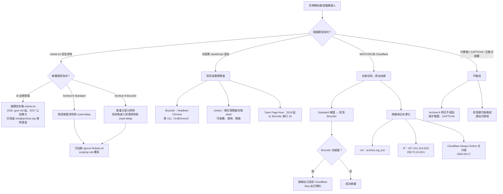

# Wayback Machine 如何檢索那些會阻擋機器人的網站

## 摘要

「會阻擋機器人的網站」在實務上分成三種截然不同的障礙：(1) 以 `robots.txt` 宣告的爬取排除、(2) 以 JavaScript 動態渲染導致傳統爬蟲拿不到內容、(3) 以 WAF／CDN 層（如 Cloudflare）做的自動化流量攔截。Internet Archive（以下簡稱 IA）的 Wayback Machine 對這三者的處理方式完全不同，而且官方文件可以清楚區分。

核心結論是：**Wayback Machine 的主要手段不是「破解」反機器人機制，而是（a）選擇性忽略 `robots.txt`、（b）改用真實瀏覽器執行 JavaScript、（c）與 CDN 業者建立白名單合作關係，以及（d）改用可被辨識、可被白名單化的身分（IP 區段與 User-Agent）。** 對於付費牆、CAPTCHA、Cloudflare 互動式挑戰，IA 官方立場是不繞過，而是請站方開放或改用替代服務。

---

## 一、先釐清：三個層次的「阻擋」

| 層次 | 機制 | Wayback Machine 的應對 |
|---|---|---|
| 宣告層 | `robots.txt` 排除 | 選擇性忽略，並保留 `info@archive.org` 移除通道 |
| 渲染層 | 內容由 JavaScript 產生 | 以真實瀏覽器（Brozzler／Umbra）執行腳本後再存檔 |
| 網路層 | WAF／CDN 阻擋自動化流量 | 靠可辨識 UA 與已公告 IP 區段讓站方白名單化；不主動繞過 |

這三層之所以容易被混為一談，是因為一般使用者看到的症狀都一樣：Wayback Machine 上沒有該頁，或顯示「已被排除」。但成因與解法差異極大，以下逐層說明。

---

## 二、宣告層：選擇性忽略 `robots.txt`

### 2.1 歷史背景與轉折

`robots.txt`（Robots Exclusion Protocol）在 1994 年被設計出來，用來指導搜尋引擎爬蟲不要進入特定區域[^robotstxt]。IA 早期遵守該協定，但後來認定「為搜尋引擎而寫的 `robots.txt` 不適合網頁典藏」。

2016 年 12 月 17 日，IA 的 Alexis Rossi 發文說明，2008、2012、2016 三次期末（end-of-term）的 `.gov`／`.mil` 網站爬取「已忽略 `robots.txt` 的排除指令，以取得更完整的快照」，並直言「往前看，答案會是『更不遵守』」[^govmil2016]。該文同時指出兩個關鍵痛點：許多網站的 `robots.txt` 從典藏角度早已失修，而且**網域易主後，新的 `robots.txt` 會溯及既往地把整個網域的歷史從 Wayback Machine 中抹除**。

2017 年 4 月 17 日，Wayback Machine 總監 Mark Graham 發布了最具代表性的公告〈Robots.txt meant for search engines don't work well for web archives〉，宣布要「更廣泛地」不再參照 `robots.txt`[^graham2017]。文中描述的問題包括：

- 搜尋引擎導向的 `robots.txt` 不利於「完整快照」的目標，因為典藏要包含重複內容與大檔版本。
- 網站歇業後網域變成停放頁（parked domain），其 `robots.txt` 會讓整個歷史從 Wayback Machine 消失，IA「幾乎每天」收到這類申訴。
- 「我們認為網頁典藏的未來，將更少依賴為搜尋引擎而寫的 `robots.txt` 宣告，而更仰賴呈現網路真正的樣貌。」[^graham2017]

Graham 也在留言區補充了兩個重要澄清：(1) 站方永遠可以寄信到 `info@archive.org` 要求不要爬取其網站或移除內容[^graham2017]；(2) 常被誤認為 IA 爬蟲的 `ia_archiver` User-Agent 其實屬於 Alexa Internet，而非 IA[^graham2017]。

### 2.2 公告之後的實務：並非全面無視

值得注意的是，2017 年的公告並未宣告「即刻、全面」無視 `robots.txt`，而是宣示方向。時至今日，Wayback Machine 的官方說明仍列出「可能因 robots 排除而未被典藏」為頁面缺席的原因之一，並提供以電子郵件申請排除的流程[^wbgen]。這表示 IA 仍會尊重部分 `robots.txt` 與站方的直接移除請求。

在 IA 的商用爬取服務 Archive-It 中，政策寫得更明確：**Standard 爬取（Heritrix + Umbra）預設尊重所有 `robots.txt` 排除與 crawl-delay；Brozzler 尊重大部分排除，但預設忽略「嵌入資源（圖片、樣式表等）」的排除與 crawl-delay**[^aitrobots]。合作單位若確實需要，可以在 seed 或 host 層級加上「Ignore Robots.txt」的 scoping rule 來覆寫[^aitrobots]。也就是說，「忽略 `robots.txt`」在 IA 體系內是一個**可設定的選項**，而不是全站一體適用的預設值。

`robots.txt` 的另一個作用是**回溯性下架**：即使頁面早已被存檔，只要網域後來的 `robots.txt` 排除，Wayback Machine 播放時就可能改顯示「此 URL 已被排除」[^smartial]。這正是 2017 年公告要處理的核心問題，也是「明明看得到日曆、點進去卻沒有內容」這種常見症狀的成因。

---

## 三、渲染層：用真實瀏覽器抓取

對「會阻擋機器人」的另一種解讀，是網站內容由 JavaScript 在客戶端渲染。傳統爬蟲只抓 HTML，會拿到空殼；IA 的解法是**在典藏流程中使用真實瀏覽器**。

### 3.1 Brozzler

Brozzler 是 IA 的開源分散式爬蟲，名稱即為「browser + crawler」的組合。依其官方說明，它「使用真實瀏覽器（Chrome 或 Chromium）抓取頁面與嵌入 URL，並抽取連結」，需要 Chromium／Chrome 64 以上版本，且因為瀏覽器需要圖形環境，伺服器上通常要部署 X11（例如 Xvfb 或 Xvnc4），並搭配 warcprox 寫入 WARC 檔[^brozzler]。Archive-It 對其定位的描述是：它「不只跟隨超連結與下載檔案，而是記錄伺服器與瀏覽器之間實際發生的互動，更接近人類使用者體驗網站資源的方式」[^aittech]。

Brozzler 的 job 設定檔（YAML）中有一個關鍵欄位 `ignore_robots`，設為 `true` 時「Brozzler 會抓取原本會被 `robots.txt` 規則阻擋的頁面」；另有 `user_agent` 欄位可自訂 UA[^brozzlerconf]。這代表 IA 內部的典藏工具在設計上就把「忽略排除」與「身分可設定」當成第一級功能。

### 3.2 Umbra

Umbra 是 Archive-It 為 Standard 爬取開發的輔助技術：Heritrix 會把每個 seed 的初始頁面送進 Umbra，由一個「模仿瀏覽器存取 seed URL」的獨立程序執行客戶端腳本，讓原本無法被發現的 URL 浮現出來。Umbra 也能模擬部分人類互動，例如點擊、滑鼠懸停與捲動[^aittech]。

### 3.3 Save Page Now（SPN）

Wayback Machine 的即時存檔功能 Save Page Now 於 2019 年 10 月大幅改版，Mark Graham 說明其「以現代化的伺服器端 Brozzler 軟體為基礎，能在儲存 URL 時執行網頁 JavaScript」[^spn2019]。這代表：即使是使用者臨時觸發的單頁典藏，IA 也已改用能執行腳本的瀏覽器架構，而非單純的 HTTP 抓取。

### 3.4 登入後內容

Archive-It 允許合作單位為受密碼保護的網站提供帳密，Brozzler 會自動填入偵測到的登入表單（單一帳號欄位＋單一密碼欄位＋`method="POST"`）並在頁面載入後送出[^aipass][^brozzlerconf]。但它明確**不相容**於兩步驗證、帳密分頁輸入、純密碼站台，以及需要 CAPTCHA 的站台[^aipass]。這條界線很重要：IA 願意代填簡單登入，但不願也無法破解 CAPTCHA 或 MFA。

---

## 四、網路層：與 CDN 合作，而非對抗

對於以 WAF／CDN 阻擋自動化流量的網站，IA 公開的路線是**可辨識化與白名單化**，不是代理跳板。

### 4.1 Cloudflare Always Online 合作案

2020 年 9 月 17 日，Cloudflare 宣布與 IA 合作：由 Cloudflare 提供客戶的主機名稱與熱門 URL 給 Wayback Machine，讓 IA 前往爬取並典藏；當客戶源站故障時，Cloudflare 就送出 IA 最新的快照來代替錯誤頁[^cfblog]。Graham 表示，透過這個合作，「我們正在得知並典藏原本可能不會知道的網頁」[^cfblog]。

Cloudflare 官方文件的設定建議，完整體現了 IA 的技術輪廓[^cfao]：

- **白名單 IA 的 IP 區段**：`207.241.224.0/20` 與 `208.70.24.0/21`。文件特別註明「此 IP 區段屬於 Internet Archive 而非 Cloudflare，因為爬取的是 Internet Archive」。
- **不要封鎖 Known Bots 或 Verified Bots 名單**，否則 IA 將無法爬取。
- **IA 不受源站 `cache-control` 影響**，因為它不「快取」資源而是「典藏」資源。
- **若問源站該預期什麼 UA**，Cloudflare 給的答案是：`Mozilla/5.0 (Windows NT 10.0; Win64; x64) AppleWebKit/605.1.15 (KHTML, like Gecko) Chrome/89.0.4389.82 Safari/605.1.15`。

也就是說，經由這個合作案進入的爬取，IH 呈現的是一個**常見的 Chrome 瀏覽器 UA**；辨識機制因此不是靠 UA 而是靠已公告的來源 IP。

### 4.2 Archive-It 對 Cloudflare 的官方處置流程

Archive-It 的技術文件〈Archiving sites protected by Cloudflare〉把「被 Cloudflare 擋住」的症狀定義得很具體：Seeds 報告出現 `Crawled (HTTP error 403)`、Wayback 播放出現 Cloudflare 品牌錯誤頁、URL 被重導到含 `__cf_chl_rt_tk...` 或 `turnstile/challenge/?next=/` 的位置[^aicf]。其處置流程是[^aicf]：

1. 若 Standard 爬取被擋，改用 Brozzler 重跑一次。
2. 若 Brozzler 也被擋，「你可能需要聯絡網站管理者以允許典藏」。
3. 站方需在 Cloudflare 設定一則 `Skip` 動作的自訂規則，允許 Archive-It 的工具通行。

同時，Archive-It 建議提供站方其爬蟲 UA（`archive.org_bot`）與 IP 區段（需開 ticket 索取）以利白名單化[^aitrobots]。

這套流程清楚顯示 IA 對 CDN 障礙的立場：**先換技術（改用瀏覽器型爬蟲），再走行政協商（請站方開規則），而不是技術繞過。**

### 4.3 身分可辨識性與其限制

IA 爬蟲的主要 UA 是 `archive.org_bot`，完整字串為 `Mozilla/5.0 (compatible; archive.org_bot +http://archive.org/details/archive.org_bot)`[^aibots]。部分新聞集團的 `robots.txt` 中也可看到另一個代號 `ia_archiver-web.archive.org`[^nieman]。

這種「可辨識、可白名單、但不以反偽裝為目標」的設計有明顯代價。獨立分析指出，IA 並未公布可供站方驗證的反向 DNS 或機械可讀的 IP 清單，因此站方面對的「自稱 archive.org_bot」流量「只是一個宣稱，無法查核」[^pathwren]。相對地，Googlebot 與部分 AI 業者的爬蟲提供反向 DNS 可驗證的區段。

---

## 五、學術視角：爬蟲可被辨識，反過來就是弱點

ACM CCS 2025 的論文〈The Power to Never Be Wrong: Evasions and Anachronistic Attacks Against Web Archives〉提出兩種新的威脅模型：**閃避型（evasive）**攻擊者能區分「網頁典藏服務的爬蟲」與「一般使用者」，選擇性地拒絕或竄改提供給前者的內容；**時代錯置型（anachronistic）**攻擊者更進一步，能利用網頁的基本存取控制機制，讓已典藏的快照仍受其控制。作者指出，「我們調查的所有網頁典藏服務都至少受到其中一項問題影響」[^acm]。

另一篇分析 Wayback Machine 2012 與 2019 存取日誌的研究則顯示，機器人相較於人類使用者的比例正在下降但仍是主流：IA 2012 的機器人流量比 2019 多（請求數多 21%、工作階段多 18%），而在葡萄牙語網頁典藏（Arquivo.pt）2019 的日誌中，機器人佔請求數的 98%、工作階段的 97%[^arxiv]。這說明 Wayback Machine 本身也是大量自動化流量的受害端與治理端，其對外爬取與對內防護是兩套不同的機制。

---

## 六、明確「不做」的事

區分「Internet Archive 官方」與「Archive Team 志工」極其重要，兩者的界線常被混淆。

**Archive Team** 是一個獨立的志工團體（名稱相近但非 IA 本身），其 wiki 有〈Dealing with Cloudflare〉頁面，內容包含探測源站 IP、破壞 TLS 指紋檢查、以 Cloudflare Workers 當代理、以及手動解 CAPTCHA 後沿用 cookie 等手法。但該頁開頭即以警告標示：「**所有這些方法都不是 Wayback 等級（not Wayback-grade）**……只有在你極度需要實際資料時才使用」[^atcf]。也就是說，連志工團體自己都說這些手法不屬於 Wayback Machine 的作法。

**IA 官方**的公開立場則是相反方向。Archive-It 明言對受 Cloudflare 保護的站台，正確做法是「聯絡站方設定 Skip 規則」[^aicf]；Cloudflare 文件也以「白名單 IA 自有 IP」而非「IA 使用代理」來描述雙方的整合[^cfao]。此外，Wayback Machine 儲存了超過一兆頁快照，其存檔 API 對使用者是公開的，因此反過來成為出版商擔憂 AI 大量取用的對象[^nieman]。

---

## 七、當代反挫：出版商主動封鎖 Wayback Machine

2025 年底至 2026 年，情況出現逆轉：**站方開始主動封鎖 IA 的爬蟲**。Nieman Lab 於 2026 年 1 月 28 日的報導指出：

- 《The New York Times》證實「hard blocking」IA 爬蟲，並在 2025 年底把 `archive.org_bot` 加入其 `robots.txt`[^nieman]。
- 《The Guardian》限制 IA 對其已發表文章的存取，將其排除於 IA 的 API 與 Wayback Machine 的 URL 介面之外，理由是擔心 AI 業者透過 IA 的結構化資料庫取得內容[^nieman]。
- 《Financial Times》封鎖任何試圖爬取其付費牆內容的機器人，包含 OpenAI、Anthropic、Perplexity 與 IA；因此 FT 通常只有非付費牆的文章會出現在 Wayback Machine[^nieman]。
- Reddit 早於 2025 年 8 月即宣布封鎖 IA[^nieman]。
- 該報導統計 1,167 個新聞網站樣本中，有 241 個在 `robots.txt` 中明確排除至少一個 IA 爬蟲，其中 87% 屬於 USA Today Co.（前 Gannett）旗下[^nieman]。

IA 的官方 FAQ 把這種處境描述為「附帶損害（collateral damage）」，並引述 Mark Graham 的說法：「Wayback Machine 是 AI 公司與出版商衝突之下的附帶損害。」[^iafaq] Graham 另在 Techdirt 表示：「Wayback Machine 是為人類讀者而建。我們使用速率限制、過濾與監控來防止濫用性存取。」[^iafaq] IA 亦表示會與出版商及權利人合作，在典藏、取用與盡責管理之間取得平衡[^iafaq]。

---

## 八、整體流程

---

## 九、批判性反思

- **官方敘事與實作細節的一致性**：IA 的公開文字（2017 年公告「更廣泛地」忽略 `robots.txt`）與後續文件（Help Center 仍列出 robots 排除為缺席原因、Archive-It 預設尊重排除）之間存在張力。合理的解讀是：政策方向確實轉向，但實作上仍是**依情境選擇性忽略**，而非單一規則。引用 2017 年公告時若省略這個落差，容易產出過度簡化的敘述。
- **來源層級差異**：關於 UA 與 IP，最權威的來源是 Cloudflare 官方文件與 Archive-It 官方文件；`archive.org_bot` 的完整字串則來自第三方爬蟲資料庫彙整，IA 本身未在單一官方頁面上完整公告，須注意其為二手來源。`ia_archiver` 與 `archive.org_bot` 的混用是常見錯誤，且 IA 已明確澄清前者屬於 Alexa Internet。
- **時效性**：這個領域在 2025–2026 年變化劇烈。Nieman Lab 的統計為探索性樣本（76% 網站位於美國，且 Gannett 旗下網站佔比偏高），不能視為全球產業趨勢。實務上應以 IA Help Center FAQ（最後更新 2026-06-26）與 Cloudflare 文件為準。
- **區分組織**：Archive Team 與 Internet Archive 名稱相近但互不隸屬。前者的繞過手法文件不應被當成 Wayback Machine 的實際作法，該 wiki 自身也發出了這樣的警告。
- **法律與倫理面**：`robots.txt` 並非法律文件，多數爬蟲「選擇」遵守；2017 年公告下的留言串同時呈現了支持（避免歷史被網域蟑螂抹除）與反對（站方失去控制權）兩種立場，顯示這本質上是價值取捨而非純技術問題。

---

## 十、參考文獻

[^robotstxt]: robotstxt.org. (n.d.). *The Web Robots Pages*. Retrieved 2026-10-11, from http://www.robotstxt.org/

[^govmil2016]: Rossi, A. (2016, December 17). *Robots.txt Files and Archiving .gov and .mil Websites*. Internet Archive Blogs. Retrieved 2026-10-11, from https://blog.archive.org/2016/12/17/robots-txt-gov-mil-websites/

[^graham2017]: Graham, M. (2017, April 17). *Robots.txt meant for search engines don't work well for web archives*. Internet Archive Blogs. Retrieved 2026-10-11, from https://blog.archive.org/2017/04/17/robots-txt-meant-for-search-engines-dont-work-well-for-web-archives/

[^wbgen]: Internet Archive. (n.d.). *Wayback Machine General Information*. Internet Archive Help Center. Retrieved 2026-10-11, from https://help.archive.org/help/wayback-machine-general-information/

[^aitrobots]: Archive-It. (2025, July 30). *Robots.txt exclusions and how they can impact your web archives*. Archive-It Help Center. Retrieved 2026-10-11, from https://support.archive-it.org/hc/en-us/articles/208001096-Robots-txt-exclusions-and-how-they-can-impact-your-web-archives

[^smartial]: Kaudo. (2026, February 21). *The Invisible Block. How to Check if robots.txt Affects Wayback Captures*. Smartial. Retrieved 2026-10-11, from https://smartial.net/the-invisible-block-how-to-check-if-robots-txt-affects-wayback-captures/

[^brozzler]: Internet Archive. (2025). *brozzler* (README). GitHub. Retrieved 2026-10-11, from https://github.com/internetarchive/brozzler

[^brozzlerconf]: Internet Archive. (2025). *Brozzler Job Configuration* (job-conf.rst). GitHub. Retrieved 2026-10-11, from https://github.com/internetarchive/brozzler/blob/master/job-conf.rst

[^aittech]: Lohndorf, J. (2025, October 10). *Archive-It Crawling Technology*. Archive-It Help Center. Retrieved 2026-10-11, from https://support.archive-it.org/hc/en-us/articles/115001081186-Archive-It-Crawling-Technology

[^spn2019]: Graham, M. (2019, October 23). *The Wayback Machine's Save Page Now is New and Improved*. Internet Archive Blogs. Retrieved 2026-10-11, from https://blog.archive.org/2019/10/23/the-wayback-machines-save-page-now-is-new-and-improved/

[^aipass]: Archive-It. (2025). *How to archive password-protected sites*. Archive-It Help Center. Retrieved 2026-10-11, from https://support.archive-it.org/hc/en-us/articles/208001306-How-to-archive-password-protected-sites

[^cfblog]: Cloudflare. (2020, September 17). *Cloudflare's Always Online and the Internet Archive team up to fight origin errors*. The Cloudflare Blog. Retrieved 2026-10-11, from https://blog.cloudflare.com/cloudflares-always-online-and-the-internet-archive-team-up-to-fight-origin-errors/

[^cfao]: Cloudflare. (2026, May 22). *Always Online*. Cloudflare Docs. Retrieved 2026-10-11, from https://developers.cloudflare.com/cache/troubleshooting/always-online/

[^aicf]: Blumenthal, K. (2025, July 17). *Archiving sites protected by Cloudflare*. Archive-It Help Center. Retrieved 2026-10-11, from https://support.archive-it.org/hc/en-us/articles/24770596010004-Archiving-sites-protected-by-Cloudflare

[^aibots]: Internet Archive. (2026). *Bots, LLMs, and Automated Access*. Internet Archive Developer Portal. Retrieved 2026-10-11, from https://archive.org/developers/bots.html

[^pathwren]: Pathwren. (2026, September 14). *archive.org_bot verification methods*. Retrieved 2026-10-11, from https://www.pathwren.workers.dev/tools/verification-methods?crawler=archive-org-bot

[^nieman]: Deck, A., & Tameez, H. (2026, January 28). *News publishers limit Internet Archive access due to AI scraping concerns*. Nieman Journalism Lab. Retrieved 2026-10-11, from https://www.niemanlab.org/2026/01/news-publishers-limit-internet-archive-access-due-to-ai-scraping-concerns/

[^acm]: Kirchner, R., Tsoukaladelis, C., Johns, M., & Nikiforakis, N. (2025). *The Power to Never Be Wrong: Evasions and Anachronistic Attacks Against Web Archives*. Proceedings of the 2025 ACM SIGSAC Conference on Computer and Communications Security. Retrieved 2026-10-11, from https://dl.acm.org/doi/10.1145/3719027.3765051

[^arxiv]: Jayanetti, H. R., Garg, K., Alam, S., Nelson, M. L., & Weigle, M. C. (2022, August 27). *Robots Still Outnumber Humans in Web Archives, But Less Than Before*. arXiv:2208.12914. Retrieved 2026-10-11, from https://arxiv.org/abs/2208.12914

[^atcf]: Archive Team. (2026, January 17). *Dealing with Cloudflare*. Archive Team Wiki. Retrieved 2026-10-11, from https://wiki.archiveteam.org/index.php/Dealing_with_Cloudflare

[^atobs]: Archive Team. (2026, June 28). *Obstacles*. Archive Team Wiki. Retrieved 2026-10-11, from https://wiki.archiveteam.org/index.php/Obstacles

[^iafaq]: Internet Archive. (2026, June 26). *FAQ: Publishers Blocking the Wayback Machine*. Internet Archive Help Center. Retrieved 2026-10-11, from https://help.archive.org/help/faq-publishers-blocking-the-wayback-machine/
