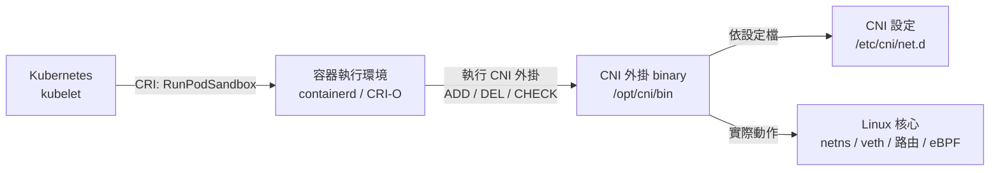
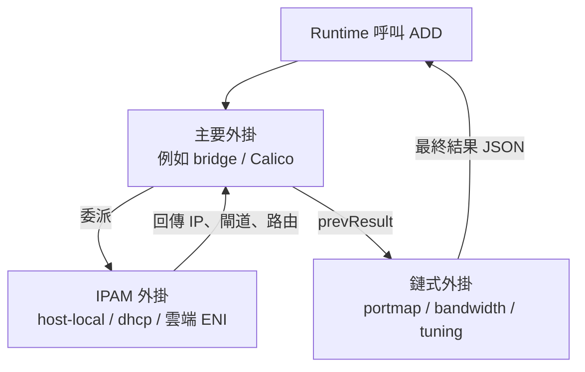
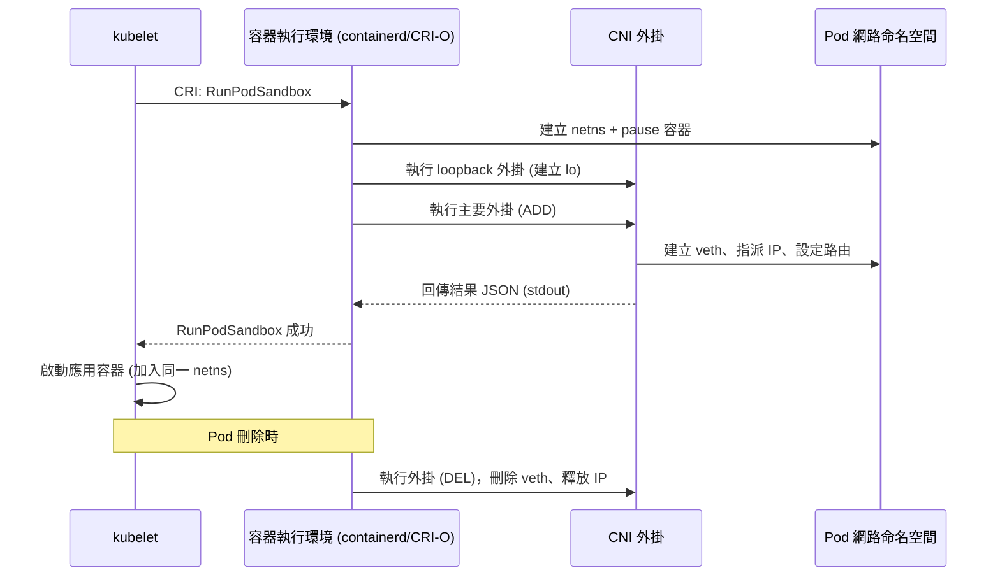

# 通俗解釋 Kubernetes 的 CNI (Container Network Interface)

## 前言：一句話版本

CNI 是「容器執行環境」（runtime）與「網路外掛」之間的**共同語言（介面規格）**。它本身不做網路，只是規定「當一個容器要被接上網路時，雙方該怎麼講話」[^cni-repo][^k8s-np]。

打個比方：CNI 不是水電師傅，而是「水電施工的標準合約」。合約規定「請幫這間房間接水、接電，並回報你做了什麼」，但真正接線的是誰、用什麼工法（橋接、覆蓋網路、eBPF……），都可以換人做。

---

## 一、為什麼需要 CNI？它解決什麼問題

Kubernetes 的網路模型要求：

- 每個 **Pod** 都有自己的 IP[^k8s-np]。
- Pod 之間可以不經 NAT 直接互通。
- 節點（Node）與 Pod 之間也可以互通。

問題是：**「怎麼接線」跟環境高度相關**。在雲端 VPC、裸機、地端機房、不同雲廠商，最好的做法都不一樣。如果 Kubernetes 把某一種做法寫死，就無法適應所有場景[^k8s-np]。

於是 Kubernetes 把網路層做成**可插拔（pluggable）**：Kubernetes 只負責說「請幫這個 Pod 準備好網路」，實際用哪套方案由你選的外掛決定。而 CNI 就是這個「請」的標準格式。

CNI 專案自己的說法是：CNI 只關心容器的網路連通性，以及容器被刪除時回收已配置的資源；因為範圍專注，所以規格簡單、支援廣泛。它也明確指出存在的理由：**為了避免重複造輪子，應該在網路外掛與容器執行環境之間定義一個共同介面**[^cni-repo]。

---

## 二、最常見的誤解：CNI ≠ CNI 外掛

| 名詞 | 是什麼 | 例子 |
|---|---|---|
| **CNI 規格（Spec）** | 一份文件 + 一套協定，定義 runtime 與外掛如何溝通，與程式語言無關 | containernetworking/cni 的 `SPEC.md`[^cni-spec] |
| **CNI 外掛（Plugin）** | 真正做事的**執行檔（binary）**，被 runtime 呼叫 | Calico、Cilium、Flannel[^k8s-np] |
| **Kubernetes 網路外掛** | 泛指整個解決方案（通常含 CNI 外掛 + 控制器 + DaemonSet） | Cilium、Calico 的整套部署[^k8s-np] |

所以：**CNI 是規則書，外掛是實作**。Kubernetes 官方要求你使用「相容於 CNI 規格 v0.4.0 或更後版本」的外掛，並推薦相容 v1.0.0 規格者[^k8s-np]。目前 CNI 規格最新版為 **1.1.0**（規格版本與程式庫、外掛版本是各自獨立的）[^cni-spec]。



---

## 三、CNI 規格到底定義了什麼

根據 CNI 規格的 Summary，它定義了五件事[^cni-spec]：

1. 管理員定義網路設定的**格式**。
2. 容器執行環境向網路外掛發出請求的**協定**。
3. 依給定設定**執行外掛的程序**。
4. 外掛把功能**委派**給其他外掛的程序。
5. 外掛回傳結果給 runtime 的**資料型別**。

### 3.1 設定檔格式（JSON）

一份網路設定是一個 JSON 物件，關鍵欄位如下[^cni-spec]：

| 欄位 | 說明 |
|---|---|
| `cniVersion` | 使用的 CNI 規格語意化版本，如 `"1.1.0"` |
| `name` | 網路名稱，主機上必須唯一 |
| `plugins` | 一串外掛設定物件（這就是「外掛鏈」） |
| `disableCheck` | 若為 true，runtime 不得呼叫 `CHECK` |

每個外掛物件最關鍵的必填欄位是 `type`，它**對應磁碟上外掛執行檔的名稱**[^cni-spec]。

```jsonc
{
  "cniVersion": "1.1.0",
  "name": "dbnet",
  "plugins": [
    {
      "type": "bridge",
      "bridge": "cni0",
      "ipam": { "type": "host-local", "subnet": "10.1.0.0/16" }
    },
    { "type": "portmap", "capabilities": { "portMappings": true } }
  ]
}
```

### 3.2 呼叫方式：環境變數 + stdin + stdout

runtime 用**環境變數**傳參數、用 **stdin** 傳設定（JSON）、從 **stdout** 讀回結果（JSON）；失敗時把錯誤寫到 **stderr**[^cni-spec]。

| 環境變數 | 意義 |
|---|---|
| `CNI_COMMAND` | `ADD` / `DEL` / `CHECK` / `GC` / `VERSION` |
| `CNI_CONTAINERID` | 容器（sandbox）唯一 ID |
| `CNI_NETNS` | 容器網路命名空間路徑，例如 `/run/netns/cni-abc123` |
| `CNI_IFNAME` | 要在容器內建立的介面名稱，通常是 `eth0` |
| `CNI_ARGS` | 額外的鍵值參數 |
| `CNI_PATH` | 搜尋外掛執行檔的路徑清單[^cni-repo] |

### 3.3 三個核心指令

- **`ADD`**：在 `CNI_NETNS` 內建立 `CNI_IFNAME` 指定的介面，或調整其設定；成功時必須在 stdout 輸出結果結構[^cni-spec]。
- **`DEL`**：刪除該介面，或還原 `ADD` 做過的修改。`DEL` 是**盡力而為（best-effort）**：即使資源早已不存在，也必須回報成功，且必須能重複被呼叫（idempotent）[^cni-spec]。
- **`CHECK`**：讓 runtime 探測既有容器的網路狀態是否符合預期，外掛需對照 `prevResult` 檢查介面、位址、路由是否仍存在且有效[^cni-spec]。

新版本規格另加了 `STATUS`（回報外掛是否就緒）、`VERSION`（回報支援的版本）、`GC`（清理殘留資源）[^cni-spec]。

---

## 四、CNI 的兩大職責：接線 + 發 IP

CNI 把工作拆成兩塊[^cni-spec]：

1. **介面建立（Interface）**：由「Interface 外掛」負責，在容器內建立網路介面並確保連通性。
2. **IP 位址分配（IPAM）**：由「IPAM 外掛」負責。外掛可透過 `CNI_PATH` 找到並**委派**給另一個外掛，這就是 `ipam` 欄位的作用[^cni-spec]。

另外還有「Chained 外掛」（調整既有介面的設定）與「Meta 外掛」（如 `portmap` 做連接埠映射、`bandwidth` 限速、`tuning` 調整 sysctl）[^cni-spec]。



**外掛鏈的順序很重要**：`ADD` 時**依序**執行，每個外掛會收到前一個外掛的結果作為 `prevResult`；`DEL` 時則**反向**執行[^cni-spec]。

---

## 五、Pod 建立時，CNI 實際上被誰呼叫？

這是最容易被誤解的一點。**kubelet 不會直接呼叫 CNI 外掛**[^k8s-np][^containerd-arch]。



流程是這樣[^k8s-np][^containerd-arch][^tigera]：

1. kubelet 透過 **CRI（Container Runtime Interface）** 發出 `RunPodSandbox` 請求。
2. **容器執行環境（containerd、CRI-O）** 建立 Pod 的網路命名空間與 pause 容器。
3. **執行環境（不是 kubelet）呼叫 CNI 外掛**。
4. kubelet 等到 sandbox 成功後，才啟動應用容器，讓它們加入同一個網路命名空間。
5. Pod 刪除時，runtime 呼叫 `DEL` 回收資源。

### 為什麼是 runtime 而不是 kubelet？

在 Kubernetes 1.24 之前，kubelet 可以直接與 Docker Engine 溝通（透過名為 **dockershim** 的內建轉接層），因此 kubelet 自己也負責載入與呼叫 CNI 外掛。**dockershim 在 v1.24 被移除後**，kubelet 就只剩 CRI 一條路，網路交給 runtime 處理。官方文件明確寫道[^k8s-np]：

> 在 Kubernetes 1.24 之前，CNI 外掛也可由 kubelet 透過 `cni-bin-dir` 與 `network-plugin` 命令列參數管理；**這些參數在 1.24 被移除，CNI 管理已不再屬於 kubelet 的職責範圍。**

因此，在 1.24+ 的叢集上，CNI 要在 **runtime 的設定檔**裡設定（例如 containerd 的 `[plugins."io.containerd.grpc.v1.cri".cni]` 區段的 `bin_dir`、`conf_dir`）[^k8s-np][^dockershim-faq]。

---

## 六、節點上 CNI 的東西放在哪

| 路徑 | 內容 | 說明 |
|---|---|---|
| `/etc/cni/net.d` | **設定檔**（`.conf` / `.conflist`） | runtime 的預設 `conf_dir`；檔案不只一份時，通常取字母序第一份[^k8s-np][^cni-repo] |
| `/opt/cni/bin` | **外掛執行檔** | runtime 的預設 `bin_dir`；CNI README 說 `CNI_PATH` 用來告訴程式去哪裡找外掛[^k8s-np][^cni-repo] |

舊的 kubelet 參數對照（**1.24 起已移除，別再用**）[^k8s-np]：

- `--network-plugin=cni`：叫 kubelet 自己用 CNI。
- `--cni-bin-dir`（預設 `/opt/cni/bin`）：外掛執行檔位置。
- `--cni-conf-dir`（預設 `/etc/cni/net.d`）：設定檔位置。

---

## 七、外掛拿到 netns 之後，到底做了什麼？

CNI 外掛用的是 Linux 核心的基本積木：**網路命名空間（netns）**、**veth pair**、**路由**[^tigera]。

- **網路命名空間**：一份獨立的網路堆疊（介面、路由、iptables、socket）。外掛會進入 `CNI_NETNS` 指向的命名空間進行設定。
- **veth pair**：兩端相連的虛擬網路線，一端進、另一端出。外掛建立一對 veth 後：
  - 把其中一端**移入 Pod 的命名空間並改名為 `eth0`**（應用程式看到的就是這個）。
  - 另一端留在主機上，各家命名慣例不同：Calico 用 `cali*`、Cilium 用 `lxc*`、Flannel 用 `cni0`。
- **IP 指派（IPAM）**：由 IPAM 外掛回傳 IP、閘道與路由，外掛把 Pod IP 指派給命名空間內的 `eth0`。
- **路由**：Pod 內通常設一條經由 `eth0` 的預設路由；主機上則為該 Pod IP 加上指向主機側 veth 的 `/32` 主機路由。

**跨節點互通**就交給各 CNI 自選的模型：覆蓋網路（VXLAN/Geneve）、BGP 路由（不封裝）、eBPF 資料路徑，或直接使用雲端 VPC 的真實 IP[^tigera]。

---

## 八、常見的 CNI 外掛（附 GitHub 星數）

以下星數為本次查證時 GitHub 頁面所顯示的約略值[^gh-stars]：

| 外掛 | 定位 | GitHub 星數 |
|---|---|---|
| **Cilium** | 基於 eBPF 的網路、安全與可觀測性 | 約 25.6k |
| **Flannel** | 為 Kubernetes 設計的簡單網路織網（overlay） | 約 9.5k |
| **Calico** | 雲原生網路與網路安全 | 約 7.4k |
| **Weave Net** | 簡單、具韌性的多主機容器網路（**已於 2024-06-20 封存，停止開發**） | 約 6.6k |
| **Antrea** | 基於 Open vSwitch 的 Kubernetes 網路 | 約 1.8k |

> 註：GitHub 星數只反映社群關注度，不等於實際採用率。例如 Calico 的 README 自稱其解決方案每日支撐超過 800 萬個節點，但星數低於 Cilium[^gh-stars]。

---

## 九、重點回顧

1. **CNI 是介面規格，不是網路實作**；實作是各種外掛 binary。
2. 它讓 Kubernetes 的網路層**可插拔**，避免寫死某一種接線方式。
3. 規格定義了**設定檔格式**與**呼叫協定**（環境變數 + stdin/stdout）。
4. 三個核心指令：`ADD`、`DEL`、`CHECK`（較新版本另有 `STATUS`、`VERSION`、`GC`）。
5. 職責拆成**接介面**與**發 IP（IPAM）**，並支援外掛鏈與委派。
6. **1.24 之後是 runtime 呼叫 CNI，不是 kubelet**。
7. 設定檔在 `/etc/cni/net.d`，外掛在 `/opt/cni/bin`。

---

## 參考資料

[^cni-repo]: CNCF (n.d.). *Container Network Interface (CNI) — networking for Linux containers* [GitHub repository]. GitHub. Retrieved 2026-10-11, from https://github.com/containernetworking/cni

[^cni-spec]: CNCF (n.d.). *CNI Specification*. CNI. Retrieved 2026-10-11, from https://raw.githubusercontent.com/containernetworking/cni/main/SPEC.md

[^k8s-np]: The Kubernetes Authors (n.d.). *Network Plugins*. Kubernetes Documentation. Retrieved 2026-10-11, from https://kubernetes.io/docs/concepts/extend-kubernetes/compute-storage-net/network-plugins/

[^containerd-arch]: The containerd Authors (n.d.). *CRI architecture*. containerd Documentation. Retrieved 2026-10-11, from https://github.com/containerd/containerd/blob/main/docs/cri/architecture.md

[^tigera]: Tigera (n.d.). *What is Kubernetes CNI?*. Tigera. Retrieved 2026-10-11, from https://www.tigera.io/learn/guides/kubernetes-networking/kubernetes-cni/

[^gh-stars]: GitHub (n.d.). *Repository pages for cilium/cilium, projectcalico/calico, flannel-io/flannel, weaveworks/weave, antrea-io/antrea*. GitHub. Retrieved 2026-10-11, from https://github.com/cilium/cilium, https://github.com/projectcalico/calico, https://github.com/flannel-io/flannel, https://github.com/weaveworks/weave, https://github.com/antrea-io/antrea

[^dockershim-faq]: The Kubernetes Authors (2022, February 17). *Dockershim removal FAQ*. Kubernetes Blog. Retrieved 2026-10-11, from https://kubernetes.io/blog/2022/02/17/dockershim-faq/
