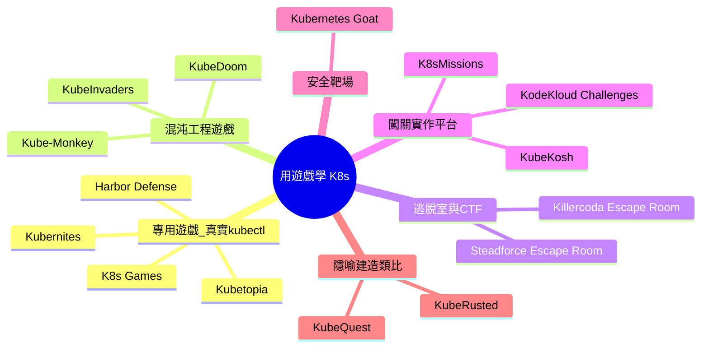

# 用遊戲學習 Kubernetes：遊戲化學習資源總覽

## 摘要

本報告調查「以遊戲（game）輔助學習 Kubernetes（K8s，一種容器编排系統）」的現況。Kubernetes 以學習曲線陡峭著稱，其「學習曲線」問題在多聲文獻回顧中被列為學術研究仍待探索的挑戰之一[^shamim]。為降低入門門檻並提升實作動機，社群與廠商發展出多種類型的遊戲化資源，大致可分為六類：可直接輸入真實 `kubectl` 指令的專用遊戲、混沌工程類遊戲、逃脫室與 CTF（Capture The Flag）挑戰、闖關式實作平台、安全靶場（vulnerable-by-design），以及以隱喻包裝的建造／類比遊戲。本報告逐一介紹其作者、授權、GitHub 星數與維護狀態，並整理目前可見的教育成效研究證據。

## 背景：為什麼要用遊戲學 Kubernetes

Kubernetes 的抽象概念眾多（Pod、Deployment、Service、Ingress 等），且其設計本身吸收了分散式系統的內在複雜度，導致學習曲線陡峭[^cncfcomplex]。一份多聲文獻回顧分析 321 份網路資料與 105 篇同儕審查文獻後指出，Kubernetes 的「學習曲線」是實務者面臨、但在學術研究中仍「未被充分探索（under-explored）」的挑戰之一[^shamim]。

另一方面，CNCF（Cloud Native Computing Foundation）2025 年度雲原生調查（n=628）顯示，「文化變革」首次超越技術複雜度成為最大障礙（47%），其次是「缺乏訓練」（36%）與「技術複雜度」（34%）[^cncfsurvey]。這意味著 Kubernetes 的推廣瓶頸已從「技術是否複雜」轉向「人是否能適應與受訓」，而遊戲化正是回應「訓練」與「動機」問題的一種手段。

一般教育領域的遊戲化證據相對樂觀：一份納入 41 項研究、超過 5,071 名參與者的統合分析（meta-analysis）發現，遊戲化對學習成果有「大」的整體正向效果（Hedges' g = 0.822，95% 信賴區間 0.567–1.078）[^meta]。不過，該研究也提醒單純的「積分／徽章／排行榜」式設計低估了遊戲化的潛力。

## 遊戲化資源分類

## 一、可直接輸入真實 kubectl 的專用遊戲

### K8s Games（k8sgames）

由 Rohit G（GitHub：rohitg00）開發的瀏覽器 3D 叢集模擬遊戲，使用 Three.js 建構，無需安裝或註冊[^k8sgames_api][^k8sgames_site]。遊戲包含五種模式：Campaign（20 關、5 章）、Chaos（無盡生存）、Sandbox（自由建造並由 Architecture Advisor 評分）、Challenges（10 個限時情境），以及 K8s Draw（3D 架構白板，可匯出 YAML/PNG）[^k8sgames_site]。其核心特色是按 `/` 可開啟 kubectl 指令列，輸入 `get pods`、`describe deployment nginx`、`scale deployment nginx --replicas=3`、`drain node-1` 等真實指令並支援 Tab 補全[^k8sgames_site]。遊戲建模 25 種 K8s 資源與 29 種故障（OOMKilled、CrashLoopBackOff、ImagePullBackOff、節點 NotReady 等），並具備 40 項成就與 30 級 XP 系統[^k8sgames_site]。授權為 Apache-2.0，約 1,399 顆星[^k8sgames_api]。

### Kubetopia（隸屬 KubeQuest 生態）

由 Geeth Sandaru 透過 CuriouserLabs 組織開發的免費、開源 3D 瀏覽器模擬器，首頁為 `play.kubequest.org`[^kubetopia_api][^kubequest_site]。玩家扮演卡通 3D 小島城鎮的值班工程師，以真實 `kubectl` 指令驅動一個純前端（client-side）的模擬叢集：其引擎是以 TypeScript 手寫的協調迴圈（reconciliation loop），每個 `tick()` 約等於一秒，模擬 Deployment 協調、排程、Pod 生命週期與回收[^kubetopia_readme]。遊戲含兩條戰役路線：CKA 風格的「City Campaign」（7 個任務）與 CKAD 風格的「Hospital Campaign」（5 個任務）[^kubetopia_readme]。任務完成條件以「叢集狀態是否真的健康」判定，而非腳本化通關[^kubetopia_readme]。其 GitHub 儲存庫為 Next.js + React Three Fiber，目前星數極少（1 顆）但持續更新[^kubetopia_api]。此專案為獨立、非官方工具，與 Linux Foundation / CNCF 無隸屬關係[^kubetopia_readme]。

### Kubernites

獨立開發者 waxb 於 itch.io 發行的「溫馨中世紀城鎮建造」遊戲，售價為「自行定價（name your own price）」[^kubernites]。遊戲將 K8s 概念隱喻化：茅屋等於 Pod、Keep 等於 Node，災難對應真實叢集故障（CrashLoopBackOff、ImagePullBackOff、OOMKilled、chaos monkey、load test）[^kubernites]。遊戲內「Speaking Stone」是一個 kubectl 主控台，可 `get nodes`、擴縮 Deployment、部署與回滾映像，或撰寫／套用 YAML[^kubernites]。其底層模擬「固定於 Kubernetes 1.37 版」，並在故事偏離規則處明確說明[^kubernites]。目前仍在開發中（版本 0.13.13），開發過程有 AI 輔助[^kubernites]。

### Harbor Defense

由 ericomanoff 開發的早期專案，讓每艘船是真實 kind 叢集中的 Pod，遊戲本身是 Kubernetes API 的圖形介面前端，用於教學 Deployment 自癒與 HPA 自動擴縮，並顯示每個動作實際執行的 YAML/kubectl[^multi]。目前星數為 0、提交數少，維護狀態不明[^multi]。

## 二、混沌工程類遊戲

### KubeInvaders

由 Eugenio Marzo（lucky-sideburn）開發、受《Space Invaders》啟發的「遊戲化混沌工程與教育工具」，每個外星人代表一個 Pod 或 Node，擊落後可觀察叢集在高壓下的反應[^kubeinv_api][^kubeinv_gh]。此專案獲 CNCF 推薦，並被列入 CNCF Landscape 的「Observability and Analysis → Chaos Engineering」類別[^kubeinv_gh][^cncfblog]。其官方定位包含「用於教學 Kubernetes（used for teaching Kubernetes）」[^kubeinv_gh]。它包含一個「Quick Start（不需叢集）」模式：內建由 KWOK 驅動的示範叢集，因此無真實叢集也能體驗（不會真的刪除資源）[^kubeinv_gh][^kwok]。授權為 Apache-2.0，約 1,129 顆星，2026 年 10 月仍有提交[^kubeinv_api]。

### KubeDoom

由 Henning Jacobs（storax）開發，在 Id Software 的《DOOM》中射殺 Pod（或 namespace）來「殺死」它們，屬於混沌工程的遊戲化，需 cluster-admin 權限[^kubedoom_api][^multi]。授權為 GPL-3.0，約 2,173 顆星[^kubedoom_api]。

### Kube-Monkey

由 asobti 開發，是 Netflix「Chaos Monkey」在 Kubernetes 上的實作，透過隨機終止 Pod 讓使用者理解韌性[^kubemonkey_api]。授權為 Apache-2.0，約 3,082 顆星，2026 年 9 月仍有提交[^kubemonkey_api]。

## 三、逃脫室與 CTF 挑戰

### Steadforce Kubernetes Escape Room

由 Steadforce 開發、以「巫師學徒」為主題的逃脫室，玩家須修復標記為紅圈的損壞 Kubernetes 資源才能「逃脫」，可在 GitHub Codespaces 或本機執行，並使用 k9s/kubectl[^steadforce_api][^multi]。授權為 Apache-2.0，約 34 顆星，2026 年 10 月仍活躍提交[^steadforce_api]。

### Killercoda 逃脫室情境

Killercoda 為瀏覽器互動實驗平台，社群在其上發布多個 K8s 逃脫室情境。例如 ralph-pam24 的「5 房間」逃脫遊戲涵蓋 Service → ConfigMap → PVC → Secret → NetworkPolicy，每間房有自動檢查腳本[^multi]。Killercoda 官方的 `scenario-examples` 儲存庫提供 K8s 情境範例，約 139 顆星[^killercoda_api]。

### K8s Dungeon Crawl

由 Kim Schaefer（schaeferka）開發，在 Kubernetes 叢集內遊玩經典 roguelike 遊戲 BrogueCE，並以一個 controller 扮演「地牢主人」驗證與變更遊戲／K8s 物件[^dungeon_api]。其遊戲內怪物是真實的 Kubernetes 資源（以 Monster CRD 定義），用以教學 controller、CRD、validating/mutating webhook 與 Prometheus/Grafana 可觀測性[^multi]。授權為 Apache-2.0，約 20 顆星[^dungeon_api]。

## 四、闖關式實作平台

### KodeKloud：Game of Pods 與 Kubernetes Challenges

Game of PODs 是 KodeKloud 的免費挑戰課程，最初由 Mumshad Mannambeth 講授，以《冰與火之歌》為戲謔主題，挑戰名稱包含 Bravo、Pento、Tyro、Redis Islands、Iron Gallery、Voting App 等[^gop_kodekloud]。其玩法是「挑戰入口網站會另開視窗，給你應用程式的架構圖與倒數計時器，須在時間內完成所有任務」[^gop_kodekloud]。此課程已被遷移：`kodekloud.com/p/game-of-pods` 現重新導向至「Kubernetes Challenges」，後者同樣免費，描述與原 Game of PODs 幾乎相同[^gop_kodekloud]。其公開解答儲存庫 `kodekloudhub/kubernetes-challenges` 約 228 顆星、329 次 fork[^kkloud_api]；第三方鏡像 `5kr1p7/game-of-pods` 約 27 顆星且自 2021 年後未再提交[^gop_api]。

### KubeKosh

由 zeborg 開發的自架式（self-hosted）Kubernetes 實作實驗室：在單一 Docker 容器內執行真實的 K3s 叢集，搭配瀏覽器終端機與自動化情境驗證，無需雲端帳號或本機叢集[^kubekosh_gh][^kubekosh_api]。情境依「Tracks（主題）→ Bundles（學習集）→ Scenarios」三層組織，涵蓋 Kubernetes 基礎（40 個情境）、Gateway API、CKAD／CKA／CKS 認證準備、Istio、Traefik、HAProxy Ingress、Falco 等，並含 Task（動手操作）與 MCQ（選擇題）兩種題型與考試模式[^kubekosh_gh]。啟動方式為 `docker run -itd --name kubekosh --privileged -p 7554:80 zeborg/kubekosh:latest`[^kubekosh_gh]。授權為 Apache-2.0，約 243 顆星[^kubekosh_api][^kubekosh_gh]。

### K8sMissions

由 Jalil Abdollahi 開發、全在地端（fully local）執行的遊戲化 K8s 訓練平台，標語為「透過弄壞它來學 Kubernetes，然後修好它」[^k8smissions_gh]。它提供橫跨 12 個模組、共 200 個漸進式挑戰（從初學者到生產環境 SRE），共 55,925 XP[^k8smissions_gh]。每關提供故意損壞的 `broken.yaml` 與對照的 `solution.yaml`，玩家須以真實 kubectl 診斷並修復[^k8smissions_gh]。遊戲化元素包含 XP 與等級、每模組的終端機證書、漸進式提示、時間追蹤、dry-run 模式、watch 自動驗證模式等[^k8smissions_gh]。它預設啟用 RBAC 安全防護，將操作限制在 `k8smissions` namespace 並阻止刪除關鍵 namespace[^k8smissions_gh]。授權為 MIT，但星數極少（2 顆）[^k8smissions_api]。

### KubeStellar Console 的 Learning Arcade

KubeStellar 是 CNCF Sandbox 專案，其 Console 子專案內建「Kubernetes Learning Arcade」，提供無需沙盒叢集的遊戲化學習[^arcade][^kubestellar_api][^multi]。Arcade 宣稱的功能包含 Pod 排程遊戲、網路政策解謎、故障排除情境、成就系統，以及可與同事競賽的團隊排行榜（追蹤速度、準確率與完成挑戰數）[^arcade]。實際的 arcade 儀表板卡片多為經典遊戲的雲原生改名版本（如 Kube Chess、Container Tetris、Pod Sweeper、Kubedle 等）[^arcade]。Arcade 頁面的結構化資料標示價格為 0 美元，底層 Console 以 Apache-2.0 開源，約 143 顆星[^arcade][^kubestellar_api]。

## 五、安全靶場（Vulnerable-by-Design）

### Kubernetes Goat

由 Madhu Akula 開發的「刻意設計成有漏洞」的叢集環境，用於以互動式動手遊樂場學習與練習 Kubernetes 安全，標語為「刻意設計成有漏洞的叢集環境，以互動式動手遊樂場學習與練習 Kubernetes 安全」[^goat_gh][^goat_api]。它包含 22 個編號情境（其中情境 09 標記為 deprecated），涵蓋原始碼敏感金鑰、DIND 漏洞利用、SSRF、容器逃逸、CIS 基準分析、私有 registry 攻擊、NodePort 暴露、RBAC 最小權限設定錯誤，以及以 Falco、KubeAudit、Popeye、Cilium Tetragon、Kyverno 等工具進行的防禦與稽核[^goat_gh]。文件明確警告「請勿與生產環境一同執行」[^goat_gh]。授權為 MIT，約 5,906 顆星、1,085 次 fork，是本清單中星數最高的開源專案之一[^goat_api][^goat_gh]。

## 六、隱喻建造／類比遊戲

### KubeRusted

一個免費的瀏覽器遊戲，教學重點為 Kubernetes 叢集架構：玩家要將 53 個真實 Kubernetes 元件拖入叢集的 11 個層次，並在各層之間擊敗「測驗魔王（quiz bosses）」[^kuberusted]。它另有「k9s Lab」，在模擬叢集上提供 18 個故障排除任務（CrashLoopBackOff、OOMKilled、就緒探針失敗、Pending Pod、Service selector 拼字錯誤、rollback、node drain、HPA 自動擴縮等）[^kuberusted]。此外提供涵蓋 16 項 CNCF 認證的準備路徑與 76 個動手練習、名為 KubeChampions 的公開排行榜（以 KubePoints 計分）[^kuberusted]。作者為 Emmanouil Gaitanakis（LinkedIn 顯示其任職於 Vodafone），他自述「因為我很享受在遊戲化環境中學習」而開發此遊戲[^kuberusted]。此為專有（proprietary）網站，未公開授權資訊，找不到公開的 GitHub 儲存庫[^kuberusted]。

### KubeQuest（多個同名專案）

「KubeQuest」一名被多個獨立專案使用，須注意區分：

- **CuriouserLabs/KubeQuest**：Geeth Sandaru 的 CKA/CKAD 免費開源讀書計畫與進度追蹤器，含依官方考試領域權重加權的進度視覺化與本地驗證的技能檢查[^kubequest_api][^kubequest_site]，與前述 Kubetopia 共用同一 Google 登入[^kubequest_site]。星數為 0[^kubequest_api]。
- **i-apologise/kubequest**：以終端機進行的 kubectl 學習遊戲，附即時 OTel 儀表板，可透過 GitHub Pages 啟動 Codespaces 遊玩[^iapolo_api]。星數為 0[^iapolo_api]。
- **najahaboobackar/kubequest**：以城市建造教學 K8s（Pods = 房屋、Nodes = 建築、Services = 計程車）的 React 專案，星數為 0[^multi]。

另有眾多星數極低（0–2 顆）的早期專案，例如 KubeClash（故障排除戰鬥）、ClusterShip（終端機海戰）、Kube Bucket（類俄羅斯方塊）、Kube Commander（Godot 卡牌遊戲）等，多數提交數極少、維護狀態不明[^multi]。

## 綜合比較

下表整理本報告涵蓋的主要資源（星數以 2026-10-11 前後查核的 GitHub API 為準，可能隨時變動）：

| 名稱 | 類型 | 開發者／組織 | 授權 | GitHub 星數 | 是否需真實叢集 |
|---|---|---|---|---|---|
| Kubernetes Goat | 安全靶場 | Madhu Akula | MIT | 5,906 | 是（或雲端） |
| Kube-Monkey | 混沌工程 | asobti | Apache-2.0 | 3,082 | 是 |
| KubeDoom | 混沌工程 | Henning Jacobs | GPL-3.0 | 2,173 | 是 |
| K8s Games | 專用遊戲 | Rohit G | Apache-2.0 | 1,399 | 否（模擬） |
| KubeInvaders | 混沌工程／教育 | Eugenio Marzo | Apache-2.0 | 1,129 | 否（內建 KWOK） |
| KubeKosh | 闖關平台 | zeborg | Apache-2.0 | 243 | 是（容器內 K3s） |
| KodeKloud Kubernetes Challenges | 闖關平台 | KodeKloud | 未標示 | 228 | 是 |
| KubeStellar Console Arcade | 遊戲化儀表板 | KubeStellar（CNCF Sandbox） | Apache-2.0 | 143 | 否 |
| Steadforce Escape Room | 逃脫室 | Steadforce | Apache-2.0 | 34 | 是 |
| K8s Dungeon Crawl | Roguelike | Kim Schaefer | Apache-2.0 | 20 | 是 |
| K8sMissions | 闖關平台 | Jalil Abdollahi | MIT | 2 | 是（kind） |
| Kubetopia | 專用遊戲 | CuriouserLabs | 未標示 | 1 | 否（模擬） |
| KubeRusted | 隱喻遊戲 | Emmanouil Gaitanakis | 專有 | 無公開儲存庫 | 否 |
| Kubernites | 隱喻建造 | waxb | 商業（自行定價） | 無公開儲存庫 | 否 |

> 註：GitHub 星數為近似值，會隨時間變動；部分專案（如 Kubetopia、KubeQuest）星數極低但仍在積極開發。

## 教育成效的研究證據

截至目前，查核結果顯示**缺乏專門針對「以遊戲教 Kubernetes」的同儕審查對照實驗**：對 arXiv 檢索 `Kubernetes AND gamification` 未得到直接相關結果，而檢索到的同儕審查文獻多是在「以 Kubernetes 作為基礎設施」時才同時出現這兩個詞[^research]。現有可用的間接證據包括：

- **DevOps 課程的間接遊戲化研究**：Devare 以第三方競賽（Hacktoberfest）作為「間接遊戲化」，實驗組 15 名學生在成績上優於對照組 52 名學生；作者同時指出遊戲化成效取決於年齡層、程度、課程內容與學習環境[^devare]。
- **產業界 DevOps 徽章遊戲化研究**：Ayoup 等人對一家大型企業 333 個專案的研究發現，遊戲化加速了某些 DevOps 實務的採用至少 60%，部分採用率提升達 6 倍；45 名開發者的調查中 73% 認為徽章有助於學習與採用新實務，但結果呈現混合（例如測試徽章使修 bug 提交增加，卻使提交數與 PR 數下降）[^ayoup]。
- **Kubernetes 學習曲線的研究缺口**：Shamim 等人的多聲文獻回顧明確將「學習曲線」列為學術上仍未被充分探索的挑戰[^shamim]。

因此，市面上的遊戲化 K8s 工具（k8sgames、KubeStellar Arcade、KodeKloud 等）多為社群或商業產品，缺乏已發表的同儕審查成效數據[^research]。

## 觀察與建議

1. **兩種主要設計範式**：其一是「弄壞再修好（break-and-fix）」的故障排除遊戲（K8sMissions、KubeClash、KubeRusted 的 k9s Lab、各類逃脫室）；其二是以隱喻包裝的建造遊戲（Kubernites、KubeRusted、城市建造類 KubeQuest）[^multi]。
2. **真實 kubectl 是關鍵區隔**：對 CKA／CKAD 等實作導向認證而言，能輸入真實 `kubectl` 指令的模擬器（K8s Games、Kubetopia、K8sMissions、KubeKosh）比純問答或純隱喻遊戲更具技能遷移價值，因為它們訓練的是可移轉的指令操作[^k8sgames_site][^kubetopia_readme][^k8smissions_gh][^kubekosh_gh]。
3. **低門檻的趨勢**：2025–2026 年出現大量「純瀏覽器、無需安裝或真實叢集」的 3D／模擬遊戲（K8s Games、KubeRusted、Kubetopia），降低了初學者的起步摩擦[^kuberusted][^k8sgames_site][^kubetopia_readme]。
4. **星數與活躍度不必然一致**：本清單中星數最高的多為混沌工程與安全靶場（Kubernetes Goat、Kube-Monkey、KubeDoom），但純教學遊戲的最高星者為 K8s Games（約 1,399 顆）[^goat_api][^kubemonkey_api][^kubedoom_api][^k8sgames_api]；同時存在大量 0–2 顆星、仍積極開發的新專案，評估時應兼看提交活躍度而非僅看星數[^multi]。
5. **授權須注意**：多數開源專案採 Apache-2.0 或 MIT，KubeDoom 採 GPL-3.0；部分熱門工具（KubeRusted、Kubernites）為專有或商業軟體，未公開授權[^kuberusted][^kubernites][^kubedoom_api]。

## 參考文獻

[^k8sgames_api]: rohitg00. (2026). *k8sgames* [Computer software]. Retrieved 2026-10-11, from https://api.github.com/repos/rohitg00/k8sgames

[^k8sgames_site]: Rohit G. (n.d.). *K8s Games: Learn Kubernetes by playing*. Retrieved 2026-10-11, from https://k8sgames.com

[^kubetopia_api]: CuriouserLabs. (2026). *Kubetopia* [Computer software]. Retrieved 2026-10-11, from https://api.github.com/repos/CuriouserLabs/Kubetopia

[^kubetopia_readme]: CuriouserLabs. (2026). *Kubetopia README*. Retrieved 2026-10-11, from https://raw.githubusercontent.com/CuriouserLabs/Kubetopia/main/README.md

[^kubequest_site]: Geeth Sandaru. (n.d.). *KubeQuest and Kubetopia*. Retrieved 2026-10-11, from https://play.kubequest.org

[^kubequest_api]: CuriouserLabs. (2026). *KubeQuest* [Computer software]. Retrieved 2026-10-11, from https://api.github.com/repos/CuriouserLabs/KubeQuest

[^iapolo_api]: i-apologise. (2026). *kubequest* [Computer software]. Retrieved 2026-10-11, from https://api.github.com/repos/i-apologise/kubequest

[^kubernites]: waxb. (2026). *Kubernites* [Computer software]. Retrieved 2026-10-11, from https://waxb.itch.io/kubernites

[^kuberusted]: Gaitanakis, E. (2026). *KubeRusted: Free Kubernetes game to learn cluster architecture*. Retrieved 2026-10-11, from https://kuberusted.com

[^kubeinv_api]: Marzo, E. (2026). *KubeInvaders* [Computer software]. Retrieved 2026-10-11, from https://api.github.com/repos/lucky-sideburn/KubeInvaders

[^kubeinv_gh]: Marzo, E. (2026). *KubeInvaders: Gamified chaos engineering and educational tool for Kubernetes*. Retrieved 2026-10-11, from https://github.com/lucky-sideburn/KubeInvaders

[^cncfblog]: The Kubernetes Authors. (2020, January 22). KubeInvaders - Gamified chaos engineering tool for Kubernetes. *Kubernetes Blog*. Retrieved 2026-10-11, from https://kubernetes.io/blog/2020/01/22/kubeinvaders-gamified-chaos-engineering-tool-for-kubernetes/

[^kwok]: Kubernetes SIGs. (n.d.). *KWOK: Kubernetes WithOut Kubelet*. Retrieved 2026-10-11, from https://kwok.sigs.k8s.io/

[^kubedoom_api]: Jacobs, H. (2024). *kubedoom* [Computer software]. Retrieved 2026-10-11, from https://api.github.com/repos/storax/kubedoom

[^kubemonkey_api]: asobti. (2026). *kube-monkey* [Computer software]. Retrieved 2026-10-11, from https://api.github.com/repos/asobti/kube-monkey

[^steadforce_api]: Steadforce. (2026). *k8s-escape-room* [Computer software]. Retrieved 2026-10-11, from https://api.github.com/repos/steadforce/k8s-escape-room

[^killercoda_api]: killercoda. (2026). *scenario-examples* [Computer software]. Retrieved 2026-10-11, from https://api.github.com/repos/killercoda/scenario-examples

[^dungeon_api]: Schaefer, K. (2025). *k8s-dungeon-crawl* [Computer software]. Retrieved 2026-10-11, from https://api.github.com/repos/schaeferka/k8s-dungeon-crawl

[^gop_kodekloud]: KodeKloud. (n.d.). *Game of PODs / Kubernetes Challenges*. Retrieved 2026-10-11, from https://kodekloud.com/p/game-of-pods

[^kkloud_api]: kodekloudhub. (2025). *kubernetes-challenges* [Computer software]. Retrieved 2026-10-11, from https://api.github.com/repos/kodekloudhub/kubernetes-challenges

[^gop_api]: 5kr1p7. (2021). *game-of-pods* [Computer software]. Retrieved 2026-10-11, from https://api.github.com/repos/5kr1p7/game-of-pods

[^kubekosh_gh]: zeborg. (2026). *KubeKosh: Interactive Kubernetes playground*. Retrieved 2026-10-11, from https://github.com/zeborg/kubekosh

[^kubekosh_api]: zeborg. (2026). *kubekosh* [Computer software]. Retrieved 2026-10-11, from https://api.github.com/repos/zeborg/kubekosh

[^k8smissions_gh]: Abdollahi, J. (2026). *K8sMissions: Learn Kubernetes by breaking it, then fixing it*. Retrieved 2026-10-11, from https://github.com/jalilabdollahi/k8smissions

[^k8smissions_api]: Abdollahi, J. (2026). *k8smissions* [Computer software]. Retrieved 2026-10-11, from https://api.github.com/repos/jalilabdollahi/k8smissions

[^arcade]: KubeStellar. (n.d.). *Kubernetes Learning Arcade*. Retrieved 2026-10-11, from https://console.kubestellar.io/arcade

[^kubestellar_api]: kubestellar. (2026). *console* [Computer software]. Retrieved 2026-10-11, from https://api.github.com/repos/kubestellar/console

[^goat_api]: Akula, M. (2026). *kubernetes-goat* [Computer software]. Retrieved 2026-10-11, from https://api.github.com/repos/madhuakula/kubernetes-goat

[^goat_gh]: Akula, M. (2026). *Kubernetes Goat: Vulnerable by design cluster environment*. Retrieved 2026-10-11, from https://github.com/madhuakula/kubernetes-goat

[^shamim]: Shamim, M. A., Gibson, A., Morrison, P., & Rahman, A. (2022). *Benefits, challenges, and research topics: A multi-vocal literature review of Kubernetes* [Preprint]. arXiv. Retrieved 2026-10-11, from https://arxiv.org/abs/2211.07032

[^cncfcomplex]: Cloud Native Computing Foundation. (2025, March 6). *Too complex: It's not Kubernetes, it's what it does*. Retrieved 2026-10-11, from https://www.cncf.io/blog/2025/03/06/too-complex-its-not-kubernetes-its-what-it-does/

[^cncfsurvey]: The Linux Foundation. (2025). *Kubernetes fuels AI growth, organizational culture remains the decisive factor*. Retrieved 2026-10-11, from https://www.linuxfoundation.org/blog/kubernetes-fuels-ai-growth-organizational-culture-remains-the-decisive-factor

[^meta]: Frontiers in Psychology. (2023). *Effectiveness of gamification on learning outcomes: A meta-analysis*. Retrieved 2026-10-11, from https://www.frontiersin.org/journals/psychology/articles/10.3389/fpsyg.2023.1253549/full

[^devare]: Devare, M. (2022). *Amalgamation of indirect gamification into development and operations (DEVOPS) course teaching* [Preprint]. arXiv. Retrieved 2026-10-11, from https://arxiv.org/abs/2204.04659

[^ayoup]: Ayoup, A., Costa, D. E., & Shihab, E. (2022). *Achievement unlocked: A case study on gamifying DevOps practices in industry* [Preprint]. arXiv. Retrieved 2026-10-11, from https://arxiv.org/abs/2208.05860

[^research]: 綜合自 PubMed／arXiv／Google Scholar 檢索。Retrieved 2026-10-11, from http://export.arxiv.org/api/query?search_query=all:Kubernetes+AND+all:gamification

[^multi]: 綜合自多個 GitHub 儲存庫與搜尋結果（harbor-defense、kubeclash、ClusterShip、kubebucket、k8s-game-rule、najahaboobackar/kubequest、ducknguyen1205/k8s-demo、ralph-pam24/k8s-escape-room 等）。Retrieved 2026-10-11, from https://github.com/search?q=kubernetes+game+learn&type=repositories
