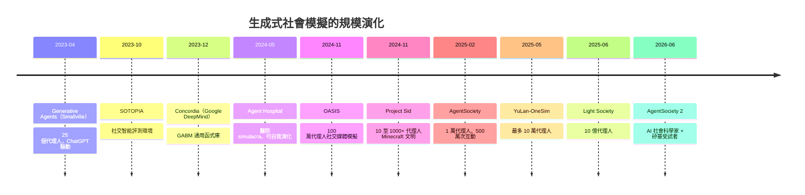
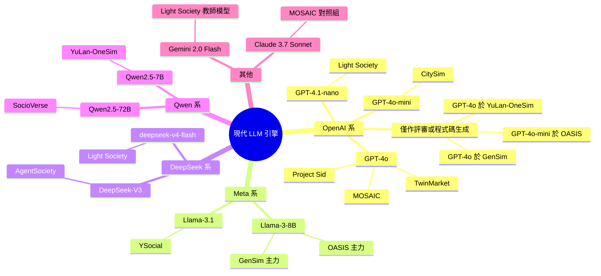

# Generative Agents（2023）在 2026 年的後續發展：其他團隊的改良、擴充與現代 LLM 驅動

## 摘要

2023 年 4 月，史丹佛大學團隊（Joon Sung Park 等人）發表《Generative Agents: Interactive Simulacra of Human Behavior》，提出以大型語言模型（LLM）驅動的生成式代理人架構（記憶流、反思、規劃），並在名為「Smallville」的沙盒小鎮中放置 25 個代理人，示範代理人能自主籌辦情人節派對等湧現行為[^ga2023]。該研究當時以 2023 年的 ChatGPT（GPT-3.5／GPT-4）作為 LLM 引擎[^ga2023]。到 2026 年，該論文已催生一整個「生成式社會模擬」（generative social simulation）研究領域：後續工作不僅來自原團隊，更大量來自其他團隊、其他機構，並改以現代 LLM（GPT-4o、Llama-3、DeepSeek-V3、Qwen2.5、Gemini 2.0 Flash 等）驅動[^agentsociety][^oasis][^concordia]。

本報告系統性整理 2024 至 2026 年間、**以該論文為基礎進行調整或改良**、或**以現代 LLM 重新驅動**的代表性專案，並依「開源框架／大規模平台／領域特化 simulacra／認知心理擴充／驗證與批判」分類，最後反思此領域的證據品質與方法論風險。

---

## 一、原始論文的基準點

要理解後續發展，必須先確定 2023 年原始論文的關鍵數字與設計：

- **發表場合**：第 36 屆 ACM 使用者介面軟體與技術研討會（UIST '23），舊金山[^ga2023]。
- **作者**：Joon Sung Park、Joseph C. O'Brien、Carrie J. Cai、Meredith Ringel Morris、Percy Liang、Michael S. Bernstein[^ga2023]。
- **核心架構**：以自然語言儲存代理人完整經驗紀錄（記憶流，memory stream），隨時間將記憶合成為更高層次的反思（reflection），並動態檢索以規劃行為（planning）[^ga2023]。
- **規模**：一個受《模擬市民》（The Sims）啟發的互動沙盒環境，內含 **25 個代理人**[^ga2023]。
- **代表性湧現行為**：僅給定「某代理人想辦情人節派對」這一單一設定，代理人便自主在兩天內擴散邀請、結識新朋友、互相邀約、協調同時到場[^ga2023]。
- **消融實驗**：觀察（observation）、規劃（planning）、反思（reflection）三個元件對行為可信度皆有關鍵貢獻[^ga2023]。

其官方程式碼庫 `joonspk-research/generative_agents` 至今累積 **約 22.2k 顆星**、3,114 次 fork；但主要分支自 2023 年 8 月起幾乎未再更新（最後一次推送紀錄為 2024-08-05）[^garepo]。換言之，原始實作已實質凍結，**後續的動能全部轉移到其他專案**。

---

## 二、後續發展的四大推力

2024 至 2026 年的後續工作，可歸納為四股力量：

1. **模型替換**：2023 年的 GPT-3.5／GPT-4 成本高且能力有限；2024 年後，Llama-3、DeepSeek-V3、Qwen2.5、Gemini 2.0 Flash 等開源或低價模型使大規模模擬在成本上變得可行[^oasis][^agentsociety][^lightsociety]。
2. **規模擴張**：從 25 個代理人一路推進到 1 萬、10 萬、100 萬，乃至 10 億代理人[^oasis][^agentsociety][^yulan][^lightsociety]。
3. **領域特化**：把「沙盒小鎮」換成醫院、股市、社群媒體、城市、審稿系統等真實場景[^agenthospital][^twinmarket][^ysocial][^citysim]。
4. **方法論反思**：2026 年開始出現大量「這種模擬到底可不可信」的批判與驗證研究[^cookbook][^robustness]。

---

## 三、開源框架與可部署重實作

這一類專案把原始論文的「概念」抽出為可重用、可部署的軟體框架，多半不綁定特定 LLM，而是「自帶模型」（bring your own LLM）。

### 3.1 AI Town（a16z-infra）

- **定位**：MIT 授權的可部署入門套件，讓使用者打造自己的「AI 小鎮」，明確標示「受《Generative Agents》論文啟發」[^aitown]。
- **現代化重點**：以 TypeScript／JavaScript 撰寫，補足「此領域多數模擬器（含原始論文）為 Python」的空缺[^aitown]。
- **LLM**：預設 `llama3` 搭配 `mxbai-embed-large` 向量嵌入；支援 Ollama 本地推論，以及 Together.ai、OpenAI 或任何 OpenAI 相容 API[^aitown]。
- **熱度**：約 **10.6k 星**，最後更新 2026-08-26，仍持續維護[^aitown]。

### 3.2 Concordia（Google DeepMind）

- **定位**：建構「生成式基於代理人的模型」（Generative Agent-Based Models, GABM）的通用函式庫，導入「遊戲主持人」（Game Master）機制，將自然語言行動轉譯為物理／社會／數位環境中的實作[^concordia]。
- **與原始論文關係**：論文明確表示「採用 Park et al. (2023) 的聯想記憶架構」，但設計為「更有彈性、更模組化」[^concordia]。
- **LLM**：**完全模型無關**，README 直言「自帶你的 LLM，任何支援文字取樣的 LLM API 皆可」，另需自備文字嵌入器[^concordia]。
- **熱度**：約 **1.8k 星**，更新至 2026-10-08，Apache-2.0[^concordia]。

### 3.3 AgentTorch

- **定位**：以「大規模人口模型」（Large Population Models, LPM）為核心，可在一般硬體上於數秒內模擬「國家規模」的人口，並支援可微分學習[^agenttorch]。
- **與原始論文關係**：README 區分「LLM 建構數位人類，LPM 建構數位社會」，並透過「LLM Archetypes」與生成式代理人**互補而非取代**[^agenttorch]。
- **LLM**：模型無關；文件示例為 `gpt-3.5-turbo` 與 `gpt-4o-mini`（DspyLLM 後端預設）[^agenttorch]。
- **熱度**：約 **653 星**[^agenttorch]。

---

## 四、大規模社會模擬平台

這是 2024 年後最活躍的一類，核心命題是「把 25 個代理人放大到社會乃至地球規模」。

### 4.1 AgentSociety（清華大學）

- **規模**：超過 **1 萬個代理人**、**500 萬次互動**；引擎設計上支援最高 10k 代理人、每人每日平均 500 次互動[^agentsociety]。
- **架構**：三層心理（情緒、馬斯洛需求層次、認知）＋三類社會行為（移動、社交、就業與消費），並整合都市空間、社交空間、經濟空間[^agentsociety]。
- **LLM**：實驗以 **DeepSeek-V3** 執行；框架支援 OpenAI 相容模型（OpenAI、DeepSeek、Qwen）與 ChatGLM，可經 vllm／ollama 本地部署[^agentsociety]。
- **驗證**：以五項社會議題（極化、煽動訊息擴散、無條件基本收入政策、颶風等外部衝擊、都市永續）進行實驗，結果與真實世界實驗相符[^agentsociety]。
- **熱度**：`tsinghua-fib-lab/AgentSociety` 約 **1.3k 星**，2026 年仍活躍更新，Apache-2.0[^agentsocietyrepo]。

### 4.2 AgentSociety 2（2026）

- **定位**：把「AI 社會科學家」與「矽基受試者」耦合在同一執行環境，形成可執行的社會科學研究環境（executable social science）[^agentsociety2]。
- **貢獻**：AI 社會科學家負責文獻扎根、假設生成、實驗設計、模擬執行、結果詮釋與稿件撰寫；矽基受試者在可配置環境中產生行為回應，將假設轉為可審計的代理人行為、環境規則、干預與量測[^agentsociety2]。
- **驗證**：橫跨七項研究，涵蓋微觀實驗室實驗、中觀社群媒體動態、宏觀都市情境[^agentsociety2]。
- **日期**：2026-06-11 首次提交，2026-07-15 修訂[^agentsociety2]。

### 4.3 SocioVerse（復旦大學）

- **定位**：LLM 代理人驅動的社會模擬「世界模型」，具四大對齊元件（社會環境、使用者引擎、情境引擎、行為引擎）與 **1,000 萬真實個體的使用者池**[^socioverse]。
- **LLM**：模型無關，測試涵蓋 Llama-3-70B、Qwen2.5-72B、DeepSeek-R1-671B／V3、GPT-4o／4o-mini[^socioverse]。
- **驗證**：美國總統大選預測、突發新聞回饋、中國全國經濟調查三個領域[^socioverse]。
- **熱度**：約 **218 星**，Apache-2.0[^socioverse]。

### 4.4 SocioVerse2（2026）

- **定位**：擴充為「人機共演化」（human-AI co-evolutionary）範式，由「縱向模擬迴圈」與「可控研究迴圈」兩個迴圈加一套基礎設施組成[^socioverse2]。
- **新增能力**：對模擬內容進行**干預**、研究者對研究流程的**控制**、以 interventions 產生反事實分支[^socioverse2]。
- **基礎設施**：五個 persona 池的人口服務、21 個真實世界訊號來源的環境服務、可組合技能與研究者檢查點[^socioverse2]。
- **日期**：2026-09-21 提交[^socioverse2]。

### 4.5 OASIS（上海人工智慧實驗室／CAMEL-AI）

- **規模**：可模擬**多達 100 萬個** LLM 代理人，針對 X（Twitter）與 Reddit 等社群媒體平台[^oasis]。
- **與原始論文關係**：其「時間引擎」**直接採用 Park et al. (2023) 的時間步進法**（一步等於 3 分鐘）；對照表明確把 Smallville（25 代理人、無動作空間、無推薦系統、無動態網路）與 OASIS（100 萬代理人、21 種動作、含推薦系統、支援動態追蹤網路）並列比較[^oasis]。
- **LLM**：論文主要實驗使用 **Llama3-8b-instruct**（含對齊版與未審查版），GPT-4o-mini 僅作為評測者；框架本身模型無關[^oasis]。
- **熱度**：`camel-ai/oasis` 約 **5.3k 星**，更新至 2026-08-19，Apache-2.0[^oasis]。

### 4.6 其他大規模平台

| 專案 | 團隊 | 規模 | LLM | 星數 | 特色 |
|---|---|---|---|---|---|
| GenSim[^gensim] | 人民大學／阿里巴巴 | 10 萬代理人 | LLaMA3-8B（GPT-4o 作糾錯評審） | 88 | 加入錯誤修正／自我演化（PPO、SFT） |
| YuLan-OneSim[^yulan] | 人民大學 RUC-GSAI | 最多 10 萬代理人 | Qwen2.5-7B（vLLM）＋GPT-4o 生成程式碼 | 245 | 無程式碼情境建構、內建 50 情境、AI 社會研究者 |
| Light Society[^lightsociety] | 中國科大／微軟研究院等 | **10 億代理人** | Gemini 2.0 Flash（教師）＋蒸餾代理模型、GPT-4.1-nano、deepseek-v4-flash | 未列 | 混合模型引擎（mixture-of-models），以蒸餾代理模型取代多數 LLM 呼叫 |
| CitySim[^citysim] | Woven by Toyota | 數萬代理人 | GPT-4o-mini（GPT-4o 作評審） | 未列 | 都市日常作息、移動與福祉預測，建構於 AgentSociety 框架上 |
| CityReal[^cityreal] | Woven by Toyota | 數萬代理人 | 以文字 adapter 對齊人口統計 | 未列 | 由 CitySim 演進，以意圖驅動決策與習慣學習，對齊目標族群 |
| Project Sid[^projectsid] | Altera.AL | 10 至 1000+ 代理人 | GPT-4o | 1.4k | PIANO 架構，Minecraft 中的文明里程碑（分工、法律、宗教） |

**規模演化的意義**：Light Society 指出，其規模比先前最高（約 10⁷）再大 100 倍，靠的是「用蒸餾代理模型取代大量 LLM 呼叫」與預先計算的查找表，而非真的對 10 億個代理人逐一呼叫 LLM[^lightsociety]。這提醒讀者：**「代理人數」與「實際 LLM 呼叫次數」是兩回事**。

---

## 五、領域特化的 simulacra

把「小鎮」換成特定領域，是後續研究最直觀的延伸路徑。

### 5.1 Agent Hospital（清華大學）

- **定位**：醫院 simulacra，病人、護士、醫師全為 LLM 自主代理人；醫師代理人透過治療大量病人自動演化[^agenthospital]。
- **與原始論文關係**：論文直言「受 Smallville 啟發，使用 Tiled 地圖編輯器與 Phaser 網頁遊戲框架設計醫院沙盒」，並稱其 SEAL 範式「結合了 AlphaGo Zero 與 Smallville 的優點」[^agenthospital]。
- **成果**：醫師代理人經演化後在 MedQA（美國醫師執照考題）上超越當時 SOTA 醫學代理人方法；風濕性心臟病診斷準確率由 GPT-3.5 基礎的 9% 提升至 82%[^agenthospital]。
- **LLM**：以專有 LLM 為凍結基礎模型（GPT-3.5、GPT-4、GPT-4o）[^agenthospital]。

### 5.2 TwinMarket（香港中文大學（深圳）等）

- **定位**：以 LLM 模擬社會經濟系統的多代理人框架，於模擬股市中重現金融泡沫與衰退[^twinmarket]。
- **與原始論文關係**：關聯較弱，僅在參考文獻與「相關工作」段落被引用為 LLM 提升 ABM 寫實度的先例之一；架構上改用「信念－慾望－意圖」（BDI）認知架構而非記憶流[^twinmarket]。
- **LLM**：**GPT-4o**（每個代理人皆為 GPT-4o）[^twinmarket]。
- **熱度**：約 **222 星**；獲 NeurIPS 2025 收錄，並獲 ICLR 2025 Financial AI Workshop 最佳論文獎[^twinmarket]。

### 5.3 MOSAIC（UCLA／MIT）

- **定位**：開源社群網路模擬框架，讓生成式語言代理人預測按讚、分享、檢舉等行為，用以研究假訊息擴散與內容審核策略[^mosaic]。
- **與原始論文關係**：persona 生成「受 AgentBank（Park et al. 2024）啟發」；實作 `AgentMemory` 模組，含互動 vs 反思、隨時間衰減的重要性分數與週期性反思，直接對應原始論文的記憶流設計[^mosaic]。
- **LLM**：預設 `gpt-4o`；比較模型含 `deepseek-v3`、`claude-3.7-sonnet`；支援 open-weight 模型（SGLang／vLLM）[^mosaic]。
- **場合**：EMNLP 2025 主會議口頭報告[^mosaic]。

### 5.4 其他領域特化專案

| 專案 | 領域 | 關係與特色 | LLM |
|---|---|---|---|
| Y Social／YSocial[^ysocial] | 社群媒體數位孿生 | 零程式碼環境，混合人－代理互動、可配置人格、RSS 新聞饋入 | 預設 Ollama，支援 vLLM／OpenAI 相容；示例 Llama 3.1、MiniCPM-v。約 34 星 |
| SOTOPIA[^sotopia] | 社交智能評測 | 90 情境、40 角色、450 任務；提出 SOTOPIA-EVAL 七維評測；與原始論文差異在於「系統化評測」而非展示能力 | GPT-4、GPT-3.5、Llama-2-70b、MPT-30b。約 337 星 |
| Humanoid Agents[^humanoid] | 認知／情緒擴充 | 直接建立在 Generative Agents 上，加入 System 1 的三要素：基本需求（飽足、健康、精力）、情緒、關係親密度 | ChatGPT 3.5（GPT-3.5-turbo），可配置 gpt-4o 或本地模型。約 325 星 |
| EconSimulacra[^econsimulacra] | 社會經濟數位孿生 | 以共享內部狀態（壓力值）串接消費經濟、移動、社交網路三個領域 | LLM 代理人驅動。2026-06 發表 |
| AgentReview[^agentreview] | 同儕審查模擬 | LLM 模擬學術同儕審查流程 | EMNLP 2024 |
| ElectionSim[^electionsim] | 選舉模擬 | 百萬級選民池，模擬美國總統大選 | 復旦大學團隊 |

---

## 六、原團隊的後續（作為對照）

雖然提問聚焦「其他專案」，但理解原團隊路線有助於定位整個領域。原始論文的六位作者中，有五位（Joon Sung Park、Carrie J. Cai、Meredith Ringel Morris、Percy Liang、Michael S. Bernstein）延續參與了：

- **《LLM Agents Grounded in Self-Reports Enable General-Purpose Simulation of Individuals》**（原題《Generative Agent Simulations of 1,000 People》）：以 1,052 名美國人的兩小時訪談與問卷資料建構代理人，在留出的 GSS 題目上達到參與者自身兩週重測一致性基準的 83%（純訪談）、82%（純問卷）、86%（兩者合併），遠高於僅用人口統計資料的 74%[^park1000]。此路線從「模擬行為」轉向「模擬特定個人」。

---

## 七、現代 LLM 引擎一覽

下圖整理各專案採用的 LLM 引擎，可看出領域已從「單一 OpenAI API」走向「模型無關＋開源模型主力」。

**關鍵觀察**：2026 年的主流做法是「**模型無關框架＋開源模型主力＋專有模型作評審／程式碼生成**」。OASIS、GenSim、YuLan-OneSim 的模擬主力皆為開源模型（Llama-3、Qwen2.5），而 GPT-4o 類模型退居評審、糾錯或情境生成的角色[^oasis][^gensim][^yulan]。這與 2023 年原始論文「全程使用 ChatGPT」的單一依賴形成鮮明對比。

---

## 八、驗證、批判與方法論反思（2026 年的新焦點）

2026 年最值得注意的趨勢，是**從「能不能做」轉向「做出來可不可信」**。

### 8.1 The Silicon Society Cookbook（McGill／Mila／Ubisoft La Forge）

- 對模擬社會網路的設計空間進行系統性分析，變因為「基礎 LLM 的選擇」與「代理人之間的連結方式」[^cookbook]。
- 核心結論：設計空間的幾何形狀「非平凡」（non-trivial），部分參數呈加法效應、部分呈複雜交互；**「基礎 LLM 的選擇是影響模擬結果最重要的變數」**[^cookbook]。
- 場合：2026-04-30 提交，投稿 COLM 2026[^cookbook]。

### 8.2 Stop Drawing Scientific Claims from LLM Social Simulations Without Robustness Audits

- 論點：生成式代理人帶來表達力的同時，也引入代理人設定、記憶表徵、互動協定、環境設計等額外架構選擇；看似微小的擾動經反覆互動後可能放大為宏觀結果的「蝴蝶效應」[^robustness]。
- 證據：在重複囚徒困境與社群媒體回音室兩個案例中，persona 格式與遊戲指令框架的微小擾動可使合作率變化達 **76 個百分點**；且敏感度在不同架構選擇與模型家族間分布不均（同一擾動在某一前沿模型造成 76 個百分點變化，在另一模型僅 1 個百分點）[^robustness]。
- 倡議：提出 TRAILS（Taxonomy for Robustness Audits In LLM Simulations）穩健性稽核分類法，涵蓋代理人（微觀）、互動（中觀）、系統（巨觀）三層[^robustness]。

### 8.3 其他驗證類研究

- **CitySim 的對照研究**：把 AgentSociety 與 CitySim 對照真實移動數據進行基準測試，檢驗其「合理性」是否等於「真實性」[^mobilityaudit]。
- **Mechanism Plausibility in Generative Agent-Based Modeling**（ACM FAccT 2026）：提出「機制合理性量表」[^mechplaus]。
- **benchmark 類研究**：如《When Synthetic Users Fail》、《Lost in Simulation》等，系統性檢驗 LLM 模擬使用者作為真人代理的不可靠性[^awesomehuman]。

---

## 九、總結與批判性反思

### 9.1 直接回答提問

**是的，2026 年存在大量後續發展，且遠超出原團隊的範圍。** 具體可分為五條主線：

1. **開源框架重實作**（AI Town、Concordia、AgentTorch）——把概念產品化、可部署化，並改成模型無關。
2. **大規模社會平台**（AgentSociety 1／2、SocioVerse 1／2、OASIS、GenSim、YuLan-OneSim、Light Society）——以現代開源 LLM 把規模從 25 推向 10 億。
3. **領域特化 simulacra**（Agent Hospital、TwinMarket、MOSAIC、YSocial、EconSimulacra 等）——把沙盒小鎮換成醫院、股市、社群平台、城市。
4. **認知與心理擴充**（Humanoid Agents、SOTOPIA、各類記憶架構改良）——沿著原始論文的記憶流與規劃架構做深度改造。
5. **驗證與批判**（Silicon Society Cookbook、Robustness Audits、mobility audit）——質疑模擬結果的可信度與可重現性。

### 9.2 對來源的批判性評估

- **權威性與同儕審查**：本報告引用的專案多數有同儕審查背書（OASIS 為 arXiv 預印本但被廣泛引用；TwinMarket 為 NeurIPS 2025；MOSAIC 為 EMNLP 2025 口頭；SOTOPIA 為 ICLR 2024 spotlight；CityReal、CitySim、AgentSociety 等為 arXiv 預印本）。但 arXiv 預印本未經同儕審查，其數字應謹慎看待[^oasis][^twinmarket][^mosaic][^sotopia]。
- **時效性與可重現性**：原始論文實作已凍結（2023-08 後主分支無更新）[^garepo]，而後續框架高度依賴外部 API 與特定模型版本。TwinMarket 的設定檔綁定 `gpt-4o`[^twinmarket]，一旦模型下線即無法重現——這正是「基礎 LLM 選擇是最大變數」研究所指出的脆弱性[^cookbook]。
- **「規模」的行銷陷阱**：Light Society 的 10 億代理人數字，實際是靠蒸餾代理模型與預先計算查找表取代大部分 LLM 呼叫[^lightsociety]；OASIS 的 100 萬代理人亦有類似的最佳化設計[^oasis]。因此「代理人數」不能直接等同於「模擬保真度」。
- **領域的自省**：值得注意的是，2026 年該領域自己出現了強烈的批判聲音，指出微小擾動可造成 76 個百分點的結果變化，且敏感度在不同模型間極不均勻[^robustness]。這意味著任何以 LLM 社會模擬為基礎的政策結論，都應先通過穩健性稽核，而非直接採信。
- **來源覆蓋的侷限**：本報告以英文 arXiv 與 GitHub 為主要來源，可能有語言與索引偏誤；部分 2026 年最新專案（如 SPINN、CityReal）剛發布不久，尚未經充分同儕驗證[^awesomehuman]。

### 9.3 對實務的啟示

若要在 2026 年以生成式代理人為基礎進行開發，實務上可考慮：

- **優先選用模型無關框架**（Concordia、AgentSociety、OASIS），避免綁定單一模型版本。
- **區分「代理人數」與「LLM 呼叫成本」**，在規模與保真度之間做明確取捨。
- **納入穩健性稽核**：至少對 persona 格式、記憶表徵、互動協定做敏感度測試，再下結論[^robustness]。
- **以現代開源模型為主力、專有模型為輔助角色**，可兼顧成本與品質[^oasis][^gensim][^yulan]。

---

## 參考文獻

[^ga2023]: Park, J. S., O'Brien, J. C., Cai, C. J., Morris, M. R., Liang, P., & Bernstein, M. S. (2023). Generative Agents: Interactive Simulacra of Human Behavior. In *Proceedings of the 36th Annual ACM Symposium on User Interface Software and Technology (UIST '23)*. Retrieved 2026-10-11, from https://arxiv.org/abs/2304.03442

[^garepo]: joonspk-research. (2023). *generative_agents* [Computer software]. GitHub. Retrieved 2026-10-11, from https://github.com/joonspk-research/generative_agents

[^aitown]: a16z-infra. (2023). *AI Town* [Computer software]. GitHub. Retrieved 2026-10-11, from https://github.com/a16z-infra/ai-town

[^concordia]: Vezhnevets, A. S., Agapiou, J. P., Aharon, A., Ziv, R., Matyas, J., Duéñez-Guzmán, E. A., Cunningham, W. A., Osindero, S., Karmon, D., & Leibo, J. Z. (2023). Generative agent-based modeling with actions grounded in physical, social, or digital space using Concordia. arXiv. Retrieved 2026-10-11, from https://arxiv.org/abs/2312.03664

[^agenttorch]: AgentTorch. (n.d.). *AgentTorch: large population models* [Computer software]. GitHub. Retrieved 2026-10-11, from https://github.com/agenttorch/agenttorch

[^agentsociety]: Piao, J., Yan, Y., Zhang, J., Li, N., Yan, J., Lan, X., Lu, Z., Zheng, Z., Wang, J. Y., Zhou, D., Gao, C., Xu, F., Zhang, F., Rong, K., Su, J., & Li, Y. (2025). AgentSociety: Large-Scale Simulation of LLM-Driven Generative Agents Advances Understanding of Human Behaviors and Society. arXiv. Retrieved 2026-10-11, from https://arxiv.org/abs/2502.08691

[^agentsocietyrepo]: tsinghua-fib-lab. (n.d.). *AgentSociety* [Computer software]. GitHub. Retrieved 2026-10-11, from https://github.com/tsinghua-fib-lab/AgentSociety

[^agentsociety2]: Piao, J., Zhang, J., Huang, H., Zhang, K., Wang, J. Y., Zhao, X., Li, S., Sun, B., Chang, J., Xu, F., Wang, C., Zhang, F., Rong, K., Su, J., Meng, T., Liu, Y., Meng, Q., Wang, Y., & Li, Y. (2026). AgentSociety 2: An Integrated Research Environment for Executable Social Science. arXiv. Retrieved 2026-10-11, from https://arxiv.org/abs/2607.11895

[^socioverse]: Zhang, X., Lin, J., Mou, X., Yang, S., Liu, X., Sun, L., Lyu, H., Yang, Y., Qi, W., Chen, Y., Li, G., Yan, L., Hu, Y., Chen, S., Wang, Y., Huang, X., Luo, J., Tang, S., Wu, L., Zhou, B., & Wei, Z. (2025). SocioVerse: A Large-Scale Social Simulation Framework with a User Pool of 10 Million. arXiv. Retrieved 2026-10-11, from https://arxiv.org/abs/2504.10157

[^socioverse2]: Zhang, X., Lin, J., Wang, J., Huang, Y., Mou, X., Wu, Y., Liang, J., Lei, S., Shi, J., Li, G., Wang, S., Lyu, H., Yin, Z., Yin, Y., Chen, S., He, Y., Luo, J., Huang, X., Jin, L., Zhou, B., Yan, H., & Wei, Z. (2026). SocioVerse2: A Longitudinal Dynamic Social Simulation Framework under a Human-AI Co-evolutionary Paradigm. arXiv. Retrieved 2026-10-11, from https://arxiv.org/abs/2609.24911

[^oasis]: Yang, Z., Zhang, Z., Zheng, Z., Jiang, Y., Gan, Z., Wang, Z., Ling, Z., Chen, J., Ma, M., Dong, B., Gupta, P., Hu, S., Yin, Z., Li, G., Jia, X., Wang, L., Ghanem, B., Lu, H., Lu, C., Ouyang, W., Qiao, Y., Torr, P., & Shao, J. (2024). OASIS: Open Agent Social Interaction Simulations with One Million Agents. arXiv. Retrieved 2026-10-11, from https://arxiv.org/abs/2411.11581

[^gensim]: Tang, J., Gao, H., Pan, X., Wang, L., Tan, H., Gao, D., Chen, Y., Chen, X., Lin, Y., Li, Y., Ding, B., Zhou, J., Wang, J., & Wen, J.-R. (2024). GenSim: A General Social Simulation Platform with Large Language Model based Agents. arXiv. Retrieved 2026-10-11, from https://arxiv.org/abs/2410.04360

[^yulan]: Wang, L., Gao, H., Bo, X., Chen, X., & Wen, J.-R. (2025). YuLan-OneSim: Towards the Next Generation of Social Simulator with Large Language Models. arXiv. Retrieved 2026-10-11, from https://arxiv.org/abs/2505.07581

[^lightsociety]: Guan, H., He, J., Fan, L., Ren, Z., He, S., Yu, X., Chen, Y., Xu, X., Zheng, S., Gao, Y., Chen, E., Liu, T.-Y., & Liu, Z. (2025). Modeling Earth-Scale Human-Like Societies with One Billion Agents. arXiv. Retrieved 2026-10-11, from https://arxiv.org/abs/2506.12078

[^citysim]: Bougie, N., & Watanabe, N. (2025). CitySim: Modeling Urban Behaviors and City Dynamics with Large-Scale LLM-Driven Agent Simulation. arXiv. Retrieved 2026-10-11, from https://arxiv.org/abs/2506.21805

[^cityreal]: Bougie, N., Ye, X., & Watanabe, N. (2026). CityReal: Human-Aligned Urban Behavior and City Dynamics Simulation with Large-Scale LLM Agents. arXiv. Retrieved 2026-10-11, from https://arxiv.org/abs/2608.16897

[^projectsid]: Ahn, A., Becker, N., Carroll, S., Christie, N., Cortes, M., Demirci, A., Du, M., Li, F., Luo, S., Wang, P. Y., Willows, M., Yang, F., & Yang, G. R. (2024). Project Sid: Many-agent simulations toward AI civilization. arXiv. Retrieved 2026-10-11, from https://arxiv.org/abs/2411.00114

[^agenthospital]: Li, J., Lai, Y., Li, W., Ren, J., Zhang, M., Kang, X., Wang, S., Li, P., Zhang, Y.-Q., Ma, W., & Liu, Y. (2024). Agent Hospital: A Simulacrum of Hospital with Evolvable Medical Agents. arXiv. Retrieved 2026-10-11, from https://arxiv.org/abs/2405.02957

[^twinmarket]: Yang, Y., Zhang, Y., Wu, M., Zhang, K., Zhang, Y., Yu, H., Hu, Y., & Wang, B. (2025). TwinMarket: A Scalable Behavioral and Social Simulation for Financial Markets. arXiv. Retrieved 2026-10-11, from https://arxiv.org/abs/2502.01506

[^mosaic]: Liu, G., Le, V., Rahman, S., Kreiss, E., Ghassemi, M., & Gabriel, S. (2025). MOSAIC: Modeling Social AI for Content Dissemination and Regulation in Multi-Agent Simulations. arXiv. Retrieved 2026-10-11, from https://arxiv.org/abs/2504.07830

[^ysocial]: Rossetti, G., Stella, M., Cazabet, R., Abramski, K., Cau, E., Citraro, S., Failla, A., Improta, R., Morini, V., & Pansanella, V. (2024). Y Social: an LLM-powered Social Media Digital Twin. arXiv. Retrieved 2026-10-11, from https://arxiv.org/abs/2408.00818

[^sotopia]: Zhou, X., Zhu, H., Mathur, L., Zhang, R., Qi, Z., Yu, H., Morency, L.-P., Bisk, Y., Fried, D., Neubig, G., & Sap, M. (2023). SOTOPIA: Interactive Evaluation for Social Intelligence in Language Agents. arXiv. Retrieved 2026-10-11, from https://arxiv.org/abs/2310.11667

[^humanoid]: Wang, Z., Chiu, Y. Y., & Chiu, Y. C. (2023). Humanoid Agents: Platform for Simulating Human-like Generative Agents. In *Proceedings of the 2023 Conference on Empirical Methods in Natural Language Processing: System Demonstrations* (pp. 167-176). Retrieved 2026-10-11, from https://aclanthology.org/2023.emnlp-demo.15/

[^econsimulacra]: Hashimoto, R., Kaneko, M., Ueda, K., Takayanagi, T., & Izumi, K. (2026). EconSimulacra: A Digital Twin Platform of Socio-Economic Systems Powered by LLM Agents. arXiv. Retrieved 2026-10-11, from https://arxiv.org/abs/2606.26883

[^agentreview]: Jin, Y., Zhao, Q., Wang, Y., Chen, H., Zhu, K., Xiao, Y., & Wang, J. (2024). AgentReview: Exploring Peer Review Dynamics with LLM Agents. In *Proceedings of EMNLP 2024 Main Track (Oral)*. Retrieved 2026-10-11, from https://arxiv.org/abs/2406.12708

[^electionsim]: Zhang, X., Lin, J., Sun, L., Qi, W., Yang, Y., Chen, Y., Lyu, H., Mou, X., Chen, S., Luo, J., Huang, X., Tang, S., & Wei, Z. (2024). ElectionSim: Massive Population Election Simulation Powered by Large Language Model Driven Agents. arXiv. Retrieved 2026-10-11, from https://arxiv.org/abs/2410.20746

[^park1000]: Park, J. S., Zou, C. Q., Kamphorst, J., Egan, N., Shaw, A., Hill, B. M., Cai, C., Morris, M. R., Liang, P., Willer, R., & Bernstein, M. S. (2024). LLM Agents Grounded in Self-Reports Enable General-Purpose Simulation of Individuals. arXiv. Retrieved 2026-10-11, from https://arxiv.org/abs/2411.10109

[^cookbook]: Bück-Kaeffer, A., Sarangi, S., Puelma Touzel, M., Rabbany, R., Yang, Z., & Godbout, J.-F. (2026). The Silicon Society Cookbook: Design Space of LLM-based Social Simulations. arXiv. Retrieved 2026-10-11, from https://arxiv.org/abs/2605.00197

[^robustness]: Ye, J., Cao, L., Chen, D., & Ferrara, E. (2026). Stop Drawing Scientific Claims from LLM Social Simulations Without Robustness Audits. arXiv. Retrieved 2026-10-11, from https://arxiv.org/abs/2605.18890

[^mobilityaudit]: Santos, G. H., Viana, A. C., & Silva, T. H. (2026). When Plausible Is Not Realistic: Evaluating Human Mobility in LLM-Based Urban Simulation. arXiv. Retrieved 2026-10-11, from https://arxiv.org/abs/2606.13835

[^mechplaus]: Zhao, P., Pham, D. H., & Vincent, N. (2026). Mechanism Plausibility in Generative Agent-Based Modeling. In *Proceedings of ACM FAccT 2026*. Retrieved 2026-10-11, from https://arxiv.org/abs/2605.12824

[^awesomehuman]: Wang, Q. (n.d.). *awesome-llm-human-simulation* [Computer software]. GitHub. Retrieved 2026-10-11, from https://github.com/Persdre/awesome-llm-human-simulation

[^mou2024]: Mou, X., Ding, X., He, Q., Wang, L., Liang, J., Zhang, X., Sun, L., Lin, J., Zhou, J., Huang, X., & Wei, Z. (2024). From Individual to Society: A Survey on Social Simulation Driven by Large Language Model-based Agents. arXiv. Retrieved 2026-10-11, from https://arxiv.org/abs/2412.03563
