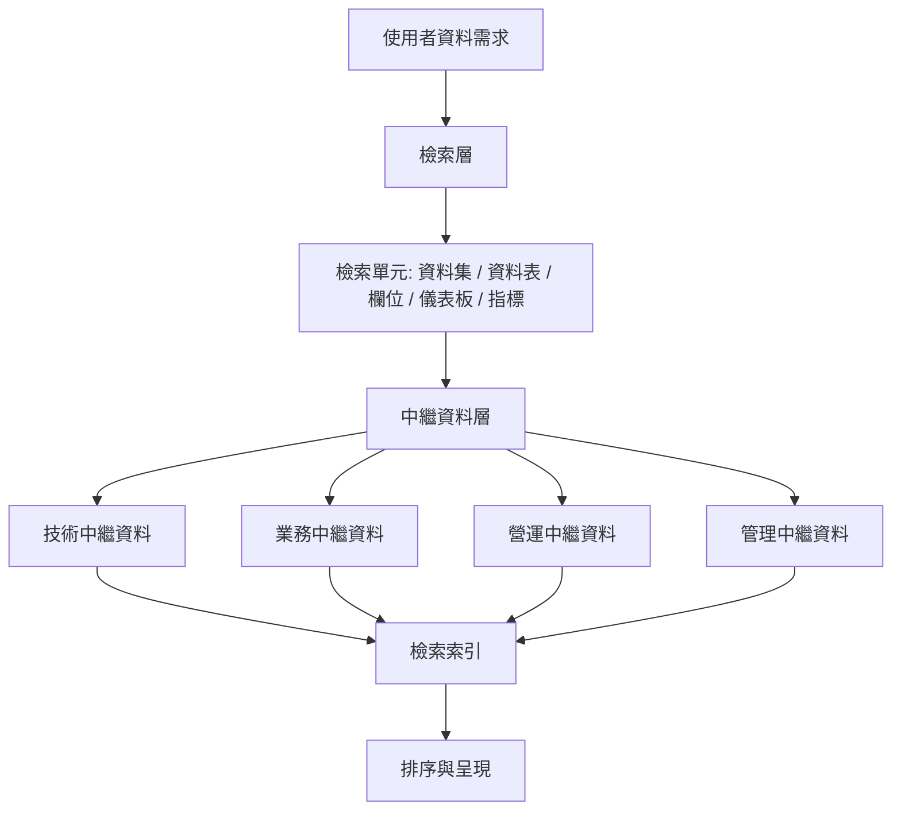
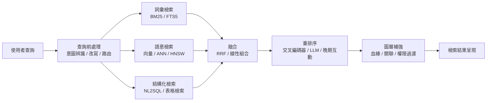

# ETL 領域的多模態檢索範式與必備領域模型

## 摘要

本報告探討一個明確限定的問題：在 ETL（Extract, Transform, Load，抽取－轉換－載入）與資料工程的脈絡下，若要建立一套「方便使用者檢索資料」的系統（而非用資料去做機器學習或資料探勘），會涉及哪些**多模態檢索範式**，以及哪些**領域模型與概念**是必須先掌握的。

核心結論是：這類系統的檢索對象並非單純的文字文件，而是**異質（heterogeneous）的資料資產**——關聯式資料表、資料行、儀表板、指標、ML 模型、檔案、甚至 PDF 與圖片。因此「多模態」在此處的第一層意義，是指**中繼資料（metadata）的多模態**與**檢索單元（retrieval unit）的多模態**；第二層意義，才是指近年以共享嵌入空間（shared embedding space）支援跨模態（文字↔圖像↔表格）的深度檢索技術。

要建構這類系統，必須先建立三層知識：(1) **檢索範式層**（如何比對與排序）、(2) **領域模型層**（資料資產如何被描述與關聯）、(3) **評估層**（如何證明檢索有效）。以下分章說明。

---

## 一、問題界定：為什麼 ETL 的檢索不是文件檢索

傳統資訊檢索（Information Retrieval, IR）處理的是「文件集合中的文字查詢」。但在資料工程場景，使用者要尋找的通常是「某張包含客戶流失率的表」、「可與目前這張表 join 的資料集」、「某個指標的定義來源」。這些檢索單元具有三個特徵：

1. **結構化**：資料表有 schema（欄位名稱、型別、主鍵），欄位本身也是可被查詢的單元。
2. **強關聯**：資料表之間透過 join 關係、血緣（lineage）關係相連，檢索時必須考慮「表格與表格之間的相關性」，而非只考慮「查詢與表格的相關性」。
3. **多重描述來源**：同一份資料同時具有技術中繼資料（欄位型別）、業務中繼資料（業務名稱、定義）、營運中繼資料（使用頻率、最近查詢時間）。

「資料集檢索（dataset search）」已被公認為一個獨立的研究領域，因為它同時借鏡資訊檢索、資料庫、實體中心檢索（entity-centric search）與表格檢索（tabular search），並具有自身獨特的挑戰與方法[^datasetsurvey]。這正是 ETL 檢索系統的理論根基。

---

## 二、檢索範式層：七種核心範式

### 2.1 資料集檢索與表格檢索（Dataset Search / Table Retrieval）

**資料集檢索**關注的是「如何把使用者的資料需求，對應到一組資料集」[^datasetsurvey]。**表格檢索**則是其子問題：從語料庫中選出最相關的資料表，作為後續問答或 SQL 生成的檢索前置步驟。

關鍵的進展在於認知到「單表檢索」不足以解決問題。許多問題需要檢索**多張**資料表，並透過一個「無法從使用者查詢本身辨識出來的 join 計畫」將它們連接起來；若檢索階段不考慮 join 計畫，後續推理與回答幾乎必然出錯。因此出現**join-aware 多表檢索**，其做法是把重排序（re-ranking）形式化為混合整數規劃（mixed-integer program），同時考慮表格－查詢相關性與表格－表格相關性[^jointable]。

早期的方法如 Table2Vec 則以類神經網路在表格標題、欄位標題與儲存格內容上學習詞與實體嵌入，作為表格檢索的額外語意相似度訊號[^table2vec]。

### 2.2 中繼資料的語意檢索（Semantic Search over Metadata）

**語意檢索**是「以意義進行檢索，有別於詞彙檢索（lexical search）」。現代系統使用**向量嵌入（vector embeddings）**把詞、片語或文件轉為數值向量，使檢索引擎能依據意義而非精確關鍵字匹配來找出結果；並常採用**混合檢索模型**，結合詞彙檢索（如 BM25）與以預訓練 transformer 為基礎的語意排序[^semsearch]。

在資料目錄（data catalog）脈絡中，這被稱為「智慧搜尋」：AI 資料目錄可用自然語言處理擴充與強化使用者查詢，並支援自然語言搜尋，讓使用者無須撰寫程式或 SQL 即可探索資料[^ibmcatalog]。

學術上，Schema Labels 相關研究從表格內容生成 schema 標籤，並以混合排序模型同時處理資料集中繼資料與生成的 schema 標籤，是早期語意中繼資料方法的代表[^schemalabels]。Google Dataset Search 則展示如何從網頁萃取 schema.org 中繼資料，使資料集可被發現，規模從約 50 萬成長到約 3,000 萬筆資料集[^googleds]。

### 2.3 混合檢索（Hybrid Search）

**混合檢索**是「把兩種以上的檢索方法（例如詞彙檢索與語意檢索）融合為單一排序清單，以提升相關性與召回率」的技術[^elastichybrid]。最常見的組合是 **BM25 全文詞彙檢索**（精確、重視詞元）加上**語意向量檢索**（意義、意圖）。

兩種標準的融合策略：

- **倒數排名融合（Reciprocal Rank Fusion, RRF）**：完全忽略原始分數，只看文件在各清單中出現的名次高低；即插即用，只有一個 `rank_constant` 參數需要調整[^pineconerag]。需特別注意：**RRF 是一種融合方法，而非混合檢索的同義詞**[^pineconerag]。
- **線性組合（Linear combination）**：將正規化後的原始分數以可調權重（α／β）合併；需要實驗調參，且對資料集敏感[^pineconerag]。

在真實的領域問答中，混合檢索已被證實優於單一檢索器：將微調過的稠密檢索器與 BM25 及 URL-host 匹配結合，可勝過單一檢索器系統[^domainhybrid]。輕量實作亦已出現，例如在 SQLite 內以 FTS5 做詞彙檢索、以 sqlite-vec 做語意檢索，並支援重排序與排名融合[^scrydb]。

### 2.4 向量嵌入與向量檢索（Vector Embeddings & Vector Search）

**向量嵌入**是把語意相似度轉譯為向量空間中鄰近程度的數值清單。文字模型如 Word2Vec、GloVe、BERT；圖像使用 CNN；音訊則使用頻譜圖[^pineconevec]。

- **稠密向量（Dense vectors）**：固定長度的浮點陣列（如 BERT），相似輸入（cat 與 kitten）在向量空間中彼此靠近，通常以**近似最近鄰（Approximate Nearest Neighbor, ANN）**演算法如 **HNSW** 查詢[^elastichybrid]。
- **稀疏向量（Sparse vectors）**：多數為零、以詞項索引的表示法（如 ELSER、SPLADE），可解釋且在零樣本情境下有效[^elastichybrid]。
- **向量資料庫**：儲存嵌入並支援相似度搜尋，核心運算為點積／餘弦相似度，並區分 KNN 與 ANN[^wikirg]。

### 2.5 多模態與共享嵌入空間（Multimodal Retrieval & Shared Embedding Space）

當檢索對象跨越文字、圖像、表格、音訊時，關鍵是**共享嵌入空間**：若一張照片與句子「a dog catching a frisbee」映射到鄰近向量，則文字查詢可以檢索圖像，反之亦然。多模態嵌入被定義為「產生圖像的向量表示，擷取其特徵與特性，並使該向量與同一向量空間上的文字搜尋相容」[^mslearn]。

技術基礎是 **CLIP（Contrastive Language–Image Pre-training）**：訓練一對模型，一個模型接收文字並輸出單一向量，另一個接收圖像並輸出單一向量；兩者被訓練成「語意相似的文字－圖像對」在共享向量空間中彼此靠近，不相似的對則遠離[^clipwiki]。此對比學習目標使**跨模態檢索（cross-modal retrieval）**成為可能：不需明確的圖像標註，即可用文字檢索圖像，反之亦然[^clipwiki]。CLIP 原始論文在 4 億組（圖像，文字）配對上訓練，展現了「預測哪段說明對應哪張圖」這種簡單預訓練任務是從零學習 SOTA 影像表示的效率與可擴展方式[^clippaper]。

同一套對比學習配方被延伸到音訊，形成 **CLAP（Contrastive Language–Audio Pretraining）**，並釋出 633,526 組音訊－文字配對，用於文字到音訊檢索、零樣本音訊分類等任務[^clap]。近年更出現**通用多模態檢索**，多模態 MLLM 檢索器可同時處理多種模態與多樣檢索任務，並被發現存在「模態偏誤」，需以「模態感知」的難負例挖掘來修正[^mmembed]。

### 2.6 晚期互動（Late Interaction）：ColBERT 與 ColPali

晚期互動是介於「單向量檢索」與「完整交叉編碼器重排序」之間的第三種範式[^weaviateLI]：

| 方法 | 表示 | 互動方式 | 品質 | 成本 |
|---|---|---|---|---|
| 無互動（雙編碼器／CLIP） | 每項一個向量 | 無（餘弦／點積） | 良好、可擴展 | 低 |
| 晚期互動（ColBERT／ColPali） | 每詞元／每圖塊一個向量 | 查詢時 MaxSim | 接近交叉編碼器 | 中（儲存密集） |
| 完整互動（交叉編碼器） | 聯合編碼 | 完整注意力 | 最佳 | 極高（查詢時） |

**ColBERT** 獨立以 BERT 編碼查詢與文件，再用便宜但強大的互動步驟建模其細粒度相似度，達到 BERT 等級的效果，同時執行速度快兩個數量級、每次查詢所需 FLOPs 少四個數量級[^colbert]。其 **MaxSim** 機制是：對每個查詢詞元與所有文件詞元計算相似度，只保留最大值，再將這些最大值加總為最終分數[^weaviateLI]。**ColBERTv2** 以殘差壓縮與去噪監督策略，把晚期互動模型的空間佔用縮減 6 至 10 倍[^colbertv2]。

對 ETL 場景尤其關鍵的是：**ColPali** 把整頁文件（含文字、表格、圖表、公式的 PDF）當作圖像，套用 ColBERT 式晚期互動於圖像區塊（patch）上，在文件檢索任務上大幅超越現代文件檢索管線，且更簡單、更快、可端到端訓練[^colpali]。這正是「多模態」在資料檢索中最直接的實務意義：把視覺化報表、PDF 規格書、掃描文件一併納入檢索。

### 2.7 結構化資料的 RAG（RAG over Structured Data）與表格問答

**RAG（Retrieval-Augmented Generation，檢索增強生成）**是「讓大型語言模型能從外部資料來源檢索並納入新資訊」的技術；被引用的資料通常被轉為 LLM 嵌入並存入向量資料庫以供檢索，且可作用於非結構化、半結構化或結構化資料（例如知識圖譜）[^wikirg]。

常見改進技術術語包括：**重排序（reranking）**、**查詢路由（query routing）**、**上下文選擇（context selection）**、**提示填充（prompt stuffing）**與**晚期互動**（如 ColBERT）[^wikirg]。

針對結構化資料的變體：

- **Table RAG／Table QA**：對表格資料進行檢索與推理。
- **mmRAG**：模組化基準，涵蓋**文字、表格與知識圖譜**，把六個問答資料集的查詢統一轉為可檢索文件，並標註文件相關性與資料集相關性，以便對個別 RAG 元件（如檢索準確度與查詢路由）做細粒度評估[^mmrag]。
- **T²-RAGBench**：針對「真實世界的文字與表格混合資料」的 23,088 組問答－上下文－答案三元組，並明確指出**混合 BM25**（稠密＋稀疏）是文字與表格資料最有效的檢索方法[^t2rag]。
- **DBRAG**：多表 RAG 框架，先以離線表格索引檢索候選表，再用與查詢相關的資料列充實其摘要，接著由 LLM 重排序候選，最後由程式輔助的推理器選擇所需表格並對其完整內容執行操作，以保持初始提示上下文精簡[^dbrag]。

### 2.8 自然語言轉 SQL（NL2SQL / Text-to-SQL）

**Text-to-SQL** 把自然語言語意轉為 SQL 查詢，是「向資料提問」的主要範式，也是結構化資料檢索中「生成查詢」的另一半。其核心挑戰在於編碼自然語句的意義、解碼為 SQL 查詢，並在兩種形式之間轉譯語意[^text2sqlsurvey]。

關鍵概念與術語：

- **Schema linking（綱要連結）**：把查詢中的提及對應到資料表與欄位；這是核心子問題。以 SQL-of-Thought 為例，它把問題分解為 schema linking、子問題辨識、查詢計畫生成、SQL 生成與引導式修正[^text2sqlsurvey]。
- **問題表示、範例選擇、範例組織**：DAIL-SQL 系統性比較這些提示工程軸線，並在 Spider 上達到 86.6% 執行準確率[^dailsql]。
- **基準資料集**：Spider、WikiSQL、BIRD、SEDE、GeoQuery、ATIS[^text2sqlsurvey]。
- **評估指標**：**執行準確率（Execution Accuracy, EX）**與詞元效率[^text2sqlsurvey]。

### 2.9 資料探索：Join／Union／Correlation Discovery

比目錄搜尋更進一步的**資料探索（data discovery）**，是在資料湖與資料市集中尋找可 join、可 union、可關聯的資料集。其研究多聚焦於個別探索運算子（join、correlation、union discovery）的改進，但實務上往往需要組合這些技術與其索引；因此出現如 BLEND 這類統一探索系統，以較低階的運算子作為複雜使用者任務的基本積木，並以統一索引結構與規則式優化器縮短探索管線的執行時間[^blend]。其他代表如依「profiles」進行可擴展資料探索的 NextiaJD[^nextiajd]、把發現與擴充耦合成回饋循環的 METAM[^metam]，以及面向異質資料湖（結構化／半結構化／非結構化）的探索系統[^hetero]。

---

## 三、領域模型層：必須知道的資料資產模型

### 3.1 中繼資料的分類

**中繼資料**是「定義與描述其他資料之特性」的資料。常見分類如下[^ibmmeta][^wikimeta]：

| 類型 | 內容 |
|---|---|
| **技術／結構中繼資料** | 檔案型別、編碼、schema、儲存位置、資料表／欄位／鍵 |
| **業務／描述中繼資料** | 業務標題、定義、標籤、關鍵字、詞彙表 |
| **營運／流程中繼資料** | 何時、如何、由誰存取或更新資料；使用統計 |
| **管理／治理中繼資料** | 擁有者、權限、保留政策、安全與合規政策 |
| **保存中繼資料** | 長期可用性、備份、移轉 |

IBM 特別指出一個區分：**資料目錄（data catalog）**提供所有資料資產的廣闊視野與業務脈絡；而**資料字典（data dictionary）**定義單一資料集的結構與內容（欄位名稱、型別、允許值、格式）[^ibmcatalog]。

### 3.2 資料目錄（Data Catalog）

**資料目錄**是「組織內資料資產的詳細清單，協助使用者輕鬆發現、理解、管理、策展與存取資料」[^ibmcatalog]。其核心能力包括：資料探索、中繼資料管理、資料血緣、資料治理、資料剖析（profiling）與隱私／存取控制[^ibmcatalog]。資料目錄的歷史演進為：人工清單與資料字典（2000 年以前）→ 大資料時代的自助式目錄（2000–2015）→ 現代 AI／ML 自動化目錄（2015 至今），後者能自動豐富中繼資料並支援自然語言搜尋[^alation]。

學術上曾提出 **5W1H+R** 的目錄心智模型：What、Who、Where、When、Why、How 加上 Relationships[^5w1h]。

### 3.3 資料血緣與資料起源

**資料血緣（data lineage）**「追蹤資料如何隨時間被生成、轉換、傳輸與使用。它記錄資料的來源、轉換與移動，提供其生命週期的詳細可見性」[^wikilineage]。IBM 定義為「追蹤資料隨時間流動的過程，清楚理解資料源自何處、如何改變，以及在資料管線中的最終去向」[^ibmlineage]。

關鍵概念：

- **回溯血緣（backward lineage，上游至來源）**與**前向血緣（forward lineage，下游至目的地）**，合稱**端到端血緣**，提供完整的**稽核軌跡（audit trail）**[^ibmlineage]。
- **粗粒度（job／file 層級）**與**細粒度（record／column 層級）**血緣[^wikilineage]。
- **關聯單位 `{i, T, o}`**：輸入集合、轉換／角色、輸出集合，是血緣的基本單位[^wikilineage]。
- 用途：根因除錯、**影響分析（impact analysis）**（某變更會影響哪些下游報表）、資料移轉規劃、合規（GDPR、CCPA）與 AI 可解釋性[^ibmlineage]。

**資料起源（data provenance）**則是「關於產生某份資料所涉實體、活動與代理者的資訊；它記錄資料如何被衍生，可用來評估品質、可靠性與可信任度」[^wikilineage]。IBM 指出兩者差異：**provenance 特別指涉資料的第一個實例或其來源**，而 **lineage 追蹤資料的移動與轉換，聚焦資料如何流動與改變**[^ibmprovenance]。古典資料庫研究區分 **why、where、how** 三種 provenance；W3C 的 **PROV 資料模型**（2013 年建議）形式化了 entity、activity、agent 三個概念[^wikilineage]。

### 3.4 中繼資料儲存庫與登錄

**中繼資料儲存庫（metadata repository）**是「為儲存中繼資料而建立的資料庫……中繼資料增加了一層抽象……它是關於『容納資料之結構』的資料」[^wikimeta]。其要求是中繼資料應具備**通用性、整合性與時效性（含歷史）**[^wikimeta]。

**儲存庫與登錄（registry）的區別**：儲存庫儲存中繼資料**並**加上關聯（血緣與連結）與版本控制，從各系統取得中繼資料並反映上游；登錄則**定義**中繼資料元素，是上游的變更真實來源（source of truth）[^wikimeta]。

設計考量包含：集中式、去中心化或分散式；實體關聯或物件導向。中繼資料分四類儲存：擁有權、描述性特徵、規則與政策、實體特徵。分層內容通常包括業務詞彙表、業務標籤、資料字典、概念／邏輯／實體資料模型、驗證與品質規則、ETL 與業務規則、報表、來源到目標對應（source-to-target mapping）[^wikimeta]。

### 3.5 標準與詞彙：DCAT、schema.org、FAIR、PROV、OpenLineage

**DCAT（Data Catalog Vocabulary）**是 W3C 的 RDF 詞彙，設計用來促進網頁上資料目錄之間的互通性。它讓發布者以標準模型與詞彙描述資料集與資料服務，便於跨目錄消費與聚合中繼資料，可提升資料集與資料服務的可發現性，並使跨站點的**聯邦式檢索（federated search）**能以相同查詢機制與結構進行[^dcat3]。DCAT 3 於 **2024 年 8 月 22 日**成為 W3C 建議標準，新增校驗和（checksum）、版本控制屬性（`dcat:version`、`dcat:previousVersion`、`dcat:hasCurrentVersion`）與 `dcat:DatasetSeries` 等[^dcat3]。其核心類別包括 Catalog、Dataset、Distribution、Data Service、Catalog Record、Concept、Relationship、Role、Period of Time、Location 與 Checksum[^dcat3]。

**FAIR 原則**是一組科學資料管理與策展的指導原則，於 2014 年荷蘭萊頓「Jointly Designing a Data FAIRport」工作坊發展，2016 年正式發表。其特色是同時適用於**人與機器**，強調機器的自動可操作性（machine-actionability）[^fair]。四大原則下轄細則：

- **F（可尋找）**：F1 全域唯一且持久識別碼；F2 豐富中繼資料；F3 中繼資料明確包含其描述資料的識別碼；F4 (中繼)資料註冊或索引於可搜尋資源。
- **A（可存取）**：A1 可透過標準化通訊協定以其識別碼取得；A1.1 協定開放、免費、普遍可實作；A1.2 必要時允許認證與授權；A2 資料不再可用時，中繼資料仍應可取用。
- **I（可互通）**：I1 使用正式、可存取、共享且廣泛適用的知識表示語言；I2 使用遵循 FAIR 的詞彙；I3 包含對其他 (中繼)資料的合格引用。
- **R（可重用）**：R1 具備多項精確且相關的屬性；R1.1 具備清楚可存取的使用授權；R1.2 具備詳細的起源資訊；R1.3 符合領域相關的社群標準[^fair]。

值得注意：FAIR 的三個參與實體是資料（或任何數位物件）、中繼資料與基礎設施；F4 之所以提到可搜尋資源，正是因為它牽涉基礎設施層面。且即使資料本身不能公開（如敏感資料），仍可發布豐富的中繼資料以促成探索，在不開放資料的前提下達到高度 FAIR[^fair]。

**OpenLineage** 是 LF AI & Data 基金會的畢業專案，是「用於資料血緣收集與分析的開放框架」，定義了 **dataset（資料集）、job（作業）與 run（執行）** 三種實體的通用模型，並以可擴充的 **facets（面向）** 豐富實體；整合對象包含 Apache Airflow、Flink、Hive、Spark、dbt、SQL、Trino 等，參考實作為 **Marquez**[^openlineage]。

### 3.6 語意層（Semantic Layer）

**語意層**是受治理、集中化的指標與業務邏輯定義，例如 dbt 的語意層搭配 MetricFlow 與以 YAML 定義的語意模型；它「集中定義關鍵術語的意義」，被定位為 AI／自然語言查詢的護欄[^dbt]。

### 3.7 檢索技術元件詞彙

建構系統時還必須掌握一組實作層詞彙：

| 術語 | 意義 |
|---|---|
| **詞彙／稀疏檢索** | 精確詞元匹配（BM25、TF-IDF、ELSER、SPLADE）[^elastichybrid] |
| **語意／稠密檢索** | 以嵌入進行意義匹配[^semsearch] |
| **混合檢索** | 詞彙與語意檢索的融合[^elastichybrid] |
| **RRF／線性組合** | 兩種標準的結果融合方法[^pineconerag] |
| **ANN／HNSW** | 向量搜尋的近似最近鄰索引[^elastichybrid] |
| **嵌入** | 編碼語意的數值向量[^pineconevec] |
| **向量資料庫** | 嵌入的儲存與相似度搜尋引擎[^wikirg] |
| **Schema linking** | 把自然語言查詢詞對應到表格／欄位[^text2sqlsurvey] |
| **表格檢索／多表檢索** | 從語料庫中選出相關資料表[^jointable] |
| **Schema matching** | 跨異質綱要對齊欄位／屬性[^jointable] |
| **重排序／查詢路由** | RAG 管線中的事後排序與分派[^wikirg] |
| **執行準確率（EX）** | Text-to-SQL 的標準評估指標[^text2sqlsurvey] |

---

## 四、評估層：如何證明檢索有效

檢索系統必須以標準 IR 指標驗證[^evalmetrics][^dcg][^mrr]：

| 指標 | 是否考慮排名 | 相關性尺度 | 範圍 | 聚合方式 |
|---|---|---|---|---|
| Precision | 否 | 二元 | 0–1 | 逐查詢 |
| Recall | 否 | 二元 | 0–1 | 逐查詢 |
| Precision@k／Recall@k | 否 | 二元 | 0–1 | 逐查詢 |
| MRR | 是（首命中） | 二元 | 0–1 | 對查詢取平均 |
| MAP | 是 | 二元 | 0–1 | 對查詢取 AP 平均 |
| nDCG | 是 | 分級 | 0–1 | 對查詢取平均 |

- **Precision** 是「檢索到的文件中相關者所佔比例」；**Recall** 是「所有相關文件中被成功檢索者所佔比例」。兩者可被平凡地操弄（只回少數文件可提高 precision，回傳全部可提高 recall），因此通常以 F 值配對使用[^evalmetrics]。
- **MRR**：「首個正確答案名次的倒數」對查詢取平均，只考慮第一個相關答案的名次[^mrr]。
- **MAP**：對每個查詢計算 Average Precision（精確率－召回率曲線下面積的離散近似），再對查詢取平均；具排名感知，會重罰早期的錯誤[^evalmetrics]。
- **nDCG**：以分級相關性計算 DCG（增益除以 log 名次折扣），再以理想 DCG（IDCG）正規化，使不同查詢間分數可比；值域 [0, 1]，1.0 表示完美排序[^dcg]。

在 RAG 與表格問答中，除**檢索準確度**外，還需評估**查詢路由**與**生成品質**；mmRAG 正是為此把「檢索相關性」與「資料集相關性」分開標註，以支援元件層級的細粒度評估[^mmrag]。

---

## 五、實務系統對照

現代資料目錄／資料湖在檢索與探索上的實作，可作為範式落地的參照（GitHub 星數擷取自各 repo 頁面，**2026-10-11**）：

| 平台 | 類型 | GitHub 星數 | 核心檢索引擎 | 語意／AI 檢索 |
|---|---|---|---|---|
| **OpenMetadata** | 開源（Apache 2.0） | 15.4k | Elasticsearch／OpenSearch | 有，語意搜尋＋MCP server[^openmetadata] |
| **DataHub** | 開源（Apache 2.0） | 12.8k | Elasticsearch | 有，自然語言「通用搜尋」[^datahub] |
| **Amundsen** | 開源，**2026-09-29 封存** | 4.8k | Elasticsearch（或 Atlas） | 無，以用量排名為主[^amundsen] |
| **Unity Catalog** | 開源＋Databricks SaaS | 3.6k | Databricks 搜尋 | 有，語意搜尋、Genie、AI 註解[^unitycatalog] |
| **Alation** | 專有商業軟體 | 無公開 repo | 專有 ML 搜尋 | 有，Intelligent Search（ALLIE AI）[^alation]；通用搜尋涵蓋資料庫、湖倉與檔案系統，並結合語意與關鍵字排序[^alationsearch] |

可觀察到的共同模式：

1. **Elasticsearch／OpenSearch 是開源目錄的預設檢索骨幹**（DataHub、OpenMetadata、Amundsen）；Unity Catalog（Databricks）使用自有搜尋，Alation 使用專有 ML 引擎[^datahub][^openmetadata][^amundsen][^unitycatalog][^alation]。
2. **面向篩選（faceted filtering）＋布林邏輯**幾乎是共通標配[^datahub][^openmetadata]。
3. **圖層與搜尋索引互補**：Neo4j（Amundsen）或中繼資料圖（DataHub／OpenMetadata）負責血緣、關聯與關係式探索[^amundsen][^datahub]。
4. **2025–2026 的趨勢是語意／AI 搜尋與 MCP**：OpenMetadata 與 DataHub 都推出 MCP server；Unity Catalog 加入 Genie 與 AI 註解；Alation 加入 ALLIE AI[^openmetadata][^datahub][^unitycatalog][^alation]。
5. **權限感知檢索（permission-aware search）**日益重要：Unity Catalog 明確指出「搜尋只會回傳你有權限看見的資料表結果」[^unitycatalog]。
6. **Amundsen 開創了以用量排名（page-rank 風格）的探索**，例如「高頻查詢的資料表會比低頻者更早出現」，但現已封存，其角色多半由 DataHub 與 OpenMetadata 承接[^amundsen]。

---

## 六、批判性反思

**來源權威性與時效性**：本報告大量引用 arXiv 預印本（同儕審查狀態不一）、維基百科（便於入門但不適合作為單一權威），以及廠商文件（IBM、Elastic、Pinecone、Alation、Databricks）。廠商文件對自身產品的描述可能有利害傾向；維基百科的定義需以原始論文（如 CLIP、ColBERT、FAIR、DCAT）交叉驗證。本報告對關鍵定義均優先引用一手或標準文件（W3C、Nature、ACL／SIGIR／ICLR 論文）。

**時間敏感度**：GitHub 星數、封存狀態（如 Amundsen 於 2026-09 封存）與廠商功能（MCP、Genie）變動快速，本報告標註擷取日期，讀者引用前應重新查核。

**範圍限制**：資料庫社群的 schema matching、entity resolution 等相鄰主題僅在與檢索直接相關時納入；影像／影片檢索的深度學習細節亦僅在作為跨模態範式時介紹。若讀者關切的是「以 ETL 資料做機器學習或探勘」，那是另一條研究路線，不在本報告範圍。

**未解的開放問題**：多模態 MLLM 檢索器存在模態偏誤，在跨模態任務上可能反而遜於較小的 CLIP 檢索器[^mmembed]；晚期互動的儲存成本即使經 ColBERTv2 壓縮仍高於單向量檢索[^weaviateLI]；多表 join 計畫無法從查詢本身推得，仍是多表檢索的核心難題[^jointable]。

---

## 七、結論：最小必備知識清單

若要用一句話總結「ETL 領域的多模態檢索範式」，那就是：**以多模態的中繼資料為檢索單元、以混合（詞彙＋語意＋結構化）檢索為核心、以血緣與關聯圖補強、以標準 IR 指標驗證**。

必備的領域模型與概念，依重要性排序為：

1. **中繼資料分類**（技術／業務／營運／管理／保存）與**資料字典 vs 資料目錄**的區分。
2. **資料血緣與資料起源**（回溯／前向、粗／細粒度、why／where／how）。
3. **中繼資料儲存庫 vs 登錄**的角色差異。
4. **標準詞彙**：DCAT 3、schema.org、FAIR、PROV、OpenLineage、ISO/IEC 11179、Dublin Core。
5. **檢索範式**：資料集／表格檢索、語意檢索、混合檢索、向量檢索（ANN／HNSW）、晚期互動（ColBERT／ColPali）、RAG over structured data、NL2SQL、資料探索。
6. **多模態基礎**：共享嵌入空間、對比學習（CLIP／CLAP）、跨模態檢索。
7. **評估指標**：Precision／Recall／@k、MRR、MAP、nDCG，以及 Text-to-SQL 的執行準確率。
8. **治理與防護**：語意層、權限感知檢索。

---

## 參考文獻

[^datasetsurvey]: Chapman, A., Simperl, E., Koesten, L., Konstantinidis, G., Ibáñez-Gonzalez, L.-D., Kacprzak, E., & Groth, P. (2019). Dataset search: A survey. arXiv:1901.00735. Retrieved 2026-10-11, from https://arxiv.org/abs/1901.00735

[^jointable]: Chen, P. B., Zhang, Y., & Roth, D. (2024). Is table retrieval a solved problem? Exploring join-aware multi-table retrieval. ACL 2024. arXiv:2404.09889. Retrieved 2026-10-11, from https://arxiv.org/abs/2404.09889

[^table2vec]: Zhang, L., Zhang, S., & Balog, K. (2019). Table2Vec: Neural word and entity embeddings for table population and retrieval. SIGIR 2019. arXiv:1906.00041. Retrieved 2026-10-11, from https://arxiv.org/abs/1906.00041

[^semsearch]: Wikipedia. (n.d.). Semantic search. Retrieved 2026-10-11, from https://en.wikipedia.org/wiki/Semantic_search

[^ibmcatalog]: Jonker, A., & Krantz, T. (n.d.). What is a data catalog? IBM Think. Retrieved 2026-10-11, from https://www.ibm.com/think/topics/data-catalog

[^schemalabels]: Wang, J., et al. (2020). Leveraging schema labels to enhance dataset search. arXiv:2001.10112. Retrieved 2026-10-11, from https://arxiv.org/abs/2001.10112

[^googleds]: Brickley, D., Burgess, M., & Noy, N. (2020). Google Dataset Search by the numbers. arXiv:2006.06894. Retrieved 2026-10-11, from https://arxiv.org/abs/2006.06894

[^elastichybrid]: Elastic. (n.d.). What is hybrid search? Retrieved 2026-10-11, from https://www.elastic.co/what-is/hybrid-search

[^pineconerag]: Pinecone. (n.d.). Hybrid search introduction. Retrieved 2026-10-11, from https://www.pinecone.io/learn/hybrid-search-intro/

[^domainhybrid]: Zhang, Y., et al. (2024). Domain-specific question answering with hybrid search. arXiv:2412.03736. Retrieved 2026-10-11, from https://arxiv.org/abs/2412.03736

[^scrydb]: Breuer, T. (2026). SQLite is enough: Lexical, semantic, and hybrid search with scrydb. arXiv:2608.24060. Retrieved 2026-10-11, from https://arxiv.org/abs/2608.24060

[^pineconevec]: Pinecone. (2023, June 30). What are vector embeddings? Retrieved 2026-10-11, from https://www.pinecone.io/learn/vector-embeddings/

[^wikirg]: Wikipedia. (n.d.). Retrieval-augmented generation. Retrieved 2026-10-11, from https://en.wikipedia.org/wiki/Retrieval-augmented_generation

[^mslearn]: Microsoft. (2025, September 16). Image retrieval with vector embeddings. Microsoft Learn. Retrieved 2026-10-11, from https://learn.microsoft.com/en-us/azure/ai-services/computer-vision/concept-image-retrieval

[^clipwiki]: Wikipedia. (n.d.). Contrastive Language–Image Pre-training. Retrieved 2026-10-11, from https://en.wikipedia.org/wiki/Contrastive_Language%E2%80%93Image_Pre-training

[^clippaper]: Radford, A., Kim, J. W., Hallacy, C., et al. (2021). Learning transferable visual models from natural language supervision. arXiv:2103.00020. Retrieved 2026-10-11, from https://arxiv.org/abs/2103.00020

[^clap]: Wu, Y., Chen, K., Zhang, T., et al. (2022). Large-scale contrastive language-audio pretraining with feature fusion and keyword-to-caption augmentation. ICASSP 2023. arXiv:2211.06687. Retrieved 2026-10-11, from https://arxiv.org/abs/2211.06687

[^mmembed]: Lin, S.-C., Lee, C., Zhang, Y., et al. (2024). MM-Embed: Universal multimodal retrieval with multimodal LLMs. ICLR 2025. arXiv:2411.02571. Retrieved 2026-10-11, from https://arxiv.org/abs/2411.02571

[^weaviateLI]: Weaviate. (n.d.). Late interaction overview. Retrieved 2026-10-11, from https://weaviate.io/blog/late-interaction-overview

[^colbert]: Khattab, O., & Zaharia, M. (2020). ColBERT: Efficient and effective passage search via contextualized late interaction over BERT. SIGIR 2020. arXiv:2004.12832. Retrieved 2026-10-11, from https://arxiv.org/abs/2004.12832

[^colbertv2]: Santhanam, K., Khattab, O., Saad-Falcon, J., Potts, C., & Zaharia, M. (2021). ColBERTv2: Effective and efficient retrieval via lightweight late interaction. NAACL 2022. arXiv:2112.01488. Retrieved 2026-10-11, from https://arxiv.org/abs/2112.01488

[^colpali]: Faysse, M., Sibille, H., Wu, T., et al. (2024). ColPali: Efficient document retrieval with vision language models. ICLR 2025. arXiv:2407.01449. Retrieved 2026-10-11, from https://arxiv.org/abs/2407.01449

[^mmrag]: Xu, C., Chen, Q., Feng, Y., & Cheng, G. (2025). mmRAG: A modular benchmark for retrieval-augmented generation over text, tables, and knowledge graphs. arXiv:2505.11180. Retrieved 2026-10-11, from https://arxiv.org/abs/2505.11180

[^t2rag]: Xu, C., et al. (2025). T²-RAGBench: A benchmark for text-and-table retrieval-augmented generation. arXiv:2506.12071. Retrieved 2026-10-11, from https://arxiv.org/abs/2506.12071

[^dbrag]: Ampofo, P. L., Kubo, R., & Difallah, D. (2026). DBRAG: Multi-table retrieval-augmented generation for complex database queries. arXiv:2610.07622. Retrieved 2026-10-11, from https://arxiv.org/abs/2610.07622

[^text2sqlsurvey]: Deng, N., Chen, Y., & Zhang, Y. (2022). Recent advances in text-to-SQL: A survey of what we have and what we expect. COLING 2022. arXiv:2208.10099. Retrieved 2026-10-11, from https://arxiv.org/abs/2208.10099

[^dailsql]: Gao, D., Wang, H., Li, Y., et al. (2023). Text-to-SQL empowered by large language models: A benchmark evaluation. arXiv:2308.15363. Retrieved 2026-10-11, from https://arxiv.org/abs/2308.15363

[^blend]: Esmailoghli, M., Schnell, C., Miller, R. J., & Abedjan, Z. (2023). Blend: A unified data discovery system. arXiv:2310.02656. Retrieved 2026-10-11, from https://arxiv.org/abs/2310.02656

[^nextiajd]: Bogatu, A., Fernandes, A. A. A., Paton, N. W., & Konstantinou, N. (2020). Scalable data discovery using profiles. arXiv:2012.00890. Retrieved 2026-10-11, from https://arxiv.org/abs/2012.00890

[^metam]: Zhou, Y., et al. (2023). METAM: Goal-oriented data discovery. ICDE 2023. arXiv:2304.09068. Retrieved 2026-10-11, from https://arxiv.org/abs/2304.09068

[^hetero]: Zhu, Y., et al. (2025). Towards operationalizing heterogeneous data discovery. arXiv:2504.02059. Retrieved 2026-10-11, from https://arxiv.org/abs/2504.02059

[^ibmmeta]: Krantz, T., & Jonker, A. (n.d.). What is metadata management? IBM Think. Retrieved 2026-10-11, from https://www.ibm.com/think/topics/metadata-management

[^wikimeta]: Wikipedia. (n.d.). Metadata repository. Retrieved 2026-10-11, from https://en.wikipedia.org/wiki/Metadata_repository

[^alation]: Alation. (n.d.). What is a data catalog? Retrieved 2026-10-11, from https://www.alation.com/blog/what-is-a-data-catalog/

[^wikilineage]: Wikipedia. (n.d.). Data lineage. Retrieved 2026-10-11, from https://en.wikipedia.org/wiki/Data_lineage

[^ibmlineage]: IBM. (n.d.). What is data lineage? IBM Think. Retrieved 2026-10-11, from https://www.ibm.com/think/topics/data-lineage

[^ibmprovenance]: Mucci, T. (n.d.). What is data provenance? IBM Think. Retrieved 2026-10-11, from https://www.ibm.com/think/topics/data-provenance

[^5w1h]: Subramaniam, P., et al. (2021). A mental model for data catalogs: 5W1H+R. arXiv:2103.07532. Retrieved 2026-10-11, from https://arxiv.org/abs/2103.07532

[^dcat3]: W3C. (2024, August 22). Data Catalog Vocabulary (DCAT) - Version 3 (W3C Recommendation). Retrieved 2026-10-11, from https://www.w3.org/TR/vocab-dcat-3/

[^fair]: Wilkinson, M. D., Dumontier, M., Aalbersberg, I. J., et al. (2016). The FAIR guiding principles for scientific data management and stewardship. Scientific Data, 3, 160018. Retrieved 2026-10-11, from https://www.nature.com/articles/sdata201618

[^openlineage]: OpenLineage. (n.d.). About OpenLineage (Version 1.53.0). Retrieved 2026-10-11, from https://openlineage.io/docs/

[^dbt]: dbt Labs. (n.d.). dbt Semantic Layer. Retrieved 2026-10-11, from https://www.getdbt.com/product/semantic-layer

[^evalmetrics]: Wikipedia. (n.d.). Evaluation measures (information retrieval). Retrieved 2026-10-11, from https://en.wikipedia.org/wiki/Evaluation_measures_(information_retrieval)

[^dcg]: Wikipedia. (n.d.). Discounted cumulative gain. Retrieved 2026-10-11, from https://en.wikipedia.org/wiki/Discounted_cumulative_gain

[^mrr]: Wikipedia. (n.d.). Mean reciprocal rank. Retrieved 2026-10-11, from https://en.wikipedia.org/wiki/Mean_reciprocal_rank

[^datahub]: DataHub Project. (n.d.). DataHub documentation: Search. Retrieved 2026-10-11, from https://docs.datahub.com/docs/how/search

[^openmetadata]: OpenMetadata. (n.d.). Data discovery. Retrieved 2026-10-11, from https://docs.open-metadata.org/latest/how-to-guides/data-discovery

[^amundsen]: Amundsen. (2026, September 29). Amundsen GitHub repository (archived). Retrieved 2026-10-11, from https://github.com/amundsen-io/amundsen

[^unitycatalog]: Databricks. (2026, September 11). Data discovery in Unity Catalog. Retrieved 2026-10-11, from https://docs.databricks.com/aws/en/discover/

[^alationsearch]: Alation. (n.d.). Search function. Retrieved 2026-10-11, from https://www.alation.com/product/search-function/
