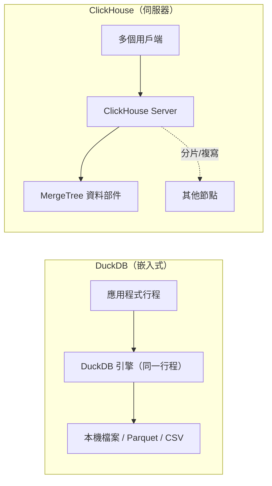
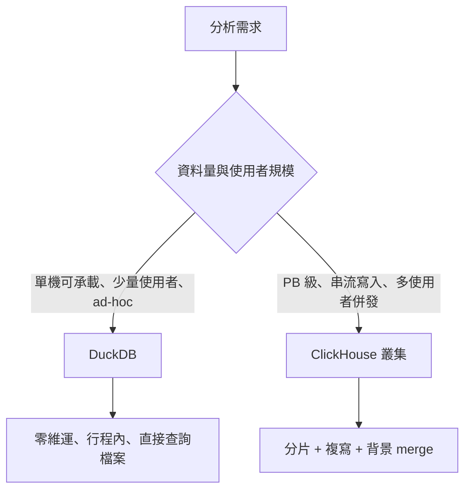

# DuckDB 與 ClickHouse 比較研究

> 檢索日期：2026-10-11（ISO 8601）

## 摘要

DuckDB 與 ClickHouse 都是為 OLAP（線上分析處理，Online Analytical Processing）設計的關聯式資料庫，皆以 C++ 撰寫、皆採欄式（column-oriented）儲存與向量化（vectorized）執行引擎，因此經常被放在一起討論。然而兩者的定位截然不同：

- **DuckDB** 是**嵌入式的單節點**分析引擎，被形容為「分析界的 SQLite」，沒有獨立伺服器行程，主打零維運、可攜性與直接查詢檔案[^whyduckdb]。
- **ClickHouse** 是**客戶端/伺服器架構的分散式**即時分析資料庫，主打大規模資料的串流寫入、高併發查詢與水平擴充[^chintro]。

兩者並非直接互斥的替代品，而是在不同規模與使用情境下互補。本文依架構、並行控制、儲存格式、擴充性、生態系、授權、版本與效能等面向逐項比較，並在最後反思資料來源的偏誤。

## 1. 基礎定位

| 面向 | DuckDB | ClickHouse |
| --- | --- | --- |
| 類型 | 嵌入式（in-process）關聯式 OLAP 引擎 | 客戶端/伺服器分散式 OLAP DBMS |
| 核心比喻 | 「分析界的 SQLite」 | 「即時分析資料庫」 |
| 部署單位 | 單一行程內，無獨立伺服器 | 長期執行的伺服器行程，可多節點[^chintro][^whyduckdb] |
| 主要目標 | 可攜、零維運、檔案直接查詢、資料科學/資料工程管線 | 大規模、多使用者、串流即時分析[^posthog] |
| 原始語言 | C++ | C++ |
| 授權 | MIT License[^whyduckdb] | Apache License 2.0[^chintro] |

DuckDB 強調「沒有需要安裝、更新、維護的 DBMS 伺服器軟體」，且完全嵌入宿主行程中執行，對分析用途而言可帶來高速的資料進出[^whyduckdb]。ClickHouse 則自詡為「高效能、欄式、用於 OLAP 的 SQL DBMS」，最初由 Yandex 內部開發，2016 年 6 月 15 日以 Apache 2.0 開源[^chintro]。

## 2. 架構與執行引擎

### 2.1 DuckDB

- **無外部相依**：整個原始碼可編譯成「amalgamation」兩檔案（一個標頭檔加一個實作檔），僅需 C++17 編譯器，簡化了部署與整合[^whyduckdb]。
- **欄式向量化引擎**：查詢仍為直譯式（interpreted）執行，但每次運算處理一整批值（稱為 vector）而非逐列處理，大幅降低每筆值的 CPU 開銷，是 OLAP 效能遠勝列式系統（PostgreSQL、MySQL、SQLite）的關鍵。引擎設計受 MonetDB/X100 論文啟發，平行化採 morsel-driven parallelism[^whyduckdb]。
- **可攜性**：支援 Linux、macOS、Windows 的 x86 與 ARM，從邊緣裝置到多 TB 記憶體、100+ CPU 核心的伺服器皆可執行；亦可透過 DuckDB-Wasm 在瀏覽器與行動裝置中執行[^whyduckdb]。
- **API 語言**：C、C++、Go、Python、R、Rust、Java、Node.js 等[^whyduckdb]。

### 2.2 ClickHouse

- **儲存層**：每次 INSERT 產生不可變的「table part」，背景 merge 行程持續將小 part 合併為大 part；INSERT 之間、INSERT 與 SELECT 之間彼此隔離，不需全域同步[^chintro]。
- **查詢處理層**：向量化引擎以批次傳遞列（提升 CPU 快取利用率，並依指令集自動選用 SIMD 變體）；查詢計畫展開為多條「lane」，通常每個 CPU 核心一條，垂直擴充，並可跨節點分片做水平擴充[^chintro]。
- **資料裁剪**：主鍵索引（排序順序）、投影（projections）與跳躍索引（skipping indexes）讓查詢盡量跳過不需要的資料[^chintro]。

## 3. 並行控制與交易

這是兩者最根本的差異之一。

### 3.1 DuckDB：單寫入者、多讀取者

- DuckDB 以自訂的、針對批次最佳化的 **MVCC（多版本並行控制）** 提供 ACID 交易保證；隔離等級為快照隔離（snapshot isolation），在 PostgreSQL 術語下等同 repeatable reads[^duckconc]。
- **行程內模式**有兩種：讀寫模式（一個行程可讀可寫）與唯讀模式（多行程可讀、不可寫）[^duckconc]。
- 在讀寫模式中，支援**單一行程內的多個寫入執行緒**，結合 MVCC 與**樂觀並行控制（optimistic concurrency control）**：只要沒有寫入衝突，多個並行寫入可成功；**追加（append）永不衝突**，即使對同一張表亦然[^duckconc]。
- 若兩個執行緒同時編輯（UPDATE/DELETE）同一列，第二個會以交易衝突錯誤失敗，常見處理方式是重試該交易[^duckconc]。
- **多行程寫入原生格式**：透過仍在 beta 的 **Quack 遠端協定**（DuckDB v1.5.2 起）可實現，或改用 **DuckLake 格式搭配 PostgreSQL 作為 catalog**；多行程僅讀取則只能在唯讀模式下進行[^duckconc]。

### 3.2 ClickHouse：多主複寫、INSERT 隔離

- INSERT 彼此隔離、也與 SELECT 隔離，背景 merge 不影響並行查詢，因此同時 INSERT 可接近磁碟 I/O 速度[^chintro]。
- 複寫為**非同步多主（multi-master）**，資料在多節點間冗餘儲存，寫入任一複本會於背景傳播，並具自動（或半自動）復原能力[^chintro]。
- 複寫以 **ClickHouse Keeper**（ZooKeeper 替代品）管理複本中介資料，INSERT 透過 block deduplication 具冪等性；複寫僅為 INSERT 增加些微延遲[^chreplication]。
- ClickHouse **不支援自動的分片再平衡（shard rebalancing）**[^chscale]。

## 4. 儲存與檔案格式

### 4.1 DuckDB

- **原生格式**為**單一檔案**資料庫，並支援以 ART 為基礎的次要索引[^whyduckdb]。
- 可直接以檔名查詢（例如 `SELECT * FROM 'test.parquet'`），或透過 `read_csv`、`read_parquet`、`read_json` 等 reader 函式與 `COPY`[^whyduckdb]。
- 支援格式包含 **CSV**（含壓縮如 `.csv.gz`）、**Parquet**（讀寫、含中介資料與加密）、**JSON**（內建 `json` 擴充，使用 yyjson 解析器）、**Iceberg**（核心擴充，含 REST catalog）、**Delta**（核心擴充），以及 DuckLake、Avro、Excel、Lance、Vortex 等[^whyduckdb]。
- 湖倉格式（lakehouse）可擴展至 PB 等級[^whyduckdb]。

### 4.2 ClickHouse

- 以 **MergeTree** 家族引擎為核心（ReplacingMergeTree、AggregatingMergeTree、SummingMergeTree、CollapsingMergeTree 等），官方稱其為「最常用且最穩健的表引擎」，專為高寫入率與巨量資料設計[^chmergetree]。
- **主鍵決定每個 part 內的排序順序**（叢集索引 clustering index）；索引指向 8192 列的「granule」區塊而非個別列，使稀疏索引小到可常駐記憶體，同時仍支援快速磁碟存取[^chmergetree]。
- 可依任意運算式**分割（partition）**，並透過分區裁剪（partition pruning）略過不需讀取的分區[^chmergetree]。
- part 採 `Wide`（每欄一檔案）或 `Compact`（單一檔案，適合小型/頻繁寫入）格式[^chmergetree]。

## 5. 擴充性：垂直 vs 水平

- **DuckDB 是單節點系統**，採**垂直擴充（vertical scalability）**，即用更多資源（CPU、記憶體、磁碟）支援更大資料集；官方表示已測試過 100+ CPU 核心與數 TB 記憶體的機器[^duckfaq]。其部落格曾展示在單一 AWS `i8g.48xlarge`（192 核心、1.5 TB RAM）上跑 TPC-H scale factor 100,000（約 100 TB CSV、約 27 TB 單一檔案）[^duckbench]。
- **ClickHouse 同時支援垂直與水平擴充**：可分片（shards，存放不同資料）與複寫（replicas，複製伺服器）；`Distributed` 表引擎本身不存資料，而是提供跨多伺服器的分散式查詢處理，自動平行化讀取並使用遠端索引[^chdistributed]。
- ClickHouse 官方 FAQ 指出，對於需要水平擴充的生產環境，叢集拓撲如「2 shards / 2 replicas」可同時兼具擴充與容忍單節點失效的能力[^chscale]。

## 6. 生態系、社群與版本

| 指標 | DuckDB | ClickHouse |
| --- | --- | --- |
| GitHub Stars | 約 42,088[^ghduck] | 約 50,334[^ghch] |
| Watchers | 278[^ghduck] | 695[^ghch] |
| 貢獻者 | 約 347[^ghduck] | 約 311[^ghch] |
| 主要語言 | C++[^ghduck] | C++[^ghch] |
| 最新穩定版 | v1.5.6（2026-09-28）[^duckver] | v26.9.15.5-stable（2026-10-10）[^chver] |
| LTS 版 | v1.4.5（2026-06-17）[^duckver] | v26.8.23.6-lts[^chver] |

- DuckDB 的 LTS 版本自 v1.4.0 起每隔一個版本發布一次；下一主要版本 v2.0.0 預計於 2026-10-21 推出，已有 2.0.0-dev 預覽版[^duckver]。
- ClickHouse 約每月發布 `stable`、每半年發布一次 `lts`（支援一年）；26.9 版本的 release call 於 2026-09-17 舉行[^chver]。
- 兩者的 GitHub 星數皆遠高於 100，屬於成熟且活躍的開源專案[^ghduck][^ghch]。

DuckDB 的**擴充機制**允許動態載入擴充以新增檔案格式、資料型別、函式與 SQL 語法；安裝（install）與載入（load）為兩個步驟，核心擴充可在首次使用時自動載入，另有社群擴充可透過 `INSTALL ... FROM community` 取得[^whyduckdb]。

## 7. 效能比較

### 7.1 ClickBench（公開排行榜）

ClickBench 是最常被引用的公開比較，資料集為 100 GB 的 `hits` 表（99.9M 列、105 欄、43 條分析查詢、**不含 JOIN**），硬體為單一 AWS `c6a.4xlarge`（16 vCPU），採熱快取（hot）計時[^clickbench]：

- **ClickHouse**：中位數 148 ms、最慢 9.6 s，43 條查詢中勝/平 32 條，壓縮後 14.21 GiB，載入 5 分鐘。
- **DuckDB**：中位數 348 ms（約 ClickHouse 的 2.35 倍）、最慢 6.5 s，勝 10 條查詢（多為重量級聚合，如 Q5、Q12、Q14、Q16–Q18、Q28、Q32–Q34），壓縮後 19.05 GiB，載入 2 分鐘（最快）。
- 兩者皆完成全部 43 條查詢、無失敗。

DuckDB 官方部落格亦指出，2025 年 10 月 9 日 DuckDB 的 in-memory 變體曾登上 ClickBench 榜首；但在 ClickBench 規則變更（2025-10-26，禁止 in-memory 資料庫提交 cold 或 combined 結果）之後，DuckDB 為熱執行（hot runs）中排名第一的開源系統，緊追閉源研究原型 Umbra[^duckbench][^cbpr]。

### 7.2 TPC-H 與其他實測

- **DuckDB 自行發布的 TPC-H**：在 scale factor 100,000（約 100 TB CSV、約 27 TB 單一檔案）、AWS `i8g.48xlarge`（192 核心、1.5 TB RAM、RAID-0 NVMe）上，22 條 TPC-H 查詢全數完成（部分查詢需溢出約 7 TB），中位數執行時間約 1.19 小時[^duckbench]。此為 DuckDB 自身發布的單引擎可擴充性展示，**並未與 ClickHouse 對比**。
- **Vantage 實測**（約 20 億列、約 16 GB 壓縮 CSV、16 GB MacBook Pro）：`clickhouse-local` 的原始查詢速度約為 DuckDB 的 3 倍（複雜讀取查詢約 11 s 對約 30 s）[^vantage]。作者自行指出多項保留：ClickHouse 可能將中繼表寫入記憶體而非磁碟、載入資料至 clickhouse-local 耗時約 734 秒、兩者皆未使用主鍵/索引。
- **臨床資料實測**（Synthea 合成資料，28,709 位病人、14.8M observations、4 條查詢）：ClickHouse 在 4 條查詢中勝 3 條（1.20× 至 1.42×），DuckDB 則在 self-join 查詢勝出（1.29×）[^fhir]。作者認為 ClickHouse 的維運成本約在十億列規模才划算。
- **PostHog 觀點**：在小型至中型資料集上，DuckDB 的冷查詢可匹敵或優於 ClickHouse（省去網路往返）；但在具備調校過的 materialized view 與索引的大型資料集上，ClickHouse 會勝出[^posthog]。
- **Tinybird 交叉點估計**：DuckDB 在約 10 GB 以下常較快，轉換至 ClickHouse 的交叉點「通常落在 50 GB 至 500 GB 之間」[^tinybird]。

### 7.3 效能結論

在單機、中小規模（≲ 100 GB）且 ad-hoc 的場景下，兩者效能大致相當，DuckDB 常具競爭力甚至更快；在 1 TB 以上的分散式大規模場景，ClickHouse 叢集可領先數個數量級[^oneuptime]。

## 8. 選用建議

**選擇 DuckDB 的情境**[^whyduckdb][^duckfaq][^posthog]：

- 需要嵌入單一程式、筆記本、CI 流程或 CLI 中的分析能力。
- 對本機檔案（Parquet、CSV、JSON）或遠端物件儲存做 ad-hoc/探索性查詢。
- 資料可放上單一機器（單節點垂直擴充，TB 級在妥善規劃下可行）。
- 追求零維運負擔：「沒有需要安裝、更新、維護的 DBMS 伺服器軟體」。

**選擇 ClickHouse 的情境**[^chintro][^posthog][^oneuptime]：

- 大量並行用戶端、多使用者共享分析。
- 串流寫入與 PB 級事件資料。
- 需精調、可重複（非 ad-hoc）的查詢，並搭配 materialized view 與稀疏索引。
- 需要跨節點水平擴充與容錯。

## 9. 資料來源批判性反思

本報告的效能數字需謹慎解讀，原因如下：

1. **廠商自營的基準測試偏誤**：ClickBench 由 ClickHouse 維護，且僅測試單一平坦表、**無 JOIN、無並行**（查詢循序執行）。MotherDuck 直言其「幾乎無法反映每次查詢都要 join 五、六張表的星型 schema BI 場景」[^motherduck]。反之，MotherDuck 與 DuckDB 的比較頁面同樣屬於廠商行銷素材，雙方的標題數字（例如 MotherDuck 聲稱 5.9 s 對上自架 ClickHouse 32.3 s）因聚合方式與執行個體不同而互斥[^motherduck][^clickbench]。
2. **規則變更**：ClickBench 於 2025-10-26 修改規則，禁止 in-memory 資料庫提交 cold/combined 結果，直接影響 DuckDB 的排名呈現[^cbpr][^duckbench]。
3. **基準測試的方法論不對等**：比較時常見的不公平包含冷/熱快取差異、寫入落在記憶體或磁碟、載入時間是否計入、以及是否對某一方做了額外調校。Vantage 的實測即自我揭露了「ClickHouse 可能使用記憶體而非磁碟」與「載入時間未計入」等問題[^vantage]。
4. **可疑來源**：部分號稱「2026 終極生產基準」的頁面內容自相矛盾（例如同時聲稱 DuckDB 1.1.3 與 v1.5.x/v2.0 預覽），具有 AI 生成內容的特徵，本報告不予採信[^duckdblab]。
5. **時效性**：兩者皆為高速迭代的專案（DuckDB 下一主要版本 v2.0 與 ClickHouse 每月 stable 版），本報告的版本與效能數字僅代表 2026-10-11 的狀態，日後可能變動[^duckver][^chver]。

綜合而言，**不存在單一權威的獨立對照測試**；本報告以官方文件描述架構與設計定位（可信度高），並以多個獨立實測交叉佐證效能趨勢（可信度中），同時排除明顯偏誤或來源可疑的數字。

## 參考文獻

[^chintro]: ClickHouse. (n.d.). Introduction. Retrieved 2026-10-11, from https://clickhouse.com/docs/en/intro

[^chmergetree]: ClickHouse. (n.d.). MergeTree. Retrieved 2026-10-11, from https://clickhouse.com/docs/en/engines/table-engines/mergetree-family/mergetree

[^chreplication]: ClickHouse. (n.d.). Replication. Retrieved 2026-10-11, from https://clickhouse.com/docs/en/engines/table-engines/mergetree-family/replication

[^chdistributed]: ClickHouse. (n.d.). Distributed. Retrieved 2026-10-11, from https://clickhouse.com/docs/en/engines/table-engines/special/distributed

[^chscale]: ClickHouse. (n.d.). Scaling clusters. Retrieved 2026-10-11, from https://clickhouse.com/docs/en/guides/sre/scaling-clusters

[^chver]: ClickHouse. (2026, October 10). Release v26.9.15.5-stable [Computer software release]. Retrieved 2026-10-11, from https://github.com/ClickHouse/ClickHouse/releases

[^whyduckdb]: DuckDB. (n.d.). Why DuckDB. Retrieved 2026-10-11, from https://duckdb.org/why_duckdb

[^duckconc]: DuckDB. (n.d.). Concurrency. Retrieved 2026-10-11, from https://duckdb.org/docs/current/connect/concurrency.html

[^duckfaq]: DuckDB. (n.d.). Frequently asked questions. Retrieved 2026-10-11, from https://duckdb.org/faq

[^duckbench]: DuckDB. (2025, October 9). Benchmark results: DuckDB 1.4 LTS. Retrieved 2026-10-11, from https://duckdb.org/2025/10/09/benchmark-results-14-lts.html

[^duckver]: DuckDB. (2026, September 28). DuckDB v1.5.6 bugfix release. Retrieved 2026-10-11, from https://duckdb.org/release_calendar.html

[^ghduck]: GitHub. (n.d.). duckdb/duckdb repository statistics. Retrieved 2026-10-11, from https://api.github.com/repos/duckdb/duckdb

[^ghch]: GitHub. (n.d.). ClickHouse/ClickHouse repository statistics. Retrieved 2026-10-11, from https://api.github.com/repos/ClickHouse/ClickHouse

[^clickbench]: ClickHouse. (n.d.). ClickBench: A benchmark for analytical DBMS. Retrieved 2026-10-11, from https://benchmark.clickhouse.com/

[^cbpr]: ClickHouse. (2025, October 26). In-memory databases cannot show cold results (ClickBench pull request #660). Retrieved 2026-10-11, from https://github.com/ClickHouse/ClickBench/pull/660

[^posthog]: PostHog. (2026, May). DuckDB vs ClickHouse: Why we use both. Retrieved 2026-10-11, from https://posthog.com/blog/duckdb-vs-clickhouse

[^vantage]: Vantage. (n.d.). clickhouse-local vs DuckDB. Retrieved 2026-10-11, from https://www.vantage.sh/blog/clickhouse-local-vs-duckdb

[^fhir]: Suresh, P. (2026, May). ClickHouse vs DuckDB: FHIR clinical data benchmark. Retrieved 2026-10-11, from https://pavankumar-s-data-works.vercel.app/blog/clickhouse-vs-duckdb

[^tinybird]: Tinybird. (2025, October). ClickHouse vs DuckDB: Nodes. Retrieved 2026-10-11, from https://www.tinybird.co/blog/clickhouse-vs-duckdb-nodes

[^oneuptime]: OneUptime. (2026, March 31). ClickHouse vs DuckDB: Analytical workloads. Retrieved 2026-10-11, from https://oneuptime.com/blog/post/2026-03-31-clickhouse-vs-duckdb-analytical-workloads/view

[^motherduck]: MotherDuck. (n.d.). Fastest OLAP databases compared. Retrieved 2026-10-11, from https://motherduck.com/learn/fastest-olap-databases-compared/

[^duckdblab]: DuckDB Lab. (n.d.). Ultimate production benchmark for 2026. Retrieved 2026-10-11, from https://duckdblab.org. [註：來源內部數據自相矛盾，本報告僅記錄以說明其不可採信。]

[^endjin]: endjin. (2025, April). DuckDB in depth: How it works and what makes it fast. Retrieved 2026-10-11, from https://endjin.com/blog/2025/04/duckdb-in-depth-how-it-works-what-makes-it-fast
