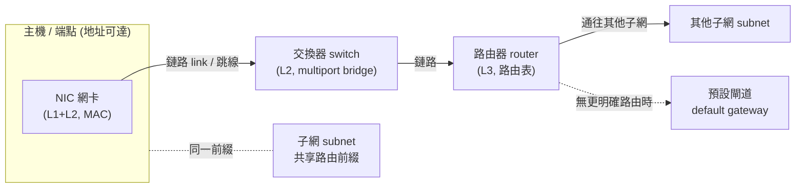
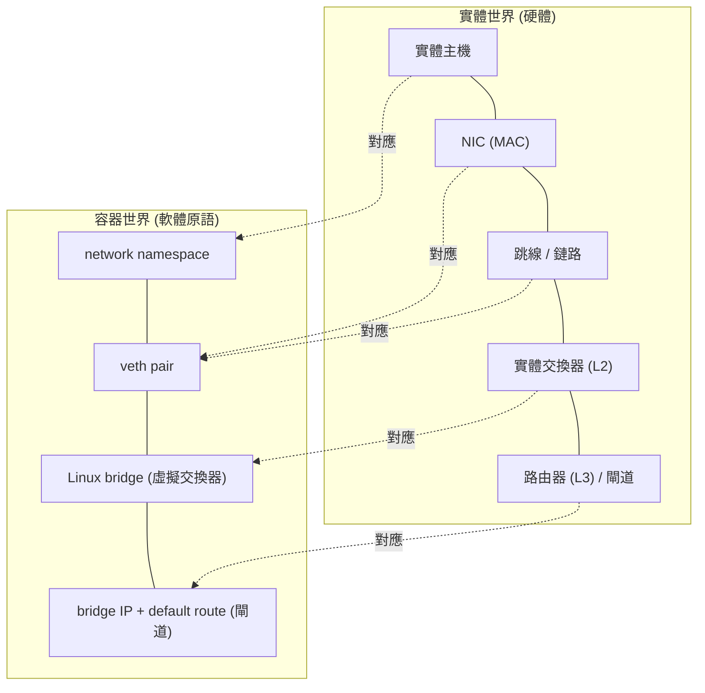
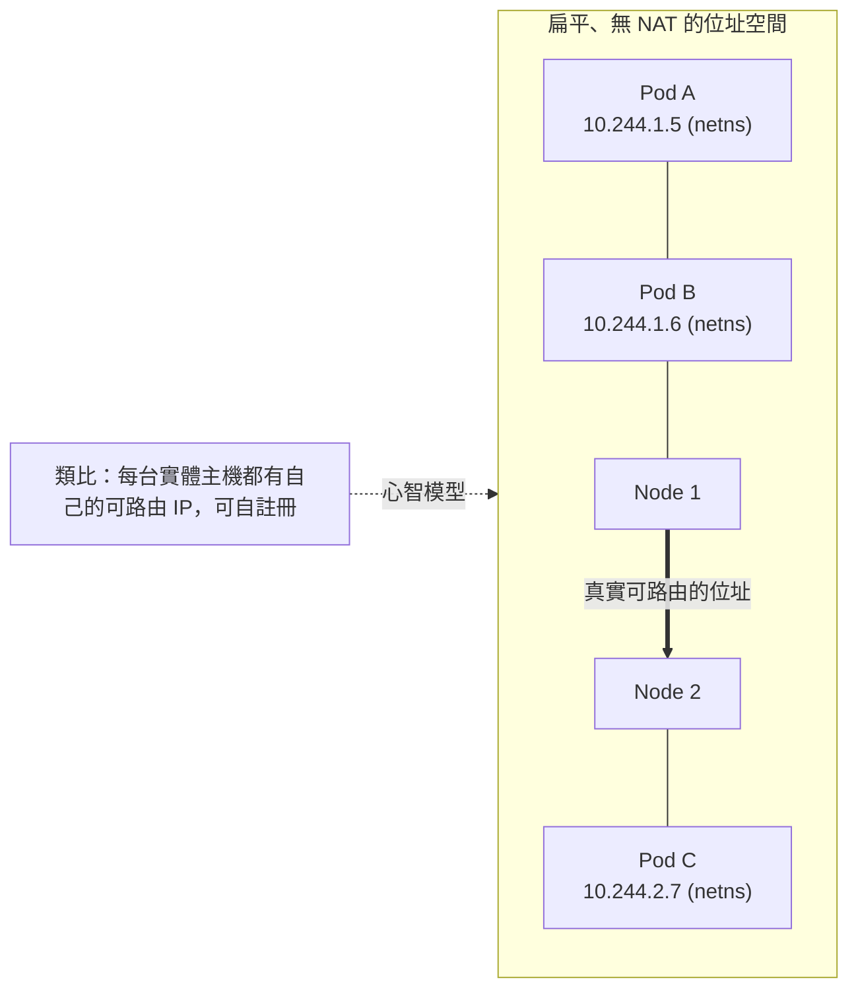

# CNI 與真實硬體網路：Kubernetes 容器網路是否複用了實體網路的領域模型？

## 摘要

本篇報告檢證一個問題：Kubernetes 所用的 CNI（Container Network Interface）規範，其設計是否與「非容器化、由真實硬體構成的網路」在元件與領域模型（domain model）上具有相似性？

結論是：**有，而且相似性相當系統化，但僅止於概念與協定層，而非實作層**。CNI 本身幾乎沒有發明新的網路抽象；它是一層薄薄的「執行契約」，把既有的 Linux 核心網路原語（network namespace、veth、bridge、route 等）依實體網路的領域模型組合起來。這些原語在語意上被刻意設計成實體設備的軟體對應物：network namespace 對應一台獨立主機、veth 對應一條跳線（patch cable）、Linux bridge 對應一台 L2 交換器、bridge 的 IP 與 default route 對應路由器／閘道。CNI 規範甚至直接沿用實體網路的「插拔」語言，將操作命名為 attachment（連接）、ADD（把容器加入網路）、DEL（把容器從網路移除）。

需要強調的差異在於：容器網路並非「另一個獨立的網路」，它是把**同一個** Linux 網路堆疊切分成多個隔離視圖，封包不經任何實體線路，且 Pod IP 具高度短暫性（ephemeral），這也是 CNI、overlay 與 Kubernetes Service 等額外抽象層存在的理由。

本文後續將依序說明：(1) CNI 的定義與操作；(2) 實體網路的領域模型；(3) 兩者的逐項映射；(4) 網路虛擬化與 Docker CNM 如何把這個映射說得更明白；(5) 相似性的邊界。所有示意圖均以 Mermaid 繪製。

---

## 1. 什麼是 CNI

CNI（Container Network Interface，容器網路介面）是一套 CNCF 專案，其規範（本文引用之版本為 spec **1.1.0**）自我定位為「一個針對 Linux 上應用容器的、通用的外掛式網路方案」[^spec]。規範定義了三個（實務上四個）關鍵詞，用詞刻意精確[^spec]：

- **_container_**（容器）：「一個網路隔離網域（network isolation domain），但實際的隔離技術並非由規範所定義。這可以是 network namespace 或一台虛擬機。」
- **_network_**（網路）：「一組可被唯一定址、且彼此可互相通訊的端點（endpoints）。這可以是單一容器、一台機器，或某個其他網路裝置（例如一台路由器）。容器在概念上可以被『加入』或『移除』一個或多個網路。」
- **_runtime_**（執行環境）：負責執行 CNI 外掛的程式。
- **_plugin_**（外掛）：套用某一指定網路設定的程式。

CNI 規範所定義的內容包含五個部分[^spec]：網路設定檔格式、runtime 呼叫外掛的協定、外掛的執行程序、外掛之間的委派（delegation）程序，以及外掛回傳結果的資料型別。外掛是**短命的可執行檔**，由 runtime 以環境變數傳入參數、以標準輸入（stdin）傳入 JSON 設定、以標準輸出（stdout）回傳結果[^spec]。主要操作以 `CNI_COMMAND` 環境變數指定[^spec]：

| 操作 | 語意（規範原文摘要） |
| --- | --- |
| `ADD` | 「將容器加入網路，或套用修改」：在容器（`CNI_NETNS`）內建立或調整介面（`CNI_IFNAME`）。 |
| `DEL` | 「將容器從網路移除，或還原修改」：刪除介面或撤銷 `ADD` 所做的修改。 |
| `CHECK` | 檢查容器網路是否符合預期。 |
| `STATUS` | 檢查外掛是否就緒（error code 50、51）。 |
| `GC` | 依 runtime 提供的「仍有效 attachment 清單」清理殘留資源。 |
| `VERSION` | 回報外掛支援的規範版本。 |

而「對容器套用一次網路設定」這個動作，規範稱為一次 **_attachment_**（連接／附加），並以 `(CNI_CONTAINERID, CNI_IFNAME)` 這組 tuple 唯一識別[^spec]。這個命名法值得注意：它不是「設定一個網路」，而是「把某個東西接上一個網路」——這正是實體網路世界的說法。

`ADD` 的成功回傳物件也直接採用了實體網路的欄位語彙[^spec]：

- `interfaces`：本次 attachment 建立的所有介面，欄位包含 `name`、**`mac`**（硬體位址）、`mtu`、`sandbox`（隔離網域路徑，例如 netns）、`socketPath`、`pciID`。
- `ips`：**`address`**（CIDR 表示法）、**`gateway`**（該子網的預設閘道）、`interface`（指向 `interfaces` 的索引）。
- `routes`：`dst`、`gw`（next hop）、`mtu`、`advmss`、`priority`、`table`、`scope`（global/link/host）。

換句話說，CNI 的結果型別是「介面、位址、路由」這三個實體網路的基本元素，加上它們的 L2/L3 屬性。

---

## 2. 實體硬體網路的領域模型

### 2.1 階層式參考模型

實體網路最標準的概念框架是 OSI 參考模型（ISO/IEC 7498-1），它把通訊系統拆成七個抽象層：實體層、資料鏈結層、網路層、傳輸層、會話層、表現層、應用層；每一層「有明確的函式與語意，為其上一層提供一類功能，並由其下一層所服務」[^osi]。與 OSI 並行的 TCP/IP（Internet protocol suite）模型則分為應用層、傳輸層、網際層（Internet layer）、鏈結層[^internetlayer]。

### 2.2 核心領域物件

實體網路在模型上可拆解為以下互相組合的物件：

1. **主機（host）／節點（node）**：連上網路、至少被指派一個網路位址的裝置。主機參與使用者應用；而交換器、集線器等基礎設施硬體不一定擁有網路位址，也不被視為網路主機[^host]。
2. **網路介面卡（NIC，網路介面控制器／網路卡）**：「連接電腦與電腦網路的硬體元件」，實作特定實體層與資料鏈結層標準（如 Ethernet、Wi-Fi），並透過 **MAC 位址**提供低位址體系[^nic]。
3. **鏈路（link）**：相鄰節點之間的實體／邏輯連線。鏈結層是 Internet 協定套組中最低的一層，其協定「僅運作於網段的相鄰網路節點之間」[^linklayer]。
4. **子網（subnet）**：對 IP 網路的邏輯細分，同一子網內的電腦共享相同的最高有效位元群（即路由前綴）[^subnet]。
5. **路由（route）與路由表（routing table）**：路由是「目的地網路到下一跳（next hop）的映射」；路由表列出通往特定網路目的地的路由，並可能附帶度量（metric）[^routetable]。
6. **閘道（gateway）／預設閘道（default gateway）**：閘道是「讓資料從一個離散網路流向另一個網路」的硬體或軟體；預設閘道則是「當其他路由都不匹配封包目的地 IP 時，作為轉送主機（路由器）的節點」，亦即「最後手段的路由器」[^gw]。
7. **交換器（switch）**：使用封包交換、以 **MAC 位址**在資料鏈結層（L2）轉送資料的網路硬體，是一種多埠橋接器（bridge），會學習相連裝置的位址而只往目的埠轉送[^switch]。
8. **路由器（router）**：在網路之間（含網際網路）轉送資料封包的裝置；封包抵達時讀取標頭中的網路位址，再依路由表或路由策略決定下一個網路[^router]。

### 2.3 組裝圖

此模型的核心是：**可定址的端點（主機／介面）由鏈路互連，被劃分為子網，再經由路由器／閘道串接起來**，整體行為由分層參考模型描述。

---

## 3. CNI 逐一對應實體網路領域模型

CNI 之所以「看起來像」實體網路，是因為其外掛文件直接以實體設備描述自己的行為。以下逐項對照。

### 3.1 Network namespace ＝ 一台獨立主機

network namespace 是 Linux 核心提供的一種建構，讓行程擁有自己完整的一份網路堆疊：自己的介面、IP、路由表、ARP／鄰居快取、防火牆規則、conntrack 表與 TCP/UDP 埠空間[^blinken]。這正是**一台實體主機**所擁有的資源集合。兩個容器可以同時綁定 `0.0.0.0:80`、且都宣稱 `10.40.0.1` 是預設閘道，正是因為查表發生在各自的堆疊中——就像兩台實體機器一樣[^iximiuz]。

CNI 規範本身即把隔離網域視為等同於主機：`container`「可以是 network namespace 或一台虛擬機」[^spec]；而 `CNI_NETNS` 參數就是「容器隔離網域的參照，若使用 network namespace 則是其路徑（例如 `/run/netns/[nsname]`）」[^spec]。傳統網路工程師常用的類比是 VRF（Virtual Routing and Forwarding）實例：同一個核心內、彼此隔離的路由與轉送平面[^blinken]。

### 3.2 veth pair ＝ 一條虛擬跳線

veth 是兩個成對、背對背連接的虛擬乙太網路裝置：一端送出的封包會立刻從另一端冒出，本身沒有自己的協定、沒有封裝、也不經使用者空間轉送[^iximiuz]。因此它被普遍描述為「永不離開核心的跳線（patch cable）」[^containerdbook]。

CNI 的 **`ptp` 外掛（point-to-point）** 就是最純粹的「線材」外掛，其文件如此描述[^ptp]：

> 「ptp 外掛使用 veth 裝置，在容器與主機之間建立一條點對點鏈路。veth pair 的一端置於容器內，另一端留在主機上……容器介面的流量將經由主機的介面被路由。」

而 main plugin 清單也直接以原語之名描述各外掛功能：`ptp`「建立一對 veth」、`bridge`「建立一座 bridge，把主機與容器加入其中」、`host-device`「把一個既有的裝置搬進容器」、`macvlan`「建立新 MAC 位址並把流量轉送給容器」、`vlan`「從 master 建立一個 vlan 介面」[^mainplugins]。

### 3.3 Linux bridge ＝ 一台虛擬交換器

Linux bridge 是軟體實作的 L2 交換器，具備 MAC 學習、轉送資料庫（FDB）、廣播與未知單播泛洪等行為——與機架交換器同一模型，只是線路是虛擬的[^iximiuz]。CNI `bridge` 外掛文件把這個類比寫得非常直白[^bridge]：

> 「使用 bridge 外掛時，同一主機上的所有容器都被**插入（plugged into）一座橋接器（虛擬交換器）**，該橋接器位於主機的 network namespace 中。容器取得 veth pair 的一端，另一端連接到橋接器。」

它甚至沿用交換器的埠模式語言：`vlan` 參數「等同於實體交換器上的一個 access port」，而 `vlan` 加 `vlanTrunk` 則構成 trunk port[^bridge]。此外 `portIsolation` 可讓容器僅能與主機或經閘道通訊，語意與交換器的埠隔離一致[^bridge]。

### 3.4 閘道與路由 ＝ 路由器介面與路由表

bridge 外掛文件接著說明：「橋接器本身也可以被指派一個 IP 位址，使其成為容器的**閘道（gateway）**」，或在純 L2 模式下改為橋接到主機網路介面[^bridge]。而 CNI 規範把這項責任指派給外掛與 IPAM：「CNI 外掛預期要為介面指派（並維護）一個 IP 位址，並安裝該介面相關的必要路由」；「IPAM 外掛必須決定介面的 IP／子網、**閘道與路由**，並把這些資訊回傳給『主』外掛去套用」[^spec]。這就是為何每個容器都會有一條 `default via 10.40.0.1` 的路由——與實體主機指向路由器的建構完全相同[^iximiuz]。

### 3.5 插拔 ＝ ADD／DEL

CNI 的操作名稱本身就是插拔語言：`ADD` 是「將容器加入網路」，`DEL` 是「將容器從網路移除」[^spec]。社群的事實標準文件《Kubernetes Network Custom Resource Definition De-facto Standard》把一次 attachment 定義得更明白[^mns]：

> 「**Network Attachment**：一種讓 Pod 直接與某個邏輯或實體網路通訊的手段。典型上（但不必然）每次 attachment 的形式是**把一個核心網路介面放進 Pod 的 network namespace**。每次 attachment 可能為 Pod 指派零個或多個 IP 位址。」

該文件也重申 CNI 規範對 attachment 的唯一識別方式為 `[container ID, network name, CNI_IFNAME]` 這組 tuple[^mns]。因此一次 attachment 對應的實體動作就是「從一台裝置拉一條跳線插進一個網路」：容器（隔離主機）取得介面（裝置埠），透過 veth（線材）連到 bridge 或路由織構（網路）。

### 3.6 逐項對照表

| 實體網路概念 | Linux／CNI 對應原語 | CNI 角色 |
| --- | --- | --- |
| 隔離主機／機器 | network namespace | 「容器」／隔離網域（`CNI_NETNS`）[^spec] |
| 跳線／點對點鏈路 | veth pair | 連接容器 netns 與主機（`ptp` 即純線材）[^ptp] |
| L2 交換器 | Linux bridge | 「虛擬交換器」，容器「插入」其中[^bridge] |
| 路由器介面／閘道 | bridge 的 IP ＋ default route | 容器的閘道（由 IPAM 決定）[^bridge][^spec] |
| 把裝置插進網路 | `ADD`／attachment | 在 netns 內建立介面並接上網路[^spec] |
| 拔除裝置 | `DEL` | 刪除介面／撤銷修改[^spec] |
| 插槽／埠與位址 | `interfaces`、`mac`、`ips` | 回報介面、硬體位址、IP、閘道[^spec] |
| 路由表 | `routes`（dst／gw／scope／table） | 回報要安裝的路由[^spec] |

---

## 4. 中介層：網路虛擬化與 Docker CNM 如何把映射說明白

### 4.1 網路虛擬化本身即是「映射」的學問

網路虛擬化被定義為「把硬體與軟體的網路資源與網路功能，結合成單一的軟體化行政實體——虛擬網路（virtual network）」[^netvirt]。它分成兩類[^netvirt]：

- **外部虛擬化**：把一個或多個實體 LAN 合併或細分為虛擬網路（如 VLAN、VPN）。其積木是交換器硬體與 VLAN 技術。
- **內部虛擬化**：在單一實體伺服器上，為軟體容器提供類網路功能，其積木正是 **vNIC** 與 **虛擬交換器（vSwitch）**。

這正是 Kubernetes CNI 所處的座標：CNI 屬於「內部虛擬化」，使用軟體原語複製實體網路。文獻對此的描述高度一致——Docker 網路「以核心的網路堆疊作為低階原語來建立更高階的網路驅動；簡單說，**Docker 網路就是 Linux 網路**」[^dockerlabs]；「Docker 並不取代 Linux 網路，而是建構在它之上……Linux 在 Docker 存在之前就已提供隔離、路由與封包轉送」[^tfl]。

### 4.2 Overlay 與 Underlay：兩層領域模型的顯式分離

雲端網路把「邏輯／租戶視角」與「實體／供應商視角」明確拆成兩層[^netvirt][^overlay]：

- **Underlay**：實體網路（路由器、交換器、線纜、NIC），通常構成固定的高頻寬織構。
- **Overlay**：建構在 underlay 之上的邏輯 L2／L3 網路，以封裝技術解耦於實體交換器；例如 VXLAN 用 24-bit VNI 提供約 1,670 萬個網路識別碼，克服 802.1Q VLAN 僅 12-bit（4,096 個）的限制[^vxlan]。

Kubernetes 生態中的 Flannel、Calico、Cilium 等 CNI 外掛即在 overlay 模式下使用 VXLAN／Geneve 等封裝，讓跨節點的 Pod 流量得以穿越實體 IP 織構[^netvirt][^design]。這說明 CNI 不只在「元件層」複製實體網路，也在「領域模型層」複製了 overlay／underlay 的雙層結構。

### 4.3 Docker CNM：把實體網路領域模型直接寫進規格

若說 CNI 是「行為上像」，Docker 的 Container Network Model（CNM）則是「形式上像」。CNM 由 Docker 提出，建立了三個主要元件，其定義與實體網路的對應幾乎是一一映射[^libnetwork]：

- **Sandbox**：包含一個容器網路堆疊的設定，涵蓋介面、路由表與 DNS 設定。「Sandbox 的一種實作可以是 Linux Network Namespace、FreeBSD Jail 或類似概念。」一個 Sandbox 可以包含來自多個網路的**多個** endpoint。[^libnetwork]
- **Endpoint**：「Endpoint 把一個 Sandbox 連接到一個 Network。Endpoint 的一種實作可以是 **veth pair**、Open vSwitch internal port 或類似物。一個 Endpoint 只能屬於一個網路，且若已連接，只能屬於一個 Sandbox。」[^libnetwork]
- **Network**：「Network 是一組能彼此直接通訊的 Endpoint。Network 的一種實作可以是 **Linux bridge、VLAN** 等。」[^libnetwork]

注意 CNM 的語意：Sandbox ≈ 主機（network namespace），Endpoint ≈ 網路介面／鏈路（veth pair），Network ≈ L2/L3 連通與隔離網域（bridge／VLAN）。這與 CNI 的原語映射完全同構，只是 CNI 選擇不把這些抽象寫成物件，而留給 runtime 與外掛自行組合。CNM 也把 IPAM 視為獨立擴充點，與 CNI 的 IPAM 外掛設計一致[^libnetwork][^spec]。

### 4.4 為何 Kubernetes 選 CNI 而非 CNM

這段歷史同樣顯示主題是「領域模型的耦合程度」。Kubernetes 官方部落格〈Why Kubernetes doesn't use libnetwork〉（2016-01-14）指出，CNM 的全域驅動依賴 libkv（consul/etcd/zookeeper）等分散式鍵值儲存做跨機器協調，迫使管理員額外維運基礎設施；且驅動「不會被告知容器被接上的網路名稱，只得到 Docker 內部配置的 ID」，難以對應到 Kubernetes 的網路概念；此外 CNM「與容器 runtime 高度相關，在某種程度上無法解耦」。相較之下「CNI 在哲學上與 Kubernetes 更一致。它比 CNM 簡單得多、不需要常駐守護程序」[^blog]。換言之，Kubernetes 保留了實體網路的領域模型，但拒絕把該模型綁進一個重量級、與 runtime 耦合的函式庫。

---

## 5. Kubernetes 本身如何借用「實體主機」的心智模型

CNI 是介面契約，真正決定「容器看起來像什麼」的是 Kubernetes 的網路模型。而其設計文件明確以實體主機為藍本[^design]：

> 「目標是讓每個 Pod 在一個**扁平的共享網路命名空間（flat shared networking namespace）**中擁有一個 IP，能與網路上其他實體電腦與容器完整通訊。」

> 「IP-per-pod 創造了一個乾淨、向後相容的模型，讓 Pod 在埠分配、網路、命名、服務發現、負載平衡、應用設定與遷移等視角上，**可以被當作 VM 或實體主機來看待**。」

> 「藉由讓 IP 位址與埠在 Pod 內外一致，我們創造了一個**無 NAT 的扁平位址空間**。」

設計文件還指出這能讓既有機制「開箱即用」：「執行 `ip addr show` 應該如預期般運作」，如此便能支援自註冊機制與散佈 IP 位址的應用；並譴責 NAT「藉由碎裂位址空間而引入額外複雜度，破壞自註冊機制」[^design]。現行文件也保證「每個 Pod 取得自己唯一的叢集級 IP」、「所有 Pod 可與所有其他 Pod 通訊……不需代理或位址轉譯（NAT）」[^k8snetworking]。

換言之，Kubernetes 刻意讓 Pod 的行為「像一台有自己 IP 的小主機」。Pod 內的容器共享同一個 network namespace，彼此透過 `localhost` 通訊，「行為如同位於同一台主機」[^design]；這與實體主機上多個服務共用一個網路堆疊的情形完全對應。

---

## 6. 相似性的邊界：哪裡只是「像」而非「是」

批判性地檢視後，相似性有三個明確邊界：

1. **底層是「同一個核心」，不是真實線路。** 容器不是 VM：VM 擁有完整網路堆疊，行為上像網路上的實體機器；容器只是主機核心上的一個行程，隔離只是一種「視圖」[^cloudodyssey]。封包不是經由真實硬體，而是在 namespace 之間透過核心函式（如 `netif_rx()`）跨越[^kernelinternals]。所謂的「線材」與「交換器」是核心資料結構，效能與故障模式因此不同。

2. **Pod IP 具高度短暫性，實體主機的 IP 相對穩定。** 這正是需要 overlay、CNI 外掛、Service／kube-proxy 等額外抽象的原因。Kubernetes 的 Service 抽象「建立一個虛擬 IP，客戶端可存取，並被透明地代理到 Service 中的 Pod」[^design]——這個 VIP／負載平衡層在實體網路中並無直接對應物。

3. **相似性是「協定與心智模型」層級。** 如同時序：容器與實體主機都使用相同的 Ethernet／L2、IP／L3、ARP、路由、NAT 等協定與概念，並且都不自創新的 OSI 層（例如 F5 的討論主張在既有層之上補述，而非另立新模型）[^f5]；但這不代表容器網路與實體網路在實作上是同一件事。較準確的表述是 **「同一套概念，不同的基底（same concepts, different substrate）」**[^cloudodyssey]。

---

## 7. 結論

回答原始問題：**CNI 的設計與「容器化無關的真實硬體網路」在元件與領域模型上確實相關，且關係是系統性的、非偶然的。** 具體而言：

- CNI 並未發明新的網路抽象，而是把既有 Linux 網路原語組合起來，這些原語在語意上被設計為實體設備的軟體對應物（netns↔主機、veth↔跳線、bridge↔交換器、bridge IP／route↔路由器／閘道）[^iximiuz][^containerdbook][^bridge]。
- CNI 規範的操作語彙本身借用實體網路的插拔模型（attachment、ADD、DEL），結果型別承載 MAC、IP、gateway、routes 等實體網路欄位[^spec]。
- Docker 的 CNM 把同一套映射寫成顯式物件（Sandbox／Endpoint／Network ↔ netns／veth／bridge），可視為該領域模型的「形式化版本」[^libnetwork]。
- Kubernetes 進一步以「Pod 像實體主機」為設計哲學，追求扁平、無 NAT、每 Pod 一 IP 的位址模型[^design][^k8snetworking]。
- 但相似性止於概念與協定層：底層是單一核心的隔離視圖而非實體線路，Pod IP 短暫，且 Service 等抽象並無實體對應物[^cloudodyssey][^kernelinternals][^design]。

因此，若把 CNI 視為「用軟體重述實體網路領域模型的一層執行契約」，會比把它視為一套全新的網路學問更貼近事實；而理解這個對應關係，正是把既有實體網路知識遷移到 Kubernetes 除錯與設計的關鍵。

---

## 參考文獻

[^spec]: CNI Authors. (n.d.). *Container Network Interface (CNI) specification (spec version 1.1.0)*. Retrieved 2026-10-11, from https://www.cni.dev/docs/spec/

[^bridge]: CNI Authors. (n.d.). *bridge plugin*. Retrieved 2026-10-11, from https://www.cni.dev/plugins/current/main/bridge/

[^ptp]: CNI Authors. (n.d.). *ptp plugin*. Retrieved 2026-10-11, from https://www.cni.dev/plugins/current/main/ptp/

[^mainplugins]: CNI Authors. (n.d.). *Main: interface-creating plugins*. Retrieved 2026-10-11, from https://www.cni.dev/plugins/current/main/

[^design]: Kubernetes Authors. (n.d.). *Networking* (Kubernetes design proposals archive). Retrieved 2026-10-11, from https://git.k8s.io/design-proposals-archive/network/networking.md

[^k8snetworking]: Kubernetes Authors. (n.d.). *Cluster networking*. Retrieved 2026-10-11, from https://kubernetes.io/docs/concepts/cluster-administration/networking/

[^libnetwork]: Moby Project. (n.d.). *Design* (libnetwork documentation). Retrieved 2026-10-11, from https://github.com/moby/libnetwork/blob/master/docs/design.md

[^blog]: Hockin, T. (2016, January 14). *Why Kubernetes doesn't use libnetwork*. Kubernetes Blog. Retrieved 2026-10-11, from https://kubernetes.io/blog/2016/01/why-kubernetes-doesnt-use-libnetwork/

[^mns]: Network Plumbing Working Group. (2018, August 2). *Kubernetes network custom resource definition de-facto standard version 1*. Retrieved 2026-10-11, from https://github.com/k8snetworkplumbingwg/multi-net-spec

[^iximiuz]: Velichko, I. (2026, September 27). *How container networking works: Building a bridge network from scratch*. iximiuz Labs. Retrieved 2026-10-11, from https://iximiuz.com/en/posts/container-networking-is-simple/

[^containerdbook]: *Network namespaces and virtual ethernet* (The containerd book, Part 5, Chapter 14). (n.d.). Retrieved 2026-10-11, from https://thecontainerdbook.com/chapters/part-5/14-network-namespaces-and-virtual-ethernet

[^blinken]: *An introduction to network namespaces*. (n.d.). Das Blinken Lichten. Retrieved 2026-10-11, from https://www.dasblinkenlichten.com/an-introduction-to-network-namespaces/

[^dockerlabs]: *Linux networking* (DockerLabs networking concepts). (n.d.). Retrieved 2026-10-11, from https://dockerlabs.collabnix.com/networking/concepts/linux-networking

[^tfl]: *Docker networking on Linux: A mental model*. (2026, January 24). TutorialForLinux. Retrieved 2026-10-11, from https://tutorialforlinux.com/2026/01/24/docker-networking-on-linux-mental-model/

[^cloudodyssey]: *How container networking really works*. (n.d.). Cloud Odyssey. Retrieved 2026-10-11, from https://cloudodyssey.substack.com/p/how-container-networking-really-works

[^kernelinternals]: *Container networking* (Kernel internals reference). (n.d.). Retrieved 2026-10-11, from https://kernel-internals.org/net/container-networking/

[^f5]: *The new OSI network stack: Containers and half-layers*. (n.d.). F5. Retrieved 2026-10-11, from https://www.f5.com/company/blog/the-new-osi-network-stack-containers-and-half-layers

[^netvirt]: Network virtualization. (n.d.). In *Wikipedia*. Retrieved 2026-10-11, from https://en.wikipedia.org/wiki/Network_virtualization

[^overlay]: Overlay network. (n.d.). In *Wikipedia*. Retrieved 2026-10-11, from https://en.wikipedia.org/wiki/Overlay_network

[^vxlan]: Virtual Extensible LAN. (n.d.). In *Wikipedia*. Retrieved 2026-10-11, from https://en.wikipedia.org/wiki/Virtual_Extensible_LAN

[^osi]: OSI model. (n.d.). In *Wikipedia*. Retrieved 2026-10-11, from https://en.wikipedia.org/wiki/OSI_model

[^internetlayer]: Internet layer. (n.d.). In *Wikipedia*. Retrieved 2026-10-11, from https://en.wikipedia.org/wiki/Internet_layer

[^host]: Host (network). (n.d.). In *Wikipedia*. Retrieved 2026-10-11, from https://en.wikipedia.org/wiki/Host_(network)

[^nic]: Network interface controller. (n.d.). In *Wikipedia*. Retrieved 2026-10-11, from https://en.wikipedia.org/wiki/Network_interface_controller

[^linklayer]: Link layer. (n.d.). In *Wikipedia*. Retrieved 2026-10-11, from https://en.wikipedia.org/wiki/Link_layer

[^subnet]: Subnet. (n.d.). In *Wikipedia*. Retrieved 2026-10-11, from https://en.wikipedia.org/wiki/Subnet

[^routetable]: Routing table. (n.d.). In *Wikipedia*. Retrieved 2026-10-11, from https://en.wikipedia.org/wiki/Routing_table

[^gw]: Default gateway. (n.d.). In *Wikipedia*. Retrieved 2026-10-11, from https://en.wikipedia.org/wiki/Default_gateway

[^switch]: Network switch. (n.d.). In *Wikipedia*. Retrieved 2026-10-11, from https://en.wikipedia.org/wiki/Network_switch

[^router]: Router (computing). (n.d.). In *Wikipedia*. Retrieved 2026-10-11, from https://en.wikipedia.org/wiki/Router_(computing)
