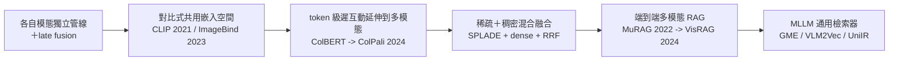
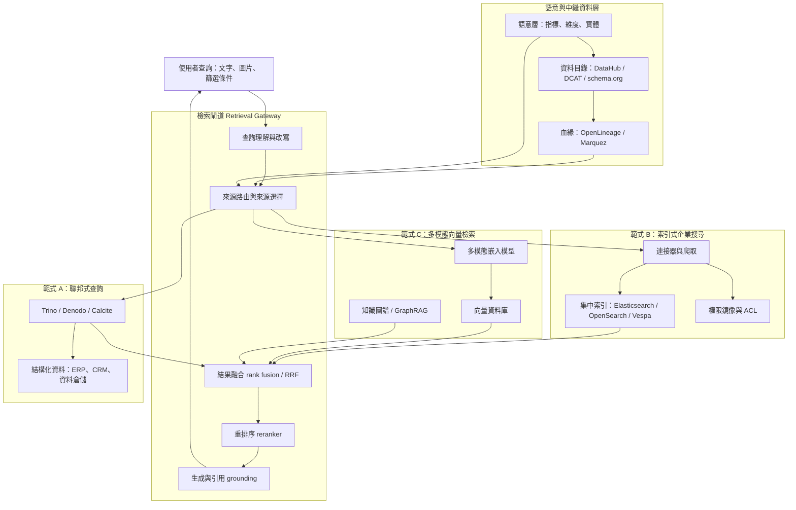

# ETL 領域的多模態檢索範式：跨資料孤島的使用者檢索系統之領域模型與核心概念

## 摘要

本報告回答一個特定問題：當目標**不是**用 ETL 進行機器學習或資料探勘，而只是要建立一套「方便使用者檢索資料」的系統，且資料分散在多個資料孤島（data silo）中時，該領域存在哪些檢索範式，以及必須掌握哪些領域模型與概念。

結論先行：這個問題落在三個學科的交集上，分別是**資訊檢索（Information Retrieval, IR）**、**資料整合（Data Integration）**與**中繼資料管理（Metadata Management）**。ETL 在此不是主角，而是被刻意繞過的對象。取代它的主要範式有三類：

1. **聯邦式查詢／資料虛擬化（Federated Query / Data Virtualization）**：不搬資料，查詢期即時向來源取用。
2. **索引式企業搜尋（Index-based / Crawl-and-Connector Enterprise Search）**：搬內容或中繼資料副本到一個集中索引。
3. **多模態向量檢索與檢索增強生成（Multimodal Vector Retrieval / RAG）**：跨文字、圖片、表格、文件頁面等模態，以語意向量與生成模型服務檢索。

三者可以疊加使用。真正的難點通常不在模型本身，而在**語意對齊（semantic alignment）**、**權限傳遞（permission propagation）**、**新鮮度（freshness）**與**排序融合（rank fusion）**。

---

## 一、問題界定：這裡的 ETL 為何與機器學習無關

傳統 ETL 的定義是：週期性地從來源系統**擷取（Extract）**、**轉換（Transform）**、**載入（Load）**到一個目標儲存體，之後的查詢都跑在一個整合後的副本上。它的代價是批次延遲（batch latency）與資料重複（duplication）[^promethium]。

相對地，**聯邦式（federated）／虛擬化（virtualized）**的做法「把資料留在來源系統，將查詢即時翻譯為來源特定的請求，並即時彙總結果」（leaves data in place at source systems, translates queries into source-specific requests on-demand, and aggregates results in real-time）[^promethium]。

兩者的分工可以這樣理解：

| 面向 | ETL／實體整合 | 聯邦式／虛擬化 |
|---|---|---|
| 資料位置 | 複製到整合儲存體 | 留在來源 |
| 延遲 | 批次 | 查詢期即時 |
| 查詢負載 | 在整合副本上 | 分散到各來源 |
| 典型用途 | 分析、建模、機器學習 | 檢索、探索、營運視圖 |
| 主要風險 | 重複、同步漂移 | 來源效能、網路敏感 |

需注意一個常見誤解：**「不用 ETL」並不等於「沒有中繼資料工程」**。索引式搜尋仍然需要連接器、schema 註冊、ACL 抽取與增量同步；這些是 ETL 的「檢索取向變體」，只是目的從「建模」變成「可被找到」。因此本報告把 ETL 的替代路徑視為**中繼資料與內容的搬運策略問題**，而非機器學習問題。

Promethium 的結論值得引用：多數成熟的資料組織「並不在地端 ETL 與虛擬化之間二選一，而是策略性地兩者並用」，用虛擬化做探索與營運視圖，並為已驗證的使用情境做實體化（materialize）[^promethium]。這正是「方便使用者檢索」這類系統的典型姿態：**先能查到，再談要不要落地**。

---

## 二、範式 A：聯邦式查詢與資料虛擬化

### 2.1 三個常被混用的概念

**資料聯邦（Data federation）** 是一種*技術*：跨多個資料儲存執行單一查詢，並把合併結果呈現得像是來自單一邏輯資料庫。作法是「把查詢拆成給各參與資料庫的子查詢，在各自系統上執行這些子查詢，再把結果合併為單一回應」。當來源相對同質（相容的 SQL 方言）時運作良好，但在混合關聯式資料庫、NoSQL、SaaS API 與檔案系統的異質環境中表現吃力[^promethium]。

**資料虛擬化（Data virtualization）** 是一個*更廣的架構層*，包含聯邦並加上額外能力。ThoughtSpot 定義它為「一種更廣的架構取向，包含聯邦，但也涵蓋快取、查詢最佳化與資料轉換層等額外能力」。經典框架（歸功於 Rick van der Lans）是：**「資料聯邦是資料虛擬化的子集；資料虛擬化的功能包含聯邦。」** Denodo 描述它為在資料消費端與底層實體來源之間建立「穩定的邏輯介面」，採零複製（zero-copy）架構，資料在「有幫助時」才被搬移，但「不是預設選項」[^thoughtspot][^denodo-overview]。

**聯邦式查詢引擎（Federated query engines）** 是*實作*聯邦／虛擬化的軟體系統：一個單一 SQL 端點，透過連接器連上多個來源，並在它們之間規劃與執行查詢，過程中不需 ETL。Trino 被描述為「一個分散式 SQL 查詢引擎，設計用來查詢分散在一個或多個異質資料來源上的大型資料集」[^trino-overview]。

### 2.2 核心領域概念

**（1）查詢下推（Query pushdown）**

引擎把查詢的一部分（謂詞、投影、聚合、join、limit）下推到來源系統，讓來源做這些工作，以減少網路流量與遠端負載。Trino 明確記載以下下推類型[^trino-pushdown]：

- **謂詞下推（Predicate pushdown）**：WHERE 條件過濾下推到來源；成功時 EXPLAIN 計畫不會出現 `ScanFilterProject`。
- **投影下推（Projection pushdown）**：只讀取被引用到的欄位。
- **解引用下推（Dereference pushdown）**：只讀取嵌套 ROW 型別中指定的欄位。
- **聚合下推（Aggregation pushdown）**：例如 `count(*)`、`sum()`、`avg()`、`min`／`max`、`stddev`、`variance`、`corr`、`regr_*`；若下推成功，EXPLAIN 不會顯示 `Aggregate` 運算子。限制包括 ROLLUP／CUBE／GROUPING SETS、聚合內的表達式、型別強制轉換，以及帶排序／過濾的聚合。
- **Join 下推（Join pushdown）**：要求所有 join 謂詞都可下推，且資料表位於同一 catalog。
- **Limit／Top-N 下推**：LIMIT 或 ORDER BY … LIMIT 被下推。

PostgreSQL 的 `postgres_fdw` 描述同樣的原則：它「嘗試最佳化遠端查詢以減少傳輸的資料量」，做法是把 WHERE 子句送到遠端，且不取用不需要的欄位；當兩張表都在同一遠端伺服器時，它會下推整個 join[^pgfdw]。DuckDB 的 PostgreSQL 擴充則暴露 `pg_experimental_filter_pushdown`（預設 true）[^duckdb-pg]。

**（2）連接器與 catalog 抽象（Connector / Catalog abstraction）**

Trino 的模型是：**connector**「使 Trino 適配某個資料來源……是 Trino 服務提供者介面（SPI）的實作」；**catalog** 是「一組用來存取特定資料來源的設定屬性，包含所需的 connector 與其他細節，例如憑證與 URL」，由一個 properties 檔定義，檔名即為 catalog 名稱。多個 catalog（甚至使用不同 connector）可在單一 SQL 查詢中被查詢[^trino-concepts]。Trino 內建數十種 connector（Iceberg、Hive、Delta Lake、MySQL、PostgreSQL、Oracle、Snowflake、Kafka、Cassandra 等）[^trino-connector]。

Apache Calcite 以 **schema adapter** 表達同一個概念：「schema adapter 讓 Calcite 能讀取特定種類的資料，把資料呈現為某個 schema 內的資料表」，並提供 JDBC、Cassandra、MongoDB、Druid、Elasticsearch、Kafka、Redis、Splunk、Spark 等 adapter。Calcite 被用於「SQL 解析、查詢最佳化、資料虛擬化／聯邦，以及物化檢視改寫」[^calcite-adapter]。

**（3）跨來源的成本式最佳化（Cost-based optimization across sources）**

- **Trino**：「有了成本式 join 列舉，Trino 使用 connector 提供的資料表統計來估計不同 join 順序的成本，並自動挑選估計成本最低的 join 順序」（策略有 AUTOMATIC、ELIMINATE_CROSS_JOINS、NONE）。它也做成本式的 **join 分發選擇**（partitioned 對 broadcast）。關鍵是：「為了讓 Trino 最佳化器使用成本式策略，connector 實作必須提供資料表統計」[^trino-cbo]。PostgreSQL connector 支援透過 `join-pushdown.strategy=AUTOMATIC` 做成本式 join 下推，且只在統計顯示能提升效能時才下推[^trino-pg-connector]。
- **Denodo** 把最佳化分為**靜態階段**（branch pruning、把條件與 group-by 推到 join 與 union 之下等改寫）與**成本式／動態階段**，後者「估計不同可能計畫的成本」，考量 join 策略（MERGE、HASH、NESTED）、來源間的**資料搬移**，以及 MPP 引擎的使用。成本估計使用來源索引與檢視統計（列數、null 數），可從來源的系統表取得。Denodo 警告：缺失或過時的統計會導致糟糕的計畫，因此 CBO「完全仰賴準確的資訊」[^denodo-cbo]。
- **Apache Drill**：「Foreman 把邏輯計畫交給成本式最佳化器以最佳化 SQL 運算子的順序……最佳化器套用各式規則，把運算子與函式重排為最佳計畫，並把邏輯計畫轉為實體計畫」[^drill-exec]。
- **Apache Calcite**：「成本模型引導整個過程，規劃引擎產生一個語意等價但成本更低的替代表達式。」Calcite 有針對成本函式與統計（選擇率、列數、不重複列數、大小、唯一鍵等）的中繼資料系統，並有兩種規劃引擎：`VolcanoPlanner`（動態規劃、窮舉搜尋）與 `HepPlanner`（固定順序規則觸發）[^calcite-algebra]。
- **Dremio** 的最佳化器「分析進來的查詢並自動改寫它們以使用預先物化的結果（Reflections）」，無需人工調校[^dremio-platform]。
- **PostgreSQL FDW** 透過 `use_remote_estimate`（送出遠端 `EXPLAIN`）做成本估計，並以 `fdw_startup_cost`、`fdw_tuple_cost` 模型化連線與傳輸開銷[^pgfdw]。

**（4）Schema 映射（Schema mapping）**

異質來源使用不同型別系統，因此 connector 必須雙向映射型別。例如 Trino 的 PostgreSQL connector 把 `NUMERIC` 映射為 `DECIMAL`、`TIMESTAMPTZ` 映射為 `TIMESTAMP WITH TIME ZONE`、`JSONB` 映射為 `JSON`、`HSTORE` 映射為 `MAP(VARCHAR,VARCHAR)`、`VECTOR` 映射為 `ARRAY(REAL)`，並提供 `unsupported-type-handling` 屬性（`IGNORE` 或 `CONVERT_TO_VARCHAR`）與 `jdbc-types-mapped-to-varchar`。名稱映射方面則透過 `case-insensitive-name-matching` 與一份 JSON 名稱映射設定檔，消解僅大小寫不同的 schema／資料表[^trino-pg-connector]。Calcite 透過 `SqlDialect`、`SqlConformance` 與 `RelDataTypeSystem` 客製化來控制映射[^calcite-adapter]。PostgreSQL FDW 則用 foreign table 上的 `schema_name`、`table_name`、`column_name` 選項映射遠端名稱[^pgfdw]。

**（5）跨異質來源的查詢規劃（Query planning across heterogeneous sources）**

Calcite 的關鍵機制是**呼叫慣例（calling convention）**：「呼叫慣例是特定資料引擎使用的協定。」在規劃多引擎查詢時，「Calcite 依其呼叫慣例為關聯表達式樹的區域『上色』。規劃器藉由觸發規則把運算子推入資料來源。若引擎不支援某個運算子，該規則就不會觸發。有時一個運算可出現在多個位置，最終依成本選出最佳計畫。」`Converter` 負責在慣例之間轉換資料（有執行期成本），而 `EnumerableConvention` 是後備方案，它「能實作所有核心關聯運算子與所有內建 SQL 函式」，作法是生成並編譯 Java 程式碼[^calcite-adapter]。

Trino 的規劃是分散式的：coordinator 解析與規劃，把執行拆成樹狀的 **stage**，每個 stage 以 **task** 實作，task 操作從 connector 取得的 **split**[^trino-concepts]。Drill 則使用 **major／minor fragment** 搭配 exchange 運算子，並為資料本地性排程[^drill-exec]。

**（6）聯邦的 SPARQL 面向**

聯邦不只是 SQL。**CostFed**（2018）提出 SPARQL 端點聯邦的成本式最佳化[^costfed]；VLDB 2025 的 CDMS 工作坊則有〈Rethinking Pluggable Federated Query Optimization〉一文，檢討可插拔的聯邦查詢最佳化[^vldb-cdms]。

### 2.3 具名系統

| 系統 | 類型 | 關鍵事實 |
|---|---|---|
| **Trino** | 開源分散式 SQL 查詢引擎 | 2019 年 1 月由 Martin Traverso、Dain Sundstrom、David Phillips 從 Presto 分支出來（PrestoSQL），2020 年 12 月更名 Trino。MPP coordinator／worker 架構、connector／catalog 模型，能跨 MySQL、PostgreSQL、Cassandra、Kafka、MongoDB、Elasticsearch 等執行聯邦查詢[^trino-wiki] |
| **Presto** | 分散式查詢引擎 | 2012 年起在 Facebook 設計，用於其 Hadoop 資料倉儲的互動式查詢，2013-11-10 開源。2019 年 1 月分支為 PrestoDB（Facebook）與 PrestoSQL（後來的 Trino）。Facebook 於 2019 年 9 月把 PrestoDB 捐給 Linux 基金會的 Presto Foundation[^presto-wiki] |
| **Denodo** | 商業資料虛擬化平台 | 以零複製架構在分散式來源之上提供邏輯介面，具分散式查詢最佳化、受治理的語意層、快取、加速與物化。其 Virtual DataPort 引擎執行靜態加成本式最佳化[^denodo-overview][^denodo-cbo] |
| **Dremio** | 商業（現屬 SAP）湖倉／查詢引擎 | Apache Arrow 原生引擎、LLVM 程式碼生成；跨 35 種以上來源型別做聯邦存取，「不需資料複製」；最佳化下推把過濾、投影、聚合與 join 交給來源引擎；「Autonomous Reflections」依 7 天查詢模式自動建立物化；使用 Calcite 做 SQL 解析與成本式最佳化[^dremio-platform] |
| **Starburst** | 商業 Trino 廠商 | 「以 Trino 為基礎」。Starburst Enterprise 提供「開放資料聯邦，從單一 SQL 介面查詢 50 種以上來源……不搬移或複製任何東西……沒有 ETL 管線或重複」，並加入 Warp Speed 加速、原生結果快取、智慧謂詞下推、自動成本式最佳化與治理。2017 年自 Teradata 分拆[^starburst] |
| **Apache Calcite** | 開源 SQL 規劃／最佳化框架 | 「動態資料管理框架」，提供標準 SQL 解析器、驗證器、JDBC 驅動、關聯代數、規劃規則與成本模型。驅動 Apache Drill、Hive、Flink、Dremio、Kylin、Beam、Phoenix 等，可作為「資料虛擬化或聯邦伺服器」，此時「Calcite 管理多個外部 schema 中的資料，但對客戶端而言所有資料似乎都在同一處」。最新列出版本 1.42.0／2026-05-31[^calcite-site][^calcite-history][^calcite-poweredby] |
| **Apache Drill** | 開源免 schema SQL 查詢引擎 | 「一個用於大資料探索的 Apache 開源 SQL 查詢引擎……從一開始就設計來支援對半結構化與快速演進資料的高效能分析」，能對 JSON、Parquet、文字、HBase 做動態查詢而無需 Hive metastore 中繼資料。使用 Calcite 做解析／最佳化；以 Foreman 為基礎的執行搭配成本式最佳化器與 major／minor fragment[^drill-intro][^drill-exec] |
| **PostgreSQL FDW** | PostgreSQL 內建聯邦機制 | 實作 SQL/MED 的一部分以存取「外部資料」。**foreign data wrapper** 是「一個能與外部資料來源通訊的函式庫，隱藏連線到該來源並取得資料的細節」。設定流程：CREATE SERVER → CREATE USER MAPPING → CREATE FOREIGN TABLE（或 IMPORT FOREIGN SCHEMA）。`postgres_fdw` 提供遠端查詢最佳化、交易、非同步執行與成本估計[^pgfdw][^pg-fdw-ddl] |
| **DuckDB** | 行程內分析型資料庫，含聯邦能力 | 用 `ATTACH` 連接 MySQL、Postgres 與 SQLite 資料庫，與原生 DuckDB 檔案並存，因此能不經 ETL 做跨資料庫 join（例如在單一查詢中 join `mysql.film`、`sqlite.film_actor`、`postgres.actor`）。可插拔的儲存／交易層允許對這些系統讀寫。支援 `postgres_query()` 與 `postgres_execute()` 把任意 SQL 推到來源。單一交易中的多資料庫*寫入*不支援[^duckdb-blog][^duckdb-pg] |

### 2.4 實務注意事項

- **效能取決於來源能力**。Trino 指出「下推的支援因各 connector 與相關底層資料庫或儲存系統而異」[^trino-pushdown]。Denodo 表示 CBO 的品質取決於統計品質，而虛擬化「取決於來源效能；對網路敏感」[^promethium][^denodo-cbo]。
- **正確性優先於下推**。Trino 的 PostgreSQL connector「以正確性為優先」，不會下推可能改變結果的運算（例如因排序規則差異而對 VARCHAR 的範圍謂詞），除非開啟實驗性旗標[^trino-pg-connector]。
- **異質性才是最難的部分**。簡單的聯邦「在來源相對同質時運作優雅……但當你需要跨混合關聯式資料庫、NoSQL 儲存、SaaS API 與檔案系統的異質環境做聯邦時就會吃力」，而這正是虛擬化層、中繼資料目錄、快取與治理發揮價值之處[^promethium]。

---

## 三、範式 B：索引式企業搜尋與連接器

### 3.1 兩種根本架構

企業搜尋必須統一散落在互不相連的 SaaS 與地端系統中的內容。存在兩種主流模式，而多數現代平台會混合它們。

**（1）索引式（crawl／connector）搜尋**

連接器把內容從各來源**拉取**（或被推送）出來、轉換，然後寫入一個集中索引。查詢時使用者只搜尋**一個索引**，不接觸來源系統。

- Microsoft 的 synced Copilot connectors 是典型案例：「Synced connectors 把外部來源的內容爬取並索引進 Microsoft Graph。」每個項目帶有內容、中繼資料與 ACL。一旦匯入，「該項目就成為你組織雲端搜尋索引的一部分。它可被全文檢索，並由語意索引 AI 處理以決定相關性」[^ms-connectors-overview]。
- Glean 的「indexed access」模式：「內容與權限是先前被爬取、存於你的 Glean 租戶中，並在查詢時從該語料讀取。延遲通常很低」[^glean-about]。
- **優點**：統一的相關性排序、查詢低延遲、豐富的排序訊號、一致的使用體驗、不造成每次查詢對來源的負載。
- **缺點**：內容是副本，可能過期；匯入成本高；權限漂移風險；完整爬取可能很慢（Glean 指出大型語料的初次同步「估計需 2 天完成」）[^glean-about]。

**（2）聯邦式搜尋（query federation）**

查詢在**查詢期**被廣播到多個來源系統，再合併結果。不建立內容的中央副本。

- Vespa 的 container「允許多個資料來源被聯邦到一個共同的搜尋服務。這些資料來源可以是同一應用中的搜尋叢集，也可以是外部服務。」一個 `provider` 是「一個產生資料（以 Result 形式）的搜尋鏈」，而 FederationSearcher「把查詢平行轉發給所有 provider。各 provider 鏈把結果往上回傳給 federation searcher，後者把它們合併為完整結果」[^vespa-federation]。
- Microsoft 的 **federated connectors** 使用 Model Context Protocol（MCP）：「即時抓取資料，不把內容索引進 Microsoft 365。聯邦連接器適合連接不應被索引的即時、動態或敏感資料來源。」「不需索引；資料留在來源系統」[^ms-federated]。
- Glean 的「live access」與「hybrid access」模式與此對應：live「在使用者請求期間呼叫來源系統以取得當前記錄或欄位」，hybrid「結合已索引資料與一次或多次即時呼叫」[^glean-about]。
- **優點**：永遠新鮮、無內容重複、原生尊重來源權限、適合敏感或動態資料。
- **缺點**：延遲較高、依賴來源可用性與速率限制、難以一致排序、合併異質引擎的分數很棘手。

**（3）取捨對照**

| 面向 | 索引式 | 聯邦式 |
|---|---|---|
| 新鮮度 | 延遲（爬取間隔） | 即時 |
| 延遲 | 低 | 較高（網路＋來源） |
| 排序品質 | 統一、可調校 | 必須融合異質分數 |
| 權限模型 | 必須把 ACL 鏡射進索引 | 來源在查詢期強制執行 |
| 資料重複 | 有 | 無 |
| 對來源的負載 | 批次爬取 | 每次查詢 |

Microsoft 明確支援**兩者共存**：「聯邦與 synced 連接器可在你的租戶中共存，並一起出現在連接器清單中」[^ms-connectors-overview]。

### 3.2 連接器框架

連接器框架標準化任意來源的匯入方式。關鍵例子：

- **Microsoft Graph／Copilot connectors API**：**connection** 是「你外部資料的邏輯容器，可供管理員視為單一單位管理」。生命週期狀態為 **Draft → Ready → Obsolete／LimitExceeded**。流程是：建立 connection → 註冊 schema → 匯入 items[^ms-connections]。每個 **externalItem** 有三個部分：**ACL、properties 與 content**。schema（在匯入前註冊）定義哪些屬性是 `searchable`、`queryable`、`retrievable`、`refinable`，並定義**語意標籤**（`title`、`url`、`createdBy` 等）與 **rank hints**[^ms-items][^ms-schema]。Microsoft 提供「超過 100 個預建連接器」（Box、Dropbox、Google Drive、Confluence、Salesforce、ServiceNow、Jira 等），並可用 API 或 Agents Toolkit 建立自訂連接器，另有供地端來源使用的 **Graph connector agent**[^ms-connectors-overview]。
- **Glean 連接器型別**：**native connectors**（專用、直接呼叫來源 API，如 Slack、Salesforce、Google Drive）；**web history connectors**（瀏覽器擴充驅動，結果為每位使用者私有）；**push API connectors**（供自架／防火牆內系統，透過 Indexing API 推送資料）；**partner connectors**（由 Glean 技術夥伴建置維護）。Glean 的連接器目錄有 **105 個連接器**，官網稱 **275 個以上連結**。連接器做兩件事：**資料抓取**與**內容解析**，且它們「也會從各來源取得權限對映」[^glean-connectors][^glean-about]。
- **Vespa** 採用程式碼層級的連接器模型：一個 `provider` 內含 `Searcher` 元件，「連上資料來源並從回傳資料產生 Result」。連接器可指向內部內容叢集（`type="local"`）或外部服務[^vespa-federation]。
- **Algolia** 是純索引（無爬取框架）：你透過 API 推送紀錄，並以 `attributesForFaceting` 定義可篩選屬性[^algolia-filtering]。

### 3.3 權限感知檢索

這是企業搜尋最難的問題：確保使用者只看得到其在*來源系統*中被授權看見的內容。核心張力在於**權限在哪裡、何時被強制執行**。

**（a）ACL 傳播（early binding）**

權限在匯入時從來源擷取、存到**文件上**，查詢期以過濾強制執行。

- **Microsoft Graph connectors**：每個 item 帶有一個 ACL，「一個代表 Microsoft Entra 使用者或群組的存取控制項陣列」，並有一個 `Everyone` 項代表所有租戶使用者。**`deny` 優先於 `grant`**。對於非 Entra 群組（Salesforce Profiles、ServiceNow groups、Confluence groups），Microsoft 提供 **external groups**，可包含 Entra 使用者、Entra 群組與其他 external groups（可嵌套）[^ms-external-groups]。重要指引：「避免把 external groups 的成員直接展開到個別 item 的 ACL 中，因為每個群組成員都可能導致大量 item 更新。」規模限制：「一位使用者應擁有少於 2,049 個 external security group 成員資格……擁有超過 10,000 個 external security group 的使用者，其查詢將以 400 回應失敗」[^ms-external-groups]。
- **Glean 的「權限鏡像」**：「當連接器爬取內容時，它也從該來源匯入權限模型（ACL、群組成員、角色指派）。在查詢時，Glean 會在回傳任何結果前，以登入使用者的身分比對這些鏡像權限」[^glean-security]。
- **Elasticsearch 的文件層級安全（DLS, Document Level Security）**：角色帶有一個定義使用者可讀哪些文件的 **query**，例如 `{"term": {"department_id": 12}}`。角色查詢支援 **Mustache 樣板**以便引用當前使用者：`{"term": {"acl.username": "{{_user.username}}"}}`[^elastic-dls]。
- **OpenSearch DLS**：等價機制，使用 OpenSearch Query DSL，並支援參數替代如 `${user.name}`、`${user.roles}`、`${user.securityRoles}`、`${attr.<TYPE>.<NAME>}`[^opensearch-dls]。
- **Vespa** 使用 **predicate fields**：儲存於文件中的布林約束（例如 `"gender in ['male'] and age in [30..40]"`），在查詢時透過 `predicate()` YQL 函式與查詢屬性比對。Vespa 舉廣告投放與已存查詢為適用場景[^vespa-predicate]。

**（b）查詢期／late binding（查詢期安全裁剪）**

- **Elasticsearch DLS** 本質上是查詢期機制：「你可以用一個查詢指定每個角色能存取的文件……它與資料流與索引上指定的權限一起運作。」它在評分**之後**套用：「document level security 不影響相關性評分所用的全域索引統計……不符角色查詢的文件永遠不會被回傳」[^elastic-dls]。
- **OpenSearch** 以 `plugins.security.dls.mode` 明確區分綁定模式[^opensearch-dls]：`lucene-level`「直接改寫 Lucene 查詢與資料結構。這是最有效率但無法使用某些進階構造……包含 term-level lookup queries」；`filter-level`「OpenSearch 透過改寫收到的查詢來套用 DLS。這允許 DLS 查詢中使用 term-level lookup queries，但只能使用 get、search、mget、msearch 運算」；`adaptive` 為預設值，逐查詢自動選擇。
- **Algolia** 以 **secured API keys** 實作 late binding：「在後端產生帶有 filters 的 secured API key（使用者無法修改這些 filters）」。filter（例如 `visible_by:group/Finance`）內嵌於金鑰並在伺服器端強制執行。`visible_by` 屬性保持可篩選，但被設為 `unretrievableAttributes` 以免洩漏於回應中[^algolia-restricted]。
- **Microsoft federated connectors** 本質上是 late binding：「來源系統強制執行所有權限。使用者只能存取其在原始資料來源中被授權檢視的內容，也只能做被授權的變更」[^ms-federated]。

**（c）early 與 late 的實務分野**

- **Early binding（ACL 傳播）**：權限物化進索引。查詢快，但**權限變更需要重新索引**，且必須維持鏡像 ACL 同步，有漂移與過期的風險。
- **Late binding（查詢期裁剪）**：引擎把使用者身分注入查詢、即時過濾。永遠與來源變更同步、不需重新索引，但查詢期有成本與複雜度。
- 真實系統通常**兩者並用**：ACL 被傳播（early），同時查詢期再用一個過濾器收斂到該使用者（late）。

**（d）已知的安全限制（重要但常被忽略）**

- Elastic 警告：「雖然 document level security 阻止使用者檢視受限文件，但仍可能寫出會回傳整個索引聚合資訊的搜尋請求。一個被限制只能存取特定文件的使用者……仍可能得知僅存在於不可存取文件中的欄位名稱與詞彙，並計算有多少不可存取文件含有某個詞」[^elastic-security-limits]。
- OpenSearch 警告 `text` 欄位中的 Unicode 特殊字元問題：像 `User-1` 這樣的值可能被分詞到 `User-1` 與 `User-2` 無法區分，「可能導致非預期的文件過濾，並可能危及對其存取的控制」。緩解方式是改用 `keyword` 欄位或自訂分析器[^opensearch-dls]。
- Elastic：「field and document level security 目前是設計與唯讀的特權帳號搭配運作。」寫入 API 不受 DLS 涵蓋[^elastic-security-limits]。
- 多角色合併時，Elastic／OpenSearch 以 OR 合併 DLS 查詢（若有任一角色無 DLS，則以最寬鬆者為準）；欄位權限取聯集[^elastic-dls]。
- OpenSearch 的 `do_not_fail_on_forbidden: true` 會靜默地回傳部分結果，「彷彿它就是完整資料集。沒有任何跡象顯示部分資料可能被省略」[^opensearch-dls]。

### 3.4 增量同步、新鮮度與刪除

- **Microsoft Graph connectors** 定義兩種爬取機制與兩種同步間隔：**incremental crawl**「偵測並推送來源資料中的新增項；比完整爬取更省資源」；**full crawl**「從來源資料更新整個 item（重新爬取），捕捉所有新增與刪除」。同步方式可以是**事件驅動**（推送，建議用於動態或敏感資料）或**排程**（每 N 分鐘，建議用於內容豐富但較少更新、且不敏感的資料，如 wiki 或網頁）[^ms-sync]。連接器「定期檢查變更。新增、更新或刪除的內容會反映到索引中。管理員可設定同步頻率並視需要觸發完整爬取」[^ms-connectors-overview]。
- **Glean** 執行五種爬取：full content crawl（依間隔索引整個語料）、incremental content crawl（「聚焦於上次爬取後被修改或新增的內容」）、activity crawl（「追蹤並索引特定變更……包含內容新增、更新、刪除與權限修改」）、identity crawl、people data。**update rate** 是「系統執行增量抓取的頻率」。刪除處理方面：API／webhook 刪除會在「數分鐘至數小時內」移除內容（OneDrive、SharePoint、Google Drive、Box、Slack、Confluence）；否則靠**完整爬取清理**移除過期內容。若刪除事件被漏掉，內容「會留在索引中直到下次完整爬取」。管理員可用 **content hiding** 暫時隱藏文件。Glean 也讓管理員調整 API 呼叫速率、並行度、退避與依尖峰／離峰的時段排程[^glean-crawl][^glean-deletion]。
- **Vespa** 是即時設計：「對資料的寫入會在數毫秒內可見」，因此「新鮮度」是內生的，而非基於爬取[^vespa-features]。

### 3.5 相關性排序與結果融合

排序是索引式系統的強項，因為所有訊號都在同一處：

- **Vespa** 對「所有結果」使用查詢中選定的排名函式。函式可以是對純量或 **tensor** 的任意數學運算，可呼叫 **ONNX 模型**，並支援**多階段排序**（「把更多 CPU 配置給有潛力的候選」）。內建文字排序使用位置資訊，另有**二維距離**與**新鮮度**特徵，並提供 `nativeRank` 與 `BM25`[^vespa-features]。
- **Microsoft Search** 對「外部與內部結果一視同仁地排序，基於查詢匹配、新鮮度與使用者情境」。語意標籤與 **rank hints**（default → very high）用於調整屬性重要性；個人化來自行 Microsoft Graph 的訊號[^ms-connectors-overview]。
- **Glean** 使用**活動訊號**：「檢視、編輯與分享，Glean 用它們來依相關性排序搜尋結果，為每位使用者浮現最有用內容」，屬於圖與個人化驅動的排序模型[^glean-about]。

**結果融合（rank fusion）**：當要融合異質引擎的分數時，分數不可比。標準解法是 **Reciprocal Rank Fusion（RRF）**。Elasticsearch 的實作為：「一種把多個帶有不同相關性指標的結果集合併為單一結果集的方法。RRF 不需調校，且不同的相關性指標彼此不必相關。」公式為：

```
score = Σ 1.0 / ( k + rank(result(q), d) )
```

`rank_constant` 預設為 **60**。Elastic 要求「至少兩個 child retriever」，例如把 BM25 的 `standard` retriever 與 `knn` 向量 retriever 結合，且「已證實 RRF 的相關性優於單獨使用任一查詢」[^elastic-rrf]。

Vespa 則在應用層處理合併：聯邦之後「我們得到一個結果，其中每個來源對應一個 HitGroup」，再以自訂的 **ResultBlender** searcher 攤平 hit groups 並套用來源特定的納入規則（範例是只保留 `score > 0.7` 的新聞 hit）。Vespa 指出最佳結果「不一定是一個攤平的清單」，有時保留來源組織更好；它也支援每個 provider 的**逾時**、**可選 provider**（太慢就丟棄）以及用於程式化選源的 **TargetSelector**[^vespa-federation]。

**跨叢集搜尋（cross-cluster search）** 是相關形式：「對一個或多個遠端叢集執行單一搜尋請求」。安全性透過 **cross-cluster API keys** 處理：「使用者的有效存取權是其角色權限與 API key 權限的交集。」DLS 支援於 `search` 參數但不支援 `replication`[^elastic-ccs]。

### 3.6 系統對照

| 系統 | 模型 | 權限機制 | 新鮮度 | 排序 |
|---|---|---|---|---|
| **Elasticsearch** | 索引（＋跨叢集搜尋） | DLS／FLS 透過角色查詢＋Mustache 樣板；跨叢集 API key | 匯入管線／`set security user` processor | BM25、向量、RRF、learning-to-rank |
| **OpenSearch** | 索引（＋跨叢集搜尋） | DLS 搭配 `${user.name}` 替代；`lucene-level`／`filter-level`／`adaptive` | 匯入管線 | BM25、向量、RRF |
| **Glean** | indexed ＋ live ＋ hybrid | **權限鏡像**，於查詢時在所有介面強制執行 | 完整／增量／活動爬取；webhook | 圖式活動訊號（檢視、編輯、分享） |
| **Microsoft Graph connectors** | synced（索引）＋ federated（MCP） | 每 item 的 ACL 含 `grant`／`deny`、external groups；聯邦模式遵循來源 OAuth | 增量／完整爬取；事件／排程 | 語意標籤、rank hints、Graph 訊號 |
| **Algolia** | 僅索引 | **secured API keys** 內嵌 filters；`unretrievableAttributes` | 透過 API 推送紀錄 | 查詢匹配＋filter scoring＋規則 |
| **Vespa** | 索引＋聯邦平台 | predicate fields；container request filters＋mTLS | 即時（毫秒） | tensor／ONNX 排名函式、多階段、nativeRank／BM25 |

---

## 四、範式 C：多模態向量檢索與檢索增強生成

### 4.1 什麼是「多模態檢索」

多模態（或跨模態）檢索指的是：以某一模態的查詢（例如文字）檢索另一模態的項目（例如圖片、影片、音訊、文件），或處理異質的查詢與候選集合（文字與圖片混合）。此領域的核心挑戰是**異質模態落差（heterogeneous modality gap）**，也就是跨不同資料型態衡量語意相似度[^cross-modal-site]。

在「跨資料孤島的檢索系統」脈絡下，多模態檢索之所以重要，是因為孤島內的內容本來就異質：ERP 裡是結構化表格、SharePoint 裡是 PDF 與 Office 文件、DAM 裡是圖片與影片、郵件系統裡是對話、工單系統裡是文字紀錄。若要讓使用者在單一入口找到全部，就必須處理這些模態。

### 4.2 融合分類學：early／late／hybrid fusion

經典的分類法是依「模態在管線中何處被結合」來區分[^fusion-survey]：

- **Early fusion（早期融合）**：在**特徵／輸入階段**結合模態（例如在共享編碼器前串接視覺與文字 token）。能早期捕捉跨模態互動，但當模態未對齊時很脆弱。
- **Late fusion（晚期融合）**：各模態**獨立**處理，再於**決策／分數層級**結合（例如平均或排序融合各自檢索器的分數）。模組化且穩健，但對細緻的跨模態互動掌握較弱。
- **Hybrid／intermediate fusion（混合／中間融合）**：在中間層融合（attention／cross-attention、encoder-decoder）。現代綜述另外納入 kernel-based、graphical 與 attention-based 等進階類別[^fusion-survey]。

代表性系統：

- **ViLBERT**（2019）：使用雙流模型與 co-attentional transformer layers，屬於 late／intermediate 互動設計[^vilbert]。
- **ALBEF**（2021）：主張「先對齊再融合」（Align before Fuse），在跨模態融合**之前**做對比式對齊[^albef]。
- **VLMo**（2021）：以 Mixture-of-Modality-Experts 統一雙編碼器與融合編碼器[^vlmo]。
- **BLIP**（2022）：統一理解與生成的視覺語言預訓練[^blip]。

在企業檢索的實務對應上，early fusion 對應「把所有來源的欄位攤平成單一 schema 再索引」，late fusion 對應「各來源各自檢索、最後用 RRF 合併」，hybrid fusion 則對應「共享語意層＋來源特定訊號」。

### 4.3 共用嵌入空間（單向量）

以一個（或一對）編碼器把所有模態映射到同一個共享向量空間，在此空間中餘弦相似度即代表跨模態相關性。

- **CLIP**（2021）：對比式圖文預訓練，是圖文檢索的基礎共用嵌入空間[^clip]。
- **CLIP4Clip**（2021）：把 CLIP 遷移到影片文字檢索[^clip4clip]。
- **ImageBind**（2023）：僅使用與影像配對的資料，就把**六種模態**（影像、文字、音訊、深度、熱影像、IMU）綁進同一個嵌入空間[^imagebind]。
- **VISTA**（2024）：以視覺化文字嵌入支援通用多模態檢索[^vista]。
- **GME**（2024）：以 MLLM 為基礎的稠密檢索器，用於通用多模態檢索，以約 800 萬筆合成實例訓練[^gme]。
- **VLM2Vec**（2024）：透過對比式訓練把任意 VLM 變成嵌入模型，並提出 MMEB 基準[^vlm2vec]。

### 4.4 遲互動與多向量檢索（ColBERT 家族）

不為每個項目產生單一向量，而是**為每個 token 產生一個向量**，並計算查詢與文件 token 嵌入之間廉價的「遲互動」（MaxSim）。這能在允許文件離線編碼的前提下捕捉細緻匹配。

- **ColBERT**（2020）：提出在 BERT 上的 late interaction（SIGIR 2020）[^colbert]。
- **ColBERTv2**（2021）：殘差壓縮與去噪監督，足跡縮小 6 到 10 倍（NAACL 2022）[^colbertv2]。
- **PLAID**（2022）：高效率遲互動引擎（centroid interaction／pruning），GPU 最多快 7 倍、CPU 最多快 45 倍[^plaid]。
- **MUVERA**（2024）：以 Fixed Dimensional Encodings 把多向量搜尋化約為單向量 MIPS（Google）[^muvera]。
- **M3-Embedding／BGE-M3**（2024）：單一模型同時支援稠密、多向量（ColBERT 式）與稀疏檢索[^bge-m3]。
- **多模態遲互動**：**PreFLMR**（2024）把細緻遲互動的多模態檢索器規模化（KB-VQA）[^preflmr]；**ColPali**（2024）用 VLM 直接從**文件頁面影像**產生多向量嵌入並搭配遲互動，並提出 ViDoRe 基準（ICLR 2025）[^colpali]。

ColPali 對「文件孤島」特別有意義：它讓使用者可以直接對掃描頁面、排版複雜的 PDF、含表格與圖表的報告做檢索，而不必先做脆弱的版面解析與文字抽取。

### 4.5 混合稀疏＋稠密檢索

結合詞彙／精確匹配訊號（BM25、learned sparse）與語意稠密嵌入，再做排序融合（通常是 **RRF**）。

- **DPR**（2020）：經典的稠密雙編碼檢索器[^dpr]。
- **SPLADE**（2021）：具反向索引效率的學習式稀疏詞彙擴展[^splade]。
- **混合實務**：BM25 ＋ SPLADE ＋ DPR／BGE，以 RRF 融合；已展示優於任一方（例如 SPLADE＋DPR 搭 RRF，nDCG@10 達 0.681）[^hybrid-cn]。
- **稠密－稀疏混合向量**（2024）：單一索引的混合搜尋，避免雙路徑的複雜度[^hybrid-vector]。
- **BGE-M3**（2024）：在單一模型統一稀疏、稠密與多向量檢索[^bge-m3]。

實務判準：BM25「對精確 token 依然無可取代」，例如產品編號、錯誤字串、函式名稱、法律術語、縮寫，而稠密嵌入恰好會在這些地方把關鍵 token 模糊掉。Anthropic 舉例：查詢「Error code TS-999」用純嵌入可能失敗，但 BM25 能找到該精確字串[^anthropic-cr]。

### 4.6 多模態 RAG（MRAG）

RAG 把「檢索 → 擴增 → 生成」串成管線，MRAG 則擴展到檢索並以圖片／影片／表格為條件，通常以 VLM 同時做檢索與生成。

- **RAG**（2020）：原始檢索增強生成框架[^rag]。
- **MuRAG**（2022）：第一個對圖片與文字做檢索增強的多模態 transformer[^murag]。
- **Retrieving Multimodal Information for Augmented Generation**（2023 綜述）[^mrag-survey-2023]。
- **DSE／Document Screenshot Embedding**（2024）：直接編碼文件截圖來檢索[^dse]。
- **VisRAG**（2024）：以 VLM 為基礎的 RAG 管線，把頁面當影像嵌入；相較純文字 RAG，端到端增益 20% 到 40%[^visrag]。
- **A Survey on Multimodal Retrieval-Augmented Generation**（2025）[^mrag-survey-2025]。
- **Ask in Any Modality**（ACL Findings 2025）：涵蓋檢索、融合、擴增、生成的完整 MRAG 綜述[^ask-any-modality]。

### 4.7 統一／指令導引的通用檢索（新興範式）

以單一模型處理多種跨模態任務，並由指令引導：

- **UniIR**（2023）：單一指令導引檢索器處理 8 種檢索任務，並提出 M-BEIR 基準[^uniir]。
- **GME**（2024）與 **VLM2Vec ＋ MMEB**（2024）[^gme][^vlm2vec]。

**發展軌跡**：從「各模態獨立管線＋分數層（late）融合」→「對比式共用嵌入空間（CLIP 2021、ImageBind 2023）」→「把細緻 token 級遲互動延伸到多模態文件（ColBERT → ColPali 2024）」→「為穩健性而做的稀疏＋稠密混合融合（SPLADE ＋ 稠密 ＋ RRF）」→「端到端多模態 RAG（MuRAG 2022 → VisRAG／ColPali 式 MRAG 2024 到 2025）」。2023 到 2026 年由 **VLM／MLLM 為基礎的檢索器**、**統一指令導引檢索**與**多模態 RAG 綜述**主導[^fusion-survey][^mrag-survey-2025]。



### 4.8 企業 RAG 的工程細節

企業 RAG 已不再是「向量搜尋＋提示」的單階段系統。有 2026 年的生產指引直言：「RAG 的 Hello World 已正式死亡。2024 年只要嵌入文件跑餘弦相似度就夠了；2026 年那種做法是一種負債。」天真的單索引管線在真實企業查詢上約有 **40%** 無法浮現含答案的段落，而其中約 **80%** 的失敗可追溯到**匯入與切塊層**[^rag-patterns]。

失敗可分成兩類，必須分別診斷：

- **召回失敗（recall failure）**：含答案的區塊從未進入候選清單。修法是更好的切塊、混合搜尋、更強的嵌入、更大的第一階段 `top_k`。
- **排序失敗（ranking failure）**：正確區塊被檢索到但被雜訊埋住。修法是加 reranker。

更強的生成模型**無法**修好爛檢索，反而常讓答案更流暢、更有說服力卻建立在錯誤脈絡上[^rag-patterns]。

**切塊策略**與其平均檢索精確度[^chunking]：

| 策略 | 作法 | 平均精確度 | 適用 |
|---|---|---|---|
| 固定大小 | 每 N 個 token 切一段，10% 到 20% 重疊 | 72% 到 78% | 同質文本（日誌、逐字稿） |
| 語意切塊 | 先嵌入句子，在相似度下降處切 | 85% 到 91% | 技術文件、知識庫 |
| 遞迴切塊 | 段落 → 句子 → 詞 | 80% 到 86% | 混合格式（Markdown、HTML） |
| parent-child | 嵌入小區塊，檢索父文件 | 最高 | 生產環境（建議） |

2026 年的建議參數是每塊 500 到 1500 token、重疊 10% 到 20%，優先採用 **parent-child** 切塊（例如父層 2000 token、子層 400 token），讓小向量提供高精確度檢索，同時由完整父層提供豐富脈絡給 LLM[^chunking]。

**最高槓桿的升級：Contextual Retrieval（Anthropic，2024-09-19）**。像「毛利率改善了 3%」這樣的孤立片段幾乎無用，因此 Anthropic 在嵌入與 BM25 索引**之前**，為每個區塊前置一段由 LLM 產生的、具文件感知的短句（50 到 100 token）。其報告的結果是[^anthropic-cr]：

- 只用 Contextual Embeddings：top-20 檢索失敗率降低 **35%**（5.7% → 3.7%）
- Contextual Embeddings ＋ Contextual BM25：降低 **49%**（5.7% → 2.9%）
- 再加上 reranking：降低 **67%**（5.7% → 1.9%）
- 用 prompt caching，一次性成本為每百萬文件 token **1.02 美元**

**切塊的重要注意事項**：固定 500 字元切法「會任意切斷句子、摧毀表格標頭，並造成災難性的檢索模糊」。現代作法使用**版面感知解析器**（LayoutLMv3、PDFMiner）偵測邊界框並保留表格，把表格轉為完整的 Markdown 或 JSON。Anthropic 另有一個關鍵提醒：若語料小於約 200K token（約 500 頁），就**跳過 RAG**，直接把整份語料放進提示並使用 prompt caching[^chunking][^anthropic-cr]。

**嵌入模型選擇**：MTEB 分數本身不可直接比較。2026 年 9 月的觀察指出，「MTEB 分數」可能指英文 v2、多語言 v2、較舊版本或部分任務集；`Mean(Task)` 與 `Mean(TaskType)` 兩種聚合會產生不同的頭條數字（例如 Qwen 對英文 v2 公布 Mean(Task)，Microsoft 的 Harrier 對多語言 v2 回報 Mean(TaskType)，兩者**不可直接比較**）[^embedding-models]。對 RAG 而言，**檢索（retrieval）分數比總平均更重要**[^embedding-models]。

代表性模型（2026 年狀態）[^embedding-models]：

| 模型 | 上下文 | 維度 | 授權／成本 |
|---|---|---|---|
| OpenAI `text-embedding-3-large` | 8K | 最多 3,072 | API，$0.13／百萬 token |
| OpenAI `text-embedding-3-small` | 8K | 最多 1,536 | API，$0.02／百萬 |
| Google Gemini Embedding 2（2026-04-22 穩定版） | 8,192 | 128 到 3,072 | API，$0.20／百萬 |
| Voyage 4 系列 | 32K | 256 到 2,048 | API；nano 為 Apache 2.0 |
| Cohere Embed 4 | 128K | 256 到 1,536 | API／託管 |
| Qwen3-Embedding（0.6B／4B／8B） | 32K | 最多 4,096 | Apache 2.0，自架 |
| BGE-M3 | 8,192 | 1,024 | MIT，自架 |
| Microsoft Harrier OSS v1（270M／0.6B／27B） | 32,768 | 最多 5,376 | MIT，自架 |

三個實務規則[^embedding-models]：

1. **MTEB 排名不是你的基準**：要在自己的查詢上重排候選。
2. **保持模型可替換**：換模型意味著整個語料要重新嵌入，混用兩個模型的向量會**默默破壞**相似度。
3. **Matryoshka 表示學習已成標準**：同一嵌入可被截斷（例如只存 768 維而非 3072 維），儲存減少約 75% 而召回損失很小。

值得注意的是，OpenAI 的 `text-embedding-3` 系列「自 2024 年初以來未再更動」，如今是預算型預設而非領先者；**多模態**方面，Gemini Embedding 2 把文字、圖片、音訊、影片、PDF 編碼進同一空間，Cohere Embed 4 接受混合文字與圖片的頁面[^embedding-models]。

**向量資料庫**（2026-03-09 的比較）[^vector-db]：

| 資料庫 | 型態 | 最佳規模 | 特色 |
|---|---|---|---|
| **pgvector** | Postgres 擴充 | 百萬級 | 與應用資料同庫、SQL join、交易一致性 |
| **Pinecone** | 託管 SaaS | 十億級 | 零維運 serverless、namespace、SOC 2 Type II |
| **Qdrant** | 專用（Rust） | 數億級 | payload filtering、量化、Apache 2.0 |
| **Weaviate** | 專用 | 數億級 | 內建向量化模組、原生混合（BM25＋向量） |
| **Milvus** | 專用 | 十億級 | GPU 加速、DiskANN／IVF／HNSW、Apache 2.0 |
| **Chroma** | 嵌入式 | 數十萬級 | 開發者體驗、原型開發 |
| **LanceDB** | 嵌入式 | 百萬級 | 零複製列式（Lance）、可處理大於記憶體的資料 |

選擇指引[^vector-db]：

- **若已在跑 Postgres 且向量少於 500 萬，先選 pgvector**：不需額外服務，嵌入與應用資料同表同交易，支援 SQL 過濾與 join，並支援 **HNSW 與 IVFFlat** 索引。缺點是垂直擴充（無內建的水平向量索引擴充），調校需要 Postgres 專業。
- **在數億級向量、或需要自動擴充與每租戶隔離時，改用專用資料庫**：Pinecone（零維運）、Qdrant（開源＋過濾）、Milvus（十億級＋GPU）、Weaviate（內建向量化＋混合）。
- **嵌入式**用於原型與本地優先：Chroma、LanceDB。

Pinecone 的注意事項：專有／封閉、**最終一致性**（寫入需要時間才可被搜尋）、中繼資料過濾能力有限（不支援 join 或子查詢）[^vector-db]。

### 4.9 重排序（reranking）

**為何有效**：第一階段檢索器是**雙編碼器（bi-encoder）**，查詢與文件分別嵌入，因此捕捉的是主題相似度，而非真正的相關性。**交叉編碼器（cross-encoder）**把 `(query, chunk)` 對一起餵進 transformer 產生單一相關性分數，準確得多但無法預先索引。生產模式是：便宜地檢索前 50 到 100 筆（混合式），再重排到前 5 到 10 筆。

報告的效益：「增加 50 到 150 毫秒延遲與每查詢數美分成本，換得在困難查詢上 recall@5 提升 5 到 15 點，這幾乎是普遍划算的增益」[^rag-patterns]。

模型版圖（2026 年上半年）[^rag-patterns]：

- **開放權重**：`bge-reranker-v2-m3`（BAAI）是預設選擇。
- **託管服務**：Cohere Rerank（現為 **Rerank 4.0**，`rerank-v4.0-pro`／`fast`，支援 100 種以上語言）、Voyage Rerank 2.5、Jina Reranker v3（listwise）。
- 2026 年初的獨立 ELO 測試把 **Zerank** 與 **Cohere Rerank 4 Pro** 排在頂端；Voyage rerank-2.5 是準確度與延遲平衡最佳的通用選擇；Cohere v3.5 最快。

關鍵規則[^rag-patterns]：

- **重排序在召回高、精確度低時有幫助；在召回低時反而有害。** 沒有重排器能救回從未進入候選清單的區塊。
- 交叉編碼器**過度偏重語意，在識別碼密集的查詢上表現較差**（函式名稱、SKU），而這正是 BM25 發揮之處。
- 把重排器放在**單一可替換介面**後面，並設逾時回退（退化為檢索順序，絕不回 500）。
- 把區塊上限設在約 512 token 以維持重排延遲可預測；一張適度的 GPU（T4／L4）可讓 100 對在 50 毫秒內完成。
- 它也能緩解「lost in the middle」效應。

Cohere 的 API 行為：給定 `query` 與 `documents` 清單，Rerank 回傳由語意相關性高到低排序的文件與 `relevance_score`（結構化資料建議以 YAML 字串傳入以獲得最佳表現）[^cohere-rerank]。

### 4.10 查詢改寫（query rewriting）

查詢改寫發生在檢索**之前**，重排序在之後。改寫的主要目標是**召回**，重排序的目標是**精確度**。

常見技術[^query-rewrite]：

1. **查詢擴展**：加入相關詞（例如「心臟病發作治療」→「心肌梗塞」、「心臟照護」）。
2. **查詢分解**：把複雜查詢拆成子查詢（多部分問題）。
3. **查詢改述**：產生替代說法。
4. **多重查詢生成**：產生數個針對不同面向的改寫版本再彙總。
5. **逐步退後提示（step-back prompting）**：先產生較廣義的問題再精煉（在脈絡稀薄時有效）。

相關技術：**HyDE（Hypothetical Document Embeddings）**——產生一個假設性的答案文件並嵌入*它*以提升召回（用於 GraphRAG 的 DRIFT search 內）；以及**子查詢分解**[^query-rewrite]。

它解決的問題：模糊／含糊查詢、缺少脈絡、詞彙不匹配、對話式追問（解析代名詞、延續先前限制）、跨內部系統的企業搜尋[^query-rewrite]。

限制：過度擴展（回傳不相關文件）、語意漂移、額外的 LLM 延遲與成本、評估複雜。它「不是完整解法」，仍需中繼資料過濾、重排序與強健的嵌入[^query-rewrite]。

### 4.11 GraphRAG（Microsoft）

**核心概念（GraphRAG 論文，arXiv:2404.16130，v1 於 2024-04-24，2025-02-19 修訂）**：標準 RAG 在面對**全域性**問題時會失敗（「這份語料的主要主題是什麼？」），因為那是查詢導向的摘要任務，而不是明確的檢索任務。GraphRAG 用 LLM 以兩個階段建立圖索引[^graphrag-paper][^graphrag-docs]：

1. 從來源文件萃取**實體知識圖譜**。
2. 為緊密相關實體的群組**預生成社群摘要**（透過 **Leiden 技術**做階層式分群）。

查詢時，每個社群摘要產生一個部分回應，所有部分回應再被摘要為最終答案（map-reduce）[^graphrag-paper]。

**基線 RAG 無法處理的兩類失敗**[^graphrag-blog]：

- **「串接線索（connecting the dots）」**：透過共享屬性串連分散的資訊片段。Microsoft 舉 VIINA 為例：基線 RAG 無法回答「What has Novorossiya done?」，因為沒有任何被檢索到的區塊提及它；GraphRAG 找到該實體並以出處佐證答案。
- **整體／全域理解**：例如「資料中的前 5 大主題是什麼？」

**查詢模式**[^graphrag-docs]：

- **Global Search**：透過社群摘要回答整體、跨語料的問題（廣度優先）。
- **Local Search**：針對特定實體，向外擴散到鄰居與概念。
- **DRIFT Search**（2024 年 10 月，由 Uncharted 提出）：結合全域與區域；用 **HyDE** 針對前 K 個社群報告（作為「引子」）擴展查詢，接著執行迭代式的區域搜尋追問。它在全面性上 **78%** 勝過 Local Search、在多樣性上 **81%** 勝過[^graphrag-drift]。
- **Basic Search**：標準的 top-k 向量搜尋。

**2024 到 2026 的關鍵最佳化**[^graphrag-dynamic][^graphrag-lazy]：

- **動態社群選擇**（2024 年 11 月）：LLM 從根節點開始為社群報告評分相關性，在 map-reduce 之前修剪不相關的子樹。相較靜態全域搜尋在第 1 層社群（1,500 份報告降到約 470 份），平均成本降低約 **77%**，品質相當；便宜的 GPT-4o-mini 評分器表現幾乎與 GPT-4o 一樣好。
- **LazyGraphRAG**（2024 年 11 月；2025 年 6 月整合進 Microsoft Discovery 與 Azure Local）：把所有 LLM 使用延後到查詢時，用 NLP 名詞片語抽取建立概念圖，不做前置摘要。**索引成本與向量 RAG 相同，僅為完整 GraphRAG 的 0.1%**；在查詢成本與向量 RAG 相當的前提下，它在區域查詢上勝過所有競爭者；在品質相當時，**查詢成本比 GraphRAG 全域搜尋低超過 700 倍**。
- 使用的評估指標：**Comprehensiveness、Diversity、Empowerment**（LLM 成對評判），加上 SelfCheckGPT 評估忠實度[^graphrag-paper]。

**何時該用**：只在「對實體關係做推理」是被實測到的失敗模式時才導入，因為代價是圖的建置與維護[^graphrag-docs]。對跨資料孤島的檢索而言，GraphRAG 的價值在於把不同孤島中指向同一實體（人、組織、專案、產品）的線索連接起來。

### 4.12 聯邦式／多來源 RAG

**定義**：聯邦式 RAG 結合**聯邦學習**（分散式訓練而不暴露原始資料）與 **RAG**（以外部知識為依據），用於隱私敏感的領域，例如醫療、金融與個人化助理[^federated-rag].

**第一份系統性對映研究**（Chakraborty, Dahal & Gupta；arXiv:2505.18906，2025-05-24 提交、2025-09-02 修訂；發表於 *Findings of EMNLP 2025*, pp. 7362–7374, Suzhou, China, 2025 年 11 月）涵蓋 **2020 到 2025** 的文獻，辨識出三項關鍵挑戰：**隱私保護檢索、跨客戶端異質性、評估限制**[^federated-rag]。

**企業架構模式**：聯邦式 RAG 讓你透過單一統一端點查詢多個獨立的 RAG 實例（「孤島」），每個孤島保有自己的向量資料庫、知識圖譜與文件集合。最重要的設計決策是**broker 是對每個來源都檢索，還是先做來源選擇**；「在企業中，選擇性路由通常較優」[^federated-rag]。

**值得注意的框架與實作**[^federated-rag]：

- **FedRAG**（Flower）：聯邦式 RAG 系統的微調。
- **VectorInstitute/fed-rag**：支援集中式與聯邦式微調的開源框架。
- **FedMosaic**（SIGIR'26）：第一個建立在參數化 adapter（PRAG 範式）上的 FedRAG 框架。

### 4.13 檢索評估指標

評估分為兩大家族：線上（搜尋日誌，如 session abandonment、CTR、session success、zero-result rate）與離線（相關性判斷）[^eval-measures]。

**核心離線指標**[^eval-measures]：

- **Precision**：檢索到的文件中相關者所佔比例：`|{relevant} ∩ {retrieved}| / |{retrieved}|`。
- **Recall**：相關文件中被檢索到的比例：`|{relevant} ∩ {retrieved}| / |{relevant}|`。全部回傳即可讓它達到 100%，因此必須與 precision 並用。
- **Recall@k**：相關段落是否出現在前 k 名。Anthropic 以 **1 − recall@20** 作為其失敗指標（前 20 名中*未被*檢索到的相關文件百分比）。這是最常見的 RAG 檢索指標[^eval-measures][^anthropic-cr]。
- **Precision@k（P@k）**：前 k 名中相關結果的數量。它不考慮位置；在相關結果少於 k 的查詢上，即使系統完美也會低於 1。
- **MAP（Mean Average Precision）**：跨查詢對 Average Precision（AveP）取平均：`MAP = Σ_q AveP(q) / Q`。AveP 捕捉每個相關文件排名處的精確度，因此 MAP 獎勵把相關文件排前面。（R-precision 常與 MAP 高度相關。）
- **MRR（Mean Reciprocal Rank）**：第一個正確答案排名倒數的平均：`MRR = (1/|Q|) Σ 1/rank_i`。例如排名為 3、2、1 時，`(1/3 + 1/2 + 1)/3 = 11/18 ≈ 0.61`。它只考慮*第一個*相關項目，適合只有一個答案的問答；若後續相關項目也重要，應改用 MAP。
- **nDCG（Normalized Discounted Cumulative Gain）**：處理分級相關性的排序指標（Järvelin & Kekäläinen, SIGIR 2000; TOIS 2002）。DCG 對分級增益依位置做對數折扣：`DCG_p = Σ (2^rel_i − 1) / log2(i+1)`；`nDCG_p = DCG_p / IDCG_p`，其中 IDCG 為理想 DCG（相關文件依相關性排序）。nDCG 落在 [0,1] 且可跨查詢比較。它有兩個假設：高度相關文件在越前面越有用，且更相關優於略微相關。**限制**：它不懲罰結果中的*壞*文件，也不懲罰*缺少*的文件（因此要固定結果集大小，例如用 nDCG@5），且可能不適合有許多同等優良結果的查詢。

**RAG 專屬評估（RAGAS）**[^eval-measures]：由於檢索器與生成器以不同方式失敗，應分別評估。RAGAS（不太依賴參考答案）的指標為：**Context Precision** 與 **Context Recall** 評檢索；**Faithfulness** 與 **Answer Relevancy** 評生成。其擴充指標典還包含 noise sensitivity、response groundedness、factual correctness。

**生產實務**[^eval-measures]：把一組 30 到 100 題的黃金題庫接進 CI，在每次切塊／嵌入／提示變更時設下回歸門檻。另可**每週監控 top-1 相似度以捕捉嵌入漂移**。指標權重需適切配置：選擇嵌入模型時，「Recall@k 顯示相關段落是否被檢索到，而 MRR 與 nDCG 另外考量其位置」。

### 4.14 2024 到 2026 的發展時間軸

- **2020**：原始 RAG 論文（Lewis et al., NeurIPS）[^rag]。
- **2024-04**：Microsoft GraphRAG 論文與部落格（local-to-global QFS）[^graphrag-paper]。
- **2024-05**：首批混合融合的系統性評估；TREC 2024 RAG Track[^rag-patterns]。
- **2024-09-19**：Anthropic Contextual Retrieval（失敗率降低 49% 與 67%）[^anthropic-cr]。
- **2024-10**：GraphRAG DRIFT Search[^graphrag-drift]。
- **2024-11**：動態社群選擇（成本降約 77%）；LazyGraphRAG 發布[^graphrag-dynamic][^graphrag-lazy]。
- **2025**：聯邦式 RAG 系統性對映研究（EMNLP Findings）；LazyGraphRAG 整合進 Microsoft Discovery 與 Azure Local（6 月）；GraphRAG 論文 v2（2 月）[^federated-rag][^graphrag-lazy][^graphrag-paper]。
- **2026**：Gemini Embedding 2（4 月 22 日）、Cohere Rerank 4.0、MTEB v2 與音訊／影像基準、agentic RAG、遲互動（ColBERT）混合管線；「天真的 RAG 已過時、RAG 是一套多階段檢索系統」成為共識；聯邦式 RAG 框架出現（FedMosaic 於 SIGIR'26）[^embedding-models][^rag-patterns][^federated-rag]。

**跨領域的 2026 年指引**[^rag-patterns]：即使模型支援百萬 token，也讓組裝後的脈絡維持在約 8K token 以內（更多脈絡會稀釋）；以 temperature 0 做有依據的作答；指示模型說「我不知道」；只在被實測的失敗模式要求時才增加複雜度（整份語料入提示 → 混合＋RRF → contextual retrieval → 重排序 → 查詢改寫 → GraphRAG → agentic）。

---

## 五、必須知道的領域模型與概念

前一節談「怎麼查」，本節談「查的是什麼」。跨孤島檢索的成敗，多半取決於是否建立了正確的**語意層（semantic layer）**與**中繼資料模型**。以下分成五組。

### 5.1 語意層（Semantic Layer）

**語意層**位於原始資料與消費者（BI 工具、應用、AI agent）之間，把商業邏輯（指標、維度、join、存取規則）定義一次，以便各處重用。它抽象化實體 schema，並為指標定義提供受治理的「單一真相來源」。

**dbt Semantic Layer（由 MetricFlow 驅動）**：MetricFlow「透過允許資料團隊在既有模型之上定義指標並自動處理資料 join，消除了重複編碼」。指標定義從 BI 層移到建模層，因此不同業務單位無論用什麼工具都使用相同定義[^dbt-metricflow]。MetricFlow 的模型包含[^dbt-metricflow]：

- **Semantic models**：對應 dbt 模型的資料入口點，帶有中繼資料（資料表名稱、主鍵）。
- **Entities**：join 鍵（語意模型之間的遍歷路徑／邊）。
- **Dimensions**：指標分組／切分的依據。
- **Metrics**：聚合函式，分為 `simple`、`ratio`、`derived`、`cumulative`、`conversion`。
- **Semantic graph**：「語意模型與 YAML 設定之間的關係，創造出一片用於建構指標的資料地景……像一張地圖，資料表像地點，而它們之間的連結（邊）像道路。」它是 dbt DAG 的子集。

dbt Semantic Layer 支援 Snowflake、BigQuery、Databricks、Postgres、Redshift，並與 **Apache Ossie** 格式協作（dbt v1.12 以上）。它是 **Open Semantic Interchange（OSI）** 倡議的一部分（由 Snowflake 於 2025 年 9 月發起）。GitHub：`dbt-labs/metricflow`，約 1.8k stars、Apache-2.0（2026 年 10 月）；授權歷史為 AGPL（v0 到 0.140）、BSL（0.150 到 0.208）、Apache 2.0（0.209 以上）[^dbt-metricflow][^metricflow-gh]。

**Cube**：「開源的語意層。用程式碼定義指標、維度、join 與存取規則一次，然後透過 SQL、REST 與 GraphQL API 把它們暴露給下游任何東西，包含 BI 工具、自訂應用或 AI agent。」它是**無介面（headless）**的，內建關聯式快取引擎以達成次秒級延遲，支援所有 SQL 來源（Snowflake、Databricks、BigQuery、Presto、Athena、Postgres）。Cube Core（開源：後端 Apache 2.0、客戶端 MIT）與商業版 **Cube**（agentic analytics 平台，含儀表板、RBAC、多租戶）有別。GitHub：`cube-js/cube`，約 21.0k stars、2.2k forks、11,538 commits（2026 年 10 月），topics 包含 `semantic-layer`、`headless-bi`、`embedded-analytics`[^cube-gh]。

**AtScale**：自稱「為 AI 與 BI 而生的語意層：企業可信分析」，能「以受治理的商業邏輯、一致的指標與成本可控的效能，驅動 AI agent、BI 工具與分析應用」。客戶包含 Netflix、Visa、The Home Depot、Toyota、Vodafone 與 Cigna。AtScale 為專有／商業軟體（無公開 GitHub 儲存庫）；其部落格強調語意層是生成式 BI、text-to-SQL 準確度與多雲指標問題的關鍵缺環[^atscale]。

在「多孤島檢索」脈絡下，語意層的作用是**統一語彙**：當 A 系統的「客戶」與 B 系統的「帳戶」其實是同一概念時，語意層提供對映規則，讓檢索端不必為每個來源客製查詢。

### 5.2 中繼資料模型與血緣（Metadata Model & Lineage）

**DataHub Metadata Model** 採取 **schema 優先**的取向，以開源 **Pegasus schema language（PDL）** 加上自訂註解來建模。其概念抽象為[^datahub-model]：

- **Entities**：中繼資料圖中的主要節點（例如 Dataset 或 CorpUser），由型別、唯一識別碼（`urn`）與成組的 attributes 構成。
- **Aspects**：描述實體某一面向的屬性集合，是**寫入的最小原子單位**（例如 `DatasetProperties`、`Ownership`、`GlobalTags`、`GlossaryTerms`、`InstitutionalMemory`）。
- **Relationships**：兩個實體之間的具名邊，透過帶 `@Relationship` 的外鍵屬性宣告，可雙向遍歷。
- **Identifiers（Keys & Urns）**：key aspects 唯一識別實體，序列化為 `Urns` 以供主鍵查詢（例如 `urn:li:corpuser:johnsmith`）。

核心實體包含 Data Platform、Dataset（表／檢視／串流／檔案）、Chart、Dashboard、Data Job（Task）、Data Flow（Pipeline／DAG）。模型存於 **Entity Registry**（`entity-registry.yml`，自 2022 年 1 月起取代 Snapshot 模型）。中繼資料有三種查詢方式：**主鍵查詢**、**搜尋查詢**與**關聯遍歷**。Aspect 分兩類：**Versioned**（存於關聯式儲存，如 ownership、tags、描述）與 **Timeseries**（存於 Elasticsearch／Kafka，如 profile、使用統計）[^datahub-model]。

GitHub：`datahub-project/datahub`，約 12.8k stars、3.7k forks、16,485 commits、Apache 2.0（2026 年 10 月）。2019 年始於 LinkedIn，管理超過 1,000 萬個資產，有 150 種以上整合。它現在自我定位為「Context Platform」，透過 **MCP、GraphQL、REST 與 SDK** 暴露情境[^datahub-gh]。

**OpenLineage**：一套**開放的中繼資料與血緣蒐集標準**，設計用來在作業執行時加以 instrument。它「定義 run、job 與 dataset 實體的一般化模型，並以一致的命名策略識別」，可透過 **facets**（附加於核心實體上的原子中繼資料片段）擴充。規格以 **OpenAPI** 定義並允許自訂 facets。它是 LF AI & Data Foundation 的 Graduate 專案。整合對象包含 Apache Airflow、Flink、Hive、Spark、dbt、Feast、Great Expectations、SQL、Trino。**Marquez** 是參考實作（蒐集、彙總、視覺化中繼資料）[^openlineage]。GitHub：`OpenLineage/OpenLineage`，約 2.7k stars、542 forks、Apache 2.0；`MarquezProject/marquez`，約 2.3k stars、Apache 2.0（2026 年 10 月）[^openlineage-gh][^marquez-gh]。

**Apache Atlas**：「一組可擴充的核心基礎治理服務，讓企業能有效且有效率地在 Hadoop 內滿足法遵要求，並與整個企業資料生態系整合。」它透過**規範性與鑑識性模型**提供可視性、技術與營運稽核，以及**由業務分類中繼資料充實的血緣**。它使用**共同中繼資料儲存**以促成互通，並透過 **Apache Ranger** 維護中繼資料的真實性；安全模型為 **RBAC 與 ABAC**。GitHub：`apache/atlas`，約 2.2k stars、907 forks、Apache 2.0（2026 年 10 月），支援 Java 8／11／17[^atlas-gh]。

**Amundsen**：一套**資料探索與中繼資料引擎**，被形容為「資料的 Google 搜尋」。它索引資料資源（資料表、儀表板、串流），並提供**基於使用模式的 page-rank 式搜尋**（被查詢越多的資料表越前面）。以探險家 Roald Amundsen 命名，2019 年 4 月始於 **Lyft**，由 LF AI & Data Foundation 託管。架構分為 **frontend**（Flask＋React）、**search**（Elasticsearch）、**metadata**（Neo4j 或 Apache Atlas）、**databuilder**（匯入）與 **common**；支援的實體為 Tables、Dashboards、ML Features、People。GitHub：`amundsen-io/amundsen`，約 4.8k stars、Apache 2.0，但**已於 2026-09-29 封存**（「因不活躍……內容將保留供歷史用途」）[^amundsen-gh]。

### 5.3 資料網格與資料產品（Data Mesh & Data Products）

**Data Mesh** 是一種**社會技術取向**的分散式資料架構，由 **Zhamak Dehghani 於 2019 年**（當時於 Thoughtworks）提出，借鏡領域驅動設計與團隊拓樸。四項原則[^datamesh][^datamesh-wiki]：

1. **領域擁有權（Domain ownership）**：領域團隊擁有其分析資料。
2. **資料即產品（Data as a product）**：「領域資料應被視為如同任何其他公開 API。」
3. **自助式資料基礎設施平台**：平台團隊提供領域無關的工具。
4. **聯邦式治理（Federated governance）**：一個 guild 定義全球的互通性、安全與文件政策。

**資料產品**是「一個邏輯單位，包含所有處理與儲存領域資料以供分析用途的元件，並透過**輸出埠（output ports）**讓其他團隊取用」，例如一個 BigQuery dataset、S3 中的 Parquet 檔或 Kafka topic。**資料契約（data contract）**定義結構、格式、語意、品質與使用條款；**Data Contract Specification**（`datacontract.com`）定義了一種 YAML 格式。資料產品應該是**可被發現、可被定址、可被信任、自我描述、可互通、安全且受治理**的。實作者包含 Zalando、Netflix、Intuit、PayPal 與 VistaPrint。在資料網格中做探索「需要一個所有分散式資料產品的中央入口」，通常以 wiki、git 儲存庫或雲端資料目錄實作（Select Star、Google Data Catalog、AWS Glue Data Catalog）[^datamesh]。

這對檢索系統的意涵是：在資料網格環境中，**目錄（catalog）本身就是檢索入口**，而「資料產品」是檢索的回傳單位，而非單一資料表。

### 5.4 標準詞彙：DCAT、schema.org、RDF／SPARQL

**（1）DCAT（Data Catalog Vocabulary）**

DCAT 是一套 **RDF 詞彙**，用於促進網際網路上中繼資料目錄的互通：「使用 DCAT 描述目錄中的資料集，發布者可提升可發現性，並讓應用能消費來自多個目錄的中繼資料。它促成目錄的分散式發布，並促進**跨目錄的聯邦式資料集搜尋**」[^dcat-wiki]。

DCAT 最初於 **DERI** 開發，後由 W3C 的 eGov Interest Group 繼續開發。**DCAT v2** 為 W3C Recommendation，日期 **2020-02-04**（新增資料服務／API、更強的資料集關聯、與 schema.org 對齊）；**DCAT v3** 為 W3C Recommendation，日期 **2024-08-22**（現行版本）。它是歐盟開放資料集描述的基礎，其應用 profile 包含 **DCAT-AP**、**StatDCAT-AP** 與 **GeoDCAT-AP**[^dcat-wiki]。

**（2）schema.org**

**schema.org 的 `Dataset`** 是「描述某個感興趣主題之結構化資訊的集合」，位於 `Thing > CreativeWork > Dataset` 的階層中。它宣告**等價類別：`dcat:Dataset`、`dctype:Dataset`、`void:Dataset`**，是與 DCAT 的明確橋接。關鍵屬性為 `distribution`（`DataDownload`）、`includedInDataCatalog`（`DataCatalog`）、`variableMeasured`、`measurementTechnique`、`issn`。依 Google 的網頁索引，使用於 **1 萬至 10 萬個網域**（2026 年 8 月）[^schema-dataset]。

**（3）RDF 與 SPARQL**

**RDF（Resource Description Framework）**：「一種描述與交換圖形資料的方法」，最初由 W3C 設計為中繼資料資料模型。它是一個由 **主詞—述詞—受詞（subject–predicate–object）** 三元組構成的有向圖（例如「天空—有顏色—藍色」）。每個部分可以是 IRI；受詞也可以是字面值（literal）。時間軸：**1999** 年採為 W3C 建議標準、**RDF 1.0（2004）**、**RDF 1.1（2014）**。序列化格式包含 Turtle、RDF/XML、JSON-LD、N-Triples、TriG、Notation3。建構於 RDF 之上的本體語言有 **RDFS、OWL、SHACL**[^rdf]。

**SPARQL**（SPARQL Protocol and RDF Query Language，唸作「sparkle」）是 W3C 標準的 **RDF 查詢語言**，也是語意網的關鍵技術。**SPARQL 1.0** 於 **2008-01-15** 成為 W3C Recommendation；**SPARQL 1.1** 於 **2013 年 3 月**。查詢形式有 `SELECT`、`CONSTRUCT`、`ASK`、`DESCRIBE`。它支援圖形遍歷（`+` 表遞移路徑）、管線式求值，以及跨多個端點的**聯邦式查詢**。參考實作有 **Apache Jena**、**Eclipse RDF4J**、**OpenLink Virtuoso**[^sparql]。

**（4）知識圖譜（Knowledge Graph）**

**知識圖譜**是「一種使用圖形結構資料模型或拓樸來表示與操作資料的知識庫」，儲存實體的互連描述。該詞由 **Edgar W. Schneider 於 1972 年**提出（引用 1968 年一份 HumRRO 簡報）。Google 以 **2012** 年的 Knowledge Graph 使其普及，建構於 DBpedia／Freebase 之上並使用 schema.org 術語。近期發展包含 **Microsoft 的 GraphRAG（2024）**，把 LLM 生成的圖整合進檢索增強生成。圖資料庫有 **Neo4j、GraphDB、AgensGraph**。**虛擬知識圖譜（Virtual Knowledge Graph）**不把資料存於專用資料庫，而是映射到關聯式或湖儲存[^kg]。

### 5.5 資料孤島、語意互操作性與本體式整合

**（1）資料孤島（Information silo）**

一種封閉的管理系統，其中某個資訊系統或子系統無法與其他相關系統做互惠運作，資訊「未被充分共享，而是被隔離在各系統內」。每當某個資料系統與其他系統不相容或未整合時就會產生孤島，可能發生在**技術、應用或資料架構**層，而「多數資料系統至少在資料架構層是不相容的」。*functional silo syndrome* 一詞由 Phil S. Ensor 於 1988 年提出。孤島是 OBDI、OBDA 與 MDM 共同試圖解決的根本問題[^silo]。

**（2）語意互操作性（Semantic interoperability）**

「電腦系統能交換具無歧義、共享意義之資料的能力」，是機器可運算邏輯、推論、知識發現與資訊系統間**資料聯邦**的前提。它關注的「不只是資料的封裝（語法），還包括意義與資料的同時傳遞（語意）」，作法是加入中繼資料，把每個資料元素連結到**受控的共享詞彙**及其關聯的本體。缺少它，資料就會「巴別塔化」。一份實務影響估計（引用於維基百科）指出，美國因缺乏語意互操作性在醫療、營建與汽車製造業的年損失超過 1,000 億美元[^seminterop]。

**（3）本體式資料整合（Ontology-Based Data Integration, OBDI）**

使用一個或多個**本體**來結合多個異質來源的資料；被歸類為 **Global-As-View（GAV）** 的資料整合取向。它處理四種異質性：語法、schema／結構、**語意**與系統異質性；本體（具明確定義概念與具名關聯的形式模型）處理的是*語意*異質性。本體扮演三種角色：**內容闡明**、**查詢模型**（全域查詢 schema）與**映射驗證**。三種架構為：**單一本體**（如 SIMS、Cyc SKSI、Gellish）、**多重本體**（每個來源一個，加上彼此映射，如 OBSERVER）、**混合式**（多個本體共享一個共同的上層詞彙）[^obdi]。

**（4）本體式資料存取（Ontology-Based Data Access, OBDA）**

這是「無 ETL」整合背後的查詢期技術。資料留在來源，被暴露為**虛擬知識圖譜（Virtual Knowledge Graph, VKG）**。使用者對本體撰寫 **SPARQL** 查詢；系統用本體**改寫／重述（rewrite/reformulate）**查詢，再透過映射**展開（unfold）**成**直接對關聯式來源執行的 SQL**。Ontop 精確定義為：「一種對非 RDF 資料的虛擬表示……資料以其原始格式留在資料來源中，但可被虛擬表示為 RDF 圖」。這是**資料虛擬化**（Denodo 式）的語意對應物，後者「與傳統 ETL 流程不同……資料留在原處，並對來源系統提供即時存取」[^ontop][^ontop-concepts]。

**（5）標準資料模型（Canonical Data Model）**

一種在不同資料格式之間通訊的設計模式：「建立一個是所有其他模型超集（『標準』）的資料模型，並建立一個『翻譯器』模組或層，讓所有既有模組與之雙向交換資料。」它充當中間人，讓每個系統只需認識標準模型，而非其他所有系統，從而**減少資料翻譯的數量與維護成本**。在 EAI／SOA 中常表達為標準 XML schema[^canonical]。共享本體（OWL／SKOS）是標準模型的語意類比物，但它是宣告式的、查詢期的，而非訊息載荷。

**（6）實體解析與記錄連結（Entity Resolution / Record Linkage）**

亦稱資料比對、實體解析、去重、模糊比對，是「在不同資料來源之間找出指向同一實體的記錄」的任務，前提是它們缺少共同識別碼。理論基礎：Halbert L. Dunn（1946）、Newcombe（1959），以及 **Fellegi–Sunter 模型（1969）**，至今仍是數學基礎，使用概似比、**m 機率／u 機率**，以及上下決策門檻，中間區間交由人工複核。方法包含**確定性（規則式）**、**機率性（模糊）**、**分塊（blocking）**（只比對在分塊鍵上一致的配對）與**語音演算法**（Soundex、NYSIIS、Metaphone）。**實體解析**特別指「一種營運情報流程……組織藉此跨多個資料孤島連結不同資料來源」，套用概似與機率評分找出匹配與非顯而易見的關係[^record-linkage]。

**（7）身分解析（Identity resolution）**

是同一核心任務的眾多名稱之一（維基百科的 Record linkage 條目會把「Identity resolution」重新導向至此）。實務上指引擎／中介軟體的觀點：它「套用概似與機率評分來判定哪些身分匹配」。進階的身分解析引擎加上**規則引擎**與工作流程，對解析出的身分及其關係做自動化決策，用於詐欺偵測、監視名單篩選、客戶資料整合（CDI）與 MDM。記錄連結標準上把「實體」等同於人類個體，而 Linked Data 則透過 URI 一般化到任何網路資源[^record-linkage]。

**（8）主資料管理（Master Data Management, MDM）**

MDM 是「一種業務與 IT 協作的學科，以確保企業官方共享主資料資產的一致性、準確性、可管理性、語意一致性與可歸責性」。目標包含資料一致性與準確性、**單一版本真相（SVOT）**、營運效率與法規遵循。它依賴**記錄連結**來關聯指向同一實體的記錄（例如銀行的行銷與客服資料庫）。實作模型有來源記錄（source of record）、註冊庫（registry）、整合（consolidation）、共存（coexistence）與交易／集中式。交付風格有**資料整合**、**資料聯邦**（單一虛擬視圖）與資料傳播。關鍵在於，維基百科指出 MDM 問題常「需要資料轉換……與其他以 ETL 為基礎的資料移動一樣，這些流程昂貴且低效率」，這正是前述語意／虛擬化取向被定位為 ETL 式 MDM 替代方案的原因[^mdm]。

**（9）各概念的串接流程**

1. **孤島**造成異質性 → 2. **語意互操作性**（共享詞彙）是目標 → 3. **OBDI** 以本體（OWL／SKOS）作為全域／標準概念層 → 4. **OBDA**（Ontop、Mastro）加上 **R2RML** 映射，把來源資料*就地*暴露為**虛擬知識圖譜**，以 SQL 改寫回答 SPARQL（無 ETL） → 5. **SHACL** 驗證／約束產生的圖 → 6. **實體／身分解析**調解跨孤島的同一現實世界實體（Fellegi–Sunter、分塊、模糊比對） → 7. **MDM** 治理產生的黃金記錄與單一版本真相，最好以**聯邦／虛擬化**（Denodo、Stardog）而非實體整合交付。**標準資料模型**是訊息取向的類比物；本體則是其查詢期、具推理能力的等價物[^obdi][^ontop][^record-linkage][^mdm][^canonical]。

**（10）相關標準與系統年表**

| 名稱 | 內容 | 關鍵日期 |
|---|---|---|
| **R2RML** | W3C 的「RDB to RDF Mapping Language」，表達從關聯式資料庫到 RDF 的映射；映射本身是 Turtle 形式的 RDF 圖；支援虛擬 SPARQL 端點、RDF 傾印或 Linked Data 介面 | **W3C Recommendation 2012-09-27** |
| **OBDA** | 本體式資料存取範式（查詢改寫＋展開為 SQL） | 研究領域，約 2000 年代起 |
| **OWL／OWL 2** | W3C 的 Web Ontology Language；建構於 RDF 之上；OWL 2 新增 profile，包含 OBDA 所用的 **OWL 2 QL** | **OWL 2004；OWL 2 於 2009-10-27 宣布** |
| **SKOS** | W3C 的 Simple Knowledge Organization System，用於詞庫、分類法、分類架構與受控詞彙的 RDF 詞彙；以概念為中心，具 broader／narrower 與關聯連結 | **W3C Recommendation 2009-08-18** |
| **SHACL** | W3C 的 Shapes Constraint Language，描述並驗證 RDF 圖；含 SHACL-SPARQL 擴充與 SHACL Rules 推論 | **2015-10-08 初版；W3C Recommendation 2017-07-20** |
| **Ontop** | 開源**虛擬知識圖譜（VKG）**系統；把關聯式資料庫暴露為 RDF；把 SPARQL 翻譯為 SQL；支援 RDFS 與 **OWL 2 QL**、**R2RML**、SPARQL 1.1；由 Free University of Bozen-Bolzano 與 Ontopic s.r.l. 支持 | **Ontop 5.5.0 於 2026-02-14 發布** |
| **Mastro** | 由 OBDA Systems S.r.l.（羅馬，Almaviva 集團）開發的 **OBDA 管理系統**；本體採 **DL-Lite／OWL 2 QL**；使用 **OWL 2 QL、SPARQL、R2RML**；以 Presto 演算法推理；回答 conjunctive query 的聯集與 EQL 查詢 | 約 2017 到 2021 年活躍 |
| **Stardog** | 知識圖譜驅動的**語意 AI 平台／語意層**；「圖資料虛擬化」，在資料所在處連結資料，「不搬移或複製資料」；本體驅動；支援聯邦查詢與 SHACL | 現行 |
| **Denodo** | **資料虛擬化／邏輯資料管理**平台；「零複製……無資料搬移與重複」；把分散式系統統一為單一可信視圖 | 現行（2026 年 Gartner 資料管理 Hype Cycle）[^r2rml][^owl-wiki][^skos-wiki][^shacl-wiki][^ontop][^mastro][^stardog][^denodo-overview] |

---

## 六、整合架構：三種範式如何疊加

在真實的多孤島檢索系統中，三種範式並非互斥，而是分層協作。一個務實的參考架構如下：



### 6.1 分層職責

| 層 | 職責 | 常見選擇 | 主要風險 |
|---|---|---|---|
| 檢索閘道 | 查詢理解、路由、融合、重排、生成 | 自建服務；RRF；cross-encoder reranker | 路由錯誤導致漏召回；融合權重不當 |
| 範式 A 聯邦式 | 結構化資料的即時、精確查詢 | Trino、Denodo、Calcite、FDW | 來源效能與網路；異質語意 |
| 範式 B 索引式 | 文件與非結構化內容的全域檢索 | Elasticsearch、OpenSearch、Vespa | 權限漂移；同步延遲 |
| 範式 C 向量式 | 語意與跨模態檢索 | CLIP 系、BGE-M3、ColPali、pgvector | 模型不可換；嵌入漂移 |
| 語意與中繼資料 | 統一語彙、可被發現 | 語意層、DataHub、DCAT、OpenLineage | 中繼資料腐化；責任歸屬不明 |

### 6.2 關鍵設計決策

1. **要不要建索引副本？** 若資料敏感、變動快、量小 → 偏好聯邦。若需要全域排序、量極大、延遲要求嚴 → 偏好索引。多數組織兩者並用[^ms-connectors-overview][^promethium]。
2. **權限採 early 還是 late binding？** 兩者並用最穩：ACL 傳播供快速過濾，查詢期再以使用者身分收斂[^elastic-dls][^ms-external-groups]。
3. **排序融合用什麼？** 異質分數不可比時用 RRF（`rank_constant` 預設 60），必要時對不同來源設權重或納入規則[^elastic-rrf][^vespa-federation]。
4. **檢索單位是什麼？** 資料表、文件、區塊（chunk）、資料產品或實體（entity）。這是一個**資訊架構決策**，決定目錄與語意層的建模方式[^datahub-model][^datamesh]。
5. **要不要做圖？** 只在「跨孤島串接線索」是被實測到的失敗模式時才做，因為圖的建置與維護成本高；可先評估 LazyGraphRAG 以降低前置成本[^graphrag-docs][^graphrag-lazy]。
6. **要不要生成？** 若使用者要的是「找到檔案」而非「得到答案」，就不要引入生成層，避免將檢索失敗偽裝成流暢的錯誤答案[^rag-patterns]。

---

## 七、常見誤解與反模式

- **誤解一：「不用 ETL 就不用工程」。** 索引式搜尋仍需連接器、schema 註冊、ACL 抽取與增量同步，這些是 ETL 的檢索取向變體[^ms-connections][^ms-schema]。
- **誤解二：「換更強的生成模型就能改善檢索」。** 生成模型不能修好爛檢索，反而會讓錯誤答案更流暢、更有說服力[^rag-patterns]。
- **誤解三：「向量搜尋可以取代關鍵字搜尋」。** 對精確 token（錯誤碼、產品編號、函式名稱）BM25 仍無可取代，混合＋RRF 是更穩的作法[^anthropic-cr]。
- **誤解四：「權限可以事後再處理」。** 權限模型會反向決定索引結構（例如是否需要把群組成員展開、`text` 或 `keyword` 欄位選擇），事後補做往往需要重建索引[^ms-external-groups][^opensearch-dls]。
- **誤解五：「MTEB 排名高就是好模型」。** 不同聚合與版本不可直接比較，且必須在自己的查詢上驗證；換模型還需全語料重新嵌入[^embedding-models]。
- **反模式：一次性的中繼資料填寫。** 目錄若依賴人工撰寫描述，通常會迅速腐化；DataHub 的 Context Intelligence 改以「挖掘多年的查詢歷史，建立組織實際如何使用資料的語意索引，不需人工撰寫」來對抗此問題[^datahub-gh]。

---

## 八、來源批判性反思

依本專案規則，必須對所引來源的偏誤、時效性、權威性與相互佐證做批判性檢視。

**（1）商業廠商內容的偏誤。** 本報告在資料虛擬化與企業搜尋兩節大量引用廠商文件（Denodo、Starburst、Dremio、Glean、Microsoft 等）。這些來源對其自身架構的描述通常是準確且權威的（屬於一手技術文件，且可被實作驗證），但**對競爭取向的比較則有商業動機**。例如「資料聯邦是資料虛擬化的子集」這類定義框架，出自虛擬化廠商的推廣內容[^thoughtspot][^denodo-overview]。因此本報告在敘述定義時，優先採用學術或維基百科的定義，並把廠商說法標示為廠商觀點。

**（2）時效性風險。** 本主題變動極快。第四節大量引用 2026 年的模型與資料庫比較（嵌入模型、向量資料庫、reranker 排行），這些數字（stars、價格、排行榜名次）在數個月內就可能過期[^embedding-models][^vector-db]。相對穩定的是**概念層**：RRF 公式與 `rank_constant` 預設值、nDCG 與 MRR 的定義、DCAT 與 SPARQL 的 W3C 建議標準狀態、OBDI／OBDA 的分類架構。讀者若要引用數字，應以最新官方文件為準；若要引用概念，本報告的敘述可信度較高。

**（3）維基百科作為來源的限制。** 第二、五節的部分定義引用了維基百科（資料孤島、語意互操作性、記錄連結、MDM、RDF、SPARQL、知識圖譜、DCAT 等）。維基百科適合確認**術語定義與標準狀態**，但不適合作為唯一依據。本報告僅在能找到標準組織（W3C）、官方文件（PostgreSQL、Trino、Apache）或其他獨立來源相互佐證時才引用維基百科，且已標明其為二手彙整。

**（4）學術預印本的狀態。** 第三、四節引用的 arXiv 論文多為預印本，未必經過同儕審查。其中較可信者為已發表於會議者：ColBERT 為 SIGIR 2020、ColBERTv2 為 NAACL 2022、nDCG 為 SIGIR 2000 與 TOIS 2002、Federated RAG 對映研究為 EMNLP 2025 Findings、Ask in Any Modality 為 ACL 2025 Findings、ColPali 為 ICLR 2025[^colbert][^colbertv2][^eval-measures][^federated-rag][^ask-any-modality][^colpali]。GraphRAG 論文則為 arXiv 預印本（2024-04-24，2025-02-19 修訂），但其系統性評估方法（LLM 成對評判）已公開且被廣泛複製[^graphrag-paper]。

**（5）月球數字（指標膨脹）的警訊。** 第四節中若干效能改善數字（例如「精確度 85% 到 91%」、「成本降低 77%」、「失敗率降低 67%」）來自廠商技術文件、部落格或單一論文，其測試語料與基準未標準化、不可直接互比。這些數字應該當作**方向性證據**，而非可移植的保證[^anthropic-cr][^chunking][^graphrag-dynamic][^rag-patterns]。

**（6）未能找到可靠來源之處。** 本報告未對「特定商用產品之間的實際效能差異」下結論，因為公開可驗證的獨立基準稀少；亦未對 Mastro 的現行維護狀態給出定論，因其官方頁面僅能透過網頁存檔取得（約 2021 年），無法確認專案是否仍活躍[^mastro]。

---

## 九、結論

針對「ETL 領域的多模態檢索範式為何」這個問題，可以濃縮成以下幾點：

1. **這裡的 ETL 是被繞過的對象，不是主角。** 因為目標是「方便使用者檢索」而非「建模或探勘」，所以主流作法是**聯邦式查詢／資料虛擬化**（不搬資料）與**索引式企業搜尋**（搬副本或中繼資料）。ETL 只在需要效能加速時以物化（materialization）形式局部回歸，且與虛擬化並存[^promethium]。

2. **三個範式可以疊加。** 聯邦式負責結構化來源的即時精確查詢；索引式負責非結構化內容的全域排序；向量式與 RAG 負責語意與跨模態檢索。三者共同由**語意層與中繼資料層**（語意層、資料目錄、血緣）黏合[^ms-connectors-overview][^datahub-model][^dbt-metricflow]。

3. **必須知道的領域模型與概念，最核心的是這八個**：語意層（semantic layer）、中繼資料模型與血緣（metadata model and lineage）、資料目錄與詞彙標準（data catalog、DCAT、schema.org）、語意互操作性與本體式整合（OBDI／OBDA、虛擬知識圖譜）、標準資料模型（canonical model）、實體／身分解析（entity and identity resolution）、主資料管理（MDM）、以及排序融合與檢索評估（RRF、recall@k、nDCG、MRR、MAP）[^dbt-metricflow][^datahub-model][^dcat-wiki][^obdi][^ontop][^canonical][^record-linkage][^mdm][^elastic-rrf][^eval-measures]。

4. **真正的難點不在模型，而在四個工程問題**：語意對齊（不同孤島對同一概念的命名不同）、權限傳遞（early 與 late binding 的組合）、新鮮度（增量同步與刪除處理）、排序融合（異質分數不可比時用 RRF）[^obdi][^elastic-dls][^glean-deletion][^elastic-rrf]。

5. **多模態在 2023 到 2026 年的走向是「統一」與「遲互動」**：從共用嵌入空間（CLIP、ImageBind）到 MLLM 通用檢索器（GME、VLM2Vec、UniIR），以及把 token 級遲互動延伸到文件頁面影像（ColBERT → ColPali），並在企業端以多階段管線（混合檢索、RRF、重排序、查詢改寫、GraphRAG）落地[^fusion-survey][^colpali][^uniir][^rag-patterns]。

6. **如何取捨**：先問「使用者要的是找到檔案，還是得到答案」。若只是找到，優先做**聯邦式＋索引式＋目錄**，把排序與權限做紮實；若要得到答案，才在其上加**生成層**，並以黃金題庫與回歸門檻管控品質[^rag-patterns][^eval-measures]。若跨孤島的難點是「串接同一實體的線索」，才考慮引入知識圖譜與 GraphRAG[^graphrag-docs]。

---

## 十、參考文獻

### 資料整合、聯邦式查詢與資料虛擬化

[^promethium]: Promethium. (2025, December 11). Data virtualization vs integration approaches. Retrieved 2026-10-11, from https://promethium.ai/guides/data-virtualization-vs-integration-approaches/
[^thoughtspot]: ThoughtSpot. (n.d.). Data federation vs data virtualization. Retrieved 2026-10-11, from https://www.thoughtspot.com/glossary/data-federation-vs-data-virtualization
[^denodo-overview]: Denodo. (n.d.). Data virtualization overview. Retrieved 2026-10-11, from https://www.denodo.com/en/data-virtualization/overview
[^denodo-cbo]: Denodo Community. (n.d.). Cost-based optimization. Virtual DataPort 9.5 Administration Guide. Retrieved 2026-10-11, from https://community.denodo.com/docs/html/browse/9.5/en/vdp/administration/optimizing_queries/cost-based_optimization/cost-based_optimization
[^trino-overview]: Trino. (n.d.). Overview. Trino Documentation. Retrieved 2026-10-11, from https://trino.io/docs/current/overview.html
[^trino-concepts]: Trino. (n.d.). Trino concepts. Trino Documentation. Retrieved 2026-10-11, from https://trino.io/docs/current/overview/concepts.html
[^trino-connector]: Trino. (n.d.). Connectors. Trino Documentation. Retrieved 2026-10-11, from https://trino.io/docs/current/connector.html
[^trino-pushdown]: Trino. (n.d.). Pushdown. Trino Documentation. Retrieved 2026-10-11, from https://trino.io/docs/current/optimizer/pushdown.html
[^trino-cbo]: Trino. (n.d.). Cost-based optimizations. Trino Documentation. Retrieved 2026-10-11, from https://trino.io/docs/current/optimizer/cost-based-optimizations.html
[^trino-pg-connector]: Trino. (n.d.). PostgreSQL connector. Trino Documentation. Retrieved 2026-10-11, from https://trino.io/docs/current/connector/postgresql.html
[^trino-wiki]: Wikipedia. (n.d.). Trino (SQL query engine). Retrieved 2026-10-11, from https://en.wikipedia.org/wiki/Trino_(SQL_query_engine)
[^presto-wiki]: Wikipedia. (n.d.). Presto (SQL query engine). Retrieved 2026-10-11, from https://en.wikipedia.org/wiki/Presto_(SQL_query_engine)
[^starburst]: Starburst. (n.d.). Starburst Enterprise. Retrieved 2026-10-11, from https://www.starburst.io/platform/starburst-enterprise/
[^dremio-platform]: Dremio. (n.d.). Platform / SQL query engine. Retrieved 2026-10-11, from https://www.dremio.com/platform/ and https://www.dremio.com/platform/sql-query-engine/
[^calcite-site]: Apache Software Foundation. (n.d.). Apache Calcite. Retrieved 2026-10-11, from https://calcite.apache.org/
[^calcite-adapter]: Apache Software Foundation. (n.d.). Adapters. Apache Calcite Documentation. Retrieved 2026-10-11, from https://calcite.apache.org/docs/adapter.html
[^calcite-algebra]: Apache Software Foundation. (n.d.). Algebra. Apache Calcite Documentation. Retrieved 2026-10-11, from https://calcite.apache.org/docs/algebra.html
[^calcite-poweredby]: Apache Software Foundation. (n.d.). Powered by Calcite. Retrieved 2026-10-11, from https://calcite.apache.org/docs/powered_by.html
[^calcite-history]: Apache Software Foundation. (n.d.). History. Apache Calcite Documentation. Retrieved 2026-10-11, from https://calcite.apache.org/docs/history.html
[^drill-intro]: Apache Software Foundation. (n.d.). Drill introduction. Apache Drill Documentation. Retrieved 2026-10-11, from https://drill.apache.org/docs/drill-introduction/
[^drill-exec]: Apache Software Foundation. (n.d.). Drill query execution. Apache Drill Documentation. Retrieved 2026-10-11, from https://drill.apache.org/docs/drill-query-execution/
[^pgfdw]: PostgreSQL Global Development Group. (n.d.). postgres_fdw. PostgreSQL 18 Documentation. Retrieved 2026-10-11, from https://www.postgresql.org/docs/current/postgres-fdw.html
[^pg-fdw-ddl]: PostgreSQL Global Development Group. (n.d.). Foreign data. PostgreSQL 18 Documentation. Retrieved 2026-10-11, from https://www.postgresql.org/docs/current/ddl-foreign-data.html
[^duckdb-blog]: DuckDB Labs. (2024, January 26). Multi-database support in DuckDB. Retrieved 2026-10-11, from https://duckdb.org/2024/01/26/multi-database-support-in-duckdb
[^duckdb-pg]: DuckDB Labs. (n.d.). PostgreSQL extension. DuckDB Documentation. Retrieved 2026-10-11, from https://duckdb.org/docs/current/core_extensions/postgres/overview.html
[^costfed]: Saleem, M., Potocki, A., Soru, T., Hartig, O., & Ngomo, A.-C. N. (2018). CostFed: Cost-based query optimization for SPARQL endpoint federation. Procedia Computer Science. Retrieved 2026-10-11, from https://www.sciencedirect.com/science/article/pii/S1877050918316211
[^vldb-cdms]: VLDB 2025 Workshops. (2025). Rethinking pluggable federated query optimization. CDMS 2025. Retrieved 2026-10-11, from https://www.vldb.org/2025/Workshops/VLDB-Workshops-2025/CDMS/CDMS25_07.pdf

### 企業搜尋、連接器與權限

[^ms-connectors-overview]: Microsoft. (2026, September 22). Copilot connectors overview. Microsoft Learn. Retrieved 2026-10-11, from https://learn.microsoft.com/en-us/microsoftsearch/connectors-overview
[^ms-federated]: Microsoft. (2026, September 30). Federated connectors overview. Microsoft Learn. Retrieved 2026-10-11, from https://learn.microsoft.com/en-us/microsoftsearch/federated-connectors-overview
[^ms-connections]: Microsoft. (2026, August 5). Create, update, and delete connections in Microsoft Graph. Microsoft Learn. Retrieved 2026-10-11, from https://learn.microsoft.com/en-us/graph/connecting-external-content-manage-connections
[^ms-items]: Microsoft. (2024, November 7). Create, update, and delete items in a Microsoft Graph connection. Microsoft Learn. Retrieved 2026-10-11, from https://learn.microsoft.com/en-us/graph/connecting-external-content-manage-items
[^ms-schema]: Microsoft. (2025, July 9). Register and manage schema for Copilot connectors. Microsoft Learn. Retrieved 2026-10-11, from https://learn.microsoft.com/en-us/graph/connecting-external-content-manage-schema
[^ms-external-groups]: Microsoft. (2025, May 21). Use external groups to manage permissions. Microsoft Learn. Retrieved 2026-10-11, from https://learn.microsoft.com/en-us/graph/connecting-external-content-external-groups
[^ms-sync]: Microsoft. (n.d.). Sync and crawls for Copilot connectors. Microsoft Learn. Retrieved 2026-10-11, from https://learn.microsoft.com/en-us/microsoftsearch/connectors-overview
[^glean-about]: Glean. (2026). About connectors. Glean Documentation. Retrieved 2026-10-11, from https://docs.glean.com/connectors/about
[^glean-connectors]: Glean. (2026). Connectors hub. Glean Documentation. Retrieved 2026-10-11, from https://docs.glean.com/connectors/
[^glean-crawl]: Glean. (2026). Crawl types. Glean Documentation. Retrieved 2026-10-11, from https://docs.glean.com/connectors/crawling-types
[^glean-deletion]: Glean. (2026). Deletion handling. Glean Documentation. Retrieved 2026-10-11, from https://docs.glean.com/connectors/crawling-deletion
[^glean-security]: Glean. (2026). Core security principles. Glean Documentation. Retrieved 2026-10-11, from https://docs.glean.com/security/security-principles
[^elastic-dls]: Elastic. (n.d.). Controlling access at the document and field level. Elastic Documentation. Retrieved 2026-10-11, from https://www.elastic.co/docs/deploy-manage/users-roles/cluster-or-deployment-auth/controlling-access-at-document-field-level
[^elastic-security-limits]: Elastic. (n.d.). Security limitations. Elasticsearch Reference. Retrieved 2026-10-11, from https://www.elastic.co/guide/en/elasticsearch/reference/current/security-limitations.html
[^elastic-rrf]: Elastic. (n.d.). Reciprocal rank fusion. Elasticsearch Reference. Retrieved 2026-10-11, from https://www.elastic.co/guide/en/elasticsearch/reference/current/rrf.html
[^elastic-ccs]: Elastic. (n.d.). Cross-cluster search. Elasticsearch Reference. Retrieved 2026-10-11, from https://www.elastic.co/guide/en/elasticsearch/reference/current/modules-cross-cluster-search.html
[^opensearch-dls]: OpenSearch Project. (n.d.). Document-level security. OpenSearch Documentation. Retrieved 2026-10-11, from https://opensearch.org/docs/latest/security/access-control/document-level-security/
[^vespa-federation]: Vespa. (n.d.). Federation. Vespa Documentation. Retrieved 2026-10-11, from https://docs.vespa.ai/en/querying/federation.html
[^vespa-predicate]: Vespa. (n.d.). Predicate fields. Vespa Documentation. Retrieved 2026-10-11, from https://docs.vespa.ai/en/schemas/predicate-fields.html
[^vespa-features]: Vespa. (n.d.). Features. Vespa Documentation. Retrieved 2026-10-11, from https://docs.vespa.ai/en/learn/features.html
[^algolia-restricted]: Algolia. (2026, September 14). User-restricted access to data. Algolia Documentation. Retrieved 2026-10-11, from https://www.algolia.com/doc/guides/security/api-keys/how-to/user-restricted-access-to-data/
[^algolia-filtering]: Algolia. (2026, September 14). Filtering. Algolia Documentation. Retrieved 2026-10-11, from https://www.algolia.com/doc/guides/managing-results/refine-results/filtering/

### 多模態檢索與向量檢索

[^cross-modal-site]: Cross-Modal Retrieval. (n.d.). Retrieved 2026-10-11, from https://cross-modal-retrieval.github.io/
[^fusion-survey]: Multimodal alignment and fusion: A survey. (2024). arXiv. Retrieved 2026-10-11, from https://arxiv.org/html/2411.17040v1
[^vilbert]: Lu, J., Batra, D., Parikh, D., & Lee, S. (2019). ViLBERT: Pretraining task-agnostic visiolinguistic representations for vision-and-language tasks. arXiv. Retrieved 2026-10-11, from https://arxiv.org/abs/1908.02265
[^albef]: Li, J., Selvaraju, R. R., Gotmare, A., Joty, S., Xiong, C., & Hoi, S. (2021). Align before fuse: Vision and language representation learning with momentum distillation. arXiv. Retrieved 2026-10-11, from https://arxiv.org/abs/2107.07651
[^vlmo]: Bao, H., Wang, W., Dong, L., Liu, Q., Mohammed, O. K., Aggarwal, K., ... Wei, F. (2021). VLMo: Unified vision-language pre-training with mixture-of-modality-experts. arXiv. Retrieved 2026-10-11, from https://arxiv.org/abs/2111.02358
[^blip]: Li, J., Li, D., Xiong, C., & Hoi, S. (2022). BLIP: Bootstrapping language-image pre-training for unified vision-language understanding and generation. arXiv. Retrieved 2026-10-11, from https://arxiv.org/abs/2201.12086
[^clip]: Radford, A., Kim, J. W., Hallacy, C., Ramesh, A., Goh, G., Agarwal, S., ... Sutskever, I. (2021). Learning transferable visual models from natural language supervision. arXiv. Retrieved 2026-10-11, from https://arxiv.org/abs/2103.00020
[^clip4clip]: Luo, H., Ji, L., Zhong, M., Chen, Y., Lei, W., Duan, N., & Li, T. (2021). CLIP4Clip: An empirical study of CLIP for end to end video clip retrieval. arXiv. Retrieved 2026-10-11, from https://arxiv.org/abs/2104.08860
[^imagebind]: Girdhar, R., El-Nouby, A., Liu, Z., Singh, M., Alwala, K. V., Joulin, A., & Misra, I. (2023). ImageBind: One embedding space to bind them all. arXiv. Retrieved 2026-10-11, from https://arxiv.org/abs/2305.05665
[^vista]: Zhou, J., Liu, Z., Xiao, S., Zhao, B., & Xiong, Y. (2024). VISTA: Visualized text embedding for universal multi-modal retrieval. arXiv. Retrieved 2026-10-11, from https://arxiv.org/abs/2406.04292
[^gme]: Zhang, X., Zhang, Y., Xie, W., Yang, M., Zhu, Y., Zhang, H., ... Yang, Y. (2024). GME: Improving universal multimodal retrieval by multimodal LLMs. arXiv. Retrieved 2026-10-11, from https://arxiv.org/abs/2412.16855
[^vlm2vec]: Jiang, Z., Meng, R., Yang, X., Yavuz, S., Zhou, Y., & Chen, W. (2024). VLM2Vec: Training vision-language models for massive multimodal embedding tasks. arXiv. Retrieved 2026-10-11, from https://arxiv.org/abs/2410.05160
[^uniir]: Wei, C., Chen, Y., Chen, H., Hu, H., Zhang, G., Fu, J., ... Chen, D. (2023). UniIR: Training and benchmarking universal multimodal information retrievers. arXiv. Retrieved 2026-10-11, from https://arxiv.org/abs/2311.17136
[^colbert]: Khattab, O., & Zaharia, M. (2020). ColBERT: Efficient and effective passage search via contextualized late interaction over BERT. SIGIR 2020. arXiv. Retrieved 2026-10-11, from https://arxiv.org/abs/2004.12832
[^colbertv2]: Santhanam, K., Khattab, O., Saad-Falcon, J., Potts, C., & Zaharia, M. (2021). ColBERTv2: Effective and efficient retrieval via lightweight late interaction. NAACL 2022. arXiv. Retrieved 2026-10-11, from https://arxiv.org/abs/2112.01488
[^plaid]: Santhanam, K., Khattab, O., Potts, C., & Zaharia, M. (2022). PLAID: An efficient engine for late interaction retrieval. arXiv. Retrieved 2026-10-11, from https://arxiv.org/abs/2205.09707
[^muvera]: Gollapudi, S., Kadekodi, S., Merchant, N., Pourshahrokhi, N., Simhadri, H. V., & Zhu, Y. (2024). MUVERA: Multi-vector retrieval via fixed dimensional encodings. arXiv. Retrieved 2026-10-11, from https://arxiv.org/abs/2405.19504
[^bge-m3]: Chen, J., Xiao, S., Zhang, P., Luo, K., Lian, D., & Liu, Z. (2024). BGE M3-Embedding: Multi-lingual, multi-functionality, multi-granularity text embeddings through self-knowledge distillation. arXiv. Retrieved 2026-10-11, from https://arxiv.org/abs/2402.03216
[^preflmr]: Lin, W., Chen, J., Mei, J., Coca, A., & Byrne, B. (2024). Fine-grained late-interaction multi-modal retrieval for retrieval augmented visual question answering. arXiv. Retrieved 2026-10-11, from https://arxiv.org/abs/2402.08327
[^colpali]: Faysse, M., Sibille, H., Wu, T., Omrani, B., Viaud, G., Hudelot, C., & Colombo, P. (2024). ColPali: Efficient document retrieval with vision language models. ICLR 2025. arXiv. Retrieved 2026-10-11, from https://arxiv.org/abs/2407.01449
[^dpr]: Karpukhin, V., Oguz, B., Min, S., Lewis, P., Wu, L., Edunov, S., ... Yih, W. (2020). Dense passage retrieval for open-domain question answering. arXiv. Retrieved 2026-10-11, from https://arxiv.org/abs/2004.04906
[^splade]: Formal, T., Piwowarski, B., & Clinchant, S. (2021). SPLADE: Sparse lexical and expansion model for first stage ranking. arXiv. Retrieved 2026-10-11, from https://arxiv.org/abs/2107.05720
[^hybrid-cn]: COMEN. (n.d.). Hybrid retrieval with RRF. Retrieved 2026-10-11, from http://comien.org/index.php/comien/article/view/56
[^hybrid-vector]: (2024). Dense-sparse hybrid vectors. arXiv. Retrieved 2026-10-11, from https://arxiv.org/abs/2410.20381
[^rag]: Lewis, P., Perez, E., Piktus, A., Petroni, F., Karpukhin, V., Goyal, N., ... Kiela, D. (2020). Retrieval-augmented generation for knowledge-intensive NLP tasks. NeurIPS 2020. arXiv. Retrieved 2026-10-11, from https://arxiv.org/abs/2005.11401
[^murag]: Chen, W., Hu, H., Saharia, C., & Cohen, W. W. (2022). Re-imagen: Retrieval-augmented text-to-image generator; MuRAG: Multimodal retrieval-augmented generator. arXiv. Retrieved 2026-10-11, from https://arxiv.org/abs/2210.02928
[^mrag-survey-2023]: (2023). Retrieving multimodal information for augmented generation: A survey. arXiv. Retrieved 2026-10-11, from https://arxiv.org/abs/2303.10868
[^dse]: Ma, X., Lin, S.-C., Li, M., Chen, W., & Lin, J. (2024). Unifying multimodal retrieval via document screenshot embedding. arXiv. Retrieved 2026-10-11, from https://arxiv.org/abs/2406.11251
[^visrag]: Yu, S., Tang, C., Xu, B., Cui, J., Ran, J., Yan, Y., ... Zhang, Y. (2024). VisRAG: Vision-based retrieval-augmented generation on multi-modality documents. arXiv. Retrieved 2026-10-11, from https://arxiv.org/abs/2410.10594
[^mrag-survey-2025]: (2025). A survey on multimodal retrieval-augmented generation. arXiv. Retrieved 2026-10-11, from https://arxiv.org/html/2504.08748v1
[^ask-any-modality]: (2025). Ask in any modality: A comprehensive survey on multimodal retrieval-augmented generation. Findings of ACL 2025. Retrieved 2026-10-11, from https://aclanthology.org/2025.findings-acl.861/
[^rag-patterns]: Ivezaj, I. (2026). RAG architecture patterns. Retrieved 2026-10-11, from https://ilirivezaj.com/ai/rag-architecture
[^anthropic-cr]: Anthropic. (2024, September 19). Introducing contextual retrieval. Retrieved 2026-10-11, from https://www.anthropic.com/news/contextual-retrieval
[^chunking]: Digital Elliptical. (2026, August 20). Chunking strategies for enterprise RAG. Retrieved 2026-10-11, from https://digitalelliptical.com/blog/chunking-strategies-enterprise-rag/
[^embedding-models]: Cognee. (2026, September 14). Best embedding models. Retrieved 2026-10-11, from https://www.cognee.ai/best-embedding-models
[^vector-db]: Encore. (2026, March 9). Best vector databases. Retrieved 2026-10-11, from https://encore.dev/articles/best-vector-databases
[^cohere-rerank]: Cohere. (n.d.). Rerank overview. Cohere Documentation. Retrieved 2026-10-11, from https://docs.cohere.com/docs/rerank-overview
[^query-rewrite]: Meilisearch. (2026, June 9). Query rewriting for RAG. Retrieved 2026-10-11, from https://www.meilisearch.com/blog/query-rewrite-rag
[^graphrag-docs]: Microsoft. (n.d.). GraphRAG documentation. Retrieved 2026-10-11, from https://microsoft.github.io/graphrag/
[^graphrag-blog]: Microsoft Research. (2024). GraphRAG: Unlocking LLM discovery on narrative private data. Retrieved 2026-10-11, from https://www.microsoft.com/en-us/research/blog/graphrag-unlocking-llm-discovery-on-narrative-private-data/
[^graphrag-paper]: Edge, D., Trinh, H., Cheng, N., Bradley, J., Chao, A., Mody, A., ... Larson, J. (2024). From local to global: A graph RAG approach to query-focused summarization. arXiv. Retrieved 2026-10-11, from https://arxiv.org/abs/2404.16130
[^graphrag-drift]: Microsoft Research. (2024, October). Introducing DRIFT search. Retrieved 2026-10-11, from https://www.microsoft.com/en-us/research/blog/introducing-drift-search-combining-global-and-local-search-methods-to-improve-quality-and-efficiency/
[^graphrag-dynamic]: Microsoft Research. (2024, November). GraphRAG: Improving global search via dynamic community selection. Retrieved 2026-10-11, from https://www.microsoft.com/en-us/research/blog/graphrag-improving-global-search-via-dynamic-community-selection/
[^graphrag-lazy]: Microsoft Research. (2024, November). LazyGraphRAG: Setting a new standard for quality and cost. Retrieved 2026-10-11, from https://www.microsoft.com/en-us/research/blog/lazygraphrag-setting-a-new-standard-for-quality-and-cost/
[^federated-rag]: Chakraborty, S., Dahal, S., & Gupta, V. (2025). Federated retrieval-augmented generation: A systematic mapping study. Findings of EMNLP 2025. arXiv. Retrieved 2026-10-11, from https://arxiv.org/abs/2505.18906
[^eval-measures]: Wikipedia. (n.d.). Evaluation measures (information retrieval). Retrieved 2026-10-11, from https://en.wikipedia.org/wiki/Evaluation_measures_(information_retrieval)
[^ndcg-wiki]: Wikipedia. (n.d.). Discounted cumulative gain. Retrieved 2026-10-11, from https://en.wikipedia.org/wiki/Discounted_cumulative_gain
[^mrr-wiki]: Wikipedia. (n.d.). Mean reciprocal rank. Retrieved 2026-10-11, from https://en.wikipedia.org/wiki/Mean_reciprocal_rank
[^rag-wiki]: Wikipedia. (n.d.). Retrieval-augmented generation. Retrieved 2026-10-11, from https://en.wikipedia.org/wiki/Retrieval-augmented_generation

### 語意層、中繼資料、目錄與標準

[^dbt-metricflow]: dbt Labs. (n.d.). About MetricFlow and dbt Semantic Layer. dbt Documentation. Retrieved 2026-10-11, from https://docs.getdbt.com/docs/build/about-metricflow and https://docs.getdbt.com/docs/use-dbt-semantic-layer/dbt-sl
[^metricflow-gh]: dbt Labs. (n.d.). metricflow. GitHub. Retrieved 2026-10-11, from https://github.com/dbt-labs/metricflow
[^cube-gh]: Cube Dev. (n.d.). cube. GitHub. Retrieved 2026-10-11, from https://github.com/cube-js/cube
[^atscale]: AtScale. (n.d.). Semantic layer for AI and BI. Retrieved 2026-10-11, from https://www.atscale.com/
[^datahub-model]: DataHub. (n.d.). Metadata modeling: Metadata model. DataHub Documentation. Retrieved 2026-10-11, from https://docs.datahub.com/docs/metadata-modeling/metadata-model
[^datahub-gh]: DataHub Project. (n.d.). datahub. GitHub. Retrieved 2026-10-11, from https://github.com/datahub-project/datahub
[^openlineage]: OpenLineage. (n.d.). OpenLineage documentation. Retrieved 2026-10-11, from https://openlineage.io/docs/
[^openlineage-gh]: OpenLineage. (n.d.). OpenLineage. GitHub. Retrieved 2026-10-11, from https://github.com/OpenLineage/OpenLineage
[^marquez-gh]: Marquez Project. (n.d.). marquez. GitHub. Retrieved 2026-10-11, from https://github.com/MarquezProject/marquez
[^atlas-gh]: Apache Software Foundation. (n.d.). atlas. GitHub. Retrieved 2026-10-11, from https://github.com/apache/atlas
[^amundsen-gh]: Amundsen. (n.d.). amundsen. GitHub. Retrieved 2026-10-11, from https://github.com/amundsen-io/amundsen
[^datamesh]: Data Mesh Architecture. (n.d.). Retrieved 2026-10-11, from https://www.datamesh-architecture.com/
[^datamesh-wiki]: Wikipedia. (n.d.). Data mesh. Retrieved 2026-10-11, from https://en.wikipedia.org/wiki/Data_mesh
[^dcat-wiki]: Wikipedia. (n.d.). Data Catalog Vocabulary. Retrieved 2026-10-11, from https://en.wikipedia.org/wiki/Data_Catalog_Vocabulary
[^schema-dataset]: Schema.org. (n.d.). Dataset. Retrieved 2026-10-11, from https://schema.org/Dataset
[^rdf]: Wikipedia. (n.d.). Resource Description Framework. Retrieved 2026-10-11, from https://en.wikipedia.org/wiki/Resource_Description_Framework
[^sparql]: Wikipedia. (n.d.). SPARQL. Retrieved 2026-10-11, from https://en.wikipedia.org/wiki/SPARQL
[^kg]: Wikipedia. (n.d.). Knowledge graph. Retrieved 2026-10-11, from https://en.wikipedia.org/wiki/Knowledge_graph
[^silo]: Wikipedia. (n.d.). Information silo. Retrieved 2026-10-11, from https://en.wikipedia.org/wiki/Data_silo
[^seminterop]: Wikipedia. (n.d.). Semantic interoperability. Retrieved 2026-10-11, from https://en.wikipedia.org/wiki/Semantic_interoperability
[^obdi]: Wikipedia. (n.d.). Ontology-based data integration. Retrieved 2026-10-11, from https://en.wikipedia.org/wiki/Ontology-based_data_integration
[^ontop]: Ontop. (n.d.). Introduction. Ontop Documentation. Retrieved 2026-10-11, from https://ontop-vkg.org/guide/
[^ontop-concepts]: Ontop. (n.d.). Concepts. Ontop Documentation. Retrieved 2026-10-11, from https://ontop-vkg.org/guide/concepts.html
[^mastro]: OBDA Systems. (2021, May 11). Mastro OBDA management system. Archived. Retrieved 2026-10-11, from https://web.archive.org/web/20210511194453/http://obdasystems.com/mastro
[^stardog]: Stardog. (n.d.). Stardog semantic AI platform. Retrieved 2026-10-11, from https://www.stardog.com/
[^canonical]: Wikipedia. (n.d.). Canonical model. Retrieved 2026-10-11, from https://en.wikipedia.org/wiki/Canonical_model
[^record-linkage]: Wikipedia. (n.d.). Record linkage. Retrieved 2026-10-11, from https://en.wikipedia.org/wiki/Record_linkage
[^mdm]: Wikipedia. (n.d.). Master data management. Retrieved 2026-10-11, from https://en.wikipedia.org/wiki/Master_data_management
[^r2rml]: W3C. (2012, September 27). R2RML: RDB to RDF Mapping Language. W3C Recommendation. Retrieved 2026-10-11, from https://web.archive.org/web/20240114073635/https://www.w3.org/TR/r2rml/
[^owl-wiki]: Wikipedia. (n.d.). Web Ontology Language. Retrieved 2026-10-11, from https://en.wikipedia.org/wiki/Web_Ontology_Language
[^skos-wiki]: Wikipedia. (n.d.). SKOS. Retrieved 2026-10-11, from https://en.wikipedia.org/wiki/SKOS
[^shacl-wiki]: Wikipedia. (n.d.). SHACL. Retrieved 2026-10-11, from https://en.wikipedia.org/wiki/SHACL
