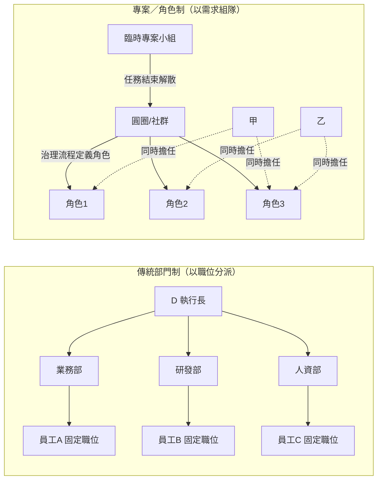

# 扁平化、專案導向的企業組織案例：不靠部門分工，而以委員會、工作小組與一人多職運作

## 摘要

本報告回答一個具體問題：**是否存在採用扁平化、專案導向的企業組織，不以「部門」分配職責，而是透過委員會、工作小組或專案小組，讓同一個人同時扮演多種角色？**

答案是肯定的，而且案例相當多。從 1950 年代的製造業到 2010 年代的軟體與電商公司，都存在以「角色／專案」而非「部門／職位」為核心的組織設計。這些組織的共通特徵是：**以角色（role）取代職位說明（job description）**、**以臨時性團隊或內部市場取代固定部門**、以及**以同儕評價或專案成果取代上級考核**[^flat-org][^holacracy]。

本報告先定義扁平化與專案導向組織的核心概念，再逐一介紹可查證的具名企業案例，最後整理其共同機制、成效與風險。所有事實均附註腳與參考文獻，並以改良版 APA 格式（ISO 8601 日期）標示來源。

## 一、概念界定

### 1.1 扁平化組織

「扁平化組織」（flat organization），又稱「橫向組織」（horizontal organization）或「減層」（delayering），是指在員工與決策者之間，中間管理層級很少或不存在的組織結構。一個組織的結構指的是內部工作單位與職位的分配關係；直式（高聳式）與扁平式組織的差異，在於管理層級的數量與各級管理者被賦予的控制權程度[^flat-org][^flat-org-zh]。

扁平化組織的「強形式」是完全沒有中階管理層。有些組織即使規模成長，仍刻意維持極度扁平[^flat-org]。這種「強形式」通常以「自我管理團隊」實現：團隊自行分派工作、自行協調，不需要上級或中階主管，但這也可能與期望透過「升遷」取得職涯進展的員工產生衝突，因此這類組織常改以「水平職涯」——深化專業、精進工藝或依年資加薪——取代垂直升遷[^flat-org][^flat-org-zh]。

### 1.2 專案導向與一人多職

「不透過部門分配職責」在實務上通常以三種機制實現：

1. **專案／專案小組（project team）**：團隊因某個產品或需求而臨時組成，任務完成後解散，成員回到其他專案或重新組隊[^open-allocation][^valve-handbook]。
2. **委員會或選舉產生的委員會（committee）**：例如由員工選出的委員會處理招募、薪資、休假等常設決策，取代人事部門的功能[^semler]。
3. **角色網路（role network）**：以「角色」為組織的最小單位，一個人可同時擔任多個角色，角色可隨需求增減，而不需要調整組織圖或職稱[^holacracy]。

其中最制度化的形式是「全體共治」（Holacracy）：它明確區分「角色」與「擔任角色的人」，定義一個角色為「一個名稱、一個目的（purpose）、可選的領域（domains）與責任（accountabilities）」；角色由各圓圈（circle）透過治理流程共同定義並定期更新。一個人可在同一時間持有多個角色[^holacracy]。

### 1.3 角色、圓圈與專案小組的關係

下圖以 Mermaid 呈現「部門制」與「專案／角色制」的對比：

## 二、具名企業案例

下表先總覽本節介紹的案例，之後逐一說明。

| 企業 | 產業／國家 | 起始時間 | 取代部門的機制 | 一人多職的表現 |
| --- | --- | --- | --- | --- |
| Valve | 遊戲／美國 | 1996 創立即扁平 | 開放式分配、臨時「cabal」小組 | 全員皆個別貢獻者，輪流擔任團隊召集人 |
| W. L. Gore | 材料製造／美國 | 1958 創立，1967 提出 | 「網格組織」、任務小組 | 人人同為「associate」，領導者自然浮現 |
| Morning Star | 農產加工／美國 | 1970 創立 | 個人商業使命、同儕承諾書（CLOU） | 無職稱、無主管，自行協商職責 |
| Buurtzorg | 居家照護／荷蘭 | 2006 | 10–12 人自治護理團隊 | 護理師同時提供醫療與生活支援服務 |
| Haier | 家電／中國 | 2005–2012 | 微型企業（ME）、生態微型社群（EMC） | 平台主／微型企業主／創業者三種角色 |
| Semco | 工業設備／巴西 | 1980 起 | 選舉產生的委員會、衛星單位 | 危機時員工身兼多職並取得支出否決權 |
| Zappos | 電商／美國 | 2014 | 約 400 個圓圈 | 一人同時擔任多個角色 |
| FAVI | 黃銅鑄造／法國 | 1983 起 | 依市場／技術／產品的迷你工廠 | 作業員自行負責品質、維護、排程 |
| Mondragon | 合作社聯盟／西班牙 | 1956 | 合作社大會、理事會 | 社員同時是所有者、管理者與勞動者 |
| カラクル（Karakuru） | IT／日本 | 2012–2015 | 「專案＋領導者」制 | 一人在 A 專案當領導者、在 B 專案當成員 |
| 韓都衣舍 | 服飾電商／中國 | 2008 起 | 三人產品小組制 | 小組內設計、頁面推廣、採購三位一體 |

### 2.1 Valve：沒有管理層，全員「用腳投票」

Valve 是美國遊戲公司，1996 年由 Gabe Newell 與 Mike Harrington 創立[^valve-wiki]。其 2012 年《員工手冊》開宗明義寫道：「Valve 是扁平的……我們沒有任何管理層，也沒有任何人『隸屬於』另一個人。我們有創辦人／總裁，但即使是他也不是你的主管。」[^valve-handbook]

在手冊中，Valve 說明其工作分配方式：「其他公司聽說會讓員工把一定比例的時間投入自選專案，在 Valve，這個比例是 100%。」員工不是因為被指派而加入專案，而是「用腳（或桌輪）投票」，即實際移動到想參與的團隊；所有辦公桌都裝上輪子以便隨時移動[^valve-handbook][^open-allocation]。專案團隊在 Valve 內部稱為「cabal」，手冊定義為「本質上就是跨領域專案團隊……它們是為了把產品或大型功能推出而存在的臨時性群組」[^valve-handbook]。

一人多職的設計尤為明確。手冊指出 Valve 沒有固定職位說明，且在同儕評量中有一項「群體貢獻」（group contribution）指標，並強調「擔任領導角色可能提高你的群體貢獻分數，但**當領導者不會自動保證更高的排序**。它只是人們不時採取的一種角色」[^valve-handbook]。Valve 另外設有「group contributor」（團隊貢獻者）一詞，用以描述「個別貢獻」與「領導」並非二分的兩端，而是一條連續光譜；團隊貢獻者的任期通常最多一個專案，之後自願輪回個別貢獻者[^flat-org][^flat-org-zh]。

成效與限制：Valve 2021 年員工數約 336 人[^valve-wiki]。該公司共同創辦人承認，由於缺乏管理者與內部控制，難以在早期察覺錯誤決策；研究「無領導」組織的 Cass 商學院教授 Cliff Oswick 認為 Valve 之所以可行，是因為它雇用高素質且適配無領導環境的人才，且打從創立之初就是扁平組織，新進員工清楚自己將進入何種環境[^flat-org][^flat-org-zh]。

### 2.2 W. L. Gore & Associates：網格組織與「任務小組」

W. L. Gore & Associates 是美國氟聚合物製造商（以 Gore-Tex 聞名），1958 年由 Bill Gore 與 Vieve Gore 創立，總部位於德拉瓦州紐華克，2022 年營收 45 億美元、員工約 12,000 人[^gore-wiki]。

Gore 的文化源自早期以小團隊運作的成功經驗，這種做法來自 Bill Gore 在杜邦（DuPont）工作時參與「任務小組」（task force teams）的經驗——這些小組通常跨領域、短期運作，並存在於正式管理層級之外[^gore-wiki]。Bill Gore 於 1967 年向同仁提出「網格」（lattice）組織概念，並在 1976 年〈The Lattice Organization – A Philosophy of Enterprise〉一文中闡述為文化原則[^gore-wiki]。

在網格組織中，所有人共用同一個頭銜「associate」（同仁）；沒有指揮鏈，也沒有既定溝通管道；以「領導者」取代「上司」，同仁選擇跟隨領導者，而非被指派上司；貢獻評估採同儕評分制[^gore-wiki]。Gore 官方網站亦說明，同仁在「網格」溝通結構中建立連結，「不受傳統指揮鏈的限制」[^gore-culture]。團隊通常圍繞機會、產品概念或業務而形成，隨著團隊演進，「領導者往往在獲得追隨者時浮現」[^gore-wiki]。

成效：Gore 為私人公司，1984 至 2017 年間多次入選《財星》「美國百大最佳雇主」[^gore-wiki]。

### 2.3 Morning Star：同儕承諾書（CLOU）與個人使命

The Morning Star Company 是美國加州伍德蘭的農產加工公司，1970 年由 Chris Rufer 創立，最初是卡車運輸業，現為全球番茄加工市場領導者[^morningstar-wiki]。它處理約 40% 的加州加工番茄，年營收逾 10 億美元，全職員工約 550 人，採收季另有 2,500 名以上季節性工人[^morningstar-wiki]。

Morning Star 以「無監督管理」「無職稱」「無結構性層級」聞名，創辦人稱之為「使命導向的自我管理」（Mission Focused Self-Management）[^morningstar-wiki][^corporate-rebels-morningstar]。員工被鼓勵獨立創新、自行定義工作職責，甚至可在諮詢專家後自行決定設備採購；薪酬則以同儕評價為基礎[^morningstar-wiki]。

其運作的核心是兩項原則：**一切互動應出於自願**（沒有人能強迫他人做事），以及**信守承諾**（履行對同事的承諾）[^corporate-rebels-morningstar]。具體機制是「同儕承諾書」（Colleague Letter of Understanding, CLOU）：這是一份簡短文件，載明員工的個人商業使命，以及其對受影響同事所做的所有承諾。每年年初，每位員工與約 10 位 CLOU 同事協商承諾內容，其中包含交付項目、目標與績效指標；CLOU 全年用於相互問責，每兩個月分享相關業務資訊以追蹤指標[^corporate-rebels-morningstar]。

Morning Star 沒有固定職位，取而代之的是「個人使命」：當業務改變，工作內容也隨之改變。報告中舉例，一名同事原在客服部門工作 2 年後轉任新職，主要任務是了解客戶需求；他開始主動電話拜訪客戶，發現偏遠地區客戶覺得運費過高，於是找來幾位同事研究，最終在各地設立配送中心——他的職責與能力隨需求快速演化[^corporate-rebels-morningstar]。

衝突處理亦不靠主管，而是四階段程序：雙方先自行對談；未解則由第三位同事提供意見（僅建議、不評判）；再未解則由 3 至 7 人小組提供更多意見；最後才由創辦人扮演「最高法院」角色[^corporate-rebels-morningstar]。

限制：新進人員的導入期長（可能超過一年才能完全理解自我管理）；「去學習化」困難，尤其是曾任管理者的人；且自我管理並不輕鬆，對話更艱難、衝突必須自行解決[^corporate-rebels-morningstar]。

### 2.4 Buurtzorg：1.4 萬名員工、0 位管理者的自治護理團隊

Buurtzorg Nederland 是荷蘭居家照護組織，2006 年由 Jos de Blok 與一小群護理師在阿爾默洛（Almelo）創立，因為他們對傳統居家照護組織的官僚與低自主感到不滿[^buurtzorg-wiki][^corporate-rebels-buurtzorg]。

其運作方式是以 10 至 12 名受過高度訓練的護理師組成自治團隊，負責某一社區 50 至 60 名病患的居家照護。這些團隊自行承接新客戶、自行規劃工作、自行提供照護，甚至自行聘僱新護理師[^buurtzorg-wiki][^corporate-rebels-buurtzorg]。約 1,000 個團隊僅由不超過 50 名行政人員與 18 名教練支持，且**沒有任何管理者**；總部的唯一功能是「吸收不可避免的官僚作業」（收費、財務報表、確保護理師領到薪水）[^corporate-rebels-buurtzorg]。

一人多職的具體表現是：護理師進入病患家中時，不僅提供醫療服務，也提供通常會委派給較低訓練、較便宜人力的支援服務，例如穿衣與沐浴[^buurtzorg-wiki]。這使每位護理師同時執行多種角色。

成效：組織擁有荷蘭千人員工企業中最高的員工滿意度，且其客戶滿意度在同業中最高；KPMG 於 2015 年 1 月發表的研究顯示，它是低成本的居家照護提供者，且這並非源於病患組合差異[^buurtzorg-wiki]。其行政成本僅約競爭者的三分之一，因為它沒有客服中心、沒有人資、沒有排班、沒有行銷部門[^corporate-rebels-buurtzorg]。它也成功接手一家陷入危機的荷蘭居家照護業者超過 2,000 名員工——員工在週五結束於傳統階層組織的最後一天，週一即開始在完全自我管理的組織工作[^corporate-rebels-buurtzorg]。

國際擴散時遇到移植困難。美國因多重付費者與各自的請款規則，護理師難以如荷蘭般自行計費[^buurtzorg-wiki]；威爾斯 NHS 於 2018 年啟動為期兩年的 Buurtzorg 試辦，其中一個差異是保留了團隊領導者，但角色轉向「富同理心的領導」與教練式支持，而評估因缺乏一致的核心資料集，無法對臨床結果或成本節省下定論[^buurtzorg-wiki]。

### 2.5 Haier：拆解層級為 4,000 多個微型企業（RenDanHeYi 人單合一）

海爾集團是中國家電與消費電子跨國企業，總部在山東青島，1984 年由張瑞敏接手一家瀕臨破產的冰箱廠起家[^haier-wiki]。其「人單合一」（RenDanHeYi）模式由張瑞敏於 2005 年提出：**人**指員工（被視為創業者）、**單**指用戶需求／價值訂單、**合一**指每位員工創造的價值直接反映在為用戶創造的價值上[^corporate-rebels-50][^greathandshake-haier]。

在結構上，Haier 把層級拆解為數千個「微型企業」（micro-enterprises, ME），每個約 15 人（多數少於 20 人），各自擁有自己的損益（P&L），可自行設定目標、招募人員、分配資源，並分享其創造的利潤[^corporate-rebels-bureaucracy][^greathandshake-haier]。2012 年，Haier 給 12,000 名中階管理者一個選擇：離開，或加入新結構[^corporate-rebels-bureaucracy]。

「不透過部門分工」在此表現為：原本的共用職能（人資、財務、法務、IT）成為獨立的「支援型 ME」，像內部市場一樣運作——其他 ME 只在需要時付費購買服務，且若內部服務品質不佳，可以外包[^corporate-rebels-haier10]。跨功能的工作則由暫時性的「生態微型社群」（Ecosystems of Micro-Communities, EMC）承擔：由多個 ME 加上外部夥伴為特定問題臨時組成，任務完成後解散，與常設的跨部門委員會不同[^corporate-rebels-haier10]。此外，Haier 設有「科學技術委員會」資助高風險、長期的研究賭注，以平衡 ME 的短期績效壓力[^corporate-rebels-haier10]。

一人多職的表現是：RenDanHeYi 下只有三種角色類型——**平台主、微型企業主、創業者**；員工擁有自己的損益、選擇自己的領導者、跨公司招募人才，並以「為用戶創造的價值」而非對上司的忠誠度被衡量[^corporate-rebels-50]。薪酬不設標準薪級，採 ME 層級的利潤分享，且不設薪資上限[^corporate-rebels-haier10]。

成效：Haier 成為全球第一大家電製造商（約 400 億美元規模；2021 年 Haier Smart Home 員工 109,586 人）[^haier-wiki][^corporate-rebels-haier10]。約有一半的新 ME 成功，相較之下獨立新創僅約 10% 存活[^corporate-rebels-bureaucracy]。Thunderobot（雷神）最初是一個 ME，後來在股票市場上市[^corporate-rebels-bureaucracy]。此模式亦輸出至美國子公司 GE Appliances：Haier 於 2016 年以 56 億美元收購 GE Appliances，兩年內在其美國子公司內建立約 100 個自治 ME，並允許路易維爾管理團隊自行調整模式而非全盤移植，這對工會接受度至關重要；GE Appliances 營收從收購時約 57 億美元成長到 2023 年逾 90 億美元[^greathandshake-haier]。

限制：Haier 自述最困難之處是「去學習化舊習慣」——員工一開始猶豫不敢做決定，前管理者難以放手；表現持續不佳的 ME 會被重整或關閉，「沒有刻意保護」[^corporate-rebels-haier10]。

### 2.6 Semco：選舉產生的委員會與衛星單位

Semco 是巴西公司，Ricardo Semler 於 1980 年、21 歲時接任執行長，第一天即解僱 60% 的高階管理者[^semler-wiki]。他推動的去中心化、參與式管理在 1980 至 1990 年代逐步展開。

1986 年導入矩陣式組織的嘗試未達預期成效[^semler-wiki]。1980 年代末，三名工程師提案設立「技術創新核心」（Nucleus of Technological Innovation, NTI）以開發新業務與產品線，獲得 Semler 支持；六個月內 NTI 找出 18 個機會。此後 Semco 內部鼓勵成立「衛星單位」（satellite units），到 1980 年代末，這些衛星單位貢獻了三分之二的新產品與三分之二的員工[^semler-wiki]。

在 1990 年巴西流動性緊縮造成的嚴重衰退中，Semco 員工同意減薪，條件是利潤分享提高到 39%、管理層薪資削減 40%，並且**員工取得審核每一筆支出的權利**[^semler-wiki]。報告明確指出：「在危機期間擔任多重角色，讓員工對營運有更深入的了解，也提出更多改善建議。」改革使庫存減少 65%、交期縮短、產品瑕疵率降到 1% 以下[^semler-wiki]。

成效：2003 年 Semco 年營收 2.12 億美元，相較 1982 年的 400 萬美元；員工從 1982 年的 90 人增至 2003 年的 3,000 人[^semler-wiki]。惟須注意來源偏誤：美國公共行政學者 Eleanor Glor 指出，關於 Semco 管理模式變革的記述幾乎全部來自 Ricardo Semler 本人，而非來自受影響的員工[^semler-wiki]。

### 2.7 Zappos：約 400 個圓圈的全體共治實驗

Zappos 是美國線上鞋類零售商（Amazon 旗下）[^holacracy]。2014 年 1 月起，執行長 Tony Hsieh 宣布採用「全體共治」（Holacracy），成為當時最大規模的完整實施案例（1,500 名員工、十億美元級企業）；此制度以「圓圈」取代部門、以「角色」取代職位說明，並取消管理職稱[^holacracy]。

在 Zappos 的實施中，組織形成約 400 個圓圈，沒有職稱、沒有管理者，權力透過「角色」而非由上而下的層級分配[^corporate-rebels-50]。全體共治的核心機制是：角色由圓圈透過集體治理流程定義與定期更新；圓圈是「角色」的群組（而非人的群組）；圓圈之間由「lead link」與「rep link」兩種角色雙向連結，以確保與更大組織的使命與策略對齊[^holacracy]。一個人在同一時間可持有 3 至 7 個角色，且單一角色也可由多人擔任[^holacracy]。

成效與爭議並存。2015 年 Zappos 主動提供優離方案，約 14% 至 18% 的員工選擇離開，公司表示這是刻意只留下相信全體共治的人[^holacracy]。批評者 Steve Denning 指出，全體共治並未移除層級，決策仍從一個圓圈被「漏斗式」往下傳遞，且規則與程序過於細瑣、偏重「行政瑣事」；他並認為全體共治模型缺少「顧客之聲」，較適合原本就已敏捷、以顧客為熱情的公司[^holacracy]。值得注意的是，《Medium》曾使用全體共治數年，並於 2016 年放棄；其 Andy Doyle 指出「對於需要跨職能協調的大型計畫，取得一致意見既耗時又容易造成分裂」，且「把責任寫得如此明確詳細，反而阻礙了主動性與共同擁有的感覺」[^holacracy]。

### 2.8 FAVI：依市場、技術、產品切分的迷你工廠

FAVI（Le Laiton Injecté）是法國索姆省阿朗庫爾（Hallencourt）的中小企業，1956 年由 Marcel Decayeux 創立，生產汽車變速箱撥叉與銅轉子，2021 年員工約 300 人[^favi]。

在組織結構上，其「部門化」是混合而非功能性的：撥叉依「一個市場」、鑄造依「一個技術」、轉子依「一個產品」來切分[^favi]。1983 年由 Jean-François Zobrist 出任總經理，啟動被稱為「解放型企業」（entreprise libérée）第一代的管理哲學，理論基礎為 McGregor 的 X 理論與 Y 理論，以及 Jean-Christian Fauvet 的社會動力學，導致採用 Blake 與 Mouton 管理方格中的 9,9 型管理風格[^favi]。

一人多職的表現形式是：作業員自行負責品質、維護、排程與客戶關係，而非交由專職部門處理。成效方面，FAVI 是歐洲第一家通過 ISO 14001 認證的鑄造廠（1997），也是法國第一家通過 OHSAS 18001（2000）與 QSE（2002）認證的企業；2023 年營收 5,477 萬歐元，淨利 277 萬歐元[^favi]。

### 2.9 Mondragon：以合作社大會與選舉取代部門層級

Mondragon Corporation 是西班牙巴斯克地區的勞動合作社聯盟，1956 年由神父 José María Arizmendiarrieta 及其技術學院學生創立，第一項產品是石蠟暖爐[^mondragon]。

其治理特色是民主：合作社由工作者擁有，設「社員大會」（一人一票）、「理事會」（Governing Council）與「常務委員會」，並依「合作社大會」多數通過的運作規則管理；公司層級則透過合作社大會與四年策略計畫協調，而非功能性部門[^mondragon]。一人多職的表現是：社員同時是所有者、管理者與勞動者，並透過投票決定薪資比率——執行主管與最低薪資的約定比率介於 3:1 至 9:1，平均為 5:1[^mondragon]。

成效：2024 年營收 112.13 億歐元、員工 70,085 人，是巴斯克地區領先的商業集團[^mondragon]。其經營者薪資約比當地同等職位低 30%，而最低薪資水準約高 13%[^mondragon]。

### 2.10 日本的「バリフラット」：取消職稱、部署、階層與資訊落差

カラクル（Karakuru，前身 ISAO）是東京淺草橋的 IT 企業，代表取締役中村圭志自 2012 年起分三年逐步取消職位，並於 2015 年 10 月完成。該公司將此制度稱為「バリフラット」（bari-flat，意指「超扁平」），核心是「四個零」：沒有職稱、沒有部署、沒有階層、沒有資訊落差[^karakuru]。

其運作方式是按需要成立「專案」，由專案推舉領導者（例如由最了解且有熱情的人被大家選為領導者），領導者決定一切並負責。代表取締役本身在被專案需要時，會以「一員」身分加入，接受該專案領導者的指示[^karakuru]。一人多職的描述極為明確：在某個專案中是「領導者」的人，在幾乎所有其他專案中都是「一員」；這與傳統「部長到哪裡都是部長」不同[^karakuru]。文中引述的西田昂弘表示，因為沒有部署、採專案制，他個人同時參與 3 至 4 個專案，每個專案的職責與技術都不同[^karakuru]。

成效：在取消職稱的同時，該公司以「同儕指名評價」取代上級考核——每位員工自行指名最多 7 位能正確評價其工作的同事，且評價者、評價內容與評價註解全部在公司內公開，以公開資訊形成紀律[^karakuru]。2020 年的匿名問卷顯示 85% 員工對自己的評價感到信服（一般企業平均約 40%）。員工數曾於 2017 年達到約 250 人的高峰（導入該制度期間亦維持運作），2018 年分割公司後為 100 人，採訪時約 130 人[^karakuru]。

### 2.11 韓都衣舍：以「三人產品小組」取代傳統服裝公司層級

韓都衣舍是 2008 年由趙迎光在山東濟南創立的中國網路服飾品牌，2008 至 2014 年從年銷 20 萬成長到 15 億人民幣，團隊從 40 人發展到 2,600 人[^handu]。

其組織模式是「以產品小組為核心的單品全程運營體系」，本質是去中心化：一個產品小組為 1 至 3 人（最多 3 人），所有公共資源與服務都圍繞小組運作；2014 年前後共有 280 個小組，「這 280 個都是中心，沒有誰是絕對的中心」[^handu]。三人分工為：一位設計師、一位負責產品頁面推廣（傳統商業中的「導購」）、一位貨品專員（即採購角色，負責供應鏈組織）[^handu]。

小組的權限包括：選什麼款式、幾個顏色、幾個尺碼、賣多少錢、參加什麼活動與促銷、打折節奏與程度——「這基本上是一家服裝企業老闆的所有權利」[^handu]。考核以「業績提成公式」核算，三個核心指標為業績完成率、毛利率、庫存周轉率；每天上午 10 點公布前一日所有小組的業績排名，組內獎金分配由組長決定[^handu]。

「一人多職」與「小組分裂」互相強化：表現好的小組成員希望分得更多，因而想自己帶組、自己當設計師兼組長並取得獎金分配權；表現落後的小組成員也不想留在賺錢少的小組，於是無論排名前後的小組都會分裂，再由公司旗下的韓都大學培養新人補足空缺；分裂後可自由重新組合或與新員工組隊[^handu]。公司另有政策支持小組分裂出來創立新品牌：成員成為新品牌創始人、收入不低於以往、考核指標降低，且新品牌的小組提成比例由一般的 1.5% 提高到 2.5%[^handu]。

成效：韓都衣舍每年開發 3 萬款產品，超過 Zara 每年約 2.2 萬款的開發數量[^handu]。

## 三、跨案例的共同機制

### 3.1 以「角色」或「承諾」取代「部門」

綜合上述案例，取代部門的機制可歸納如下：

- **角色 vs. 職位說明**：全體共治與 Haier 都將工作組織成帶有明確目的、責任與領域的「角色」，人們「活化」角色，常同時持有數個。角色可被新增、移除或移動，而不會有人被「降職」[^holacracy][^corporate-rebels-haier10]。
- **同儕承諾書（CLOU）**：Morning Star 以一份可隨時重新協商的文件，載明個人使命與對同儕的承諾，取代固定職位說明[^corporate-rebels-morningstar]。
- **贊助者與自然領導**：Gore 沒有指派的主管，以「贊助者（sponsor）」指導新人，領導權透過貢獻取得[^gore-wiki]。
- **支援型 ME／平台職能**：Haier 把人資、財務、法務、IT 變成內部服務提供者，ME 可購買或繞過[^corporate-rebels-haier10]。
- **EMC／臨時聯盟**：Haier 的跨功能工作由臨時組成的目的性團體完成並解散，避免形成永久性穀倉[^corporate-rebels-haier10]。
- **圓圈＋lead/rep link**：全體共治把部門變成巢狀圓圈，並以雙向連結角色串接[^holacracy]。
- **選舉產生的委員會**：Semco 以選出的同儕團體處理招聘、薪資、休假等常設決策[^semler-wiki]。
- **專案＋推舉領導者**：カラクル 按需要成立專案，由專案推舉領導者，代表取締役亦以成員身分受其領導[^karakuru]。
- **三人產品小組**：韓都衣舍以三人為最小自負盈虧單位，涵蓋設計、推廣與採購[^handu]。

### 3.2 「一人多職」的實作方式

實務上，「一人多職」並非模糊地要求大家什麼都做，而是有明確的機制讓角色切換可被辨識：

- **明示角色帽子**：全體共治實務中，人們以「作為［角色 X］，我想……（As [Role X] I want…）」的句式發言，以表明自己是從哪一個角色的權限說話，藉此釐清權限、焦點與界線[^holacracy]。
- **角色數量上限的經驗法則**：實務建議一人同時以 3 至 6 個角色為宜；小型組織平均每人 5 至 8 個角色，大型組織則為 2 至 4 個。角色過多的警訊包括：專案做不完、會議缺席、品質下滑、長期過載，以及不再提出張力[^holacracy]。
- **角色與人的分離**：這是讓「一人多職」可運作而不導致職稱膨脹的關鍵——角色可以被重新指派，人不必因此被降職或升職[^holacracy]。
- **領導者與成員的流動**：Valve 的 group contributor 任期至多一個專案[^flat-org]；Gore 的領導與跟隨是暫時性的，「當專案結束，領導者可能輪回為追隨者，且不被汙名化」[^open-allocation]；カラクル則明文區分「專案中的領導者」與「其他專案中的一員」[^karakuru]。

### 3.3 以內部和外部市場取代上級指派

Haier 的做法最為徹底：不是由管理者分派工作，而是由內部市場分派——團隊彼此簽約，用戶支付薪水；如果找不到用戶，就無法為自己籌資[^corporate-rebels-bureaucracy]。這也解釋了為何 Haier 的 ME 成功率約 50%，遠高於獨立新創的約 10%[^corporate-rebels-bureaucracy]。

Valve 的「開放式分配」則是另一種市場機制：專案不能由高層單方面設立並配置人員；提案者必須說服他人投入時間、精力與職涯，才能取得「關鍵多數」[^open-allocation][^valve-handbook]。

## 四、成效與風險

### 4.1 已知效益

企業觀察社群 Corporate Rebels 針對 14 個實際案例的質性分析歸納出五項反覆出現的優點[^cr-adv]:

1. **決策更貼近專業與現實**：由掌握最多脈絡的團隊或個人決定，減少核准迴圈與資訊扭曲。
2. **更強的當責與所有感**：責任不被抽象地「往上」委派，而是由個人與團隊自己承擔。
3. **減少內部政治與權力遊戲**：當財務、薪資、優先順序與績效透明時，影響力難以在密室中運作。
4. **更高的適應力與韌性**：權威分散，組織不需依賴少數領導者感知與回應所有變化。
5. **目的、工作與人之間更深的對齊**：目的成為協調機制而非口號；人可以不必被迫進入管理職就能成長。

### 4.2 已知風險與限制

同一份分析指出五項反覆出現的缺點[^cr-adv]：

1. **高度的認知與情緒負荷**：組織把決策、排序與升級處理的負擔，從系統轉移到個人身上。
2. **決策與最終責任的模糊**：在多個案例中，人們會猶豫並自問「我是否有權決定」；單單移除職稱並不等於分散權力，若未重新設計決策流程，權力可能仍留在非正式或創辦人手中。
3. **並非人人都能適應**：有些人難以承受增加的責任、不確定性與主動溝通的要求。
4. **高昂的協調與對齊成本**：扁平組織並未消除協調工作，只是重新分配；大型組織會導入複雜框架來管理協調，增加作業與認知複雜度。
5. **漫長且常感不適的轉型期**：轉型往往歷時數年，期間伴隨困惑、衝突與不穩定，甚至先經歷危機才見到效益。

此外，學術與實務上提出了幾項結構性風險：

- **「無架構的暴政」**：依 Jo Freeman 著名文章，像 Valve 這類無領導公司可能出現對抱怨的不當處理、非正式小圈圈、受歡迎員工的「軟實力」影響、非專業與性別歧視態度，以及職場多樣性不足等問題[^flat-org-zh]。
- **新的隱性階層**：Suzanne Baker 指出，當組織不再把價值放在職位上，基於性格類型、技術群與溝通方式的新等級可能浮現；若這些等級不被察覺，將難以處理[^flat-org-zh]。
- **決策品質風險**：商業記者 Mark Henricks 批評，當層級過少時，決策可能無法作成，或由缺乏經驗、當責與動機的員工作成錯誤決策[^flat-org-zh][^flat-org]。
- **創辦人依賴**：多個案例（Morning Star 的 Chris Rufer、Semco 的 Ricardo Semler、Haier 的張瑞敏、Buurtzorg 的 Jos de Blok、Zappos 的 Tony Hsieh）都顯示領導者的承諾是關鍵，且當創辦人離去時模式可能弱化[^corporate-rebels-morningstar][^semler-wiki][^greathandshake-haier]。
- **可移植性受限**：開放式分配最成功的領域是科學、技術，尤其是軟體，且通常由高能力、高教育程度的員工組成；它是否更普遍地適用於其他類型組織，仍是一個開放問題[^open-allocation]。全體共治則被批評為「一體適用」、增加官僚層與心理負擔[^holacracy]。

## 五、結論

對於「是否有採用扁平化、專案導向的企業組織案例」這個問題，答案是：**有，且橫跨多個產業、國家與規模**。這些組織不透過部門分配職責，而是：

- 以**臨時性專案小組**（Valve 的 cabal、Haier 的 EMC、カラクル 的專案）取代常設部門；
- 以**委員會**（Semco 的選舉委員會、Mondragon 的合作社大會）取代人資與行政層級；
- 以**角色網路**（全體共治的圓圈與角色）或**承諾文件**（Morning Star 的 CLOU）取代職位說明；
- 以**自負盈虧的小單位**（Haier 的 ME、韓都衣舍的三人小組、Buurtzorg 的護理團隊、FAVI 的迷你工廠）取代功能分工。

同時，這些案例一致顯示：扁平與一人多職並非「沒有結構」，而是以**更明確的角色定義、更透明的資訊、更強的同儕問責與更長期的文化建構**，換取更快的決策與更深的當責。其代價是高度的個人負荷、漫長的轉型期，以及對創辦人與文化的高度依賴。

## 參考文獻

Corporate Rebels. (n.d.). *Advantages & disadvantages of flat organizational structures (from 14 case studies)*. Retrieved 2026-10-11, from https://www.corporate-rebels.com/blog/advantages-disadvantages-flat-organizational-structures

Corporate Rebels. (n.d.). *The future of work: 50+ case studies of self-managing organizations*. Retrieved 2026-10-11, from https://www.corporate-rebels.com/blog/50-case-studies-of-self-managing-organizations

Great Handshake. (2026, August 19). *Haier's RenDanHeYi model: The management philosophy reshaping how global companies think about organizational design*. Retrieved 2026-10-11, from https://www.greathandshake.com/en/haier-rendanheyi-management-model-organizational-design/

Hamel, G. (2011, December). First, let's fire all the managers. *Harvard Business Review*. Retrieved 2026-10-11, from https://hbr.org/2011/12/first-lets-fire-all-the-managers

de Morree, P. (2017, June 21). *Buurtzorg's healthcare revolution: 14,000 employees, 0 managers, sky-high engagement*. Corporate Rebels. Retrieved 2026-10-11, from https://www.corporate-rebels.com/blog/buurtzorg

de Morree, P. (2026, January 6). *7 examples of flat organizational structures*. Corporate Rebels. Retrieved 2026-10-11, from https://www.corporate-rebels.com/blog/examples-flat-organizational-structures

de Morree, P. (2026, January 8). *Advantages & disadvantages of flat organizational structures (from 14 case studies)*. Corporate Rebels. Retrieved 2026-10-11, from https://www.corporate-rebels.com/blog/advantages-disadvantages-flat-organizational-structures

dolookhao. (2018, October 30). 从20万到15亿收入，韩都衣舍都做对了什么. *人人都是产品经理*. Retrieved 2026-10-11, from https://www.woshipm.com/chuangye/1574474.html

Kelion, L. (2013, September 23). Valve: How going boss-free empowered the games-maker. *BBC News*. Retrieved 2026-10-11, from https://www.bbc.com/news/technology-24205497

Minnaar, J. (2016, November 14). *Morning Star's success story: No bosses, no titles, no structural hierarchy*. Corporate Rebels. Retrieved 2026-10-11, from https://www.corporate-rebels.com/blog/morning-star

Minnaar, J. (2024, September 8). *The future of work: 50+ case studies of self-managing organizations*. Corporate Rebels. Retrieved 2026-10-11, from https://www.corporate-rebels.com/blog/50-case-studies-of-self-managing-organizations

Minnaar, J. (2025, May 4). *10 questions about Haier's RenDanHeYi model—answered*. Corporate Rebels. Retrieved 2026-10-11, from https://www.corporate-rebels.com/blog/10-questions-about-haiers-rendanheyi-model-answered

Minnaar, J. (2026, August 24). *Corporate bureaucracy has a cure. This company found it*. Corporate Rebels. Retrieved 2026-10-11, from https://www.corporate-rebels.com/blog/corporate-bureaucracy

Valve Corporation. (2012). *Valve: Handbook for new employees* (1st ed.). Retrieved 2026-10-11, from https://cdn.cloudflare.steamstatic.com/apps/valve/Valve_NewEmployeeHandbook.pdf

W. L. Gore & Associates. (n.d.). *Our culture*. Retrieved 2026-10-11, from https://www.gore.com/about/our-story/culture

Wikipedia. (2026). *Buurtzorg Nederland*. Retrieved 2026-10-11, from https://en.wikipedia.org/wiki/Buurtzorg

Wikipedia. (2026). *Flat organization*. Retrieved 2026-10-11, from https://en.wikipedia.org/wiki/Flat_organization

Wikipedia. (2026). *Haier*. Retrieved 2026-10-11, from https://en.wikipedia.org/wiki/Haier

Wikipedia. (2026). *Holacracy*. Retrieved 2026-10-11, from https://en.wikipedia.org/wiki/Holacracy

Wikipedia. (2026). *Mondragon Corporation*. Retrieved 2026-10-11, from https://en.wikipedia.org/wiki/Mondragon_Corporation

Wikipedia. (2026). *Open allocation*. Retrieved 2026-10-11, from https://en.wikipedia.org/wiki/Open_allocation

Wikipedia. (2026). *Ricardo Semler*. Retrieved 2026-10-11, from https://en.wikipedia.org/wiki/Ricardo_Semler

Wikipedia. (2026). *The Morning Star Company*. Retrieved 2026-10-11, from https://en.wikipedia.org/wiki/The_Morning_Star_Company

Wikipedia. (2026). *Valve Corporation*. Retrieved 2026-10-11, from https://en.wikipedia.org/wiki/Valve_Corporation

Wikipedia. (2026). *W. L. Gore & Associates*. Retrieved 2026-10-11, from https://en.wikipedia.org/wiki/W._L._Gore_%26_Associates

Wikipédia. (2026). *Favi*. Retrieved 2026-10-11, from https://fr.wikipedia.org/wiki/FAVI

維基百科. (2025). *扁平化组织*. Retrieved 2026-10-11, from https://zh.wikipedia.org/wiki/扁平化组织

畑中徹. (2021, March 31). 【中村圭志】役職も部署もない「バリフラット」な会社　人の数だけリーダーがいる. *朝日新聞GLOBE+*. Retrieved 2026-10-11, from https://globe.asahi.com/article/14313959

[^flat-org]: Flat organization — Wikipedia. Retrieved 2026-10-11, from https://en.wikipedia.org/wiki/Flat_organization

[^flat-org-zh]: 扁平化组织 — 维基百科. Retrieved 2026-10-11, from https://zh.wikipedia.org/wiki/扁平化组织

[^holacracy]: Holacracy — Wikipedia. Retrieved 2026-10-11, from https://en.wikipedia.org/wiki/Holacracy

[^open-allocation]: Open allocation — Wikipedia. Retrieved 2026-10-11, from https://en.wikipedia.org/wiki/Open_allocation

[^valve-handbook]: Valve Corporation. (2012). *Valve: Handbook for new employees* (1st ed.). Retrieved 2026-10-11, from https://cdn.cloudflare.steamstatic.com/apps/valve/Valve_NewEmployeeHandbook.pdf

[^valve-wiki]: Valve Corporation — Wikipedia. Retrieved 2026-10-11, from https://en.wikipedia.org/wiki/Valve_Corporation

[^gore-wiki]: W. L. Gore & Associates — Wikipedia. Retrieved 2026-10-11, from https://en.wikipedia.org/wiki/W._L._Gore_%26_Associates

[^gore-culture]: W. L. Gore & Associates. (n.d.). *Our culture*. Retrieved 2026-10-11, from https://www.gore.com/about/our-story/culture

[^morningstar-wiki]: The Morning Star Company — Wikipedia. Retrieved 2026-10-11, from https://en.wikipedia.org/wiki/The_Morning_Star_Company

[^corporate-rebels-morningstar]: Minnaar, J. (2016, November 14). *Morning Star's success story: No bosses, no titles, no structural hierarchy*. Corporate Rebels. Retrieved 2026-10-11, from https://www.corporate-rebels.com/blog/morning-star

[^buurtzorg-wiki]: Buurtzorg Nederland — Wikipedia. Retrieved 2026-10-11, from https://en.wikipedia.org/wiki/Buurtzorg

[^corporate-rebels-buurtzorg]: de Morree, P. (2017, June 21). *Buurtzorg's healthcare revolution: 14,000 employees, 0 managers, sky-high engagement*. Corporate Rebels. Retrieved 2026-10-11, from https://www.corporate-rebels.com/blog/buurtzorg

[^haier-wiki]: Haier — Wikipedia. Retrieved 2026-10-11, from https://en.wikipedia.org/wiki/Haier

[^corporate-rebels-haier10]: Minnaar, J. (2025, May 4). *10 questions about Haier's RenDanHeYi model—answered*. Corporate Rebels. Retrieved 2026-10-11, from https://www.corporate-rebels.com/blog/10-questions-about-haiers-rendanheyi-model-answered

[^corporate-rebels-bureaucracy]: Minnaar, J. (2026, August 24). *Corporate bureaucracy has a cure. This company found it*. Corporate Rebels. Retrieved 2026-10-11, from https://www.corporate-rebels.com/blog/corporate-bureaucracy

[^corporate-rebels-50]: Minnaar, J. (2024, September 8). *The future of work: 50+ case studies of self-managing organizations*. Corporate Rebels. Retrieved 2026-10-11, from https://www.corporate-rebels.com/blog/50-case-studies-of-self-managing-organizations

[^greathandshake-haier]: Great Handshake. (2026, August 19). *Haier's RenDanHeYi model: The management philosophy reshaping how global companies think about organizational design*. Retrieved 2026-10-11, from https://www.greathandshake.com/en/haier-rendanheyi-management-model-organizational-design/

[^semler-wiki]: Ricardo Semler — Wikipedia. Retrieved 2026-10-11, from https://en.wikipedia.org/wiki/Ricardo_Semler

[^favi]: Favi — Wikipédia. Retrieved 2026-10-11, from https://fr.wikipedia.org/wiki/FAVI

[^mondragon]: Mondragon Corporation — Wikipedia. Retrieved 2026-10-11, from https://en.wikipedia.org/wiki/Mondragon_Corporation

[^karakuru]: 畑中徹. (2021, March 31). 【中村圭志】役職も部署もない「バリフラット」な会社　人の数だけリーダーがいる. 朝日新聞GLOBE+. Retrieved 2026-10-11, from https://globe.asahi.com/article/14313959

[^handu]: dolookhao. (2018, October 30). 从20万到15亿收入，韩都衣舍都做对了什么. 人人都是产品经理. Retrieved 2026-10-11, from https://www.woshipm.com/chuangye/1574474.html

[^cr-adv]: de Morree, P. (2026, January 8). *Advantages & disadvantages of flat organizational structures (from 14 case studies)*. Corporate Rebels. Retrieved 2026-10-11, from https://www.corporate-rebels.com/blog/advantages-disadvantages-flat-organizational-structures

## 來源批判性反思

- **Wikipedia 作為起點而非終點**：本報告中多數企業基本事實（成立年、員工人數、機制描述）引自維基百科，其優點是彙整了原始文獻的引用來源，缺點是可被匿名編輯。凡涉及關鍵數字者，本報告盡量以企業官方文件或獨立媒體交叉佐證（例如 Valve 的官方員工手冊、Gore 官方文化頁面、KPMG 對 Buurtzorg 的研究）。
- **第一手企業文件的立場問題**：Valve 的員工手冊是官方公關文件，呈現的是理想化的自我描述，而非獨立評估；本報告因此同時引用 BBC 與學者的批判觀點。
- **倡議型來源的偏誤**：Corporate Rebels 是一個以推廣「進步型組織」為使命的社群，其內容傾向正面呈現此類模式。本報告引用其 14 案例的優缺點分析以避免單面論述，但仍應注意其選擇偏誤（可能高估成功案例、低估失敗與放棄案例）。同樣地，Semco 的相關記述幾乎全數來自 Ricardo Semler 本人，這是學術界明確指出的來源偏誤。
- **Haier 數據的來源落差**：不同來源對 Haier 的營收、員工人數與 ME 數量說法不一（例如「4,000 多個」與「數千個」），本報告保留其區間而非單一數字。
- **未能查證的線索**：網路上常見將日本「未來工業」（Mirai Industry）描述為「廢除部門與職稱」的案例，但實際檢視其官方揭露後，該公司仍存在部長會與各類部、課編制，較準確的描述應為「低管理層、高自主、信任導向」。因此本報告未將其列為「廢除部門」的案例。類似地，涉及京瓷「阿米巴經營」與華為「鐵三角」的說法雖廣為流傳，但本次未能取得足以支撐詳細描述的一手來源，故未納入具體斷言。
