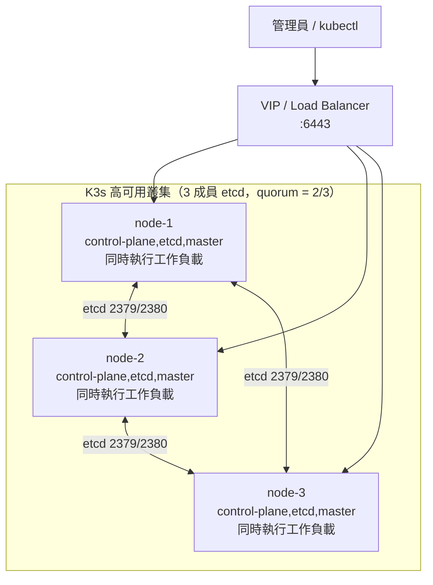
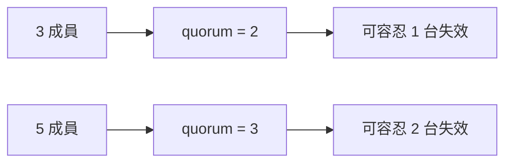

# 建立三節點 K3s 高可用叢集指南：每節點同時扮演控制平面與工作節點

## 摘要

本報告提供一份可直接照做（step-by-step）的操作指南，用於建立一個由三台主機組成的 K3s（輕量級 Kubernetes）高可用（High Availability，HA）叢集。此架構的特殊要求在於：**每一台節點都同時是控制平面（control-plane）節點、嵌入式 etcd 成員，以及可執行工作負載的工作節點（worker）**，因此叢集中不需要額外加入專職的 agent 節點[^ha-embedded][^adhdecode]。

此設計的核心價值在於：三個 etcd 成員構成正當的奇數多數決（quorum），可容忍一台節點失效；同時因為 K3s 的 server 節點預設「未被汙染（untainted）」，排程器會直接把 Pod 放到這些節點上，所以三台機器既是控制平面也是工作節點[^linuxjunkies][^ha-embedded]。

---

## 1. 適用情境與設計取捨

### 1.1 什麼情況適合這個架構

- 資源有限、只有三台實體機或虛擬機，希望同時取得控制平面容錯與工作負載容量。
- 自架（homelab）、小型內部環境、邊緣運算等不需要分成「專職控制平面」與「專職工作節點」的場景。
- 想要避免外部資料庫（如外部 etcd、PostgreSQL、MySQL）所帶來的額外維運複雜度[^ha-embedded]。

### 1.2 需要理解的取捨

| 面向 | 全 server（本指南） | server 加專職 agent |
| --- | --- | --- |
| 控制平面容錯 | 有（3 成員 etcd，可掛 1 台） | 有 |
| 控制平面與工作負載隔離 | 無（同一台機器混跑） | 有 |
| 節點數量需求 | 最少 3 台 | 最少 3 台 server 加若干 agent |
| 適合規模 | 小型、自架、邊緣 | 中大型、需要資源隔離 |

K3s 官方文件指出，HA 嵌入式 etcd 叢集是由「三個或更多的 server 節點」組成，這些節點提供 Kubernetes API、執行其他控制平面服務，並承載嵌入式 etcd 資料儲存；agent 節點是**選用**的[^ha-embedded]。因此「三台全 server」是官方明確認可的組態。

---

## 2. 架構總覽

下圖顯示本指南建立的三節點同構（homogeneous）叢集：每台節點同時是 API server、etcd 成員與 worker。



圖中 VIP（虛擬 IP）為選用但強烈建議的元件，用於提供一個固定的 API 端點，避免 kubeconfig 綁死在單一節點上[^cluster-lb][^linuxjunkies]。

### 2.1 為什麼必須是奇數台

官方文件說明，HA 嵌入式 etcd 叢集必須由**奇數**個 server 節點組成，etcd 才能維持 quorum。對 n 個 server 而言，quorum 為 `(n/2)+1`；對任意奇數叢集，多加一台節點反而會增加達到 quorum 所需的節點數，因此容錯能力不會變好[^ha-embedded]。



---

## 3. 硬體與作業系統前置需求

### 3.1 硬體最低需求

K3s 官方列出的最低需求為：server 節點 2 核心 CPU、2 GB 記憶體；agent 節點 1 核心、512 MB[^requirements]。由於本架構每台節點同時是 server 與 worker，**實務上建議以 server 規格（或更高）為基準**。

伺服器規模建議（控制平面加 etcd 節點）如下[^requirements]：

| Server CPU | Server RAM | 可承載 agent 數量 |
| --- | --- | --- |
| 2 | 4 GB | 0–350 |
| 4 | 8 GB | 351–900 |
| 8 | 16 GB | 901–1800 |
| 16+ | 32 GB | 1800+ |

官方並補充，使用三台 server 節點的 HA 組態時，agent 數量可再放大約 50%（例如 3 台 4 vCPU / 8 GB 的 server 可擴充至約 1200 個 agent）[^requirements]。

### 3.2 磁碟

K3s 效能取決於資料庫效能，建議使用 SSD；若部署於 Raspberry Pi 或其他 ARM 裝置，建議使用外接 SSD，因為 etcd 是寫入密集（write intensive）的工作負載，SD 卡與 eMMC 無法承受其 I/O 負載[^requirements]。官方亦警告，嵌入式 etcd（HA）在較慢的磁碟（如使用 SD 卡的 Raspberry Pi）上可能有效能問題[^ha-embedded]。

### 3.3 作業系統與主機名稱

- 架構支援 x86_64、armhf、arm64/aarch64[^requirements]。
- K3s 預期可在多數現代 Linux 系統上運作[^requirements]。
- **兩台節點不能有相同的主機名稱**。若主機名稱可能重複或被自動化佈建系統重用，可使用 `--with-node-id` 附加隨機後綴，或以 `--node-name`／`$K3S_NODE_NAME` 指定唯一名稱[^requirements]。

### 3.4 節點基礎準備（三台皆須執行）

以下為常見的 Ubuntu / Debian 準備步驟，目的在於滿足 Kubernetes 對 swap、核心模組、時間同步的要求[^syncbricks]。

```bash
# 關閉 swap（Kubernetes 要求）
sudo swapoff -a
sudo sed -i '/ swap / s/^/#/' /etc/fstab

# 啟用時間同步（etcd 與 TLS 對時鐘偏移敏感）
sudo timedatectl set-ntp true

# 載入 Kubernetes 期待的核心模組
sudo modprobe br_netfilter overlay
printf 'br_netfilter\noverlay\n' | sudo tee /etc/modules-load.d/kubernetes.conf

# 設定 netfilter 參數
printf 'net.bridge.bridge-nf-call-iptables=1\nnet.ipv4.ip_forward=1\n' \
  | sudo tee /etc/sysctl.d/99-kubernetes.conf
sudo sysctl --system
```

設定唯一主機名稱並確認彼此可解析：

```bash
sudo hostnamectl set-hostname node-1   # 於 node-2、node-3 分別替換

# 於三台節點皆加入 /etc/hosts
sudo tee -a /etc/hosts <<'EOF'
192.168.10.11  node-1
192.168.10.12  node-2
192.168.10.13  node-3
EOF
```

> **複製虛擬機的陷阱**：若以複製 VM 的方式建立節點，務必重新產生 `/etc/machine-id`，否則會出現「duplicate node name」等身分衝突問題[^syncbricks]。

---

## 4. 網路與防火牆連接埠

### 4.1 必要連接埠

K3s 提供了一份明確的 inbound 規則表[^requirements]：

| 協定 | 連接埠 | 來源 | 目的 | 用途 |
| --- | --- | --- | --- | --- |
| TCP | 2379–2380 | Servers | Servers | 僅嵌入式 etcd HA 需要 |
| TCP | 6443 | Agents | Servers | K3s supervisor 與 Kubernetes API Server |
| UDP | 8472 | 所有節點 | 所有節點 | 僅 Flannel VXLAN 需要 |
| TCP | 10250 | 所有節點 | 所有節點 | Kubelet metrics 與 API |
| UDP | 51820 | 所有節點 | 所有節點 | 僅 Flannel WireGuard（IPv4）需要 |
| UDP | 51821 | 所有節點 | 所有節點 | 僅 Flannel WireGuard（IPv6）需要 |

官方特別提醒：**VXLAN 連接埠（8472）不應暴露到公網**，否則叢集網路將對任何人開放；節點應置於防火牆或安全群組之後[^requirements]。

### 4.2 防火牆設定範例

官方建議關閉 firewalld 或 ufw。若必須保留，需開放上述連接埠，並將 Pod CIDR `10.42.0.0/16` 與 Service CIDR `10.43.0.0/16` 設為受信任來源[^requirements]。

```bash
# ufw 範例（建議將來源限制在叢集網段）
sudo ufw allow from 192.168.10.0/24 to any port 6443  proto tcp   # API
sudo ufw allow from 192.168.10.0/24 to any port 2379:2380 proto tcp # etcd
sudo ufw allow from 192.168.10.0/24 to any port 10250 proto tcp   # kubelet
sudo ufw allow 8472/udp                                           # Flannel VXLAN
sudo ufw --force enable
sudo ufw status
```

```bash
# firewalld 範例（官方版，若選擇保留 firewalld）
sudo firewall-cmd --permanent --add-port=6443/tcp
sudo firewall-cmd --permanent --zone=trusted --add-source=10.42.0.0/16  # pods
sudo firewall-cmd --permanent --zone=trusted --add-source=10.43.0.0/16  # services
sudo firewall-cmd --reload
```

---

## 5. 安裝步驟

所有 K3s 節點都使用同一支官方安裝腳本 `https://get.k3s.io`[^quick-start]。**只有第一台 server 會加上 `--cluster-init`**，其餘節點以 `--server` 指向既有叢集[^ha-embedded]。

### 5.1 第一步：在 node-1 初始化叢集

```bash
curl -sfL https://get.k3s.io | \
  K3S_TOKEN='REPLACE_WITH_STRONG_SECRET' \
  sh -s - server \
    --cluster-init \
    --tls-san 192.168.10.10 \
    --tls-san 192.168.10.11
```

- `--cluster-init` 會啟用叢集化並初始化嵌入式 etcd 資料儲存[^ha-embedded]。
- `K3S_TOKEN` 即為加入叢集所用的共享密鑰（node token）[^ha-embedded]。
- `--tls-san` 會把額外的 Subject Alternative Name 加入 API server 的 TLS 憑證；應列出用戶端或其他節點會用來連到 API 的所有主機名稱與 IP（負載平衡器 VIP、DNS 名稱、個別節點 IP），可重複指定多次[^linuxjunkies][^cluster-lb]。

> **重要**：啟動叢集中第一台 server 時，除非使用自訂 CA 憑證，否則只能使用「短格式（僅密碼）」的 token。原因是叢集 CA 的雜湊值必須等到 server 產生自簽 CA 憑證之後才會存在[^token]。

等待服務啟動（etcd 啟動約需 20–30 秒）並確認第一台節點為 Ready：

```bash
sudo systemctl status k3s --no-pager
sudo k3s kubectl get nodes -o wide
```

取得完整 token（**務必複製整串，內含 `::` 分隔的 CA 雜湊，截斷會導致加入失敗**）[^syncbricks][^token]：

```bash
sudo cat /var/lib/rancher/k3s/server/node-token
```

### 5.2 第二步：加入 node-2 與 node-3

在三台節點都完成第 3.4 節的基礎準備後，於 node-2 執行：

```bash
curl -sfL https://get.k3s.io | \
  K3S_TOKEN='<貼上 node-1 的完整 token>' \
  sh -s - server \
    --server https://192.168.10.11:6443 \
    --tls-san 192.168.10.10 \
    --tls-san 192.168.10.11
```

在 node-3 執行相同命令即可。已成功加入叢集的任一 server，都可以用來當作 `--server` 參數的目標[^ha-embedded]。

> **必須在所有 server 節點保持一致（否則節點會加入失敗）的旗標**[^ha-embedded]：
> - 網路相關：`--cluster-dns`、`--cluster-domain`、`--cluster-cidr`、`--service-cidr`
> - 元件部署：`--disable-helm-controller`、`--disable-kube-proxy`、`--disable-network-policy`，以及任何傳給 `--disable` 的元件
> - 功能相關：`--secrets-encryption`
>
> 若不一致，節點會印出類似 `failed to validate server configuration: critical configuration value mismatch.` 的錯誤[^configuration]。

### 5.3 建議：以設定檔取代命令列旗標

安裝腳本的內容不會被版控，且重跑時若未帶上原本的參數，設定會遺失[^configuration]。較好的做法是把設定寫進 `/etc/rancher/k3s/config.yaml`，讓設定獨立於安裝腳本之外[^configuration][^syncbricks]：

```yaml
# /etc/rancher/k3s/config.yaml（範例：node-2）
token: "REPLACE_WITH_STRONG_SECRET"
server: "https://192.168.10.11:6443"
tls-san:
  - "192.168.10.10"
  - "192.168.10.11"
```

---

## 6. 驗證叢集

### 6.1 節點狀態

```bash
sudo k3s kubectl get nodes -o wide
```

預期輸出（三台皆為 `control-plane,etcd,master`）[^ha-embedded]：

```text
NAME     STATUS   ROLES                       AGE   VERSION
node-1   Ready    control-plane,etcd,master   28m   vX.Y.Z
node-2   Ready    control-plane,etcd,master   13m   vX.Y.Z
node-3   Ready    control-plane,etcd,master   10m   vX.Y.Z
```

### 6.2 etcd 成員與系統 Pod

```bash
# 應顯示 3 個成員
sudo k3s etcdctl --write-out=table member list

# 核心元件應為 Running
sudo k3s kubectl get pods -n kube-system -o wide
```

### 6.3 冒煙測試

```bash
sudo k3s kubectl create deployment nginx --image=nginx --replicas=3
sudo k3s kubectl rollout status deployment/nginx
sudo k3s kubectl delete deployment nginx
```

---

## 7. 管理端存取與 API 端點高可用

### 7.1 複製 kubeconfig

K3s 會在 server 節點寫入 kubeconfig 至 `/etc/rancher/k3s/k3s.yaml`[^quick-start]。此檔案預設指向 `https://127.0.0.1:6443`，該位址僅在該 server 本機有效；從工作站使用時必須改為可連線的位址[^gajan]。

```bash
scp root@192.168.10.11:/etc/rancher/k3s/k3s.yaml ~/.kube/config
sed -i 's|127.0.0.1|192.168.10.10|g' ~/.kube/config   # 改為 VIP 或某台節點 IP
chmod 600 ~/.kube/config
kubectl get nodes
```

### 7.2 為何需要固定註冊位址

HA server 組態中，每個節點也可以透過固定註冊位址向 Kubernetes API 註冊；註冊後，agent 節點會與其中一個 server 建立直接連線[^architecture]。若 kubeconfig 直接綁定單一節點 IP，該節點失效時管理將中斷，因此官方與實務社群都建議在 server 前面放一個外部負載平衡器或虛擬 IP[^cluster-lb][^linuxjunkies][^gajan]。

### 7.3 使用 kube-vip 提供 VIP（範例）

官方提供了以 kube-vip 在 ARP（L2）模式下提供 VIP 與控制平面負載平衡的範例：它會以 DaemonSet 形式部署在控制平面節點上，並在節點網路上公告該 VIP；需依環境調整網路介面與子網[^cluster-lb]。kube-vip 專案在 GitHub 上約有 3.0k stars[^kubevip]。

```bash
# 1. 安裝 RBAC
curl -fsSL https://kube-vip.io/manifests/rbac.yaml \
  -o /var/lib/rancher/k3s/server/manifests/kube-vip-rbac.yaml
```

接著依官方範例以 `kubectl apply -f` 部署 DaemonSet，並修改 `vip_interface`、`address`（VIP）與控制平面節點親和性設定[^cluster-lb]。

> **TLS 憑證注意事項**：若 K3s 安裝時尚未把 VIP 加入 API server 憑證的 SAN，kubelet 與 API 用戶端將不信任該 VIP 的伺服器憑證。此時需停止 K3s、執行 `k3s certificate rotate` 重新產生憑證，再啟動 K3s[^cluster-lb]。

```bash
sudo systemctl stop k3s
sudo k3s certificate rotate
sudo systemctl start k3s

# 驗證可透過 VIP 存取
kubectl --server=https://192.168.10.10:6443 get nodes
```

---

## 8. 備份：etcd 快照

備份與還原方式取決於資料儲存類型；使用嵌入式 etcd 時，請參考 `k3s etcd-snapshot` 命令[^backup]。

> **關鍵警告**：除了備份資料儲存本身，也必須備份 server token 檔 `/var/lib/rancher/k3s/server/token`。還原時必須提供相同的 token，否則因為 token 用於加密資料儲存內的機密資料，快照將無法使用[^backup]。

### 8.1 排程快照（預設已啟用）

排程快照預設在系統時間 00:00 與 12:00 執行，並在**每台 server 節點**本機磁碟保留 5 份，檔名以 `etcd-snapshot` 開頭[^etcd-snapshot]。

| 旗標 | 說明 |
| --- | --- |
| `--etcd-disable-snapshots` | 停用排程快照 |
| `--etcd-snapshot-name` | 設定排程快照的基底名稱（預設 `etcd-snapshot`） |
| `--etcd-snapshot-compress` | 壓縮快照 |
| `--etcd-snapshot-dir` | 快照目錄（預設 `${data-dir}/db/snapshots`） |
| `--etcd-snapshot-retention` | 每台 server 節點保留的本機快照數量（預設 5） |
| `--etcd-snapshot-schedule-cron` | cron 運算式（預設 `0 */12 * * *`） |

### 8.2 手動快照與 S3 上傳

```bash
# 立即建立快照（無保留策略，需自行刪除）
sudo k3s etcd-snapshot save

# 列出快照
sudo k3s etcd-snapshot ls
```

因本機快照僅存在於節點磁碟，社群實務建議將快照複製到叢集外部以因應整台主機失效或磁碟毀損[^gajan]。K3s 原生支援將快照複寫到 S3 相容物件儲存（`--etcd-s3` 系列旗標），並提供 `--etcd-s3-retention` 控制 S3 上的保留數量[^etcd-snapshot]。

### 8.3 還原（多 server 情境）

三台 server 的還原流程摘要如下[^etcd-snapshot]：

1. 在所有 server 上停止 K3s：`sudo systemctl stop k3s`
2. 在其中一台（假設為 S1）執行還原：
   ```bash
   sudo k3s server --cluster-reset --cluster-reset-restore-path=<快照路徑>
   ```
3. 啟動 S1：`sudo systemctl start k3s`
4. 在 S2、S3 刪除資料目錄並重新加入：
   ```bash
   sudo rm -rf /var/lib/rancher/k3s/server/db/
   sudo systemctl start k3s
   ```

---

## 9. 升級

官方建議：升級時**先逐台升級 server 節點，再升級 agent 節點**，且一次一台[^manual-upgrades]。

### 9.1 自動化升級（System Upgrade Controller）

可使用 Rancher 的 system-upgrade-controller，以 Kubernetes 原生方式透過 `Plan` 自訂資源宣告式描述要升級哪些節點與目標版本[^automated]。官方範例中，`server-plan` 以 `concurrency: 1`、`cordon: true` 逐台升級控制平面節點；`agent-plan` 透過 `prepare` 步驟等待 server plan 完成後才執行[^automated]。

對於本指南這種「每台節點同時是 server 與 worker」的組態，`concurrency: 1` 尤其重要，因為同時重啟兩台節點會破壞 3 成員 etcd 的 quorum[^adhdecode][^automated]。

```bash
# 安裝 system-upgrade-controller
kubectl apply -f https://github.com/rancher/system-upgrade-controller/releases/latest/download/crd.yaml \
  -f https://github.com/rancher/system-upgrade-controller/releases/latest/download/system-upgrade-controller.yaml
```

```yaml
# server-plan（節錄）
apiVersion: upgrade.cattle.io/v1
kind: Plan
metadata:
  name: server-plan
  namespace: system-upgrade
spec:
  concurrency: 1
  cordon: true
  nodeSelector:
    matchExpressions:
    - key: node-role.kubernetes.io/control-plane
      operator: In
      values:
      - "true"
  serviceAccountName: system-upgrade
  upgrade:
    image: rancher/k3s-upgrade
  channel: https://update.k3s.io/v1-release/channels/stable
```

`channel` 欄位指向穩定版發佈通道，控制器會持續監看該 URL 並在解析到新版本時升級；也可省略 `channel` 並以 `version: vX.Y.Z+k3s1` 指定固定版本[^automated]。

### 9.2 手動升級

重跑安裝腳本即可升級，但**必須帶上與原本相同的環境變數與參數**，否則原有設定會遺失；設定檔（`/etc/rancher/k3s/config.yaml`）則不受安裝腳本管理[^manual-upgrades]。

```bash
curl -sfL https://get.k3s.io | INSTALL_K3S_VERSION=v1.33.4+k3s1 \
  K3S_TOKEN='REPLACE_WITH_STRONG_SECRET' \
  sh -s - server --server https://192.168.10.11:6443
```

> 升級時適用 Kubernetes 的版本偏差政策（version skew policy），不可跳過中間的次要版本[^manual-upgrades][^automated]。
>
> 安裝腳本不會在重啟 K3s 前 drain 或 cordon 節點。若工作負載對短暫的 API server 中斷敏感，建議先手動 drain 與 cordon，升級後再 uncordon[^manual-upgrades]。

---

## 10. 安全性強化建議

### 10.1 機密資料加密

K3s 支援靜態機密資料加密（secrets encryption at rest）。在 HA 環境啟用或輪替金鑰時，官方建議挑選一台 server 作為執行 `secrets-encrypt` 命令的節點；輪替流程為：在三台 server 皆以 `--secrets-encryption` 啟動後，於 S1 執行 `k3s secrets-encrypt rotate-keys`，等待重新加密完成（可用 `k3s secrets-encrypt status` 確認 `reencrypt_finished`），依序重啟 S1、S2、S3[^secrets-encrypt]。

> **警告**：未依正確流程輪替加密金鑰，可能讓叢集永久損毀，務必謹慎[^secrets-encrypt]。

### 10.2 CIS 強化重點

官方 CIS 強化指南列出數項需手動介入的項目[^hardening]：

- K3s 不會修改主機作業系統，主機層級調整須手動完成。
- `protect-kernel-defaults` 是 K3s 的頂層旗標；需先設定核心參數（`/etc/sysctl.d/90-kubelet.conf`）：`vm.panic_on_oom=0`、`vm.overcommit_memory=1`、`kernel.panic=10`、`kernel.panic_on_oops=1`。
- 需自行啟用 Pod Security Admissions 與 Network Policy，並撰寫對應政策；K3s 預設不包含任何 Pod 安全或網路政策，但內建會執行網路政策的控制器。

以下是官方針對 v1.29 及更新版本的設定範例（節錄）[^hardening]：

```yaml
protect-kernel-defaults: true
secrets-encryption: true
kube-apiserver-arg:
  - "enable-admission-plugins=NodeRestriction,EventRateLimit"
  - 'admission-control-config-file=/var/lib/rancher/k3s/server/psa.yaml'
  - 'audit-log-path=/var/lib/rancher/k3s/server/logs/audit.log'
  - 'audit-policy-file=/var/lib/rancher/k3s/server/audit.yaml'
  - 'audit-log-maxage=30'
  - 'audit-log-maxbackup=10'
  - 'audit-log-maxsize=100'
  - 'service-account-extend-token-expiration=false'
kube-controller-manager-arg:
  - 'terminated-pod-gc-threshold=100'
kubelet-arg:
  - 'streaming-connection-idle-timeout=5m'
```

### 10.3 Token 管理

- server token 可用於加入 server 與 agent 節點，等同於叢集管理員權限，必須謹慎保管；它同時作為加密資料儲存中機密資料（bootstrap data）的 PBKDF2 通行片語[^token]。
- 可透過 `k3s token rotate` 輪替 server token；輪替後，所有以舊 token 加入的 server 與 agent 都必須以新 token 重啟。**輪替前建立的快照在還原時需要舊的 server token**[^token]。

---

## 11. 常見問題與疑難排解

| 症狀 | 可能原因 | 處理方式 |
| --- | --- | --- |
| 節點持續 `NotReady` | 防火牆阻擋 8472/UDP（Flannel VXLAN）、節點間時鐘偏移超過 2 秒、token 錯誤 | 檢查 `journalctl -u k3s -n 100`；開放連接埠；同步 NTP[^linuxjunkies] |
| 出現 `not authorized` 或 CA 不受信任 | 使用了不完整的 token（缺少 `::` CA 雜湊） | 從 node-1 重新複製**完整** token[^syncbricks][^token] |
| 出現 `duplicate node name found` | 複製 VM 時保留了舊的 K3s 資料或主機名稱／machine-id | 於加入節點執行 `k3s-uninstall.sh`、`rm -rf /var/lib/rancher/k3s /etc/rancher/k3s`，重設主機名稱與 machine-id 後以 `--node-name` 重新加入[^syncbricks] |
| 出現 `etcdserver: leader changed` | etcd peer 之間 2379/2380 連線異常 | 檢查節點間 etcd 連接埠是否可達[^adhdecode] |
| API 無法連線 | 6443 未開放 | 以 `curl -k https://<node-ip>:6443/version` 測試[^syncbricks] |
| 憑證對 VIP／新網域不生效 | 安裝時未將該位址列入 `tls-san` | 於 `config.yaml` 補上 `tls-san`，刪除自動產生的憑證後重啟，讓 K3s 重新產生[^linuxjunkies][^cluster-lb] |

### 11.1 失去 quorum 的處理

若三台中已有兩台永久失效，etcd 會卡住；此時只能強制將單一成員提升為新叢集，這是最後手段且具破壞性[^linuxjunkies]：

```bash
sudo systemctl stop k3s
sudo k3s server --cluster-reset   # 破壞性操作：會移除其他 etcd 成員
sudo systemctl start k3s
```

之後需重新加入替換的 server 節點[^linuxjunkies]。

### 11.2 關於節點重啟的提醒

只要剩餘節點仍構成 quorum，HA 叢集就能繼續運作；但若一次重啟超過 quorum 允許的數量（例如三節點叢集中的兩台），etcd 叢集將分裂，控制平面會變成不可用，成員會嘗試選舉領導者但因沒有多數而無法完成[^adhdecode]。

### 11.3 解除安裝

解除安裝可能造成資料遺失。安裝腳本會產生解除安裝腳本，執行後會停止 K3s 與所有執行中的 Pod、刪除本機叢集資料儲存、Local Storage 的 Persistent Volume 資料、節點設定，以及所有腳本與 CLI 工具[^uninstall]。

```bash
# server 節點
sudo /usr/local/bin/k3s-uninstall.sh
```

若計畫在解除安裝後重新加入既有叢集，務必先從叢集刪除該節點，以確保移除節點密碼密鑰（node password secret）[^uninstall][^architecture]。

---

## 12. 上線檢查清單

- [ ] 三台節點各有唯一主機名稱，且互相可解析（`/etc/hosts` 或 DNS）[^requirements]
- [ ] 三台節點皆已關閉 swap 並啟用 NTP 時間同步[^syncbricks]
- [ ] 已開啟 6443/TCP、2379–2380/TCP、10250/TCP、8472/UDP（且 8472 未對公網開放）[^requirements]
- [ ] node-1 以 `--cluster-init` 初始化，node-2、node-3 以 `--server` 加入[^ha-embedded]
- [ ] 所有 server 節點的網路與元件相關旗標完全一致[^ha-embedded]
- [ ] `kubectl get nodes` 顯示三台 `control-plane,etcd,master` 且皆為 Ready[^ha-embedded]
- [ ] `etcdctl member list` 顯示三個成員[^syncbricks]
- [ ] 已設定固定 API 端點（VIP／負載平衡器）並將該位址列入 `tls-san`[^cluster-lb]
- [ ] 已確認排程快照運作，並將快照複製到叢集外部／S3[^etcd-snapshot][^gajan]
- [ ] 已備份 `/var/lib/rancher/k3s/server/token`[^backup]
- [ ] 已啟用機密資料加密並規劃金鑰輪替流程（如適用）[^secrets-encrypt]
- [ ] 已設定以 `concurrency: 1` 進行升級，避免同時重啟多台節點[^automated][^adhdecode]

---

## 13. 結論

K3s 內建的嵌入式 etcd 讓「三節點、每台同時是控制平面與工作節點」的 HA 叢集變得相當容易建立：只需要在三台機器上分別執行安裝腳本，第一台加上 `--cluster-init`，其餘兩台加上 `--server`，並確保關鍵旗標一致即可[^ha-embedded]。真正需要花心思的地方不在安裝本身，而在周邊環節：固定 API 端點與 `tls-san` 的規劃、etcd 快照的異地備份、以及升級時嚴守一次一台（`concurrency: 1`）以保護 quorum[^cluster-lb][^backup][^automated][^adhdecode]。把這些環節做好，這個架構便足以作為小型生產環境或自架學習環境的可靠基礎。

---

## 參考文獻

[^requirements]: K3s Project Authors. (n.d.). *Requirements*. K3s - Lightweight Kubernetes. Retrieved 2026-10-11, from https://docs.k3s.io/installation/requirements

[^ha-embedded]: K3s Project Authors. (n.d.). *High availability embedded etcd*. K3s - Lightweight Kubernetes. Retrieved 2026-10-11, from https://docs.k3s.io/datastore/ha-embedded

[^architecture]: K3s Project Authors. (n.d.). *Architecture*. K3s - Lightweight Kubernetes. Retrieved 2026-10-11, from https://docs.k3s.io/architecture

[^quick-start]: K3s Project Authors. (n.d.). *Quick-start guide*. K3s - Lightweight Kubernetes. Retrieved 2026-10-11, from https://docs.k3s.io/quick-start

[^configuration]: K3s Project Authors. (n.d.). *Configuration options*. K3s - Lightweight Kubernetes. Retrieved 2026-10-11, from https://docs.k3s.io/installation/configuration

[^server-roles]: K3s Project Authors. (n.d.). *Managing server roles*. K3s - Lightweight Kubernetes. Retrieved 2026-10-11, from https://docs.k3s.io/installation/server-roles

[^cluster-lb]: K3s Project Authors. (n.d.). *Cluster load balancer*. K3s - Lightweight Kubernetes. Retrieved 2026-10-11, from https://docs.k3s.io/datastore/cluster-loadbalancer

[^backup]: K3s Project Authors. (n.d.). *Backup and restore*. K3s - Lightweight Kubernetes. Retrieved 2026-10-11, from https://docs.k3s.io/datastore/backup-restore

[^etcd-snapshot]: K3s Project Authors. (n.d.). *k3s etcd-snapshot*. K3s - Lightweight Kubernetes. Retrieved 2026-10-11, from https://docs.k3s.io/cli/etcd-snapshot

[^manual-upgrades]: K3s Project Authors. (n.d.). *Manual upgrades*. K3s - Lightweight Kubernetes. Retrieved 2026-10-11, from https://docs.k3s.io/upgrades/manual

[^automated]: K3s Project Authors. (n.d.). *Automated upgrades*. K3s - Lightweight Kubernetes. Retrieved 2026-10-11, from https://docs.k3s.io/upgrades/automated

[^token]: K3s Project Authors. (n.d.). *k3s token*. K3s - Lightweight Kubernetes. Retrieved 2026-10-11, from https://docs.k3s.io/cli/token

[^secrets-encrypt]: K3s Project Authors. (n.d.). *k3s secrets-encrypt*. K3s - Lightweight Kubernetes. Retrieved 2026-10-11, from https://docs.k3s.io/cli/secrets-encrypt

[^hardening]: K3s Project Authors. (n.d.). *CIS hardening guide*. K3s - Lightweight Kubernetes. Retrieved 2026-10-11, from https://docs.k3s.io/security/hardening-guide

[^uninstall]: K3s Project Authors. (n.d.). *Uninstalling K3s*. K3s - Lightweight Kubernetes. Retrieved 2026-10-11, from https://docs.k3s.io/installation/uninstall

[^linuxjunkies]: Linux Junkies. (2026-06-07). *Set up a multi-node k3s cluster*. Linux Junkies. Retrieved 2026-10-11, from https://linuxjunkies.org/guides/install-k3s-cluster

[^syncbricks]: SyncBricks. (n.d.). *Install a 3-node HA Kubernetes (K3s) cluster on Ubuntu Server 24.04 step-by-step (Proxmox/VM friendly)*. SyncBricks. Retrieved 2026-10-11, from https://syncbricks.com/install-kubernetes-k3s-ubuntu-24-04-ha-cluster-guide/

[^gajan]: Gajan Rajah. (2026-08-02). *Building a three-node HA K3s homelab*. gajan.dev. Retrieved 2026-10-11, from https://gajan.dev/blog/three-node-ha-k3s-homelab

[^adhdecode]: ADHDecode. (2026-04-18). *K3s HA mode: High availability with embedded etcd (2026)*. ADHDecode. Retrieved 2026-10-11, from https://adhdecode.com/articles/k3s/k3s-ha-embedded-etcd/

[^k3s-repo]: k3s-io. (n.d.). *k3s: Lightweight Kubernetes* [Computer software]. GitHub. Retrieved 2026-10-11, from https://github.com/k3s-io/k3s

[^kubevip]: kube-vip. (n.d.). *kube-vip: Kubernetes virtual IP and load balancer* [Computer software]. GitHub. Retrieved 2026-10-11, from https://github.com/kube-vip/kube-vip

---

## 附錄：來源可信度與偏誤評估

為維持研究的批判性，以下說明各類來源的性質與限制。

- **K3s 官方文件**（`docs.k3s.io`）為主要依據，權威性最高，內容直接對應程式碼與發行版本；缺點是文件中部分敘述可能隨版本演進而未即時更新（例如文件頁面標示的最後更新時間）。
- **k3s 與 kube-vip 的 GitHub 專案**用於佐證專案活躍度（stars 屬於社群關注度的粗略指標，非品質保證）。截至查證時，k3s 約有 34.2k stars[^k3s-repo]，kube-vip 約有 3.0k stars[^kubevip]。
- **社群教學文章**（Linux Junkies、SyncBricks、gajan.dev、ADHDecode）用於補充官方文件較少著墨的實務細節，例如複製 VM 時重設 machine-id、token 截斷導致的授權錯誤、quorum 分裂的實際症狀等。這些內容屬於經驗分享，個別部落格可能含有推廣連結（例如 SyncBricks 頁面含聯盟行銷連結），且其敘述未必完全對應最新版本，因此本報告僅採用與官方文件一致或可交叉印證的內容。
- **交叉印證**：關於「三節點嵌入式 etcd 可容忍一台失效」、「server 節點預設未被汙染所以可執行工作負載」、「先升 server 再升 agent」等關鍵結論，皆同時出現於官方文件與至少兩份獨立社群來源，可信度較高[^ha-embedded][^linuxjunkies][^syncbricks][^automated]。
- **未能查明之處**：本報告未查得官方對於「三節點全 server 組態」在大型生產環境的效能實測數據，因此大規模情境下的容量建議僅引用官方 sizing 表，未做外推[^requirements]。
