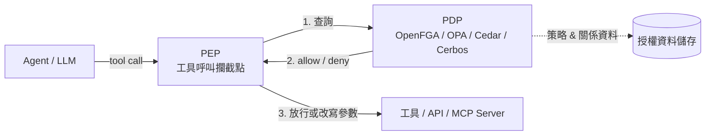
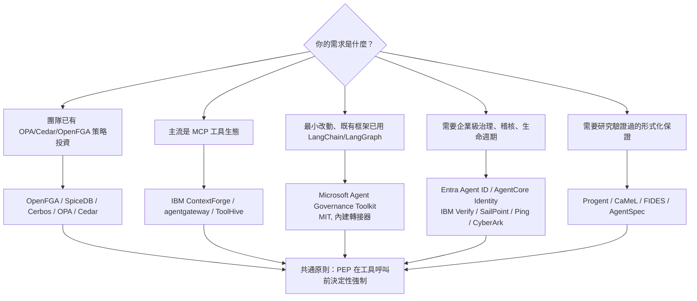

# 參考 IAM 權限控制以提升 Agent 權限管理粒度的工具調查

## 摘要 (Executive Summary)

本報告回答一個具體問題：**是否存在參考 IAM (Identity and Access Management，身分與存取管理) 權限控制模型、用以提高 Agent 權限管理粒度的工具？**

結論是：**存在，而且數量相當多**。這類工具可大致分為五個層次：

1. **策略引擎層**：以 ReBAC / ABAC / PA 等 IAM 授權模型為核心的通用引擎（OpenFGA、SpiceDB、Cerbos、OPA、Cedar、Casbin），被用來建模「agent → 工具 → 資源」的關係。
2. **Agent 治理框架層**：專門攔截 agent 每一次工具呼叫、在模型之外決定性 (deterministically) 執行授權的框架（Microsoft Agent Governance Toolkit 等）。
3. **MCP / A2A 閘道層**：作為 agent 與工具之間的代理 (proxy)，在傳輸層做工具層級 RBAC 與工具白名單（IBM ContextForge、agentgateway、ToolHive、Docker MCP Gateway）。
4. **學術方法層**：把權限視為「可程式化的符號規則」或「能力 (capability)」的研究原型（Progent、AgentSpec、CaMeL、FIDES、RTBAS 等）。
5. **企業 IAM 產品層**：既有 IAM/IGA/PAM 廠商把 agent 視為「非人類身分 (NHI)」納入治理（IBM Verify、AWS Bedrock AgentCore Identity、Google Cloud Agent Identity、Microsoft Entra Agent ID、Okta Cross App Access、SailPoint、CyberArk、Ping Identity、Descope、Auth0、WorkOS、AuthZed）。

需要特別澄清的是：**使用者所引用的 IBM ReAct agent 頁面本身並未討論 IAM 或權限控制**。該頁面只把「可用的工具」當作 prompt engineering 的構面（在系統提示中列出允許的 action 清單），並未涉及身分、任務範疇授權、最小權限或人工核准[^ibmreact]。因此「參考 IAM 權限控制的 agent 工具」是另一個獨立的技術領域，而非該頁面的內容。

## 名詞與範圍界定

### 何謂「提高權限管理粒度」

在傳統 IAM 中，授權決策的粒度可以是：

- **粗粒度**：角色 (role) 層級，例如「這個服務帳號是管理員」。
- **中粒度**：資源 + 動作 (resource + action)，例如「可以 `tools.execute` 這個工具」。
- **細粒度 (fine-grained)**：關係 (relationship) 或屬性 (attribute) 層級，例如「使用者 A 是專案 P 的成員，且僅能在工作時間、從特定來源 IP 對資源 R 執行 `read`」。

「提高粒度」指把上述決策從粗粒度推向細粒度，並且**決策點 (PDP) 與執行點 (PEP) 要落到每一次工具呼叫之前**，而不是只在登入時檢查一次。

### 為何 Agent 場景需要 IAM

多個權威來源的共識是：**不可把模型本身當作安全邊界**。Microsoft 的文件明確指出「不要讓 agent 自己決定授權，應用程式仍須決定動作是否被允許」[^msidentity]。OWASP 的 Agentic 應用 Top 10 把 **ASI02 工具誤用與濫用**、**ASI03 身分與權限濫用**、**ASI10 失控 agent** 列為核心風險[^owaspagentic]。NIST 的 NCCoE 概念文件則把 agent 的授權拆成四個控制領域：識別 (identification)、認證與授權 (authentication & authorization)、存取委派 (access delegation)、稽核與不可否認性 (auditing & non-repudiation)[^nccoe]。

## 一、策略引擎層：以 IAM 授權模型為核心的引擎

這一層不是 agent 專用工具，而是把既有的 IAM 授權模型套用到 agent 場景。它們負責「決策」，本身不含 agent 生命週期管理。

| 工具 | 授權模型 | GitHub | 星數 (約) | 授權條款 |
|---|---|---|---|---|
| OpenFGA | ReBAC (Zanzibar 式關係) | https://github.com/openfga/openfga | 5.9k | Apache-2.0[^openfga] |
| SpiceDB (AuthZed) | ReBAC (Zanzibar 式) | https://github.com/authzed/spicedb | 7.1k | Apache-2.0[^spicedb] |
| Cerbos | RBAC / ABAC，YAML policy-as-code | https://github.com/cerbos/cerbos | 4.6k | Apache-2.0[^cerbos] |
| Open Policy Agent (OPA) | Rego 通用策略引擎 | https://github.com/open-policy-agent/opa | 12.3k | Apache-2.0[^opa] |
| Cedar | AWS 授權策略語言 (principal/action/resource/context) | https://github.com/cedar-policy/cedar | 1.8k | Apache-2.0[^cedar] |
| Casbin | ACL / RBAC / ABAC 授權函式庫 (多語言) | https://github.com/apache/casbin | 20.4k | Apache-2.0[^casbin] |

**在 agent 場景的用法**：把 agent 當作 principal、把工具或 API 當作 action、把資料或服務當作 resource，直接沿用既有的關係圖或策略檔。例如 OpenFGA 的社群就收錄了一個名為 `agentic-authz` 的參考實作，示範「用 OpenFGA 為 AI agent 做細粒度授權」[^agenticauthz]；Casbin 亦在其程式庫中提供了 AI API 介面[^casbin]。

**與 agent 框架的整合實例**：

- Cerbos 針對 **Claude Agent SDK、Claude Code、CrewAI、A2A** 發佈了整合頁面，並提供 Agent Gateway 的原生 `ext_authz`（外部授權）介面，可在 MCP/A2A/LLM 流量上做工具呼叫授權[^cerboseco]。
- Permit.io 的 **MCP Gateway** 以 OPAL（建構在 OPA、Cedar、OpenFGA 之上的策略/資料即時派送層）為底，對每一次工具呼叫做認證、授權、記錄同意與稽核，並以 **LangGraph + LangChain MCP Adapters** 示範「把 AI 權限委派給人類使用者」的人在工作流程 (human-in-the-loop)[^permitmcp]。
- Oso 曾提供 `langchain-oso` 的觀測 callback，但其開源核心函式庫已於 2025-02 停止維護 (deprecated)，後續以商用 Oso Cloud 形式提供[^oso]。

> **注意 (open-core 陷阱)**：Cerbos、Permit.io、Oso 皆為 open-core 模式。核心引擎是 Apache-2.0，但「agent 閘道」與企業功能（例如 Permit 的人工核准流程、Cerbos Hub、Oso Cloud for Agents）屬商業授權[^cerbos][^permitmcp][^oso]。選型時須區分「引擎可用」與「agent 治理功能可用」。

Mermaid 圖示此層與 agent 的關係：



## 二、Agent 治理框架層：在模型之外決定性執行授權

這一層與第一層的差別在於：它是 **agent 原生**的，會攔截每一次「工具呼叫、訊息、委派」，並以確定性程式碼執行授權。

### Microsoft Agent Governance Toolkit (AGT)

- **定位**：為自主 agent 提供策略執行、零信任身分、執行沙箱與可靠性工程，宣稱覆蓋 OWASP Agentic Top 10 全部十項[^agt]。
- **粒度機制**：
  - 攔截每一次工具呼叫 / 訊息 / 委派，並在**確定性程式碼**中檢查（而非交由模型判斷）。
  - 支援 **`require_approval`** 人工核准規則，即高風險動作需人工放行。
  - 策略可用 **YAML / OPA / Cedar** 撰寫，並提供 **MCP Security Gateway**。
- **框架適配**：內建 **LangGraph、LangChain、LlamaIndex、CrewAI、AutoGen、OpenAI Agents SDK、Google ADK、Semantic Kernel** 等轉接器；SDK 支援 Python / TypeScript / .NET / Rust / Go[^agt]。
- **星數與授權**：約 6.4k stars、MIT[^agt]。

這是目前最接近使用者問題描述「參考 IAM 權限控制、用以提高 agent 權限管理粒度」的開源工具：它把 IAM 的最小權限、零信任身分、人工核准等概念，直接實作成 agent 可用的攔截器與策略引擎。

### 其他相關框架

- **NVIDIA NeMo Guardrails**（約 7.3k stars）與 **Guardrails AI**（約 7.5k stars）：提供輸入/輸出/tool rail 的護欄，屬 ML 式的最後一道防線，非嚴格 IAM 授權模型[^nemoguardrails][^guardrailsai]。

## 三、MCP / A2A 閘道層：代理式工具層級 RBAC

當 agent 透過 **MCP (Model Context Protocol)** 呼叫工具時，最自然的執行點 (PEP) 就是一個位於 agent 與 MCP server 之間的閘道。這一層的工具**直接實作了類似 IAM 的權限粒度**。

| 工具 | 粒度機制 | GitHub | 星數 (約) | 授權條款 |
|---|---|---|---|---|
| IBM ContextForge (mcp-context-forge) | 工具層級權限字串 + 角色 + token 範疇 | https://github.com/IBM/mcp-context-forge | 4.6k | Apache-2.0[^contextforge] |
| agentgateway | 細粒度 RBAC + CEL 策略引擎 | https://github.com/agentgateway/agentgateway | 5.3k | Apache-2.0[^agentgateway] |
| ToolHive (Stacklok) | 每請求身分/存取策略、隔離容器 | https://github.com/stacklok/toolhive | 2.3k | Apache-2.0[^toolhive] |
| Docker MCP Gateway | 每個 profile 的工具白名單 | https://github.com/docker/mcp-gateway | 1.6k | MIT[^dockermcp] |
| mcp-proxy | 傳輸代理（可作choke point） | https://github.com/sparfenyuk/mcp-proxy | 2.8k | MIT[^mcpproxy] |
| MCP Guardian (EQTY Lab) | 逐筆工具呼叫的人工核准/拒絕 | https://github.com/eqtylab/mcp-guardian | 200 | Apache-2.0[^mcpguardian] |
| Plano (前 archgw) | AI 原生代理與 guardrail 過濾鏈 | https://github.com/katanemo/plano | 7.1k | Apache-2.0[^plano] |

### 最值得參考的粒度實作：IBM ContextForge 的 RBAC

IBM 的開源 MCP/A2A 閘道 ContextForge 是「IAM 概念落地到 agent 工具」最完整的公開範例。它採用**兩層安全模型**[^cfrbac]：

1. **Token Scoping（第一層）**：控制使用者「**能看到什麼**」，透過 JWT 的 `teams` claim 做資料過濾。
2. **RBAC（第二層）**：控制使用者「**能做什麼**」，即動作授權。

其權限字串是 **per-resource + per-action** 的細粒度設計[^cfrbac]：

- 工具：`tools.create`、`tools.read`、`tools.update`、`tools.delete`、`tools.execute`
- 資源：`resources.create` / `read` / `update` / `delete` / `share`
- 提示：`prompts.create` / `read` / `update` / `delete` / `execute`
- 伺服器：`servers.create` / `read` / `use` / `update` / `delete` / `manage`
- A2A：`a2a.invoke`
- 管理：`admin.system_config`、`admin.user_management`、`admin.security_audit`

內建角色包含 `platform_admin` (global, `["*"]`)、`team_admin`、`developer`、`viewer`、`platform_viewer`，並支援以 JSON 自訂角色，例如[^cfrbac]：

```json
{"name": "data_analyst", "scope": "team",
 "permissions": ["tools.read", "resources.read", "prompts.read"],
 "is_system_role": true}
```

其他值得注意的設計[^cfrbac]：

- **執行點一致化**：RBAC 在 Token Scoping 中介層、REST 端點 (`@require_permission`)、RPC handler、Admin UI、服務層 DB 查詢過濾、WebSocket、MCP 傳輸等所有存取路徑一致套用。這正是 IAM「單一決策、多點執行」的精神。
- **Token 範疇**：可把 token 限制在特定 server、權限清單、IP CIDR、以及時間/用量配額。
- **可見性層級**：每個資源可為 `public` / `team` / `private`。
- **SSO 整合**：GitHub、Google、IBM Security Verify、Microsoft Entra ID、Okta、Keycloak、通用 OIDC，並支援 group → team 映射。
- **規劃中**：ABAC、每個虛擬伺服器的 API key 搭配工具層級能力授予、OPA/Rego policy-as-code[^cfrbac]。

此設計可直接對照傳統 IAM：principal = agent/user、role = 內建或自訂角色、permission = `<resource>.<action>`、scope = team/IP/time、PEP = 各路徑的 `@require_permission`。

## 四、學術方法層：把權限視為可程式化規則或能力

學術界針對「agent 權限粒度」提出了多種機制，對設計自研系統極具參考價值。以下依機制分類。

### 4.1 可程式化特權控制：Progent

- **論文**：Securing AI Agents with Privilege Control (arXiv:2504.11703)[^progent]。
- **機制**：把「特權」表示為**針對工具名稱與參數的符號規則策略**；每次工具呼叫由**確定性程序**檢查是否符合策略。LLM 依使用者任務自動產生初始策略，並提出更新；由 **SMT solver** 判定該更新是「限縮 (narrowing)」還是「擴張 (expansion)」——限縮自動套用，擴張需明確核准，藉此達成**單調收斂 (monotonic confinement)**：未經核准時，可執行的動作空間只會縮小不會擴大[^progent]。
- **整合**：LangChain 與 OpenAI Agents SDK；於 AgentDojo 與 ASB 基準上評估[^progent]。
- **開源**：https://github.com/sunblaze-ucb/progent，約 53 stars、MIT[^progentrepo]。

**為何重要**：這是把 IAM 的「權限不可自行擴張」原則形式化為可驗證機制的代表作。

### 4.2 執行期約束 DSL：AgentSpec

- **論文**：AgentSpec: Customizable Runtime Enforcement for Safe and Reliable LLM Agents (arXiv:2503.18666)[^agentspec]。
- **機制**：以領域特定語言 (DSL) 描述形如 `trigger / check / enforce` 的執行期約束。強制手段包括 `stop`、`user_inspection`（暫停等待人工核准）、`invoke_action(tool, input)`（替換為安全動作）、`llm_self_examine`。規則以 ANTLR 編譯[^agentspec]。
- **開源**：https://github.com/haoyuwang99/AgentSpec，約 62 stars；整合 LangChain[^agentspecrepo]。
- **名稱衝突警告**：另有一個不相關的 `luanmorenommaciel/agentspec`（HTML，約 253 stars），並非上述執行期約束系統[^agentspec]。

### 4.3 能力 (Capability) 與資訊流控制

此類方法不靠「角色」，而是靠「能力標籤」與「資訊流標籤」限制資料流動，粒度更高。

| 系統 | 來源 | 機制 | 開源 / 星數 |
|---|---|---|---|
| CaMeL | Google DeepMind (arXiv:2503.18813) | 分離「特權 LLM」（只看可信使用者查詢、負責控制流）與「隔離 LLM」（處理不可信資料、不能影響控制流）；以 capability 阻止未授權資料外洩[^camel] | github.com/google-research/camel-prompt-injection，約 405 stars、Apache-2.0[^camelrepo] |
| FIDES | Microsoft (arXiv:2505.23643) | planner 追蹤機密性與完整性標籤，確定性強制安全策略[^fides] | github.com/microsoft/fides，約 119 stars、MIT[^fidesrepo] |
| RTBAS | arXiv:2502.08966 | 採用資訊流控制，僅在無法保證安全時才要求使用者確認[^rtbas] | 未提供官方 repo[^rtbas] |
| SEAgent | arXiv:2601.11893 | 以 ABAC 為基礎的強制存取控制 (MAC)，透過資訊流圖監控 agent–工具互動[^seagent] | — |
| ChainCaps | arXiv:2605.26542 | 沿工具鏈以交集傳遞「sink 特定能力預算」，防「權限漂白」[^chaincaps] | — |
| IntentCap | arXiv:2609.14631 | 任務範疇的能力租約 (capability lease)，具單調收斂[^intentcap] | — |
| APPA | arXiv:2607.24625 | Agentic Permissions Policy Algebra，資訊流控制 + 雙階段參考監控[^appa] | — |

### 4.4 宣告式權限清單與其他

- **AgentBound** (arXiv:2510.21236，FSE 2026)：被描述為**首個針對 MCP server 的存取控制框架**，採用「受 Android 權限模型啟發的宣告式策略」；作者建立 296 個熱門 MCP server 的資料集，並以原始碼自動產生策略，準確率 80.9%[^agentbound]。**名稱衝突警告**：另有 arXiv:2606.30970 的同名框架（Behavioral Governance），為不同系統[^agentbound2]。
- **Permission Manifests for Web Agents** (arXiv:2601.02371)：提出類似 robots.txt 的 `agent-permissions.json` 站點清單[^permmf].
- **Zero-Trust Authorization for Enterprise MCP** (arXiv:2609.22573)：FastMCP 中的 per-tool 授權與「權限過濾後的工具可見性」[^ztmcp]。
- **AgentSandbox** (arXiv:2505.24019)：把國防深度、最小權限、完全中介、心理可接受性等古典安全原則嵌入 agent 生命週期；屬概念框架，非已發佈程式碼[^agentsandbox]。
- **Survey**：How Agents Ask for Permission (arXiv:2607.13718) 整理了 21 個 agent 權限方案與 5 個商用 agent 的taxonomy[^survey]。
- **AutoGen**：無專用 permission API，但提供 `UserProxyAgent` 的人工介入核准，以及 Docker 沙箱隔離作為框架級最小權限原語[^autogen]。

## 五、企業 IAM 產品層：把 agent 當作非人類身分治理

傳統 IAM 廠商近兩年紛紛把 agent 納入治理範圍。若組織已有既有 IAM 投資，這一層通常是導入成本最低的路徑。

### 5.1 雲廠商的 agent 身分服務

| 產品 | 粒度機制 | 關鍵日期 |
|---|---|---|
| AWS Bedrock AgentCore Identity | 將 agent 建模為 **workload identity**；雙向認證（入向 SigV4/JWT/OAuth、出向 2-legged/3-legged OAuth）；token 以 KMS 加密；整合 Cognito/Okta/Entra ID[^awsagentcore] | Preview 2025-07，GA 2025-10-13[^awsagentcore] |
| Google Cloud Agent Identity (IAM) | 以 **SPIFFE** 為基礎的密碼學 agent 身分（`spiffe://TRUST_DOMAIN/...`）；X.509 憑證 24 小時輪替；mTLS、DPoP；整合 IAM allow/deny 政策、Principal Access Boundary、VPC Service Controls[^gcpagentid] | 文件更新 2026-10-07[^gcpagentid] |
| Microsoft Entra Agent ID | 引入 **agent identities** 與 **agent identity blueprints**（父子模板、可繼承權限）；支援 OAuth 2.0、**MCP**、**A2A**；擴充 Conditional Access、ID Governance、存取套件；**封鎖高風險角色**（如 `RoleManagement.ReadWrite.All`）給 agent[^entraagentid] | Build 2025-05 發表，現已 GA[^entraagentid] |
| Okta Cross App Access (XAA) | 以 **Identity Assertion Authorization Grant (ID-JAG)** 讓企業 IdP 成為授權仲介，簽發同時帶有使用者與 agent 脈絡的 token；與 MCP、A2A 互補[^oktaxaa] | 2025-06-23 發表；Blueprint Alliance 2026-09-22 成立[^oktaxaa][^blueprint] |

### 5.2 治理與特權存取廠商

- **IBM Verify / Agentic AI identity management**：把每個 agent 註冊為唯一可驗證身分、以最小權限與風險感知為原則發放 JIT 短效憑證、在每次 API/工具呼叫做 AI 認證、提供簽章稽核軌跡與即時撤銷；另有 **Machine Identity Management (MIM)** 管理 NHI 憑證生命週期，並以 **CIBA** 支援交易中途的帶外驗證[^ibmverify]。
- **SailPoint Agentic Fabric**：跨雲發現所有 agent/NHI 及其憑證；為每個 agent 指派**具名的人類擁有者**；對 agent 授權做存取審查/認證；JIT 時限授權；行為監控與**策略驅動的 kill switch**[^sailpoint]。
- **CyberArk (Idira) Secure AI Agents**：以特權為核心，掃描環境**發現執行中的 agent**；強制 **zero standing privileges**（僅在任務期間授予存取）；即時威脅偵測與會話監控；治理 MCP server 的「誰/哪個 agent 可執行哪個工具」；2025-12 GA[^cyberark]。
- **Ping Identity Agent Governance / Agent Privilege / Agent IAM Core / Agent Gateway**：發現並分類 agent、指派人類保管人、對應工具與權限、強制 zero standing privilege 與 JIT、偵測異常；Agent Gateway 作為 agent 與 MCP 資源之間的執行期強制層；支援人在迴路核准[^ping]。
- **Descope Agentic Identity Hub**：agent 目錄與每 agent/工具層級 scope；MCP 認證（OAuth 2.1 + PKCE、DCR/CIMD）；短效 scoped token；策略引擎支援漸進式 scope 提升；human-in-the-loop 與 step-up 認證；支援 Cross-App Access (ID-JAG)[^descope]。
- **Auth0 for AI Agents**：把 agent 與使用者**區分**建模；把授權集中到身分層而非應用程式碼；支援細粒度授權 (FGA)、代理使用者的 scoped 委派存取、非同步授權[^auth0ai]。
- **WorkOS AuthKit for MCP**：為 MCP server 提供符合 OAuth 2.1 的授權伺服器，對 agentic 應用做細粒度授權[^workos]。
- **AuthZed (SpiceDB)**：ReBAC 授權平台；主打**權限感知 RAG**（在檢索速度下遵守 Google Drive/OneDrive/Box 的權限繼承與即時撤銷）與 agent 授權[^authzed]。

## 六、標準與合規框架

導入粒度控制時，可對齊以下標準：

- **MCP Authorization 規範**：把 MCP server 歸類為 **OAuth 2.1 resource server**，使用 RFC 8414（AS Metadata）、RFC 9728（Protected Resource Metadata）、RFC 8707（Resource Indicators）、PKCE，並明文禁止 token passthrough（防 confused deputy）。2025-06-18 修訂加入 Resource Server 分類；現行版本 2026-07-28 再補上 RFC 6750、RFC 9207 `iss` 驗證、scope-challenge / step-up 授權流與 `ext-auth` 擴充[^mcpauth][^mcpauth2]。
- **A2A (Agent2Agent) 協定**：agent 對 agent 通訊的開放標準（與 MCP 的 agent 對工具互補），由 Google 開發後捐給 Linux Foundation；授權委由 OAuth2/OIDC 等標準機制，Agent Card 宣告 `security` scheme，支援**每 skill 的 OAuth scope**、資料/動作層級與最小權限強制[^a2a][^a2aent]。
- **IETF OAuth Cross App Access**：`draft-ietf-oauth-identity-chaining`（2026-08-21）結合 RFC 8693（Token Exchange）與 RFC 7523（JWT Authorization Grants）；`draft-ietf-oauth-identity-assertion-authz-grant`（2026-05-21）定義 ID-JAG token 型別[^idchaining][^idjag]。
- **NIST**：NCCoE 概念文件《Accelerating the Adoption of Software and AI Agent Identity and Authorization》（2026-02-05）提出識別、認證授權、存取委派、稽核四大控制領域，並強調**委派只能限縮、不得擴張**、動作須可追溯至授權的人類；目前仍在demonstration 階段，最終將形成 SP-1800 系列實務指南[^nccoe]。相關 AI Agent Standards Initiative 由 CAISI 於 2026-02-17 啟動[^nistcaisi]。
- **OWASP Top 10 for Agentic Applications (2026)**：ASI01 Agent Goal Hijack、ASI02 Tool Misuse、ASI03 Identity and Privilege Abuse、ASI04 Agentic Supply Chain、ASI05 Unexpected Code Execution、ASI06 Memory & Context Poisoning、ASI07 Insecure Inter-Agent Communication、ASI08 Cascading Failures、ASI09 Human-Agent Trust Exploitation、ASI10 Rogue Agents[^owaspagentic]。

## 七、綜合比較與選型建議



**依情境建議**：

1. **最快取得成果**：若團隊已使用 LangChain/LangGraph/LlamaIndex，**Microsoft Agent Governance Toolkit** 是落差最小的選擇——它把 zero-trust 身分、策略執行、`require_approval` 人工核准、MCP Security Gateway 一次打包，且為 MIT 授權[^agt]。
2. **已有 IAM 策略投資**：沿用 OpenFGA / SpiceDB（ReBAC）或 Cerbos / OPA / Cedar（policy-as-code），以 `agentic-authz` 之類的參考實作為起點[^agenticauthz][^openfga]。
3. **MCP 為主**：以 **IBM ContextForge** 為主要參考對象，其 per-resource/per-action 權限字串與兩層（token scoping + RBAC）模型直接對映 IAM 的 principal/role/permission/scope 概念[^cfrbac]；`agentgateway` 則提供 CEL 式細粒度 RBAC 與 Cerbos `ext_authz` 整合[^agentgateway][^cerboseco]。
4. **企業級治理**：若需要發現、盤點、人類問責、生命週期與稽核，選雲廠商或 IGA/PAM 廠商方案（Entra Agent ID、AgentCore Identity、Google Agent Identity、IBM Verify、SailPoint、Ping、CyberArk、Descope）[^entraagentid][^awsagentcore][^gcpagentid][^ibmverify][^sailpoint][^ping][^cyberark][^descope]。
5. **需要形式化保證**：採用 **Progent** 的單調收斂（SMT 驗證的限縮/擴張分類）或 **CaMeL / FIDES** 的能力與資訊流控制[^progent][^camel][^fides]。

**共通設計原則**（跨所有層級皆適用）：

- **模型不是安全邊界**：授權決策必須在模型之外以確定性程式碼完成[^msidentity]。
- **PEP 落到每次工具呼叫前**，而非登入閘道一次檢查[^orchid]。
- **委派只能限縮**：任何委派鏈的每一步都必須縮小或維持範圍，且具到期時間[^nccoe]。
- **任務範疇的短效憑證**，避免長期常駐角色[^awsagentcore][^nccoe]。
- **高後果動作需人工核准**或第二授權路徑[^agt][^mcpguardian][^permitmcp]。
- **可稽核**：動作須可重建序列並歸屬於 agent 與其背後的人類[^nccoe][^orchid]。

## 八、對來源的批判性反思

在撰寫本報告時，有幾點必須向讀者揭露：

1. **時序問題**：本報告的資料擷取時間為 2026-10-11，但其中不少引用的 arXiv 編號落在 2026 年（如 2601.xxxxx、2607.xxxxx、2609.xxxxx），這些屬於相對新的預印本，**尚未經過充分的同儕審查與復現驗證**。讀者引用時應區分「已發表於會議（如 AgentBound 的 FSE 2026）」與「僅為預印本」。
2. **抓到「反直覺」的基數**：本主題的論文產出速度極快，單一面向（例如權限 DSL）就存在大量近似的方案（Progent、AgentSpec、IGAC、IntentCap…）。這本身是一種警訊——**領域尚未收斂**，最佳實務仍在形成中，選型不應只看單篇論文。
3. **廠商行銷語言的偏誤**：第五節的企業產品資訊主要來自各家官方網站與新聞稿。這些來源天生具有**推銷傾向**，傾向誇大功能完整度與成熟度，且「GA」的定義各家不一。例如 IBM、SailPoint、Ping、CyberArk 的 agent 治理功能多為 2025 年底至 2026 年的新增項目，實際部署經驗有限。
4. **名稱衝突造成的混淆**：本報告至少發現兩處同名不同物的情形——`AgentBound`（arXiv:2510.21236 與 arXiv:2606.30970）與 `agentspec`（haoyuwang99 與 luanmorenommaciel）。引用時務必核對 arXiv 編號或 repo 擁有者。
5. **星數的時效性**：所有 GitHub 星數為擷取時點的近似值，會隨時間漂移。此外，**星數不等於安全性或成熟度**，僅能作為關注度的粗略指標。本報告在嘗試透過 GitHub API 取得精確星數時遭遇 403 回應，故星數沿用次級來源的近似值，精確數字請以 GitHub 頁面為準。
6. **使用者引用的原始頁面與主題無關**：必須再次強調，IBM 的 ReAct agent 頁面本身不討論 IAM、授權或權限粒度[^ibmreact]。若使用者的用意是「是否存在以 ReAct 架構實作、且參考 IAM 的 agent 工具」，則本報告的答案是：ReAct 只是推理-行動迴圈的模式，權限控制是**正交 (orthogonal)** 的關注點，由上述五個層次的工具分別處理，而非由 ReAct 這個模式本身提供。
7. **政策與標準的變動性**：MCP Authorization 規範、A2A 協定、IETF XAA 草案與 NIST NCCoE 文件皆處於快速演進狀態，本報告所引版本與日期可能在數月內失效。

## 九、結論

**是的，有大量參考 IAM 權限控制、用以提高 agent 權限管理粒度的工具。** 它們分布於五個層次，從底層的策略引擎（OpenFGA、SpiceDB、Cerbos、OPA、Cedar、Casbin），到 agent 原生的治理框架（Microsoft Agent Governance Toolkit），到 MCP/A2A 閘道（IBM ContextForge、agentgateway、ToolHive），到學術原型（Progent、AgentSpec、CaMeL、FIDES），再到企業 IAM 產品（Entra Agent ID、AgentCore Identity、IBM Verify、SailPoint、Ping、CyberArk、Descope、Auth0、WorkOS、AuthZed）。

其中最貼近「把 IAM 概念直接落地為 agent 工具權限粒度」的公開範例是 **IBM ContextForge 的 per-resource/per-action 權限字串 + 兩層安全模型**，以及 **Microsoft Agent Governance Toolkit 的決定性攔截 + `require_approval`**。若需要形式化保證，**Progent 的單調收斂**與 **CaMeL/FIDES 的能力與資訊流控制**則提供了可驗證的設計參考。

需要提醒的是：這個領域仍在高速演進、尚未收斂，且大量來源為預印本與廠商行銷材料，採用前應以實際環境驗證。

## 參考文獻 (References)

[^ibmreact]: IBM. (n.d.). What is a ReAct agent? Retrieved 2026-10-11, from https://www.ibm.com/think/topics/react-agent
[^msidentity]: Microsoft. (n.d.). Identity fundamentals for AI agents. Microsoft Learn. Retrieved 2026-10-11, from https://learn.microsoft.com/en-us/startups/build/identity-management/identity-fundamentals-ai-agents
[^owaspagentic]: OWASP GenAI Security Project. (2026). OWASP Top 10 for Agentic Applications for 2026. Retrieved 2026-10-11, from https://genai.owasp.org/resource/owasp-top-10-for-agentic-applications-for-2026/
[^nccoe]: NIST National Cybersecurity Center of Excellence. (2026-02-05). Accelerating the adoption of software and artificial intelligence agent identity and authorization (Concept paper). Retrieved 2026-10-11, from https://www.nccoe.nist.gov/projects/software-and-si-agent-identity-and-authorization
[^nistcaisi]: NIST. (2026-02-17). AI Agent Standards Initiative. Retrieved 2026-10-11, from https://www.nist.gov/artificial-intelligence/ai-agent-standards-initiative
[^openfga]: OpenFGA. (n.d.). OpenFGA: High performance and flexible authorization. GitHub. Retrieved 2026-10-11, from https://github.com/openfga/openfga
[^spicedb]: AuthZed. (n.d.). SpiceDB. GitHub. Retrieved 2026-10-11, from https://github.com/authzed/spicedb
[^cerbos]: Cerbos. (n.d.). Cerbos: Painless authorization. GitHub. Retrieved 2026-10-11, from https://github.com/cerbos/cerbos
[^opa]: Open Policy Agent. (n.d.). Open Policy Agent. GitHub. Retrieved 2026-10-11, from https://github.com/open-policy-agent/opa
[^cedar]: Cedar Policy. (n.d.). Cedar. GitHub. Retrieved 2026-10-11, from https://github.com/cedar-policy/cedar
[^casbin]: Apache Software Foundation. (n.d.). Casbin. GitHub. Retrieved 2026-10-11, from https://github.com/apache/casbin
[^agenticauthz]: Siddhant-K-code. (n.d.). agentic-authz: Fine-grained authorization for AI agents using OpenFGA. GitHub. Retrieved 2026-10-11, from https://github.com/Siddhant-K-code/agentic-authz
[^cerboseco]: Cerbos. (n.d.). Agent gateway authorization. Retrieved 2026-10-11, from https://www.cerbos.dev/ecosystem/agent-gateway
[^permitmcp]: Permit.io. (n.d.). Permit MCP Gateway documentation. Retrieved 2026-10-11, from https://docs.permit.io/permit-mcp-gateway/
[^oso]: Oso. (n.d.). Oso authorization framework. GitHub. Retrieved 2026-10-11, from https://github.com/osohq/oso
[^agt]: Microsoft. (n.d.). AI Agent Governance Toolkit. GitHub. Retrieved 2026-10-11, from https://github.com/microsoft/agent-governance-toolkit
[^nemoguardrails]: NVIDIA. (n.d.). NeMo Guardrails. GitHub. Retrieved 2026-10-11, from https://github.com/NVIDIA-NeMo/Guardrails
[^guardrailsai]: Guardrails AI. (n.d.). Guardrails. GitHub. Retrieved 2026-10-11, from https://github.com/guardrails-ai/guardrails
[^contextforge]: IBM. (n.d.). MCP Context Forge. GitHub. Retrieved 2026-10-11, from https://github.com/IBM/mcp-context-forge
[^cfrbac]: IBM. (n.d.). Role-Based Access Control (RBAC). MCP Context Forge documentation. Retrieved 2026-10-11, from https://ibm.github.io/mcp-context-forge/latest/manage/rbac/
[^agentgateway]: agentgateway. (n.d.). agentgateway: An AI-native proxy. GitHub. Retrieved 2026-10-11, from https://github.com/agentgateway/agentgateway
[^toolhive]: Stacklok. (n.d.). ToolHive. GitHub. Retrieved 2026-10-11, from https://github.com/stacklok/toolhive
[^dockermcp]: Docker. (n.d.). MCP Gateway. GitHub. Retrieved 2026-10-11, from https://github.com/docker/mcp-gateway
[^mcpproxy]: sparfenyuk. (n.d.). mcp-proxy. GitHub. Retrieved 2026-10-11, from https://github.com/sparfenyuk/mcp-proxy
[^mcpguardian]: EQTY Lab. (n.d.). MCP Guardian. GitHub. Retrieved 2026-10-11, from https://github.com/eqtylab/mcp-guardian
[^plano]: Katanemo. (n.d.). Plano. GitHub. Retrieved 2026-10-11, from https://github.com/katanemo/plano
[^progent]: Shi, T., He, J., Wang, L., Li, P., Wu, D., Guo, C., & Song, D. (2025). Progent: Securing AI agents with privilege control. arXiv:2504.11703. Retrieved 2026-10-11, from https://arxiv.org/abs/2504.11703
[^progentrepo]: Sunblaze UC Berkeley. (n.d.). Progent. GitHub. Retrieved 2026-10-11, from https://github.com/sunblaze-ucb/progent
[^agentspec]: Wang, H., Poskitt, C. M., & Sun, J. (2025). AgentSpec: Customizable runtime enforcement for safe and reliable LLM agents. arXiv:2503.18666. Retrieved 2026-10-11, from https://arxiv.org/abs/2503.18666
[^agentspecrepo]: haoyuwang99. (n.d.). AgentSpec. GitHub. Retrieved 2026-10-11, from https://github.com/haoyuwang99/AgentSpec
[^camel]: Debenedetti, E., et al. (2025). Defeating prompt injections by design. arXiv:2503.18813. Retrieved 2026-10-11, from https://arxiv.org/abs/2503.18813
[^camelrepo]: Google Research. (n.d.). CaMeL: Defeating prompt injections by design. GitHub. Retrieved 2026-10-11, from https://github.com/google-research/camel-prompt-injection
[^fides]: Costa, M., Köpf, B., Kolluri, A., Paverd, A., Russinovich, M., Salem, A., Tople, S., Wutschitz, L., & Zanella-Béguelin, S. (2025). Securing AI agents with information-flow control. arXiv:2505.23643. Retrieved 2026-10-11, from https://arxiv.org/abs/2505.23643
[^fidesrepo]: Microsoft. (n.d.). FIDES. GitHub. Retrieved 2026-10-11, from https://github.com/microsoft/fides
[^rtbas]: (2025). RTBAS: Defending LLM agents against prompt injection and privacy leakage. arXiv:2502.08966. Retrieved 2026-10-11, from https://arxiv.org/abs/2502.08966
[^agentbound]: Bühler, J., Biagiola, M., Di Grazia, L., & Salvaneschi, G. (2025). AgentBound: Securing execution boundaries of AI agents. arXiv:2510.21236. Retrieved 2026-10-11, from https://arxiv.org/abs/2510.21236
[^agentbound2]: Kaul, A., Lan, C., & Gupta, R. (2026). Behavioral governance for autonomous AI agents: The AgentBound framework. arXiv:2606.30970. Retrieved 2026-10-11, from https://arxiv.org/abs/2606.30970
[^agentsandbox]: Zhang, Y., Su, T., Chen, Y., Bertino, E., Zhang, Y., & Li, N. (2025). LLM agents should employ security principles. arXiv:2505.24019. Retrieved 2026-10-11, from https://arxiv.org/abs/2505.24019
[^seagent]: (2026). SEAgent: Mandatory access control for LLM agents. arXiv:2601.11893. Retrieved 2026-10-11, from https://arxiv.org/abs/2601.11893
[^chaincaps]: (2026). ChainCaps: Sink-specific capability budgets across tool chains. arXiv:2605.26542. Retrieved 2026-10-11, from https://arxiv.org/abs/2605.26542
[^intentcap]: (2026). IntentCap: Task-scoped capability leases. arXiv:2609.14631. Retrieved 2026-10-11, from https://arxiv.org/abs/2609.14631
[^appa]: (2026). APPA: Agentic permissions policy algebra. arXiv:2607.24625. Retrieved 2026-10-11, from https://arxiv.org/abs/2607.24625
[^permmf]: (2026). Permission manifests for web agents. arXiv:2601.02371. Retrieved 2026-10-11, from https://arxiv.org/abs/2601.02371
[^ztmcp]: (2026). Zero-trust authorization for enterprise MCP. arXiv:2609.22573. Retrieved 2026-10-11, from https://arxiv.org/abs/2609.22573
[^survey]: (2026). How agents ask for permission. arXiv:2607.13718. Retrieved 2026-10-11, from https://arxiv.org/abs/2607.13718
[^autogen]: Microsoft. (n.d.). Human-in-the-loop. AutoGen documentation. Retrieved 2026-10-11, from https://microsoft.github.io/autogen/stable/user-guide/agentchat-user-guide/tutorial/human-in-the-loop.html
[^awsagentcore]: Amazon Web Services. (2025-10-13). Amazon Bedrock AgentCore now generally available. Retrieved 2026-10-11, from https://aws.amazon.com/about-aws/whats-new/2025/10/amazon-bedrock-agentcore-available/
[^gcpagentid]: Google Cloud. (2026-10-07). Agent identity overview. Google Cloud IAM documentation. Retrieved 2026-10-11, from https://cloud.google.com/iam/docs/agent-identity-overview
[^entraagentid]: Microsoft. (n.d.). Microsoft Entra Agent ID. Microsoft Learn. Retrieved 2026-10-11, from https://learn.microsoft.com/en-us/entra/agent-id/
[^oktaxaa]: Okta. (2025-06-23). Okta introduces Cross App Access to help secure AI agents in the enterprise. Retrieved 2026-10-11, from https://investor.okta.com/news-and-events/news-releases/news-details/2025/Okta-Introduces-Cross-App-Access-to-Help-Secure-AI-Agents-in-the-Enterprise/default.aspx
[^blueprint]: Okta. (2026-09-22). Industry leaders form the Blueprint Alliance. Retrieved 2026-10-11, from https://www.okta.com/newsroom/press-releases/industry-leaders-form-the-blueprint-alliance/
[^ibmverify]: IBM. (n.d.). Agentic AI identity management. Retrieved 2026-10-11, from https://www.ibm.com/solutions/agentic-ai-identity-management
[^sailpoint]: SailPoint. (n.d.). Agentic Fabric. Retrieved 2026-10-11, from https://www.sailpoint.com/products/agentic-fabric
[^cyberark]: CyberArk. (n.d.). Secure AI agents. Retrieved 2026-10-11, from https://www.cyberark.com/solutions/secure-agentic-ai/
[^ping]: Ping Identity. (2026-05-27). Ping Identity redefines the identity control plane for the agentic enterprise. Retrieved 2026-10-11, from https://press.pingidentity.com/2026-05-27-Ping-Identity-Redefines-the-Identity-Control-Plane-for-the-Agentic-Enterprise
[^descope]: Descope. (2026-01-26). Agentic Identity Hub. Retrieved 2026-10-11, from https://www.descope.com/blog/post/agentic-identity-hub
[^auth0ai]: Auth0. (n.d.). Auth0 for AI agents. Retrieved 2026-10-11, from https://auth0.com/ai
[^workos]: WorkOS. (n.d.). AuthKit for MCP. Retrieved 2026-10-11, from https://workos.com/mcp
[^authzed]: AuthZed. (n.d.). Permission-aware RAG and agent authorization. Retrieved 2026-10-11, from https://authzed.com/use-cases/ai-retrieval-augmented-generation
[^mcpauth]: Model Context Protocol. (2025-06-18). Authorization. Retrieved 2026-10-11, from https://modelcontextprotocol.io/specification/2025-06-18/basic/authorization
[^mcpauth2]: Model Context Protocol. (2026-07-28). Authorization. Retrieved 2026-10-11, from https://modelcontextprotocol.io/specification/2026-07-28/basic/authorization
[^a2a]: A2A Protocol. (n.d.). Agent2Agent (A2A) protocol specification. Retrieved 2026-10-11, from https://a2a-protocol.org/latest/
[^a2aent]: A2A Protocol. (n.d.). Enterprise-ready. Retrieved 2026-10-11, from https://a2a-protocol.org/latest/topics/enterprise-ready/
[^idchaining]: IETF. (2026-08-21). OAuth identity and authorization chaining across domains (draft-ietf-oauth-identity-chaining-17). Retrieved 2026-10-11, from https://datatracker.ietf.org/doc/draft-ietf-oauth-identity-chaining/
[^idjag]: Parecki, A., McGuinness, K., & Campbell, B. (2026-05-21). Identity assertion JWT authorization grant (draft-ietf-oauth-identity-assertion-authz-grant-04). Retrieved 2026-10-11, from https://datatracker.ietf.org/doc/draft-ietf-oauth-identity-assertion-authz-grant/
[^orchid]: Orchid Security. (n.d.). IAM for AI agents. Retrieved 2026-10-11, from https://www.orchid.security/guides/iam-for-ai-agents
