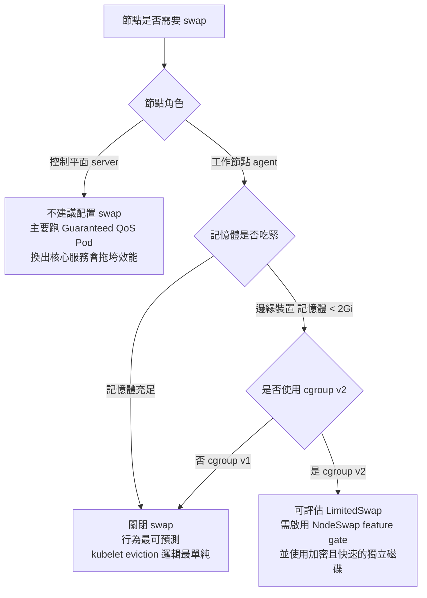

# 為什麼架設 k3s 需要關閉 swap？

## 摘要

網路上大量的 Kubernetes 安裝教學都會在最開頭放一行 `sudo swapoff -a`，但在 k3s 的官方 Requirements 頁面上卻完全找不到這段指示，因此常有人困惑：k3s 到底需不需要關閉 swap？本報告的結論是：**需要，但理由與一般 Kubernetes 教學所說的不完全相同，而且 k3s 本身的預設行為也與上游 kubelet 不同**。

簡言之，上游 Kubernetes 的 kubelet 預設會在偵測到 swap 時拒絕啟動；k3s 則為了降低使用門檻，**從一開始就把 `fail-swap-on` 設為 `false`**[^k3s8811][^k3sagent]，所以 k3s 節點即使開著 swap 也能正常跑起來。然而「能啟動」不等於「該開啟」：關閉 swap 的理由在於 Kubernetes 的排程、記憶體核算與驅逐（eviction）機制都無法正確處理 swap，開啟後會讓節點行為變得不可預測。k3s 官方維護的 Ansible 部署專案（k3s-ansible）在其 README 中仍明確建議停用 swap[^k3sansible]，社群論壇的回答也是「即使用 k3s 也應該關閉」[^forum]。

---

## 一、背景：kubelet 與 swap 的關係

要理解「為什麼要關閉 swap」，必須先知道 Kubernetes 對 swap 的預設態度。

kubeadm 的安裝文件〈Install kubeadm〉在「Swap configuration」一節寫得非常直接：

> "The default behavior of a kubelet is to fail to start if swap memory is detected on a node. This means that swap should either be disabled or tolerated by kubelet."[^failswap]

而 Kubernetes 的〈Swap memory management〉概念頁則在作業系統支援一節寫道：

> "Linux nodes support swap; you need to configure each node to enable it. By default, the kubelet will **not** start on a Linux node that has swap enabled."[^swapmgmt]

也就是說，在原生 Kubernetes 上，開啟 swap 的節點連 kubelet 都起不來，會直接看到類似下面的錯誤：

```
failed to run Kubelet: running with swap on is not supported,
please disable swap or set --fail-swap-on flag to false
```

這個錯誤訊息實際來自 kubelet 的 container manager 實作，在 `NewContainerManager` 中會先檢查 `swap.IsSwapOn()`，若為真且 `failSwapOn` 為真就直接回傳錯誤[^kubesource]：

```go
if isSwapOn {
    if failSwapOn {
        return nil, fmt.Errorf("running with swap on is not supported, " +
            "please disable swap or set --fail-swap-on flag to false")
    }
    ...
}
```

因此，**「關閉 swap」在上游是啟動的前置條件，而不是效能調校建議**。

---

## 二、為什麼要關閉 swap？五個核心原因

### 2.1 排程器無法核算 swap，資源配置失去可預測性

k3s 與 Kubernetes 的排程決策，是基於 Pod 的 *requests* 相對於節點可分配資源來進行的。然而 Pod 只能宣告 `memory`，**無法宣告 swap 需求**，排程器也完全不把 swap 納入考量。

Kubernetes 官方文件在「Risks and caveats」與「Swap-aware scheduling」兩節中說明：

> "since swap allows for greater memory usage for workloads in Kubernetes that cannot be predictably accounted for, and due to unexpected packing configurations, the scheduler currently does not account for swap memory usage. This heightens the risk of noisy neighbors."[^swapmgmt]

> "Kubernetes does not support allocating Pods to nodes in a way that accounts for swap memory usage. The scheduler typically uses _requests_ for infrastructure resources to guide Pod placement, and Pods do not request swap space; they just request `memory`."[^swapmgmt]

KEP-2400（Node memory swap support）的 Risks and Mitigations 一節也以幾乎相同的措辭強調：

> "Since enabling swap permits greater memory usage for workloads in Kubernetes that cannot be predictably accounted for, it also increases the risk of noisy neighbours and unexpected packing configurations, as the scheduler cannot account for swap memory usage."[^kep2400]

**白話解釋**：排程器以為節點剩下 2 GB 記憶體，於是排了兩個各要 1 GB 的 Pod；但這兩個 Pod 的舊資料其實被換出到磁碟，真實的記憶體壓力被「藏起來」了。等到它們同時需要被換回（page in）時，節點會瞬間崩潰。排程器看不到這個風險，也無法事先避開。

### 2.2 OOM killer 不具 Kubernetes 感知，驅逐必須搶在 OOM 之前

Kubernetes 的節點壓力處理邏輯是：**先由 kubelet 驅逐 Pod，再讓核心的 OOM killer 出手**。原因是 OOM killer 完全不懂 Kubernetes 的 QoS 分級、Pod priority 等概念。

官方文件的「Evictions」一節寫道：

> "With swap being disabled, it is reasonable to configure kubelet's eviction thresholds to be a bit lower than the node's memory capacity. The rationale is that we want Kubernetes to start evicting Pods before the node runs out of memory and invokes the Out Of Memory (OOM) killer, since the OOM killer is not Kubernetes-aware, therefore does not consider things like QoS, pod priority, or other Kubernetes-specific factors."[^swapmgmt]

開啟 swap 後，這段邏輯會變得極為複雜，因為核心會先透過 `vm.min_free_kbytes` 觸發記憶體回收（包含換出頁面），而 kubelet 的 eviction 門檻必須與之協調：

> "With swap enabled, the situation is more complex. In Linux, the `vm.min_free_kbytes` parameter defines the memory threshold for the kernel to start aggressively reclaiming memory, which includes swapping out pages. If the kubelet's eviction thresholds are set in a way that eviction would take place before the kernel starts reclaiming memory, it could lead to workloads never being able to swap out during node memory pressure. However, setting the eviction thresholds too high could result in the node running out of memory and invoking the OOM killer, which is not ideal either."[^swapmgmt]

換句話說，關閉 swap 讓「記憶體不足 = 快用到上限」成為一個單純、可預測的訊號，kubelet 只要把 eviction 門檻設得比實際記憶體容量略低，就能穩定地在 OOM 之前依 QoS 與 priority 驅逐正確的 Pod。

### 2.3 cgroup v1 的合併核算問題（歷史根因）

Kubernetes 近期的官方部落格〈Scaling Kubernetes Workloads with Node Swap〉回顧了「swap 為何長期被勸退」的兩大歷史原因，第一項正是記憶體核算：

> "Historically, swap was discouraged in Kubernetes for two reasons. The first was memory accounting. Under cgroup v1, the controls treated memory and swap as a single combined limit rather than letting operators set an independent limit for disk swap. Without independent tracking, a process could page large amounts of anonymous memory out to disk, which made a container's real memory usage unpredictable and hard to isolate. Kubernetes' swap support resolves this by relying on cgroup v2, whose separate swap accounting tracks disk swap on its own."[^scaling]

在 cgroup v1 的語意下，`memory.memsw.limit_in_bytes` 設定的是「記憶體 + swap」的**合併上限**，管理者無法單獨限制容器能用多少磁碟 swap。結果就是容器可以無聲地把大量匿名記憶體丟到磁碟，讓它「看起來」還在記憶體限制內，實際上記憶體使用量已難以量測與隔離。

KEP-2400 也證實 cgroup v1 最終被排除在支援範圍外：

> "As the feature progressed, sig-node realized that supporting swap with cgroup v1 would be very difficult. Therefore, this feature is limited to cgroupv2 only."[^kep2400]

只有在 cgroup v2 之下，`memory.swap.max` 才能獨立追蹤磁碟 swap，讓 swap 支援變得可行。這也是為什麼 Kubernetes 1.22 之前的版本一律選擇「乾脆不要開」。

### 2.4 效能不可預測：數量級的延遲落差

第二個歷史原因是延遲。同上部落格：

> "The second reason was the latency penalty of paging to slow spinning disks, which fast NVMe Local SSDs largely eliminate."[^scaling]

官方文件則進一步量化這個問題：

> "Having swap available on a system reduces predictability. While swap can enhance performance by making more RAM available, swapping data back to memory is a heavy operation, sometimes slower by many orders of magnitude, which can cause unexpected performance regressions."[^swapmgmt]

> "The performance of a node with swap memory enabled depends on the underlying physical storage. When swap memory is in use, performance will be significantly worse in an I/O operations per second (IOPS) constrained environment, such as a cloud VM with I/O throttling, when compared to faster storage mediums like solid-state drives or NVMe."[^swapmgmt]

在雲端 VM（尤其是有 IOPS 節流的機型）上，swap 一旦被大量使用，節點可能因為磁碟 I/O 被吃滿而集體變慢，連 kubelet、container runtime 與 systemd 都受影響，形成連鎖反應。

### 2.5 安全性：Kubernetes Secret 可能被寫入磁碟

開啟未加密的 swap 意味著記憶體中的機密資料可能被換出到磁碟。KEP-2400 在 Security risk 一節明確警告：

> "Enabling swap on a system without encryption poses a security risk, as critical information, such as Kubernetes secrets, may be swapped out to the disk. If an unauthorized individual gains access to the disk, they could potentially obtain these secrets."[^kep2400]

官方文件同樣強調加密 swap 的重要性，並在 Risks and caveats 中以 caution 標示[^swapmgmt]。對 k3s 這種常見於邊緣裝置、單機或家用環境的輕量部署而言，磁碟通常未加密，這個風險尤其現實。

另外，kubelet 需要核心支援 `noswap` 掛載選項（Linux 6.3 起正式支援，部分發行版回移植），才能保證 Secret 掛載用的 tmpfs 不會被換出；否則 kubelet 只會發出警告並繼續執行，等同默默降低了機密性保證[^swapmgmt][^kep2400]。

---

## 三、k3s 的實際行為：與上游不同

### 3.1 k3s 預設 `fail-swap-on=false`

這是整份報告最容易被忽略的一點。**k3s 不會因為節點有 swap 而拒絕啟動**，因為它從一開始就把 kubelet 的 `fail-swap-on` 設為 `false`。

k3s 維護者 brandond 在原專案 issue #8811 中如此說明：

> "For as long as `fail-swap-on` has been an available kubelet arg, K3s has set this to false. We still set it to false today."[^k3s8811]

在當時的原始碼 `pkg/daemons/agent/agent_linux.go` 中，可見對應的設定[^k3s8811]：

```go
"fail-swap-on": "false",
```

而在目前的 k3s 主線程式碼中，該設定已改為結構化欄位，出現在 `pkg/daemons/agent/agent.go` 的 `defaultKubeletConfig()` 內[^k3sagent]：

```go
defaultConfig := &kubeletconfig.KubeletConfiguration{
    ...
    FailSwapOn: utilsptr.To(false),
    ...
}
```

同一 issue 中，使用者 clcc2019 也描述了 k3s 的實際狀況：

> "k3s supports running on a host with swap enabled, but the node cannot allocate swap memory to run the container."[^k3s8811]

這正是關鍵區別：k3s **容忍** swap 存在，但**預設不讓任何工作負載使用 swap**（即 `NoSwap` 行為）。此時能使用 swap 的只有 Kubernetes 管轄範圍外的行程，例如 systemd 服務與 kubelet 本身。

### 3.2 k3s 官方文件對 swap 保持沉默

k3s 官方的 Requirements 頁面列出了主機名稱唯一性、架構、各 OS 的防火牆與 cgroup 前置需求、硬體最低規格、網路連接埠等，但**完全沒有提及 swap**[^k3sreq]。Known Issues 頁面同樣沒有 swap 相關條目[^k3sreq]。這也是使用者困惑的來源。

### 3.3 但 k3s 官方 Ansible 專案仍建議關閉 swap

k3s 組織自己維護的 `k3s-io/k3s-ansible`（約 2,871 顆星[^star]）在 README 的 System requirements 中寫道：

> "It is also recommended that all managed nodes disable firewalls and swap. See [K3s Requirements](https://docs.k3s.io/installation/requirements) for more information."[^k3sansible]

有趣的是，該 README 引用連結指向的 Requirements 頁面其實並沒有 swap 的說明，這也顯示這條建議是沿襲上游 Kubernetes 的慣例。

對應的 issue #147「Disabling swap」中，協作者 St0rmingBr4in 曾明確表示：

> "swap should be disabled yes. We need to have this at least specified in the README"[^k3sansible147]

### 3.4 社群實務回答

SUSE 官方論壇的 k3s 版面上，有使用者提出完全相同的疑問：

> "I've seen on all the base Kubernetes install instructions they recommend disabling swap memory on each server. But I don't see any similar recommendation to disable swap with K3s instructions. Does anyone know if swap should be disabled on all nodes with K3s?"[^forum]

回覆是：

> "You probably figure this out by now, but yes you should disable swap on your hosts even with K3s."[^forum]

---

## 四、決策流程



**控制平面節點**：Kubernetes 專案本身建議控制平面節點不要配置任何 swap：

> "The Kubernetes project recommends running control plane nodes without any swap space configured. The control plane primarily hosts Guaranteed QoS Pods, so swap can generally be disabled. The main concern is that swapping critical services on the control plane could negatively impact performance."[^swapmgmt]

**工作節點**：一般情況下仍以關閉 swap 為最安全的預設；只有在記憶體極度受限的邊緣／單機情境、且使用 cgroup v2 時，才值得考慮啟用 `LimitedSwap`。

---

## 五、如果確實需要在 k3s 上啟用 swap

即使 k3s 已預設 `fail-swap-on=false`，要讓**工作負載**真正能用 swap，還需要滿足以下條件（這些機制來自上游 KEP-2400 的設計，k3s 完全沿用）[^kep2400][^k3s8811]：

1. 節點上已經配置好的 swap 空間（Provisioning 屬於 OS 層級，不在 kubelet 職責內）；
2. 節點使用 **cgroup v2**（cgroup v1 僅能使用 `NoSwap`）；
3. 啟用 kubelet 的 `NodeSwap` feature gate；
4. 將 kubelet 設定中的 `memorySwap.swapBehavior` 設為 `LimitedSwap`（預設為 `NoSwap`）。

維護者 brandond 提供的可運作範例指令如下[^k3s8811]：

```bash
curl -sL get.k3s.io | sh -s - server \
  --kubelet-arg=feature-gates=NodeSwap=true,CloudDualStackNodeIPs=true
```

`LimitedSwap` 下並非所有 Pod 都能用 swap，只有 **Burstable QoS** 的 Pod 可以；`Guaranteed` 與 `BestEffort`（以及高優先級 Pod）都被排除。可用的 swap 上限計算方式為[^swapmgmt][^kep2400]：

```
（containerMemoryRequest / nodeTotalMemory） × totalPodsSwapAvailable
```

也就是說，容器能用的 swap 與它的 memory request 成正比。若容器設定 requests == limits（即 Guaranteed 語意），其 swap 上限為 0。

此外，啟用後仍建議：
- 將 system.slice 的 `memory.swap.max` 設為 `0`，避免 kubelet 等關鍵 daemon 被換出[^swapmgmt][^kep2400]；
- 為 system.slice 設定 `io.latency` 以保護 I/O 優先序[^swapmgmt]；
- 使用**獨立且加密**的快速磁碟（SSD/NVMe）作為 swap 空間[^swapmgmt][^kep2400]；
- 以 taint 標記有 swap 的節點，避免一般工作負載意外被排上去[^swapmgmt]。

需要注意的是，即使啟用了 feature gate，實務上仍可能出現 Pod 未如預期使用 swap 的情況；k3s 維護者對相關 issue 的回覆是：

> "Nothing here is K3s specific, this is just standard Kubernetes behavior. Just turning it on, and telling the kubelet not to fail if swap is enabled, doesn't actually make the pods use swap where they previously would not."[^k3sdisc]

---

## 六、結論

| 問題 | 答案 |
|---|---|
| k3s 會不會因為 swap 而無法啟動？ | 不會。k3s 預設 `fail-swap-on=false`，與上游 kubelet 的預設相反[^k3s8811][^k3sagent]。 |
| k3s 官方文件有要求關閉 swap 嗎？ | 沒有。Requirements 與 Known Issues 頁面均未提及 swap[^k3sreq]。 |
| 那到底該不該關閉？ | 該關。k3s 官方 Ansible 專案仍建議關閉[^k3sansible]，社群實務也如此回答[^forum]。 |
| 關閉的真正理由是什麼？ | 排程器無法核算 swap（noisy neighbor）、eviction/OOM killer 邏輯變複雜、cgroup v1 合併核算導致用量不可預測、延遲數量級落差、以及 Secret 被換出到磁碟的資安風險[^swapmgmt][^kep2400][^scaling]。 |
| 什麼時候可以不關？ | 記憶體極度受限的邊緣或單機情境，且使用 cgroup v2、加密且高速的獨立 swap 磁碟，並啟用 `NodeSwap` + `LimitedSwap`[^kep2400][^swapmgmt]。 |

一句話總結：**k3s 讓你有開啟 swap 的自由，但 Kubernetes 的排程、驅逐與核算模型並沒有因此變得更聰明；除非你有明確的理由並做好 cgroup v2 與加密磁碟的準備，否則維持關閉仍是正確的預設選擇。**

---

## 參考文獻

[^failswap]: Kubernetes. (n.d.). *Installing kubeadm: Swap configuration*. Retrieved 2026-10-11, from https://kubernetes.io/docs/setup/production-environment/tools/kubeadm/install-kubeadm/

[^swapmgmt]: Kubernetes. (n.d.). *Swap memory management*. Retrieved 2026-10-11, from https://kubernetes.io/docs/concepts/cluster-administration/swap-memory-management/

[^kubesource]: Kubernetes Authors. (n.d.). *pkg/kubelet/cm/container_manager_linux.go* (NewContainerManager). Retrieved 2026-10-11, from https://github.com/kubernetes/kubernetes/blob/master/pkg/kubelet/cm/container_manager_linux.go

[^kep2400]: Kubernetes Enhancement Proposal 2400. (n.d.). *Node memory swap support (KEP-2400)*. Retrieved 2026-10-11, from https://github.com/kubernetes/enhancements/blob/master/keps/sig-node/2400-node-swap/README.md

[^scaling]: Kubernetes. (2026, October 5). *Scaling Kubernetes workloads with node swap*. Kubernetes Blog. Retrieved 2026-10-11, from https://kubernetes.io/blog/2026/10/05/scaling-kubernetes-workloads-with-node-swap/

[^k3s8811]: k3s-io. (2023, November 12). *1.28 Enable swap support (Issue #8811)* [Comments by brandond and clcc2019]. GitHub. Retrieved 2026-10-11, from https://github.com/k3s-io/k3s/issues/8811

[^k3sagent]: k3s-io. (n.d.). *pkg/daemons/agent/agent.go* (defaultKubeletConfig: FailSwapOn). GitHub. Retrieved 2026-10-11, from https://github.com/k3s-io/k3s/blob/main/pkg/daemons/agent/agent.go

[^k3sansible]: k3s-io. (n.d.). *k3s-ansible: System requirements* [README]. GitHub. Retrieved 2026-10-11, from https://github.com/k3s-io/k3s-ansible

[^k3sansible147]: k3s-io. (2021, September 23). *Disabling swap (Issue #147)* [Comments by St0rmingBr4in and dereknola]. GitHub. Retrieved 2026-10-11, from https://github.com/k3s-io/k3s-ansible/issues/147

[^k3sreq]: k3s-io. (n.d.). *Requirements*. K3s Documentation. Retrieved 2026-10-11, from https://docs.k3s.io/installation/requirements

[^k3sdisc]: k3s-io. (2025, July 29). *Pods seem to ignore swap despite NodeSwap enabled (Discussion #12678)* [Reply by brandond]. GitHub. Retrieved 2026-10-11, from https://github.com/k3s-io/k3s/discussions/12678

[^forum]: SUSE. (2024, February 22). *Should I disable swap memory on K3s?* SUSE Forums. Retrieved 2026-10-11, from https://forums.suse.com/t/should-i-disable-swap-memory-on-k3s/42613

[^star]: GitHub. (n.d.). *k3s-io/k3s and k3s-io/k3s-ansible* [Repository statistics]. GitHub REST API. Retrieved 2026-10-11, from https://api.github.com/repos/k3s-io/k3s-ansible

