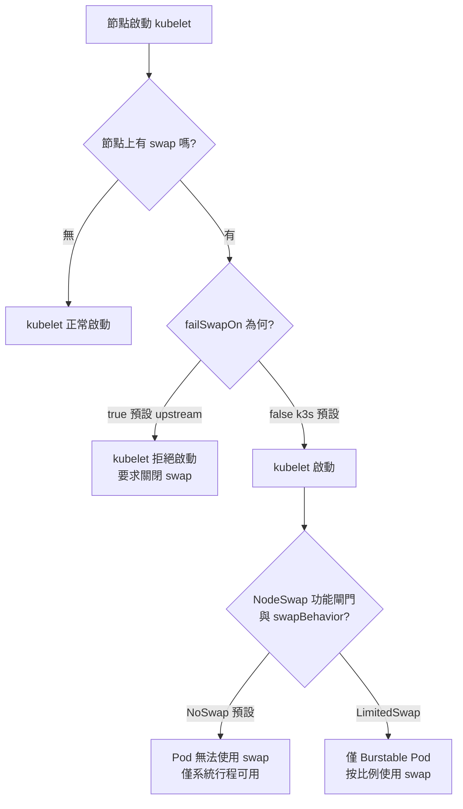

# 為何安裝 k3s 時要關閉 Swap？

## 摘要

許多 k3s（與 Kubernetes）安裝教學，例如 SyncBricks 的《Install a 3-Node HA Kubernetes (K3s) Cluster on Ubuntu Server 24.04》一文，會在主機基線設定（baseline）階段直接執行 `swapoff -a` 並註解掉 `/etc/fstab` 中的 swap 掛載行，並在註解中寫上「Disable swap (Kubernetes requirement)」[^syncbricks]。本文要回答的問題是：為什麼要這麼做？這個要求從何而來、是否仍然成立？

核心結論有四點：

1. 這是**上游 Kubernetes 的歷史設計決策**：kubelet 預設 `failSwapOn: true`，節點若偵測到 swap 就會拒絕啟動，因此教學必須先關掉 swap[^kubeletcfg][^failswap]。
2. 根本理由是**記憶體可預測性**：Kubernetes 的 QoS 保證、排程器、驅逐（eviction）機制全都建立在「容器記憶體使用量可被準確計算與限制」的前提上，而 swap 會破壞這個前提[^qos][^kep2400]。
3. **k3s 其實不強制關閉 swap**：k3s 長期在預設 kubelet 設定中寫死 `failSwapOn: false`，所以即使主機有 swap，k3s 伺服器仍能正常啟動[^k3sagent][^k3s8811]。教學要求關閉，是遵循上游最佳實務與 etdc／控制平面的效能考量，而非 k3s 的硬性限制。
4. 自 Kubernetes 1.34 起 `NodeSwap` 已進入 GA（預設開啟），但 **預設 swap 行為仍是 `NoSwap`**，且官方仍建議控制平面節點不要配置 swap[^nodeswap][^swapdoc]。

---

## 背景：這條指令出現在哪裡

SyncBricks 的教學在「Base OS Baseline」步驟要求：

```bash
# Disable swap (Kubernetes requirement)
swapoff -a
sed -i '/ swap / s/^/#/' /etc/fstab
free -h   # Swap should now be 0
```

該文並在「Common Join Errors」中再次強調：「Swap enabled — Must be **off** on every node（`free -h`）」[^syncbricks]。

值得注意的是，這篇文章在建構的是 **HA 控制平面**：三台 VM 同時擔任 control-plane 與 embedded etcd 成員[^syncbricks]。這一點對「為什麼這裡特別在意 swap」很重要，後文會解釋。

---

## 什麼是 swap

Swap 是作業系統把記憶體中不常使用的頁面（page）寫到磁碟、以便釋放實體記憶體（RAM）的機制[^swappiness]。它的好處是避免程式因實體記憶體不足而被殺掉；代價是**存取被換出的頁面時需要讀寫磁碟，速度比 RAM 慢好幾個數量級**，可能造成難以預期的效能劣化[^swapdoc][^kep2400]。

換句話說，swap 讓「可用記憶體」從一個固定的物理量，變成一個隨磁碟 I/O 與存取模式浮動的量。單機上這通常可接受，但對 Kubernetes 這種需要對資源做精確排程與保證的系統來說，就變成了問題。

---

## 核心原因一：QoS 保證與記憶體計算會失效

Kubernetes 早期的資源 QoS 設計文件就明白寫道：

> The current QoS policy assumes that swap is disabled. If swap is enabled, then resource guarantees (for pods that specify resource requirements) will not hold.[^qos]

意思是：Kubernetes 的資源保證（requests/limits）是以 **實體記憶體** 為基準計算的。若容器達到記憶體上限後還能繼續透過 swap 取得記憶體，那麼「Guaranteed」與「Burstable」等 QoS 類別的承諾就無法成立。設計文件進一步說明：兩個已達記憶體上限的 Guaranteed Pod，可以繼續消耗磁碟置換空間，一旦 swap 也耗盡，Pod 內的行程就可能被殺掉，節點必須把 swap 空間顯式納入計算，才能提供「可預測的隔離行為」[^qos]。

KEP-2400（Node Swap 的設計提案）在摘要中也重申了同樣的歷史立場：

> Kubernetes currently does not support the use of swap memory on Linux, as it is difficult to provide guarantees and account for pod memory utilization when swap is involved. As part of Kubernetes' earlier design, swap support was considered out of scope.[^kep2400]

因此 swap 從一開始就被視為「超出範圍」的功能，節點上偵測到 swap 時，最直接的防呆就是讓 kubelet 拒絕啟動。

---

## 核心原因二：排程器無法計算 swap

Kubernetes 排程器依據 Pod 的 `requests` 與節點可配置（allocatable）記憶體來決定把 Pod 放到哪裡。然而 Pod 並沒有「請求 swap」這個概念，官方文件因此明講：

> since swap allows for greater memory usage for workloads in Kubernetes that cannot be predictably accounted for, and due to unexpected packing configurations, the scheduler currently does not account for swap memory usage. This heightens the risk of noisy neighbors.[^swapdoc]

排程器看不見 swap，就會出現「以為節點還有空間、實際上早已靠 swap 撐著」的過度裝箱（over-packing），導致鄰居互相干擾（noisy neighbor）。KEP-2400 也把這列為已知限制[^kep2400]。

---

## 核心原因三：OOM／驅逐行為變得不可靠

Kubernetes 希望「節點真正耗盡記憶體、觸發 OOM killer 之前，就先由 kubelet 主動驅逐（evict）Pod」。這是因為 **OOM killer 不認識 Kubernetes**，不會考慮 QoS、Pod 優先序等 Kubernetes 專屬因素[^swapdoc]。

若啟用 swap，kubelet 的驅逐判斷會被打亂。KEP-2400 的 Drawbacks 段落指出：啟用 swap 後，有記憶體上限的容器會「較少被殺掉」，因為核心通常能回收更多記憶體；這雖然能避免崩潰，卻也可能**掩蓋容器達到記憶體上限的問題**[^kep2400]。

也就是說，swap 讓「記憶體壓力」這個訊號變得模糊，而 Kubernetes 的自我修復與驅逐邏輯正高度依賴這個訊號。

---

## 核心原因四：延遲與效能不可預測

官方 swap 管理文件寫道：

> Having swap available on a system reduces predictability. While swap can enhance performance by making more RAM available, swapping data back to memory is a heavy operation, sometimes slower by many orders of magnitude, which can cause unexpected performance regressions.[^swapdoc]

KEP-2400 同樣指出 swap 效能「有時慢上許多數量級」，會造成非預期的效能倒退[^kep2400]。對一般工作負載而言，這代表延遲抖動；對 **etcd** 這類對磁碟 `fsync` 延遲極度敏感的服務而言，則可能直接導致心跳逾時與 leader 變更[^etcdtuning]。這正是 HA 教學（SyncBricks 那篇即是三節點 embedded etcd）特別要求關閉 swap 的原因之一[^syncbricks]。

需要澄清的是：**etcd 官方文件本身並沒有「必須關閉 swap」的明文規定**。etcd 只在 FAQ 中建議「機器應有足夠 RAM 以避免 swap 或 OOM」[^etcdfaq]，並提供 `--memory-mlock` 旗標來鎖定 etcd 記憶體分頁、避免被置換[^etcdmlock]。真正明文建議「控制平面節點不要配置 swap」的是 Kubernetes 官方：

> The Kubernetes project recommends running control plane nodes without any swap space configured. The control plane primarily hosts Guaranteed QoS Pods, so swap can generally be disabled. The main concern is that swapping critical services on the control plane could negatively impact performance.[^swapdoc]

---

## 機制面：kubelet 的 `failSwapOn`

上述設計立場被落實為 kubelet 的一個設定項。`KubeletConfiguration` 中的 `failSwapOn`（舊稱命令列旗標 `--fail-swap-on`）定義為：

> failSwapOn tells the Kubelet to fail to start if swap is enabled on the node. Default: true[^kubeletcfg]

程式實作中，若未設定則強制為 `true`，而當節點偵測到 swap 且 `failSwapOn` 為 true 時，kubelet 會以如下訊息結束：

> running with swap on is not supported, please disable swap or set --fail-swap-on flag to false[^failswap]

這就是為什麼幾乎所有 Kubernetes 安裝教學都會「先關 swap 再說」——不是因為 swap 本身有錯，而是因為**不關的話 kubelet 根本不會啟動**，而且這是最省事的合規做法。



---

## 重要釐清：k3s 其實預設允許 swap

許多教學把「Disable swap (Kubernetes requirement)」當成通則，但**k3s 並不強制關閉 swap**。k3s 在其預設 kubelet 設定中將 `FailSwapOn` 明確設為 `false`[^k3sagent]。k3s 維護者 brandond 在 GitHub issue #8811 中表示：

> For as long as `fail-swap-on` has been an available kubelet arg, K3s has set this to false. We still set it to false today.[^k3s8811]

> K3s has always supported swap.[^k3s8811]

此外，k3s 官方 Requirements 頁面**完全沒有提到 swap**，swap 並非 k3s 的安裝前提條件[^k3sreq]。反倒是官方的 k3s-ansible 專案以「建議」（recommended）而非「要求」的語氣，建議受管理節點關閉防火牆與 swap[^k3sansible]。

這裡還有一個容易混淆的細節：**主機有 swap ≠ Pod 能使用 swap**。即使 `failSwapOn: false` 讓 k3s 節點帶著 swap 啟動，Pod 預設仍無法使用 swap，除非另外開啟 `NodeSwap` 功能閘門並設定 `memorySwap.swapBehavior`[^k3s8811][^k3s12678]。brandond 在討論串中對此說明：

> Just turning it on, and telling the kubelet not to fail if swap is enabled, doesn't actually make the pods use swap where they previously would not.[^k3s12678]

因此「關閉 swap」對 k3s 而言，實務上是**遵循上游最佳實務與效能考量**，而不是 k3s 層級的技術強制。

---

## 現在的情況：NodeSwap 已 GA，但預設仍不用 swap

Kubernetes 後來透過 KEP-2400 逐步加入 swap 支援，`NodeSwap` 功能閘門的生命週期為：1.22 Alpha、1.28 Beta（預設關閉）、1.30 Beta（預設開啟）、**1.34 GA（鎖定為預設開啟）**[^nodeswap]。使用時必須同時把 kubelet 的 `failSwapOn` 設為 `false`[^nodeswap]。

即便如此，**預設的 `swapBehavior` 仍是 `NoSwap`**：Pod 內的工作負載不能使用 swap，但 Kubernetes 範圍外的系統行程（例如系統守護行程）仍可使用 swap，藉此保護節點免於系統層級的記憶體尖峰[^swapdoc]。

三種 swap 行為的比較如下[^swapdoc][^kep2400]：

| swapBehavior | Pod 能否使用 swap | 說明 |
| --- | --- | --- |
| `NoSwap`（預設） | 否 | 僅 Kubernetes 範圍外的行程可用；保護節點系統層 |
| `LimitedSwap` | 部分 | 僅非高優先序的 Burstable Pod 可用，swap 量按 `(containerMemoryRequest / nodeTotalMemory) × totalPodsSwapAvailable` 計算 |
| `UnlimitedSwap`（Beta 2 已移除） | 是 | 曾被移除，因為工作負載可能耗盡所有 swap，使節點變得不健康 |

KEP-2400 對預設值的建議始終未變：

> Enabling Swap on nodes is a pretty advanced feature which requires tuning and knowledge of the kernel. We do not recommend swap on all nodes so we still suggest `--fail-swap-on=true` for most cases of Kubernetes.[^kep2400]

同時，`NodeSwap` 僅支援 **cgroup v2**；在 cgroup v1 系統上只能使用 `NoSwap`，也就是 Kubernetes 工作負載仍無法使用 swap[^kep2400]。

---

## 結論

「安裝 k3s 要關閉 swap」這個說法，拆解後有三層意義：

- **歷史與機制層**：上游 kubelet 預設 `failSwapOn: true`，有 swap 就拒絕啟動，所以關閉 swap 是最直接的合規做法[^failswap]。
- **設計原理層**：Kubernetes 的 QoS 保證、排程器與驅逐機制都假設「記憶體使用可被準確計算與限制」，swap 會讓這些機制失效、增加 noisy neighbor 風險、並引入數量級等級的延遲抖動[^qos][^swapdoc]。
- **k3s 實務層**：k3s 本身預設 `failSwapOn: false`、官方 Requirements 未列 swap 為前提，關閉 swap 是**建議**而非**強制**[^k3sagent][^k3sreq][^k3sansible]。對 HA 控制平面（含 embedded etcd）而言，關閉 swap 對效能穩定性的好處格外明顯[^swapdoc][^etcdtuning]。

即使 `NodeSwap` 已於 1.34 GA，官方仍建議控制平面節點不配置 swap、維持預設的 `NoSwap` 行為[^swapdoc][^nodeswap]。因此在可預見的未來，安裝指南繼續叫你 `swapoff -a` 仍屬合理的保守做法；但應理解它主要是**效能與可預測性的最佳實務**，而非 k3s 的硬性技術要求。

---

## 參考文獻

[^syncbricks]: SyncBricks. (2025). Install a 3-Node HA Kubernetes (K3s) Cluster on Ubuntu Server 24.04 Step-by-Step (Proxmox/VM Friendly). Retrieved 2026-10-11, from https://syncbricks.com/install-kubernetes-k3s-ubuntu-24-04-ha-cluster-guide/

[^qos]: Kubernetes. (n.d.). Resource Quality of Service in Kubernetes [Design proposal]. Retrieved 2026-10-11, from https://github.com/kubernetes/design-proposals-archive/blob/main/node/resource-qos.md

[^kep2400]: Kubernetes Enhancement Proposal. (n.d.). KEP-2400: Node memory swap support. Retrieved 2026-10-11, from https://github.com/kubernetes/enhancements/blob/master/keps/sig-node/2400-node-swap/README.md

[^swapdoc]: Kubernetes. (n.d.). Swap memory management. Retrieved 2026-10-11, from https://kubernetes.io/docs/concepts/cluster-administration/swap-memory-management/

[^nodeswap]: Kubernetes. (n.d.). NodeSwap [Feature gate reference]. Retrieved 2026-10-11, from https://kubernetes.io/docs/reference/command-line-tools-reference/feature-gates/

[^kubeletcfg]: Kubernetes. (n.d.). Kubelet configuration (v1beta1) — KubeletConfiguration. Retrieved 2026-10-11, from https://kubernetes.io/docs/reference/config-api/kubelet-config.v1/

[^failswap]: Kubernetes. (n.d.). pkg/kubelet/cm/container_manager_linux.go [Source code]. Retrieved 2026-10-11, from https://github.com/kubernetes/kubernetes/blob/master/pkg/kubelet/cm/container_manager_linux.go

[^k3sagent]: K3s. (n.d.). pkg/daemons/agent/agent.go [Source code]. Retrieved 2026-10-11, from https://github.com/k3s-io/k3s/blob/main/pkg/daemons/agent/agent.go

[^k3s8811]: K3s. (2023). 1.28 Enable swap support [Issue #8811]. Retrieved 2026-10-11, from https://github.com/k3s-io/k3s/issues/8811

[^k3s12678]: K3s. (2024). Kubernetes swap support [Discussion #12678]. Retrieved 2026-10-11, from https://github.com/k3s-io/k3s/discussions/12678

[^k3sreq]: K3s. (n.d.). Requirements. Retrieved 2026-10-11, from https://docs.k3s.io/installation/requirements

[^k3sansible]: K3s. (n.d.). k3s-ansible [README]. Retrieved 2026-10-11, from https://github.com/k3s-io/k3s-ansible

[^etcdfaq]: etcd. (n.d.). FAQ — System requirements. Retrieved 2026-10-11, from https://etcd.io/docs/v3.5/faq/

[^etcdmlock]: etcd. (n.d.). Configuration — --memory-mlock. Retrieved 2026-10-11, from https://etcd.io/docs/v3.7/op-guide/configuration/

[^etcdtuning]: etcd. (n.d.). Tuning. Retrieved 2026-10-11, from https://etcd.io/docs/v3.5/tuning/

[^swappiness]: Linux Kernel Organization. (n.d.). Documentation for /proc/sys/vm/ — swappiness. Retrieved 2026-10-11, from https://docs.kernel.org/admin-guide/sysctl/vm.html
