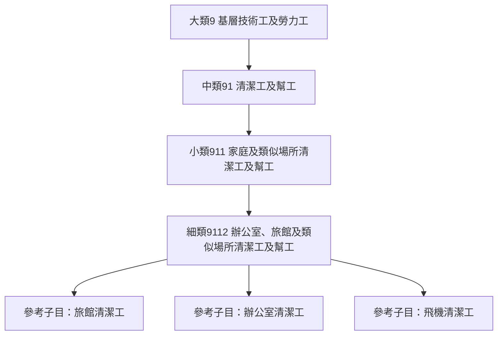
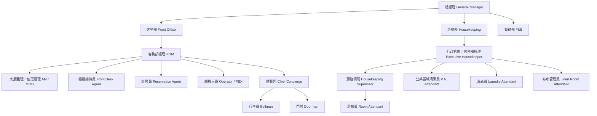
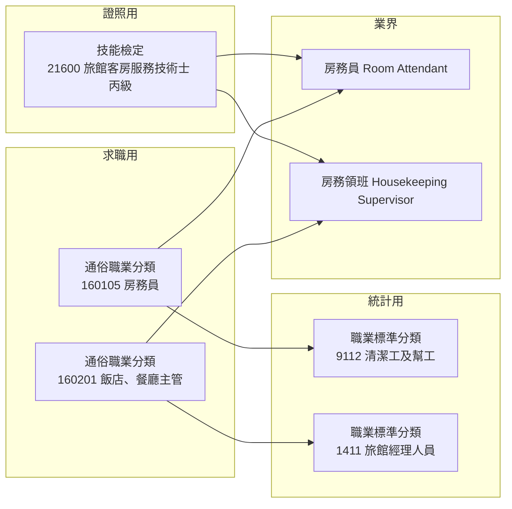

# 飯店從業人員與客房服務人員的職稱與正式職業名稱

本報告整理「飯店從業人員」（尤其是客房服務／房務人員）在不同體系下的正式職業名稱，涵蓋三個層次：

1. **官方統計分類**：行政院主計總處《中華民國職業標準分類》與勞動部「通俗職業分類」。
2. **技能檢定與證照**：勞動部勞動力發展署技能檢定中心所辦理的相關職類。
3. **業界職稱**：旅館實際組織架構中的中文職稱與對應英文職稱。
4. **國際對照**：國際勞工組織 ISCO-08 與美國 O*NET／SOC 的標準職業編碼。

一句話總結：**台灣並沒有單一「政府規定的飯店職稱總表」**。日常求職網站看到的「櫃檯服務人員」「房務員」屬於勞動部的**通俗職業分類**；而正式統計上的「職業標準分類」中，房務工作實際被歸類為清潔工，並非以「房務員」為正式名稱。

---

## 1. 台灣官方職業分類

### 1.1 行政院主計總處《中華民國職業標準分類》（第 6 次修訂）

現行版本為第 6 次修訂（民國 99 年 5 月公布，2010 年），採 10 大類、中類、小類、細類的四層架構，並與 ISCO 體系對齊[^statmain]。與旅宿業直接相關的分類如下：

| 層級 | 代碼 | 正式名稱 | 說明 |
|---|---|---|---|
| 大類 | 1 | 民意代表、主管及經理人員 | 主管職 |
| 中類 | 14 | 餐旅、零售及其他場所服務經理人員 | |
| 小類 | 141 | 旅館及餐廳經理人員 | |
| **細類** | **1411** | **旅館經理人員** | 從事規劃、指揮、協調及綜理旅館及其他住宿場所營運之人員[^stat1411] |
| 大類 | 4 | 事務支援人員 | |
| 小類 | 422 | 顧客資訊事務人員 | |
| **細類** | **4222** | **接待員及服務台事務人員** | 在辦公室、旅館及其他場所從事接待顧客與答覆詢問等工作之人員[^stat4222] |
| **細類** | **4223** | **總機人員** | 電話交換機操作 |
| 大類 | 5 | 服務及銷售工作人員 | |
| 細類 | 5139 | 其他餐飲服務人員 | 餐飲服務人員 |
| 大類 | 9 | 基層技術工及勞力工 | |
| 中類 | 91 | 清潔工及幫工 | |
| 小類 | 911 | 家庭及類似場所清潔工及幫工 | |
| **細類** | **9112** | **辦公室、旅館及類似場所清潔工及幫工** | 房務／客房清潔工作的正式歸類[^stat9112] |

**關鍵發現**：在《職業標準分類》中，**並不存在「旅館服務人員」或「房務員」這兩個正式名稱**。旅館的房間清潔工作在統計上被歸入 9112「辦公室、旅館及類似場所清潔工及幫工」，其工作內容明列「鋪床、清理浴室、補充毛巾、肥皂及相關用品」，且「參考子目」中包含**「旅館清潔工」**[^stat9112]。而「旅館經理人員」（1411）的參考子目則列出「飯店經理人員、汽車旅館經理人員、青年旅館經理人員」[^stat1411]。

下圖說明房務工作在官方分類中的位置：

### 1.2 勞動部勞動力發展署「通俗職業分類」

台灣就業通／Jobooks 工作百科系統使用的是另一套**通俗職業分類**，代碼為六碼，這才是求職網站上常見「櫃檯服務人員」「房務員」的來源[^jobooks16]。此系統同時將每個通俗職業對應到上表的標準職業編碼：

| 通俗職業代碼 | 正式名稱 | 職務內容（官方敘述） | 對應標準職業編碼 |
|---|---|---|---|
| 160104 | **櫃檯服務人員** | 在飯店／旅館櫃檯接待旅客，協助旅客辦理住房與退房的登記，並提供旅館、觀光等的諮詢服務[^jobooks160104] | 4222 接待員及服務台事務人員 |
| 160105 | **房務員** | 負責飯店／旅館內房間的打掃工作，協助整理房間清潔及補充消耗性用品[^jobooks160105] | 9112 辦公室、旅館及類似場所清潔工及幫工 |
| 160201 | **飯店、餐廳主管** | 掌管飯店或餐廳的整體營運，如菜單設計、採購、人員募集訓練、房務制度建立及管理房間安排事宜等[^jobooks160201] | 1411 旅館經理人員 |
| 160205 | **飯店工作人員** | 於旅館、飯店內從事提供顧客服務或維持旅館、飯店正常運作等工作[^jobooks160205] | 4222 接待員及服務台事務人員 |

「房務員」一職在 Jobooks 所列的**常見職務名稱**包括：房務員、房務人員、房務清潔人員、房務清潔員、飯店房務員、房務、房務清潔整理人員、房務領班、客房服務員、房務服務人員、客房清潔員等[^jobooks160105]。「櫃檯服務人員」的常見職務名稱則包括櫃檯人員、櫃檯接待員、櫃台人員、櫃檯接待人員等[^jobooks160104]。

> ⚠️ 因此，若要填寫「正式職業名稱」：
> - 求職、失業給付、職訓登記等場合 → 使用**通俗職業分類**：`160105 房務員`、`160104 櫃檯服務人員`。
> - 統計調查、普查等場合 → 使用**職業標準分類**：`9112 辦公室、旅館及類似場所清潔工及幫工`、`4222 接待員及服務台事務人員`。

---

## 2. 台灣的技能檢定與證照

勞動部勞動力發展署技能檢定中心並未設立以「房務」為名的獨立職類，而是以「旅館客房服務」與「餐旅服務」涵蓋。

| 職類代碼 | 證照名稱 | 開辦級別 | 工作範圍（官方敘述） |
|---|---|---|---|
| **21600** | **旅館客房服務技術士** | **僅丙級** | 培養旅館業客房部（Rooms Division）基層從業人員，配合實務技術，提昇其服務品質[^nabi21600] |
| **131** | **餐旅服務技術士** | 乙級（旅館項）、乙級（餐飲項）、丙級 | 培養餐旅業（旅館／餐飲）幹部及基層從業人員[^law131] |
| 21500 | 餐飲服務技術士 | 丙級、乙級 | 餐飲服務[^wdasec] |

- 「旅館客房服務技術士」於民國 102 年 5 月 14 日以勞中二字第 1020201754 號令發布，105 年 8 月 15 日修正[^nabi21600]。
- 官方簡章明載：「**『旅館客房服務技術士』僅辦理『丙級』技能檢定**」，並無乙級[^exam734]。
- 丙級「旅館客房服務」的英文名稱為 **Level C Technician for Hotel Rooms Division Service**（客房部＝Rooms Division）[^nabi21600]。政府對外的英文文宣另譯為 "Hotel Guest Room Service" Level C Technician Certificate[^roctaiwan]。
- 報考資格為年滿 15 歲或國民中學畢業；一般報檢費用 2,090 元[^nabi21600]。
- 術科測驗包含：房務車準備（7 分鐘）、兩張床鋪設與撤收（18 分鐘）、客房清潔與開夜床（15 分鐘）[^nabi21600]。

> 結論：**客房服務／房務人員最對口的國家級證照就是「旅館客房服務技術士（丙級）」，職類代碼 21600**；若想往幹部發展，則對應「餐旅服務技術士」乙級[^law131]。

相關民間證照還包括中華旅館經理人協會的「CHM 旅館管理專業人員銀階認證」、社團法人中華國際知客服務產業協會的「旅宿業經營專業人員（初階認證）」、台灣民宿協會的「BBB 民宿管家檢定認證」[^nabi21600]。

---

## 3. 業界職稱：部門組織與中英文對照

旅館實務上通常分為「客務部（Front Office）」與「房務部（Housekeeping）」兩大住宿相關部門，並常以「前場（Front of House）／後場（Back of House）」區分[^uptogo2]。

### 3.1 房務部（Housekeeping Department）

| 中文職稱 | 英文職稱 | 說明 |
|---|---|---|
| 行政管家／房務部經理／房務部總監 | Executive Housekeeper（EH）／Housekeeping Manager | 房務部門最高主管；「行政管家」為台灣與亞洲旅館常用詞[^kknews] |
| 副行政管家／助理管家 | Assistant Executive Housekeeper（AEH）／Assistant Housekeeper（AH） | |
| 房務主任／房務經理 | Housekeeping Supervisor／Housekeeping Manager | |
| 房務領班／樓層領班／樓層主任 | Housekeeping Supervisor／Floor Supervisor／Housekeeping Captain | 台灣職缺常見「房務部-樓層領班/主任 Housekeeping Captain & Supervisor」[^yes123] |
| **房務員／客房服務員／樓層服務員** | **Room Attendant（ATT）／Housekeeper／Housekeeping Attendant** | 最常見者為 Room Attendant[^uptogo3] |
| 公共區域清潔員／公清人員 | Public Area Attendant／Public Area Cleaner（P.A.） | 台灣職缺寫法為「公共區域清潔員 - Public Area Attendant」[^job104] |
| 洗衣員 | Laundry Attendant／Laundry Man | |
| 洗衣房主任／經理 | Laundry Supervisor／Laundry Manager | |
| 布巾管理員／布巾室人員 | Linen Room Attendant／Linen Keeper | 布巾室被稱為「房務部的心臟」[^uptogo2] |
| 制服收發員 | Uniform Room Attendant | |
| 客衣收發員 | Valet／Guest Laundry Attendant | |
| 裁縫員 | Seamstress | |
| 花房 | Florist | |

### 3.2 客務部（Front Office Department）

| 中文職稱 | 英文職稱 | 說明 |
|---|---|---|
| 客務部經理 | Front Office Manager（FOM） | |
| 客務部副理 | Assistant Front Office Manager（AFOM） | |
| **大廳副理** | Assistant Manager（AM）／Lobby Assistant Manager | 常兼處理客訴，故又稱「抱怨經理」[^uptogo2] |
| **值班經理** | Duty Manager（DM）／Manager On Duty（MOD） | 常與大廳副理職務重疊[^uptogo2] |
| 夜間經理 | Night Duty Manager | 23:00–07:00 現場最高主管 |
| 櫃檯主任／櫃檯組長 | Front Office Supervisor／Front Office Captain | |
| **櫃檯接待員** | **Front Desk Agent／Receptionist／Room Clerk** | 台灣教學講義採 Room Clerk／Receptionist[^khsh] |
| 櫃檯出納員 | Front Desk Cashier | |
| 夜間櫃檯接待員／夜間審計員 | Night Clerk／Night Auditor | |
| **訂房員** | Reservation Agent／Reservation Clerk（RESV） | |
| **總機／話務人員** | Operator／PBX | 被稱為「看不見的接待員」[^uptogo2] |
| **禮賓司** | Chief Concierge（CON） | 部門主管；個人則稱禮賓員 Concierge；「金鑰匙」為 Les Clefs d'Or[^uptogo2] |
| **行李員** | Bellman／Bellboy／Bellhop／Porter | 領班為 Bell Captain[^uptogo2] |
| **門房／門衛** | Doorman | 第一位迎接抵達旅客的人[^uptogo2] |
| 客務關係專員 | Guest Relations Officer（GRO） | |
| 商務中心接待員 | Business Center Clerk | |
| 機場接待員 | Airport Representative | |
| 代客停車員 | Valet／Parking Attendant | |

常見英文縮寫：F.O.＝Front Office、FOM＝Front Office Manager、AM/DM＝Assistant/Duty Manager、HSKP＝Housekeeping、EH＝Executive Housekeeper、ATT＝Room Attendant、P.A.＝Public Area、RESV＝Reservation、OPT＝Operator[^kknews]。

---

## 4. 國際標準分類對照

### 4.1 國際勞工組織 ISCO-08

ISCO-08 為四層架構（10 大類／43 次大類／130 小類／436 細類）[^isco08]，與旅宿業相關的細類如下：

| ISCO-08 編碼 | 正式名稱 | 對應職務 |
|---|---|---|
| 1411 | Hotel managers | 旅館經理人員（對應台灣 1411）[^sg1411] |
| 4224 | Hotel receptionists | 旅館櫃檯接待員[^sg4224] |
| 5151 | Cleaning and housekeeping supervisors in offices, hotels and other establishments | 房務領班[^sg5151] |
| 9112 | Cleaners and helpers in offices, hotels and other establishments | 房務員／客房清潔員[^sg9112] |
| 9621 | Messengers, package deliverers and luggage porters | 行李員[^sg9621] |
| 5131 | Waiters | 餐飲服務員[^sg5131] |

值得注意的是，ISCO-08 **沒有專屬「禮賓員（concierge）」的細類**[^isco08]。

### 4.2 美國 SOC／O*NET

| O*NET-SOC 編碼 | 正式名稱 | 對應台灣職稱 |
|---|---|---|
| 43-4081.00 | Hotel, Motel, and Resort Desk Clerks | 櫃檯接待員[^onet434081] |
| 37-2012.00 | Maids and Housekeeping Cleaners | 房務員[^onet372012] |
| 39-6011.00 | Baggage Porters and Bellhops | 行李員[^onet396011] |
| 39-6012.00 | Concierges | 禮賓員[^onet396012] |
| 11-9081.00 | Lodging Managers | 旅宿業經理[^onet119081] |
| 37-1011.00 | First-Line Supervisors of Housekeeping and Janitorial Workers | 房務領班[^onet371011] |
| 35-3031.00 | Waiters and Waitresses | 餐飲服務員[^onet353031] |

O*NET 官方對 37-2012.00 的敘述為：執行輕度清潔工作以維持私人住宅或商業機構（如旅館、醫院）之整潔，職務可能包含鋪床、補充布巾、清潔房間與走廊、吸塵等；其**樣本職稱**包含 Chambermaid、Guest Room Attendant（GRA）、Housekeeper、Room Cleaner 等[^onet372012]。43-4081.00 的樣本職稱則包含 Desk Clerk、Front Desk Agent、Guest Service Representative、Reservationist 等[^onet434081]。

> 台灣的 `9112` 與 ISCO-08 的 `9112` 以及美國的 `37-2012` 在概念上高度對應，都是「旅館客房清潔」的正式職業定位。

---

## 5. 三套名稱的關係圖

---

## 6. 直接回答

- **客房服務／房務人員的正式職業名稱**：
  - 求職登記用：**房務員**（通俗職業分類 160105），對應標準職業 **9112 辦公室、旅館及類似場所清潔工及幫工**。
  - 業界通用：**房務員／客房服務員**，英文 **Room Attendant（ATT）／Housekeeper**。
  - 國家證照：**旅館客房服務技術士（丙級）**，職類代碼 21600，英文 Level C Technician for Hotel Rooms Division Service。
  - 國際對照：ISCO-08 **9112**；美國 O*NET-SOC **37-2012.00 Maids and Housekeeping Cleaners**。
- **飯店從業人員的正式職業名稱**：
  - 主管：**旅館經理人員**（職業標準分類 1411）／通俗職業分類 **160201 飯店、餐廳主管**；英文 Lodging Managers。
  - 櫃檯：**櫃檯服務人員**（通俗職業分類 160104），對應標準職業 **4222 接待員及服務台事務人員**；英文 Front Desk Agent／Receptionist。

## 7. 來源反思

- **主計總處與勞動部資料互為官方，但用途不同**：職業標準分類是統計用途（對齊 ISCO），通俗職業分類是媒合用途（對齊職缺）。兩者對同一份工作給出不同名稱，是本主題最容易混淆之處，本報告已明確區分。
- **「房務員」在統計分類中不被視為獨立職業**，而是併入清潔工；這反映統計分類以「工作性質」而非「產業別」為分類邏輯，並非貶抑該職務。
- **業界職稱的中英文對照多來自旅館教學講義、職缺與業界整理**（如關西高中餐旅講義、uptogo 整理、104／1111 職缺），此類來源權威性低於政府文件，但因其直接反映實務用法仍具參考價值；本報告已標明其性質。
- **英文名稱並非唯一**：同一中文職稱在不同旅館可能對應不同英文（如房務員可為 Room Attendant 或 Housekeeper；旅館客房服務技術士的英文有 Rooms Division 與 Guest Room Service 兩種官方寫法），使用時宜註明語境。

---

## 參考文獻

[^statmain]: 行政院主計總處. (n.d.). 中華民國職業標準分類（第6次修訂）. Retrieved 2026-10-11, from https://www.stat.gov.tw/standardoccupationalclassification.aspx?n=3145&sms=0&rid=6

[^stat1411]: 行政院主計總處. (n.d.). 1411細類 旅館經理人員. In 中華民國職業標準分類. Retrieved 2026-10-11, from https://www.stat.gov.tw/StandardOccupationalClassificationContent.aspx?n=3145&sms=11196&RID=6&PID=MTQxMQ==&Level=4

[^stat4222]: 行政院主計總處. (n.d.). 4222細類 接待員及服務台事務人員. In 中華民國職業標準分類. Retrieved 2026-10-11, from https://www.stat.gov.tw/StandardOccupationalClassificationContent.aspx?n=3145&sms=11196&RID=6&PID=NDIyMg==&Level=4

[^stat9112]: 行政院主計總處. (n.d.). 9112細類 辦公室、旅館及類似場所清潔工及幫工. In 中華民國職業標準分類. Retrieved 2026-10-11, from https://www.stat.gov.tw/StandardOccupationalClassificationContent.aspx?n=3145&sms=11196&RID=6&PID=OTExMg==&Level=4

[^jobooks16]: 勞動部勞動力發展署. (n.d.). Jobooks工作百科系統：16 旅遊/餐飲/休閒. Retrieved 2026-10-11, from https://jobooks.taiwanjobs.gov.tw/News2.aspx?n=20&sms=8450

[^jobooks160104]: 勞動部勞動力發展署. (n.d.). 160104 櫃檯服務人員. In Jobooks工作百科系統. Retrieved 2026-10-11, from https://jobooks.taiwanjobs.gov.tw/News2_Content.aspx?n=199&s=1634

[^jobooks160105]: 勞動部勞動力發展署. (n.d.). 160105 房務員. In Jobooks工作百科系統. Retrieved 2026-10-11, from https://jobooks.taiwanjobs.gov.tw/News2_Content.aspx?n=20&s=1633

[^jobooks160201]: 勞動部勞動力發展署. (n.d.). 160201 飯店、餐廳主管. In Jobooks工作百科系統. Retrieved 2026-10-11, from https://jobooks.taiwanjobs.gov.tw/News2_Content.aspx?n=4&s=1629

[^jobooks160205]: 勞動部勞動力發展署. (n.d.). 160205 飯店工作人員. In Jobooks工作百科系統. Retrieved 2026-10-11, from https://jobooks.taiwanjobs.gov.tw/News2_Content.aspx?n=20&s=1625

[^nabi21600]: 104人力銀行. (n.d.). 丙級旅館客房服務技術士 Level C Technician for Hotel Rooms Division Service. In 104證照中心. Retrieved 2026-10-11, from https://nabi.104.com.tw/ability/10049335

[^exam734]: 百官網公職. (n.d.). 116年旅館客房服務技術士技能檢定簡章. Retrieved 2026-10-11, from https://www.examiner.com.tw/examInfo_detail.php?id=734

[^law131]: 勞動部. (n.d.). 技術士技能檢定餐旅服務職類規範（131）. Retrieved 2026-10-11, from https://laws.mol.gov.tw/Download.ashx?pfid=0000071162

[^wdasec]: 勞動部勞動力發展署技能檢定中心. (n.d.). 技能檢定規範. Retrieved 2026-10-11, from https://www.wdasec.gov.tw/News.aspx?n=51954D6AB42BECBF&sms=4C9F24535BA50B1F

[^roctaiwan]: Taipei Economic and Cultural Office in the Philippines. (n.d.). Hotel Guest Room Service Level C Technician Certificate. Retrieved 2026-10-11, from https://www.roc-taiwan.org/ph_en/post/11537.html

[^uptogo2]: UpToGo. (2026). 飯店有哪些部門？. Retrieved 2026-10-11, from https://uptogo.com.tw/職場/飯店有哪些部門？/

[^uptogo3]: UpToGo. (2026). 房務員是什麼？. Retrieved 2026-10-11, from https://uptogo.com.tw/職場/職業/房務員是什麼？/

[^khsh]: 新竹縣立關西高級中學. (n.d.). 旅館業組織及從業人員之職掌. Retrieved 2026-10-11, from https://www.khsh.hcc.edu.tw/ischool/publish_page/220/?cid=13481

[^kknews]: 每日頭條. (n.d.). 酒店各部門職稱中英文對照一覽表. Retrieved 2026-10-11, from https://kknews.cc/zh-tw/news/4k6bjvg.html

[^job104]: 104人力銀行. (n.d.). 公共區域清潔員 - Public Area Attendant（職缺）. Retrieved 2026-10-11, from https://www.104.com.tw/job/747vb

[^yes123]: yes123求職網. (2026). 房務部樓層領班 Housekeeping Floor Supervisor（職缺）. Retrieved 2026-10-11, from https://www.yes123.com.tw/wk_index/job.asp

[^isco08]: International Labour Organization. (n.d.). International Standard Classification of Occupations (ISCO-08). Retrieved 2026-10-11, from https://isco.ilo.org/en/

[^sg1411]: SG Code. (n.d.). ISCO-08 1411 Hotel managers. Retrieved 2026-10-11, from https://sg-code.com/isco/1/14/141/1411/

[^sg4224]: SG Code. (n.d.). ISCO-08 4224 Hotel receptionists. Retrieved 2026-10-11, from https://sg-code.com/isco/4/42/422/4224/

[^sg5151]: SG Code. (n.d.). ISCO-08 5151 Cleaning and housekeeping supervisors in offices, hotels and other establishments. Retrieved 2026-10-11, from https://sg-code.com/isco/5/51/515/5151/

[^sg9112]: SG Code. (n.d.). ISCO-08 9112 Cleaners and helpers in offices, hotels and other establishments. Retrieved 2026-10-11, from https://sg-code.com/isco/9/91/911/9112/

[^sg9621]: SG Code. (n.d.). ISCO-08 9621 Messengers, package deliverers and luggage porters. Retrieved 2026-10-11, from https://sg-code.com/isco/9/96/962/9621/

[^sg5131]: SG Code. (n.d.). ISCO-08 5131 Waiters. Retrieved 2026-10-11, from https://sg-code.com/isco/5/51/513/5131/

[^onet434081]: National Center for O*NET Development. (n.d.). 43-4081.00 - Hotel, Motel, and Resort Desk Clerks. In O*NET OnLine. Retrieved 2026-10-11, from https://www.onetonline.org/link/summary/43-4081.00

[^onet372012]: National Center for O*NET Development. (n.d.). 37-2012.00 - Maids and Housekeeping Cleaners. In O*NET OnLine. Retrieved 2026-10-11, from https://www.onetonline.org/link/summary/37-2012.00

[^onet396011]: National Center for O*NET Development. (n.d.). 39-6011.00 - Baggage Porters and Bellhops. In O*NET OnLine. Retrieved 2026-10-11, from https://www.onetonline.org/link/summary/39-6011.00

[^onet396012]: National Center for O*NET Development. (n.d.). 39-6012.00 - Concierges. In O*NET OnLine. Retrieved 2026-10-11, from https://www.onetonline.org/link/summary/39-6012.00

[^onet119081]: National Center for O*NET Development. (n.d.). 11-9081.00 - Lodging Managers. In O*NET OnLine. Retrieved 2026-10-11, from https://www.onetonline.org/link/summary/11-9081.00

[^onet371011]: National Center for O*NET Development. (n.d.). 37-1011.00 - First-Line Supervisors of Housekeeping and Janitorial Workers. In O*NET OnLine. Retrieved 2026-10-11, from https://www.onetonline.org/link/summary/37-1011.00

[^onet353031]: National Center for O*NET Development. (n.d.). 35-3031.00 - Waiters and Waitresses. In O*NET OnLine. Retrieved 2026-10-11, from https://www.onetonline.org/link/summary/35-3031.00
