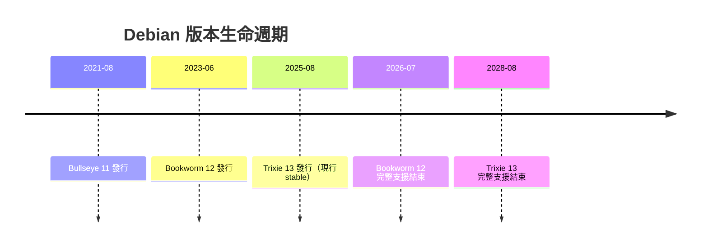
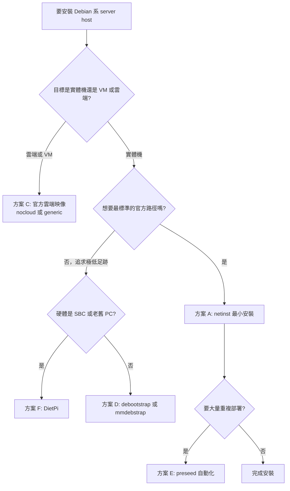

# 如何安裝輕量級的 Debian 系作業系統作為 Server Host

## 摘要

本報告回答一個具體的實務問題：**如何取得並安裝一套「輕量級、屬於 Debian 家族」的作業系統，並把它當作伺服器主機（server host）使用**。

「輕量級」在此有兩層意思：

1. **安裝映像本身輕量**：下載檔小、安裝流程短、不需要圖形介面。
2. **執行期足跡輕量**：開機後常駐行程少、記憶體佔用低、磁碟佔用小、可攻擊面（attack surface）小。

本報告先說明 Debian 家族的版本現況，再逐一介紹七條可行路徑（官方最小安裝、mini.iso、雲端映像、debootstrap/mmdebstrap、preseed 自動化、DietPi、Devuan），並補充 Ubuntu Server 與 Proxmox VE 作為「以 Debian 為底的主機平台」選項。最後給出安裝後的必要加固步驟與決策樹。

---

## 1. 背景：Debian 家族的版本現況

在選擇任何方案之前，必須先確認「你要裝的是哪一個 Debian 版本」。撰寫本報告時（2026-10-11）的狀態如下：

| 版本 | 代號 | 狀態 | 首次發行 | 完整支援結束（EOL） |
|---|---|---|---|---|
| 15 | Duke | 已公布代號，尚未發行 | — | — |
| 14 | Forky | testing（無預定發行日） | — | — |
| 13 | **Trixie** | **現行 stable**（最新更新 13.7，2026-09-12） | 2025-08-09 | 2028-08-09 |
| 12 | Bookworm | 現行 oldstable | 2023-06-10 | 2026-07-11 |
| 11 | Bullseye | oldoldstable，LTS 中 | 2021-08-14 | 2024-08-14 |

Debian 每個版本的生命週期為五年：前三年完整支援，後兩年為長期支援（LTS）[^releases][^releaseswiki]。

> **關鍵提醒**：網路上大量教學仍以「Debian 12 Bookworm = stable」為前提撰寫。2026 年的正確答案是 **Debian 13 Trixie = stable**，Bookworm 已是 oldstable 且已於 2026-07-11 結束完整支援[^releases]。挑選教學文件時務必確認其對應版本。



---

## 2. 方案總覽與比較

| 方案 | 適用情境 | 產出大小／足跡 | 難度 |
|---|---|---|---|
| **A. Debian netinst 最小安裝** | 單機實體機／VPS 一次性安裝 | Trixie 最小 base 647 MB | 低 |
| **B. Debian mini.iso（netboot）** | 需要更小下載、或想選非 stable 套件 | ISO 約 64 MB | 中 |
| **C. Debian 官方雲端映像** | VM／OpenStack／雲端主機 | qcow2 326–415 MB | 低 |
| **D. debootstrap / mmdebstrap** | 從既有 Linux 交叉安裝、容器、chroot | 可低於 647 MB | 高 |
| **E. preseed 自動化安裝** | 大量機器、可重現部署 | 同方案 A | 中高 |
| **F. DietPi** | SBC、舊電腦、極低資源主機 | 磁碟約 630–1055 MB、RAM 42–296 MiB | 低 |
| **G. Devuan** | 不想用 systemd 的 Debian 使用者 | netinstall ISO 594 MB | 低 |
| **H. Ubuntu Server minimal** | 想要 Canonical 生態、`unminimize` 可逆 | ISO 2.7 GB／minimal 映像約 227 MiB | 低 |
| **I. Proxmox VE** | 要把主機當虛擬化平台 | ISO 1.71 GB | 中 |

選擇邏輯：



---

## 3. 方案 A：Debian 官方 netinst 最小安裝（預設推薦）

這是 Debian 專案自己推薦的最小伺服器安裝法。官方定義為「單張 CD 就能安裝整個作業系統，其中只包含安裝 base system 所需的最小軟體量，其餘套件透過網路取得」[^netinst]。

### 3.1 取得映像

現行 stable（13.7）的 netinst 映像[^netinst][^cdimage]：

- amd64：`https://cdimage.debian.org/debian-cd/current/amd64/iso-cd/debian-13.7.0-amd64-netinst.iso`（約 756 MB）
- arm64：`https://cdimage.debian.org/debian-cd/current/arm64/iso-cd/debian-13.7.0-arm64-netinst.iso`
- 其他架構：armhf、ppc64el、riscv64、s390x 位於同層目錄

> 注意：本映像同時包含非自由（non-free）韌體，以支援依賴專有驅動的硬體，這是此映像建置的既定設計[^cdimage]。

若要安裝 **testing（Forky）**，需改用每日建置映像[^netinst]。

### 3.2 硬體最低需求

Debian 官方建議的最低需求如下（此表為「不安裝桌面」的情境）[^hwreq]：

| 安裝型態 | RAM（最低） | RAM（建議） | 硬碟 |
|---|---|---|---|
| 無桌面（No desktop） | 512 MB | 1 GB | 4 GB |
| 含桌面（With Desktop） | 1 GB | 2 GB | 10 GB |

補充官方說明[^hwreq]：

- 「無桌面」的數字假設使用**文字模式安裝程式**，而非圖形安裝程式。
- 在啟用 swap 的前提下，實際最低可到約 350 MB RAM。
- **支援圖形安裝程式的映像需要更多記憶體，記憶體低於 780 MB 的機器不應使用**；若可在文字與圖形安裝程式間選擇，此類機器應選文字版。
- 可透過開機參數 `lowmem=1` 或 `lowmem=2` 手動強制低記憶體模式[^hwreq]。

### 3.3 寫入 USB 隨身碟

i386、amd64、arm64 的 Debian 映像皆採用 isohybrid 技術，可直接寫入 USB 隨身碟並由 BIOS/UEFI 開機。Linux 上可使用[^cdfaq]：

```
cp <file> <device>
```

或

```
sudo dd if=<file> of=<device> bs=16M status=progress oflag=sync
```

其中 `<device>` 是 USB 裝置（例如 `/dev/sda`）。官方明確警告必須確認裝置名稱正確，因為此指令同樣能輕易覆寫硬碟。此外，**Debian 建議不要使用 unetbootin**，它可能導致難以診斷的開機與安裝問題[^cdfaq]。Windows 使用者官方推薦 balenaEtcher 或 USBImager[^cdfaq]。

### 3.4 安裝流程（最小化的關鍵步驟）

安裝程式各階段的細節見官方安裝手冊第六章[^installer]。與「輕量化」最相關的是**軟體選擇**階段：

到 *Selecting and Installing Software* 畫面時會列出 task 清單。在標準介面中，**使用空白鍵切換選取**[^installer]：

- **取消勾選「Desktop environment」**：它預設是**被勾選的**，且預設安裝 GNOME[^installer][^diskspace]。
- **勾選「SSH server」**：約 21 MB 安裝大小（下載約 3 MB），安裝 `openssh`，讓機器可遠端連線[^installer][^diskspace]。
- **關於「Standard system utilities」**：它會安裝所有 priority 為 `standard` 的套件。官方原文警告：「除非你知道自己在做什麼、且真的想要一個極精簡的系統，否則你應該保持這個 task 被選取。」[^installer]

換言之：

- 想要**保守、安全**的最小系統 → 保留 `standard`，只取消 desktop、加上 SSH server。
- 想要**極致足跡最小** → 連 `standard` 一起取消。代價是許多慣用工具都不存在，需自行安裝。

其他實用選項[^installer]：

- **不設定 root 密碼**：此時 root 帳號會被停用，安裝程式改為安裝 `sudo` 套件，並讓第一個建立的普通使用者可使用 sudo 執行管理任務。這是比「設 root 密碼並直接用 root」更好的預設。
- **`lowmem` 模式**：低記憶體時安裝程式會自動停用翻譯、僅載入必要元件，並建議建立 1–2 GB 的 swap 分割區[^installer]。
- **`network-console`**：可從安裝選單載入此元件，改用 SSH 遠端完成大部分安裝流程（需先在本機完成網路設定）[^installer]。

### 3.5 磁碟佔用實測值（官方數據）

官方 Appendix D.2 提供安裝後的實際磁碟用量（已刪除暫存檔，且**不含檔案系統本身的 overhead，例如 journal**）[^diskspace]：

**Debian 13 Trixie（amd64）**：

| 項目 | 數值 |
|---|---|
| 標準安裝（含所有 standard 套件、預設核心） | **843 MB** |
| 最小 base 安裝（**未**勾選 Standard system utilities） | **647 MB** |
| SSH server task | 21 MB 安裝（3 MB 下載） |
| Web server task | 116 MB 安裝（26 MB 下載） |

**Debian 12 Bookworm（amd64）**（供對照）[^diskspacebookworm]：

| 項目 | 數值 |
|---|---|
| 標準安裝 | 1242 MB |
| 最小 base 安裝（無 Standard system） | 1012 MB |
| SSH server task | 21 MB 安裝（3 MB 下載） |

debootstrap 附錄亦重複了同樣的數字：Trixie 純 console 安裝約 647 MB，Bookworm 約 1012 MB[^debootstrapdoc]。

> **規劃提醒**：這些數字是「安裝完成後」的淨用量，且不含檔案系統 overhead。這代表**安裝期間**與**日常使用**都會需要顯著更多空間。官方針對 `/var` 的建議是通常至少配置 200 MB，因為 dpkg 的套件資訊本身就可能佔用約 40 MB，且 apt 會先把下載的套件放在此處[^hwreq]。

### 3.6 引導式分割方案的空間門檻

若使用引導式分割（guided partitioning），不同方案需要的最小可用空間不同[^installer]：

| 分割方案 | 最小空間 | 建立的分割區 |
|---|---|---|
| 全部放在單一分割區 | 8 GB | `/`、swap |
| `/home` 獨立 | 9 GB | `/`、`/home`、swap |
| `/home`、`/var`、`/tmp` 皆獨立 | 12 GB | `/`、`/home`、`/var`、`/tmp`、swap |
| `/srv` 與 `/var` 獨立；swap 限 1 GB（**伺服器用**） | 8 GB | `/`、`/srv`、`/var`、swap |
| 小磁碟專用 | 3 GB | `/`、swap |

若可用空間不足約 3 GB，引導式分割會失敗[^installer]。使用 (encrypted) LVM 時，安裝程式會額外建立獨立的 `/boot` 分割區；EFI 模式下還會建立 EFI System Partition（ESP）[^installer]。

---

## 4. 方案 B：mini.iso（netboot 網路開機映像）

如果 netinst 的 756 MB 仍嫌太大，Debian 鏡像站上提供 `mini.iso`，位於[^minisio]：

```
https://deb.debian.org/debian/dists/trixie/main/installer-amd64/current/images/netboot/mini.iso
```

實測大小約 **64 MB**（同目錄另有 `netboot.tar.gz` 約 53 MB、`pxelinux.0` 等 PXE 開機所需檔案）[^minisio]。

`mini.iso` 的特點與注意事項[^cdfaq][^netinst]：

- 它**不在官方 netinst 清單中**，只在鏡像的 `netboot` 目錄下，因此不是「一般使用者」路徑。
- 官方 FAQ 提到，若想安裝 unstable（sid），可用 netboot 的 `mini.iso`，並在安裝時選 *Advanced options → Expert install*，於「Choose a mirror of the Debian archive」步驟選擇版本。
- 適合：PXE 網路開機環境、需要極小開機映像、或想安裝非 stable 套件的進階使用者。

PXE 環境下，同目錄的 `netboot.tar.gz` 與 `pxelinux.cfg/` 可直接作為 TFTP 根目錄使用[^minisio]。

---

## 5. 方案 C：Debian 官方雲端映像（VM／雲端主機最省事）

Debian Cloud Team 提供預先建置的最小化映像，**完全不需要跑安裝程式**，開機即是可用的輕量系統[^cloud]。

### 5.1 映像種類

| 種類 | 說明 | 適用 |
|---|---|---|
| `generic` | 使用 cloud-init，可跑在 OpenStack、DigitalOcean、bare metal | 通用 |
| `genericcloud` | 與 `generic` 相同，但核心含較少硬體驅動，因此較小 | 雲端、驅動需求單純 |
| `nocloud` | **不執行 cloud-init，直接開到 root shell** | 本機 QEMU／VM 手動操作 |
| `ec2`、`azure`、`raspi` | 各供應商／平台最佳化 | 對應平台 |

官方說明：`genericcloud` 若不符合使用情境，就應該改用 `generic`[^cloud]。

### 5.2 檔案大小（trixie/latest 實測）

Trixie 最新映像目錄中的 amd64 檔案大小[^cloudtrixie]：

| 檔案 | 大小 |
|---|---|
| `debian-13-generic-amd64.qcow2` | 415 MB |
| `debian-13-genericcloud-amd64.qcow2` | 326 MB |
| `debian-13-nocloud-amd64.qcow2` | 388 MB |
| `debian-13-generic-amd64.raw` | 3.0 GB |
| `debian-13-generic-amd64.tar.xz` | 307 MB |
| `debian-13-genericcloud-amd64.tar.xz` | 219 MB |
| `debian-13-nocloud-amd64.tar.xz` | 291 MB |

arm64、ppc64el、riscv64 亦有對應檔案；另有 `SHA512SUMS` 供校驗[^cloudtrixie]。

### 5.3 匯入 OpenStack（官方範例）

```
openstack image create \
    --container-format bare \
    --disk-format qcow2 \
    --property hw_disk_bus=scsi \
    --property hw_scsi_model=virtio-scsi \
    --property os_type=linux \
    --property os_distro=debian \
    --property os_admin_user=debian \
    --file debian-13-generic-amd64.qcow2 debian-13-generic-amd64.qcow2
```

官方解釋：`hw_disk_bus=scsi` 與 `hw_scsi_model=virtio-scsi` 會選用 virtio-scsi 驅動而非 virtio-blk，較佳（在較舊的 QEMU 上 virtio-blk 不支援 FSTRIM）；`os_type`、`os_distro`、`os_version`、`os_admin_user` 是 OpenStack 標準屬性，建議設定以利使用者過濾[^cloud]。

### 5.4 驗證下載

官方建議：對現行映像，最安全的方法是**透過 TLS** 從 `cloud.debian.org` 或 `cdimage.debian.org` 下載映像與 checksum 檔。這兩個名稱支援 DNSSEC，因此驗證型解析器可確保連到的是 Debian 主機，而 TLS 確保傳輸過程未被竄改[^cloud]。

---

## 6. 方案 D：debootstrap 與 mmdebstrap（從既有 Linux 建立）

### 6.1 debootstrap

官方安裝手冊明確指出，debootstrap 是「Debian 安裝程式所使用的工具，也是公認安裝 Debian base system 的官方方法」。它只需要 `wget`、`ar`、`/bin/sh` 與基本 Unix 工具[^debootstrapdoc]。

基本用法（Trixie，現行版本 1.0.141）[^debootstrapdoc][^debootstrapman]：

```
/usr/sbin/debootstrap --arch ARCH trixie \
     /mnt/debinst http://ftp.us.debian.org/debian
```

`SUITE` 參數可以是發行代號（`sid`、`trixie` 等）或符號名稱（`unstable`、`testing`、`stable`、`oldstable`）[^debootstrapman]。`MIRROR` 可以是 `http://`、`https://`、`file:///` 或 `ssh://` URL；注意 `file:/` 會被轉換為正規的 `file:///`，而 `file://` **不會**運作[^debootstrapman]。

**variant 選項**（這是控制「有多小」的主要旋鈕）[^debootstrapman]：

| variant | 內容 |
|---|---|
| `minbase` | 僅 `required` 套件加上 apt（最精簡） |
| `buildd` | 加入 build-essential |
| `fakechroot` | 不需要 root 權限 |
| （未指定） | 預設：priority 為 `required` 與 `important` 的所有套件，含 apt |

debootstrap 不負責安裝開機引導程式。完成後需 chroot 進去、設定 `/etc/fstab`、網路（`/etc/network/interfaces`、`/etc/resolv.conf`、`/etc/hostname`、`/etc/hosts`）、apt sources、locale、核心與 GRUB，並安裝 `ssh`[^debootstrapdoc]。官方也提醒：由於此流程高度手動，「你無法期待產出的系統與正常安裝的系統完全相同」，且此程序只涵蓋基本步驟，額外的安裝／設定步驟可能仍需要[^debootstrapdoc]。

官方提供的完善化指令[^debootstrapdoc]：

```
# tasksel install standard
# apt clean
```

前者安裝所有 `standard` priority 的套件，後者清掉 `/var/cache/apt/archives/` 中已下載的套件以釋放空間。

### 6.2 mmdebstrap（較新的替代品）

mmdebstrap 是 debootstrap 的替代工具，其標語為「multi-mirror Debian chroot creation」。**核心差異在於它內部使用 apt 解析相依性**，因此取得 debootstrap 沒有的能力[^mmdebstrap]。

相對於 debootstrap 的優勢[^mmdebstrap]：

- 支援**多個 mirror**（apt 式相依解析）
- 對 Debian stable chroot **預設納入 security 與 updates mirror**（這是 debootstrap 自 2009 年以來的 wontfix）
- **快約兩倍**（範例：`apt` variant chroot 約 11 秒）
- 在設定 `$SOURCE_DATE_EPOCH` 時可產出**逐位元可重現**的輸出
- 可透過 Linux user namespace 或 fakechroot **以非特權身分執行**
- 支援用 qemu-user 建立**外國架構** chroot

限制[^mmdebstrap]：

- **只能在已安裝 apt 的系統上執行**（Debian 及其衍生版），因此永遠無法完全取代 debootstrap
- 沒有 `SCRIPT` 參數（改用 hooks）
- 不存在這些選項：`--second-stage`、`--exclude`、`--resolve-deps`、`--force-check-gpg`、`--merged-usr`、`--no-merged-usr`、`--cache-dir`

**variant 一覽**（所有 variant 都含直接與間接硬相依，但不含 recommends）[^mmdebstrap]：

| variant | 安裝的套件集 |
|---|---|
| `extract` | 預設不安裝任何套件（連 `Essential:yes` 都不裝）；`--include` 的套件只解開不安裝 |
| `custom` | 預設不裝任何套件；`--include` 的套件會**被安裝** |
| `essential` | 僅 `Essential:yes` 套件 |
| `apt` | `essential` + apt |
| `required`、`minbase` | `essential` + 所有 `Priority:required` |
| `buildd` | `essential` + apt + build-essential |
| `important`、`debootstrap`、`-` | `required` + 所有 `Priority:important`（**這是 debootstrap 的預設**） |
| `standard` | `important` + 所有 `Priority:standard` |

現行版本為 **1.6.0**（2026-10-03 發行）；Debian stable（Trixie）套件版本為 `1.5.7-1+deb13u1`[^mmdebstrap]。

實用範例（含「去蕪存菁」縮小足跡的作法）[^mmdebstrap]：

```
# 僅 Essential:yes + apt 的極精簡 chroot
mmdebstrap --variant=apt unstable chroot.tar

# stable chroot（自動加入 security 與 updates mirror）
mmdebstrap stable stable-chroot.tar

# 移除 man page、locale、doc 以縮小 chroot
mmdebstrap --variant=essential \
    --dpkgopt='path-exclude=/usr/share/man/*' \
    --dpkgopt='path-include=/usr/share/man/man[1-9]/*' \
    --dpkgopt='path-exclude=/usr/share/locale/*' \
    --dpkgopt='path-include=/usr/share/locale/locale.alias' \
    --dpkgopt='path-exclude=/usr/share/doc/*' \
    --dpkgopt='path-include=/usr/share/doc/*/copyright' \
    --dpkgopt='path-include=/usr/share/doc/*/changelog.Debian.*' \
    unstable debian-unstable.tar
```

---

## 7. 方案 E：preseed 全自動最小安裝

preseed 是 debian-installer 的自動化機制，官方文件為安裝手冊 **Appendix B**，範例設定檔位於[^preseed][^preseedcontents]：

```
https://www.debian.org/releases/trixie/example-preseed.txt
```

與最小伺服器相關的片段[^preseedcontents]：

```
# 套件選擇
#tasksel tasksel/first multiselect standard, web-server, kde-desktop
# 或者完全不顯示 tasksel 對話框（不透過 tasksel 安裝任何東西）：
#d-i pkgsel/run_tasksel boolean false

# 個別額外套件
#d-i pkgsel/include string openssh-server build-essential
#d-i pkgsel/upgrade select none

# Base system
#d-i base-installer/install-recommends boolean false   # 僅限進階使用者
#d-i base-installer/kernel/image string linux-image-686
```

可用 task 名稱包含 `standard`、`desktop`、`gnome-desktop`、`xfce-desktop`、`kde-desktop`、`cinnamon-desktop`、`mate-desktop`、`lxde-desktop`、`web-server`、`ssh-server`[^preseed]。

載入 preseed 檔的方式（開機參數）[^preseed]：

- netboot：`preseed/url=http://host/path/to/preseed.cfg`（別名 `url=`）
- remastered ISO：`preseed/file=/cdrom/preseed.cfg`
- USB：`preseed/file=/hd-media/preseed.cfg`
- task 別名：`tasks` → `tasksel:tasksel/first`，例如 `tasks=standard,ssh-server`
- 自動模式：開機選「Automated install」／`auto` 項目，或加上 `auto=true priority=critical`
- 也可由 DHCP 伺服器引導（vendor-class 為 "d-i"）指向 preseed 檔

Debian 官方建議「永遠包含 `standard` task」，但若追求最極簡系統，就是把它省略[^preseed]。

---

## 8. 方案 F：DietPi（極輕量的 Debian 衍生版）

### 8.1 定位

DietPi 官方定義為「**高度最佳化且極簡的 Debian 系 Linux 發行版**，核心極度輕量，同時安裝與使用極度簡單」[^dietpidocs]。它主要針對單板電腦（Raspberry Pi、Odroid、Orange Pi、PINE64、Radxa 等），也可跑在 x86_64 PC、虛擬機與容器上；並提供選單驅動的 `dietpi-software` 工具，可安裝並預先最佳化常見軟體（Nextcloud、Pi-hole、Plex、LAMP/LEMP、VPN、桌面等），裝好即可用[^dietpidocs]。

### 8.2 Debian 基底與版本

DietPi 是建構在 Debian 之上[^dietpidocs]：

- **預設／穩定**：Debian 13（Trixie）——官方推薦
- **oldstable**：Debian 12（Bookworm）
- **testing**：Debian 14（Forky）

Ubuntu **明確不支援**。此外，DietPi 提供 `dietpi-installer` 腳本，可把任何既有的「臃腫」Debian／Raspbian 安裝轉換成輕量 DietPi 系統[^dietpidocs]。

### 8.3 輕量程度（官方實測數據）

DietPi 官方比較頁以 2026 年的 Trixie 映像實測[^dietpistats]：

| 裝置 | DietPi RAM | DietPi 磁碟 | DietPi 套件數 | 對照組 |
|---|---|---|---|---|
| Raspberry Pi Zero W | **42 MiB** | **702 MiB** | 215 | Raspberry Pi OS Lite：96 MiB／2378 MiB／664 pkgs |
| Raspberry Pi 5 | 152 MiB | 894 MiB | 251 | Armbian minimal：186 MiB／1148 MiB；RPi OS Lite：240 MiB／2639 MiB |
| Odroid XU4 | 110 MiB | 642 MiB | 197 | Armbian minimal：153 MiB／1320 MiB |
| NanoPi R76S | 296 MiB | 630 MiB | 196 | Armbian minimal：376 MiB／1475 MiB |

以 Raspberry Pi Zero W 為例，DietPi 使用 **42 MiB RAM**（對比 Raspberry Pi OS Lite 的 96 MiB，低 44%）、**702 MiB 磁碟**（對比 2378 MiB，約 30%）；下載大小約 178 MiB 對 497 MiB[^dietpistats]。

官方另提供一個與 Debian netinst 的對照（Bookworm、x86_64 UEFI PC，2024-05-31）：在 Debian 安裝程式中「所有項目皆取消勾選，只留下 SSH server 與 common system utilities」的情況下，DietPi 為 296 MiB RAM／1055 MiB 磁碟／237 套件，Debian 為 357 MiB RAM／1787 MiB 磁碟／357 套件[^dietpistats]。

> **對照組的詮釋**：DietPi 官方自己也提醒「這不代表 DietPi 比其他發行版更好」，只是其 base image 更輕；其他專案（如 Armbian）把重心放在自有建置系統、核心開發與硬體支援上[^dietpistats]。換言之，選 DietPi 是用「與 Debian 上游的距離」換取足跡。此頁數據亦標註為 2024–2026 年間分批測得，硬體與軟體世代不同，不宜直接跨列比較。

### 8.4 硬體需求

官方安裝前置需求[^dietpiinstall]：

- 一台受支援的 SBC 或 PC（Raspberry Pi、Odroid 等，或 x86_64 PC／VM）
- 一張至少 **4 GiB** 的 SD 卡、USB 隨身碟或 eMMC，以及寫入工具
- 選用：網路線

支援清單中最低 RAM 的板子是 Raspberry Pi 1／Zero，僅 256 MiB LPDDR2（最高 512 MiB），可見其能在極低記憶體硬體上運作[^dietpidocs]。

針對 x86_64 虛擬化環境[^dietpiinstall]：

- VirtualBox：最小運行系統約需 **1.2 GiB** 磁碟空間，典型含 X11 的系統需 5–10 GiB
- VMware Player：最小運行系統約 3 GiB（關機狀態 1.5 GiB），含 X11 為 5–10 GiB；建議至少保留 10 GiB
- Hyper-V：最小運行系統約 3 GiB，含 X11 為 8–10 GiB
- Proxmox VM：DietPi 本身需 1.2 GiB RAM（最小），典型含 X11 為 5–10 GiB
- **首次執行（Clonezilla 式安裝）期間至少需要 1024 MB 記憶體**，之後可視情況調降[^dietpiinstall]

### 8.5 安裝步驟

官方安裝流程為三步[^dietpiinstall]：

1. **準備安裝媒體**：SD 卡（SBC）或 USB 隨身碟（PC），至少 4 GiB。
2. **取得並燒錄 DietPi 映像**：從 `dietpi.com/#download` 下載（`.xz` 壓縮格式）。多數燒錄工具（balenaEtcher、Rufus、Raspberry Pi Imager）可直接處理 `.xz`；否則需先解壓（Linux 上用 `xz-utils`：`xz -d DietPi-Image.img.xz`）。若要用 WiFi，可在開機分割區編輯 `dietpi.txt`（把 `AUTO_SETUP_NET_WIFI_ENABLED` 設為 1）與 `dietpi-wifi.txt`（設定 `aWIFI_SSID[0]` 與 `aWIFI_KEY[0]`）[^dietpiinstall]。
3. **開機並完成一次性設定**：插入媒體、開機、依對話完成首次設定。

首次開機注意事項[^dietpiinstall]：

- 因為會自動調整根檔案系統大小並執行基本設定，**這次開機比後續每次開機久很多**，依儲存裝置與硬體可能長達數分鐘。
- 支援**無人值守的首次開機安裝**（automatic base installation），透過 `dietpi.txt` 自動化[^dietpiinstall]。

### 8.6 在 Proxmox 上的兩種安裝法

DietPi 官方文件提供兩條路徑[^dietpiinstall]：

- **ISO 安裝法**：下載 `DietPi_VM-x86_64-*_Installer.iso` 上傳到 Proxmox ISO 儲存區 → 建立 VM → 執行 Clonezilla 式安裝 → 安裝完會自動關機 → 移除 CD/DVD 光碟機 → 重開機進入首次設定。重點注意：磁碟至少需 8 GB；首次執行需至少 1024 MB 記憶體；建議勾選 **QEMU Agent** 選項（DietPi 會在首次設定時自動安裝，官方說明其用途包含讓 Proxmox 取得 VM 的即時 IP、在備份／快照前凍結檔案系統以維持一致性、以及在 thin-provisioned 儲存上觸發 TRIM 回收空間）。
- **直接匯入 qcow2**：跳過 ISO 安裝流程，改在 Proxmox 主機 console 執行（`qm importdisk`、`qm set` 等指令）。官方亦提及社群腳本 `dazeb/proxmox-dietpi-installer`[^dietpiinstall]。

### 8.7 專案活躍度

DietPi 的 GitHub 儲存庫（`MichaIng/DietPi`）在 2026-10-11 的資料為：**6,326 顆星**、567 個 fork、448 個開啟的 issue、語言為 Shell、授權 GPL-2.0、主題標籤包含 debian、lightweight、sbc、raspberrypi 等（遠高於本報告所述之 100 星門檻，屬活躍專案）[^dietpigh]。最新版本為 **v10.7**（2026-09-12 發行），新增 ARMv8 VM 映像、含虛擬網路的容器映像、LubanCat 4 支援，以及新軟體 HomeBox 與 Scrypted[^dietpirelease]。

---

## 9. 方案 G：Devuan（移除 systemd 的 Debian fork）

### 9.1 定位

Devuan GNU+Linux 是自由軟體作業系統，也是 **Debian 的 fork，主要差異是移除了 systemd**。其使命是確保「Init Freedom」，讓使用者能執行傳統 init 系統（預設 sysvinit，亦支援 OpenRC、runit 等）。該 fork 於 2014-11-27 在 DNG 郵件列表上宣布，動機是 Debian 的 systemd 爭議。實務上 Devuan 絕大多數套件與 Debian 相同，只有需要 systemd 的套件被排除或以移除該相依的方式 fork[^devuan]。

### 9.2 版本與 Debian 對應

| Devuan 版本 | suite | 發行日 | 基於 Debian | 狀態 |
|---|---|---|---|---|
| **Excalibur 6** | stable | **2025-11-02** | **Debian 13 Trixie** | 維護中 |
| Daedalus 5 | oldstable | 2023-08-14 | Debian 12 Bookworm | 維護中 |
| Chimaera 4 | oldoldstable | 2021-10-14 | Debian 11 Bullseye | 維護中 |
| Beowulf 3 | — | 2020-06-01 | Debian 10 Buster | 已封存 |

下一個開發中版本為 **Devuan 7 "Freia"**（基於 Debian Forky）；unstable 代號為 `ceres`（等同 Debian sid）[^devuanreleases][^devuan]。此外 **Excalibur 起 merged-/usr 為強制要求**，從 Daedalus 升級前必須先安裝 `usrmerge` 套件；i386 已無安裝程式與核心[^devuan]。

官方建議在 `sources.list` 中使用**發行代號**而非 `stable`／`testing` 這類 suite 名稱，以避免兩個可能不相容的儲存庫被混用[^devuanreleases]。

### 9.3 映像種類與大小

以 Excalibur 6.1.1（2026-04-25 建置）的 amd64 為例[^devuaniso]：

| 映像 | 大小 |
|---|---|
| `devuan_excalibur_6.1.1_amd64_netinstall.iso` | 594 MB |
| `devuan_excalibur_6.1.1_amd64_server.iso` | 629 MB |
| `devuan_excalibur_6.1.1_amd64_desktop.iso` | 4 GB |
| `devuan_excalibur_6.1.1_amd64_pool1.iso` | 5 GB |

`*_netinstall.iso` 是「最小安裝程式」：先安裝最小 base system，再於安裝過程中從 Devuan 儲存庫下載額外套件（需網路連線，不支援離線安裝）[^devuan]。另有 `*_minimal-live` 是純 console 的 live 映像（以無障礙／盲用為重點、使用 `refractainstaller`），amd64 為 877 MB[^devuan]。

### 9.4 硬體需求（社群經驗值）

Devuan **沒有官方公布的系統需求表**；其描述為「軟體的倉庫」，需求取決於你選擇的設定。來自官方論壇的指引[^devuan]：

- **RAM**：執行 Excalibur netinstall 約需 **800 MB 最低**；視窗管理員加瀏覽器約 1 GB；現代圖形桌面建議 2 GB 以上（或 4 GB）。
- **磁碟**：8 GB 磁碟可「舒適地安裝多數圖形桌面環境」，但建議 20 GB 以上以備未來。
- 一個被引用的 Debian 等效基準為：雙核 1 GHz CPU、2 GB RAM、20 GB 儲存、8 GB USB 隨身碟；但實際上能在更舊的硬體上運作（例如 13 年前的雙核筆電配 4 GB RAM）。
- **架構**：Excalibur 提供 i386（無核心）、amd64、armel、armhf、arm64、ppc64el、riscv64；**安裝 ISO 僅限 amd64**[^devuan]。

> **來源品質提醒**：以上 RAM 數字來自官方論壇討論而非官方規格文件，屬社群經驗值，可信度低於官方白皮書等級的來源。若要嚴謹規劃，應以實機測試為準。

### 9.5 安裝流程

1. 從 release archive 或 mirror 下載 ISO；可用 `sha256sum -c SHA256SUMS` 與 `gpg --verify` 驗證[^devuan]。
2. 寫入媒體：ISOs 為 hybrid，USB 用 `dd if=filename.iso of=/dev/sdX bs=1M && sync`[^devuan]。
3. 開機後選 `Install`。**圖形安裝程式已被移除**；Excalibur 的安裝程式為 console/framebuffer 模式，選 "Expert install" 可排除非自由韌體[^devuan]。
4. 依對話完成：語言 → 地區 → 鍵盤 → 網路 → hostname／domain → **root 密碼** → **建立使用者帳號** → 時鐘／NTP／時區。
5. （選用）全磁碟加密。
6. 分割磁碟（使用最大可用空間以保留既有分割區，或用整顆磁碟——後者會清空一切）。
7. 寫入分割表並安裝 base system。
8. （選用）掃描其他光碟；選擇網路 mirror（建議 `deb.devuan.org`）。
9. 選擇 popcon（自願參加）與軟體選擇（**預設桌面為 Xfce**）。
10. 安裝套件，然後**選擇 init 系統**（預設 sysvinit）。
11. 安裝 GRUB 到 MBR（例如 `/dev/sda`），完成後移除媒體並重開機。

升級路徑：先安裝 `usrmerge` 後可從 Devuan Daedalus 升級到 Excalibur，或從 Debian Trixie 遷移過來；**不支援跳版升級**[^devuan]。

> **取捨提醒**：對「伺服器主機」而言，Devuan 的價值主張是「不使用 systemd」。這是一個**技術與哲學的取捨**：你得到的是傳統 init 的簡潔與可替換性，付出的是與 Debian 生態中部分依賴 systemd 的現代套件（例如某些容器執行環境、部分桌面整合）的相容性落差，以及社群規模與商業支援較小。若沒有明確的 systemd 排斥理由，方案 A 仍是預設選擇。

---

## 10. 方案 H：Ubuntu Server（含 minimal 模式）

若「Debian 系」可放寬到 Ubuntu，以下是要點。

### 10.1 現行版本

**Ubuntu 26.04 LTS（Resolute Raccoon）** 為現行 LTS[^ubuntudl]：

- 首次發行 **2026-04-23**；點版本 **26.04.1** 於 2026-08-26 發布（官方建議下載此版）
- 支援：標準安全維護 5 年（至 2031 年 4 月），Ubuntu Pro（ESM）可延長至 10 年
- 仍然支援的舊 LTS：24.04.5 LTS（2024 年 4 月）、22.04.5 LTS（2022 年 4 月）

### 10.2 ISO

```
https://releases.ubuntu.com/26.04/ubuntu-26.04.1-live-server-amd64.iso
```

檔案大小 **2.7 GB**（2026-08-26 時間戳）[^ubuntudl]。原始 26.04 版為 `ubuntu-26.04-live-server-amd64.iso`，2.7 GB，2026-04-20[^ubuntudl]。

> **比較**：Ubuntu Server ISO 的 2.7 GB 遠大於 Debian netinst 的 756 MB。這是因為它是 live server 映像而非 netinst。若「輕量」指的是下載量，Debian 明顯佔優。

### 10.3 硬體需求

官方系統需求（數值以 Ubuntu 24.04 LTS amd64 為準；其他版本／架構可能略有差異）[^ubuntu]：

| 資源 | 最低（ISO 安裝） | 最低（雲端映像） | 建議 |
|---|---|---|---|
| RAM | 1.5 GB | 1 GB | 3 GB 以上 |
| 儲存 | 5 GB | 4 GB | 25 GB 以上 |
| 媒體 | USB 埠或 DVD 光碟機 | — | — |

### 10.4 兩種「minimal」

**（1）安裝時選 minimal source**：server 安裝程式提供一個精簡套件集，ID 為 `ubuntu-server-minimal`（預設標準來源為 `ubuntu-server`）。在 autoinstall 中以如下方式選擇[^ubuntu]：

```yaml
autoinstall:
  source:
    id: ubuntu-server-minimal
```

**（2）Ubuntu Minimal Cloud Images**：這是**預先安裝好的磁碟映像**（非 ISO），由 Ubuntu 工程團隊客製為極小執行期足跡，用於「預期不會有人登入」的環境以提升工作負載密度[^ubuntuminimal]。

重點事實[^ubuntu][^ubuntuminimal]：

- Minimal 映像有大幅縮減的預設套件集、沒有供互動使用的便利工具、開機更快、長期下來需要的安全更新更少。
- 自 23.10（Mantic）起導入 `cloud-minimal` seed：套件數從 426 降到 288，QCOW2 映像大小從 337 MiB 降到約 227 MiB。
- **`unminimize` 指令**（`sudo unminimize`）可把 minimal 實例轉回標準 Server 環境（還原說明文件、man page、翻譯，並安裝 `linux-image-virtual` 等套件）。這是 minimal 模式「可逆」的關鍵。
- 發行版建置位於 `https://cloud-images.ubuntu.com/minimal/releases/`，26.04 LTS（`resolute`）已有發行建置。

### 10.5 autoinstall（無人值守）

autoinstall 是 Ubuntu 的自動化安裝機制，由 **Subiquity** 安裝程式實作，使用 **YAML** 格式，支援 Ubuntu Server 20.04 以上[^ubuntu]。提供設定的兩種方式[^ubuntu]：

1. **透過 cloud-init（官方推薦）**：以 cloud-config user data 交付（通常經 NoCloud data source），需要 `#cloud-config` 標頭與頂層 `autoinstall:` 鍵。
2. **直接放在安裝媒體上**：把 `autoinstall.yaml` 置於安裝媒體根目錄（含 `casper` 子目錄的那個分割區），不需要頂層 `autoinstall:` 鍵（24.04 起允許單一頂層 `autoinstall:` 關鍵字）。路徑也可用核心命令列的 `subiquity.autoinstallpath=` 指定。

當多處同時存在時，優先順序為：核心命令列 > 安裝系統根目錄 > cloud-config > 安裝媒體（ISO）根目錄[^ubuntu]。

重要頂層鍵（含預設值）摘錄[^ubuntu]：

- `version`：必須為 `1`（必要）
- `identity`：初始使用者——`username`、`password`（加密）、`hostname`、`realname`、`groups`（除非有 `user-data`，否則這是唯一必要的鍵）
- `source`：`id`（例如 `ubuntu-server-minimal`）
- `storage`：layout 可選 `lvm`（預設）、`direct`、`zfs`；支援 LUKS、TPM 加密、`sizing-policy`、`reset-partition`
- `network`：Netplan 格式（預設對 `eth*`／`en*` 使用 DHCP）
- `ssh`：`install-server`（預設 false）、`authorized-keys`、`allow-pw`
- `packages`、`snaps`、`drivers`、`codecs`
- `updates`（預設 `security`；可設 `all`）、`shutdown`（預設 `reboot`）
- `early-commands`、`late-commands`、`error-commands`：在安裝環境執行，目標系統掛載於 `/target`，可用 `curtin in-target --` 在目標系統內執行
- `interactive-sections`：列出仍要互動詢問的區段（`*` 表示全部）

行為差異提醒：與 debian-installer 的 preseed 不同，**未回答的問題會採用預設值**（若無預設值則失敗）[^ubuntu]。官方亦說明：設定會以 JSON schema 驗證，version 1 中無法辨識的鍵會被忽略，但未來版本會變成致命錯誤[^ubuntu]。

---

## 11. 方案 I：Proxmox VE（把主機本身當虛擬化平台）

若「server host」的定義是「要跑多台 VM／容器的宿主」，則 Proxmox VE 是常見的 Debian 系選擇。

### 11.1 版本與 Debian 基底

**Proxmox VE 9.2** 為現行穩定版（ISO `9.2-1`，2026-05-21；ARM64 版 `9.2-1-arm64` 於 2026-08-05 發布），搭載 Linux kernel 7.0 系列[^proxmoxdl][^proxmoxwiki]。Debian 對應關係[^proxmoxfaq]：

| Proxmox VE | Debian 版本 | 首次發行 |
|---|---|---|
| **Proxmox VE 9** | **Debian 13 (Trixie)** | 2025-08 |
| Proxmox VE 8 | Debian 12 (Bookworm) | 2023-06（EOL 2026-08） |
| Proxmox VE 7 | Debian 11 (Bullseye) | 2021-07 |

官方 FAQ 明載：「Proxmox VE is based on Debian GNU/Linux」，且其支援期至少與對應 Debian 版本一樣長（約首次發行後 3 年，依 Debian Security Team 支援期），並採用 rolling release 模式，建議永遠使用最新穩定版[^proxmoxfaq]。

注意架構限制：Proxmox VE **僅支援 64 位元 CPU**，支援的架構為 x86_64（AMD64 或 Intel 64）以及 NVIDIA Grace Hopper／NVIDIA Vera 平台上的 aarch64，**沒有支援 32 位元的計畫**。不過**VM 與容器本身可以是 32 位元或 64 位元**[^proxmoxfaq]。

### 11.2 硬體需求

**最低（僅供評估／測試）**[^proxmoxreq]：

- **CPU**：64 位元 x86（AMD64 或 Intel 64）並支援 Intel VT 或 AMD-V；或 64 位元 ARM（ARMv8-A 以上）。
- **RAM**：**1 GB** 最低，外加供 guest 使用的記憶體。
- **磁碟**：安裝程式**拒絕小於 2 GB 的系統磁碟**，並在低於「建議最小空間 8 GB」時提出警告。
- 一張 NIC。

**建議（正式環境）**[^proxmoxreq]：

- **RAM**：**最低 2 GB** 供作業系統與 Proxmox VE 服務使用，外加指定給 guest 的記憶體。若用 **Ceph 或 ZFS**，約每 TB 已用儲存需額外 **1 GB**（ZFS wiki 建議至少從 8 GB 起）。
- **儲存**：快速且有冗餘的儲存；建議 SSD，最好具備 Power-Loss-Protection（不建議消費級 SSD）。注意 **ZFS 與 Ceph 不相容於硬體 RAID 控制器**。
- 具冗餘的 (Multi-)Gbit NIC。
- 若要 PCI(e) passthrough：需要 IOMMU（x86 上的 Intel VT-d／AMD-Vi，arm64 上的 SMMU）。

補充：安裝程式在 ext4/XFS 安裝中會把根 volume 設為磁碟的 1/4（上限 96 GiB），其餘留給 guest，因此 128 GB 以上的 SSD 對 host 本身而言相當寬裕[^proxmoxreq]。

檢查 CPU 是否支援虛擬化（僅適用 x86 主機）[^proxmoxfaq]：

```
egrep '(vmx|svm)' /proc/cpuinfo
```

官方說明：在支援的 arm64 平台上，KVM 硬體輔助虛擬化是可用的，且不會回報對應的 CPU flag[^proxmoxfaq]。

### 11.3 從 ISO 安裝

**ISO 安裝程式是官方推薦的方法**[^proxmoxwiki]：

1. 從下載頁取得 ISO 並製作安裝媒體（USB/CD）。
2. 在韌體中啟用從該媒體開機；**關閉 Secure Boot**（Proxmox VE 8.1 之前的安裝程式必須如此；memtest 仍需要）。
3. 開機後選 **Install Proxmox VE (Graphical)**、**Terminal UI** 或 **Terminal UI, Serial Console**（無頭機）。圖形與終端使用相同的安裝程式碼。
4. 精靈會分割磁碟——**ext4（預設）、XFS、BTRFS（tech preview）或 ZFS**——並設定時區、語言與網路。*所選磁碟上的所有既有資料都會被清除，且不會加入其他 OS 的開機項目。*
5. 重開機，瀏覽 `https://<your-ip>:8006`，以 `root` 與 **PAM** realm 登入。
6. 設定套件儲存庫（Enterprise repo 需訂閱金鑰），然後建立 Linux bridge（`vmbr0`）。

### 11.4 在既有 Debian 上安裝 Proxmox VE

**這是官方文件化的方法**，適合想要自訂分割配置的人；官方提醒**僅建議進階使用者**使用，因為需要相當深入的 Proxmox 知識[^proxmoxdebian]。

官方 how-to 步驟[^proxmoxdebian]：

1. 安裝標準 Debian Trixie（amd64），設定靜態 IP，並確保 hostname 能解析到非 loopback IP（透過 `/etc/hosts` 或 DNS）。
2. 以 deb822 格式加入 Proxmox 儲存庫：

```
cat > /etc/apt/sources.list.d/pve-install-repo.sources << EOL
Types: deb
URIs: http://download.proxmox.com/debian/pve
Suites: trixie
Components: pve-no-subscription
Signed-By: /usr/share/keyrings/proxmox-archive-keyring.gpg
EOL

wget https://enterprise.proxmox.com/debian/proxmox-archive-keyring-trixie.gpg -O /usr/share/keyrings/proxmox-archive-keyring.gpg
apt update && apt full-upgrade
```

3. 安裝並開機進入 PVE 核心：`apt install proxmox-default-kernel` 然後 `systemctl reboot`。
4. 安裝套件：`apt install proxmox-ve postfix open-iscsi chrony`。官方說明：`chrony` 可換成其他 NTP daemon，但**不建議在伺服器系統上使用 systemd-timesyncd**；而 `ntpsec-ntpdate` 選項在某些硬體上可能與開機時啟動網路衝突。
5. **移除 Debian 核心**（Trixie 上為 `apt remove linux-image-amd64 'linux-image-6.12*'`）並執行 `update-grub`（若用 systemd-boot 則不需要）；建議一併移除 `os-prober`，因為它會掃描所有分割區並為其建立 GRUB 項目，而被掃描的分割區可能包含已分配給虛擬機的磁碟。
6. 連到 `https://your-ip:8006`，建立 `vmbr0` bridge，上傳訂閱金鑰。

**與本報告主題的關鍵交集**：官方此頁明確建議，在安裝 Debian Trixie 基底時「**只安裝 "standard system utilities" 與 "SSH server" 套件選擇**，因為 Proxmox VE 自帶 QEMU 與 LXC 的套件，不需要桌面環境」[^proxmoxdebian]。這正是方案 A 的最小安裝配置，也是本報告中「輕量 Debian 主機」的一個具體應用場景。

注意事項[^proxmoxdebian]：

- 在啟用 Secure Boot 的情況下使用（實驗性的）systemd-boot 方法時，**不支援**在 Debian 之上安裝 Proxmox VE。
- 實務陷阱：Proxmox VE GUI 預期自己控制 DNS 管理，不再從 `/etc/network/interfaces` 取得 DNS 設定；任何會自動產生（覆寫）`/etc/resolv.conf` 的套件（例如 IPv4 的 `resolvconf`、IPv6 的 `rdnssd`）都會導致 DNS 失效。
- 若 PVE 核心開機失敗並出現 `error: bad shim signature.`，請確認已關閉 Secure Boot。
- 若看到 `ipcc_send_rec[1] failed: Connection refused` 之類訊息，應回頭檢查 `/etc/hosts` 設定（即前述主機名稱解析要求）。

---

## 12. 安裝後的加固與最小化

無論選哪條路徑，以下是讓「輕量主機」同時「安全」的必要步驟。**貫穿全場的原則：在整個過程中保持一條非 SSH 的備援存取管道（供應商 console／VNC／實體存取）開啟，因為每一步做錯順序都可能把自己鎖在外面**[^hardening]。

### 12.1 先建立可使用 sudo 的非 root 使用者

最小安裝可能連 `sudo` 都沒有。以 root 身分執行[^hardening]：

```
apt update && apt install sudo        # 最小安裝可能沒有 sudo
adduser username                      # 互動式；設定密碼與家目錄
usermod -aG sudo username             # Debian 透過 'sudo' 群組授予 sudo
```

群組變更**只在新登入 session 生效**（`su - username` 或重新登入）。用 `sudo whoami` 驗證應輸出 `root`。另一個做法是用 `visudo` 加入 `username ALL=(ALL:ALL) ALL`[^hardening]。

對照官方安裝手冊的說明：若在安裝時**不指定 root 密碼**，root 帳號會被停用，而安裝程式會改為安裝 `sudo` 套件，並讓系統上第一個建立的使用者可以使用 `sudo` 成為 root[^installer]。這是比「設 root 密碼並持續以 root 登入」更好的預設。

### 12.2 SSH 僅允許金鑰認證

**先安裝金鑰並在另一個終端機確認可用，然後才停用密碼認證。** 客戶端[^hardening]：

```
ssh-keygen -t ed25519 -C "laptop"
ssh-copy-id username@your-server-ip
```

伺服器端建立 drop-in 檔案（**不要**直接編輯主 `sshd_config`）[^hardening]：

```
sudo nano /etc/ssh/sshd_config.d/00-hardening.conf
```

```
PermitRootLogin no
PasswordAuthentication no
KbdInteractiveAuthentication no
PubkeyAuthentication yes
MaxAuthTries 3
LoginGraceTime 30
X11Forwarding no
AllowUsers username
```

驗證並重新載入[^hardening]：

```
sudo sshd -t && echo "config OK"
sudo sshd -T | grep -E '^(permitroot|password|maxauth|allowusers)'
sudo systemctl reload ssh     # 用 reload 而非 restart，保留既有 session
```

**關鍵陷阱**（有官方 man page 佐證）[^sshdconfig][^hardening]：Debian 的 `openssh-server` 套件在 `/etc/ssh/sshd_config` 內預設有 `Include /etc/ssh/sshd_config.d/*.conf`，而這些檔案**被包含在設定檔的開頭**，因此其中的選項會覆寫 `sshd_config` 主體中的設定[^sshdconfig]。同時，對每個關鍵字而言**第一個出現的值才會被採用**，而 include 檔案是**按字典序**處理的[^hardening][^sshdconfig]。這代表雲端映像中的 `50-cloud-init.conf`（把 `PasswordAuthentication` 設為 `yes`）會勝過你的 `60-hardening.conf`。**因此請將檔案命名為 `00-hardening.conf`，並且每次都以 `sshd -T` 確認實際生效值是你要的。**權限也必須正確：`~/.ssh` 為 700、`authorized_keys` 為 600[^hardening]。

其他可用的加固關鍵字（依 man page 定義）[^sshdconfig]：

- `AllowUsers`：只允許符合模式的帳號登入；預設允許所有使用者。允許／拒絕指令的處理順序為 `DenyUsers` 後 `AllowUsers`。若模式形如 `USER@HOST`，使用者與主機分別檢查，可把登入限制在特定來源主機。
- `PermitRootLogin`：預設為 `prohibit-password`（對 root 停用密碼與 keyboard-interactive 認證）。設為 `no` 則 root 完全不可登入。其餘可選值為 `yes` 與 `forced-commands-only`。
- `MaxAuthTries`：預設 6。當失敗次數達到此值的一半時，後續失敗會被記錄。
- `LoginGraceTime`：預設 120 秒；設為 0 表示無時限。
- `KbdInteractiveAuthentication`：上游預設 yes，但 **Debian 的 openssh-server 套件已將其設為 no**（這是套件層級的非上游預設值之一）[^sshdconfig]。
- `PerSourcePenalties`：**OpenSSH 較新版本內建**的懲罰機制，對造成 sshd 崩潰、認證失敗後斷線、未嘗試認證即斷線、超過 `LoginGraceTime` 未完成認證等行為的來源位址（依 `PerSourceNetBlockSize` 定義的網段）施加一段時間的拒絕連線。**預設即啟用**，可用 `no` 停用。預設值包含 `authfail:5s`、`crash:90s`、`noauth:1s`、`grace-exceeded:10s`、`max:10m`、`min:15s`[^sshdconfig]。

> Debian 套件層級的非上游預設值（安裝後即生效）還包括：`Include /etc/ssh/sshd_config.d/*.conf`、`X11Forwarding yes`、`PrintMotd no`、`AcceptEnv LANG LC_* COLORTERM NO_COLOR`、`Subsystem sftp /usr/lib/openssh/sftp-server`、`UsePAM yes`[^sshdconfig]。

### 12.3 防火牆：nftables（原生）或 UFW（前端）

Debian 自 **Debian 10 Buster** 起就以 **nftables 為預設防火牆框架**，取代舊的 iptables 及相關工具（ip6tables、arptables、ebtables 皆已棄用）[^nftableswiki]。官方 wiki 特別指出：舊網頁仍常提及 `iptables`，但它已棄用多年且可移除；即使安裝了 iptables，實際上也是透過 `iptables-nft` 相容層使用 nftables[^nftableswiki]。

**UFW**（需自行安裝，且啟用前不會生效）——**順序非常關鍵，必須先允許 SSH**[^hardening]：

```
sudo apt install ufw
sudo ufw allow 22/tcp          # 或：sudo ufw limit 22/tcp（30 秒內 6 次以上連線會被封鎖）
sudo ufw default deny incoming
sudo ufw default allow outgoing
sudo ufw allow 80/tcp          # 只開放你實際有在跑的服務
sudo ufw allow 443/tcp
sudo ufw enable
sudo ufw status verbose
```

啟用後 UFW 會在開機時自動啟動。但必須注意：**Docker 會繞過 UFW**——已發布的容器 port 會在防火牆規則生效前就被路由，因此要嘛綁定到 `127.0.0.1`，要嘛管理 Docker 自己的過濾規則[^hardening]。

**nftables（原生，Debian 11 起）**[^nftableswiki]：

```
sudo apt install nftables
sudo systemctl enable nftables.service
sudo nft list ruleset
```

規則預設位於 **`/etc/nftables.conf`**，此檔案中的規則會跨重開機持續存在（用 `nft add rule` 臨時加入的則不會）。重新載入用 `sudo systemctl reload nftables.service`[^nftableswiki]。Debian 的 nftables 套件在 `/usr/share/doc/nftables/examples/` 提供範例規則集，上游亦在 nftables wiki 提供 workstation、server 與 home router 範例[^nftableswiki]。

一個實用的最小語法範例（改寫自官方 wiki 範例）[^nftableswiki]：

```
# 建立 IPv4/IPv6 雙棧的 filter 表
nft add table inet filter
# 建立 input chain
nft add chain inet filter input { type filter hook input priority 0\; }
# 接受 80/tcp 與 443/tcp 的新連線與既有連線並計數
nft add rule inet filter input tcp dport {80, 443} ct state new,established counter accept
```

官方 wiki 也強調 nftables 與 iptables 的幾個主要差異[^nftableswiki]：

- iptables 預設有 filter、nat 等表與 INPUT、FORWARD 等 chain；nftables **沒有預設的 table 或 chain**，必須自行建立。
- iptables 每條規則只能有一個 target（`-j ACCEPT`、`-j LOG` 等），nftables 可在**單一規則中執行多個動作**。
- nftables **內建資料集（set）能力**；iptables 需要另外使用 ipset 工具。
- iptables 每個 family 各有工具（iptables、ip6tables、arptables、ebtables）；nftables 以**單一 CLI 工具**管理所有 family，並可透過 `inet` family 同時看到 IPv4 與 IPv6 流量。

**不要同時讓 UFW 與 nftables 各自改寫規則集**[^hardening]。官方 wiki 亦提醒：**不要混用 nftables 與 iptables/ebtables/arptables 規則集，除非你知道自己在做什麼**[^nftableswiki]。若要停用 nftables，官方提供兩種層級：`nft flush ruleset` 可清空所有規則但不阻止服務啟動，`systemctl mask nftables.service` 則可阻止其在開機時啟動[^nftableswiki]。

### 12.4 fail2ban

```
sudo apt install fail2ban
```

Debian 套件已預設啟用一個 `sshd` jail，並設定 `backend = systemd`（讀取 journal）與 `banaction = nftables`[^hardening]。

**絕對不要編輯 `jail.conf`**——建立 drop-in 檔案 `/etc/fail2ban/jail.d/sshd-local.conf`（檔案按字母順序讀取，後者勝出）[^hardening]：

```
[DEFAULT]
bantime  = 1h
findtime = 10m
maxretry = 4
ignoreip = 127.0.0.1/8 ::1 <your-admin-IP>

[sshd]
enabled = true
```

**先把你自己的 IP 加入 `ignoreip`**（`echo $SSH_CLIENT` 可顯示你目前的位址）。測試後重新啟動[^hardening]：

```
sudo fail2ban-server -t                 # 必須印出 "OK"
sudo systemctl restart fail2ban
sudo fail2ban-client status sshd
```

若被誤鎖，可從 console 解鎖：`sudo fail2ban-client set sshd unbanip <IP>`[^hardening]。

> **成本效益提醒**：在已採金鑰認證的情況下，密碼猜測本來就會失敗，因此 fail2ban 的主要作用是**降低日誌噪音**，應視為其中一層防線，而非主要防禦手段[^hardening]。DietPi 也對 fail2ban 做了整合，其 `dietpi-banner` 會顯示封鎖數，且 v10.7 起也計入以 CIDR 標記的整個子網封鎖[^dietpirelease]。

### 12.5 unattended-upgrades（自動安全修補）

```
sudo apt install unattended-upgrades
sudo dpkg-reconfigure -plow unattended-upgrades   # 回答 yes
```

官方 wiki 提供的等價檢查方式是 `sudo dpkg-reconfigure unattended-upgrades`，它應該詢問你是否要自動下載並安裝 stable 更新（答案是 yes）[^unattended]。

這會建立 `/etc/apt/apt.conf.d/20auto-upgrades`[^hardening]：

```
APT::Periodic::Update-Package-Lists "1";
APT::Periodic::Unattended-Upgrade "1";
```

官方說明：檢查每天執行兩次，時間隨機化（由 `apt-daily.timer` 控制）；設定位於 `/etc/apt/apt.conf.d/50unattended-upgrades`；**建議把覆寫放在新檔案 `/etc/apt/apt.conf.d/52unattended-upgrades-local`，以免套件升級時衝突**（官方 wiki 的作法是複製 `50unattended-upgrades` 為 `52unattended-upgrades-local` 再編輯）[^unattended][^hardening]。實用設定[^hardening]：

```
Unattended-Upgrade::Mail "admin@example.com";
Unattended-Upgrade::MailOnlyOnError "true";
Unattended-Upgrade::Automatic-Reboot "false";
Unattended-Upgrade::Automatic-Reboot-Time "02:00";
```

注意：**預設設定只自動安裝安全更新，不裝新功能**；`Unattended-Upgrade::Origins-Pattern` 區段中想自動更新的來源預設是註解掉的，需自行取消註解[^unattended]。

測試與監控[^unattended][^hardening]：

```
sudo unattended-upgrade -d          # 手動執行以除錯
```

監控 `/var/log/unattended-upgrades/` 與 `/var/log/dpkg.log`。官方 wiki 建議可安裝 `apt-listchanges` 以設定更新通知（設定檔 `/etc/apt/listchanges.conf`，範例可設 `email_address=root`、`which=both`）[^unattended]。

官方也提醒兩個實務要點[^unattended]：

- 定時器為 `apt-daily.timer`（下載）與 `apt-daily-upgrade.timer`（升級），可用 `systemctl edit` 調整。
- **RandomizedDelaySec 不應隨意關閉**：官方說明在 `RandomizedDelaySec` 之類工具出現前，伺服器會在每天某幾秒出現巨大流量尖峰，其餘時間相對沉寂；「一兩個人關掉不會有太大差別，但請考慮把延遲設為至少 1h」。
- 若機器是筆電：`unattended-upgrades` 預設在**非 AC 電源時拒絕執行**。官方建議可用 `Unattended-Upgrade::OnlyOnACPower "false";` 與覆寫 `apt-daily-upgrade` 服務（移除 `ConditionACPower`）強制執行，但明確指出這有風險。

**替代方案**：官方列出 `cron-apt`、GNOME 的軟體更新設定等，但強調**這些方法不應與 unattended-upgrades 同時使用**[^unattended]。

### 12.6 建議一併安裝的除錯輔助

官方 wiki 在 See Also 中提及 **`needrestart`** 系列套件，用於辨識在套用（先前已安裝的）安全更新後，哪些額外執行中的行程需要重啟、才能在不重開機的情況下真正套用更新[^unattended]。對長期不重開機的伺服器而言，這是重要的一環。

### 12.7 最小化與加固的取捨矩陣

| 做法 | 節省 | 代價／風險 |
|---|---|---|
| 不安裝 Desktop environment | 約 3.3–9.9 GB（依桌面而異） | 無（伺服器不需要） |
| 不安裝 Standard system utilities | 約 196 MB（843 → 647 MB） | 大量慣用工具消失；官方明言僅建議知道自己在做什麼的人 |
| 不安裝 recommends | 未知但可觀 | 部分軟體功能不全，需逐案處理 |
| 使用 `nocloud` 而非 `generic` 雲端映像 | 略小，且無 cloud-init 開銷 | 失去 cloud-init 的自動化能力 |
| 使用 DietPi 而非原生 Debian | 磁碟約 30%–41%、RAM 約 17%–56% | 與 Debian 上游有距離，需信任第三方維護者 |
| 使用 sysvinit（Devuan） | 移除 systemd 及其相依 | 部分現代套件不相容；社群較小 |
| `unminimize`（Ubuntu） | —— | 這是「復原」手段，會把節省的足跡還回去 |

> **重要**：「輕量」不應以犧牲可維護性為代價。官方對 `standard` task 的警告（「除非你知道自己在做什麼」）值得認真對待：一個缺少常見工具的最小系統，在故障排除時的隱形成本往往遠高於它省下的 196 MB。**對多數伺服器，建議保留 `standard`，只在磁碟極度受限時才省略。**

---

## 13. 官方文件與參考資源總表

| 資源 | 用途 | URL |
|---|---|---|
| Debian 發行資訊 | 版本與 EOL | https://www.debian.org/releases/ |
| Debian 網路安裝頁 | netinst 映像清單 | https://www.debian.org/CD/netinst/ |
| Debian 安裝手冊（Trixie） | 完整安裝流程 | https://www.debian.org/releases/stable/installmanual |
| 安裝手冊 §3.4 | 最低硬體需求 | https://www.debian.org/releases/stable/amd64/ch03s04.en.html |
| 安裝手冊 §6.3 | 安裝程式各元件／軟體選擇 | https://www.debian.org/releases/stable/amd64/ch06s03.en.html |
| 安裝手冊 App. D.2 | task 磁碟佔用 | https://www.debian.org/releases/stable/amd64/apds02.en.html |
| 安裝手冊 App. D.3 | 從 Unix/Linux 安裝（debootstrap） | https://www.debian.org/releases/stable/amd64/apds03.en.html |
| 安裝手冊 App. B | preseed 自動化 | https://www.debian.org/releases/stable/amd64/apb.en.html |
| 範例 preseed 檔 | 可直接引用的模板 | https://www.debian.org/releases/trixie/example-preseed.txt |
| Debian CD FAQ | 寫入 USB、映像種類 | https://www.debian.org/CD/faq/ |
| Debian 官方雲端映像 | 免安裝映像 | https://cloud.debian.org/images/cloud/ |
| Cloud Team wiki | 雲端映像概念與 FAQ | https://wiki.debian.org/Cloud |
| debootstrap man page | 官方參數說明 | https://manpages.debian.org/trixie/debootstrap/debootstrap.8.en.html |
| mmdebstrap man page | 替代工具完整選項 | https://manpages.debian.org/unstable/mmdebstrap/mmdebstrap.1.en.html |
| nftables wiki | 防火牆原生用法 | https://wiki.debian.org/nftables |
| PeriodicUpdates wiki | unattended-upgrades | https://wiki.debian.org/PeriodicUpdates |
| sshd_config man page | SSH 加固參數與 Debian 預設差異 | https://manpages.debian.org/trixie/openssh-server/sshd_config.5.en.html |
| Debian 安全性資訊 | DSA 與安全公告 | https://www.debian.org/security/ |
| Debian Security Tracker | 查詢 CVE／套件狀態 | https://security-tracker.debian.org/tracker/ |
| Debian 使用者手冊總覽 | 各類官方文件入口 | https://www.debian.org/doc/user-manuals |

以上安全性與手冊入口的用途說明，係依據 Debian 官方安全性頁面、Security Tracker 與使用者手冊總覽頁的自我描述[^securitydocs]。Security Tracker 的資料來源為 Debian 的 `security-tracker` Git 儲存庫，加上 MITRE CVE 與 NVD feed；`debsecan` 套件即使用它來回報已安裝套件中的已知弱點[^securitydocs]。

> **安全公告的訂閱管道**：`debian-security-announce` 郵件列表是權威的安全修補通知管道[^hardening]。對需要及時掌握 CVE 的伺服器管理者而言，訂閱它比依賴自動更新日誌更可靠。
| Debian Administrator's Handbook | 系統管理教學 | https://www.debian.org/doc/manuals/debian-handbook/ |
| Debian Reference（含 zh_TW 版） | 指令範例與系統管理參考 | https://www.debian.org/doc/manuals/debian-reference/ |
| DietPi 官方站 | 下載與專案首頁 | https://dietpi.com/ |
| DietPi 文件 | 安裝與軟體目錄 | https://dietpi.com/docs/ |
| DietPi 安裝指南 | 逐步安裝 | https://dietpi.com/docs/install/ |
| DietPi OS stats | 足跡比較數據 | https://dietpi.com/stats.html |
| Devuan 官方站 | 下載與發行資訊 | https://www.devuan.org/ |
| Devuan 發行資訊 | 版本與 Debian 對應 | https://www.devuan.org/os/releases |
| Devuan 安裝指南 | 安裝流程 | https://www.devuan.org/os/install |
| Ubuntu 26.04 下載頁 | ISO 清單與大小 | https://releases.ubuntu.com/26.04/ |
| Ubuntu Server 文件 | 安裝與系統需求 | https://ubuntu.com/server/docs/ |
| Ubuntu Subiquity 文件 | autoinstall 完整參考 | https://canonical-subiquity.readthedocs-hosted.com/en/latest/ |
| Ubuntu Minimal Images | minimal 雲端映像 | https://cloud-images.ubuntu.com/minimal/releases/ |
| Proxmox VE 下載頁 | ISO 與版本 | https://www.proxmox.com/en/downloads/proxmox-virtual-environment |
| Proxmox VE 安裝 wiki | ISO 安裝流程 | https://pve.proxmox.com/wiki/Installation |
| Proxmox VE on Debian 13 Trixie | 在既有 Debian 上安裝 | https://pve.proxmox.com/wiki/Install_Proxmox_VE_on_Debian_13_Trixie |
| Proxmox VE 系統需求 | 硬體建議 | https://pve.proxmox.com/wiki/System_Requirements |
| Proxmox VE FAQ | 版本／Debian 對應表 | https://pve.proxmox.com/wiki/FAQ |

---

## 14. 來源批判性反思

本報告所引用的來源，其性質與可信度並不一致。以下逐類說明，供讀者判斷各項敘述應賦予多少權重。

### 14.1 最高可信度：官方專案文件

Debian 的安裝手冊、CD FAQ、`releases/` 頁面、man page 系統（`manpages.debian.org`）、官方 wiki（`wiki.debian.org`）皆屬第一方文件，內容由專案維護，且有版本對應的明確標示（例如 `manpages.debian.org/trixie/...` 會標明套件版本，如 `openssh-server 1:10.0p1-7+deb13u4`）[^sshdconfig]。這類來源適合直接作為規劃依據。

DietPi、Devuan、Ubuntu、Proxmox 的官方站與文件同屬第一方，但**性質不同**：它們描述的是各自產品的行為，客觀性仰賴其自我揭露。本報告在引用時已標明其為「官方數據」或「官方說明」。

### 14.2 需注意的官方偏誤

**DietPi 的比較數據來自 DietPi 自己**。官方在同頁聲明「這不代表 DietPi 比其他發行版更好」，並解釋其他專案（如 Armbian）把重心放在自有建置系統、核心開發與硬體支援上[^dietpistats]。這是一段值得肯定的自我揭露，但讀者仍應注意：

- 比較的基準點由 DietPi 選擇（例如選擇 Raspberry Pi OS Lite 而非 Raspberry Pi OS full）。
- 不同列的測試日期橫跨 2024–2026，硬體與軟體世代不同（例如 x86_64 那兩列標註 2024-05，而 SBC 那幾列標註 2026-03 至 2026-06）[^dietpistats]。**跨列直接比較並不嚴謹。**
- 「與 Debian netinst 對照」那一列的官方開場白就直接承認：「這些映像難以比較」（These images are hard to compare）[^dietpistats]。

因此本報告在引用時保留原始數字與日期，並未把不同列的數字合併成單一「DietPi 比 X 快 Y%」的結論。

### 14.3 最需警惕：非官方教學與社群經驗值

本報告在**加固**一節（第 12 章）中，部分操作細節來自技術教學網站（liberiangeek、linuxize、howtoforge、poweradm、glesys docs 等）[^hardening]。這些來源的風險在於：

- **可能未跟上版本**：許多教學的預設前提是較舊的 Debian／Ubuntu。
- **可能包含非最佳實務**：例如某些教學仍建議直接編輯 `sshd_config` 而非使用 drop-in 檔案。

本報告的處理方式是：**凡有官方文件可佐證者，以官方為準並於內文標明**。例如：

- SSH 的 `Include` 機制與「第一個值勝出、按字典序讀取」的行為，**由官方 `sshd_config(5)` man page 直接佐證**[^sshdconfig]，而非僅依賴教學網站。
- `PermitRootLogin` 預設為 `prohibit-password`、`MaxAuthTries` 預設 6、`LoginGraceTime` 預設 120 秒等，均引自 man page[^sshdconfig]。
- nftables 為 Debian 預設框架、iptables 已棄用，引自 Debian 官方 wiki[^nftableswiki]。
- unattended-upgrades 的設定檔覆寫建議與定時器名稱，引自 Debian 官方 wiki[^unattended]。

凡**無法由官方來源佐證**者，已於內文明確標示。最明顯的例子是 **Devuan 的 RAM 需求**：該數字來自官方**論壇討論**而非官方規格文件，因此報告中標為「社群經驗值」並加上來源品質提醒[^devuan]。Devuan 官方本身也承認沒有公布系統需求表[^devuan]。

### 14.4 版本時效性的風險

這是本主題最大的陷阱。三個實例：

1. **Debian 版本**：大量現存教學以 Bookworm 為 stable 撰寫，但 2026 年已是 Trixie。本報告以 `www.debian.org/releases/` 的即時資料確認[^releases]。
2. **Proxmox VE**：其 Debian 對應關係隨版本演進（8 → Bookworm、9 → Trixie），若沿用舊教學可能裝出與預期不符的基底[^proxmoxfaq]。
3. **OpenSSH**：較新版本引入 `PerSourcePenalties` 這類內建防護，舊教學不會提到，可能導致讀者以為必須額外安裝工具才能達到同等防護[^sshdconfig]。

**結論**：本報告所有版本號與日期均標註擷取或發行日期，並以 ISO 檔案清單的實際時間戳（例如 `debian-13.7.0-amd64-netinst.iso` 為 `2026-09-12`）佐證[^cdimage]。讀者在數月後閱讀本報告時，應重新確認 `www.debian.org/releases/` 的現況。

### 14.5 未取得或無法驗證的資訊

基於誠實揭露原則，以下事項本報告**未能取得**可靠來源，故未給出結論：

- **Debian minimal 安裝的實測 RAM 佔用**：官方手冊提供的最低記憶體需求（512 MB／1 GB）是**安裝條件**，而非安裝完成後閒置時的實際 RAM 用量[^hwreq]。官方並未公布對應的實測閒置記憶體數據。DietPi 有公布自身數據，但那是 DietPi 而非原生 Debian[^dietpistats]。
- **Devuan 的官方硬體規格**：官方無此文件[^devuan]。
- **各方案在 Arm 架構上的完整實測**：本報告的尺寸數據以 amd64 為主。
- **`mini.iso` 是否為正式支援路徑**：官方 netinst 頁面並未列出它，僅在 CD FAQ 的 unstable 安裝選項中被提及[^netinst][^cdfaq]。因此本報告將它歸類為「進階使用者」路徑而非預設推薦。

### 14.6 本報告未能直接存取的來源

在撰寫過程中，部分官方 wiki 頁面（如 `wiki.debian.org/Debootstrap`、`wiki.debian.org/Cloud`、`wiki.debian.org/Cloud/OpenStack`）曾回傳 HTTP 429（rate limited）。本報告改用功能等價的官方文件替代：

- `wiki.debian.org/Debootstrap` → 改用官方安裝手冊 Appendix D.3 與 `debootstrap(8)` man page[^debootstrapdoc][^debootstrapman]。
- `wiki.debian.org/Cloud/OpenStack` → 改用 `cloud.debian.org/images/cloud/` 官方頁面（其本身即包含 OpenStack 匯入範例）[^cloud]。

這些 wiki 頁面仍是官方社群參考，讀者可自行前往查閱。

---

## 15. 結論與建議

1. **預設選擇**：對絕大多數「要裝一台 Debian 系伺服器主機」的需求，**方案 A（netinst 最小安裝）** 是最平衡的選擇——官方支援、資料最完整、可維護性最高。具體做法是取消 Desktop environment、勾選 SSH server、**保留** Standard system utilities，最終約 843 MB。

2. **若目標是 VM 或雲端**：直接用**方案 C（官方雲端映像）**，選 `nocloud` 做本機 VM、`generic` 做雲端。省去整個安裝流程，且開機即是最小系統。

3. **若磁碟或記憶體極度受限（SBC、老舊硬件）**：**方案 F（DietPi）** 在 Raspberry Pi Zero W 上實測僅 42 MiB RAM 與 702 MiB 磁碟，是同一硬體上原生 Debian 難以達到的水準。代價是與 Debian 上游的距離。

4. **若要大量重複部署**：用**方案 E（preseed）** 或 Ubuntu 的 autoinstall。注意兩者的失敗行為不同：preseed 未回答會走預設，autoinstall 亦然，但 autoinstall 對無法辨識的鍵在未來版本會變成致命錯誤[^ubuntu]。

5. **若要把主機當虛擬化平台**：**方案 I（Proxmox VE）** 本身即建構在 Debian Trixie 上，且其官方文件反而建議你採用與方案 A 相同的最小安裝配置[^proxmoxdebian]。

6. **無論選哪條路徑**，第 12 章的加固步驟都是必要的，其中三個最易出錯的點是：
   - SSH drop-in 檔案的**命名順序**（用 `00-` 前綴）與 `sshd -T` 驗證。
   - 防火牆啟用前**必須先允許 SSH**。
   - 全程保持一條**非 SSH 的備援存取通道**。

7. **關於「輕量」的底線**：省下 196 MB 卻換來一個難以故障排除的系統，通常不是好交易。**輕量的價值在於較小的攻擊面與較少的常駐服務，而非單純的磁碟數字。**

---

## 註腳

[^releases]: Debian Project. (2026). Debian Releases. Retrieved 2026-10-11, from https://www.debian.org/releases/

[^releaseswiki]: Debian Wiki. (n.d.). DebianReleases. Retrieved 2026-10-11, from https://wiki.debian.org/DebianReleases

[^netinst]: Debian Project. (2026). Network install from a minimal USB, CD. Retrieved 2026-10-11, from https://www.debian.org/CD/netinst/

[^cdimage]: Debian CD Team. (2026). Index of /debian-cd/current/amd64/iso-cd. Retrieved 2026-10-11, from https://cdimage.debian.org/debian-cd/current/amd64/iso-cd/

[^cdfaq]: Debian CD Team. (2026). Frequently Asked Questions about Debian CD/DVD/USB images. Retrieved 2026-10-11, from https://www.debian.org/CD/faq/

[^installmanual]: Debian Installer Team. (2025). Debian trixie -- Installation Guide. Retrieved 2026-10-11, from https://www.debian.org/releases/stable/installmanual

[^hwreq]: Debian Installer Team. (2025). 3.4. Meeting Minimum Hardware Requirements. In Debian GNU/Linux Installation Guide. Retrieved 2026-10-11, from https://www.debian.org/releases/stable/amd64/ch03s04.en.html

[^installer]: Debian Installer Team. (2025). 6.3. Using Individual Components. In Debian GNU/Linux Installation Guide. Retrieved 2026-10-11, from https://www.debian.org/releases/stable/amd64/ch06s03.en.html

[^diskspace]: Debian Installer Team. (2025). D.2. Disk Space Needed for Tasks. In Debian GNU/Linux Installation Guide. Retrieved 2026-10-11, from https://www.debian.org/releases/stable/amd64/apds02.en.html

[^diskspacebookworm]: Debian Installer Team. (2023). D.2. Disk Space Needed for Tasks. In Debian GNU/Linux Installation Guide (bookworm). Retrieved 2026-10-11, from https://www.debian.org/releases/bookworm/amd64/apds02.en.html

[^debootstrapdoc]: Debian Installer Team. (2025). D.3. Installing Debian GNU/Linux from a Unix/Linux System. In Debian GNU/Linux Installation Guide. Retrieved 2026-10-11, from https://www.debian.org/releases/stable/amd64/apds03.en.html

[^debootstrapman]: Debian Project. (2025). debootstrap(8). Debian Manpages, version 1.0.141. Retrieved 2026-10-11, from https://manpages.debian.org/trixie/debootstrap/debootstrap.8.en.html

[^mmdebstrap]: Johannes Schauer Marin Rodrigues. (2026). mmdebstrap(1). Debian Manpages, version 1.6.0. Retrieved 2026-10-11, from https://manpages.debian.org/unstable/mmdebstrap/mmdebstrap.1.en.html

[^minisio]: Debian Project. (2026). Index of /debian/dists/trixie/main/installer-amd64/current/images/netboot. Retrieved 2026-10-11, from https://deb.debian.org/debian/dists/trixie/main/installer-amd64/current/images/netboot/

[^preseed]: Debian Installer Team. (2025). Appendix B. Automating the installation using preseeding. In Debian GNU/Linux Installation Guide. Retrieved 2026-10-11, from https://www.debian.org/releases/stable/amd64/apb.en.html

[^preseedcontents]: Debian Installer Team. (2025). B.4. Contents of the preconfiguration file (for trixie). In Debian GNU/Linux Installation Guide. Retrieved 2026-10-11, from https://www.debian.org/releases/stable/amd64/apbs04.en.html

[^cloud]: Debian Cloud Team. (2026). Debian Official Cloud Images. Retrieved 2026-10-11, from https://cloud.debian.org/images/cloud/

[^cloudtrixie]: Debian Cloud Team. (2026). Index of /images/cloud/trixie/latest. Retrieved 2026-10-11, from https://cloud.debian.org/images/cloud/trixie/latest/

[^dietpidocs]: DietPi. (2026). DietPi.com Docs. Retrieved 2026-10-11, from https://dietpi.com/docs/

[^dietpiinstall]: DietPi. (2026). How to install DietPi. Retrieved 2026-10-11, from https://dietpi.com/docs/install/

[^dietpistats]: DietPi. (2026). DietPi OS stats & comparison. Retrieved 2026-10-11, from https://dietpi.com/stats.html

[^dietpirelease]: DietPi. (2026, September 12). September 2026 (version 10.7). In DietPi Release Notes. Retrieved 2026-10-11, from https://dietpi.com/docs/releases/v10_7/

[^dietpigh]: GitHub. (2026). MichaIng/DietPi. Retrieved 2026-10-11, from https://api.github.com/repos/MichaIng/DietPi

[^devuan]: Devuan Project. (n.d.). Devuan GNU+Linux Free Operating System. Retrieved 2026-10-11, from https://www.devuan.org/

[^devuanreleases]: Devuan Project. (2026). Devuan Release Information. Retrieved 2026-10-11, from https://www.devuan.org/os/releases

[^devuaniso]: Devuan Project. (2026). Index of /devuan_excalibur/installer-iso/. Retrieved 2026-10-11, from https://files.devuan.org/devuan_excalibur/installer-iso/

[^ubuntudl]: Canonical Ltd. (2026). Ubuntu 26.04.1 LTS (Resolute Raccoon). Retrieved 2026-10-11, from https://releases.ubuntu.com/26.04/

[^ubuntu]: Canonical Ltd. (2026). Ubuntu Server documentation and Subiquity autoinstall reference. Retrieved 2026-10-11, from https://ubuntu.com/server/docs/ and https://canonical-subiquity.readthedocs-hosted.com/en/latest/

[^ubuntuminimal]: Canonical Ltd. (2026). Ubuntu Minimal Cloud Images (RELEASED). Retrieved 2026-10-11, from https://cloud-images.ubuntu.com/minimal/releases/

[^proxmoxwiki]: Proxmox Server Solutions GmbH. (2025). Installation. Retrieved 2026-10-11, from https://pve.proxmox.com/wiki/Installation

[^proxmoxdebian]: Proxmox Server Solutions GmbH. (2025, August 25). Install Proxmox VE on Debian 13 Trixie. Retrieved 2026-10-11, from https://pve.proxmox.com/wiki/Install_Proxmox_VE_on_Debian_13_Trixie

[^proxmoxreq]: Proxmox Server Solutions GmbH. (2026). System Requirements. Retrieved 2026-10-11, from https://pve.proxmox.com/wiki/System_Requirements

[^proxmoxfaq]: Proxmox Server Solutions GmbH. (2026, May 21). FAQ. Retrieved 2026-10-11, from https://pve.proxmox.com/wiki/FAQ

[^proxmoxdl]: Proxmox Server Solutions GmbH. (2026). Downloads - Proxmox Virtual Environment. Retrieved 2026-10-11, from https://www.proxmox.com/en/downloads/proxmox-virtual-environment

[^nftableswiki]: Debian Wiki. (2026, October 4). nftables. Retrieved 2026-10-11, from https://wiki.debian.org/nftables

[^unattended]: Debian Wiki. (2026, July 10). PeriodicUpdates. Retrieved 2026-10-11, from https://wiki.debian.org/PeriodicUpdates

[^sshdconfig]: Debian Project. (2025). sshd_config(5). Debian Manpages, openssh-server version 1:10.0p1-7+deb13u4. Retrieved 2026-10-11, from https://manpages.debian.org/trixie/openssh-server/sshd_config.5.en.html

[^hardening]: 本註腳彙整下列非官方技術教學來源，用於第 12 章的實務操作步驟；凡可由官方文件佐證者已另立註腳並於內文標明。Liberian Geek. (2026, October). How to harden SSH / set up fail2ban / set up UFW on Debian 13 [Multiple articles]. Retrieved 2026-10-11, from https://liberiangeek.net/2026/10/harden-ssh-debian-13/ ; linuxize. (n.d.). How to create a sudo user on Debian. Retrieved 2026-10-11, from https://linuxize.com/post/how-to-create-a-sudo-user-on-debian/ ; HowtoForge. (n.d.). Automatic updates on Debian and Ubuntu. Retrieved 2026-10-11, from https://www.howtoforge.com/automatic-updates-debian-ubuntu/ ; PowerAdmin. (n.d.). systemd-network configuration on Linux. Retrieved 2026-10-11, from https://poweradm.com/systemd-network-config-linux/ ; GleSYS. (n.d.). Set up a firewall on Debian 11 or newer using nftables. Retrieved 2026-10-11, from https://docs.glesys.com/products/compute/guides-for-server-management/set-up-a-firewall-on-debian-11-or-newer-using-nftables

[^securitydocs]: Debian Project. (n.d.). Debian Security Information. Retrieved 2026-10-11, from https://www.debian.org/security/ ; Debian Security Team. (n.d.). Debian Security Tracker. Retrieved 2026-10-11, from https://security-tracker.debian.org/tracker/ ; Debian Project. (n.d.). Debian Users' Manuals. Retrieved 2026-10-11, from https://www.debian.org/doc/user-manuals

