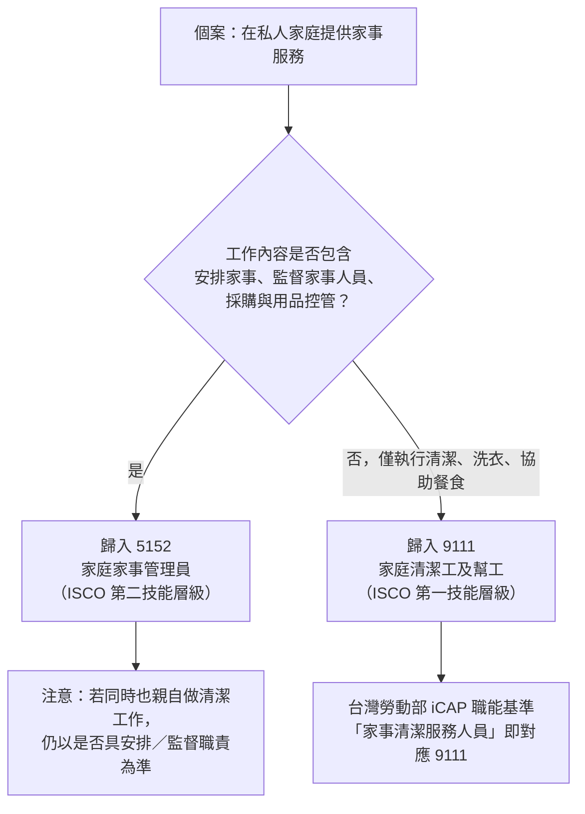

# 家管員與家政士在 ISCO 中是否有對應分類？

## 摘要

本文探討「家管員」與「家政士」這兩個名稱，在**國際標準職業分類（ISCO, International Standard Classification of Occupations）**中是否存在對應的分類。

結論如下：

1. **ISCO-08 並沒有一個字面上叫「家管員」或「家政士」的分類**；ISCO 是英文體系的職業分類，其分類名稱以英文職業概念為準。
2. 依工作內涵對應，「家管員／家事管理員」在 ISCO-08 中主要落在兩個候選分類：**9111 家庭清潔工及幫工（Domestic cleaners and helpers）** 與 **5152 家庭管家／家事管理員（Domestic housekeepers）**。兩者的分界線在於**是否包含「安排、監督」職責**。
3. **「家政士」不是 ISCO 的分類名稱，而是日本的一項民間／公的認定資格**（厚生勞動大臣認定的團體檢定），台灣職業標準分類中亦查無此職業名稱。
4. 台灣現行的**中華民國職業標準分類（第 6 次修訂）採用與 ISCO-08 相同的編碼**，可直接對照。

---

## 一、背景：ISCO 是什麼

ISCO 由**國際勞工組織（ILO, International Labour Organization）**制定，是一套讓全世界所有工作都能被歸類的分類系統[^isco08]。

- ISCO-08 是**四層級**的分類結構，共計 **436 個「細類」（unit group）**，向上彙整為 **130 個「小類」（minor group）**、**43 個「中類」（sub-major group）** 與 **10 個「大類」（major group）**[^isco08browse]。
- 四層級的編碼長度分別為：大類 1 碼、中類 2 碼、小類 3 碼、細類 4 碼[^isco08browse]。
- ISCO-08 於 **2007 年 12 月**由勞動統計三方專家會議以決議方式通過，並於 **2008 年 3 月**獲 ILO 理事會認可，是 ISCO 的第四代版本[^isco08adopt]。

與家務、家事服務最相關的兩個大類是：

| 大類 | 英文 | 中文（台灣譯名） |
|---|---|---|
| 5 | Service and sales workers | 服務及銷售工作人員 |
| 9 | Elementary occupations | 基層技術工及勞力工 |

---

## 二、ISCO-08 中與「家務／家事」相關的分類

### 2.1 9111 家庭清潔工及幫工（Domestic cleaners and helpers）

分類路徑：**9 大類（基層技術工及勞力工）→ 91 中類（清潔工及幫工）→ 911 小類（家庭、旅館及辦公室清潔工及幫工）→ 9111 細類（家庭清潔工及幫工）**[^esco911]。

**官方定義（lead statement）**：

> Domestic cleaners and helpers sweep, vacuum clean, wash and polish, take care of household linen, purchase household supplies, prepare food, serve meals and perform various other domestic duties.（家庭清潔工及幫工從事掃地、吸塵、清洗與打蠟、照料家用亞麻織品、採購家庭用品、備餐、上菜以及其他各式家務職責。）[^isco9111]

**工作任務（tasks include）**[^isco9111]：

- (a) 打掃、吸塵、打蠟與清洗地板及家具，或清洗窗戶及其他固定裝置；
- (b) 洗滌、熨燙及修補亞麻織品與其他紡織品；
- (c) 洗碗盤；
- (d) 協助餐食與點心的準備、烹調及上菜；
- (e) 採購食物及其他家庭用品；
- (f) 清潔、消毒及除臭廚房、浴室與廁所；
- (g) 清洗窗戶及其他玻璃表面。

**歸入本類的職業舉例**：Charworker (domestic)（家庭打掃工）、Domestic cleaner（家庭清潔工）、Domestic helper（家庭幫傭）[^isco9111]。

**相關但歸於他類的職業**：Domestic housekeeper（家庭管家）→ 5152；Hotel cleaner（旅館清潔工）→ 9112；Hand launderer（手工洗衣工）→ 9121；Street sweeper（清道夫）→ 9613[^isco9111]。

> 注意：91 中類（清潔工及幫工）多數職業屬於 **ISCO 第一技能層級（first skill level）**[^isco91]。

### 2.2 5152 家庭管家／家事管理員（Domestic housekeepers）

分類路徑：**5 大類（服務及銷售工作人員）→ 51 中類（個人服務工作人員）→ 515 小類（建築物及家事管理員）→ 5152 細類（家庭管家）**[^esco515]。

**官方定義（lead statement）**：

> Domestic housekeepers organize, supervise and carry out housekeeping functions in private households and small accommodation establishments with or without the support of subordinate staff.（家庭管家在私人家庭與小型住宿場所中，安排、監督並執行家事職能，無論是否有下屬協助。）[^isco5152]

**工作任務（tasks include）**[^isco5152]：

- (a) 監督受僱於家庭之家事服務人員；
- (b) 採購或控管採購之用品；
- (c) 控管用品之儲存與發放；
- (d) 於輕微受傷或生病時提供協助，例如量體溫、給藥、包紮；
- (e) 打掃或吸塵、清洗及打蠟地板、家具及其他固定裝置；
- (f) 鋪床、清潔浴室、補充毛巾、肥皂及相關用品；
- (g) 照料寵物與植物、接待訪客、接聽電話、傳遞訊息、採買雜貨；
- (h) 準備與烹調餐食、擺設及收拾餐桌、供應餐食與飲料；
- (i) 清潔廚房並協助廚房工作，包括洗碗。

**歸入本類的職業舉例**：Bed and breakfast operator（民宿經營者）、Domestic housekeeper（家庭管家）、Butler（管家）[^isco5152]。

**相關但歸於他類的職業**：Hotel manager（旅館經理）→ 1411；Domestic helper（家庭幫傭）→ 9111[^isco5152]。

> 51 中類（個人服務工作人員）多數職業屬於 **ISCO 第二技能層級（second skill level）**[^isco51]。

### 2.3 兩者的關鍵分界

ISCO-08 在 **9111 與 5152 之間的分界線是「安排（organize）與監督（supervise）」職責**：

- 只做清潔、洗衣、協助餐食等**執行性工作**、不含督導與統籌 → **9111**（第一技能層級）。
- 涉及**安排家事、監督家事人員、採購控管**等統籌職責 → **5152**（第二技能層級）。

---

## 三、台灣的情形：「家管員」的定位

### 3.1 台灣職業標準分類採用與 ISCO-08 相同的編碼

台灣的**中華民國職業標準分類**最新為**第 6 次修訂**（民國 99 年 5 月公布、99 年 5 月 1 日實施），並自 **112 年 9 月 1 日起改由勞動部編修**（原由行政院主計總處辦理）[^dgbas]。因為編碼與 ISCO-08 一致，可逐碼對照：

- **9111 家庭清潔工及幫工**：對應 ISCO-08 9111[^tw9111]。
  > 定義：「在家庭內從事房間清理及碗盤餐具洗滌等家事服務之人員。」
  > 不包括：家庭管家應歸入 5152；旅館清潔工應歸入 9112；手工洗衣工應歸入 9199。
  > 參考子目：家庭幫傭、家庭清潔工。

- **5152 家庭家事管理員**：對應 ISCO-08 5152[^tw5152]。
  > 定義：「從事家庭家事安排、監督及執行之人員。以自用住宅提供住宿服務之民宿經營人員亦歸入本類。」
  > 不包括：未涉及家庭家事安排及監督工作、僅從事家庭清潔工作之人員應歸入 9111。
  > 參考子目：家庭管家、民宿經營人員。

- **5159 其他場所家事管理員**：在辦公室、旅館及其他場所從事家事之安排、監督及執行之人員，如旅館管家、宿舍舍監[^tw5159]。

### 3.2 「家管員」是民間俗稱，非官方分類名稱

「家管員」一詞在官方職業標準分類中**並不存在**。實務上主要來自**彭婉如文教基金會**等民間機構，該基金會把提供「家事管理」服務的從業人員稱為「家管員」，並與「家事管理員」一詞交互使用[^pwr]。

基金會定義的家管員工作內容包括[^pwr]：

1. 居家清潔（客餐廳、臥室、書房、廚房、衛浴等主要生活空間）
2. 收納整理（桌面、地面等表面物品的基本收納）
3. 洗衣摺衣（使用洗衣機洗滌、晾衣、摺衣）
4. 膳食服務（備餐、煮餐、提供家常料理）
5. 簡易整燙（熨燙襯衫等，通常另酌收費用）
6. 其他：清洗冷氣濾網、換床被單、晾曬衣物等

**判讀**：基金會的家管員工作內容多屬**執行性家事**，依官方定義通常應歸入 **9111 家庭清潔工及幫工**；唯有當工作內容真的包含「安排家事、監督家事服務人員」時，才符合 **5152 家庭家事管理員** 的嚴格定義[^tw5152]。

### 3.3 勞動部的相關職能基準

勞動部勞動力發展署以 **iCAP 職能基準**方式，將「**家事清潔服務人員**」對應到職業別代碼 **9111**，工作描述為「提供居家清潔、收納整理等家事服務」，主要職責包含清潔工作整備、居家清潔、居家物品收納整理、驗收與結案[^icap]。

台灣就業通 Jobooks 的通俗職業中另有 **190201 家事服務員／家庭清潔人員** 與 **190202 家庭／民宿管家** 兩個通俗職業名稱，可視為對應到 9111 與 5152 的實務別名[^jobooks]。

---

## 四、日本的情形：「家政士」的定位

### 4.1 「家政士」不是 ISCO 分類，而是日本的資格

「家政士」**不是職業標準分類的名稱，而是一項日本資格制度**，且並非法律上的「國家資格（国家資格）」[^kanka][^mhlw]。

- **認定／實施機構**：公益社團法人**日本看護家政紹介事業協會**（簡稱「看家協會」）[^kanka]。
- **性質**：**厚生勞動大臣認定的團體檢定制度**。2016 年（平成 28 年）先以「家政士社內檢定」取得厚生勞動省認定，2025 年（令和 7 年）3 月升級為新設的**「團體檢定制度」第 1 號**（認定番號 団第 1 號）[^kanka][^mhlw]。
- **定位**：厚生勞動省「團體等檢定事例」頁面說明，這是「由社內檢定移行至團體檢定」的制度，屬**公的認定但非國家資格**[^mhlw]。
- **商標**：「家政士」為看家協會之登錄商標（商標登錄番號第 5750910 號）[^kanka]。
- **考試**：學科（40 題、60 分鐘）＋實技（衣、食、住 3 科目）；學科 80% 以上、實技 70% 以上合格；報名費 13,000 日圓（會員 9,000、學生 6,000）[^kanka]。
- **報考資格**：原則需家政婦（夫）業務 5 年以上經驗，或看護／保育／家事支援等相關 5 年實務經驗者、家政相關學科在校生／畢業生等[^kanka]。
- **國家資格化的動向**：2025 年 12 月 24 日第 2 回日本成長戰略會議上，高市總理指示「加速檢討家事支援服務等之公的資格化」，政府以 2027 年為目標檢討中；也就是說家政士**目前仍是民間／公的認定資格，但正被檢討要「國家資格化」**[^kokka]。

### 4.2 日本職業分類中「家事服務／家政婦」的位置

日本採用的是**日本標準職業分類（JSOC，總務省）**與**厚生勞動省編職業分類（ハローワーク）**，其編碼與 ISCO 不同：

| 對象 | 日本標準職業分類（JSOC） | 厚生勞動省編職業分類 |
|---|---|---|
| 家政婦（夫）、家事手傳 | E-35-**351** | 052-**01** |
| 家事代行（含各種家事／特定作業） | 351（各種）／359（單一家事） | 052-01（各種）／052-99（特定） |
| 保母（ベビーシッター） | 359 | 052-99 |
| 房屋清潔（ハウスクリーニング） | 712（別分類） | 096-02 |

- JSOC 小分類 **351 家政婦（夫），家事手傳い** 的說明為：「依個人家庭或個人之要求，從事烹調、洗衣、掃除、對需照護者提供入浴、食事等照顧之工作。」事例包含家政婦（夫）、家事手傳い、お手傳い、**Housekeeper**、House maid、派出婦（夫）等；不適合事例包含派出看護師〔133〕、料理人（個人家庭）〔359〕、洗濯人（個人家庭）〔359〕、ホームヘルパー〔362〕、ハウスクリーニング職〔712〕[^jsoc351]。
- 同中分類下的 **359 その他の家庭生活支援サービス職業従事者** 則收納保母、執事、別墅看守、料理人（個人家庭）、洗濯人（個人家庭）、庭掃除人等[^jsoc359]。
- 厚生勞動省編職業分類的 **052-01 家政婦（夫）、家事手傳い** 涵蓋お手傳い、介護家政婦、家事代行員（從事各種工作者）；不適合事例為訪問看護師〔023-03〕、訪問介護員〔051-01〕、保母／洗濯人／料理人（個人家庭）〔052-99〕等[^hellowork]。

**重點**：日本的「家政婦／家事手傳い」在概念上介於 ISCO 的 9111 與 5152 之間，但因日本未直接採用 ISCO 編碼，須透過對照表另行映射，不能直接以一碼對一碼認定。

---

## 五、對照總表

| 名稱 | 是否為 ISCO 分類名稱 | 最接近的 ISCO-08 分類 | 台灣對應（第 6 次修訂） | 日本對應 |
|---|---|---|---|---|
| 家管員（民間俗稱） | 否 | 視職責而定：多為 9111；含監督則為 5152 | 9111 家庭清潔工及幫工 / 5152 家庭家事管理員 | JSOC 351 / 359 |
| 家事管理員 | 否（台灣官方名稱為「家庭家事管理員」） | **5152** Domestic housekeepers | **5152 家庭家事管理員** | JSOC 351 |
| 家庭清潔工及幫工 | 是（中譯） | **9111** Domestic cleaners and helpers | **9111 家庭清潔工及幫工** | JSOC 351（部分） |
| 家政士（日本資格） | 否 | 概念上介於 9111 與 5152（資格 ≠ 職業分類） | 查無此職業名稱 | 民間／公的認定資格，非職業分類 |

---

## 六、判定流程圖

以下流程圖說明如何判斷一個個案應歸入 9111 還是 5152：

---

## 七、來源批判性反思

- **權威性**：ISCO-08 的定義以 ILO 官方出版品（Volume 1）為準，可信度最高；本文所引 9111、5152 的定義與任務，已由 ILO ISCO-08 官方結構文件與 ESCO（歐盟依 ISCO 建置之對照庫）交叉比對，兩者一致。
- **時效性**：ISCO-08 自 2008 年沿用至今，尚未有 ISCO-09 或新版正式取代；台灣職業標準分類第 6 次修訂（民國 99 年）亦以 ISCO-08 為藍本，故編碼可直接對照。惟台灣自 112 年 9 月起改由勞動部編修，未來若修訂須留意版本差異。
- **語意落差**：這是本文最需注意的風險。「家管員」是**民間通俗稱法**，官方分類中無此名；不同機構（彭婉如基金會、就業通 Jobooks、iCAP）對同一工作者使用了不同名稱，容易造成「名稱相近但歸類條件不同」的混淆。本文的處理方式是**以工作內涵（是否含安排、監督）而非名稱來決定歸類**。
- **跨體系問題**：「家政士」是**資格（qualification）**，ISCO 是**職業分類（occupation classification）**，兩者屬於不同維度，嚴格說不能直接等同。本文僅說明其概念上接近的職業分類位置，並特別聲明資格 ≠ 職業分類。
- **未能完全查證之處**：日本厚生勞動省編職業分類的官方一覽表部分頁面受限於編碼，本文以其官方ハローワーク分類頁面與 JSOC e-Stat 條目互相佐證；若需最嚴謹的日→ISCO 對照，應查閱總務省或厚生勞動省發布之官方對照表。

---

## 參考文獻

[^isco08]: International Labour Organization. (n.d.). *ISCO-08*. Retrieved 2026-10-11, from https://isco.ilo.org/en/isco-08/

[^isco08browse]: International Labour Organization. (n.d.). *Browse a code or title in ISCO-08*. Retrieved 2026-10-11, from https://isco.ilo.org/en/isco-08/codelist

[^isco08adopt]: International Labour Office. (2012). *International standard classification of occupations: ISCO-08, Volume 1 - Structure, group definitions and correspondence tables*. International Labour Organization. Retrieved 2026-10-11, from https://webapps.ilo.org/ilostat-files/ISCO/newdocs-08-2021/ISCO-08/ISCO-08%20EN%20Vol%201.pdf

[^esco911]: European Commission. (n.d.). *911 - Domestic, hotel and office cleaners and helpers*. ESCO. Retrieved 2026-10-11, from https://esco.ec.europa.eu/en/classification/occupation?uri=http://data.europa.eu/esco/isco/C911

[^isco9111]: International Labour Office. (2012). Unit group 9111: Domestic cleaners and helpers. In *International standard classification of occupations: ISCO-08, Volume 1*. International Labour Organization. Retrieved 2026-10-11, from https://webapps.ilo.org/ilostat-files/ISCO/newdocs-08-2021/ISCO-08/ISCO-08%20EN%20Vol%201.pdf

[^isco91]: International Labour Office. (2012). Sub-major group 91: Cleaners and helpers. In *International standard classification of occupations: ISCO-08, Volume 1*. International Labour Organization. Retrieved 2026-10-11, from https://webapps.ilo.org/ilostat-files/ISCO/newdocs-08-2021/ISCO-08/ISCO-08%20EN%20Vol%201.pdf

[^esco515]: European Commission. (n.d.). *515 - Building and housekeeping supervisors*. ESCO. Retrieved 2026-10-11, from https://esco.ec.europa.eu/en/classification/occupation?uri=http://data.europa.eu/esco/isco/C515

[^isco5152]: International Labour Office. (2012). Unit group 5152: Domestic housekeepers. In *International standard classification of occupations: ISCO-08, Volume 1*. International Labour Organization. Retrieved 2026-10-11, from https://webapps.ilo.org/ilostat-files/ISCO/newdocs-08-2021/ISCO-08/ISCO-08%20EN%20Vol%201.pdf

[^isco51]: International Labour Office. (2012). Sub-major group 51: Personal service workers. In *International standard classification of occupations: ISCO-08, Volume 1*. International Labour Organization. Retrieved 2026-10-11, from https://webapps.ilo.org/ilostat-files/ISCO/newdocs-08-2021/ISCO-08/ISCO-08%20EN%20Vol%201.pdf

[^dgbas]: 行政院主計總處. (n.d.). 職業標準分類. Retrieved 2026-10-11, from https://www.stat.gov.tw/News.aspx?n=3145&sms=11196

[^tw9111]: 行政院主計總處. (n.d.). 9111 家庭清潔工及幫工. 中華民國職業標準分類（第 6 次修訂）. Retrieved 2026-10-11, from https://www.stat.gov.tw/StandardOccupationalClassificationContent.aspx?n=3145&sms=11196&RID=6&PID=OTExMQ==&Level=4

[^tw5152]: 行政院主計總處. (n.d.). 5152 家庭家事管理員. 中華民國職業標準分類（第 6 次修訂）. Retrieved 2026-10-11, from https://www.stat.gov.tw/StandardOccupationalClassificationContent.aspx?n=3145&sms=11196&RID=6&PID=NTE1Mg==&Level=4

[^tw5159]: 行政院主計總處. (n.d.). 5159 其他場所家事管理員. 中華民國職業標準分類（第 6 次修訂）. Retrieved 2026-10-11, from https://www.stat.gov.tw/StandardOccupationalClassificationContent.aspx?n=3145&sms=11196&RID=6&PID=NTE1OQ==&Level=4

[^pwr]: 彭婉如文教基金會. (n.d.). 家事管理服務. Retrieved 2026-10-11, from https://www.pwr.org.tw/service/domestic

[^icap]: 勞動部勞動力發展署. (n.d.). 職能基準：家事清潔服務人員（PIC9111-001）. iCAP 職能發展應用平台. Retrieved 2026-10-11, from https://icap.wda.gov.tw/

[^jobooks]: 勞動部勞動力發展署. (n.d.). 通俗職業：家事服務員／家庭清潔人員. 台灣就業通 Jobooks. Retrieved 2026-10-11, from https://jobooks.taiwanjobs.gov.tw/

[^kanka]: 公益社団法人日本看護家政紹介事業協会. (n.d.). 家政士検定. Retrieved 2026-10-11, from https://kanka.or.jp/kaseishi

[^mhlw]: 厚生労働省. (n.d.). 団体等検定事例：公益社団法人日本看護家政紹介事業協会 家政士団体検定. Retrieved 2026-10-11, from https://www.mhlw.go.jp/seisakunitsuite/bunya/koyou_roudou/jinzaikaihatsu/ability_skill/dantaitou/case01.html

[^jsoc351]: 総務省統計局. (n.d.). 日本標準職業分類 小分類 351 家政婦（夫），家事手伝い. e-Stat. Retrieved 2026-10-11, from https://www.e-stat.go.jp/classifications/terms/20/02/351

[^jsoc359]: 総務省統計局. (n.d.). 日本標準職業分類 小分類 359 その他の家庭生活支援サービス職業従事者. e-Stat. Retrieved 2026-10-11, from https://www.e-stat.go.jp/classifications/terms/20/02/359

[^hellowork]: 厚生労働省. (n.d.). 厚生労働省編職業分類 052 家庭生活支援サービスの職業. ハローワーク. Retrieved 2026-10-11, from https://www.hellowork.mhlw.go.jp/info/mhlw_job_dictionary_05.html

[^kokka]: ナナブナ福祉. (n.d.). 「家政士」国家資格化の動向. Retrieved 2026-10-11, from https://hukushi-nabana.com/category3/category10/entry55.html
