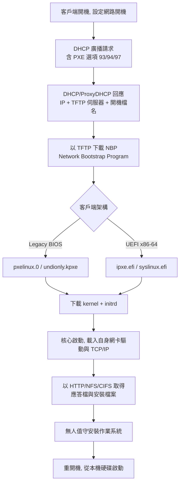

# 網路開機與網路安裝作業系統完整指南

本報告說明如何透過網路（而非本機硬碟、光碟或 USB）啟動電腦並安裝作業系統。內容涵蓋底層協定（PXE、DHCP、TFTP）、現代替代方案（iPXE、UEFI HTTP Boot）、自動化安裝的應答檔機制、無磁碟開機的根檔案系統取得方式、常見工具比較、實作範例，以及安全性考量。所有事實均附註腳與 APA 改良格式（ISO 8601 日期）之參考文獻。

## 1. 什麼是網路開機

**網路開機（Network Booting / Netboot）** 是指電腦不從本機儲存裝置開機，而是透過網路協定向伺服器取得開機映像檔，進而啟動作業系統或安裝程式[^nbpedia]。其典型應用包含：資料中心大量部署伺服器、無磁碟工作站（Thin Client）、磁碟映像複製（Cloning）、以及救援環境的啟動。

網路開機的客戶端只需要一張支援 **PXE** 的網路卡（NIC）與標準協定 **DHCP、TFTP**[^pxewiki]。

無磁碟節點（Diskless Node）指的是沒有磁碟機、改以網路開機載入作業系統的電腦，其優點包含成本較低、運轉安靜、集中化管理[^diskless]。取得作業系統的方式大致分為三類：**NFS 根目錄**、**RAM disk 記憶體開機**、以及**區塊層級虛擬磁碟**（iSCSI、AoE、NBD 等）[^diskless]。

## 2. 網路開機的層次架構

理解網路開機時，必須區分三個彼此獨立但常被混淆的層次：

| 層次 | 目的 | 代表技術 |
|---|---|---|
| **傳輸層：開機搬運** | 讓裸機取得開機程式與核心 | PXE、TFTP、iPXE、UEFI HTTP Boot |
| **安裝層：應答自動化** | 事先回答安裝程式的問題 | preseed、autoinstall、Kickstart、AutoYaST |
| **首次開機層：系統設定** | 作業系統裝好後的初始化 | cloud-init |

**PXE** 是負責「把安裝程式的核心與 initrd 送上裸機」的傳輸機制；安裝程式再透過核心命令列參數（kernel cmdline）去抓取應答檔[^autoinstall-debian]。



## 3. PXE 開機流程詳解

PXE（Preboot Execution Environment，讀作 "pixie"）是由 Intel 在「Wired for Management」框架下提出的規格，PXE 2.0 於 1998 年 12 月發布，2.1 於 1999 年 9 月發布；目前它已成為 UEFI 標準的一部分[^pxewiki]。其設計目標是在網卡韌體中放入一個小型的 PXE ROM，提供通用網路裝置介面（UNDI）、極簡的 UDP/IP 堆疊、開機前 DHCP 客戶端與 TFTP 客戶端[^pxewiki]。

### 3.1 步驟一：取得 IP 位址（DHCP DORA）

客戶端的 PXE 韌體會向 **port 67/UDP 廣播 DHCPDISCOVER** 封包[^rfc2131]。依 RFC 2131，標準的交換序列為 DORA[^rfc2131]：

| 訊息 | 方向 | 用途 |
|---|---|---|
| **DHCPDISCOVER** | 客戶端廣播 | 尋找可用的伺服器 |
| **DHCPOFFER** | 伺服器 → 客戶端 | 提供設定參數 |
| **DHCPREQUEST** | 客戶端廣播 | 向選定的伺服器要求參數 |
| **DHCPACK** | 伺服器 → 客戶端 | 確認網路位址 |

### 3.2 步驟二：找到開機伺服器與開機程式名稱

PXE 客戶端使用 **RFC 4578** 定義的三個 DHCP 選項來識別自己，且這些選項必須出現在所有 PXE 封包中[^rfc4578]：

- **Option 93 — Client System Architecture Type**：16 位元架構識別碼。常見值為 `0`（Intel x86PC，傳統 BIOS）、`6`（EFI IA32）、`7`（EFI BC）、`9`（EFI x86-64）[^rfc4578]。
- **Option 94 — Client Network Interface Identifier**：type 1 = UNDI，附主次版本號[^rfc4578]。
- **Option 97 — Client Machine Identifier**：16 位元組的 GUID，type 0[^rfc4578]。

此外，PXE 客戶端**必須請求 DHCP 選項 128–135**，這些選項內容供下載後的 NBP 使用，而非開機 ROM 本身[^rfc4578]。

### 3.3 步驟三：DHCP 選項 66 與 67

定義於 **RFC 2132** 第 9.4 與 9.5 節[^rfc2132]：

- **Option 66 — TFTP server name**：當 DHCP 表頭的 `sname` 欄位被用於其他 DHCP 選項時，用以識別 TFTP 伺服器[^rfc2132]。
- **Option 67 — Bootfile name**：當 DHCP 表頭的 `file` 欄位被用於其他 DHCP 選項時，用以識別開機檔名[^rfc2132]。

這兩個選項之所以存在，是因為原始 BOOTP 表頭的 `sname`（64 位元組）與 `file`（128 位元組）欄位在 DHCP 選項佔用空間後會不足[^rfc2132]。許多 DHCP 伺服器（例如 ISC dhcpd）也直接使用 `next-server`（等同 `siaddr`）與 `filename` 欄位[^rfc2132]。**若 PXE 客戶端只從未啟用 PXE 的 DHCP 伺服器取得回應，將無法開機**[^pxewiki]。

### 3.4 步驟四：proxyDHCP（DHCP 重導）

由於企業的 DHCP 伺服器通常被嚴格管控，PXE 標準定義了 **proxyDHCP**，將需求拆成兩個可獨立管理的伺服器[^pxewiki]：

1. **傳統 DHCP 伺服器**：提供所有客戶端的 IP 位址與遮罩。
2. **proxyDHCP 伺服器**：只對通過 PXE 識別的客戶端提供 TFTP 伺服器 IP 與 NBP 名稱。

客戶端送出一次 PXE DHCPDISCOVER，會收到兩個互補的 DHCPOFFER。由於兩個服務無法共用同一個主機上的 port 67/UDP，**proxyDHCP 執行於 port 4011/UDP**[^pxewiki]。

### 3.5 步驟五：以 TFTP 傳輸 NBP

客戶端使用 **TFTP** 將 **NBP（Network Bootstrap Program）** 載入 RAM，必要時進行驗證（例如 UEFI Secure Boot），然後執行[^pxewiki]。TFTP（RFC 1350）在 UDP 上運作[^rfc1350]：

- 傳輸由送往伺服器知名 **port 69** 的 RRQ（讀取請求）或 WRQ（寫入請求）開始[^rfc1350]。
- 資料以固定 **512 位元組區塊**傳輸；每個 DATA 封包必須被 ACK 確認後才能送下一個（lock-step）[^rfc1350]。
- DATA 封包**小於 512 位元組代表傳輸結束**[^rfc1350]。
- 五種封包類型：RRQ(1)、WRQ(2)、DATA(3)、ACK(4)、ERROR(5)[^rfc1350]。
- TFTP **沒有認證機制**，因此伺服器必須限制可存取的檔案[^rfc1350]。
- 傳輸效能後來由 **TFTP Blocksize Option**（RFC 2348，1998）與 **TFTP Windowsize Option**（RFC 7440，2015）改善[^rfc1350]。

### 3.6 步驟六：NBP 執行並鏈式載入

NBP 是開機鏈的第一環。它通常會再以 TFTP 請求額外檔案，啟動一個極簡的作業系統執行環境（Windows PE，或 Linux 核心 + initrd）[^pxewiki]。**一旦這個小型作業系統開始運作，它會載入自己的網路驅動與 TCP/IP 堆疊，之後剩餘的傳輸改用更穩健的協定（HTTP、CIFS 或 NFS），而非 TFTP**[^pxewiki]。常見的 NBP 包含：

- **PXELINUX**（BIOS 下的 `pxelinux.0`），為 Syslinux 的衍生品[^syslinux]。
- **iPXE / gPXE**（`undionly.kpxe`、`ipxe.efi`），功能完整的開源開機韌體[^ipxe]。
- 廠商自製 NBP（例如 WDS 的 `boot.wim` 映像）。

### 3.7 UEFI 與傳統 BIOS 的差異

| 面向 | 傳統 BIOS | UEFI |
|---|---|---|
| **客戶端韌體位置** | 網卡上的 PXE Option ROM（IA-32） | PXE 程式整合於 UEFI 韌體 / 網卡韌體 |
| **DHCP Option 93 架構碼** | `0`（Intel x86PC） | `6`（EFI IA32）、`7`（EFI BC）、`9`（EFI x86-64） |
| **開機檔** | `.0` / `.bin`（如 `pxelinux.0`） | `.efi`（如 `syslinux.efi`、`ipxe.efi`、`bootx64.efi`） |
| **韌體介面** | UNDI + PXE API | SNP + **EFI_PXE_BASE_CODE_PROTOCOL** |
| **設定模組** | `ldlinux.c32` | `ldlinux.e32` / `ldlinux.e64` |

UEFI 規格第 24 章（Network Protocols — SNP, PXE, and BIS）定義了開機服務環境中的網路存取協定：**Simple Network Protocol（SNP）**、**PXE Base Code Protocol** 與 **Boot Integrity Services（BIS）**[^uefispec]。SNP 提供網路卡的封包層介面，供高階驅動產生 DHCP、TFTP、MTFTP 等開機服務[^uefispec]。**EFI_PXE_BASE_CODE_PROTOCOL** 疊在 EFI_MANAGED_NETWORK_PROTOCOL 之上，其介面包含 `Dhcp()`（完成 DHCPv4 DORA 或 DHCPv6 SARR 序列）、`Discover()`、`Mtftp()` 及 UDP 讀寫函式[^uefispec]。

**實務後果**：BIOS 客戶端與 UEFI 客戶端需要**不同的開機檔**，因此 DHCP 伺服器必須依 Option 93 分支處理。ISC dhcpd 範例如下[^syslinux]：

```text
option architecture-type code 93 = unsigned integer 16;
if option architecture-type = 00:00 {
    filename "path/to/BIOS/pxelinux.0";
}
elsif option architecture-type = 00:09 {
    filename "path/to/EFIx64/syslinux.efi";
}
elsif option architecture-type = 00:06 {
    filename "path/to/EFIia32/syslinux.efi";
}
```

需注意架構碼 **06（EFI IA32）與 07（EFI BC）** 常被廠商誤用於 CSM/x64 開機[^syslinux]。此外，**UEFI Secure Boot** 可在執行 NBP 前驗證其簽章[^pxewiki]；**UEFI 2.5** 新增了 **HTTP Boot** 與 **iPXE HTTP chainloading**，讓客戶端可透過 HTTP 而非 TFTP 下載開機檔，因而省去 TFTP 伺服器[^pxewiki]。

## 4. IPv6 下的網路開機（RFC 5970）

針對 IPv6，**RFC 5970**（由 Huth、Freimann、Zimmer、Thaler 於 2010 年 9 月發布的標準軌文件）定義了網路開機用的 DHCPv6 選項，與 DHCPv4 下的 RFC 4578 提供同等能力[^rfc5970]：

| 選項 | 代碼 | 用途 |
|---|---|---|
| `OPT_BOOTFILE_URL` | 59 | 開機檔的 URL（開機的必要選項） |
| `OPT_BOOTFILE_PARAM` | 60 | 傳遞給開機檔的參數 |
| `OPTION_CLIENT_ARCH_TYPE` | 61 | 對應 DHCPv4 Option 93 |
| `OPTION_NII` | 62 | 對應 DHCPv4 Option 94 |

RFC 5970 指出，**Option 59（`OPT_BOOTFILE_URL`）** 攜帶的 URL 字串「MUST comply with STD 66 [RFC3986]」；若主機為 IPv6 位址，「the address in the URL then MUST be enclosed in '[' and ']' characters」[^rfc5970]。該協定本身對下載協定並無限制，但「we strongly recommend that, at a minimum, implementers of network boot loaders implement... HTTP... for downloading. Please note that for IPv6, this supersedes RFC 906, which recommended using TFTP」[^rfc5970]。此外，RFC 5970 警告「DHCPv6 messages are sent unencrypted by default」，並建議採用 HTTPS/TLS 與簽署過的開機映像[^rfc5970]。DHCPv6 使用 **S.A.R.R.** 序列（Solicit / Advertise / Request / Reply）[^rfc5970]。

## 5. 現代替代方案

### 5.1 iPXE

**iPXE** 是領先的開源網路開機韌體，提供完整的 PXE 實作並附加多項功能；它可**取代網卡上原有的 PXE ROM**，或**以鏈式載入（chainload）方式進入 iPXE** 而無須重刷韌體[^ipxeproject]。GitHub 上的 `ipxe/ipxe` 儲存庫約有 **2.1k stars**、818 forks[^ipxegithub]。

其特色包含[^ipxeproject]：

- 透過 HTTP 或 HTTPS 從網頁伺服器開機（不限於 TFTP）
- 從 iSCSI SAN 開機
- 透過 FCoE 從 Fibre Channel SAN 開機
- 從 AoE SAN 開機
- 從無線網路開機
- 從廣域網路（WAN/Internet）開機
- 從 Infiniband 網路開機
- 以腳本控制開機流程
- 建立互動式表單與選單

授權方面，iPXE 主體採用 **GNU GPL 第 2 版（或任一較新版本）**，部分歷史因素下的程式碼採用 GPL 相容授權如**二條款 BSD 授權**[^ipxelicense]。最新穩定版為 **v2.0.0**（2026 年 3 月 6 日發布），新增 UEFI Secure Boot shim 支援、LoongArch64 與 RISC-V 架構支援、`autoexec.ipxe` 自動下載、EAPoL/port 認證、LLDP、現代 TLS（DHE/ECDHE、X25519、P-256/P-384、ECDSA）並移除 TLS v1.0[^ipxerelease]。

### 5.2 UEFI HTTP Boot

**UEFI HTTP Boot** 於 **UEFI 規格 2.5 版**引入，結合 **DHCP、DNS 與 HTTP** 來進行網路開機與部署，以 HTTP(S) 取代 TFTP 作為檔案傳輸方式[^intel]。相較於傳統 PXE，HTTP Boot 能處理遠大於 TFTP 的檔案，且可跨越更大的距離；PXE 依賴 UDP 廣播，而 HTTP Boot 可從不位於區域網路的伺服器下載數 MB 的檔案，例如 Linux 核心與根檔案系統[^intel]。

| 面向 | PXE | UEFI HTTP Boot |
|---|---|---|
| 傳輸 | TFTP over UDP | HTTP(S) over TCP |
| 範圍 | 區域網路（UDP 廣播） | 可跨 L3 / WAN |
| 檔案大小 | 受 TFTP/UDP 限制 | 大檔案（核心、rootfs、ISO） |
| 安全 | 無原生加密/認證 | 支援 HTTPS + TLS 憑證 + Secure Boot |
| 可靠性 | TFTP 逾時、UDP 封包遺失 | TCP 可靠傳輸 |
| 架構 | 16 位元 BIOS/UNDI 根源 | UEFI 原生（IPv4 + IPv6） |
| 伺服器 | TFTP 伺服器 | 網頁伺服器（Apache/lighttpd）+ DHCP |

Intel 指出 PXE 的弱點：「PXE has no mechanism for encryption or authentication, is susceptible to man-in-the-middle attacks, does not scale outside of local networks, and has reliability issues associated with TFTP time-outs and UDP packet loss」，並直言「The TFTP & UDP transactions associated with PXE may be the last unencrypted traffic on your network and are trivial to intercept」[^intel]。

**運作方式**：客戶端以 DHCP Option 60（Vendor Class Identifier）傳送 **`HTTPClient`** 字串自我識別，伺服器則以 **Option 67** 回傳一個 **`http://` URL** 的開機檔位址，客戶端再以 HTTP(S) 下載[^hannan]。iPXE 文件指出：「You must configure your DHCP server to check for a UEFI HTTP Boot client, and to provide the string `HTTPClient` as the vendor class identifier, and an HTTP URI as the boot filename」[^ipxeuefihttp]。SUSE 文件亦強調「the DHCPv4 server must use the `HTTPClient` parameter for the vendor class ID, as the client uses it to identify an HTTP Boot offer」[^susehttpboot]。

ISC dhcpd 範例（同時服務 PXE 與 HTTP 客戶端）[^susehttpboot]：

```text
class "pxeclients" {
  match if substring (option vendor-class-identifier, 0, 9) = "PXEClient";
  option vendor-class-identifier "PXEClient";
  next-server 192.168.111.1;
  filename "/bootx64.efi";
}
class "httpclients" {
  match if substring (option vendor-class-identifier, 0, 10) = "HTTPClient";
  option vendor-class-identifier "HTTPClient";
  filename "http://www.httpboot.local/sle/EFI/BOOT/bootx64.efi";
}
```

**與 iPXE HTTP Boot 的關係**：iPXE 的「UEFI HTTP chainloading」應用說明指出：「Version 2.5 of the UEFI specification introduces the UEFI HTTP Boot feature. You can use the basic UEFI HTTP Boot client to chainload iPXE from an HTTP server, eliminating the need for a separate TFTP server in your boot infrastructure」[^ipxeuefihttp]。原生 UEFI HTTP Boot 客戶端刻意設計得很簡單，只下載並執行一個開機檔；iPXE 則作為第二階段解鎖進階功能[^ipxeuefihttp]。iPXE 會自動繼承韌體憑證：「when running on a UEFI platform, iPXE will automatically obtain any certificates stored in the UEFI `TlsCaCertificate` variable」[^ipxecrypto]。

### 5.3 netboot.xyz

**netboot.xyz** 是一個以 **iPXE** 為基礎的開源網路開機作業系統安裝器，本體是一個不到 1 MB 的 iPXE 開機程式，開機後提供選單，從上游取得網路安裝器、Live 發行版與救援工具，因此無須管理安裝媒體[^netbootxyz]。它支援 **x86（32/64 位元）與 arm64**，並同時支援 **Legacy（PCBIOS）與 UEFI** 模式[^netbootxyz]。

其主要選單分類包含：Linux 網路安裝、桌上型與 Live 發行版、安全與鑑識、工具與救援、Hypervisor 與儲存、Windows（WIM）、netboot.xyz 端點、iPXE Shell、重新開機[^netbootxyzdocs]。可用的作業系統約 80 種以上，包含 AlmaLinux、Alpine、Arch、CentOS、Debian、Fedora、FreeBSD、NixOS、Ubuntu 等[^netbootxyz]。

鏈式載入方式[^netbootxyzboot]：

- **透過 PXE / TFTP**：於 DHCP 指定 `filename "netboot.xyz.kpxe"`；若網卡有問題可改用 `netboot.xyz-undionly.kpxe`（undionly 版本借用網卡開機韌體）。
- **透過既有 iPXE**：在 iPXE shell（按 `Ctrl-B`）執行 `dhcp` 然後 `chain --autofree https://boot.netboot.xyz`。
- **透過 ISO / USB**：`netboot.xyz.iso` 可掛載為虛擬媒體（Citrix XenServer、Proxmox VE、VMware、VirtualBox）或用於頻外管理（Dell DRAC / HP iLO）；`netboot.xyz.img` 可寫入 USB。
- **透過 GRUB/syslinux**：`chain --autofree https://boot.netboot.xyz/menu.ipxe`。

netboot.xyz 本質上是一組整理過的 iPXE 腳本、選單與重新打包的作業系統映像，而非 iPXE 本身的分支[^netbootxyz]。其主儲存庫為 `github.com/netbootxyz/netboot.xyz`，約有 **12.5k stars**、867 forks，授權為 Apache-2.0[^netbootxyzgithub]。在 Secure Boot 方面，它透過 Microsoft 信任的 shim 鏈式載入已簽署的 iPXE 二進位檔；完整端到端安裝支援目前限於 Debian、Devuan 與 Kali，其他發行版可能需要關閉 Secure Boot 才能完成最後安裝步驟[^netbootxyz]。

### 5.4 iVentoy

**iVentoy** 是與 Ventoy 同一作者開發的增強型 PXE/HTTPBoot 伺服器，只需將 ISO 檔放入資料夾即可讓客戶端透過網路開機，無須解壓縮或逐一設定[^iventoy]。其特色包含：直接開機原始 ISO 檔（透過 HTTP 或 NBD 串流）、保留每個 ISO 的原生開機選單、同時支援 x86 Legacy BIOS / IA32 UEFI / x86_64 UEFI（含 Secure Boot）/ ARM64 UEFI / LoongArch64 UEFI、涵蓋 110 種以上作業系統、可執行於 Windows 與 Linux[^iventoy]。

其網路 ISO 開機流程為：客戶端取得 PXE/TFTP 指示後，iVentoy 傳送一個 iPXE 核心給客戶端，客戶端顯示 Ventoy 圖形介面列出可用 ISO，選定的 ISO 再被串流至 RAM 或透過網路區塊掛載（NBD/iSCSI/NFS/SMB）[^iventoydocstart]。

iVentoy 提供四種 DHCP 模式以與既有 DHCP 伺服器共存：**Proxy / ProxyNet**（內建 DHCP 只回應 next-server/bootfile，不發放 IP）、**External**（同網段，iVentoy 監聽 DHCP 封包學習客戶端 BIOS 模式）、**ExternalNet**（不同網段/VLAN，需由第三方 DHCP 依客戶端架構動態設定 bootfile）[^iventoydhcp]。

需留意 **Ventoy** 與 **iVentoy** 是兩個不同產品：Ventoy 為 100% 開源、用於透過 USB/硬碟安裝作業系統；iVentoy 則部分開源、部分閉源，用於透過網路（PXE）安裝作業系統[^ventoydiff]。標準 Ventoy 另內建**本地 PXE 功能**：以 Ventoy USB 開機後按 **F5: Tools** 選擇 **PXE**，該主機即成為臨時的 DHCP + TFTP 伺服器，讓同網段設定為網路開機的目標機連上並載入 Ventoy 選單，開機存於主機 Ventoy USB 上的原始 ISO 檔[^ventoypxe]。

## 6. 自動化 / 無人值守網路安裝

安裝自動化是與 PXE 傳輸不同的一個層次：它負責事先回答安裝程式的問題，使安裝無須人工介入。以下是各主要作業系統的機制。

### 6.1 Debian preseed

Preseeding 是設定 `debian-installer`（d-i）所問問題的答案；它不是必需的，空的 preseed 等同於手動安裝，你預先設定的每個問題會改變基準行為；安裝程式讀取 **debconf** 格式檔案，並將值餵入 debconf 資料庫[^debpreseed]。

依載入時機分為三種傳遞方式[^debpreseed]：

| 方式 | 載入時機 | 說明 |
|---|---|---|
| **initrd** | 極早期，在第一個問題之前 | 需在 initrd 根目錄放置名為 `preseed.cfg` 的檔案 |
| **file** | 安裝映像載入後 | `preseed/file=/cdrom/preseed.cfg` |
| **network** | 網路設定完成後 | `preseed/url=http://host/path/preseed.cfg` |

由於語系/鍵盤問題最先被詢問，網路與檔案方式通常無法預先設定它們，因此須使用 **auto 模式**（`auto=true priority=critical`）延後這些問題並以 `critical` 優先度執行[^debpreseed]。檔案格式為 `<owner> <question name> <question type> <value>`，範例檔案可於 Debian 官網取得[^debpreseed]。進階功能包含 `preseed/run`（安裝期間執行腳本）、`preseed/include`（串接其他 preseed 檔）與 `preseed/late_command`（安裝後動作）[^debpreseed]。

**PXE 串接**：以 PXELINUX 開機 d-i netboot 核心/initrd，並加上 `auto=true priority=critical preseed/url=http://server/preseed.cfg`[^debpreseed]。限制是：必須重新分割整顆磁碟或使用可用空間，無法沿用既有分割區[^debpreseed]。

### 6.2 Ubuntu autoinstall（Subiquity）

Ubuntu Server 20.04+ / Desktop 23.04+ 使用 **autoinstall** 格式（為 d-i preseeding 的現代替代），以 YAML 撰寫、由 **Subiquity** 安裝程式處理；與 preseed 的關鍵行為差異是：只要有任何 autoinstall 設定存在，**未回答的問題會採預設值**（若無預設值則失敗），而不會停下來詢問；可將區段標記為 `interactive-sections` 以保留互動[^subiquity]。

傳遞方式有兩種：一是**透過 cloud-init**（建議方式），在 `#cloud-config` 檔案中以頂層 `autoinstall:` 鍵放入，透過 **NoCloud** datasource 傳遞；二是**直接放在安裝媒體**根目錄的 `autoinstall.yaml`[^subiquity]。Subiquity 的優先序為：核心命令列 → 安裝系統根目錄 → cloud-config → 安裝媒體根目錄[^subiquity-provide]。

所需檔案為 `user-data`（含 `#cloud-config` 後接 `autoinstall: version: 1 ...`）與 `meta-data`（通常為空，或含 `instance-id`），透過 HTTP（`ds=nocloud-net;s=http://server:port/`）或標籤為 `CIDATA` 的 ISO/vfat 磁碟提供[^subiquity]。

**PXE 串接**：以 `autoinstall ds=nocloud-net;s=http://_gateway:3003/` 開機[^subiquity]。cloud-init 負責*傳遞*設定，但**不處理** autoinstall 指令——由 Subiquity 處理；cloud-config 頂層指令修改*臨時*安裝環境，而 `autoinstall: user-data:` 下的指令則修改*目標*系統的首次開機[^cloudinit-subiquity]。

### 6.3 Red Hat Kickstart（Anaconda）

Kickstart 是純文字應答檔，由 **Anaconda** 安裝程式消費；檔案慣用名稱為 `ks.cfg` 或 `anaconda-ks.cfg`，可從 `/root/anaconda-ks.cfg`（Anaconda 在每次成功安裝後寫入）起始，並以 `ksvalidator` 驗證[^rhelks]。檔案結構如下[^rhelks]：

| 區段 | 執行時機 | 用途 |
|---|---|---|
| `#version=RHEL10` | 解析時 | 選擇語法版本 |
| 頂層指令 | 規劃期間 | 語系、網路、磁碟、使用者、防火牆、`reboot` |
| `%packages … %end` | 套件選擇 | 環境群組、RPM、排除套件 |
| `%pre` | 載入 ks 後、分割前 | 磁碟偵測、清除 |
| `%pre-install` | `/mnt/sysimage` 掛載後 | 固定 ID 的使用者、版面調整 |
| `%post` | 套件安裝後（預設 chroot） | 設定、服務 |
| `%post --nochroot` | 安裝環境中 | 複製安裝紀錄 |
| `%addon` | 附加元件 | kdump、OpenSCAP |

**PXE 串接**：在 PXELINUX 的 `append` 行或 GRUB2 的 `linuxefi` 核心行加上 `inst.ks=http://192.168.124.2/kickstarts/ks.cfg`；此外，標籤為 **`OEMDRV`** 且根目錄含 **`ks.cfg`** 的本機磁碟區會被自動偵測（無須 `inst.ks=`）[^rhelks]。

### 6.4 SUSE AutoYaST

AutoYaST 是 SUSE 的無人值守大量部署系統，使用 **AutoYaST profile**（又稱 control file）——通常是名為 `autoinst.xml` 的 **XML** 檔，內含安裝與設定資料；YaST 解析 profile 後無需使用者互動即可設定系統[^autoyast]。其流程分三階段：準備、安裝、**安裝後設定（第二階段）**；與一般單階段 SLES 安裝不同，AutoYaST 於首次開機後執行第二階段，需具備 `autoyast2` 與 `autoyast2-installation` 套件，可用 `<second_stage config:type="boolean">false</second_stage>` 停用[^autoyast]。

對異質機群，AutoYaST 支援 **rules 與 classes**（依系統屬性合併部分 profile）與 **ERB 範本**（以 Ruby 動態產生 profile），此為其相對 Kickstart/preseed 的關鍵差異[^autoyast-control]。

**PXE 串接**：YaST 會在開機時於開機媒體或 initrd 根目錄尋找 **`autoinst.xml`**，或於標籤 **`OEMDRV`** 的裝置上尋找；否則於核心命令列傳入 `autoyast=URL`，支援 `file://`、`device://`、`nfs://`、`http://`、`https://`、`tftp://`、`ftp://`、`cifs://` 等[^autoyast-invoke]。需注意 **PXE 迴圈問題**：安裝後機器會再次 PXE 開機而重新安裝；解法是使用會切換 TFTP 設定的 HTTP/CGI，或在 profile 中以 `<pxe>` 資源於重開機前為該 MAC 上傳 `localboot 0` 設定[^autoyast-invoke]。

### 6.5 cloud-init（首次開機設定）

cloud-init 是 Linux 雲端實例/VM/裸機首次開機設定的實質標準，依 **五個序列開機階段**運作：**Detect**（`ds-identify` 偵測平台）、**Local**（`cloud-init-local.service`，在網路前執行、尋找本地 datasource 並寫入網路設定）、**Network**（`cloud-init-network.service`，網路就緒後完整處理 user-data）、**Config**（`cloud-config.service`，執行 `cloud_config_modules` 含 `runcmd`）、**Final**（`cloud-final.service`，如 rc.local 的晚期階段）[^cloudinitboot]。

NoCloud datasource 所需的四種設定檔為[^cloudinitnocloud]：

- **`user-data`** — 使用者設定（cloud-config YAML 或 shell 腳本；cloud-config 需 `#cloud-config` 標頭）
- **`meta-data`** — YAML，至少含 `instance-id`
- **`vendor-data`** — 選用的廠商預設值
- **`network-config`** — 選用的網路設定

NoCloud 的傳遞來源包含本機檔案系統、標籤為 **`CIDATA`** 的磁碟、自訂網頁伺服器（`ds=nocloud;s=https://...`，HTTP 時使用 `-net` 後綴）或 FTP/FTPS 伺服器[^cloudinitnocloud]。`seedfrom`/`s` 值必須以 `/` 結尾[^cloudinitnocloud]。cloud-init **不是安裝程式**，它是 Ubuntu autoinstall 所搭乘的機制；改變 `meta-data` 中的 `instance-id` 會讓 cloud-init 將該次開機視為全新的「首次開機」[^cloudinitnocloud]。

### 6.6 應答檔機制比較

| 系統 | 發行版/安裝程式 | 格式 | 應答檔 | 自動探索 | PXE 掛鉤 |
|---|---|---|---|---|---|
| **Preseed** | Debian（d-i） | debconf 行 | `preseed.cfg` | DHCP `filename` 或 `auto` + `url=` | `auto=true priority=critical preseed/url=…` |
| **Autoinstall** | Ubuntu（Subiquity） | YAML 於 `autoinstall:` 下 | `user-data` + `meta-data` | 透過 NoCloud 的 cloud-config | `autoinstall ds=nocloud-net;s=…` |
| **Kickstart** | RHEL/Fedora（Anaconda） | 類 INI + `%` 區段 | `ks.cfg` | `OEMDRV` 磁碟區 | `inst.ks=…` |
| **AutoYaST** | SUSE（YaST） | XML | `autoinst.xml` | 媒體/initrd 根目錄或 `OEMDRV` | `autoyast=URL` |
| **cloud-init** | 跨發行版（首次開機） | cloud-config YAML | `user-data` + `meta-data` | datasource 偵測；NoCloud `CIDATA`/HTTP | `ds=nocloud[-net];s=…` |

關鍵區別：**preseed** 遇到未回答的問題會停止，**autoinstall** 則採預設值（或失敗）；**Autoinstall** 為 YAML 且建構於 cloud-init 之上，**preseed** 為 debconf 鍵值[^debpreseed][^subiquity]。

## 7. 無磁碟開機：根檔案系統怎麼來

無磁碟節點的作業系統映像取得方式分三類[^diskless]：

1. **NFS 根目錄** — 核心載入記憶體後，其餘作業系統透過網路*檔案系統*連線存取。
2. **RAM disk / RAM 開機** — 作業系統映像被取入 RAM disk 並從記憶體執行。
3. **虛擬磁碟 / 區塊層級開機** — 磁碟操作被虛擬化並轉為網路協定（iSCSI、AoE、NBD 等），遠端的是原始*區塊裝置*。

### 7.1 NFS 根目錄

依 Linux 核心官方文件，NFS root 是經典的 Linux 無磁碟技術[^nfsroot]：

- 核心以 `root=/dev/nfs` 告知使用 NFS 而非實體裝置，並以 `nfsroot=[<server-ip>:]<root-dir>[,<nfs-options>]` 指定；若未給定 `nfsroot`，預設為 `/tftpboot/%s`（`%s` 為客戶端 IP）[^nfsroot]。
- `ip=<client-ip>:<server-ip>:<gw-ip>:<netmask>:<hostname>:<device>:<autoconf>` 參數設定網路，最常見形式為 `ip=dhcp`[^nfsroot]。
- NFS 客戶端支援與核心層級自動設定（DHCP/BOOTP/RARP）必須**編譯為內建**（而非模組）才能使用 nfsroot[^nfsroot]。
- 使用 NFS root 的系統，`/etc/resolv.conf` 常連結至 `/proc/net/pnp`，因為 DNS 資訊由此匯出[^nfsroot]。

### 7.2 iSCSI 開機

**iSCSI** 將區塊導向的 SCSI 指令封裝為 iSCSI PDU，透過 TCP/IP 傳輸，並定義 initiator 與 target 的 Session（I-T nexus）；與 NFS 不同，iSCSI 呈現的是遠端**區塊裝置**，作業系統將其視為本機磁碟[^uefiiscsi]。依 ArchWiki，開機時掛載 iSCSI target 有三種方式[^archiscsi]：

1. **標準 initramfs** — 設定為初始化網路連線、掛載 iSCSI target 並自其開機。
2. **韌體式（BIOS/UEFI）與網路卡** — 某些韌體與網卡可在開機進入作業系統前自行初始化網路連線並掛載 iSCSI target，「This is common in server- and enterprise-grade hardware」[^archiscsi]。
3. **自訂 PXE 韌體如 iPXE** — 掛載 iSCSI target 並開機。

傳遞韌體 iSCSI 設定給作業系統的機制是 **iBFT（iSCSI Boot Firmware Table）**，作業系統/initramfs 讀取此 ACPI 表以自動設定網路與 iSCSI session[^archiscsi]。微軟的 iSCSI Target Server 可從單一集中映像開機數百台電腦，使用 **differencing VHD** 時一個主映像可開機最多 **256 台電腦**；微軟測試曾於 34 分鐘內部屬 256 台電腦，且「A specialized network adapter is not required for this scenario, and a software boot loader can be used (such as iPXE open source boot firmware)」[^msiscsi]。

### 7.3 AoE（ATA over Ethernet）

**ATA over Ethernet（AoE）** 由 Brantley Coile Company 開發，用於在乙太網路上簡單高效地存取區塊儲存[^aoe]：

- AoE 運作於**乙太網路 Layer 2**，**不使用 IP**，因此無法透過網際網路或其他 IP 網路路由（性質較接近 FCoE 而非 iSCSI）[^aoe]。
- 它將 **ATA 指令**封裝於乙太網路框架（IEEE 指派 EtherType `0x88A2`），向作業系統呈現為 SCSI 磁碟[^aoe]。
- 協定層較少使其快速輕量；AoE 規格僅 **12 頁**，而 iSCSI 為 **257 頁**（RFC 3720）[^aoe]。
- **不可路由是其唯一的安全機制**；沒有 AoE 專屬的密碼/加密機制，以 MAC 為基礎的存取清單（"masks"）可被偽造，最安全的做法是使用 VLAN 隔離[^aoe]。
- Linux 自 kernel 2.6.11+ 原生支援；Windows/Mac/BSD 透過第三方驅動（如 WinAoE、WinVBlock）[^aoe]。

### 7.4 NBD（Network Block Device）

NBD 是 Linux 上的網路協定，可將一部機器的區塊裝置（通常為硬碟或分割區）轉發給另一部機器，使本機得以存取另一部電腦上的磁碟[^nbd]。它最初為 Linux 2.1.55 開發、於 1997 年釋出，2011 年重新修訂並正式文件化，現為協作式開放標準[^nbd]。依核心文件：「Linux can use a remote server as one of its block devices... This can be used for stations with low disk space (or even diskless) to borrow disk space from another computer. Unlike NFS, it is possible to put any filesystem on it」；`nbd` 核心模組只需裝在客戶端，`nbd-server` 完全在使用者空間執行[^nbddoc]。

### 7.5 無磁碟開機框架：LTSP 與 DRBL

**LTSP（Linux Terminal Server Project）** 是免費/開源的 Linux 終端伺服器，由 Jim McQuillan 於 1999 年創立，採 GPLv3；其客戶端開機流程為：伺服器上建立 chroot 環境 → 客戶端以 PXE 取得核心與 initrd（透過 TFTP）→ initrd 要求 DHCP IP 與根檔案系統伺服器位址 → 客戶端**透過 NFS 或 NBD 掛載根檔案系統**[^ltsp]。LTSP 4 使用 XDMCP 與 **NFS** 根目錄；LTSP 5（"MueKow"）使用 **NBD 或 NFS** 與經 SSH 通道的 LDM[^ltsp]。

**DRBL（Diskless Remote Boot in Linux）** 是 NFS/NIS 伺服器，提供客戶端無磁碟或無系統環境，由台灣國家高速網路與計算中心（NCHC）自 2003 年起開發[^drblwiki]。客戶端設定以 **PXE 或 Etherboot** 從網卡開機，向 DRBL 伺服器要求 IP 與 TFTP 映像，經 TFTP 開機初始 RAM disk 後**掛載 NFS 分享作為根（/）分割區**[^drblwiki]。DRBL 自 1.6.3+ 有四種模式：Full DRBL、Full Clonezilla、DRBL SSI（Single System Image）與 Clonezilla Box[^drbl]。官方強調「DRBL does NOT touch the client hard drives, therefore, other operating systems (e.g. MS Windows) installed on the client [remain intact]」[^drbl]。

### 7.6 無狀態 / RAM 開機

依 Linux 核心文件，**initramfs** 是連結進核心映像的 gzip **cpio** 壓縮檔，開機時被解壓至 rootfs；若其中含 `/init`，該程式以 PID 1 執行，負責尋找並掛載真正的根裝置（可能位於網路上，需要 DHCP 等）[^initramfs]。這個「early userspace」階段正是 NFS/iSCSI/AoE/NBD 根目錄掛載的起點[^initramfs]。

無狀態（stateless）RAM 開機通常指客戶端透過網路下載完整作業系統映像、載入 RAM 並完全從記憶體執行；由於映像被複製到 RAM，操作期間的任何變更（由使用者、蠕蟲或病毒造成）「can be either wiped out when the power is removed... or prohibited entirely (if the image is a network filesystem)」，因此非常適合圖書館、學校等公共使用環境[^diskless]。常見的無狀態混合做法是**唯讀共用根目錄搭配本地 overlay**：共用唯讀根檔案系統作為每個節點的範本，本地寫入的檔案存於節點記憶體並於重開機後消失[^voleg]。

### 7.7 根檔案系統取得方式比較

| 方法 | 層級 | 傳輸 | 可路由？ | 客戶端感知 |
|---|---|---|---|---|
| **NFS root** | 檔案系統（檔案層） | UDP/TCP over IP | 是 | 核心知道在網路檔案系統上執行 |
| **iSCSI** | 區塊裝置 | TCP/IP（SCSI over TCP） | 是 | 呈現為本機磁碟 |
| **AoE** | 區塊裝置 | Layer 2 乙太網路（EtherType 0x88A2） | 否（僅限 LAN） | 呈現為本機磁碟 |
| **NBD** | 區塊裝置 | TCP/IP | 是 | 呈現為本機磁碟 |
| **RAM/initramfs** | 整個作業系統映像在 RAM | 任意（TFTP/HTTP/NFS…） | 不適用 | 從記憶體執行，無狀態 |
| **LTSP** | 框架（NFS 或 NBD root + 精簡/肥客戶端） | PXE/DHCP/TFTP 後 NFS/NBD | 是 | 依應用與拓樸而異 |
| **DRBL** | 框架（NFS root + NIS） | PXE/Etherboot 後 NFS | 是 | 無磁碟節點 |

這些方法共同的模式是：**DHCP 告訴客戶端何處可找到開機程式；TFTP 傳送核心與 initramfs；initramfs 的 early userspace init 接著掛載真正的根目錄——無論是網路檔案系統（NFS）、網路區塊裝置（iSCSI/AoE/NBD）或記憶體中的 RAM disk（無狀態）**[^pxewiki][^nfsroot][^diskless]。

## 8. 網路開機 / 部署工具比較

### 8.1 佈建與映像工具

| 工具 | 用途 | 授權 | Stars | 主要情境 |
|---|---|---|---|---|
| **FOG Project** | 免費開源電腦複製/映像、救援與資產管理系統，透過 PXE、PartClone 與 PHP 網頁介面部署 Windows（XP→11）與 Linux 磁碟映像 | GPL-3.0 | ~1.7k[^fog] | 學校、實驗室、企業中大量 Windows/Linux PC 的快速磁碟映像複製 |
| **MAAS** | Canonical 的裸機「雲」層，以 PXE 開機並探索硬體、部署 Ubuntu/CentOS/RHEL/Windows/ESXi，透過 IPMI/Redfish 與 cloud-init 管理生命週期 | AGPL-3.0 | ~507[^maas] | 將整櫃裸機伺服器變成彈性、API 驅動的私有雲 / 資料中心佈建層 |
| **Cobbler** | Linux 安裝與更新伺服器，串接 DHCP、TFTP、DNS、套件鏡像、電源管理（經 Koan），支援 PXE 與虛擬化 | GPL-2.0 | ~2.8k[^cobbler] | 集中式多作業系統網路安裝環境（尤以 RPM/Linux 為主） |
| **Foreman** | 實體與虛擬伺服器完整生命週期管理：探索、佈建（裸機/VM/雲）、設定管理（Puppet/Ansible/Chef/Salt）、編排、監控與除役 | GPL-3.0 | ~3.0k[^foreman] | 端到端伺服器生命週期自動化，常與 Katello 搭配做內容管理 |
| **DRBL / Clonezilla** | DRBL 提供無磁碟/無系統 PXE+NFS+NIS 環境；Clonezilla 為其磁碟/分割區映像與複製元件（Live、Lite Server、SE），Clonezilla SE 可一次多播複製 40+ 台 | GPL（Clonezilla 為 GPL-2.0） | 未以 GitHub 為主倉庫[^drbl] | 無磁碟 Linux 教室（DRBL）與大規模磁碟映像/備份（Clonezilla） |
| **Tinkerbell** | CNCF 裸機佈建引擎，支援網路與 ISO 開機、BMC 互動（Redfish、IPMI、IntelAMT）、metadata 服務與工作流程引擎 | Apache-2.0 | ~320[^tinkerbell] | 雲原生 / Kubernetes 周邊環境中，以宣告式工作流程大規模佈建裸機 |
| **WDS** | 已遭棄用的 Microsoft Windows Server 角色（RIS 的後繼者），透過 PXE 載入 Windows PE（WinPE）與 WIM 映像 | 專有（Windows Server 授權） | N/A[^wds] | Microsoft/Active Directory 環境中的 Windows 集中式映像/部署 |
| **MDT** | 免費 Microsoft 工具組，自動化 Windows 部署，建立部署套件並產生自訂 WinPE 映像 | 免費專有 | N/A[^mdt] | 歷史上的 Windows 腳本化映像與部署，常與 WDS 或 SCCM 搭配 |

微軟方面值得注意的是：**WDS** 已於 Windows Server 2022 中棄用（無法直接以 ISO 的 boot.wim 部署 Windows 11），**MDT** 亦於 2026 年 1 月發布立即除役通知，微軟正引導使用者轉向 Windows ADK、Intune/Autopilot 與 Configuration Manager[^wds][^mdt]。

### 8.2 底層網路服務

| 工具 | 用途 | 授權 | 主要情境 |
|---|---|---|---|
| **dnsmasq** | 輕量 DNS 轉發器 + DHCP 伺服器 + TFTP 伺服器，支援網路開機（BOOTP/PXE/TFTP）；資源足跡低 | GPL-2.0 或 GPL-3.0（雙授權）[^dnsmasq] | 小型網路的 DNS/DHCP/TFTP，以及輕量佈建環境的 DHCP/TFTP/PXE 提供者（如 MAAS、Tinkerbell、libvirt 使用） |
| **ISC DHCP（dhcpd）** | ISC 的參考開源 DHCP 伺服器（DHCPv4/DHCPv6），支援 PXE 開機（next-server、boot filenames） | 寬鬆的 ISC 式授權（類 BSD）[^iscdhcp] | 企業級 DHCP（與 PXE 開機選項），大規模服務網路開機客戶端 |
| **Kea** | ISC 的現代 DHCP 伺服器，具 PXE 開機、客戶端分類、HA 與資料庫式租約 | MPL-2.0[^kea] | ISC DHCP 的後繼者，取代經典 dhcpd |

**關鍵區別**：FOG、Clonezilla 與 WDS/MDT 本質上是*映像/部署*工具；Cobbler、MAAS、Foreman 與 Tinkerbell 則是*佈建/編排*層，同樣處理 DHCP/TFTP/PXE、硬體探索，且常包含設定管理[^fog][^maas][^cobbler][^foreman][^tinkerbell]。dnsmasq 與 ISC dhcpd 是實際發放 IP 與開機檔名給客戶端的底層管線[^dnsmasq][^iscdhcp]。**PXE ProxyDHCP 細節**：為與既有 DHCP 伺服器共存，dnsmasq 與 Tinkerbell 支援 ProxyDHCP（只回應 PXE 交握中與開機相關的部分）[^dnsmasq][^tinkerbell]。

## 9. 實作範例：以 dnsmasq + iPXE + HTTP 建立網路開機伺服器

現代實務上常見的架構是「**三檔案系統**」：dnsmasq 負責 proxy-DHCP 與 TFTP（同一份輕量設定），iPXE 由笨拙的韌體 PXE ROM 鏈式載入後接手真正的 HTTP 傳輸，網頁伺服器則提供大型檔案（核心、initrd、ISO、腳本）[^bigiron]。

選擇此模式的原因：TFTP 是 1981 年的 lock-step 一次一封包協定，對於約 1 MB 的 iPXE 二進位檔尚可，但對 60 MB 的 initrd 而言是折磨；一旦 iPXE 開始運作，所有大型檔案都改用 HTTP 提供[^bigiron]。

### 9.1 前置準備

伺服器需有**靜態 IP**（例如 `192.168.1.2`），且每個客戶端都能在**第二層**觸及它（PXE 以廣播為基礎；須同 VLAN 或使用 DHCP relay）[^bigiron]。安裝套件：

```bash
# Debian/Ubuntu
sudo apt update && sudo apt install dnsmasq ipxe nginx

# RHEL/Fedora
sudo dnf install -y dnsmasq ipxe-bootimgs nginx
```

需注意：dnsmasq 預設設定會啟用 DNS 伺服器，若只想要 PXE，應以 `port=0` 明確停用 DNS[^bigiron]。

### 9.2 決定 proxy-DHCP 或完整 DHCP

- **Proxy-DHCP** — dnsmasq 與既有 DHCP 伺服器（路由器/pfSense/UniFi）並存，只回應 PXE 特定部分，既有伺服器仍負責發放 IP。若你已有不想汰換的 DHCP 伺服器（幾乎所有人），應採用此模式[^bigiron]。
- **完整 DHCP** — dnsmasq 也負責發放 IP，需停用路由器上的 DHCP。僅在你已用 Linux 伺服器提供 DHCP，或建置全新網段時採用[^bigiron]。

### 9.3 dnsmasq 設定（同時服務 UEFI 與 BIOS）

客戶端在 **DHCP Option 93（`client-arch`）** 宣告其架構，dnsmasq 據此標記並發送正確開機檔[^bigiron]。建立 `/etc/dnsmasq.d/pxe.conf`：

```ini
# ---- 關閉 DNS：我們只要 proxy-DHCP + TFTP ----
port=0

# 偵錯期間記錄 DHCP/TFTP 交易（之後可註解掉）
log-dhcp

# ---- Proxy-DHCP ----
# 在本子網公告 PXE 服務但不發放位址，",proxy" 是關鍵字
dhcp-range=192.168.1.0,proxy

# ---- TFTP ----
enable-tftp
tftp-root=/srv/tftp

# ---- 依架構（DHCP Option 93）選擇開機檔 ----
dhcp-match=set:bios,option:client-arch,0      # 傳統 BIOS
dhcp-match=set:efi64,option:client-arch,7     # x86-64 UEFI
dhcp-match=set:efi64,option:client-arch,9     # x86-64 UEFI（替代碼）
dhcp-match=set:efi32,option:client-arch,6     # x86（IA32）UEFI（少見）

# BIOS 客戶端：鏈式載入 BIOS iPXE 二進位檔
dhcp-boot=tag:bios,undionly.kpxe

# UEFI x86-64 客戶端：鏈式載入 EFI iPXE 二進位檔
dhcp-boot=tag:efi64,ipxe.efi

# 已執行 iPXE 的客戶端會以 option 175 自我標記。
# 將它們指向 HTTP 選單，而非另一個 iPXE 二進位檔——這能打破開機迴圈。
dhcp-match=set:ipxe,175
dhcp-boot=tag:ipxe,http://192.168.1.2/boot.ipxe
```

最後兩行是常被遺漏的部分；若省略，症狀是無限迴圈：韌體載入 iPXE → iPXE 重做 DHCP → dnsmasq 又叫它載入 iPXE → 永遠循環。iPXE 以 **DHCP Option 175** 自我識別；比對後對已是 iPXE 的客戶端改發 HTTP 選單即可[^bigiron]。

若偏好不使用顯式 iPXE 鏈式載入的單行做法，dnsmasq 亦支援 `pxe-service` 指令[^bigiron]：

```ini
pxe-service=x86PC,"PXELINUX (BIOS)",bios/lpxelinux
pxe-service=X86-64_EFI,"PXELINUX (EFI)",efi64/syslinux.efi
```

### 9.4 放置 iPXE 二進位檔並啟動

```bash
sudo mkdir -p /srv/tftp
sudo cp /usr/lib/ipxe/undionly.kpxe /srv/tftp/   # BIOS
sudo cp /usr/lib/ipxe/ipxe.efi      /srv/tftp/   # UEFI x86-64
sudo systemctl restart dnsmasq
sudo ss -ulnp | grep -E ':(67|69)\b'
```

若主機板的 UEFI 拒絕 `ipxe.efi`，可改編譯 `snponly.efi`（使用韌體自身網路驅動的 SNP 介面），它在完整驅動版本失敗時往往可用[^bigiron]：

```bash
sudo apt install build-essential liblzma-dev git
git clone https://github.com/ipxe/ipxe.git
cd ipxe/src
make bin-x86_64-efi/snponly.efi
sudo cp bin-x86_64-efi/snponly.efi /srv/tftp/ipxe.efi
```

### 9.5 iPXE 選單腳本

撰寫 `/var/www/html/boot.ipxe`（dnsmasq 指向 iPXE 客戶端的 URL）[^bigiron]：

```
#!ipxe

:start
menu PXE netboot
item --gap --             Install
item install_manual       Install Debian (manual, normal installer)
item install_auto         Install Debian (unattended preseed)
item --gap --             Other
item rescue               Installer rescue mode
item shell                iPXE shell
item exit                 Boot from local disk
choose --default install_manual --timeout 10000 target && goto ${target}

:install_manual
kernel http://192.168.1.2/debian/linux
initrd http://192.168.1.2/debian/initrd.gz
boot

:install_auto
kernel http://192.168.1.2/debian/linux
initrd http://192.168.1.2/debian/initrd.gz
imgargs linux auto=true priority=critical interface=auto \
  url=http://192.168.1.2/preseed.cfg \
  hostname=debian domain=lan
boot
```

此處有刻意的設計選擇：**預設選項是手動安裝、而非無人值守安裝**；無人值守安裝會無確認地清除磁碟，你絕不希望一次誤觸的網路開機默默重新格式化機器；破壞性選項只差一次按鍵，但絕不成為預設[^bigiron]。

若要**依 MAC 自動安裝**，以安全的下墜邏輯分支[^bigiron]：

```
#!ipxe
iseq ${net0/mac} 52:54:00:ab:cd:01 && goto auto_nvme ||
iseq ${net0/mac} 52:54:00:ab:cd:02 && goto auto_sda  ||
goto start        # 未知機器進入安全的手動選單
```

### 9.6 防火牆連接埠

| 協定 | 連接埠 | 用途 |
|---|---|---|
| UDP | 67/68 | DHCP |
| UDP | 69 | TFTP |
| UDP | 4011 | PXE proxy / altbootservice |
| TCP | 80（或 8080） | HTTP（iPXE 檔案） |
| TCP/UDP | 53 | DNS（僅在未設定 `port=0` 時） |

RHEL 範例：`sudo firewall-cmd --permanent --add-service={dhcp,tftp,http} && sudo firewall-cmd --reload`[^bigiron]。

### 9.7 UEFI Secure Boot 現實

- **iPXE 未由 Microsoft 簽署**。啟用 Secure Boot 時，韌體會拒絕執行未簽署的 `ipxe.efi`，出現安全違規而開機失敗，沒有任何 iPXE 旗標能解決[^bigiron]。
- 三條實際路徑[^bigiron]：
  1. **安裝時停用 Secure Boot，安裝後再啟用**（家用/實驗室最常見）。
  2. **鏈式載入已簽署的開機程式**（Microsoft 簽署的 `shimx64.efi` + 發行版簽署的 grub），全程保持 Secure Boot，但失去 iPXE 的腳本/HTTP 能力。
  3. **自行登錄 MOK 金鑰並簽署 iPXE 二進位檔**，最純粹但擴展性差。
- 另一項 UEFI 陷阱：某些韌體只有在明確啟用網卡的 **"UEFI network stack" / "IPv4 PXE"** 選項時才會以 UEFI 模式 PXE 開機，且部分主機板會將 BIOS 式與 UEFI 式網路開機列為不同的開機選單項目[^bigiron]。

### 9.8 疑難排解對照表

| 症狀 | 原因 |
|---|---|
| 目標機毫無反應 | 未匹配任何架構標記，或 proxy-DHCP 不在同一 L2 網段[^bigiron] |
| iPXE 反覆載入（迴圈） | 缺少 `dhcp-match=set:ipxe,175` + `dhcp-boot=tag:ipxe,...`[^bigiron] |
| UEFI 出現 "Security violation" | Secure Boot 開啟而 iPXE 未簽署[^bigiron] |
| 核心載入後 "unable to mount root" | initrd 與核心版本不符[^bigiron] |
| 已下 `auto=true` 安裝程式仍暫停 | preseed 未回答某個問題[^bigiron] |

## 10. 安全性考量

### 10.1 風險

**未加密的 TFTP / PXE 無認證**：Intel 指出「PXE has no mechanism for encryption or authentication, is susceptible to man-in-the-middle attacks... The TFTP & UDP transactions associated with PXE may be the last unencrypted traffic on your network and are trivial to intercept」，此開機流程違背當今網路的「零信任」概念[^intel]。

**流氓 DHCP / proxyDHCP**：由於 DHCP 無認證，網段上任何主機都可冒充 DHCP 伺服器並注入惡意設定。CISA 的 ATT&CK 條目 **DHCP Spoofing（T1557.003）** 描述：「Adversaries may spoof as a rogue DHCP server on the victim network, from which legitimate hosts may receive malicious network configurations」，攻擊者可藉此取得中間人（adversary-in-the-middle）位置[^cisa]。

**中間人攻擊（MITM）**：TFTP 傳輸未經認證與加密，同網段攻擊者可攔截或修改開機流量[^netbootme]。

**開機映像竄改 / 憑證洩漏**：Bureau Veritas 的滲透測試報告顯示，由於 PXE 使用無認證的 TFTP，攻擊者可掛載 WinPE 映像、下載 `.wim` 並以 `wimlib-imagex` 掛載，進而擷取 `Unattend.xml`、`Bootstrap.ini`（含部署分享位置與憑證）與 `VARIABLES.DAT`（含 base64 編碼的 `USERID`、`USERDOMAIN`、`USERPASSWORD`），並以這些憑證列舉網域分享[^bv]。

### 10.2 緩解措施

| 風險 | 緩解措施 |
|---|---|
| 未加密 TFTP / 無認證 | HTTPS Boot（TLS）、802.1X、網路分段、專用 PXE VLAN[^intel][^cisco] |
| 流氓 DHCP / proxyDHCP | DHCP snooping、DHCP Option 82、PXE Forced Mode、DAI / IP Source Guard[^netbootmedhcp] |
| 中間人攻擊 | HTTPS Boot（憑證驗證）、802.1X、DHCP snooping、加密[^intel][^cisco] |
| 開機映像竄改 / 憑證竊取 | UEFI Secure Boot、簽署開機映像、shim 信任鏈、勿在開機腳本中放機密[^ipxesecboot][^bv] |

**UEFI Secure Boot** 限制開機流程只能執行受信任金鑰簽署的程式碼，多數現代 UEFI 系統預設啟用[^netbootxyz]。需注意 iPXE 專案對此頗有微詞，稱 Secure Boot 是「primarily a form of pay-to-play security theatre. Unless you are prepared to manage your own keys... there are no meaningful restrictions on the code that can be signed, or on who can perform the signing」[^ipxesecboot]。

**HTTPS Boot** 於 UEFI 規格 2.5 版引入，結合 DHCP、DNS 與 HTTP 並加入 TLS；Linaro 說明其安全效益為「In contrast to legacy protocols like PXE, Booting over HTTPS upholds modern security standards such as HTTPS and certificate validation」[^linaro]。

**802.1X** 確保只有經認證/授權的裝置能連上網路。由於 PXE 必須在任何作業系統認證客戶端之前執行，Cisco 特別為此情境記錄了 **IEEE 802.1X Open Authentication**：「allows a host to have network access without having to go through IEEE 802.1X authentication. Open authentication is useful in an applications such as the Preboot Execution Environment (PXE), where a device must access the network to download a bootable image containing an authentication client」[^cisco]。Cisco 亦記錄搭配 **Pre-Auth ACL** 的 Low Impact Mode，在認證完成前只允許 DHCP、DNS 與 TFTP 流量[^cisco]。

**DHCP snooping** 是 Layer 2 交換器功能，區分受信任埠（合法 DHCP 伺服器所在）與非受信任埠（終端裝置）；交換器維護記錄 MAC、IP、租約時間與 VLAN 的綁定表，用以驗證 DHCP 訊息，可防止 DHCP spoofing、DHCP starvation 與中間人攻擊[^netbootmedhcp]。它與 Dynamic ARP Inspection（DAI）及 IP Source Guard 搭配運作，後兩者消費 DHCP snooping 綁定表[^netbootmedhcp]。

**簽署開機映像**：即使有 HTTPS 傳輸安全，開機內容本身仍應簽署，讓客戶端可驗證完整性與真實性。實務上透過 UEFI Secure Boot 信任鏈達成；Microsoft 的部署堆疊即要求開機映像必須由客戶端 NVRAM 中受信任的 CA 簽署，已撤銷 2011 年憑證的強化系統會拒絕以舊 CA 簽署的 SCCM 開機映像，直到重新以 2023 年憑證簽署[^sccm]。

**iPXE 與 Secure Boot shim**：標準 iPXE 二進位檔未由 Microsoft UEFI Secure Boot CA 信任的金鑰簽署，因此會被啟用 Secure Boot 的韌體拒絕。iPXE 專案透過信任鏈解決[^ipxesecboot]：

1. **Shim** — 由 Microsoft 第三方 UEFI CA 簽署的小型開機程式（`ipxe/shim`），客製為信任 iPXE Secure Boot CA。
2. **已簽署的 iPXE** — shim 驗證並啟動以 iPXE Secure Boot CA 憑證簽署的 `ipxe.efi`。
3. **autoexec.ipxe** — iPXE 開始運作後載入開機腳本。

iPXE 文件說明 DHCP 設定應將 `filename` 指向 **shim**（如 `ipxe-shim.efi`）而非 iPXE 二進位檔本身：「The Secure Boot shim (e.g. ipxe-shim.efi or snponly-shim.efi) will automatically load the iPXE binary with the corresponding name」[^ipxesecboot]。對 Linux，iPXE 的 `shim` 指令會交棒給發行版自己的簽署 shim（如 `shimx64.efi` / `BOOTX64.EFI`），且「will silently do nothing if UEFI Secure Boot is disabled」[^ipxeshibcmd]。**限制**：由於任何修改都會使簽章失效，已簽署的 iPXE 版本無法客製——`imgverify` 不可用、佈景主題遺失，且「You cannot compile your own iPXE binary with additional features and have it trusted by the Secure Boot shim」；端到端 Secure Boot 網路開機目前限於有發布簽署網路開機 shim 的發行版（Debian 系列：Debian、Devuan、Kali）[^ipxesecboot]。

## 11. 工具選擇建議

- **自行組裝 dnsmasq + iPXE** — 透明度與控制力最高，約 150 行設定，適合 2–20 台機器，亦即本報告第 9 節所建構的內容[^bigiron]。
- **iVentoy** — 幾乎零設定，放入 ISO 即可，跨架構且含 Secure Boot 與 ARM64，適合想開機多種 ISO 且有選單需求、不願手寫開機腳本者，並可與既有 dnsmasq DHCP 共存（Proxy/External 模式）[^iventoy]。
- **netboot.xyz** — 想要現成的多發行版安裝選單時首選，鏈式載入即可使用[^netbootxyz]。
- **MAAS / Foreman / Cobbler / Tinkerbell** — 需要生命週期管理、硬體探索與設定管理整合時採用[^maas][^foreman][^cobbler][^tinkerbell]。
- **FOG / Clonezilla** — 需求是「把既有磁碟映像大量複製到多台同型機器」時採用[^fog][^drbl]。

## 12. 名詞對照

| 縮寫 | 全稱 | 說明 |
|---|---|---|
| PXE | Preboot Execution Environment | 開機前執行環境，網路開機的基礎規格[^pxewiki] |
| NBP | Network Bootstrap Program | 網路開機程式，開機鏈第一環[^pxewiki] |
| UNDI | Universal Network Device Interface | 網卡通用網路裝置介面，PXE ROM 的一部分[^pxewiki] |
| SNP | Simple Network Protocol | UEFI 的網路卡封包層介面[^uefispec] |
| iBFT | iSCSI Boot Firmware Table | 傳遞 iSCSI 開機設定的 ACPI 表[^archiscsi] |
| DORA | Discover / Offer / Request / Ack | DHCPv4 的四步驟交換序列[^rfc2131] |
| SARR | Solicit / Advertise / Request / Reply | DHCPv6 的四步驟交換序列[^rfc5970] |
| OEMDRV | OEM Drive | 標籤名，Anaconda 與 AutoYaST 用以自動探索應答檔[^rhelks][^autoyast-invoke] |
| CIDATA | Cloud-init data | 標籤名，cloud-init NoCloud datasource 用以尋找設定檔[^cloudinitnocloud] |

## 參考文獻

[^nbpedia]: Network booting. (n.d.). In Wikipedia. Retrieved 2026-10-11, from https://en.wikipedia.org/wiki/Network_booting

[^pxewiki]: Preboot Execution Environment. (n.d.). In Wikipedia. Retrieved 2026-10-11, from https://en.wikipedia.org/wiki/Preboot_Execution_Environment

[^diskless]: Diskless node. (n.d.). In Wikipedia. Retrieved 2026-10-11, from https://en.wikipedia.org/wiki/Diskless_node

[^rfc2131]: Droms, R. (1997, March). Dynamic Host Configuration Protocol (RFC 2131). Internet Engineering Task Force. Retrieved 2026-10-11, from https://www.rfc-editor.org/rfc/rfc2131

[^rfc2132]: Alexander, S., & Droms, R. (1997, March). DHCP Options and BOOTP Vendor Extensions (RFC 2132). Internet Engineering Task Force. Retrieved 2026-10-11, from https://www.rfc-editor.org/rfc/rfc2132

[^rfc4578]: Johnston, M., & Varia, S. (2006, November). Dynamic Host Configuration Protocol (DHCP) Options for the Intel Preboot eXecution Environment (PXE) (RFC 4578). Internet Engineering Task Force. Retrieved 2026-10-11, from https://www.rfc-editor.org/rfc/rfc4578

[^rfc1350]: Sollins, K. (1992, July). The TFTP Protocol (Revision 2) (RFC 1350). Internet Engineering Task Force. Retrieved 2026-10-11, from https://www.rfc-editor.org/rfc/rfc1350

[^rfc5970]: Huth, T., Freimann, J., Zimmer, V., & Thaler, D. (2010, September). DHCPv6 Options for Network Boot (RFC 5970). Internet Engineering Task Force. Retrieved 2026-10-11, from https://www.rfc-editor.org/rfc/rfc5970

[^uefispec]: Unified Extensible Firmware Interface Forum. (n.d.). Chapter 24: Network Protocols — SNP, PXE, and BIS. In UEFI Specification 2.11. Retrieved 2026-10-11, from https://uefi.org/specs/UEFI/2.11/24_Network_Protocols_SNP_PXE_BIS.html

[^syslinux]: Syslinux Project. (n.d.). PXELINUX. Syslinux Wiki. Retrieved 2026-10-11, from https://wiki.syslinux.org/wiki/index.php?title=PXELINUX

[^ipxe]: iPXE Project. (n.d.). iPXE — Open Source Boot Firmware. Retrieved 2026-10-11, from https://ipxe.org/

[^ipxeproject]: iPXE Project. (n.d.). iPXE start page. Retrieved 2026-10-11, from https://ipxe.org/start

[^ipxegithub]: iPXE Project. (n.d.). ipxe/ipxe [Source code repository]. GitHub. Retrieved 2026-10-11, from https://github.com/ipxe/ipxe

[^ipxelicense]: iPXE Project. (n.d.). iPXE licensing. Retrieved 2026-10-11, from https://ipxe.org/licensing

[^ipxerelease]: iPXE Project. (n.d.). Releases: ipxe/ipxe. GitHub. Retrieved 2026-10-11, from https://github.com/ipxe/ipxe/releases/latest

[^ipxeuefihttp]: iPXE Project. (n.d.). UEFI HTTP chainloading. Retrieved 2026-10-11, from https://ipxe.org/appnote/uefihttp

[^ipxecrypto]: iPXE Project. (n.d.). iPXE cryptography. Retrieved 2026-10-11, from https://ipxe.org/crypto

[^ipxesecboot]: iPXE Project. (n.d.). UEFI Secure Boot. Retrieved 2026-10-11, from https://ipxe.org/secboot

[^ipxeshibcmd]: iPXE Project. (n.d.). shim command. Retrieved 2026-10-11, from https://ipxe.org/cmd/shim

[^intel]: Intel Corporation. (n.d.). Network boot in a zero trust environment. Retrieved 2026-10-11, from https://www.intel.com/content/www/us/en/developer/articles/technical/network-boot-in-a-zero-trust-environment.html

[^hannan]: Hannan, J. (n.d.). PXE boot and HTTP boot. Retrieved 2026-10-11, from https://hannan.au/posts/pxe/

[^susehttpboot]: SUSE. (n.d.). Setting up a UEFI HTTP Boot server. In SUSE Linux Enterprise Server 15 SP6 Deployment Guide. Retrieved 2026-10-11, from https://documentation.suse.com/sles/15-SP6/html/SLES-all/cha-deployment-prep-uefi-httpboot.html

[^netbootxyz]: netboot.xyz. (n.d.). netboot.xyz — Your favorite operating systems in one place. Retrieved 2026-10-11, from https://netboot.xyz/

[^netbootxyzdocs]: netboot.xyz. (n.d.). netboot.xyz documentation. Retrieved 2026-10-11, from https://netboot.xyz/docs/

[^netbootxyzboot]: netboot.xyz. (n.d.). Booting netboot.xyz. Retrieved 2026-10-11, from https://netboot.xyz/docs/booting/ipxe

[^netbootxyzgithub]: netboot.xyz. (n.d.). netbootxyz/netboot.xyz [Source code repository]. GitHub. Retrieved 2026-10-11, from https://github.com/netbootxyz/netboot.xyz

[^iventoy]: iVentoy. (n.d.). iVentoy — PXE server for booting ISO files over the network. Retrieved 2026-10-11, from https://www.iventoy.com/en/index.html

[^iventoydocstart]: iVentoy. (n.d.). Getting started. Retrieved 2026-10-11, from https://www.iventoy.com/en/doc_start.html

[^iventoydhcp]: iVentoy. (n.d.). External DHCP mode. Retrieved 2026-10-11, from https://www.iventoy.com/en/doc_ext_dhcp.html

[^ventoydiff]: Ventoy. (n.d.). Does Ventoy support PXE booting raw ISO images? Retrieved 2026-10-11, from https://salivity.github.io/ventoy/article/does-ventoy-support-pxe-booting-raw-iso-images

[^ventoypxe]: Ventoy Forums. (n.d.). iVentoy versus Ventoy PXE. Retrieved 2026-10-11, from https://forums.ventoy.net/showthread.php?tid=2246

[^debpreseed]: Debian Project. (n.d.). Appendix B: Automating the installation using preseeding. In Debian Installation Guide. Retrieved 2026-10-11, from https://www.debian.org/releases/stable/amd64/apb.en.html

[^autoinstall-debian]: Debian Project. (n.d.). Appendix B.2: Using preseeding. In Debian Installation Guide. Retrieved 2026-10-11, from https://www.debian.org/releases/stable/amd64/apbs02.en.html

[^subiquity]: Canonical. (n.d.). Autoinstall reference. Subiquity documentation. Retrieved 2026-10-11, from https://canonical-subiquity.readthedocs-hosted.com/en/latest/reference/autoinstall-reference.html

[^subiquity-provide]: Canonical. (n.d.). Providing autoinstall. Subiquity documentation. Retrieved 2026-10-11, from https://canonical-subiquity.readthedocs-hosted.com/en/latest/tutorial/providing-autoinstall.html

[^cloudinit-subiquity]: Canonical. (n.d.). cloud-init and autoinstall interaction. Subiquity documentation. Retrieved 2026-10-11, from https://canonical-subiquity.readthedocs-hosted.com/en/latest/explanation/cloudinit-autoinstall-interaction.html

[^rhelks]: Red Hat. (n.d.). Starting Kickstart installations. In Automatically installing RHEL. Retrieved 2026-10-11, from https://docs.redhat.com/en/documentation/red_hat_enterprise_linux/10/html/automatically_installing_rhel/starting-kickstart-installations

[^autoyast]: SUSE. (n.d.). Introduction to AutoYaST. In SUSE Linux Enterprise Server 15 SP6 Deployment Guide. Retrieved 2026-10-11, from https://documentation.suse.com/sles/15-SP6/html/SLES-all/cha-intro-to-autoyast.html

[^autoyast-control]: SUSE. (n.d.). AutoYaST control file. In SUSE Linux Enterprise Server 15 SP6 Deployment Guide. Retrieved 2026-10-11, from https://documentation.suse.com/sles/15-SP6/html/SLES-all/cha-autoyast-control-file.html

[^autoyast-invoke]: SUSE. (n.d.). Invoking AutoYaST. In SUSE Linux Enterprise Server 15 SP6 Deployment Guide. Retrieved 2026-10-11, from https://documentation.suse.com/sles/15-SP6/html/SLES-all/Invoking.html

[^cloudinitboot]: cloud-init. (n.d.). Boot stages. cloud-init documentation. Retrieved 2026-10-11, from https://docs.cloud-init.io/en/latest/explanation/boot.html

[^cloudinitnocloud]: cloud-init. (n.d.). NoCloud datasource. cloud-init documentation. Retrieved 2026-10-11, from https://docs.cloud-init.io/en/latest/reference/datasources/nocloud.html

[^nfsroot]: Linux Kernel Organization. (n.d.). Mounting the root filesystem via NFS (nfsroot). The Linux Kernel documentation. Retrieved 2026-10-11, from https://www.kernel.org/doc/html/latest/admin-guide/nfs/nfsroot.html

[^archiscsi]: Arch Linux Wiki. (n.d.). iSCSI/Boot. Retrieved 2026-10-11, from https://wiki.archlinux.org/title/ISCSI/Boot

[^uefiiscsi]: Unified Extensible Firmware Interface Forum. (n.d.). iSCSI Boot. In UEFI Specification 2.10. Retrieved 2026-10-11, from https://uefi.org/specs/UEFI/2.10/16_Protocols_iSCSI_Boot.html

[^msiscsi]: Microsoft. (n.d.). iSCSI target boot overview. Microsoft Learn. Retrieved 2026-10-11, from https://learn.microsoft.com/en-us/windows-server/storage/iscsi/iscsi-boot-overview

[^aoe]: ATA over Ethernet. (n.d.). In Wikipedia. Retrieved 2026-10-11, from https://en.wikipedia.org/wiki/ATA_over_Ethernet

[^nbd]: Network block device. (n.d.). In Wikipedia. Retrieved 2026-10-11, from https://en.wikipedia.org/wiki/Network_block_device

[^nbddoc]: Linux Kernel Organization. (n.d.). Network Block Device (TCP version). The Linux Kernel documentation. Retrieved 2026-10-11, from https://www.kernel.org/doc/html/latest/admin-guide/blockdev/nbd.html

[^initramfs]: Linux Kernel Organization. (n.d.). Ramfs, rootfs and initramfs. The Linux Kernel documentation. Retrieved 2026-10-11, from https://www.kernel.org/doc/html/latest/filesystems/ramfs-rootfs-initramfs.html

[^ltsp]: Linux Terminal Server Project. (n.d.). In Wikipedia. Retrieved 2026-10-11, from https://en.wikipedia.org/wiki/Linux_Terminal_Server_Project

[^drblwiki]: Diskless Remote Boot in Linux. (n.d.). In Wikipedia. Retrieved 2026-10-11, from https://en.wikipedia.org/wiki/Diskless_remote_boot_in_linux

[^drbl]: DRBL Project. (n.d.). DRBL — Diskless Remote Boot in Linux. Retrieved 2026-10-11, from https://drbl.org/

[^voleg]: voleg. (n.d.). Make Red Hat diskless with NFS read-only root. Retrieved 2026-10-11, from http://www.voleg.info/redhat-diskless.html

[^fog]: FOG Project. (n.d.). fogproject/fogproject [Source code repository]. GitHub. Retrieved 2026-10-11, from https://github.com/FOGProject/fogproject

[^maas]: Canonical. (n.d.). canonical/maas [Source code repository]. GitHub. Retrieved 2026-10-11, from https://github.com/canonical/maas

[^cobbler]: Cobbler Project. (n.d.). cobbler/cobbler [Source code repository]. GitHub. Retrieved 2026-10-11, from https://github.com/cobbler/cobbler

[^foreman]: The Foreman Project. (n.d.). theforeman/foreman [Source code repository]. GitHub. Retrieved 2026-10-11, from https://github.com/theforeman/foreman

[^tinkerbell]: Tinkerbell Project. (n.d.). tinkerbell/tinkerbell [Source code repository]. GitHub. Retrieved 2026-10-11, from https://github.com/tinkerbell/tinkerbell

[^wds]: Windows Deployment Services. (n.d.). In Wikipedia. Retrieved 2026-10-11, from https://en.wikipedia.org/wiki/Windows_Deployment_Services

[^mdt]: Microsoft Deployment Toolkit. (n.d.). In Wikipedia. Retrieved 2026-10-11, from https://en.wikipedia.org/wiki/Microsoft_Deployment_Toolkit

[^dnsmasq]: Dnsmasq. (n.d.). In Wikipedia. Retrieved 2026-10-11, from https://en.wikipedia.org/wiki/Dnsmasq

[^iscdhcp]: Internet Systems Consortium. (n.d.). ISC DHCP. Retrieved 2026-10-11, from https://www.isc.org/dhcp/

[^kea]: Kea (software). (n.d.). In Wikipedia. Retrieved 2026-10-11, from https://en.wikipedia.org/wiki/Kea_(software)

[^bigiron]: Big Iron. (n.d.). Netboot PXE Debian: The 2026-correct pattern. Retrieved 2026-10-11, from https://www.bigiron.cc/guides/netboot-pxe-debian-the-2026-correct-pattern

[^cisa]: Cybersecurity and Infrastructure Security Agency. (n.d.). DHCP Spoofing (T1557.003). MITRE ATT&CK Eviction Strategies Tool. Retrieved 2026-10-11, from https://www.cisa.gov/eviction-strategies-tool/info-attack/T1557.003

[^netbootme]: netboot.me. (n.d.). Understanding the risks of unsecured network boot protocols. Retrieved 2026-10-11, from https://netboot.me/understanding-the-risks-of-unsecured-network-boot-protocols/

[^netbootmedhcp]: netboot.me. (n.d.). The role of DHCP snooping in protecting network boot services. Retrieved 2026-10-11, from https://netboot.me/the-role-of-dhcp-snooping-in-protecting-network-boot-services/

[^bv]: Bureau Veritas. (n.d.). Attacking and mitigating Windows PXE environments. Retrieved 2026-10-11, from https://cybersecurity.bureauveritas.com/blog/attacking-mitigating-windows-pxe-environments

[^cisco]: Cisco Systems. (n.d.). IEEE 802.1X open authentication. In 802.1X configuration guide. Retrieved 2026-10-11, from https://www.cisco.com/c/en/us/td/docs/ios-xml/ios/sec_usr_8021x/configuration/xe-3e/sec-usr-8021x-xe-3e-book/sec-ieee-open-auth.html

[^linaro]: Linaro. (n.d.). How to enable UEFI HTTPS boot with U-Boot for secure OS installation. Retrieved 2026-10-11, from https://www.linaro.org/blog/how-to-enable-uefi-https-boot-with-u-boot-for-secure-os-installation

[^sccm]: System Center Dudes. (n.d.). Update SCCM boot images for devices with hardened Secure Boot. Retrieved 2026-10-11, from https://www.systemcenterdudes.com/update-sccm-boot-images-for-devices-with-hardened-secure-boot/
