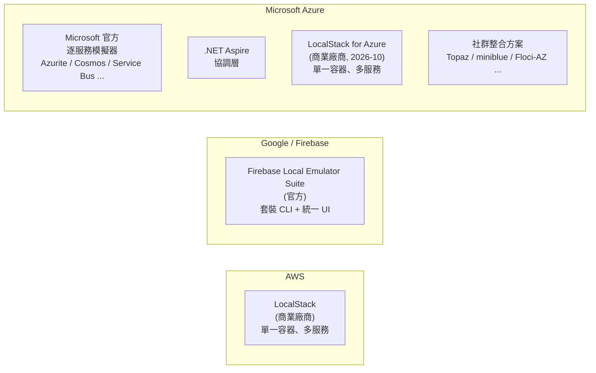

# Microsoft Azure 是否有類似 AWS LocalStack / Firebase Emulator Suite 的本機 Mock 實作？

## 摘要

**有，但型態與 AWS、Firebase 不同。**長達近十年的時間裡，Azure 的官方本機開發方案是「**逐服務、各自獨立的模擬器**」拼湊而成，沒有單一整合的本機雲端模擬環境。使用者必須自行以 Azurite（儲存體）、Cosmos DB Emulator（資料庫）、Service Bus Emulator（訊息佇列）、App Configuration Emulator（組態）等工具組裝出本機環境。這與 AWS 以 LocalStack 提供「單一容器、多服務模擬」的模式，以及 Firebase 以 LocalStack 概念更進一步推出的「Local Emulator Suite」都有明顯落差。

這個情況在 **2026 年 10 月出現根本性變化**：AWS 陣營的 LocalStack 公司於 2026-10-07 正式發表 **LocalStack for Azure（公開預覽）**，這是第一個由商業廠商提供、單一容器即可模擬大量 Azure 服務的官方級整合方案。同時，社群也出現一批「Azure 版的 LocalStack」專案（Topaz、miniblue、Floci-AZ、localaz、Armite 等）。換言之，答案從「**有零散的官方模擬器，但沒有整合方案**」演變為「**官方仍維持零散策略，但商業與社群整合方案在同一時間點大量出現**」。

本報告先界定 AWS LocalStack 與 Firebase Emulator Suite 作為對照基準，再逐一梳理 Azure 官方模擬器清單、社群非官方模擬器，以及整合型方案的現況與限制。

---

## 一、對照基準：AWS 與 Firebase 的本機模擬方案

要回答「Azure 有沒有類似的東西」，必須先明確「類似的東西」指的是什麼。

### 1.1 AWS：LocalStack

LocalStack 是 AWS 生態系中最知名的本機雲端模擬器，核心特徵是**以單一容器模擬大量 AWS 服務**，讓開發者把 SDK／CLI 的 endpoint 指向本機即可運作。LocalStack 公司後續也把同一套模式延伸到其他雲，包括 LocalStack for Snowflake，以及 2026 年的 LocalStack for Azure[^lsazure-blog]。

### 1.2 Google：Firebase Local Emulator Suite

Firebase 提供的 **Local Emulator Suite** 是一組「打包好、一致體驗」的本機模擬器，涵蓋 Firestore、Realtime Database、Cloud Storage、Authentication、Cloud Functions、Pub/Sub、Extensions、App Hosting、Data Connect／SQL Connect 等，並附帶一個統一的管理 UI（預設埠 4000）。啟動指令為 `firebase emulators:start`，也可用 `--only` 指定子集，或用 `firebase emulators:exec` 在 CI 中執行測試後自動關閉[^fb-emulator]。

Firebase 模式的特點是：**官方提供、一起安裝、一起啟動、有統一入口**——這正是長期以來 Azure 最欠缺的部分。

### 1.3 小結

| 方案 | 提供者 | 形式 | 涵蓋範圍 |
|---|---|---|---|
| LocalStack (AWS) | 商業公司 LocalStack | 單一容器、多服務 | 大量 AWS 服務 |
| Firebase Local Emulator Suite | Google 官方 | 一套 CLI + 統一 UI | Firebase 全產品線 |
| Azure（2026 年 10 月前） | Microsoft 官方 | 逐服務獨立工具 | 零散覆蓋 |
| Azure（2026 年 10 月後） | LocalStack（商業）＋社群 | 單一容器、多服務 | 逐步擴大 |

---

## 二、Azure 官方（Microsoft）本機模擬器與工具

Microsoft 至今**沒有**推出「一個模擬器涵蓋全部 Azure」的產品；官方策略是針對個別服務提供模擬器或本機執行環境。以下為主要項目。

### 2.1 Azurite（Azure Storage 模擬器）

Azurite 是 Microsoft 官方開源、以 JavaScript／Node.js 撰寫的輕量儲存體模擬器，支援 **Blob、Queue、Table** 三種儲存服務，跨平台（Windows／Linux／macOS），另有 Docker 映像與 VS Code 擴充[^azurite]。它是已淘汰的舊版 Azure Storage Emulator 的官方替代品，並持續更新以支援最新的 Azure Storage API。須注意 Azurite **不支援 Azure Files 與 Azure Data Lake Storage Gen2**，且 **Table 支援目前仍為預覽**[^azurite]。

Azurite 的 GitHub 專案（Azure/Azurite）約有 2,278 顆星[^gh-azurite]。

### 2.2 Azure Storage Emulator（已淘汰）

舊版 Azure Storage Emulator 僅能在 Windows 執行、依賴 SQL Server 2012 Express LocalDB，僅支援單一固定帳號與測試金鑰。Microsoft 已明確標示其為 **deprecated**，並建議改用 Azurite[^storage-emulator]。

### 2.3 Azure Cosmos DB Emulator（Windows 版）

Windows 版本可模擬 **NoSQL、MongoDB、Cassandra、Gremlin、Table** 等多種 API，但僅限 Windows，且不支援 Apple silicon 或 ARM 處理器（需改用 Windows 虛擬機繞道）。此版本使用一組公開已知的帳號金鑰，且**僅支援 provisioned throughput，不支援 serverless**[^cosmos-emulator]。

### 2.4 Azure Cosmos DB Emulator（Linux／Docker vNext 版）

新一代的 Cosmos DB 模擬器完全以 Linux 為基礎、以 Docker 容器形式提供，支援 x64 與 ARM64，可在 Linux、macOS、Windows 上執行。映像檔為 `mcr.microsoft.com/cosmosdb/linux/azure-cosmos-emulator:vnext-latest`[^cosmos-linux]。

但 vNext 版有明顯限制：**僅支援 NoSQL API 的 gateway 模式**、**不強制驗證（authentication enforcement 不支援）**，且 **stored procedures、triggers、UDFs 明確列為「不計畫支援」**。部分端點（offers、users、permissions、Client Encryption Keys）為 no-op，會回傳合法狀態碼但不執行實際操作[^cosmos-linux]。此版本已於 **2026-06-02 宣布 GA**[^cosmos-ga]。

### 2.5 Azure Service Bus Emulator

Microsoft 於 **2024-11-19** 在 Tech Community 部落格發表本機 Service Bus 模擬器，以 Docker 容器（Linux 基礎）形式提供，跨平台，支援以 AMQP 串流訊息，可透過設定檔或 Administration Client 管理實體[^sb-blog][^sb-emulator]。

限制包括：不支援 JMS、不支援 partitioned entities、僅支援 AMQP TCP（不支援 AMQP Web Sockets）；**容器重啟後資料與實體不會保留**；且官方明言**不提供正式支援、無 SLA、不可用於生產**[^sb-emulator]。此外，它需要**搭配一個 SQL Server 容器**作為後端相依[^sb-emulator]。其 GitHub 專案約有 274 顆星[^gh-sb]。

### 2.6 Azure Event Hubs Emulator

Event Hubs 模擬器同樣為 Linux Docker 容器，支援以 **Kafka 與 AMQP** 串流事件，可透過 JSON 設定 event hubs、partitions、consumer groups[^eh-emulator]。限制包括：Kafka 僅支援 producer／consumer API、不支援執行期動態管理操作、容器重啟後資料不保留、不支援 Entra ID 整合與 UI portal、官方不提供正式支援且不建議用於生產[^eh-emulator]。其 GitHub 專案約有 56 顆星[^gh-eh]。

### 2.7 Azure App Configuration Emulator

App Configuration 的官方模擬器為開源專案（Azure/AppConfiguration-Emulator，約 38 顆星），提供 Web UI、匿名驗證與 HMAC 驗證，支援 `/keys`、`/kv`、`/labels`、`/locks`、`/revisions`、`/snapshots` 等 API，並可與 .NET Aspire 整合。Docker 映像為 `mcr.microsoft.com/azure-app-configuration/app-configuration-emulator`[^appconfig-emulator][^gh-appconfig]。

值得注意的是，Microsoft 在 2022 年的官方問答中曾回覆「**目前沒有本機模擬器，且不在產品藍圖中**」，直到 **2025-12-08** 才有 Microsoft 員工在該討論串更新「App Configuration 團隊已發布官方模擬器」[^qa-appconfig]。這條時間線本身就說明了 Azure 官方模擬器策略是逐步、被動補齊的。

### 2.8 Azure SignalR Service Local Emulator

SignalR 也有官方的本機模擬器（`Microsoft.Azure.SignalR.Emulator`，以 .NET 工具形式安裝，指令 `asrs-emulator`）。支援 Auth、最新 REST API 與 Upstream，但**僅適用於 serverless 情境**，且只支援 Transient 傳輸類型，不支援 Persistent[^signalr-emulator]。

### 2.9 Azure Functions Core Tools（本機執行環境）

Azure Functions 的本機開發主要靠 **Azure Functions Core Tools**（`func`）。v4 為 GA，v5 為預覽（改稱 Azure Functions CLI）。它提供本機 runtime，可執行與偵錯函式，並可搭配 Azurite 滿足儲存體需求[^func-core-tools]。嚴格說，它不是「服務模擬器」，而是「服務本身的執行環境在本機重現」。其 GitHub 專案約有 1,466 顆星[^gh-func]。

### 2.10 Azure Static Web Apps CLI（SWA CLI）

SWA CLI 提供本機靜態網站伺服器、前端框架開發伺服器代理、API 代理（透過 Functions Core Tools）、**模擬驗證與授權伺服器**，以及本機路由與設定強制執行，預設服務於 `http://localhost:4280`[^swa-cli]。此工具已 GA，GitHub 專案約有 668 顆星[^gh-swa]。

### 2.11 Azure Service Fabric 本機叢集（OneBox）

Service Fabric 提供本機開發叢集（Windows 原生，或 Linux 的 OneBox 容器映像），供開發與執行微服務應用程式[^sf-get-started]。這是少數自成一格、非以 API 模擬為主的本機環境。

### 2.12 其他本機相關工具

| 工具 | 用途 | 狀態 |
|---|---|---|
| Azure SQL Edge | IoT／Edge 用的關聯式資料庫引擎（Docker） | **已於 2025-09-30 退役**，且已不支援 ARM64[^sql-edge] |
| Azure SDK Test Proxy | SDK 測試用的 record／playback HTTP 代理 | GA，屬測試基礎設施而非服務模擬器[^test-proxy-role] |
| Azure API Management Self-Hosted Gateway | 容器化的 APIM 資料平面，可於本機評估 | GA（Developer／Premium 層級）[^apim-gateway-role] |
| Microsoft Fabric 本機開發 | VS Code 擴充的 local mode | 僅為「本機開發體驗」，非服務模擬器[^fabric-local] |
| Microsoft Entra ID Auth SDK（sidecar） | 本機執行的身分驗證 sidecar（Docker Compose 範例） | 官方提供，仍會向 `login.microsoftonline.com` 取權杖[^entra-sidecar] |

### 2.13 Microsoft 官方的「整合層」：.NET Aspire

Microsoft 並未推出單一 Azure 模擬器，但透過 **.NET Aspire** 提供了一種「整合協調層」。Aspire 的 Azure 整合文件明確列出支援的本機模擬器[^aspire-overview]：

- **Azure App Configuration**：`RunAsEmulator`，使用 App Configuration Emulator
- **Azure Cosmos DB**：`RunAsEmulator`，使用 NoSQL API 模擬器
- **Microsoft Foundry**：`RunAsFoundryLocal`
- **Azure Event Hubs**：`RunAsEmulator`
- **Azure Service Bus**：`RunAsEmulator`
- **Azure SignalR Service**：`RunAsEmulator`
- **Azure Storage**：`RunAsEmulator`，使用 Azurite

另外列有「本機容器」（`RunAsContainer`）選項：Azure Cache for Redis、Azure PostgreSQL Flexible Server、Azure SQL Server，分別對應官方容器映像[^aspire-overview]。

**關鍵區別**：Aspire 的 `RunAsEmulator` **不影響發布 manifest**，發布時產生的 Bicep 仍指向真實 Azure 服務，而非本機模擬器[^aspire-overview]。Aspire 也**未提供 Azure Key Vault 的模擬器整合**[^aspire-overview]。因此 Aspire 是「開發體驗的協調者」，而非 LocalStack 式的統一雲端模擬器。

### 2.14 官方策略的歷史脈絡

回顧社群紀錄，可以清楚看到官方「沒有整合模擬器」的長期立場：

- **2021-10-13**，Microsoft Q&A 版主回覆「**AFAIK, there isn't a LocalStack equivalent for Azure**，但有一些針對特定服務的模擬器／工具」，並建議使用（當時仍在 Windows 的）Azure Storage Emulator 與 Azure Functions Core Tools[^qa-localdev]。
- **2022-09-28**，Microsoft Q&A 回覆 App Configuration「**沒有本機模擬器，且不在藍圖中**」[^qa-appconfig]。

這兩個官方回覆是最好的佐證：在 2021 至 2022 年間，Azure 官方本身就承認不存在 LocalStack 等級的整合方案。

---

## 三、社群／非官方的整合型 Azure 模擬器

2025 至 2026 年間，社群出現多個明確以「Azure 版 LocalStack」為訴求的專案。

### 3.1 Topaz（TheCloudTheory）

Topaz 主打「One binary. Multiple Azure services. No cloud required.」，以單一 process 提供 Storage、Key Vault、Service Bus、Event Hub、Container Registry、App Service、SQL、RBAC，並支援 ARM template 部署，亦模擬 Entra ID 與 RBAC 角色指派[^topaz-site]。官方網站並直接行銷其為 Azurite 的替代方案[^topaz-site]。Apache-2.0 授權，GitHub 約 **54 顆星**[^gh-topaz]——星數偏低，採用前需謹慎評估其成熟度。

### 3.2 miniblue（moabukar）

miniblue 標榜「Local Azure development. One binary. No account needed.」以單一二進位、單一埠（4566／4567）提供 26 項 Azure 服務，涵蓋 Resource Groups、Blob／Table／Queue Storage、Key Vault、Cosmos DB、Service Bus、Event Grid、App Configuration、Functions、VNet、DNS、ACR、AKS、VM、PostgreSQL／MySQL／SQL、Redis 等[^miniblue-site]。支援 Terraform（`metadata_host = "localhost:4567"`）、Pulumi、各語言 SDK，並有類似 `awslocal` 的 `azlocal` CLI[^miniblue-site]。MIT 授權，GitHub 約 **449 顆星**[^gh-miniblue]，是社群整合方案中聲量較高者。

### 3.3 Floci-AZ（floci-io）

Floci-AZ 為單一原生二進位檔，提供 Blob／Queue／Table Storage、Azure Functions、App Configuration、Cosmos DB（含 MongoDB／PostgreSQL／Cassandra／Gremlin／Table 等多 API）、Key Vault、Event Hubs、APIM、VNet、VM、Redis、ACR，統一埠為 4577，並聲稱啟動時間低於 100ms。其官方比較表直接把自己與 Azurite、Functions Core Tools 並列對照[^floci-az]。MIT 授權，GitHub 約 **764 顆星**[^gh-floci]，為此類專案中星數最高者。

### 3.4 localaz（link-society）

localaz 自述為「Vibecoded local Azure emulator inspired by LocalStack (AWS) and localgcp (GCP)」[^localaz-readme]，以 Go 撰寫、單一 Docker 容器提供 Blob／Queue／Table、Key Vault、Event Grid、Web PubSub、Service Bus、Monitor Logs、Entra ID 與 ARM control plane。GitHub 僅約 **7 顆星**[^gh-localaz]，且在 README 中自承是「vibecoded」（大致等同 AI 生成、未經嚴格工程驗證），**建議僅作實驗用途**。

### 3.5 Armite（ioflux-org）

Armite 專注於 **身分與 RBAC 的真實性**，主打 Entra token、managed identity、ARM、Key Vault 與 Blob Storage 由單一 RBAC 引擎驅動，並強調能被 `az`、各語言 SDK 與 Terraform「未經修改地」驅動，且在 Azure 會回 403 的地方也回 403[^gh-armite]。Apache-2.0 授權，但 GitHub 僅約 **7 顆星**，且專案建立於 2026-10-10[^gh-armite]，極新、成熟度未知。

### 3.6 其他較早期或零散嘗試

- **Spotflow In-Memory Azure Test SDK**：提供 Azure .NET SDK 的 drop-in fake（Storage、Event Hubs、Service Bus、Key Vault），可注入錯誤與延遲，MIT 授權，約 **37 顆星**[^gh-spotflow]。
- **localazure（jacygao）**：主打「Run azure stack locally for rapid local development and debugging」，Apache-2.0，約 **7 顆星**，最後推送時間為 2025-05-04[^gh-localazure]。
- **azure-emulators-docker（AleksNeStu）**：以 Docker Compose 打包 Cosmos DB Emulator、Azurite、Service Bus Emulator 與 Functions Runtime，但專案**已於 2026-06-22 封存**，且僅 **0 顆星**[^gh-emulators-docker]。
- **awesome-cloud-emulators**：一份整理 AWS／Azure／GCP 雲端模擬器的精選清單，約 **60 顆星**[^gh-awesome]。

---

## 四、社群／非官方的「單一服務」Azure 模擬器（補官方之不足）

在整合型方案之外，社群也針對官方缺乏模擬器的服務進行補位，最明顯的是 **Key Vault** 與 **Entra ID**。

### 4.1 Key Vault 模擬器

| 專案 | 語言 | 星數 | 說明 |
|---|---|---|---|
| azure-keyvault-emulator（james-gould） | C# | 約 328[^gh-keyvault-jg] | 最知名者，支援 Azure SDK 的 SecretClient／KeyClient／CertificateClient，可搭配 Docker 與 .NET Aspire。作者於 2025-04-30 發表介紹文[^keyvault-jg-blog] |
| lowkey-vault（nagyesta） | Java | 約 112[^gh-lowkey] | Key Vault 的測試替身（test double），支援 key／secret API。2022-05 即在 Stack Overflow 被推薦[^so-vault] |
| volt（sebastiean） | TypeScript | 約 38[^gh-volt] | 受 Azurite 啟發的 Key Vault API 相容模擬器，但最後推送為 2021-02-16[^gh-volt] |
| azure-keyvault-emulator（calvinchengx） | Go | 0[^gh-keyvault-cx] | 單一 Go 二進位、真實 RSA／EC 密碼學與 X.509 簽發，並可對接 entra-emulator |
| vault-emu（MichalMoudry） | — | — | 社群自建的 Key Vault 模擬器[^vault-emu] |
| azure-keyvault-emulator（rokeller） | — | — | 另一社群實作[^vault-rokeller] |

Key Vault 之所以成為社群補位的重點，正是因為 Microsoft 長期未提供官方模擬器。james-gould 在介紹文中明確指出：「Microsoft 針對遭遇相同困境的產品發布了模擬器，例如 Azure Service Bus 已有官方 Emulator……**可惜 Azure Key Vault 沒有類似的替代方案**」[^keyvault-jg-blog]。

### 4.2 Entra ID（Azure AD）模擬器

身分驗證是 Azure 開發中最難本機化的部分，也是社群最活躍的領域：

| 專案 | 語言 | 星數 | 說明 |
|---|---|---|---|
| entra-local（cmaneu） | TypeScript | 約 61[^gh-entra-local] | MSAL 相容的 OIDC／OAuth2 模擬器，含最小 Graph 與管理入口 |
| entra-emulator（calvinchengx） | Go | 3[^gh-entra-emulator] | 單一 Go 二進位，主打真實 RS256 token，並聲稱已對 Microsoft 自家 MSAL（五種語言）驗證 |
| entra-id-emulator（jctanner） | Python | 1[^gh-entra-jctanner] | 輕量 OIDC／OAuth2 端點與管理 API |
| Microsoft Entra ID Emulator (microsoft.emulators.dev) | — | — | 第三方提供的 stateful OAuth2／OIDC 與 Graph 子集[^entra-emu-dev] |

值得注意的是，Microsoft 官方對「Azure AD 沒有 LocalStack 等效方案」的立場相當明確：2021-10 的 Q&A 中被問到是否有 Azure AD 的 LocalStack 等效物時，版主回覆「AFAIK, there isn't a LocalStack equivalent for Azure」，發問者最後表示「**很遺憾……沒有任何 Docker 映像能模擬它，只能用 mockserver 來 mock 回應**」[^qa-localdev]。

### 4.3 App Configuration 模擬器（社群版）

在官方模擬器出現前，社群已有實作：

- **feature23/AzureAppConfigurationEmulator**：衍生自 tnc1997 的專案，README 明確標示「not endorsed by Microsoft」，約 2 顆星[^gh-appconfig-feature23]。
- **tnc1997/azure-app-configuration-emulator**：原始專案，C# 撰寫，約 14 顆星，支援 HMAC 與 Entra ID 驗證，並提供 Docker 映像[^gh-appconfig-tnc]。

### 4.4 Service Bus 模擬器（官方出現前的社群版）

在官方 Service Bus Emulator 推出前，社群以 **Lazvard**（lazvard-message，PejmanNik）填補空缺。Lazvard 是以 C# 撰寫、部署簡單的 AMQP 伺服器，作為 Azure Service Bus 的模擬器，約 **73 顆星**，MIT 授權[^gh-lazvard]。一篇 2025-03-05 的技術部落格即說明：由於「Azure Service Bus 在撰寫時沒有官方模擬器」，因此推薦社群替代品 Lazvard[^instilledbee]。

---

## 五、關鍵轉折：LocalStack for Azure（2026-10-07 公開預覽）

最直接回應本題的答案，是 2026 年 10 月的最新發展：**LocalStack 公司自己推出了 Azure 版本**。

### 5.1 發布內容

LocalStack 於 **2026-10-07** 在官方部落格宣布 **LocalStack for Azure 進入公開預覽（Public Preview）**，訴求為「Run core Azure services on your own machine」，並明確定位為「**local Azure sandbox where developers and AI agents can build, test, and validate Azure applications before anything touches live Azure resources**」[^lsazure-blog]。

公開預覽期間**完全免費、自助註冊**，GA 預計在 **2027 年初**，屆時才會公布定價[^lsazure-blog]。

### 5.2 支援的服務範圍

根據官方產品頁與文件，公開預覽涵蓋 23 個 resource provider、48 項服務[^lsazure-services]，主要分組為[^lsazure-product]：

- **容器**：AKS、Container Apps、Container Instances、Container Registry
- **Serverless 與資料**：Functions、App Service (Web Apps)、Cosmos DB（NoSQL／MongoDB）、SQL Database、PostgreSQL
- **儲存體**：Storage Account（Blob／Queue／Table）
- **訊息與事件**：Service Bus、Event Hubs、Event Grid
- **安全與身分**：Key Vault、App Configuration、Managed Identity、RBAC
- **網路與交付**：VNet／subnet、Private Endpoint、Private DNS、NAT Gateway、Route table、NIC、Front Door／CDN、API Management
- **監控與管理**：Azure Monitor、Application Insights、Log Analytics、Resource Graph、Resource Manager
- **IaC 與工具**：ARM、Bicep、Terraform、Pulumi、Azure CLI、azd

### 5.3 重要限制

- **不宣稱完整對等**：官方明確表示「We focus on the services typical enterprise dev/test workflows depend on, rather than claiming parity with all of Azure」，且 Key Vault、Managed Identity、Private Endpoint 標註為「mocked where applicable」[^lsazure-blog]。
- **開發者體驗功能缺席**：App Inspector、snapshots、chaos／resiliency API 在預覽階段不提供[^lsazure-blog]。
- **API 覆蓋率有限**：以逐服務頁面呈現，例如 App Services 僅實作 616 個操作中的 143 個、AKS 實作 126 個中的 77 個[^lsazure-services]。
- **狀態不持久**：多數服務的狀態存於記憶體，重啟即遺失；AKS 叢集不存活於模擬器重啟[^lsazure-services]。

### 5.4 發展時程

LocalStack for Azure 並非突然出現，其脈絡為[^lsazure-history]：

| 時間 | 事件 |
|---|---|
| 2024 下半年 | alpha 映像 `localstack/localstack-azure-alpha` 出現（build date 2024-10-03），社群開始討論「LocalStack for Azure is in the works」 |
| 2025 年初 | 文件站 `azure.localstack.cloud/introduction/` 上線並被 Internet Archive 收錄（2025-01-27） |
| 2025-11 | 於 KubeCon North America 2025 宣布 Azure emulator 進入 closed beta |
| **2026-10-07** | **公開預覽（Public Preview）發布** |
| 2027 初（預期） | GA |

---

## 六、綜合比較

### 6.1 三雲本機模擬策略對照

### 6.2 Azure 官方模擬器一覽

| 模擬器 | 對應服務 | 形式 | 狀態 |
|---|---|---|---|
| Azurite | Blob／Queue／Table Storage | 跨平台 Node.js／Docker | GA（Table 為預覽）[^azurite] |
| Storage Emulator | Blob／Queue／Table Storage | Windows 專用 | 已淘汰[^storage-emulator] |
| Cosmos DB Emulator (Windows) | Cosmos DB（多 API） | Windows 原生 | GA[^cosmos-emulator] |
| Cosmos DB Emulator (Linux vNext) | Cosmos DB（NoSQL） | Docker | GA（2026-06-02）[^cosmos-ga] |
| Service Bus Emulator | Service Bus | Docker（需 SQL Server） | 已發布、無正式支援[^sb-emulator] |
| Event Hubs Emulator | Event Hubs | Docker | 已發布、無正式支援[^eh-emulator] |
| App Configuration Emulator | App Configuration | Docker／開源 | 已發布[^appconfig-emulator] |
| SignalR Local Emulator | SignalR（serverless） | .NET 工具 | 已發布[^signalr-emulator] |
| Functions Core Tools | Azure Functions runtime | 跨平台 CLI | v4 GA[^func-core-tools] |
| Static Web Apps CLI | Static Web Apps | npm | GA[^swa-cli] |
| Service Fabric 本機叢集 | Service Fabric | Windows／Linux OneBox | GA[^sf-get-started] |
| Azure SQL Edge | SQL Server 引擎（IoT） | Docker | **2025-09-30 退役**[^sql-edge] |

### 6.3 社群整合型方案一覽

| 專案 | 語言 | 星數 | 特色 |
|---|---|---|---|
| Floci-AZ | Java | 約 764[^gh-floci] | 單一原生二進位、統一埠 4577、多 API |
| miniblue | Go | 約 449[^gh-miniblue] | 單一二進位、26 服務、azlocal CLI |
| Topaz | C# | 約 54[^gh-topaz] | ARM 部署、Entra ID 與 RBAC |
| localaz | Go | 約 7[^gh-localaz] | 自承「vibecoded」，實驗性 |
| Armite | Go | 約 7[^gh-armite] | 強調真實 RBAC 與 Entra token |

---

## 七、批判性反思

### 7.1 來源的時效性風險

本主題的關鍵事實變動極快。**2026-10-07 的 LocalStack for Azure 公開預覽**距離今日（2026-10-12）僅約五天，公開預覽的實際穩定性、真實使用者回饋與 API 相容性都尚未經過時間檢驗。同樣地，Topaz、miniblue、Armite 等社群專案在 2026 年才快速成形，其程式碼品質、維護持續性與長期存活率均高度不確定。讀者應把本報告視為「快照」，而非長期結論。

### 7.2 星數與成熟度的落差

依本專案規則，低於約 100 顆星的專案需審慎評估。本報告中：

- **Floci-AZ（764）與 miniblue（449）** 屬相對可信的社群整合方案，但仍遠低於 Azurite（2,278）這種官方且長期維護的專案。
- **Topaz（54）、localaz（7）、Armite（7）、localazure（7）** 星數偏低。其中 localaz 自承「vibecoded」、Armite 專案建立於 2026-10-10（僅兩天前），成熟度極低。本報告仍收錄這些專案，是因為 Azure 生態系中「整合型模擬器」本就稀缺，低星數本身即是該領域現況的資訊。

### 7.3 官方敘事的偏誤

Microsoft 官方文件在描述模擬器時，一律附帶「**不可用於生產、不提供正式支援、無 SLA**」的免責聲明[^sb-emulator][^eh-emulator]。這是合理的風險聲明，但也意味著官方模擬器在功能覆蓋與長期維護上缺乏承諾。相對地，LocalStack for Azure 的官方文案則強調「不宣稱與整個 Azure 對等」，同樣是刻意降低期待。**兩者都傾向於把模擬器定位為「輔助」，而非「替代」。**

### 7.4 未解的結構性缺口

即使到了 2026 年 10 月，仍有明顯缺口：

- **Azure Files 與 Data Lake Storage Gen2 缺乏模擬器**（Azurite 明確不支援）[^azurite]。
- **Key Vault 至今沒有 Microsoft 官方模擬器**，必須仰賴社群專案或 LocalStack for Azure 的「mocked where applicable」[^keyvault-jg-blog][^lsazure-blog]。
- **Entra ID 沒有官方模擬器**，且因 MSAL 等 SDK 難以重新導向 endpoint，社群方案各有相容性取捨[^qa-localdev]。
- **.NET Aspire 的 `RunAsEmulator` 不影響發布產物**，本機與雲端的落差仍需開發者自行承擔[^aspire-overview]。

### 7.5 來源可信度排序

綜合評估，本報告引用的來源可信度大致為：

1. **Microsoft Learn 官方文件**（Azurite、Service Bus、Event Hubs、Cosmos DB、SignalR 等頁面）——最高，但需注意部分頁面更新於 2026 年、會隨時間變動。
2. **官方 GitHub 專案 metadata**（Azure/Azurite、Azure/AppConfiguration-Emulator 等）——用於星數、授權、建立與最後推送時間的客觀佐證。
3. **LocalStack 官方部落格與產品頁**——一手資訊，但具商業行銷性質，服務覆蓋與限制需對照其技術文件。
4. **Microsoft Q&A 與 Stack Overflow**——反映歷史脈絡與社群真實困境，但屬個人意見，且部分回答已過時（例如 2021 年稱「無 LocalStack 等效方案」）。
5. **社群專案 README 與部落格**——用於了解動機與功能宣稱，但未經第三方驗證。

---

## 八、結論

**Azure 確實有本機 mock／模擬實作，但長期以來的形式與 AWS、Firebase 不同。**

- **官方層面**：Microsoft 提供的是**逐服務、各自獨立的模擬器與本機工具**（Azurite、Cosmos DB Emulator、Service Bus Emulator、Event Hubs Emulator、App Configuration Emulator、SignalR Emulator、Functions Core Tools、SWA CLI 等），再加上 .NET Aspire 作為開發體驗的協調層。Microsoft 自己曾在 2021 年明確表示「沒有 Azure 版的 LocalStack」[^qa-localdev]。
- **商業層面**：**LocalStack for Azure 於 2026-10-07 進入公開預覽**，是第一個由商業廠商提供、單一容器模擬大量 Azure 服務的整合方案，但仍在早期，且不宣稱完整對等[^lsazure-blog]。
- **社群層面**：出現一批「Azure 版 LocalStack」專案（Floci-AZ、miniblue、Topaz、localaz、Armite），以及針對官方缺口（Key Vault、Entra ID、App Configuration、Service Bus）的單一服務模擬器。其中僅 Floci-AZ 與 miniblue 的星數達到相對可信的水準，其餘多屬實驗階段。

因此，若問題是「**Azure 有沒有類似 AWS LocalStack 或 Firebase Emulator Suite 的東西**」，答案是：**過去十年只有零散的官方模擬器，沒有官方整合方案；但自 2026 年 10 月起，商業（LocalStack for Azure）與社群（Floci-AZ、miniblue 等）兩條路線同時提供了整合型選項，只是成熟度與覆蓋率仍不及 AWS、Firebase 的既有方案。**

---

## 參考文獻

[^lsazure-blog]: LocalStack Team. (2026, October 7). *LocalStack for Azure is now in Public Preview*. LocalStack Blog. Retrieved 2026-10-12, from https://blog.localstack.cloud/localstack-for-azure-public-preview/

[^lsazure-product]: LocalStack. (n.d.). *LocalStack for Azure*. Retrieved 2026-10-12, from https://www.localstack.cloud/localstack-for-azure

[^lsazure-services]: LocalStack. (n.d.). *Local Azure Services*. LocalStack Docs. Retrieved 2026-10-12, from https://docs.localstack.cloud/azure/services/

[^lsazure-history]: LocalStack. (n.d.). *Welcome to LocalStack for Azure Docs*. Retrieved 2026-10-12, from https://docs.localstack.cloud/azure/

[^fb-emulator]: Google. (n.d.). *Introduction to Firebase Local Emulator Suite*. Firebase Documentation. Retrieved 2026-10-12, from https://firebase.google.com/docs/emulator-suite

[^azurite]: Microsoft. (2025, August 26). *Use the Azurite emulator for local Azure Storage development*. Microsoft Learn. Retrieved 2026-10-12, from https://learn.microsoft.com/en-us/azure/storage/common/storage-use-azurite

[^storage-emulator]: Microsoft. (2026, August 11). *Use the Azure Storage Emulator for development and testing (deprecated)*. Microsoft Learn. Retrieved 2026-10-12, from https://learn.microsoft.com/en-us/azure/storage/common/storage-use-emulator

[^cosmos-emulator]: Microsoft. (2026, September 1). *What is the Azure Cosmos DB emulator?* Microsoft Learn. Retrieved 2026-10-12, from https://learn.microsoft.com/en-us/azure/cosmos-db/emulator

[^cosmos-linux]: Microsoft. (2026, October 7). *Linux-based emulator - vNext*. Microsoft Learn. Retrieved 2026-10-12, from https://learn.microsoft.com/en-us/azure/cosmos-db/emulator-linux

[^cosmos-ga]: Microsoft. (2026, June 2). *Generally Available: Azure Cosmos DB Linux emulator (vNext)*. Azure Updates. Retrieved 2026-10-12, from https://azure.microsoft.com/updates?id=562754

[^sb-blog]: Glodha, S. (2024, November 19). *Introducing Local emulator for Azure Service Bus*. Microsoft Tech Community. Retrieved 2026-10-12, from https://techcommunity.microsoft.com/blog/messagingonazureblog/introducing-local-emulator-for-azure-service-bus/4304457

[^sb-emulator]: Microsoft. (2026, September 19). *Overview of the Azure Service Bus emulator*. Microsoft Learn. Retrieved 2026-10-12, from https://learn.microsoft.com/en-us/azure/service-bus-messaging/overview-emulator

[^eh-emulator]: Microsoft. (2026, August 26). *Azure Event Hubs emulator overview*. Microsoft Learn. Retrieved 2026-10-12, from https://learn.microsoft.com/en-us/azure/event-hubs/overview-emulator

[^appconfig-emulator]: Microsoft. (2026, September 4). *Azure App Configuration emulator overview*. Microsoft Learn. Retrieved 2026-10-12, from https://learn.microsoft.com/en-us/azure/azure-app-configuration/emulator-overview

[^signalr-emulator]: Microsoft. (2025, December 12). *Use Azure SignalR Local Emulator for serverless development*. Microsoft Learn. Retrieved 2026-10-12, from https://learn.microsoft.com/en-us/azure/azure-signalr/signalr-howto-emulator

[^func-core-tools]: Microsoft. (n.d.). *Develop Azure Functions locally by using Core Tools*. Microsoft Learn. Retrieved 2026-10-12, from https://learn.microsoft.com/en-us/azure/azure-functions/functions-run-local

[^swa-cli]: Microsoft. (2024, December 18). *About the Azure Static Web Apps CLI*. Microsoft Learn. Retrieved 2026-10-12, from https://learn.microsoft.com/en-us/azure/static-web-apps/static-web-apps-cli-overview

[^sf-get-started]: Microsoft. (2026, August 19). *Prepare your development environment on Windows*. Microsoft Learn. Retrieved 2026-10-12, from https://learn.microsoft.com/en-us/azure/service-fabric/service-fabric-get-started

[^sql-edge]: Microsoft. (2024, September 21). *What is Azure SQL Edge?* Microsoft Learn. Retrieved 2026-10-12, from https://learn.microsoft.com/en-us/azure/azure-sql-edge/overview

[^aspire-overview]: Aspire. (n.d.). *Azure integrations overview*. Retrieved 2026-10-12, from https://aspire.dev/integrations/cloud/azure/overview/

[^qa-localdev]: Microsoft. (2021, October 13). *Local development with Azure Services, specifically Azure AD*. Microsoft Q&A. Retrieved 2026-10-12, from https://learn.microsoft.com/en-us/answers/questions/579764/local-development-with-azure-services-specifically

[^qa-appconfig]: Microsoft. (2022, September 28). *Is there an emulator for Azure App Configuration for local development*. Microsoft Q&A. Retrieved 2026-10-12, from https://learn.microsoft.com/en-us/answers/questions/1027361/is-there-an-emulator-for-azure-app-configuration-f

[^entra-sidecar]: Microsoft. (2026, June 16). *Run the Microsoft Entra ID Auth SDK (sidecar) for local development*. Microsoft Learn. Retrieved 2026-10-12, from https://learn.microsoft.com/en-us/entra/agent-id/sidecar-local-development

[^keyvault-jg-blog]: Gould, J. (2025, April 30). *Introducing the Azure Key Vault Emulator*. Practical .NET. Retrieved 2026-10-12, from https://jamesgould.dev/posts/Azure-Key-Vault-Emulator/

[^instilledbee]: The Ultimate Nerd. (2025, March 5). *Self-Hosting Azure Resources for Local Development*. Retrieved 2026-10-12, from https://instilledbee.net/blog/posts/local-development-with-azure-resources-guide

[^topaz-site]: The Cloud Theory. (n.d.). *Azure emulator for local development and learning*. Retrieved 2026-10-12, from https://topaz.thecloudtheory.com/

[^miniblue-site]: miniblue. (n.d.). *Local Azure development. One binary. No account needed.* Retrieved 2026-10-12, from https://miniblue.io/

[^floci-az]: floci-io. (n.d.). *Floci-AZ*. Retrieved 2026-10-12, from https://floci.io/floci-az/

[^localaz-readme]: link-society. (2026). *localaz: Vibecoded local Azure emulator inspired by LocalStack (AWS) and localgcp (GCP)* [Computer software]. GitHub. Retrieved 2026-10-12, from https://github.com/link-society/localaz

[^gh-azurite]: Azure. (n.d.). *Azurite: A lightweight server clone of Azure Storage* [Computer software]. GitHub. Retrieved 2026-10-12, from https://github.com/Azure/Azurite

[^gh-sb]: Azure. (n.d.). *azure-service-bus-emulator-installer* [Computer software]. GitHub. Retrieved 2026-10-12, from https://github.com/Azure/azure-service-bus-emulator-installer

[^gh-eh]: Azure. (n.d.). *azure-event-hubs-emulator-installer* [Computer software]. GitHub. Retrieved 2026-10-12, from https://github.com/Azure/azure-event-hubs-emulator-installer

[^gh-appconfig]: Azure. (n.d.). *AppConfiguration-Emulator* [Computer software]. GitHub. Retrieved 2026-10-12, from https://github.com/Azure/AppConfiguration-Emulator

[^gh-func]: Azure. (n.d.). *azure-functions-core-tools: Command line tools for Azure Functions* [Computer software]. GitHub. Retrieved 2026-10-12, from https://github.com/Azure/azure-functions-core-tools

[^gh-swa]: Azure. (n.d.). *static-web-apps-cli: Azure Static Web Apps CLI* [Computer software]. GitHub. Retrieved 2026-10-12, from https://github.com/Azure/static-web-apps-cli

[^gh-topaz]: TheCloudTheory. (n.d.). *Topaz: One binary. Multiple Azure services. No cloud required* [Computer software]. GitHub. Retrieved 2026-10-12, from https://github.com/TheCloudTheory/Topaz

[^gh-miniblue]: moabukar. (n.d.). *miniblue: Local Azure development. One binary.* [Computer software]. GitHub. Retrieved 2026-10-12, from https://github.com/moabukar/miniblue

[^gh-floci]: floci-io. (n.d.). *floci-az: Light, fluffy, and always free - Local Azure Emulator* [Computer software]. GitHub. Retrieved 2026-10-12, from https://github.com/floci-io/floci-az

[^gh-localaz]: link-society. (n.d.). *localaz* [Computer software]. GitHub. Retrieved 2026-10-12, from https://github.com/link-society/localaz

[^gh-armite]: ioflux-org. (n.d.). *armite: A local Azure emulator with real identity and RBAC* [Computer software]. GitHub. Retrieved 2026-10-12, from https://github.com/ioflux-org/armite

[^gh-spotflow]: spotflow-io. (n.d.). *In-Memory Azure Test SDK* [Computer software]. GitHub. Retrieved 2026-10-12, from https://github.com/spotflow-io/in-memory-azure-test-sdk

[^gh-localazure]: jacygao. (n.d.). *localazure: Run azure stack locally for rapid local development and debugging* [Computer software]. GitHub. Retrieved 2026-10-12, from https://github.com/jacygao/localazure

[^gh-emulators-docker]: AleksNeStu. (n.d.). *azure-emulators-docker* [Computer software]. GitHub. Retrieved 2026-10-12, from https://github.com/AleksNeStu/azure-emulators-docker

[^gh-awesome]: upgundecha. (n.d.). *awesome-cloud-emulators* [Computer software]. GitHub. Retrieved 2026-10-12, from https://github.com/upgundecha/awesome-cloud-emulators

[^gh-keyvault-jg]: james-gould. (n.d.). *azure-keyvault-emulator: An emulator for Azure Key Vault* [Computer software]. GitHub. Retrieved 2026-10-12, from https://github.com/james-gould/azure-keyvault-emulator

[^gh-keyvault-cx]: calvinchengx. (n.d.). *azure-keyvault-emulator: Local Azure Key Vault data plane in one Go binary* [Computer software]. GitHub. Retrieved 2026-10-12, from https://github.com/calvinchengx/azure-keyvault-emulator

[^gh-lowkey]: nagyesta. (n.d.). *Lowkey Vault: a small test double for Azure Key Vault* [Computer software]. GitHub. Retrieved 2026-10-12, from https://github.com/nagyesta/lowkey-vault

[^gh-volt]: sebastiean. (n.d.). *volt: An open source Azure Key Vault API compatible server (emulator)* [Computer software]. GitHub. Retrieved 2026-10-12, from https://github.com/sebastiean/volt

[^vault-emu]: MichalMoudry. (n.d.). *vault-emu* [Computer software]. Codeberg. Retrieved 2026-10-12, from https://codeberg.org/MichalMoudry/vault-emu

[^vault-rokeller]: rokeller. (n.d.). *azure-keyvault-emulator* [Computer software]. GitHub. Retrieved 2026-10-12, from https://github.com/rokeller/azure-keyvault-emulator

[^gh-entra-local]: cmaneu. (n.d.). *entra-local: A local Entra ID emulator for application developers that need to mock authentication* [Computer software]. GitHub. Retrieved 2026-10-12, from https://github.com/cmaneu/entra-local

[^gh-entra-emulator]: calvinchengx. (n.d.). *entra-emulator: Local Microsoft Entra ID emulator in one Go binary* [Computer software]. GitHub. Retrieved 2026-10-12, from https://github.com/calvinchengx/entra-emulator

[^gh-entra-jctanner]: jctanner. (n.d.). *entra-id-emulator: A lightweight Entra ID (Azure AD) emulator* [Computer software]. GitHub. Retrieved 2026-10-12, from https://github.com/jctanner/entra-id-emulator

[^entra-emu-dev]: Microsoft Emulators. (n.d.). *Microsoft Entra ID Emulator*. Retrieved 2026-10-12, from https://microsoft.emulators.dev/

[^gh-appconfig-feature23]: feature23. (n.d.). *AzureAppConfigurationEmulator: An emulator for the Azure App Configuration service* [Computer software]. GitHub. Retrieved 2026-10-12, from https://github.com/feature23/AzureAppConfigurationEmulator

[^gh-appconfig-tnc]: tnc1997. (n.d.). *azure-app-configuration-emulator* [Computer software]. GitHub. Retrieved 2026-10-12, from https://github.com/tnc1997/azure-app-configuration-emulator

[^gh-lazvard]: PejmanNik. (n.d.). *lazvard-message: lightweight AMQP server - Azure Service Bus simulator* [Computer software]. GitHub. Retrieved 2026-10-12, from https://github.com/PejmanNik/lazvard-message

[^so-vault]: Stack Overflow. (2022). *Azure Vault Running Locally*. Retrieved 2026-10-12, from https://stackoverflow.com/questions/64137205/azure-vault-running-locally

[^test-proxy-role]: Azure. (n.d.). *Azure SDK Test Proxy* [Computer software]. GitHub. Retrieved 2026-10-12, from https://github.com/Azure/azure-sdk-tools/tree/main/tools/test-proxy

[^apim-gateway-role]: Microsoft. (n.d.). *Self-hosted gateway overview*. Microsoft Learn. Retrieved 2026-10-12, from https://learn.microsoft.com/en-us/azure/api-management/self-hosted-gateway-overview

[^fabric-local]: Microsoft. (n.d.). *Author notebooks with the VS Code extension*. Microsoft Learn. Retrieved 2026-10-12, from https://learn.microsoft.com/en-us/fabric/data-engineering/author-notebook-with-vs-code
