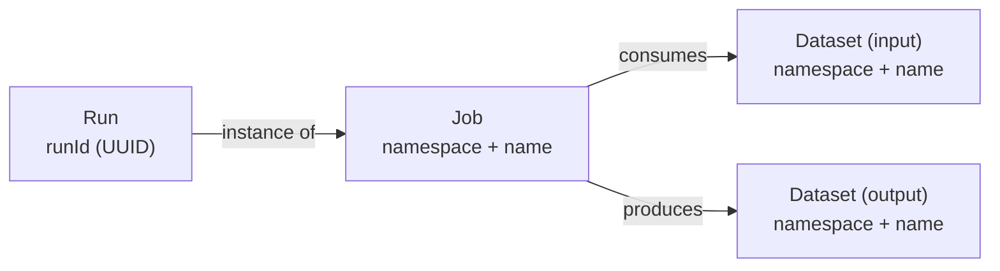
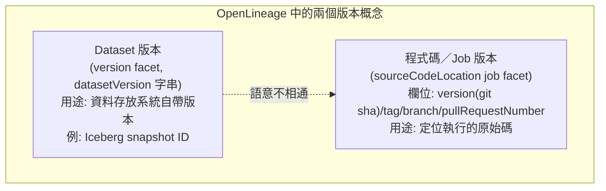
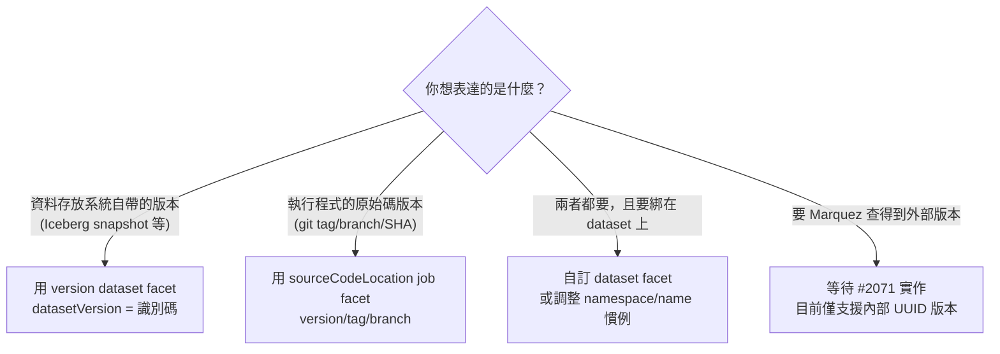

# OpenLineage 能否描述「某個 Dataset 實例的特定版本」？以 GitHub 的 tag 或 branch 為例

## 摘要

**可以，但有限制。** OpenLineage 核心規格確實提供了描述「某個 dataset 實例的特定版本」的機制：一個名為 `version` 的 dataset facet（其 JSON Schema 名稱為 `DatasetVersionDatasetFacet`），它只有一個必填欄位 `datasetVersion`，型別為字串[^ol-versionfacet][^ol-versionjson]。然而，這個版本字串對 OpenLineage 而言是**不透明的（opaque）**：規格只用它來承接「資料存放系統本身已定義版本」的情境，例如 Iceberg 的 snapshot ID[^ol-model]。

至於 **GitHub 的 tag 或 branch**：OpenLineage **沒有**把 git 分支、標籤或 commit 建模成 dataset 版本的概念。git 的 branch、tag、commit SHA 只出現在一個 **Job facet**（`SourceCodeLocationJobFacet`）中，用來描述「工作（Job）的原始碼位置」，而不是 dataset 的版本[^ol-scl][^ol-scljson]。因此，若想用 git tag/branch 表示「某個 dataset 實例的特定版本」，目前在規格層面沒有直接支援，只能靠 (a) 把 tag/branch 塞進不透明的 `datasetVersion` 字串，或 (b) 自訂 facet，兩者都屬於非標準慣例。

本文以下依序說明物件模型、版本 facet、git 相關 facet、Marquez 後端的實作，最後給出實務建議與批判性反思。

---

## 一、問題拆解

使用者提問可拆成兩個子問題：

1. OpenLineage 是否有一種通用機制，能描述「某個 dataset **實例**的**特定版本**」？（類似於「同一張表，但這是第 3 版」）
2. 若該版本的識別方式是 **GitHub 的 tag 或 branch**（例如 `v1.2.3`、`main`），OpenLineage 是否能表達？

這兩個問題的答案不同：第一題是「有，但只是不透明字串」；第二題是「規格沒有針對 git 的 dataset 版本語意，git 概念被放在 Job 上」。

---

## 二、OpenLineage 物件模型回顧

OpenLineage 的核心物件模型由三個實體構成：**Job**、**Run**、**Dataset**，並透過 **facet** 進行擴充[^ol-model]。

| 實體 | 識別方式 | 說明 |
|:--|:--|:--|
| Job | `namespace` + `name` | 一個「離散工作」的抽象，例如 cron 執行的 Python 腳本 |
| Run | `runId`（UUID） | Job 的一次執行實例 |
| Dataset | `namespace` + `name` | 資料的抽象表示，例如資料庫的 table、物件儲存的一個 object |

規格明確指出：Dataset 具備「在 namespace 內唯一的 name，且由其實體位置推導而來（即 `db.host.database.schema.table`）；namespace 與 name 的組合應足以在資料生態系中唯一識別它」[^ol-model]。



值得注意的是：規格對「Dataset 何時改變」的敘述是「當一個寫入它的 job 完成時，通常該 Dataset 就改變了」，而「每次 Run 都不同的資訊」則放在 Input/Output facet 中（例如指出讀寫了哪個時間分區）[^ol-model]。這暗示 dataset 本身的識別是相對穩定的（namespace + name），而「版本」是一個附加的維度。

---

## 三、描述「特定版本」的機制：Version Facet

### 3.1 規格敘述

在物件模型的 Dataset Facets 清單中，有一個條目寫著[^ol-model]：

> **version**: Captures the dataset version when versioning is defined by the data store (e.g.. Iceberg snapshot ID)

也就是說，這個 facet 的用途明確限定在「當**資料存放系統本身**定義了版本」時，例如 Apache Iceberg 的 snapshot ID。

### 3.2 Schema 內容

對應的 JSON Schema 為 `DatasetVersionDatasetFacet`，其內容如下（節錄）[^ol-versionjson]：

```json
{
  "$defs": {
    "DatasetVersionDatasetFacet": {
      "allOf": [
        { "$ref": "https://openlineage.io/spec/2-0-2/OpenLineage.json#/$defs/DatasetFacet" },
        {
          "type": "object",
          "properties": {
            "datasetVersion": {
              "description": "The version of the dataset.",
              "type": "string"
            }
          },
          "additionalProperties": true,
          "required": ["datasetVersion"]
        }
      ],
      "type": "object"
    }
  },
  "properties": {
    "version": { "$ref": "#/$defs/DatasetVersionDatasetFacet" }
  }
}
```

重點整理：

- **facet 掛載鍵（key）是 `version`**，寫在 dataset 的 `facets` 物件中。
- **唯一必填欄位是 `datasetVersion`**，型別為 `string`，描述僅有「The version of the dataset.」。
- 它繼承標準的 `DatasetFacet`，因此也帶有 `_producer` 與 `_schemaURL` 兩個必要欄位[^ol-custom]。
- 它是「通用 dataset facet」，可用於 `inputs` 與 `outputs`（不是 `inputFacets`/`outputFacets`）。

官方文件的範例長這樣[^ol-versionfacet]：

```json
{
  "inputs": {
    "facets": {
      "version": {
        "_producer": "https://some.producer.com/version/1.0",
        "_schemaURL": "https://openlineage.io/spec/facets/1-0-0/DatasetVersionDatasetFacet.json",
        "datasetVersion": "1"
      }
    }
  }
}
```

### 3.3 這個 facet 的來歷

此 facet 源自一個提案：OpenLineage issue #976「Facet for Dataset Version ID」，於 2022-08-01 由 `RNHTTR` 提出，動機是「某些資料工具（如 Iceberg 與 Delta）已內建資料表版本系統，因此 OpenLineage 應支援以 facet 形式發佈 dataset 版本 ID」，並引用了 Marquez 上關於 dataset versions 的討論[^ol-976]。該 issue 在當天即由 `collado-mike` 回覆指向**既有的** `DatasetVersionDatasetFacet.json` 規格檔，最終在 2024-09-20 被關閉為 completed[^ol-976]。換言之，規格層面認為此需求「本來就已存在對應機制」。

值得注意的是，該 issue 的討論**完全沒有提及 git tag、branch 或 commit**；其版本概念環繞在 Iceberg 與 Delta 這類資料湖表格版本上[^ol-976]。

---

## 四、git 的 tag / branch 出現在哪裡？答案是 Job，不是 Dataset

OpenLineage 規格中唯一具備 git 概念的 facet 是 **`SourceCodeLocationJobFacet`**，它是一個 **Job facet**，描述「原始碼所在位置」[^ol-scl]。

其 JSON Schema 欄位如下[^ol-scljson]：

| 欄位 | 型別 | 描述（原文） |
|:--|:--|:--|
| `type` | string | the source control system（例：`git\|svn`）|
| `url` | string (uri) | the full http URL to locate the file |
| `repoUrl` | string | the URL to the repository |
| `path` | string | the path in the repo containing the source files |
| `version` | string | the current version deployed (not a branch name, the actual unique version)（例：git sha）|
| `tag` | string | optional tag name |
| `branch` | string | optional branch name |
| `pullRequestNumber` | string | optional pull request or merge request number associated with a CI run |

必填欄位為 `type` 與 `url`[^ol-scljson]。官方文件範例[^ol-scl]：

```json
{
  "job": {
    "facets": {
      "sourceCodeLocation": {
        "_producer": "https://some.producer.com/version/1.0",
        "_schemaURL": "https://github.com/OpenLineage/OpenLineage/blob/main/spec/facets/SourceCodeLocationJobFacet.json",
        "type": "git|svn",
        "url": "https://github.com/MarquezProject/marquez-airflow-quickstart/blob/693e35482bc2e526ced2b5f9f76ef83dec6ec691/dags/hello.py",
        "repoUrl": "git@github.com:{org}/{repo}.git or https://github.com/{org}/{repo}.git|svn://<your_ip>/<repository_name>",
        "path": "path/to/my/dags",
        "version": "git: the git sha | Svn: the revision number",
        "tag": "example",
        "branch": "main"
      }
    }
  }
}
```

這裡有幾個對本題至關重要的觀察：

1. **它是 Job facet**，schema 內引用的是 `JobFacet`（`"$ref": ".../OpenLineage.json#/$defs/JobFacet"`）[^ol-scljson]，不是 dataset。
2. `version` 欄位的描述明確寫著「**不是分支名稱，而是實際的唯一版本**（not a branch name, the actual unique version）」，例如 git SHA[^ol-scljson]。也就是說，即使在此 facet 內，branch 也不是被當成「版本」，branch 另有獨立欄位。
3. git 的 tag 與 branch 是「可選的補充座標」，用來輔助定位，而非識別 dataset 版本的鍵。

### 4.1 從程式碼萃取 lineage 時，也把 git 座標放在 Job 上

OpenLineage 官方部落格在談「從程式碼萃取 lineage」（Static / Design lineage）時明白寫道[^ol-blog-code]：

> We leverage this, in order to model code-based lineage. This means that we use the **Job object to represent the code location** from which the lineage was extracted. … We can also use some facets of Job which are suitable for use for code-based lineage, such as **SourceCodeLocationJobFacet**, in order to represent additional information, such as the **specific code version identifier (e.g., commit hash), repository**, etc.

其示意為[^ol-blog-code]：

```
Table1 → <Job (points to `source/foo.py`)> → Table2
```

即：**程式碼位置是 Job 的屬性，資料表仍然是 dataset**。git repo、commit SHA 都被掛在 Job 上，而非在圖中成為一個 dataset 節點。

### 4.2 近期的 git 自動偵測功能，依然只針對 Job facet

2025-06-02 有人提出 issue #3746「[FEATURE] Try to collect sourceCodeLocation from .git folder content」，主張若存在 `.git` 目錄，就能自動萃取 repo URL、DAG 檔在 repo 中的路徑、**branch name、tag 與 commit**，以改善使用者體驗（例如「昨天在某個 commit 上執行成功，今天在另一個 commit 上失敗」）[^ol-3746]。該 issue 於 2026-03-22 由作者標記為完成（實作於 PR #4398 與 #4403），且實作預設為 opt-in[^ol-3746]。

這裡再次確認：git 的 branch/tag/commit 是被放進**Job** 的 `sourceCodeLocation` facet，而不是 dataset 的版本。

---

## 五、OpenLineage 是否把 git repo / tag / branch 建模成 dataset？

**沒有。** 佐證如下：

1. **命名慣例表（Naming Conventions）** 列出了 Athena、BigQuery、Snowflake、S3、GCS、Kafka、HDFS 等各種資料存放系統的 namespace/name 規則，其中**沒有任何 git 或原始碼控制系統的條目**[^ol-naming]。
2. 沒有 `git://` 之類的 dataset namespace 慣例，也沒有專門給原始碼／版本控制用的 dataset facet。
3. 官方對 code-based lineage 的定位是「用 **Job** 物件代表程式碼位置」，dataset 仍代表實際資料[^ol-blog-code]。



這兩者**不互相替代，也不能互相轉換**：`datasetVersion` 不帶 git 語意，`sourceCodeLocation.version` 也不被解讀為 dataset 版本。

---

## 六、Marquez（參考後端）的 DatasetVersion 實作

OpenLineage 只是規格；實際儲存與查詢通常由後端（如 Marquez）負責。Marquez 本身有更豐富的 `DatasetVersion` 實體。

### 6.1 概念

Marquez 文件說明[^mqz-quickstart]：

> A **dataset** _version_ pointer is present for each input and output dataset and maintained by Marquez keeping track of the historical set of metadata changes. Each _immutable_ dataset version is mapped to a metadata change and the run ID that modifyed the dataset preserving it's state at some given point in time. A **job** _version_ pointer is also present and mapped to a unique referenceable link to code, the latest run ID, and one or more versioned input and output datasets.

即：**dataset version = 「某個時間點上，該 dataset 狀態的不可變快照」**，由 Marquez 在每次中繼資料變更時計算並賦予版本。而 **job version** 才對應到「一段可引用的程式碼連結」。

### 6.2 REST API

Marquez OpenAPI 規格定義了兩個端點[^mqz-openapi]：

```yaml
/namespaces/{namespace}/datasets/{dataset}/versions:
  get:
    operationId: getDatasetVersions
    summary: List all versions for a dataset
/namespaces/{namespace}/datasets/{dataset}/versions/{version}:
  get:
    operationId: getDatasetVersion
    summary: Retrieve a version for a dataset
```

（base URL 為 `http://localhost:5000/api/v1`，故路徑即 `GET /api/v1/namespaces/{namespace}/datasets/{dataset}/versions` 與 `.../versions/{version}`[^mqz-openapi]。）

`DatasetVersion` 的回應 schema 欄位包含：`id`、`type`、`name`、`physicalName`、`createdAt`、`version`、`namespace`、`sourceName`、`fields`、`tags`、`description`、`createdByRun`、`facets`[^mqz-openapi]。

關鍵在於 `version` 路徑參數的定義[^mqz-openapi]：

```yaml
version:
  name: version
  in: path
  description: The ID of the job or dataset version.
  required: true
  schema:
    type: string
    format: uuid
    example: ea9badc5-7cb2-49af-9a9f-155771d3a797
```

**是 UUID，而非 git tag/branch 字串。** 也就是 Marquez 自行計算出的內部版本識別碼。

### 6.3 外部版本（external version）仍未落地

Marquez issue #2071「Proposal: Update DatasetVersion versioning」於 2022-08-12 提出，主張[^mqz-2071]：

- `DatasetVersion` 同時有 `uuid` 與 `version`（皆為 UUID），語意重複；
- 應讓 `uuid` 承接原本 `version` 的功能，並新增 `external_version`（String）欄位，以支援由外部系統提供的 dataset 版本；
- 其中第 6 點明確寫道要「**Use OpenLineage's `DatasetVersionDatasetFacet` facet to support external dataset versions**」[^mqz-2071]。

然而該 issue 截至檢視時仍為 **open**（已排入 0.51.0 里程碑但無實作 PR）[^mqz-2071]。這意味著：即使想透過 `datasetVersion` facet 把外部版本（例如 git tag）帶進 Marquez，**目前的 Marquez 實作也尚未支援**將外部版本與其內部 UUID 版本對應。

---

## 七、實務建議：如何表達「GitHub 特定 tag/branch 的 dataset 實例版本」

依循規格與後端現況，有以下幾條路徑，各有取捨：

### 方案 A：把 tag/branch 當成不透明字串放進 `datasetVersion`

```json
{
  "namespace": "git://github.com/my-org/my-repo",
  "name": "data/schema.sql",
  "facets": {
    "version": {
      "_producer": "https://my-org.com/openlineage/producer",
      "_schemaURL": "https://openlineage.io/spec/facets/1-0-1/DatasetVersionDatasetFacet.json",
      "datasetVersion": "v1.2.3"
    }
  }
}
```

- **優點**：完全符合 schema（`datasetVersion` 就是不透明字串，`additionalProperties: true`）[^ol-versionjson]。
- **缺點**：`git://` 這種 namespace 並非官方命名慣例，屬自訂[^ol-naming]；下游消費者不會把 `v1.2.3` 自動理解為 git tag；即便寫入 Marquez，Marquez 目前也不會把它當作外部版本（見 #2071 未實作）[^mqz-2071]。

### 方案 B：改用 Job 的 `sourceCodeLocation` 表達程式碼版本

若你真正要表達的是「這段程式碼／這份 SQL 的哪個版本被執行」，正確的做法是把 tag/branch/SHA 放在 **Job** 的 `sourceCodeLocation`：`version`（git SHA）、`tag`、`branch`、`pullRequestNumber`[^ol-scljson]。這正是 OpenLineage 的設計意圖[^ol-blog-code]。

### 方案 C：自訂 facet

OpenLineage 允許使用者擴充 base facet 並自帶定義，只要包含 `_producer` 與 `_schemaURL` 兩個必要欄位即會被接受與儲存[^ol-custom]。若你需要同時表達 repo、tag、branch、commit 且要綁在 dataset 上，可自訂一個 dataset facet（例如 `gitDatasetVersion`）。缺點是離開標準，需自行確保消費端理解其結構[^ol-custom]。

### 方案 D：把 git 位置表示成一個獨立的 Dataset（nodes for code）

技術上，你可以把 `namespace = "git://github.com/org/repo"`、`name = "path/to/file@v1.2.3"` 當成一個 dataset 節點，再把資料流連到它。但這**並不符合** OpenLineage 的既有模型（code location 屬於 Job）[^ol-blog-code]，也缺乏官方命名慣例支持[^ol-naming]，因此屬於社群自創模式。

### 決策對照



---

## 八、批判性反思

1. **規格意圖 vs. 使用者期待**：`DatasetVersionDatasetFacet` 的設計意圖是「資料存放系統自帶版本」（Iceberg/Delta）[^ol-model][^ol-976]，並非通用版本控制。將其套用到 git tag 上是可運作的「技術上可行」，但語意上是「借用」而非「原生支援」。讀者不宜誤以為 OpenLineage 內建 git 版本語意。

2. **版本字串的不透明性是一把雙面刃**：`datasetVersion` 為自由字串、`additionalProperties: true`[^ol-versionjson]，帶來極大彈性，但也意味著**沒有跨 producer 的互通保證**：不同 producer 可能用不同格式（`1`、`v1.2.3`、commit SHA、timestamp），消費者難以統一解讀。

3. **文件與實作的落差**：Marquez 文件對 dataset version 的描述相當完整[^mqz-quickstart]，但 API 的 `version` 參數是 UUID[^mqz-openapi]，且外部版本支援的提案 #2071 自 2022 年起仍 open[^mqz-2071]。評估可行性時，必須區分「規格有 facet」與「後端真的支援外部版本」這兩件事。

4. **來源權威性**：本文主要依據第一手來源，即 OpenLineage 官方規格文件與 JSON Schema 檔[^ol-model][^ol-versionjson][^ol-scljson]、OpenLineage 與 Marquez 的官方 issue/PR[^ol-976][^ol-3746][^mqz-2071]，以及 Marquez 的 OpenAPI 規格[^mqz-openapi]。這些屬專案自身權威來源；其中部落格文章[^ol-blog-code]由外部廠商（Foundational）創辦人撰寫，代表提案方視角，但其敘述與官方規格一致，可相互佐證。

5. **時效性**：OpenLineage 仍在演進。例如 2026-08 有 Explicit Lineage Facets 的新提案（issue #4359），引入 `LineageJobFacet` 與 `LineageDatasetFacet`，處理 dataset-to-dataset 衍生等情境，但目前未觸及 git 版本語意。未來規格若有變動，本文結論可能需要更新。

6. **未找到的線索**：在本次檢視範圍內，**未發現**任何 OpenLineage 提案、issue 或 facet 試圖把 git repo / tag / branch 建模成 dataset 版本。若讀者知道相關討論，應以該討論為準。

7. **專案熱度**：OpenLineage 官方 repo 截至檢視時約有 2,700 stars[^ol-repo]，屬活躍且具規模的專案，其規格變動值得持續追蹤。

---

## 九、結論

- **能描述「dataset 實例的特定版本」嗎？** 能，透過 `version` dataset facet（`DatasetVersionDatasetFacet`），以不透明字串 `datasetVersion` 表示[^ol-versionfacet][^ol-versionjson]。但規格設想的場景是資料存放系統自帶的版本（如 Iceberg snapshot ID）[^ol-model]。
- **能描述 GitHub 的 tag / branch 嗎？** 在 **Job** 層面能：`SourceCodeLocationJobFacet` 有 `tag`、`branch`、`version`(git SHA) 等欄位[^ol-scljson]，且官方明確建議用 Job 代表程式碼位置[^ol-blog-code]。但在 **Dataset** 層面**不能**：沒有 git 專用的 dataset facet、沒有 git 命名慣例[^ol-naming]，`datasetVersion` 也不帶 git 語意。
- **若必須把 git tag/branch 表達為 dataset 版本**，實務上只能借用不透明字串（方案 A）或自訂 facet（方案 C），且需注意 Marquez 目前仍不支援外部版本（#2071 未實作）[^mqz-2071]。

---

## 參考資料

[^ol-model]: OpenLineage. (n.d.). Object Model. Retrieved 2026-10-11, from https://openlineage.io/docs/spec/object-model

[^ol-naming]: OpenLineage. (n.d.). Naming Conventions. Retrieved 2026-10-11, from https://openlineage.io/docs/spec/naming

[^ol-versionfacet]: OpenLineage. (n.d.). Version Facet. Retrieved 2026-10-11, from https://openlineage.io/docs/spec/facets/dataset-facets/version_facet

[^ol-versionjson]: OpenLineage. (n.d.). DatasetVersionDatasetFacet.json [JSON Schema]. Retrieved 2026-10-11, from https://openlineage.io/spec/facets/1-0-1/DatasetVersionDatasetFacet.json

[^ol-scl]: OpenLineage. (n.d.). Source Code Location Facet. Retrieved 2026-10-11, from https://openlineage.io/docs/spec/facets/job-facets/source-code-location

[^ol-scljson]: OpenLineage. (n.d.). SourceCodeLocationJobFacet.json [JSON Schema]. Retrieved 2026-10-11, from https://github.com/OpenLineage/OpenLineage/blob/main/spec/facets/SourceCodeLocationJobFacet.json

[^ol-custom]: OpenLineage. (n.d.). Custom Facets. Retrieved 2026-10-11, from https://openlineage.io/docs/spec/facets/custom-facets

[^ol-976]: OpenLineage. (2022, August 1). Facet for Dataset Version ID (Issue No. 976) [Issue]. GitHub. Retrieved 2026-10-11, from https://github.com/OpenLineage/OpenLineage/issues/976

[^ol-3746]: OpenLineage. (2025, June 2). [FEATURE] Try to collect sourceCodeLocation from .git folder content (Issue No. 3746) [Issue]. GitHub. Retrieved 2026-10-11, from https://github.com/OpenLineage/OpenLineage/issues/3746

[^ol-blog-code]: Forgoun, B. (2025, February 4). Expanding the horizon of OpenLineage: Extracting lineage from code with Foundational. OpenLineage Blog. Retrieved 2026-10-11, from https://openlineage.io/blog/lineage-from-code/

[^ol-repo]: OpenLineage. (n.d.). OpenLineage (Repository No. 306977038) [Source code repository]. GitHub. Retrieved 2026-10-11, from https://github.com/OpenLineage/OpenLineage

[^mqz-quickstart]: Marquez Project. (n.d.). Quickstart. Retrieved 2026-10-11, from https://marquezproject.ai/docs/quickstart/

[^mqz-openapi]: Marquez Project. (n.d.). OpenAPI specification (openapi.yml, version 0.51.2-SNAPSHOT) [OpenAPI specification]. Retrieved 2026-10-11, from https://raw.githubusercontent.com/MarquezProject/marquez/main/spec/openapi.yml

[^mqz-2071]: Marquez Project. (2022, August 12). Proposal: Update DatasetVersion versioning (Issue No. 2071) [Issue]. GitHub. Retrieved 2026-10-11, from https://github.com/MarquezProject/marquez/issues/2071
