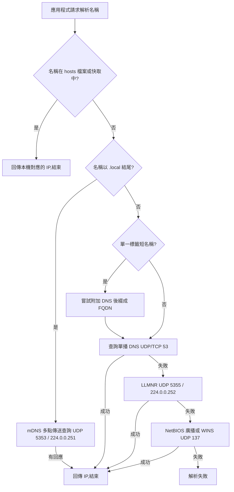

# 區域網路(LAN)中的主機名稱運作原理

## 摘要

在區域網路(LAN, Local Area Network)中，「主機名稱」(hostname)是一個方便人類辨識的字串標籤，用來代表某一台裝置；但網路通訊實際上依賴 IP 位址，因此必須有一套「名稱解析」(name resolution)機制，把人類可讀的主機名稱轉換成 IP 位址。LAN 內的名稱解析並非單一機制，而是多種機制並存，依照作業系統、名稱後綴(例如 `.local`)與解析器(resolver)設定不同而選用不同路徑[^mswpo]。本報告依序說明主機名稱的定義、名稱如何被指派(DHCP Option 12)、以及四種主要解析機制：單播 DNS、多點傳送 DNS(mDNS)、LLMNR 與 NetBIOS，最後說明各作業系統的解析順序。

## 一、什麼是主機名稱

主機名稱是一個用來標識網路裝置的可讀標籤。在 DNS 的術語中，完整的名稱稱為「完整網域名稱」(FQDN, Fully Qualified Domain Name)，例如 `laptop.contoso.com`，由以句點分隔的多個標籤(label)組成。RFC 1035 定義了語法：標籤可包含字母、數字與連字號，必須以字母開頭、以字母或數字結尾，且長度不得超過 63 個字元[^rfc1035]。

值得注意的是，RFC 6762 對「主機名稱」給出更嚴格的定義：一個 host name 是一個「擁有 IPv4/IPv6 位址記錄的完整網域名稱」，而不只是 DNS 名稱的第一個標籤[^rfc6762]。在實務上，同一台機器在 LAN 中往往同時擁有數個名稱：

- **電腦名稱**(computer name)，例如 `My-Computer`
- **DNS 主機名稱**，例如 `my-computer.contoso.com`
- **NetBIOS 名稱**(舊式 Windows)，15 位元組加上第 16 個服務位元組[^mswpo]
- **mDNS `.local` 名稱**，例如 `My-Computer.local`

## 二、主機名稱如何被指派：DHCP Option 12

當裝置加入 LAN 時，DHCP 負責派發 IP 設定。**DHCP Option 12(「Host Name」)**定義於 RFC 2132 §3.14，用途是讓 DHCP 用戶端把自己的名稱告知 DHCP 伺服器[^rfc2132]：

> 「此選項指定用戶端的名稱。該名稱可能帶有或未帶有本地網域名稱……此選項的代碼為 12，最小長度為 1。」

微軟文件將此記錄為「[MS-DHCPE] DHCPv4 Option Code 12 (0xC) – Host Name Option」，並指出該名稱「必須遵循 [RFC1035] 所指定的字元集限制」，且由於編碼方式的歧義問題，它已被 **DHCPv4 Option 81(Client FQDN)**取代[^msdhcpe]。Option 81 定義於 RFC 4702，由用戶端與伺服器協商由誰更新 A 與 PTR 記錄[^rfc4702]。

由於 Option 12 是由用戶端自行提供，路由器或 DHCP 伺服器可以選擇信任、忽略，或改以 MAC 位址對應名稱來覆寫它[^dnsmasq]。

## 三、名稱解析機制

LAN 中的名稱解析可分為兩大類：**集中式/靜態**機制(單播 DNS、hosts 檔案)，以及**多點傳送/廣播的連結本地**機制(mDNS、LLMNR、NetBIOS)[^mswpo]。

### 3.1 單播 DNS

用戶端的 stub resolver 會對設定好的 DNS 伺服器(來自 DHCP 或靜態設定)發送 DNS 查詢，使用 UDP/TCP 連接埠 53。對於單一標籤名稱(例如 `mypc`)，解析器通常會先附加搜尋網域(search domain，例如 `corp.example.com`)再進行查詢，伺服器回傳 A(IPv4)/AAAA(IPv6)記錄[^rfc1035]。

在小型路由器上，常見的做法是執行 **dnsmasq**。其文件說明：「本地 DNS 名稱可經由讀取 /etc/hosts、從 DHCP 子系統匯入名稱來定義……由 DHCP 設定的機器，其名稱會自動納入 DNS。」[^dnsmasq] 因此流程為：用戶端送出 DHCP Option 12 → 路由器的 DHCP 伺服器記錄租約 → 路由器的 DNS 解析器將該租約名稱匯入本地 DNS 區域，並回應其 A/PTR 查詢[^dnsmasq]。

在 Windows/Active Directory 環境中，機制則不同：用戶端使用**動態 DNS 更新**自行向 DNS 伺服器註冊 A/AAAA 與 PTR 記錄。微軟說明 Windows Server DNS 支援「動態更新：用戶端 DNS 記錄的自動註冊與更新」[^windns]。

### 3.2 多點傳送 DNS(mDNS)與 `.local` 名稱

當沒有 DNS 伺服器時(或需要零設定)，**多點傳送 DNS**(mDNS, Multicast DNS)會以 IP 多點傳送方式進行類似 DNS 的解析[^rfc6762]。RFC 6762 規定：

> 「任何對以『.local.』結尾之名稱的 DNS 查詢，都必須送往 mDNS 的 IPv4 連結本地多點傳送位址 224.0.0.251(或其 IPv6 對應位址 FF02::FB)。」

名稱形式為 `single-dns-label.local.`，例如「筆記型電腦可以回應名稱『MyComputer.local.』」。`.local.` 頂級網域屬於**連結本地**(link-local)：「任何以『.local.』結尾的完整網域名稱皆為連結本地，該網域內的名稱僅在其起源的那條連結上具有意義。」[^rfc6762]

運作細節：查詢與回應都送往 **UDP 5353**，IPv4 多點傳送位址為 224.0.0.251、IPv6 為 FF02::FB[^rfc6762][^wikipedia-mdns]。名稱是透過**探測**(probing，發送查詢以偵測衝突)與**公告**(announcing)來主張的，發生衝突時由失敗方改名(例如 `mypc-2.local`)[^rfc6762]。伴隨的 **DNS-SD**(服務探索，RFC 6763)則建立在 mDNS 之上，用於印表機、AirPlay 等服務探索[^rfc6763]。

實作方面：
- **Apple Bonjour**：Apple 的 mDNS/DNS-SD 堆疊(開放原始碼為 `mDNSResponder`)，內建於 macOS/iOS。Apple 支援文件說明本地主機名稱：「本地網路名稱是您的電腦名稱加上 `.local`，且空格會以連字號取代……本地網路名稱不分大小寫。」[^apple-localhostname]
- **Avahi**：Linux 上的 mDNS/DNS-SD 實作，其 `nss-mdns` 外掛「允許所有使用 nsswitch 的系統程式透過 mDNS 查詢 `*.local` 主機名稱」[^nssmdns]
- **Windows**：自 Windows 10 起加入 mDNS/DNS-SD 支援，自版本 1903 起可解析主機名稱而不僅是裝置名稱[^wikipedia-mdns]

### 3.3 LLMNR

**連結本地多點傳送名稱解析**(LLMNR, Link-Local Multicast Name Resolution)是微軟以 DNS 封包為基礎的多點傳送備援機制，定義於 RFC 4795。需注意其標準地位：IESG 註記指出「本文件原先意圖晉升為提議標準(Proposed Standard)，但 IETF 未能就該做法達成共識」，因此以**資訊性(Informational)**文件發布[^rfc4795]。

「LLMNR 在與 DNS 不同的連接埠上運作，並擁有獨立的解析器快取……由於 LLMNR 僅在本地連結上運作，它不能被視為 DNS 的替代品。」[^rfc4795] 在 Windows 的實作設定檔([MS-LLMNRP])中，查詢「送往並接收於 **連接埠 5355**」，且 Windows 版本與 RFC 4795 的差異在於 TCP 與 EDNS0 支援為可選[^msllmnrp]。

LLMNR 從 Windows Vista 一路支援至 Windows 10/11，Linux 上則由 **systemd-resolved** 實作[^wikipedia-llmnr]。安全提醒：由於 LLMNR 的命名空間與一般 DNS 重疊，連結上的攻擊者可偽造回應(典型的憑證轉送攻擊向量)，這也是它正被逐步淘汰的原因之一[^ms-mdns-align]。

### 3.4 NetBIOS / WINS

**NetBIOS 名稱解析**(RFC 1001/1002)是舊式的 Windows 方法。NetBIOS 名稱是一個 **16 位元組**字串；依 [MS-WPO]，Windows 啟動時，檔案與印表機共享服務會註冊電腦名稱，「補齊為 15 位元組，再加上第 16 個位元組 0x20」[^mswpo]。

**WINS**(Windows Internet Name Service)是「NetBIOS Name Server(NBNS)的微軟實作，一個供 NetBIOS 名稱使用的名稱伺服器」，負責把 NetBIOS 名稱對應到 IP 位址[^wins-top]。然而微軟已將 WINS 定位為「一項舊式電腦名稱註冊與解析服務」，並建議：「若您尚未在網路上部署 WINS，請勿部署 WINS，而應部署網域名稱系統(DNS)。」[^wins-top] WINS 在 Windows Server 2022 中被標記為棄用，並將在 Windows Server 2025 之後的所有 Windows Server 版本中移除，支援則延續至 2034 年 11 月[^wins-removal]。

NetBIOS over TCP/IP(NBT)除了廣播外，也可查詢 WINS/NBNS 伺服器；節點類型(node type)定義了解析順序：B-node 僅廣播、P-node 僅點對點(WINS)、M-node 先廣播後 WINS、H-node 先 WINS 後廣播。NetBIOS 不支援 IPv6，使用 UDP 137(名稱服務)、UDP 138(資料包服務)、TCP 139(工作階段服務)[^wikipedia-netbios]。

## 四、作業系統如何解析短名稱

單一標籤(短)名稱如 `server1` 並非 FQDN，因此解析器會嘗試多種機制。微軟的 [MS-WPO] §7.1.4 說明：

> 「單一標籤名稱可同時作為 DNS 名稱與 NetBIOS 名稱來解析。若要讓單一標籤名稱經由 DNS 解析，必須先附加後綴將其轉換成 FQDN(例如把『example』轉換成『example.contoso.com』)。」[^mswpo]

**Windows 一般解析順序**大致為：本機 hosts 檔案與 DNS 解析器快取 → DNS 用戶端服務(附加 DNS 後綴形成 FQDN，並依介面順序查詢 DNS 伺服器) → LLMNR(備援，連接埠 5355) → NetBIOS 名稱解析(廣播與/或 WINS) → mDNS(現代 Windows 1903+)[^mswpo]。微軟正主動調整此順序；其 2022 年部落格〈Aligning on mDNS〉指出目標是「讓 mDNS 成為唯一預設開啟的多點傳送名稱解析協定」，並將 NetBIOS 移至「學習模式」(learning mode，僅在 mDNS 與 LLMNR 皆失敗後才使用)，可透過群組原則或登錄值 `EnableNetbios` (位於 `HKLM\SYSTEM\CurrentControlSet\Services\Dnscache\Parameters`)控制[^ms-mdns-align]。

**Linux** 的解析順序由 `/etc/nsswitch.conf` 決定。典型的 Debian 設定行為：

```
hosts: files mdns4_minimal [NOTFOUND=return] dns mdns4
```

即先查 `/etc/hosts`(「files」)，再對 `.local` 名稱透過 nss-mdns 進行 mDNS，最後才用單播 DNS[^nssmdns]。此外，`host`、`nslookup` 等工具會繞過 NSS，因此測試時應使用 `getent hosts foo.local`[^nssmdns]。**macOS** 則以 Bonjour/mDNS 解析 `.local`，其餘名稱透過單播 DNS[^apple-localhostname]。

## 五、解析流程示意

下圖以用戶端角度，展示 LAN 中一台電腦嘗試解析主機名稱時的決策流程：



## 六、機制對照總表

| 機制 | 連接埠/位址 | 範圍 | 標準/來源 |
|---|---|---|---|
| DHCP Option 12(名稱指派) | UDP 67/68 | LAN | RFC 2132 §3.14[^rfc2132] |
| 單播 DNS(含動態更新) | UDP/TCP 53 | 全域 | RFC 1034/1035[^rfc1035] |
| mDNS `.local` | UDP 5353,224.0.0.251 / FF02::FB | 連結本地 | RFC 6762(+6763)[^rfc6762][^rfc6763] |
| LLMNR | UDP 5355(Windows/Linux 亦有 TCP 5355) | 連結本地 | RFC 4795(資訊性)[^rfc4795][^msllmnrp] |
| NetBIOS / WINS | UDP 137/138,TCP 139 | LAN(僅 IPv4) | RFC 1001/1002;[MS-WPO][^wikipedia-netbios][^mswpo] |
| hosts 檔案 | 無(本機檔案) | 單機 | hosts(5)[^hosts5] |

## 七、來源批判性反思

本報告主要引用 IETF RFC 與微軟官方文件作為一手來源。RFC 文件具有高度權威性且穩定，其中 RFC 6762(mDNS)、RFC 2132(DHCP)屬標準追蹤(Standards Track)文件，可信度高。需注意的是 **LLMNR 的 RFC 4795 僅為資訊性文件**，IETF 本身並未就該協定達成共識，因此其權威性低於其他標準，這一點在報告中已明確標示[^rfc4795]。

微軟官方文件([MS-WPO]、[MS-LLMNRP])對 Windows 行為的描述權威性高，但反映的是微軟自身的實作與政策立場(例如推動 mDNS、淘汰 NetBIOS/LLMNR)，可能存在推廣其新生態系的傾向，讀者宜視為「微軟意圖與現況」而非中立技術結論[^ms-mdns-align]。Wikipedia 條目僅作為輔助確認(如連接埠編號、多點傳送位址)之用，其內容可被公眾編輯，故僅在能與 RFC 或官方文件相互印證時才採用[^wikipedia-netbios][^wikipedia-mdns]。dnsmasq 文件代表消費級路由器常見的實作方式，可補充 RFC 未涵蓋的實務細節[^dnsmasq]。

各文件發布時間跨距甚大，部分為 n.d.(無日期)。凡涉及時間敏感的主題(如 WINS 移除時程、Windows 對 NetBIOS 的淘汰政策)，本報告均已引用較近期(2022 年後)的微軟公告以確保時效性[^ms-mdns-align][^wins-removal]。

## 參考文獻

Apple. (n.d.). *Change your Mac computer's local hostname*. Retrieved 2026-10-12, from https://support.apple.com/guide/mac-help/change-computers-local-hostname-mac-mchlp2322/mac

Avahi. (n.d.). *nss-mdns*. Retrieved 2026-10-12, from https://github.com/avahi/nss-mdns

Cheshire, S., & Krochmal, M. (2013). *Multicast DNS* (RFC 6762). Internet Engineering Task Force. Retrieved 2026-10-12, from https://www.rfc-editor.org/rfc/rfc6762.html

Cheshire, S., & Krochmal, M. (2013). *DNS-Based Service Discovery* (RFC 6763). Internet Engineering Task Force. Retrieved 2026-10-12, from https://www.rfc-editor.org/rfc/rfc6763.html

The dnsmasq project. (n.d.). *Dnsmasq - network services for small networks*. Retrieved 2026-10-12, from https://thekelleys.org.uk/dnsmasq/doc.html

Internet Engineering Task Force. (2006). *Link-Local Multicast Name Resolution (LLMNR)* (RFC 4795). Retrieved 2026-10-12, from https://datatracker.ietf.org/doc/html/rfc4795

Microsoft. (n.d.). *DHCPv4 Option Code 12 (0xC) – Host Name Option*. [MS-DHCPE]. Retrieved 2026-10-12, from https://learn.microsoft.com/en-us/openspecs/windows_protocols/ms-dhcpe/57a3ac2f-a50a-4612-9be9-c4ca41701768

Microsoft. (n.d.). *LLMNR Profile*. [MS-LLMNRP]. Retrieved 2026-10-12, from https://learn.microsoft.com/en-us/openspecs/windows_protocols/ms-llmnrp/6806998e-034d-4c39-8398-5af8bfd52d7e

Microsoft. (n.d.). *Windows Name Resolution*. [MS-WPO]. Retrieved 2026-10-12, from https://learn.microsoft.com/en-us/openspecs/windows_protocols/ms-wpo/f00add7f-a321-4a5f-a5d8-1748e748cd44

Microsoft. (n.d.). *WINS*. Retrieved 2026-10-12, from https://learn.microsoft.com/en-us/windows-server/networking/technologies/wins/wins-top

Microsoft. (n.d.). *Domain Name System (DNS)*. Retrieved 2026-10-12, from https://learn.microsoft.com/en-us/windows-server/networking/dns/dns-top

Microsoft. (2022, November 16). *Aligning on mDNS: ramping down NetBIOS name resolution and LLMNR*. Retrieved 2026-10-12, from https://techcommunity.microsoft.com/blog/networkingblog/aligning-on-mdns-ramping-down-netbios-name-resolution-and-llmnr/3290816

Microsoft. (2025, November). *WINS removal: moving forward with modern name resolution*. Retrieved 2026-10-12, from https://support.microsoft.com/en-us/servicing/os/windows/docs/2025/11/wins-removal-moving-forward-with-modern-name-resolution

Mockapetris, P. (1987). *Domain names - implementation and specification* (RFC 1035). Internet Engineering Task Force. Retrieved 2026-10-12, from https://www.rfc-editor.org/rfc/rfc1035

NetBSD Project. (n.d.). *hosts(5) - Linux man page*. Retrieved 2026-10-12, from https://man7.org/linux/man-pages/man5/hosts.5.html

Alexander, S., & Droms, R. (1997). *DHCP Options and BOOTP Vendor Extensions* (RFC 2132). Internet Engineering Task Force. Retrieved 2026-10-12, from https://www.rfc-editor.org/rfc/rfc2132.html

Stapp, M., & Volz, B. (2006). *The Dynamic Host Configuration Protocol (DHCP) Client Fully Qualified Domain Name (FQDN) Option* (RFC 4702). Internet Engineering Task Force. Retrieved 2026-10-12, from https://www.rfc-editor.org/rfc/rfc4702.html

Wikipedia. (n.d.). *Multicast DNS*. Retrieved 2026-10-12, from https://en.wikipedia.org/wiki/Multicast_DNS

Wikipedia. (n.d.). *NetBIOS*. Retrieved 2026-10-12, from https://en.wikipedia.org/wiki/NetBIOS

Wikipedia. (n.d.). *Link-Local Multicast Name Resolution*. Retrieved 2026-10-12, from https://en.wikipedia.org/wiki/Link-Local_Multicast_Name_Resolution

[^rfc1035]: Mockapetris, P. (1987). *Domain names - implementation and specification* (RFC 1035). Internet Engineering Task Force. Retrieved 2026-10-12, from https://www.rfc-editor.org/rfc/rfc1035
[^rfc2132]: Alexander, S., & Droms, R. (1997). *DHCP Options and BOOTP Vendor Extensions* (RFC 2132), §3.14. Internet Engineering Task Force. Retrieved 2026-10-12, from https://www.rfc-editor.org/rfc/rfc2132.html
[^rfc4702]: Stapp, M., & Volz, B. (2006). *The Dynamic Host Configuration Protocol (DHCP) Client Fully Qualified Domain Name (FQDN) Option* (RFC 4702). Internet Engineering Task Force. Retrieved 2026-10-12, from https://www.rfc-editor.org/rfc/rfc4702.html
[^rfc6762]: Cheshire, S., & Krochmal, M. (2013). *Multicast DNS* (RFC 6762). Internet Engineering Task Force. Retrieved 2026-10-12, from https://www.rfc-editor.org/rfc/rfc6762.html
[^rfc6763]: Cheshire, S., & Krochmal, M. (2013). *DNS-Based Service Discovery* (RFC 6763). Internet Engineering Task Force. Retrieved 2026-10-12, from https://www.rfc-editor.org/rfc/rfc6763.html
[^rfc4795]: Internet Engineering Task Force. (2006). *Link-Local Multicast Name Resolution (LLMNR)* (RFC 4795). Retrieved 2026-10-12, from https://datatracker.ietf.org/doc/html/rfc4795
[^msdhcpe]: Microsoft. (n.d.). *DHCPv4 Option Code 12 (0xC) – Host Name Option*. [MS-DHCPE]. Retrieved 2026-10-12, from https://learn.microsoft.com/en-us/openspecs/windows_protocols/ms-dhcpe/57a3ac2f-a50a-4612-9be9-c4ca41701768
[^msllmnrp]: Microsoft. (n.d.). *LLMNR Profile*. [MS-LLMNRP]. Retrieved 2026-10-12, from https://learn.microsoft.com/en-us/openspecs/windows_protocols/ms-llmnrp/6806998e-034d-4c39-8398-5af8bfd52d7e
[^mswpo]: Microsoft. (n.d.). *Windows Name Resolution*. [MS-WPO], §7.1.4. Retrieved 2026-10-12, from https://learn.microsoft.com/en-us/openspecs/windows_protocols/ms-wpo/f00add7f-a321-4a5f-a5d8-1748e748cd44
[^windns]: Microsoft. (n.d.). *Domain Name System (DNS)*. Retrieved 2026-10-12, from https://learn.microsoft.com/en-us/windows-server/networking/dns/dns-top
[^wins-top]: Microsoft. (n.d.). *WINS*. Retrieved 2026-10-12, from https://learn.microsoft.com/en-us/windows-server/networking/technologies/wins/wins-top
[^wins-removal]: Microsoft. (2025, November). *WINS removal: moving forward with modern name resolution*. Retrieved 2026-10-12, from https://support.microsoft.com/en-us/servicing/os/windows/docs/2025/11/wins-removal-moving-forward-with-modern-name-resolution
[^ms-mdns-align]: Microsoft. (2022, November 16). *Aligning on mDNS: ramping down NetBIOS name resolution and LLMNR*. Retrieved 2026-10-12, from https://techcommunity.microsoft.com/blog/networkingblog/aligning-on-mdns-ramping-down-netbios-name-resolution-and-llmnr/3290816
[^apple-localhostname]: Apple. (n.d.). *Change your Mac computer's local hostname*. Retrieved 2026-10-12, from https://support.apple.com/guide/mac-help/change-computers-local-hostname-mac-mchlp2322/mac
[^nssmdns]: Avahi. (n.d.). *nss-mdns*. Retrieved 2026-10-12, from https://github.com/avahi/nss-mdns
[^dnsmasq]: The dnsmasq project. (n.d.). *Dnsmasq - network services for small networks*. Retrieved 2026-10-12, from https://thekelleys.org.uk/dnsmasq/doc.html
[^wikipedia-mdns]: Wikipedia. (n.d.). *Multicast DNS*. Retrieved 2026-10-12, from https://en.wikipedia.org/wiki/Multicast_DNS
[^wikipedia-netbios]: Wikipedia. (n.d.). *NetBIOS*. Retrieved 2026-10-12, from https://en.wikipedia.org/wiki/NetBIOS
[^wikipedia-llmnr]: Wikipedia. (n.d.). *Link-Local Multicast Name Resolution*. Retrieved 2026-10-12, from https://en.wikipedia.org/wiki/Link-Local_Multicast_Name_Resolution
[^hosts5]: NetBSD Project. (n.d.). *hosts(5) - Linux man page*. Retrieved 2026-10-12, from https://man7.org/linux/man-pages/man5/hosts.5.html