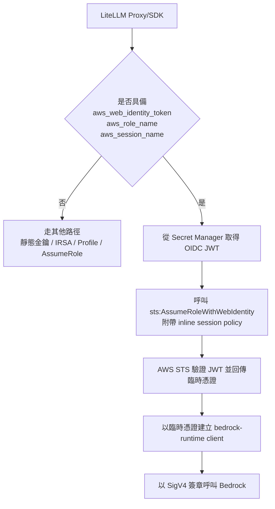

# LiteLLM 是否支援 Amazon Bedrock 的 OAuth／OIDC 模式？

## 摘要

**支援，但需要精確區分「OIDC」與「OAuth」兩種不同語意。** LiteLLM 支援以 **OpenID Connect（OIDC）權杖**換取 AWS Security Token Service（STS）的臨時憑證，再以該臨時憑證對 Amazon Bedrock 進行 SigV4 簽章呼叫。這條路徑在 LiteLLM 官方文件稱為「OIDC」，其底層機制是 AWS 的 `sts:AssumeRoleWithWebIdentity`（網頁身分聯邦），而非把 OAuth 2.0 存取權杖直接送給 Bedrock[^oidc-doc]。

換言之：

- **OIDC／網頁身分聯邦 → Bedrock**：LiteLLM 官方支援（標記為 BETA）。[^oidc-doc]
- **通用 OAuth 2.0 授權碼／客戶端憑證流程直接對 Bedrock**：不支援，因為 Bedrock 本身不接受 OAuth 存取權杖作為驗證方式；唯一的 Bearer Token 機制是 AWS Bedrock API Key。[^bedrock-doc]

LiteLLM 為開源專案（授權條款標示為 Other／MIT），GitHub 星數約 61,134（檢索時透過 GitHub API 取得）[^gh-api]。

---

## 1. 背景：名詞釐清

在討論「LiteLLM 是否支援 Bedrock 的 OAuth／OIDC 模式」之前，必須先釐清三個容易混淆的概念。

### 1.1 OAuth 2.0 與 OIDC 的差異

- **OAuth 2.0** 是授權框架，核心產物是「存取權杖（access token）」，用於代表使用者或服務存取資源。
- **OpenID Connect（OIDC）** 建立在 OAuth 2.0 之上，加入了身分驗證層，核心產物是 **ID Token（JWT）**，可用於向第三方證明身分。

在雲端情境中，OIDC 最常見的用途是「**工作負載身分聯邦（Workload Identity Federation）**」：由外部 OIDC 身分提供者（IdP，例如 Google Cloud Run、GitHub Actions、Azure AD、Kubernetes Service Account）簽發 JWT，雲平台（此處為 AWS STS）驗證該 JWT 後，換發短期的雲端憑證。AWS 對應的 API 即為 `AssumeRoleWithWebIdentity`。[^aws-sts][^aws-oidc]

### 1.2 Amazon Bedrock 的驗證方式

Amazon Bedrock 屬 AWS 服務，其存取透過 **AWS Identity and Access Management（IAM）** 與 **AWS Signature Version 4（SigV4）** 簽章。Bedrock 本身不是 OAuth 資源伺服器，不接受外部 OIDC／OAuth 存取權杖直接作為 API 驗證。[^bedrock-doc]

AWS 另外提供了 **Bedrock API Key**，可透過 HTTP `Authorization: Bearer <token>` 標頭使用；這是與 OAuth 無關的 AWS 自有機制。[^bedrock-apikey]

因此「Bedrock 的 OIDC 模式」在實務上指的是：**以 OIDC JWT 向 STS 換取 IAM 臨時憑證，再以該憑證呼叫 Bedrock**。LiteLLM 支援的正是這條路徑。

---

## 2. LiteLLM 的 OIDC 支援（官方文件）

LiteLLM 官方文件設有專頁「[BETA] OpenID Connect (OIDC)」，明確定義其 OIDC 身分提供者與「依賴方（Relying Party）」。[^oidc-doc]

### 2.1 支援的 OIDC 身分提供者（IdP）

| 提供者 | 設定名稱（config name） | 自訂對象（Custom Audiences） |
|---|---|---|
| Google Cloud Run | `google` | 是 |
| CircleCI v1 | `circleci` | 否 |
| CircleCI v2 | `circleci_v2` | 否 |
| GitHub Actions | `github` | 是 |
| Azure Kubernetes Service | `azure` | 否 |
| Azure AD | `azure` | 是 |
| File（非官方） | `file` | 否 |
| Environment Variable（非官方） | `env` | 否 |
| Environment Path（非官方） | `env_path` | 否 |

官方文件提醒，除非確知其他提供者不可用，否則不建議使用 `file`、`env`、`env_path` 這三個非官方提供者。[^oidc-doc]

### 2.2 支援的 OIDC 依賴方（Relying Party）

LiteLLM 官方文件列出支援的依賴方為：

- **Amazon Bedrock** ✅
- Azure OpenAI ✅
- Google Cloud Vertex AI（文件標示為 Coming soon）

也就是說，**Amazon Bedrock 是 LiteLLM OIDC 功能的一級支援對象**。[^oidc-doc]

### 2.3 設定格式

凡是可使用 secret key 的位置，都可改用 OIDC。通用格式為：

```text
oidc/<config_name>/<audience>
```

若提供者不使用 `audience` 參數，則應省略（保留結尾斜線）：

```text
oidc/<config_name>/
```

例如，Google Cloud Run 聯邦至 Amazon Bedrock 的設定為：[^oidc-doc]

```yaml
model_list:
  - model_name: claude-sonnet-5
    litellm_params:
      model: bedrock/us.anthropic.claude-sonnet-5
      aws_region_name: us-west-2
      aws_session_name: "litellm"
      aws_role_name: "arn:aws:iam::YOUR_THING_HERE:role/litellm-google-demo"
      aws_web_identity_token: "oidc/google/https://example.com"
```

Azure AD 聯邦至 Amazon Bedrock 的設定為：[^oidc-doc]

```yaml
model_list:
  - model_name: aws/claude-sonnet-5
    litellm_params:
      model: bedrock/us.anthropic.claude-sonnet-5
      aws_region_name: "eu-central-1"
      aws_role_name: "arn:aws:iam::12345678:role/bedrock-role"
      aws_web_identity_token: "oidc/azure/api://123-456-789-9d04"
      aws_session_name: "litellm-session"
```

### 2.4 必要條件：三個參數缺一不可

LiteLLM 只有在 `aws_web_identity_token`、`aws_role_name`、`aws_session_name` **三者同時具備**時，才會走網頁身分聯邦的驗證路徑。[^base-aws-llm]

---

## 3. 運作機制與原始碼實證

### 3.1 憑證取得流程

LiteLLM 對 Bedrock 的驗證依賴 `boto3`。當偵測到網頁身分權杖時，會建立 STS client 並呼叫 `assume_role_with_web_identity`，再以回傳的臨時憑證建立 `bedrock-runtime` client。[^base-aws-llm][^common-utils]

以 mermaid 表示：



對應原始碼片段（`litellm/llms/bedrock/base_aws_llm.py`）：[^base-aws-llm]

```python
sts_response = sts_client.assume_role_with_web_identity(
    RoleArn=aws_role_name,
    RoleSessionName=aws_session_name,
    WebIdentityToken=oidc_token,
    DurationSeconds=3600,
    Policy=json.dumps(build_web_identity_session_policy(), separators=(",", ":")),
)
```

### 3.2 內嵌 Session Policy 是「權限上限」

LiteLLM 在呼叫 `AssumeRoleWithWebIdentity` 時，會附帶一份**內嵌 session policy**。在 AWS IAM 中，session policy 扮演**權限上限（permission ceiling）**的角色：有效權限是「角色身分政策（identity policy）」與「session policy」的**交集**。因此，任何未列入 session policy 的動作，即使角色的 IAM 政策明確允許，仍會被拒絕。[^base-aws-llm][^test-session-policy]

這個設計是 LiteLLM OIDC 支援最重要、也最容易踩雷的特性，衍生出多起 403 問題（見第 4 節）。

### 3.3 最初導入

OIDC 支援最早由 PR #3507 導入，標題為「Initial OIDC support (Google/GitHub/CircleCI -> Amazon Bedrock & Azure OpenAI)」，作者 Manouchehri，於 2024-05-11 合併。[^pr-3507]

---

## 4. 已知限制與實際問題

由於 session policy 是權限上限，每當 LiteLLM 新增一條 Bedrock 路由，若其對應的 IAM action 未同步加入 session policy，使用 OIDC 驗證的請求就會回傳 403。以下是已記錄的案例。

| 問題 | 受影響路由 | IAM Action 命名空間 | 追蹤連結 |
|---|---|---|---|
| `bedrock:CountTokens` 未列入 | `/count-tokens` | `bedrock:*` | Issue #33142／PR #33145、Issue #37336[^issue-33142][^pr-33145][^issue-37336] |
| `aws-external-anthropic:*` 未列入 | `bedrock/claude_platform/` | `aws-external-anthropic:*` | Issue #30200／PR #30205[^pr-30205] |
| `bedrock-mantle:CreateInference` 未列入 | `bedrock_mantle/` | `bedrock-mantle:*` | Issue #33094／PR #33096[^pr-33096] |
| `bedrock-websearch:*` 未列入 | Bedrock Mantle web_search 工具 | `bedrock-websearch:*` | Issue #43804[^issue-43804] |
| 過期 OIDC 權杖遭重放 | Bedrock Guardrails | 不適用（權杖快取問題） | PR #34637[^pr-34637] |

其中 PR #33145 已將 `bedrock:CountTokens` 加入 session policy 並合併；Issue #37336 則回報在 v1.94.3 上該修正尚未生效（重複回報）。[^pr-33145][^issue-37336]

此外，Issue #27728 指出：當 Bedrock 部署同時使用 IAM／OIDC 憑證並開啟 `use_in_pass_through: true` 時，因初始化要求 `api_key` 而導致該部署被靜默丟棄。[^issue-27728]

---

## 5. 其他相關驗證方式

LiteLLM 對 Bedrock 支援的驗證方式不限於 OIDC。根據官方文件與原始碼，完整的驗證參數清單如下：[^bedrock-doc][^base-aws-llm]

```text
aws_access_key_id,
aws_secret_access_key,
aws_session_token,
aws_region_name,
aws_session_name,
aws_profile_name,
aws_role_name,
aws_web_identity_token,
aws_bedrock_runtime_endpoint,
api_key,   # AWS Bedrock API Key（Bearer）
```

其中：

- **`AWS_BEARER_TOKEN_BEDROCK` 環境變數或 `api_key` 參數**：使用 AWS Bedrock API Key，以 `Authorization: Bearer` 標頭送出，跳過 SigV4。這是 Bedrock **唯一**的 Bearer Token 機制，但屬 AWS 自有 API Key，而非 OAuth。[^bedrock-doc][^bedrock-apikey]
- **IRSA（EKS）**：LiteLLM 會自動偵測 `AWS_ROLE_ARN` 與 `AWS_WEB_IDENTITY_TOKEN_FILE` 環境變數，並手動呼叫 `assume_role_with_web_identity`。[^base-aws-llm]

---

## 6. 結論

1. **LiteLLM 支援 Amazon Bedrock 的「OIDC 模式」**：以 OIDC JWT 向 AWS STS 換取臨時 IAM 憑證（`AssumeRoleWithWebIdentity`），再呼叫 Bedrock。文件將 Amazon Bedrock 列為支援的 OIDC 依賴方。[^oidc-doc]
2. **「OAuth 模式」則應理解為不支援**：Bedrock 本身不接受 OAuth 2.0／OIDC 存取權杖直接作為 API 驗證；LiteLLM 送給 Bedrock 的唯一 Bearer 機制是 AWS Bedrock API Key。[^bedrock-doc][^bedrock-apikey]
3. **使用時的最大陷阱是 session policy 權限上限**：若所用路由的 IAM action 未列入 LiteLLM 內嵌的 session policy，即使 IAM 角色允許仍會 403。部署前應確認 LiteLLM 版本已包含對應修正。[^base-aws-llm][^issue-43804]
4. **支援的 IdP** 包括 Google Cloud Run、GitHub Actions、CircleCI v1/v2、Azure AD、Azure Kubernetes Service，以及非官方的 file／env／env_path。[^oidc-doc]

---

## 註腳與參考文獻

[^oidc-doc]: LiteLLM. (n.d.). [BETA] OpenID Connect (OIDC). Retrieved 2026-10-11, from https://docs.litellm.ai/docs/oidc

[^bedrock-doc]: LiteLLM. (n.d.). AWS Bedrock. Retrieved 2026-10-11, from https://docs.litellm.ai/docs/providers/bedrock

[^bedrock-apikey]: Amazon Web Services. (n.d.). Generate and use an Amazon Bedrock API key. Retrieved 2026-10-11, from https://docs.aws.amazon.com/bedrock/latest/userguide/api-keys.html

[^aws-sts]: Amazon Web Services. (n.d.). AssumeRoleWithWebIdentity. In AWS Security Token Service API Reference. Retrieved 2026-10-11, from https://docs.aws.amazon.com/STS/latest/APIReference/API_AssumeRoleWithWebIdentity.html

[^aws-oidc]: Amazon Web Services. (n.d.). Creating OpenID Connect (OIDC) identity providers. In AWS Identity and Access Management User Guide. Retrieved 2026-10-11, from https://docs.aws.amazon.com/IAM/latest/UserGuide/id_roles_providers_create_oidc.html

[^base-aws-llm]: BerriAI. (n.d.). litellm/llms/bedrock/base_aws_llm.py. GitHub. Retrieved 2026-10-11, from https://github.com/BerriAI/litellm/blob/main/litellm/llms/bedrock/base_aws_llm.py

[^common-utils]: BerriAI. (n.d.). litellm/llms/bedrock/common_utils.py. GitHub. Retrieved 2026-10-11, from https://github.com/BerriAI/litellm/blob/main/litellm/llms/bedrock/common_utils.py

[^test-session-policy]: BerriAI. (n.d.). tests/unit/llms/bedrock/test_web_identity_session_policy.py. GitHub. Retrieved 2026-10-11, from https://github.com/BerriAI/litellm/blob/main/tests/unit/llms/bedrock/test_web_identity_session_policy.py

[^gh-api]: GitHub. (2026). BerriAI/litellm repository metadata [Data set]. GitHub REST API. Retrieved 2026-10-11, from https://api.github.com/repos/BerriAI/litellm

[^pr-3507]: Manouchehri. (2024, May 11). Initial OIDC support (Google/GitHub/CircleCI -> Amazon Bedrock & Azure OpenAI) (Pull request #3507). GitHub. Retrieved 2026-10-11, from https://github.com/BerriAI/litellm/pull/3507

[^issue-33142]: Jazzex. (2026, July 14). [Bug]: Bedrock OIDC session policy omits bedrock:CountTokens, causing 403 despite IAM allow (Issue #33142). GitHub. Retrieved 2026-10-11, from https://github.com/BerriAI/litellm/issues/33142

[^pr-33145]: devin-ai-integration[bot]. (2026, July 14). fix(bedrock): grant bedrock:CountTokens in OIDC session policy (Pull request #33145). GitHub. Retrieved 2026-10-11, from https://github.com/BerriAI/litellm/pull/33145

[^issue-37336]: jimmychen-p72. (2026, August 18). [Bug]: Bedrock CountTokens still 403s over OIDC/IRSA on v1.94.3 (Issue #37336). GitHub. Retrieved 2026-10-11, from https://github.com/BerriAI/litellm/issues/37336

[^pr-30205]: hclsys. (2026, June 11). fix(bedrock): grant aws-external-anthropic:* in OIDC session policy for claude_platform (#30200) (Pull request #30205). GitHub. Retrieved 2026-10-11, from https://github.com/BerriAI/litellm/pull/30205

[^pr-33096]: devin-ai-integration[bot]. (2026, July 13). fix(bedrock): grant bedrock-mantle:CreateInference in OIDC session policy (Pull request #33096). GitHub. Retrieved 2026-10-11, from https://github.com/BerriAI/litellm/pull/33096

[^issue-43804]: elvis-cai. (2026, September 30). [Bug]: Bedrock Mantle web_search tool returns status=failed when using OIDC/web identity auth (Issue #43804). GitHub. Retrieved 2026-10-11, from https://github.com/BerriAI/litellm/issues/43804

[^pr-34637]: yucheng-berri. (2026, July 25). fix(bedrock): stop replaying expired Google OIDC tokens to STS on guardrail auth (Pull request #34637). GitHub. Retrieved 2026-10-11, from https://github.com/BerriAI/litellm/pull/34637

[^issue-27728]: habonlaci. (2026, May 12). [Bug]: Bedrock passthrough deployment initialization fails with IAM/OIDC credentials because api_key is required (Issue #27728). GitHub. Retrieved 2026-10-11, from https://github.com/BerriAI/litellm/issues/27728