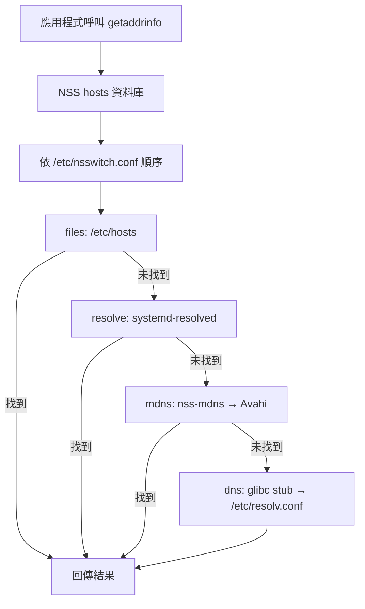
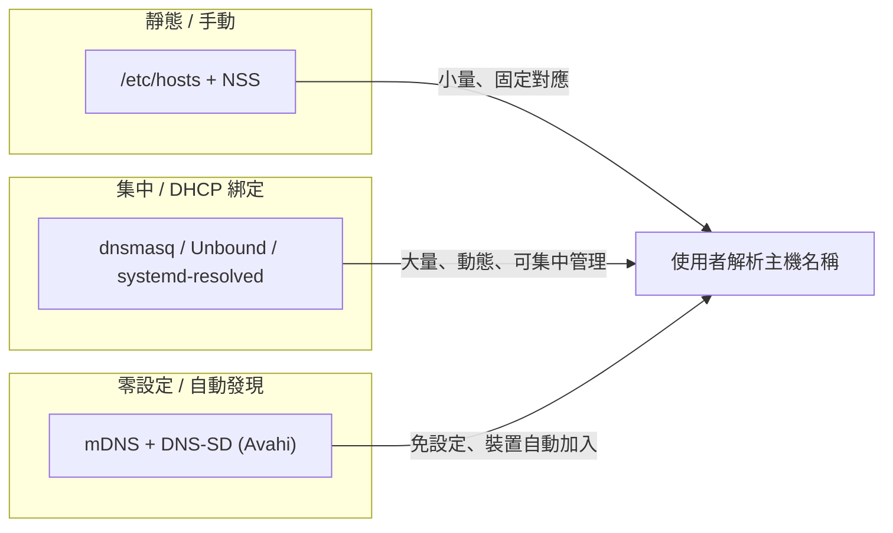

# 區域網路 (LAN) 主機名稱解析原理

## 摘要

在區域網路中，「主機名稱 (hostname)」要能被其他裝置解析成 IP 位址，並非單一機制，而是由多層技術疊加而成。核心有三條路徑：**靜態檔案**（`/etc/hosts`）、**區域 DNS 伺服器**（通常與 DHCP 綁定）、以及**零設定服務發現協定**（mDNS）。本報告以 Linux/Unix 及開放協定為主，說明各機制如何運作、如何協同，以及各自的適用場景。

> 註：本報告依需求排除 Windows 專屬技術與方案。微軟起源的 LLMNR 協定因 Linux 生態亦有實作，僅在必要處簡短提及並標註其來源。

---

## 1. 主機名稱與 FQDN

主機名稱是「指派給連上電腦網路之裝置的標籤，用於在各種電子通訊形式中識別該裝置」[^hostname]。當主機名稱接上 DNS 網域後，就構成**完整網域名稱 (FQDN, Fully Qualified Domain Name)**；「當所有標籤（含最上層網域 TLD）都被明確指定時，主機名稱即被視為 FQDN」[^hostname]。

在 LAN 中，名稱解析的目標就是把一個使用者可讀的名稱（如 `printer` 或 `printer.local`）轉換成可路由的 IP 位址。

---

## 2. 第一層：靜態設定檔 `/etc/hosts` 與 NSS

### 2.1 `/etc/hosts`

`/etc/hosts` 是「主機名稱的靜態查表」檔案。其格式為每行一個 IP 位址：

```
IP_address canonical_hostname [aliases...]
```

`hosts(5)` 說明：「此檔為簡單文字檔，將 IP 位址與主機名稱關聯，每個 IP 位址一行……選用的別名可用於名稱變更、替代拼法、較短的主機名稱或通用主機名稱（例如 localhost）。」[^hosts5]

此機制不需網路、延遲最低，是放置靜態 LAN 對應的自然位置，並可透過 NSS 設定使其優先於 DNS。

### 2.2 NSS 與 `/etc/nsswitch.conf`

程式呼叫 `getaddrinfo(3)` 時，glibc 並不硬性規定查詢順序，而是查詢 **名稱服務切換 (NSS, Name Service Switch)** 的 `hosts` 資料庫，其來源與順序定義於 `/etc/nsswitch.conf`[^nsswitch5]。NSS「將電腦與各種常見設定資料庫及名稱解析機制連接起來」，包含本機檔案（`/etc/hosts`）、DNS、NIS、LDAP 等[^nss].

`nsswitch.conf(5)` 指出：「服務在該行上的順序，決定這些服務被查詢的順序，會依序查詢直到找到結果為止。」[^nsswitch5]

**順序與 `[STATUS=ACTION]` 語法**：每個來源可後接方括號動作，影響是否繼續查詢下一來源[^nsswitch5]：

- **STATUS**：`success`、`notfound`、`unavail`、`tryagain`
- **ACTION**：`return`、`continue`、`merge`
- 預設：`success` → `return`；`notfound` / `unavail` / `tryagain` → `continue`

因此 `[NOTFOUND=return]` 表示：若前一來源權威地回答「不存在」，就停止、不再查詢後續來源。這正是 mDNS 設定能運作的關鍵（見第 4 節）。



---

## 3. 第二層：DHCP 與區域 DNS（DDNS）

### 3.1 為何 DHCP 與 DNS 綁定

DHCP 的核心工作是發放 IP 位址（DORA 程序：Discover、Offer、Request、Acknowledge，使用 UDP 67/68 埠）[^dhcpwiki]。但租約會變動，因此「名稱→位址」對應必須與 DNS 保持同步。Wikipedia 指出：「此功能要求 DNS 伺服器也必須自動保持最新。DDNS 的最初實作即為此目的：主機電腦取得通知其 DNS 伺服器所收到位址的能力。」[^ddnswiki]

### 3.2 DHCP 名稱相關選項

| 選項 | RFC | 方向 | 用途 |
|------|-----|------|------|
| Option 12 Host Name | RFC 2132 §3.14 | 客戶端→伺服器 | 未限定網域的 ASCII 主機名稱 |
| Option 15 Domain Name | RFC 2132 §3.17 | 伺服器→客戶端 | 建構 FQDN 的後綴 |
| Option 6 DNS Servers | RFC 2132 §3.8 | 伺服器→客戶端 | 解析器位址 |
| Option 81 Client FQDN | RFC 4702 | 雙向 | 協商 FQDN 及由誰更新 A/PTR |

**Option 12（主機名稱）**定義於 RFC 2132 §3.14：「此選項指定客戶端名稱。名稱可含或不含本機網域名稱。」其為純 ASCII 字串（通常未限定），代碼為 12，最小長度為 1[^rfc2132]。

**Option 81（客戶端 FQDN）**定義於 RFC 4702，是現代機制，讓客戶端與伺服器協商完整名稱「以及更新與客戶端位址指派相關之 DNS RR 的責任歸屬」[^rfc4702]。其 Flags 欄位含 S/O/N/E 位元：S 位元決定是否由**伺服器**執行 A 記錄更新；N 位元代表「不更新」；E 位元決定網域欄位編碼[^rfc4702]。

重要的是：當客戶端送出 Option 81 時，**不得同時送出 Option 12**；「若客戶端同時送出 Client FQDN 與 Host Name 選項，伺服器應忽略 Host Name 選項」[^rfc4702]。因此 Option 81 存在時會取代 Option 12。

RFC 4702 也指出兩種正常運作模型：(1) DHCP 客戶端更新 A 記錄、DHCP 伺服器更新 PTR 記錄；(2) DHCP 伺服器同時更新 A 與 PTR 記錄[^rfc4702]。

### 3.3 DDNS 更新（RFC 2136）

實際將記錄寫入 DNS 的標準協定為 RFC 2136（DNS UPDATE）：「RFC 2136 所描述的標準動態更新方法……是搭配受管理的 DNS 伺服器使用的網路協定，並包含安全機制。RFC 2136 支援所有 DNS 記錄類型，但常作為 DHCP 系統的延伸，由受授權的 DHCP 伺服器將客戶端記錄註冊到 DNS 中。」[^ddnswiki] 安全上通常搭配 TSIG。

### 3.4 路由器/閘道器如何解析本機名稱

家用路由器與閘道器通常是 LAN 的 DHCP 伺服器：「許多路由器與家用閘道器具備 DHCP 伺服器能力……在區域網路內，DHCP 伺服器為每台裝置指派本機 IP 位址。」[^dhcpwiki]

由於路由器同時發放租約、且通常執行 DNS 轉發器，它能直接從 DHCP 租約建立本機名稱表，無需外部 DDNS：

- 路由器執行 **DNS 轉發/快取**；對本機網域的名稱直接由租約表 + `/etc/hosts` 回答，其餘轉發上游。
- 透過 **Option 6** 宣告自己是 DNS 伺服器，透過 **Option 15** 宣告本機後綴（常見為 `.lan`、`.home`、`.localdomain` 等）。

### 3.5 Linux 工具：dnsmasq

**dnsmasq** 是 Linux 上把 DHCP 與 DNS 綁定的經典工具。其手冊說明：「dnsmasq 是輕量的 DNS、TFTP、PXE、路由器通告與 DHCP 伺服器。其目標是為 LAN 提供**結合的 DNS 與 DHCP 服務**。」它「載入 /etc/hosts 內容，使不出現於全域 DNS 的本機主機名稱可被解析，並回應 DHCP 設定主機的 DNS 查詢」[^dnsmasqman]。

關鍵選項：

- `-s, --domain=<domain>`：「指定 DHCP 伺服器的 DNS 網域……它使 DHCP 伺服器向任何請求的 hosts 回傳該網域，其次設定 DHCP 設定主機可主張的合法網域。意圖是限制主機名稱，使 LAN 上不受信任的主機無法透過 DHCP 宣稱如 'microsoft.com' 的名稱。」[^dnsmasqman]
- `-E, --expand-hosts`：「將網域加到 /etc/hosts 中不含句點的簡單名稱上，方式如 DHCP 衍生名稱。」[^dnsmasqman]
- `-G, --dhcp-host=...`：「允許特定硬體位址的機器總是被指派相同的主機名稱、IP 位址與租約時間。**以這種方式指定的主機名稱會覆寫 DHCP 客戶端在機器上所提供的名稱。**」[^dnsmasqman]
- `--dhcp-client-update`：「正常情況下，在給予 DHCP 租約時，dnsmasq **會在 FQDN 選項中設定旗標，告訴客戶端不要嘗試以其名稱與 IP 位址執行 DDNS 更新**，因為名稱-IP 配對已自動加入 dnsmasq 的 DNS 視圖。此旗標抑制該行為。」[^dnsmasqman]

設 `--domain=lan` 時，一台 DHCP 主機名為 `laptop` 的機器「其 IP 位址在 dnsmasq 中同時以 'laptop' 與 'laptop.lan' 提供」[^dnsmasqman]。

**Unbound** 則是純驗證遞迴解析器，對本機名稱使用 local-zone / local-data 定義，本身不提供 DHCP[^unbound]。**systemd-resolved** 見第 5 節。

---

## 4. 第三層：mDNS 零設定解析（RFC 6762）

### 4.1 概述

**多播 DNS (mDNS, Multicast DNS)** 是零設定協定，可在沒有本機名稱伺服器的小型網路上解析主機名稱，規範於 **RFC 6762**（2013 年 2 月，作者 Stuart Cheshire 與 Marc Krochmal）[^mdnswiki]。它「使用與單播 DNS 基本上相同的程式介面、封包格式與運作語意」，但透過 IP 多播傳送查詢[^mdnswiki]。

核心概念：當客戶端需要解析主機名稱時，多播一個 DNS 格式查詢，要求擁有該名稱的主機自我識別；目標機器多播回含其 IP 位址的回應。網段上所有機器都能快取此資訊。

### 4.2 `.local` 網域

RFC 6762 規定：任何以 `.local.` 結尾的完整名稱都是**連結本地 (link-local)** 的，且「此網域內的名稱僅在其起源的連結上具有意義」——類似 IPv4 的 169.254/16 或 IPv6 的 FE80::/10[^mdnswiki]。重點規則：

- 任何以 `.local.` 結尾的 DNS 查詢**必須**送往 mDNS 多播位址。
- 預設 mDNS 僅解析以 `.local` 結尾的主機名稱。
- 名稱僅限連結本地，不會被路由器轉發。

### 4.3 位址與埠

依 RFC 6762 與 Wikipedia[^mdnswiki]：

| 項目 | 值 |
|------|-----|
| IPv4 多播位址 | **224.0.0.251** |
| IPv6 多播位址 | **ff02::fb** |
| UDP 埠 | **5353**（來源與目的皆是） |
| Ethernet MAC (IPv4) | **01:00:5E:00:00:FB** |
| Ethernet MAC (IPv6) | **33:33:00:00:00:FB** |

多播群組 `224.0.0.251` 位於本機網路控制區塊（224.0.0.0/24），因此永不跨越本機連結被路由[^mdnswiki]。

### 4.4 查詢/回應流程與特殊位元

- **Probing（探測）**：在聲稱擁有某唯一記錄集（如自身主機名稱）前，回應者必須先探測以確認無其他回應者已宣稱該名稱；名稱衝突必須解決[^mdnswiki]。
- **Cache-flush 位元**：mDNS 資源記錄新增 1 位元 CACHE-FLUSH 旗標，指示鄰居**覆寫**而非附加同名稱/類型的快取項目[^mdnswiki]。
- **Unicast-response 位元**：查詢區段的 1 位元旗標；若設定，回應者應以定向單播回覆以減少流量[^mdnswiki]。
- **TTL = 0**：主機可藉由送出 TTL 為零的回應封包放棄名稱宣稱[^mdnswiki]。

### 4.5 實作：Avahi

**Avahi** 是 mDNS + DNS-SD 的自由 (LGPL) 零設定實作，2004 年由 Lennart Poettering 與 Trent Lloyd 建立[^avahiwiki]。它實作 Apple Zeroconf 規範、mDNS、DNS-SD 與 RFC 3927（IPv4 連結本地），提供模組化架構與多語言綁定（Python、Mono 等），內建於多數 Linux/BSD 發行版，並使用 D-Bus 做行程間通訊[^avahiwiki]。GNOME (GVfs) 與 KDE (KIO) 皆與其整合。

### 4.6 DNS-SD 服務發現（RFC 6763）

**DNS 服務發現 (DNS-SD)** 是搭配的零設定技術，使用標準 DNS 記錄來廣告與發現服務。RFC 6763「未提議改變 DNS 訊息結構，亦無新操作碼、回應碼或資源記錄類型」[^rfc6763]。服務實例由以下描述：

- **SRV 記錄**，名稱 `<Instance>.<Service>.<Domain>`——提供目標主機與埠。
- **TXT 記錄**，同名——提供額外的鍵值資訊。
- **PTR 記錄**，名稱 `<Service>.<Domain>`——客戶端瀏覽可用實例時查詢此記錄[^rfc6763]。

其中 `<Service>` 為兩個 DNS 標籤：底線加服務名（如 `_http`、`_ipp`）加 `_tcp` 或 `_udp`[^rfc6763]。

### 4.7 與單播 DNS 的差異

| 面向 | 單播 DNS | 多播 DNS |
|------|----------|----------|
| 傳輸/定址 | 點對點送往設定的名稱伺服器（通常埠 53） | UDP 多播至 224.0.0.251 / ff02::fb，埠 5353 |
| 基礎設施 | 需本機/權威名稱伺服器 | 無伺服器；每台主機為自己應答 |
| 範圍 | 全域/階層式，可路由 | 僅連結本地（單一子網/廣播域） |
| 命名空間 | 完整 DNS 階層 | 預設 `.local.` |
| 設定 | 需要設定 | 零設定 |
| 特定位元 | 標準 DNS 位元 | 新增 UNICAST-RESPONSE 與 CACHE-FLUSH |

[^mdnswiki]

**衝突考量**：由於 mDNS 佔用整個 `.local` TLD，若 `.local` 同時包含可經傳統單播 DNS 解析的主機，可能發生衝突；解決此類衝突「需要 mDNS 原本設計要避免的網路設定變更」[^mdnswiki]。

---

## 5. Linux 上的解析流程整合

### 5.1 傳統堆疊：glibc stub resolver

`dns` 來源（`libnss_dns.so`）是傳統 glibc stub resolver，讀取 `/etc/resolv.conf`：`nameserver`（最多 3 個）、`search` 網域、`options`（`ndots`、`timeout`、`attempts` 等）。值得注意的是 glibc 解析器**不快取**，也**無法驗證 DNSSEC**[^nsswitch5]。

### 5.2 經典「files, mdns, dns」順序

Debian 的 nss-mdns 文件給出典型範例[^nssmdns]：

```
hosts:          files mdns4_minimal [NOTFOUND=return] dns mdns4
```

- `files`——先查 `/etc/hosts`
- `mdns4_minimal`——對 `.local` 名稱（IPv4）透過 Avahi 以 mDNS 查詢；若 mDNS 權威回答「找不到」，`[NOTFOUND=return]` 會停止查詢，使 `.local` 不被送往單播 DNS
- `dns`——否則使用 glibc 解析器
- `mdns4`——最終備援

`_minimal` 變體「永遠拒絕解析不以 `.local` 結尾的主機名稱，或不屬於 `169.254.x.x` 範圍的位址」，並套用**兩標籤限制**（`X.local` 可用，`X.Y.local` 不行）與**單播 SOA 檢查**[^nssmdns]。nss-mdns 本身僅是**客戶端**，需要另一個回應守護行程 **Avahi** 執行。

### 5.3 systemd-resolved

`systemd-resolved` 是提供**快取、驗證之 DNS/DNSSEC stub resolver** 的系統服務，外加 **LLMNR 與 MulticastDNS 解析器與回應者**，對外提供四種介面：D-Bus、Varlink、glibc NSS（`nss-resolve`）、以及 `127.0.0.53` 與 `127.0.0.54`（埠 53）的本機 DNS stub 監聽[^resolved].

建議的 `hosts:` 行為[^nssresolve]：

```
hosts:          mymachines resolve [!UNAVAIL=return] files myhostname dns
```

即 `resolve` 置於 `files` 之前（因 systemd-resolved 內部讀取 `/etc/hosts` 並快取），`dns` 留作備援。

**systemd-resolved 的路由規則**[^resolved]：

- 合成名稱與 `/etc/hosts` 項目立即回答，**永不送往網路**。
- **單標籤名稱**（無句點，如 `printer`）→ 在所有啟用 LLMNR 的介面上透過 **LLMNR** 解析。
- **以 `.local` 結尾的多標籤名稱** → 在所有啟用 mDNS 的介面上透過 **MulticastDNS** 解析。
- 其他多標籤名稱 → 單播 DNS。
- 連結本地位址的反向查詢 → 僅用 LLMNR/mDNS，永不使用單播 DNS。

`.local` 查詢預設**不會**路由到單播 DNS，除非明確將 `.local` 設為搜尋/路由網域；文件警告：「一般建議避免在 DNS 伺服器中定義 `.local`，因 RFC6762 將此網域保留給 MulticastDNS 專用。」[^resolved] 啟用 mDNS 需同時滿足全域 `MulticastDNS=`（resolved.conf）與每連結設定；mDNS 監聽 **UDP 5353**，LLMNR 監聽 **UDP/TCP 5355**[^resolved]。若同時執行 Avahi，建議停用/遮蔽 `avahi-daemon.service` 以避免與 systemd-resolved 的 mDNS 衝突[^archresolved]。

### 5.4 短名稱與搜尋網域

短（單標籤）主機名稱如 `printer` 無句點，解析器會附加 `search` 網域使其成為 FQDN（`printer.example.lan`）。`resolv.conf(5)` 說明：「search：主機名稱查詢的清單。預設清單含一個項目，即本機網域名稱。」[^resolvconf5]

`ndots` 選項控制「名稱在進行首次絕對查詢前，必須出現的句點數量門檻……預設為 1，意即名稱中若有任何句點，會先以絕對名稱嘗試，之後才附加搜尋清單項目」[^resolvconf5]。因此：

- **ndots=1（預設）**：含 ≥1 句點的名稱先作絕對查詢；0 句點的名稱總會先附加搜尋網域。
- **ndots=5**：少於 5 個句點的名稱先以相對名稱嘗試（常見於 Kubernetes 設定）。

systemd-resolved 則**不實作** ndots 機制：「任何含至少一個句點的名稱總是解讀為 FQDN。」[^resolved]

### 5.5 完整流程範例：`ping printer`

1. 應用程式呼叫 `getaddrinfo("printer")`。
2. NSS 查 `files` → 先看 `/etc/hosts`。若列出 `printer`，結束。
3. 否則 NSS `dns` 查 `/etc/resolv.conf`：因 `printer` 為 0 句點，stub resolver 先附加 `search` 網域（`printer.example.lan`）。
4. 查詢送往 LAN DNS 伺服器（dnsmasq / Unbound / systemd-resolved stub）。
5. 該伺服器由 DHCP 租約表 / local zone / `/etc/hosts` 快取回答，若非本機則轉發上游。
6. 第一個成功答案被回傳，依其 TTL 快取（本機名稱通常 TTL 為 0）[^dnsmasqman]。

---

## 6. 各機制對照與選用建議



| 機制 | 適用場景 | 優點 | 限制 |
|------|----------|------|------|
| `/etc/hosts` + NSS | 少量固定對應、單機覆寫 | 即時、離線可用、可優先於 DNS | 需逐機維護、無法擴展 |
| DHCP + 區域 DNS (dnsmasq 等) | 一般家用/企業 LAN | 集中管理、短名稱自動生效 | 需設定伺服器、依賴 DHCP |
| mDNS/DNS-SD (Avahi) | 臨時/訪客網路、IoT、印表機發現 | 零設定、自動發現服務 | 僅連結本地、`.local` 可能與企業 DNS 衝突 |

---

## 7. 批判性來源反思

- **RFC 文件（6762、6763、2132、4702、2136）**為 IETF 標準，權威性最高，且屬規範性文件，適合作為協定行為的依據。
- **man pages（dnsmasq、resolv.conf、nsswitch.conf、hosts、systemd-resolved）**為各實作的官方文件，反映實際行為；dnsmasq 手冊直接引用 RFC 4702 說明其 FQDN 旗標行為，可信度高。
- **Wikipedia** 條目便於綜覽，但不作為唯一來源；本報告中的具體協定細節均回溯至對應 RFC 或手冊。
- 本報告已依需求**排除 Windows 專屬技術**（如 NetBIOS/NBNS、Windows 網路芳鄰、Active Directory 整合等）。LLMNR 雖為微軟起源協定（RFC 4795），但因 systemd-resolved 於 Linux 亦有實作，僅作架構性提及，未深入探討其 Windows 應用。
- **時效性**：mDNS (RFC 6762/6763) 與 DHCP FQDN 選項 (RFC 4702) 皆為 2006–2013 年定稿之穩定標準，至今仍為主流，無明顯過時風險。

---

## 參考文獻

[^hostname]: Wikipedia. (n.d.). Hostname. Retrieved 2026-10-12, from https://en.wikipedia.org/wiki/Hostname

[^hosts5]: hosts(5) — Linux manual page. (n.d.). Retrieved 2026-10-12, from https://man7.org/linux/man-pages/man5/hosts.5.html

[^nsswitch5]: nsswitch.conf(5) — Linux manual page. (n.d.). Retrieved 2026-10-12, from https://man7.org/linux/man-pages/man5/nsswitch.conf.5.html

[^nss]: Wikipedia. (n.d.). Name Service Switch. Retrieved 2026-10-12, from https://en.wikipedia.org/wiki/Name_Service_Switch

[^dhcpwiki]: Wikipedia. (n.d.). Dynamic Host Configuration Protocol. Retrieved 2026-10-12, from https://en.wikipedia.org/wiki/Dynamic_Host_Configuration_Protocol

[^ddnswiki]: Wikipedia. (n.d.). Dynamic DNS. Retrieved 2026-10-12, from https://en.wikipedia.org/wiki/Dynamic_DNS

[^rfc2132]: Alexander, S., & Droms, R. (1997). DHCP Options and BOOTP Vendor Extensions (RFC 2132). Internet Engineering Task Force. Retrieved 2026-10-12, from https://datatracker.ietf.org/doc/html/rfc2132

[^rfc4702]: Stapp, M., & Volz, B. (2006). The Dynamic Host Configuration Protocol (DHCP) Client Fully Qualified Domain Name (FQDN) Option (RFC 4702). Internet Engineering Task Force. Retrieved 2026-10-12, from https://datatracker.ietf.org/doc/html/rfc4702

[^dnsmasqman]: The dnsmasq man page. (n.d.). Retrieved 2026-10-12, from https://thekelleys.org.uk/dnsmasq/docs/dnsmasq-man.html

[^unbound]: Unbound documentation — unbound.conf(5). (n.d.). Retrieved 2026-10-12, from https://unbound.docs.nlnetlabs.nl/en/latest/manpages/unbound.conf.html

[^mdnswiki]: Wikipedia. (n.d.). Multicast DNS. Retrieved 2026-10-12, from https://en.wikipedia.org/wiki/Multicast_DNS

[^rfc6763]: Cheshire, S., & Krochmal, M. (2013). DNS-Based Service Discovery (RFC 6763). Internet Engineering Task Force. Retrieved 2026-10-12, from https://www.rfc-editor.org/rfc/rfc6763

[^avahiwiki]: Wikipedia. (n.d.). Avahi (software). Retrieved 2026-10-12, from https://en.wikipedia.org/wiki/Avahi_(software)

[^nssmdns]: Avahi/nss-mdns — README. (n.d.). Retrieved 2026-10-12, from https://github.com/avahi/nss-mdns/blob/master/README.md

[^resolved]: systemd-resolved.service(8) — Linux manual page. (n.d.). Retrieved 2026-10-12, from https://man7.org/linux/man-pages/man8/systemd-resolved.service.8.html

[^nssresolve]: nss-resolve(8) — Linux manual page. (n.d.). Retrieved 2026-10-12, from https://man7.org/linux/man-pages/man8/nss-resolve.8.html

[^resolvconf5]: resolv.conf(5) — Linux manual page. (n.d.). Retrieved 2026-10-12, from https://man7.org/linux/man-pages/man5/resolv.conf.5.html

[^archresolved]: ArchWiki. (n.d.). Systemd-resolved. Retrieved 2026-10-12, from https://wiki.archlinux.org/title/Systemd-resolved