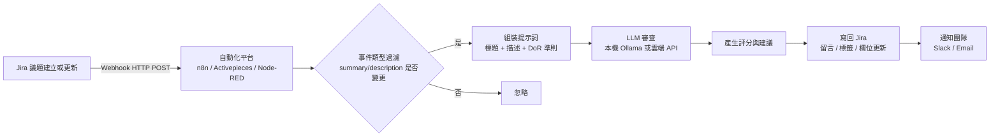

# 以 Webhook 整合 Jira 並用 LLM 審查工單內容與品質的 FOSS 方案

## 摘要

本報告調查「可整合 Jira（透過 Webhook）、並使用大型語言模型（LLM）審查工單（ticket）內容或品質」的自由開源軟體（FOSS, Free and Open Source Software）方案。結論是：**目前不存在一個高星數、成熟、以 OSI 認可授權釋出的「Jira 工單品質 LLM 審查器」**。實務上有兩條路線：

1. **專用工單品質審查工具**：多為個人專案，星數極低（0～7 星），部分甚至未附授權檔，適合當作參考實作或自架改造。
2. **通用自動化平台**：以 n8n、Activepieces、Node-RED、Windmill、Huginn 串接 Jira Webhook 與 LLM，其中 Activepieces（MIT）與 Node-RED（Apache-2.0）為 OSI 認可授權，n8n 為 source-available 的 fair-code 授權而非 OSI 開源。

以下依序說明背景、方案分類、授權比較、整合架構與建議。

## 背景與問題定義

Jira 是以 Atlassian 開發的專案與議題追蹤系統，廣泛用於軟體開發團隊管理缺陷（bug）、使用者故事（user story）與任務（task）。Jira 支援 **Webhook** 機制，當議題被建立、更新或狀態變更時，會以 HTTP POST 主動通知外部服務，這是把 Jira 事件串接到外部自動化的標準做法[^atlassian-webhook]。

「用 LLM 審查工單品質」通常指自動檢查下列項目：標題是否清楚、描述是否完整、是否具備驗收標準（acceptance criteria）、再現步驟（reproduction steps）、依賴與風險是否標明，並對照團隊的 Definition of Ready（DoR，就緒定義）給出評分或建議[^jironaut]。

FOSS 指符合開源定義、可自由使用、修改與散布的軟體；嚴謹而言，只有 OSI（Open Source Initiative）認可的授權才算「開源」[^osi]。source-available（原始碼可見）不等於開源，這點在下述授權比較中至關重要[^faircode]。

## 方案一：專用 Jira 工單品質 LLM 審查工具

這些專案直接以 LLM 審查 Jira 工單內容，最貼近需求，但普遍星數極低。

| 專案 | 星數 | 授權 | 語言 | 說明 |
|---|---|---|---|---|
| lisbuenas/task-reviewer（AgileLint） | 0 | 未附授權檔 | TypeScript | 接收 Jira issue webhook，以 LLM（Amazon Bedrock Nova Lite 或 OpenRouter）審查標題與描述是否符合敏捷品質條件，維護單一分析留言[^task-reviewer]。 |
| MarcinMikula/defect-pilot | 0 | 未附授權檔（README 標示 MIT） | Python | 隱私優先的 QA 守門員，輪詢 Jira 取得缺陷，用本機 Ollama 分析文字與截圖並給 0～100 完整度分數，缺漏時退回給測試者[^defect-pilot]。 |
| curiouscoach-tools/jironaut | 0 | 未附授權檔（README 標示 MIT） | JavaScript | React/Vite 網頁應用，將工單標題與描述對照產業最佳實務與團隊 DoR 評分（100 分制），含 PII 偵測與自訂 DoR 上傳，使用 Claude[^jironaut]。 |
| SondosAlgyed/qa-agent | 0 | 未附授權檔 | TypeScript/Python | 命令列工具 `qa review <key>`，抓取 Jira 故事並請 Claude 審查，輸出 Ready／有疑問／未就緒的判定與發現分類，含 DeepEval 評測[^qa-agent]。 |
| suneelasree/ai-judge | 7 | MIT | TypeScript | 以驗收標準為關卡：故事缺少或無法測試的 AC 即停止，接著由 AI 設計測試案例並在 Chrome 執行，產生人工核准的 Jira 缺陷[^ai-judge]。 |
| hunterr198/us-quality-gate | 0 | MIT | Python | 使用者故事品質評估：草稿潤飾、多視角審查（架構／測試／安全）、量化評分與自動修正，設有品質關卡門檻[^us-quality-gate]。 |
| ns-skuncha/jira-quality-check | 0 | 未附授權檔 | Python | 依元件或標籤抓取工單，以本機模型（Ollama/llama3.2）或規則式評分，檢查再現步驟、預期／實際結果、日誌、RCA 等，產出 HTML/JSON 報告[^jira-quality-check]。 |
| Sid-0307/Jira-Ticket-Enhancer | 0 | 未附授權檔 | TypeScript | LLM 驅動工具，在建立工單時即時評分並以品質門檻把關，含問題偵測與改寫預覽，後端 FastAPI＋Gemini[^ticket-enhancer]。 |
| datexland/Jira-Tickets-AI | 0 | 未附授權檔 | Agent Skill | 提示詞技能，將任一 LLM 變成技術產品負責人，強制套用模板（使用者故事、DoR、DoD）並偵測阻礙[^tickets-ai]。 |

**觀察**：上表專案多為個人或小型專案，星數介於 0～7，且過半未附正式授權檔（README 標示與倉庫實際授權檔不一致者亦存在），重複使用前須自行確認授權[^task-reviewer][^jironaut]。這顯示「Jira 工單品質 LLM 審查」是一個真實但尚未成熟、缺乏主流專案的小眾領域。

## 方案二：通用自動化平台（Webhook → LLM）

若追求可長期維護、授權乾淨的生產級方案，實務做法是以自動化平台接收 Jira Webhook，再呼叫 LLM 節點或 API 審查工單。

| 平台 | 星數（約） | 授權 | Jira 支援 | LLM 支援 |
|---|---|---|---|---|
| n8n | ~207,000 | Sustainable Use License（fair-code，非 OSI 開源） | 原生 Jira Trigger 與 Jira 動作節點[^n8n] | 原生 LangChain AI 節點（AI Agent、聊天模型、向量庫、MCP）[^n8n] |
| Activepieces | ~25,000 | MIT（核心）＋商用授權（企業版） | 原生 Jira Cloud piece（多種觸發與動作）[^activepieces] | AI piece、Agents、AI Router、MCP[^activepieces] |
| Node-RED | ~23,700 | Apache-2.0 | 透過 `node-red-contrib-jira` 與 HTTP/Webhook 節點 | 透過 HTTP 節點或社群 LLM 節點 |
| Windmill | ~18,200 | AGPL-3.0 | 以 Python/TS/Go 腳本呼叫 Jira REST API | 腳本內呼叫任一 LLM API |
| Huginn | ~50,000 | MIT | 內建 JiraAgent 與通用 Webhook/Post 代理 | 可呼叫 LLM API |

**授權關鍵差異**：n8n 雖為最熱門，但其授權為自家 Sustainable Use License，限制商業轉售與託管服務，且不符合 OSI 開源定義[^n8n-license][^faircode]。若嚴格要求「開源」，應優先考慮 **Activepieces（MIT）**、**Node-RED（Apache-2.0）** 或 **Huginn（MIT）**[^activepieces][^node-red][^huginn]。Activepieces 的核心採 MIT，但 `packages/ee/` 目錄下的企業功能另採商用授權，需注意雙授權邊界[^activepieces]。

## 方案三：可作為積木的相關基礎設施

| 專案 | 星數（約） | 授權 | 用途 |
|---|---|---|---|
| sooperset/mcp-atlassian | ~5,993 | MIT | Atlassian（Jira、Confluence）的 MCP 伺服器，讓任何支援 MCP 的 LLM 客戶端讀寫 Jira 工單，常作為工單審查代理的建構積木[^mcp-atlassian]。 |
| wshm-dev/wshm | 84 | Apache-2.0 | AI 驅動的倉庫代理，支援 GitHub、GitLab、Gitea、Azure DevOps，含議題分流，支援自架與 Ollama/OpenAI/Anthropic[^wshm]。 |
| h1alexbel/ghiqc | 5 | MIT | 以 LLM 檢查 GitHub Issues bug 報告品質的命令列工具（Rust），目標為 GitHub 而非 Jira，是最貼近「LLM 缺陷報告品質檢查」但非 Jira 的實作[^ghiqc]。 |

## 整合架構示意

下圖說明以通用平台接收 Jira Webhook、呼叫 LLM 審查、並將結果寫回工單的典型流程。

**資料落地與隱私**：若工單含敏感資訊，建議採本機模型（如 Ollama），defect-pilot 即以本機 llava 模型做隱私優先的增強，而 jironaut、task-reviewer 則預設呼叫雲端 API（Claude、Bedrock）[^defect-pilot][^jironaut][^task-reviewer]。

## 關鍵發現與批判性反思

- **缺乏主流方案**：搜尋 GitHub 後，沒有任何高星數、以 OSI 授權釋出的專用「Jira 工單品質 LLM 審查器」；最貼近者（jironaut、qa-agent、ai-judge、task-reviewer）皆為 0～7 星的小型專案，且多數未附正式授權檔[^task-reviewer][^jironaut][^qa-agent][^ai-judge]。
- **多數 Jira＋LLM 專案方向不同**：大量專案聚焦於測試案例生成、議題分流或工單建立，而非工單文字品質的評分與審查[^wshm]。
- **授權是選型關鍵**：n8n 熱門但非 OSI 開源；追求嚴格 FOSS 者應選 Activepieces、Node-RED 或 Huginn[^n8n-license][^activepieces][^node-red][^huginn]。
- **來源可信度**：本報告資料主要來自 GitHub 倉庫頁面與 GitHub API，屬第一手但由專案作者自述，品質與成熟度未經獨立驗證；星數為擷取時數值，會隨時間變動。OSI 與 fair-code 的授權判斷則援引授權原始文件與公平碼（fair-code）官方定義[^osi][^faircode]。

## 建議

1. **需要可長期維護的生產方案**：以 **Activepieces（MIT）** 或 **Node-RED（Apache-2.0）** 接收 Jira Webhook，串接 OpenAI/Anthropic 或本機 Ollama，自行實作審查提示詞與評分邏輯。若可接受 source-available 授權，n8n 因原生 Jira 與 AI 節點最完整而最易上手[^n8n][^activepieces][^node-red]。
2. **需要現成審查邏輯**：參考 jironaut 的 DoR 評分規準、task-reviewer 的單一留言管理機制、qa-agent 的驗收標準判定分類，自行改造為自架服務[^jironaut][^task-reviewer][^qa-agent]。
3. **重視隱私／需離線**：採本機模型路線，參考 defect-pilot 與 jira-quality-check 的 Ollama 用法[^defect-pilot][^jira-quality-check]。
4. **需與 LLM 客戶端深度整合**：採用 mcp-atlassian 作為 MCP 積木，讓支援 MCP 的代理直接讀寫 Jira 工單[^mcp-atlassian]。

## 參考文獻

[^atlassian-webhook]: Atlassian. (n.d.). Webhooks. Retrieved 2026-10-11, from https://developer.atlassian.com/server/jira/platform/webhooks/

[^jironaut]: curiouscoach-tools. (n.d.). jironaut [Computer software]. Retrieved 2026-10-11, from https://github.com/curiouscoach-tools/jironaut

[^osi]: Open Source Initiative. (n.d.). The open source definition. Retrieved 2026-10-11, from https://opensource.org/osd

[^faircode]: Faircode. (n.d.). Fair-code. Retrieved 2026-10-11, from https://faircode.io/

[^task-reviewer]: lisbuenas. (n.d.). task-reviewer (AgileLint) [Computer software]. Retrieved 2026-10-11, from https://github.com/lisbuenas/task-reviewer

[^defect-pilot]: MarcinMikula. (n.d.). defect-pilot [Computer software]. Retrieved 2026-10-11, from https://github.com/MarcinMikula/defect-pilot

[^qa-agent]: SondosAlgyed. (n.d.). qa-agent [Computer software]. Retrieved 2026-10-11, from https://github.com/SondosAlgyed/qa-agent

[^ai-judge]: suneelasree. (n.d.). ai-judge [Computer software]. Retrieved 2026-10-11, from https://github.com/suneelasree/ai-judge

[^us-quality-gate]: hunterr198. (n.d.). us-quality-gate [Computer software]. Retrieved 2026-10-11, from https://github.com/hunterr198/us-quality-gate

[^jira-quality-check]: ns-skuncha. (n.d.). jira-quality-check [Computer software]. Retrieved 2026-10-11, from https://github.com/ns-skuncha/jira-quality-check

[^ticket-enhancer]: Sid-0307. (n.d.). Jira-Ticket-Enhancer [Computer software]. Retrieved 2026-10-11, from https://github.com/Sid-0307/Jira-Ticket-Enhancer

[^tickets-ai]: datexland. (n.d.). Jira-Tickets-AI [Computer software]. Retrieved 2026-10-11, from https://github.com/datexland/Jira-Tickets-AI

[^n8n]: n8n. (n.d.). n8n [Computer software]. Retrieved 2026-10-11, from https://github.com/n8n-io/n8n

[^n8n-license]: n8n. (n.d.). Sustainable use license. Retrieved 2026-10-11, from https://github.com/n8n-io/n8n/blob/master/LICENSE.md

[^activepieces]: Activepieces. (n.d.). Activepieces [Computer software]. Retrieved 2026-10-11, from https://github.com/activepieces/activepieces

[^node-red]: Node-RED. (n.d.). Node-RED [Computer software]. Retrieved 2026-10-11, from https://github.com/node-red/node-red

[^windmill]: Windmill Labs. (n.d.). Windmill [Computer software]. Retrieved 2026-10-11, from https://github.com/windmill-labs/windmill

[^huginn]: Huginn. (n.d.). Huginn [Computer software]. Retrieved 2026-10-11, from https://github.com/huginn/huginn

[^mcp-atlassian]: sooperset. (n.d.). mcp-atlassian [Computer software]. Retrieved 2026-10-11, from https://github.com/sooperset/mcp-atlassian

[^wshm]: wshm-dev. (n.d.). wshm [Computer software]. Retrieved 2026-10-11, from https://github.com/wshm-dev/wshm

[^ghiqc]: h1alexbel. (n.d.). ghiqc [Computer software]. Retrieved 2026-10-11, from https://github.com/h1alexbel/ghiqc