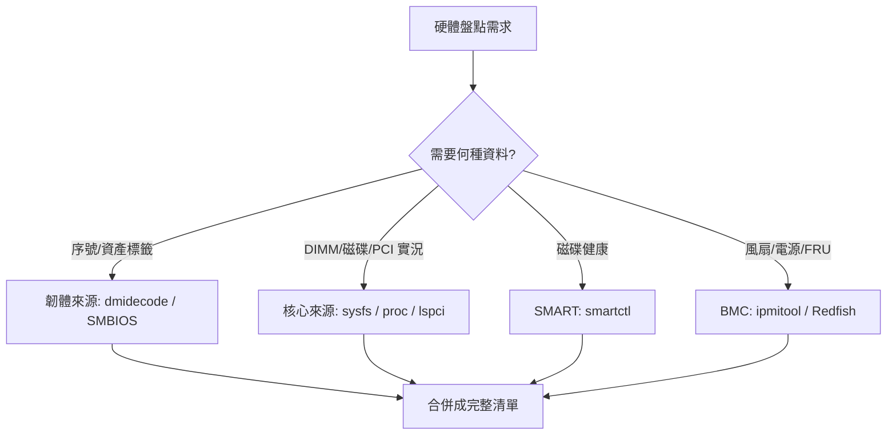

# 用 Ansible 傾印 Linux 伺服器硬體資訊是否可行？

## 摘要

短答：**Ansible 適合當「跨多台機器的蒐集協調者」，但不是硬體盤點工具本身。**

Ansible 內建的 `setup` 模組能快速取得一份「基準」硬體資訊（CPU、記憶體總量、DMI、區塊裝置、掛載點等），但要拿到序號（serial number）、每條 DIMM 的料號、磁碟健康度（SMART）、PCI 拓樸或 BMC/FRU 資料，就必須讓 Ansible 去呼叫真正的硬體工具（`dmidecode`、`lshw`、`smartctl`、`ipmitool` 等），再解析其輸出。Ansible 原生 facts 的深度不足[^setupdocs][^facts]。

---

## 1. 先理解兩類硬體資料來源

所有硬體工具幾乎都屬於以下兩類之一，理解差異是選工具的前提：

- **韌體／BMC 來源**：由廠商（BIOS/BMC）告訴作業系統有哪些硬體。速度快，能提供序號與資產標籤（asset tag），但「已被證明不足以盲目信任」，因為它反映的是 BIOS 的說法，而非對實際晶片的掃描[^dmidecode-wiki]。
- **核心／探測來源**：核心透過 `/sys`、`/proc`、PCI 設定空間等實際列舉裝置。對「存在且可用」的硬體準確，但看不到只有韌體才知道的型號／序號／資產資料[^sysfs]。

一份完整的硬體盤點通常必須同時合併這兩類資料。



---

## 2. 常用硬體傾印工具比較

| 工具 | 資料來源 | 涵蓋範圍 | 需要 root | 機器可讀輸出 | 重點 |
|---|---|---|---|---|---|
| `dmidecode` | SMBIOS/DMI 表（韌體） | 系統、主機板、BIOS、機殼、CPU 插槽、記憶體插槽、I/O 埠 | **是**（讀 `/dev/mem`） | `--type` 選擇；文字解析 | **不掃描硬體，只回報 BIOS 所說**；是序號、資產標籤、BIOS 版本的唯一標準來源[^dmidecode-wiki][^dmidecode-man] |
| `lshw` | DMI、`/proc`、`/sys`、PCI、CPUID、SCSI、USB、OpenFirmware | 完整硬體樹（記憶體、韌體、主機板、CPU、快取、匯流排、磁碟、NIC） | **是**（否則只回報部分資訊） | `-json`、`-xml`、`-html`、`-short`、`-businfo` | 最佳「單一完整樹」工具；可 `-sanitize` 去敏感、`-disable dmi`[^lshw-man] |
| `hwinfo` | 探測 `/proc`、`/sys` 及硬體 | 涵蓋最廣：PCI、USB、CPU、記憶體、磁碟、網路、音效、螢幕、BIOS、RAID（`--listmd`）、指紋等 | 完整細節通常需要 | `--log FILE`、`--short` | 被視為 `lshw` 的超集[^hwinfo-man] |
| `inxi` | 包裝多個後端（`/sys`、`/proc`、dmidecode、lsblk、lspci、lsusb、smartctl、ipmi、sensors） | 易讀的整合報告：系統、BIOS、CPU、記憶體模組、磁碟、網路、顯示、感測器、RAID、USB、分割區 | 部分功能（`--slots`、`--dmidecode`） | `--output json`、`--output xml` | 最適合人看的摘要與支援；`-v8` 全開；`-z` 過濾隱私（MAC/IP/序號）[^inxi-man] |
| `lspci` / `lsusb` | PCI 設定空間／USB | PCI 匯流排與裝置；USB 匯流排與裝置 | 部分（`-xxx` 需 root） | `-m`、`-mm`（`lspci`）；`-vmm` | `lspci -k` 顯示每個裝置的核心驅動；`-t` 樹狀；`update-pciids` 修正「Unknown device」[^lspci-man] |
| `lsblk` | `/sys` + udev DB（+ libblkid） | 區塊裝置、分割區、檔案系統、拓樸 | 否（部分 FS 標籤/UUID 需 root） | `-J/--json`、`-P/--pairs`、`-r/--raw`、`-o` 選欄 | 官方警告：**預設輸出可能變動，腳本切勿依賴預設欄位，務必用 `--output` 明確指定**[^lsblk-man] |
| `smartctl`（smartmontools） | ATA/SATA/SCSI/SAS/NVMe 的 SMART 資料 | 磁碟型號、序號、韌體、健康、溫度、錯誤日誌、自我測試 | 通常需要 | 新版有 JSON（`-j`）；亦支援文字 | `-i` 取型號/序號/韌體；`-a`/`-x` 取全部 SMART；`-d` 可穿透 RAID 控制器[^smartctl-man] |
| `ipmitool` | IPMI BMC（帶內或 IPMI-over-LAN） | **FRU 可替換單元盤點**、感測器、SDR、SEL、機殼狀態/電源 | 本機需 OpenIPMI 驅動；遠端需 LAN 憑證 | `-c` CSV 輸出 | `ipmitool fru` 內建 FRU 盤點；`sdr`/`sensor` 讀值；`chassis status` 電源/散熱/故障；可帶外運作，主機斷電/當機仍可盤點[^ipmitool-man] |
| `/sys`、`/proc` | 核心 | 原始裝置/驅動/樹狀資料 | 視情況 | 純文字 | 是上述多數工具的**底層來源**；`/sys` 有 `block/ bus/ class/ dev/ devices/ firmware/ hypervisor/ kernel/ module/ power/` 等目錄[^sysfs] |

### 實務建議組合

- **快速人看摘要**：`inxi -Fxz`（或 `-v8`）[^inxi-man]。
- **結構化完整樹給程式解析**：`lshw -json` 或 `hwinfo --all --log`[^lshw-man][^hwinfo-man]。
- **序號／資產標籤／BIOS 版本（資產追蹤必需）**：`dmidecode`，這是唯一標準來源[^dmidecode-wiki]。
- **實體磁碟健康／序號**：`smartctl -i` / `-a`[^smartctl-man]。
- **伺服器 FRU／感測器／風扇／電源，含帶外**：`ipmitool fru` / `sdr` / `sensor` / `chassis status`[^ipmitool-man]。

---

## 3. Ansible 到底能做什麼？

### 3.1 `setup` 模組與 `ansible_facts`

`ansible.builtin.setup` 模組「會被 playbook 自動呼叫，以蒐集遠端主機的實用變數」[^setupdocs]。蒐集結果放在 `ansible_facts`（預設也會以頂層 `ansible_*` 變數注入）。

與硬體相關的 facts 包含：`ansible_processor`、`ansible_processor_cores/count/vcpus/threads_per_core`、`ansible_memtotal_mb`、`ansible_memory_mb`、`ansible_swap*`、`ansible_devices`（磁碟/分割區）、`ansible_mounts`、`ansible_product_name/serial/uuid/version`、`ansible_system_vendor`、`ansible_form_factor`、`ansible_bios_date/bios_version`、`ansible_machine`、`ansible_architecture`、`ansible_virtualization_type/role`[^setupdocs][^facts]。

從 ansible-core 原始碼可知，`HardwareCollector` 宣告的 fact ID 為：`processor`、`processor_cores`、`processor_count`、`mounts`、`devices`（原始碼註解還寫著「mounts 其實不完全是硬體」），可見 Ansible 所謂的「hardware」比純物理硬體更廣，還包含檔案系統/掛載資料[^src-hw-base]。

### 3.2 `gather_subset` 選項

`gather_subset` 可限制蒐集範圍，預設為 `["all"]`；與硬體相關的值包括 `hardware`、`devices`、`mounts`、`processor`、`processor_cores`、`processor_count` 等[^setupdocs]：

- `gather_subset: hardware` — DMI/BIOS/產品層級 facts。
- `gather_subset: devices` — 區塊裝置（`ansible_devices`）。
- 可組合：`gather_subset: [hardware, devices]`。
- 可用 `!` 反選：例如 `!all,!min` 表示完全不蒐集（除明確列出的 subset 外）。
- `!all` 只蒐集 `min` subset。

```yaml
- name: 只收網路與虛擬化 facts（含最小 facts）
  ansible.builtin.setup:
    gather_subset: [network, virtual]

- name: 只收網路與虛擬化 facts（排除最小 facts）
  ansible.builtin.setup:
    gather_subset: ['!all', network, virtual]
```

`gather_timeout` 預設為 10 秒，是「每個 fact」的蒐集逾時[^setupdocs]。

### 3.3 各項 hardware facts 的細節來源

Linux collector（`module_utils/facts/hardware/linux.py`）合併以下內容[^src-hw-linux]：

- **CPU**（來自 `/proc/cpuinfo`）：`ansible_processor`（清單）、`ansible_processor_cores`、`ansible_processor_count`、`ansible_processor_vcpus`、`ansible_processor_nproc`、`ansible_flags`。
- **記憶體**（來自 `/proc/meminfo`）：`ansible_memtotal_mb`、`ansible_memfree_mb`、`ansible_swaptotal_mb`、`ansible_memory_mb`（巢狀 real/nocache/swap）。
- **DMI**（來自 `/sys/devices/virtual/dmi/id/*`，若不可用則退回 `dmidecode` 執行檔）：`ansible_bios_*`、`ansible_board_*`、`ansible_chassis_*`、`ansible_product_*`、`ansible_system_vendor`、`ansible_form_factor`。注意：**沒有單一的 `ansible_dmi` fact**，DMI 被攤平成多個頂層 fact。
- **裝置／區塊儲存**（來自 `/sys/block`、`/dev/disk/by-*`、`lsblk`/`udevadm`、`lspci`、`sg_inq`）：`ansible_devices`（每顆磁碟的 `model`、`vendor`、`size`、`serial`、`wwn`、`rotational`、`partitions`、`links` 等）。
- **掛載**（來自 `/etc/mtab`、`/proc/mounts`）：`ansible_mounts`。
- **LVM**（**僅在 root 且存在 `vgs`/`lvs`/`pvs` 時**）：`ansible_lvm`，否則為字串 `"N/A"`[^src-hw-linux]。

### 3.4 Ansible 硬體 facts 的限制

1. **深度不足**：`ansible_facts` 不提供磁碟序號以外的深層硬體細節、每條 DIMM 的料號/序號、PCI 裝置樹、SMART 健康或 BMC/FRU 資料。Ansible 沒有內建的 `smartctl`、`ipmitool`、`lspci` 等對應 fact[^facts][^setupdocs]。
2. **相依外部套件會導致 fact 缺失**：官方警告「因為支援蒐集那些 facts 的套件預設未安裝，你可能看到 fact 缺漏或為預設值」。例如網路 facts 需要 `iproute2` 的 `ip` 執行檔[^facts]。
3. **DMI 退回鏈**：若 `/sys/devices/virtual/dmi/id/` 不可用會退回 `dmidecode`；若 `dmidecode` 也不存在，**所有 DMI facts 會被設為 `'NA'`**[^src-hw-linux]。
4. **磁碟序號來源**：序號依賴 `sg_inq`（SCSI）或 `/sys/block/<name>/device/serial`（NVMe）；WWN 需要 `/dev/disk/by-id`[^src-hw-linux]。
5. **特權需求**：LVM facts 需 root；BSD 上某些 facts（如 `ansible_product_version`）需提權[^src-hw-linux][^facts]。
6. **逾時**：`gather_timeout` 預設 10 秒；掛載蒐集以執行緒進行且可能失敗（「No mount facts were gathered due to timeout」），慢速/網路檔案系統尤甚[^src-hw-linux][^setupdocs]。
7. **虛擬化會遮蔽真實硬體**：在 VM 中 DMI 值為通用/合成的（例如 `ansible_product_name: "HVM domU"`、`ansible_system_vendor: "Xen"`），許多裝置欄位為 `null`，實體資產/序號常不可得或不可靠[^facts]。
8. **`filter` 只過濾第一層**：無法任意深度過濾；Windows 目標不支援 `filter`[^facts][^setupdocs]。
9. **快照特性**：facts 是蒐集當下的快照，易變值（記憶體/磁碟用量）會過期；官方指出 `ansible_date_time`「在長時間 playbook 中會過期」[^facts]。
10. **規模效能**：facts 預設在每個 play 開頭蒐集；大量主機時官方建議用 **fact cache** 或 `gather_facts: false`[^facts][^cache]。

### 3.5 用 Ansible 做硬體盤點的正確姿勢

既然原生 facts 太淺，實務作法是**呼叫真正的工具並解析輸出**：

```yaml
- name: 取得 dmidecode 記憶體資訊
  ansible.builtin.command: dmidecode --type 17
  register: dmi_mem
  changed_when: false

- name: 取得 lshw 完整樹（JSON）
  ansible.builtin.command: lshw -json
  register: lshw_out
  changed_when: false

- name: 取得磁碟序號與健康
  ansible.builtin.command: smartctl -i -j /dev/sda
  register: smart_out
  changed_when: false
```

再以 `from_json` 解析。或使用 `ansible.builtin.setup` 搭配 `gather_subset: [hardware, devices]` 取快速基準，並以 `/etc/ansible/facts.d/*.fact`（可執行、回傳 JSON 的腳本）補充自訂 facts[^setupdocs]。

此外，`community.general` collection 提供 BMC/OEM 管理模組，如 `hpilo_boot`（HP iLO）與 `idrac_redfish_command`（Dell iDRAC Redfish），可用於帶外盤點/控制[^cg]。

### 3.6 Fact cache：把 facts 持久化

若要在多台主機上重複使用 facts 而不重複蒐集，可啟用 fact cache。官方文件（https://docs.ansible.com/ansible/latest/plugins/cache.html ）說明[^cache]：

- Fact caching **永遠啟用**，但一次只能有一個 fact cache plugin 生效；預設是 `memory`（僅當前執行）。
- Inventory caching **預設關閉**，需以 `ANSIBLE_INVENTORY_CACHE=True` 或 `[inventory] cache=True` 開啟。
- 常用外掛：`ansible.builtin.jsonfile`（每主機一個 JSON 檔，`_timeout` 預設 86400 秒）、`community.general.redis`、`community.general.memcached`[^cache][^jsonfile-cache]。
- **重要警告**：cache plugin 的資料是內部實作細節，**不應被外部程式查詢**，格式可能變動；只應在 playbook 內間接使用[^cache]。

`ansible-inventory` 可傾印 inventory，並有 `--flush-cache`（清除所有主機的 fact cache）等選項[^ansible-inventory]。

---

## 4. 大規模硬體盤點的其他工具

若目標是「整個機房規模的硬體盤點／DCIM」，Ansible 只是其中一環。關鍵在於分辨兩層：**真相來源（DCIM 資料庫）** vs **蒐集器/代理程式**[^netbox][^osquery]。

| 工具 | 類型 | 序號 | DIMM | 磁碟 | NIC | 全機隊蒐集 |
|---|---|---|---|---|---|---|
| **NetBox** | DCIM 真相來源 | ✅ | ✅（inventory items/modules） | ✅ | ✅ | ✅（REST/GraphQL API） |
| **osquery** | SQL 主機代理 | ✅ `system_info.hardware_serial` | ✅ `memory_devices`（每 DIMM） | ✅ `block_devices.serial` | ✅ `interface_details.mac` | ✅ 分散式查詢 |
| **Facter**（Puppet） | Facts 函式庫 | ✅ `dmi.product.serial_number` | ⚠️ 僅總量 | ✅ `disks.*.serial_number` | ✅ | ✅ 經 PuppetDB |
| **Salt grains** | Facts + 執行模組 | ✅ 經 `smbios` 模組 | ✅ `smbios.records 17` | ✅ | ✅ | ✅ Mine |
| **Telegraf** | 指標/遙測代理 | ✅ smart plugin | ⚠️ 總量 | ✅ `smart`（序號/WWN） | ✅ | ✅ 多外掛 |
| **node_exporter** | 指標 exporter | ⚠️ 預設不含序號 | ⚠️ 僅總量 | ⚠️ 無序號 | ✅ | ✅ Prometheus |
| **Redfish/BMC** | 帶外標準 API | ✅ `ComputerSystem.SerialNumber` | ✅ `Memory` 集合 | ✅ `Drive` 序號 | ✅ MAC | ✅ 單一 API 跨廠商 |

- **osquery** 是作業系統內最強的單一代理：`memory_devices` 提供每條 DIMM 的序號/料號/廠商，`block_devices` 提供磁碟序號，可用 SQL 對上千節點做分散式查詢[^osquery]。
- **Redfish（BMC）** 是唯一免代理、與 OS 無關的選項，且是序號的權威來源（即使 OS 掛掉仍可查）；DMTF schema 定義 `ComputerSystem`、`Memory`、`Storage`、`Drive`、`EthernetInterface` 等[^redfish]。
- **NetBox** 本身不做探索，標準作法是：用蒐集器（osquery/Redfish/netbox-agent）→ 透過 REST API 或 Diode 將序號/DIMM/磁碟/NIC 寫入 NetBox[^netbox]。

---

## 5. 結論

- **只用 Ansible 原生 facts 不夠**：它給的是「基準」，適合快速取得 CPU/記憶體/DMI/磁碟/掛載等概要，但不含磁碟以外元件的序號、DIMM 明細、SMART 健康、PCI 拓樸、BMC/FRU[^facts]。
- **Ansible 的真正價值是「協調」**：讓它跨多台機器執行 `dmidecode`、`lshw -json`、`lsblk -J`、`smartctl -i`、`ipmitool fru`、`lspci -mm`，再 `register` + `from_json` 彙整[^setupdocs]。
- **若追求完整且可信的機房盤點**：考慮 osquery（OS 內、SMBIOS 底層 SQL）+ Redfish/BMC（帶外、權威序號）+ NetBox（真相來源），並用 Ansible 負責部署與週期性觸發[^netbox][^osquery][^redfish]。
- **實務折衷**：`ansible.builtin.setup` 搭配 `gather_subset: [hardware, devices]` 作快速基準，加上 `command` 呼叫真實工具與 `/etc/ansible/facts.d` 自訂 facts，即可在既有 Ansible 體系內得到相當完整的硬體傾印[^setupdocs]。

---

## 參考文獻

Ansible. (n.d.). *ansible.builtin.setup module*. Retrieved 2026-10-12, from https://docs.ansible.com/ansible/latest/collections/ansible/builtin/setup_module.html

Ansible. (n.d.). *Cache plugins*. Retrieved 2026-10-12, from https://docs.ansible.com/ansible/latest/plugins/cache.html

Ansible. (n.d.). *Discovering variables: facts and magic variables*. Retrieved 2026-10-12, from https://docs.ansible.com/ansible/latest/playbook_guide/playbooks_vars_facts.html

Ansible. (n.d.). *ansible.builtin.jsonfile cache*. Retrieved 2026-10-12, from https://docs.ansible.com/ansible/latest/collections/ansible/builtin/jsonfile_cache.html

Ansible. (n.d.). *ansible-inventory CLI*. Retrieved 2026-10-12, from https://docs.ansible.com/ansible/latest/cli/ansible-inventory.html

Ansible. (n.d.). *community.general collection index*. Retrieved 2026-10-12, from https://docs.ansible.com/ansible/latest/collections/community/general/index.html

Ansible. (n.d.). *linux.py (hardware facts collector source)*. Retrieved 2026-10-12, from https://raw.githubusercontent.com/ansible/ansible/devel/lib/ansible/module_utils/facts/hardware/linux.py

Ansible. (n.d.). *base.py (HardwareCollector source)*. Retrieved 2026-10-12, from https://raw.githubusercontent.com/ansible/ansible/devel/lib/ansible/module_utils/facts/hardware/base.py

DMTF. (n.d.). *Redfish standard*. Retrieved 2026-10-12, from https://www.dmtf.org/standards/redfish

inxi. (n.d.). *inxi man page*. Retrieved 2026-10-12, from https://manpages.debian.org/testing/inxi/inxi.1.en.html

ipmitool. (n.d.). *ipmitool man page*. Retrieved 2026-10-12, from https://manpages.debian.org/testing/ipmitool/ipmitool.1.en.html

NetBox Community. (n.d.). *NetBox documentation*. Retrieved 2026-10-12, from https://netbox.readthedocs.io/en/stable/

osquery. (n.d.). *osquery*. Retrieved 2026-10-12, from https://osquery.io

pciutils. (n.d.). *lspci man page*. Retrieved 2026-10-12, from https://manpages.debian.org/testing/pciutils/lspci.8.en.html

smartmontools. (n.d.). *smartctl man page*. Retrieved 2026-10-12, from https://manpages.debian.org/testing/smartmontools/smartctl.8.en.html

The Linux Kernel. (n.d.). *sysfs - The filesystem for exporting kernel objects*. Retrieved 2026-10-12, from https://www.kernel.org/doc/html/latest/filesystems/sysfs.html

util-linux. (n.d.). *lsblk man page*. Retrieved 2026-10-12, from https://manpages.debian.org/testing/util-linux/lsblk.8.en.html

Wikipedia. (n.d.). *dmidecode*. Retrieved 2026-10-12, from https://en.wikipedia.org/wiki/Dmidecode

[^setupdocs]: Ansible, `ansible.builtin.setup module`（https://docs.ansible.com/ansible/latest/collections/ansible/builtin/setup_module.html），說明 setup 模組、`gather_subset` 選項與 `gather_timeout` 預設值。

[^facts]: Ansible, `Discovering variables: facts and magic variables`（https://docs.ansible.com/ansible/latest/playbook_guide/playbooks_vars_facts.html），說明 facts 的取得、套件相依警告、filter 限制與虛擬化下的 DMI 行為。

[^cache]: Ansible, `Cache plugins`（https://docs.ansible.com/ansible/latest/plugins/cache.html），說明 fact cache 僅能啟用一個外掛、格式為內部實作細節不應外部查詢。

[^jsonfile-cache]: Ansible, `ansible.builtin.jsonfile cache`（https://docs.ansible.com/ansible/latest/collections/ansible/builtin/jsonfile_cache.html），列出 `_uri`、`_prefix`、`_timeout` 參數。

[^ansible-inventory]: Ansible, `ansible-inventory CLI`（https://docs.ansible.com/ansible/latest/cli/ansible-inventory.html），說明 `--list`、`--host`、`--flush-cache` 等選項。

[^src-hw-linux]: Ansible 原始碼 `module_utils/facts/hardware/linux.py`（https://raw.githubusercontent.com/ansible/ansible/devel/lib/ansible/module_utils/facts/hardware/linux.py），Linux collector 的 fact 來源、DMI 退回 `dmidecode`、缺 `dmidecode` 時 DMI facts 為 `'NA'`、LVM 需 root、掛載逾時訊息。

[^src-hw-base]: Ansible 原始碼 `module_utils/facts/hardware/base.py`（https://raw.githubusercontent.com/ansible/ansible/devel/lib/ansible/module_utils/facts/hardware/base.py），`HardwareCollector` 宣告的 fact ID 清單與註解。

[^cg]: Ansible, `community.general collection index`（https://docs.ansible.com/ansible/latest/collections/community/general/index.html），提供 `hpilo_boot`、`idrac_redfish_command` 等 BMC/OEM 模組。

[^dmidecode-wiki]: Wikipedia, `dmidecode`（https://en.wikipedia.org/wiki/Dmidecode），說明 dmidecode 不掃描硬體、只回報 BIOS 的 DMI 資料，以及「DMI data have proven to be too unreliable to be blindly trusted」。

[^dmidecode-man]: dmidecode 專案頁（https://www.nongnu.org/dmidecode/），說明其為 SMBIOS/DMI 表解碼工具。

[^lshw-man]: Debian manpages, `lshw.1`（https://manpages.debian.org/testing/lshw/lshw.1.en.html），說明需 super user 才能取得完整資訊，並支援 `-json`、`-xml`、`-html`、`-sanitize`、`-disable` 等選項。

[^hwinfo-man]: Debian manpages, `hwinfo.8`（https://manpages.debian.org/testing/hwinfo/hwinfo.8.en.html），列出各硬體項目探測與 `--log`、`--short` 選項。

[^inxi-man]: Debian manpages, `inxi.1`（https://manpages.debian.org/testing/inxi/inxi.1.en.html）與 smxi.org 選項文件（https://smxi.org/docs/inxi-options.htm），說明 JSON/XML 輸出與隱私過濾選項。

[^lspci-man]: Debian manpages, `lspci.8`（https://manpages.debian.org/testing/pciutils/lspci.8.en.html），說明 `-m`、`-mm`、`-k`、`-t`、`update-pciids` 等用法。

[^lsblk-man]: Debian manpages, `lsblk.8`（https://manpages.debian.org/testing/util-linux/lsblk.8.en.html），警告預設輸出可能變動、腳本應明確指定 `--output`，並列出 `-J`、`-P`、`-r`。

[^smartctl-man]: Debian manpages, `smartctl.8`（https://manpages.debian.org/testing/smartmontools/smartctl.8.en.html），說明 `-i`、`-a`、`-x`、`-d` 與 SMART 資料來源。

[^ipmitool-man]: Debian manpages, `ipmitool.1`（https://manpages.debian.org/testing/ipmitool/ipmitool.1.en.html），說明 `fru`、`sdr`、`sensor`、`chassis status` 與 `-c` CSV 輸出。

[^sysfs]: The Linux Kernel, `sysfs - The filesystem for exporting kernel objects`（https://www.kernel.org/doc/html/latest/filesystems/sysfs.html），說明 `/sys` 的頂層目錄結構。

[^netbox]: NetBox Community, `NetBox documentation`（https://netbox.readthedocs.io/en/stable/），包含 Device、Inventory Items、Modules、REST API 等模型與整合方式。

[^osquery]: osquery, `osquery`（https://osquery.io）與 schema（https://osquery.io/schema/），包含 `system_info`、`memory_devices`、`block_devices`、`interface_details`、`cpu_info` 等表。