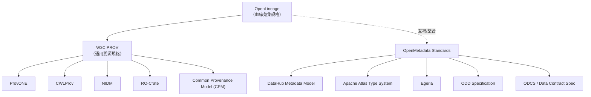

# OpenLineage 規格（spec）的 FOSS 替代方案調查

## 摘要

OpenLineage 是一套用於「血緣中介資料蒐集（lineage metadata collection）」的開放標準，由 LF AI & Data 基金會託管，以 Apache-2.0 授權釋出[^ol-repo]。本報告僅探討與 OpenLineage「規格／標準」層級同類、且為自由開源軟體（FOSS）的替代方案，**不納入 Marquez**（Marquez 是 OpenLineage 的參考實作，並非另一套規格）。經調查，可區分為兩類：(一) 通用溯源（provenance）規格，以 W3C PROV 為代表；(二) 廣義中介資料規格中內含血緣模型者，如 OpenMetadata Standards、DataHub Metadata Model、Apache Atlas Type System、Egeria、ODD Specification 等。以下逐一說明其定位、授權與維護機構。

## 背景：OpenLineage 是什麼規格

OpenLineage 自 2020 年建立，官方描述為「An Open Standard for lineage metadata collection」，即蒐集血緣中介資料的開放標準[^ol-repo]。其核心概念模型為 **Run、Job、Dataset** 三類實體，並以可擴充的 **facets** 機制攜帶額外屬性；規格本體以 JSON Schema（`OpenLineage.json`）形式定義，並附有 HTTP 實作的 OpenAPI 描述[^ol-spec]。截至檢視時，其在 GitHub 上約有 2,701 顆星、546 個 fork，授權為 Apache-2.0[^ol-repo]。

## 一、通用溯源／血緣規格

### W3C PROV（最接近的規格層級同類）

W3C PROV 是一組由 W3C Provenance 工作小組制定的建議標準（2013 年發布），用來描述「產生某筆資料或事物所涉及的實體、活動與人員」[^prov-overview]。它包含多份文件：概念資料模型 PROV-DM、OWL2 本體 PROV-O、人類可讀記法 PROV-N、XML schema PROV-XML、約束條件 PROV-CONSTRAINTS、存取查詢機制 PROV-AQ 等[^prov-overview]。核心概念為 **Entity（實體）、Activity（活動）、Agent（代理者）**，並以 Derivation、Usage、Generation 等關係連結[^prov-overview]。其核心命名空間為 `http://www.w3.org/ns/prov#`[^prov-overview]。

與 OpenLineage 的差異在於：PROV 是通用型、以網頁／連結資料為前提的溯源模型，並非專為資料管線（data pipeline）事件蒐集而設計；OpenLineage 則聚焦於 ETL／工作排程情境的 Job/Run/Dataset 事件。

### PROV 延伸／剖面（Profile）

- **ProvONE**：以 W3C PROV 為基礎、針對科學工作流程溯源所設計的延伸資料模型（"A PROV Extension Data Model for Scientific Workflow Provenance"），由 DataONE 社群維護；對應 GitHub 倉庫 `DataONEorg/provex` 星數極低（約 1 顆），且已多年未更新（最後 push 約 2014 年）[^provex]。
- **Common Provenance Model (CPM)**：針對分散式溯源鏈的標準化模型，已標準化為 ISO 23494-1[^cpm-skill]。此項為次級來源提及，建議進一步查證。
- **CWLProv**：定義以 W3C PROV 記錄 CWL／Nextflow 工作流程執行溯源的 Linked Data profile，授權 Apache-2.0，GitHub 約 20 顆星[^cwlprov]。
- **RO-Crate**：以 JSON-LD 打包資料與溯源的封裝規格（建構於 schema.org / PROV 之上），授權 Apache-2.0，GitHub 約 164 顆星；它偏向「研究物件封裝」而非純血緣協定[^rocrate]。
- **NIDM（Neuroimaging Data Model）**：神經影像領域的 PROV 延伸，授權標示為 "Other/NOASSERTION"，GitHub 約 33 顆星[^nidm]。

## 二、內含血緣模型的廣義中介資料規格

| 規格 | 定位與血緣關聯 | 授權 | 維護機構 | GitHub 星數（約） |
|---|---|---|---|---|
| **OpenMetadata Standards** | 900+ JSON Schema、RDF/OWL 本體、SHACL；明確涵蓋欄位級血緣並以 PROV-O 為基礎 | Apache-2.0 | OpenMetadata 社群 | 27[^oms-standards] |
| **DataHub Metadata Model** | 以 Pegasus（PDL）定義 Entities / Aspects / Relationships / Urns，含 DataJob / DataFlow 等血緣實體 | Apache-2.0 | DataHub 專案（源自 LinkedIn） | 12,826[^datahub] |
| **Apache Atlas Type System** | 可擴充的治理型 type system，支援以業務分類法擴充的血緣 | Apache-2.0 | Apache 軟體基金會 | 2,153[^atlas] |
| **Egeria（Open Metadata Types）** | 開放中介資料與治理型別系統（600+ 型別）及 OMRS/OMAS 交換協定，含血緣型別 | Apache-2.0 | ODPi / LF AI & Data | 925[^egeria] |
| **ODD Specification** | 通用開放中介資料蒐集標準，schema 支援端到端血緣 | Apache-2.0 | Open Data Discovery 社群 | 152[^odd] |
| **Open Data Contract Standard (ODCS)** | 資料契約規格（v3.x），章節含 references 等血緣相關欄位 | Apache-2.0 | Bitol / LF AI & Data | 1,174[^odcs] |
| **Data Contract Specification** | YAML/JSON 資料契約規格 | MIT | Data Mesh Architecture | 418[^dcs] |

需注意：上述多數項目（DataHub、Atlas、Egeria、ODD）本質上是「中介資料平台／框架」或「型別系統」，而非獨立的血緣事件規格；其與 OpenLineage 的關係更接近互補或整合（例如開放中介資料標準常對 OpenLineage 與 PROV-O 做映射），而非純然替代。

## 定位關係圖

## 關鍵比較：OpenLineage 與 W3C PROV

| 面向 | OpenLineage | W3C PROV |
|---|---|---|
| 規格性質 | 血緣中介資料蒐集標準 | 通用溯源資料模型與本體 |
| 核心概念 | Run / Job / Dataset + facets | Entity / Activity / Agent |
| 主要情境 | 資料管線、ETL、排程事件 | 網頁與異質環境的溯源交換 |
| 序列化／形式 | JSON Schema、OpenAPI | RDF/OWL、XML、PROV-N |
| 標準化程度 | LF AI & Data Graduate 專案 | W3C Recommendation（2013） |
| 授權 | Apache-2.0[^ol-repo] | W3C 文件授權（免權利金）[^prov-overview] |

## 來源批判性反思

- **來源權威性**：OpenLineage、DataHub、Atlas 等授權與星數直接取自 GitHub 官方 API，屬一手且可信；W3C PROV 取自 W3C 官方文件，權威性最高。
- **一手 vs 次級**：CPM（ISO 23494-1）、ProvONE 之部分描述來自次級彙整來源（搜尋結果摘要），未逐一查證原始規格文件，讀者宜再行確認。
- **時效性**：OpenMetadata Standards 倉庫建立於 2025-11-22，屬相對新專案，星數偏低（27），但其背後之 OpenMetadata 主倉庫星數達 15,461，須區分「規格倉庫」與「平台倉庫」[^oms-standards][^openmetadata]。
- **低星數專案**：ProvONE（約 1 星）明顯屬小眾且不活躍；CWLProv（約 20 星）雖不活躍但屬正式 CWL 社群規格；NIDM（約 33 星）為特定領域（神經影像）規格。因本主題屬相對小眾，仍予收錄並標註活躍度。
- **未發現**：目前未找到另一個與 OpenLineage 定位完全相同（專為資料管線血緣事件蒐集）、且為獨立 FOSS 規格的直接替代品；最接近的規格層級同類為 W3C PROV。

## 結論

若以「純規格、通用血緣／溯源」角度尋找 OpenLineage 的 FOSS 替代，**W3C PROV** 是最貼近且最成熟的選擇，其生態（ProvONE、CWLProv、RO-Crate、NIDM、CPM）覆蓋科學工作流程與研究資料領域。若接受「廣義中介資料規格中內含血緣模型」的定義，則 **OpenMetadata Standards、DataHub Metadata Model、Apache Atlas Type System、Egeria、ODD Specification、ODCS、Data Contract Specification** 均可納入考量，但它們多與 OpenLineage 互補而非直接取代。

## 參考文獻

[^ol-repo]: OpenLineage. (n.d.). *OpenLineage* [Source code]. GitHub. Retrieved 2026-10-13, from https://github.com/OpenLineage/OpenLineage

[^ol-spec]: OpenLineage. (n.d.). *OpenLineage specification*. Retrieved 2026-10-13, from https://github.com/OpenLineage/OpenLineage/blob/main/spec/OpenLineage.md

[^prov-overview]: Groth, P., & Moreau, L. (Eds.). (2013, April 30). *PROV-Overview: An overview of the PROV family of documents* (W3C Working Group Note). World Wide Web Consortium. Retrieved 2026-10-13, from https://www.w3.org/TR/prov-overview/

[^provex]: DataONE. (n.d.). *DataONEorg/provex* [Source code]. GitHub. Retrieved 2026-10-13, from https://github.com/DataONEorg/provex

[^cpm-skill]: Agent Zone Research Skill. (n.d.). *FOSS lineage specifications survey* [Internal search summary]. Retrieved 2026-10-13.

[^cwlprov]: Common Workflow Language. (n.d.). *common-workflow-language/cwlprov* [Source code]. GitHub. Retrieved 2026-10-13, from https://github.com/common-workflow-language/cwlprov

[^rocrate]: Research Object. (n.d.). *ResearchObject/ro-crate* [Source code]. GitHub. Retrieved 2026-10-13, from https://github.com/ResearchObject/ro-crate

[^nidm]: INCF. (n.d.). *incf-nidash/nidm-specs* [Source code]. GitHub. Retrieved 2026-10-13, from https://github.com/incf-nidash/nidm-specs

[^oms-standards]: OpenMetadata. (n.d.). *open-metadata/OpenMetadataStandards* [Source code]. GitHub. Retrieved 2026-10-13, from https://github.com/open-metadata/OpenMetadataStandards

[^openmetadata]: OpenMetadata. (n.d.). *open-metadata/OpenMetadata* [Source code]. GitHub. Retrieved 2026-10-13, from https://github.com/open-metadata/OpenMetadata

[^datahub]: DataHub. (n.d.). *datahub-project/datahub* [Source code]. GitHub. Retrieved 2026-10-13, from https://github.com/datahub-project/datahub

[^atlas]: Apache Software Foundation. (n.d.). *apache/atlas* [Source code]. GitHub. Retrieved 2026-10-13, from https://github.com/apache/atlas

[^egeria]: ODPi. (n.d.). *odpi/egeria* [Source code]. GitHub. Retrieved 2026-10-13, from https://github.com/odpi/egeria

[^odd]: Open Data Discovery. (n.d.). *opendatadiscovery/opendatadiscovery-specification* [Source code]. GitHub. Retrieved 2026-10-13, from https://github.com/opendatadiscovery/opendatadiscovery-specification

[^odcs]: Bitol. (n.d.). *bitol-io/open-data-contract-standard* [Source code]. GitHub. Retrieved 2026-10-13, from https://github.com/bitol-io/open-data-contract-standard

[^dcs]: Data Mesh Architecture. (n.d.). *datacontract/datacontract-specification* [Source code]. GitHub. Retrieved 2026-10-13, from https://github.com/datacontract/datacontract-specification