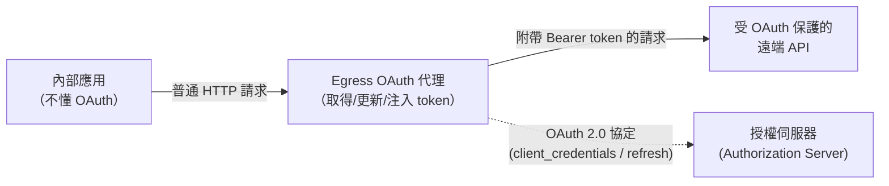

# 開源「反向 OAuth 代理（Egress OAuth Proxy）」調查

## 摘要

本報告調查一類常被稱為 **反向 OAuth 代理**（reverse OAuth proxy）、**OAuth egress gateway** 或 **OAuth 邊車（sidecar）** 的開源軟體。這類代理的定位與常見的「入口（ingress）認證代理」相反：

- **入口代理（非本研究目標）**：例如 `oauth2-proxy`，用身分供應者（IdP）保護**進來的**請求，讓後端服務不必實作身分驗證（AuthN）。
- **出口／反向代理（本研究目標）**：介於**內部應用**與**受 OAuth 保護的遠端 API** 之間。代理代替內部應用完成 OAuth 2.0 協定（取得 access token、必要時更新 token、注入 `Authorization` 標頭），並對內提供一個**不需處理 OAuth 的普通 HTTP API**。內部應用只要照常發 HTTP 請求，OAuth 的複雜度由代理／閘道吸收。

換句話說，這是把「受 OAuth 保護的遠端 API」**轉換成普通 API** 的出口閘道。

## 主要候選專案

以下專案依「與需求的貼合度」分類。星號數量為擷取當下 GitHub 所顯示之數值，可能隨時間變動。

### 一、最貼合：OAuth client-credentials 出口邊車 / 代理

| 專案 | 授權 | Stars | 說明 |
| --- | --- | --- | --- |
| [surfkansas/oauth2-client-credentials-api-sidecar](https://github.com/surfkansas/oauth2-client-credentials-api-sidecar) | MIT | ~7 | 最直接對應需求的專案。邊車代理負責**對外**呼叫其他 API 時的 OAuth2 Client Credentials 流程；用戶端以**未驗證的 HTTP** 呼叫它，它負責取得／更新 token，加入 `Authorization` 標頭（與可選的 API key），再呼叫真正的 HTTPS API[^sidecar]。 |
| [diligentsoft/api-auth-proxy](https://github.com/diligentsoft/api-auth-proxy) | Apache-2.0 | ~0 | API 認證代理，同時處理 OAuth Client Credentials 流程的用戶端與伺服器端；支援**正向代理模式**（簽署外送請求）與**反向代理模式**[^authproxy]。 |
| [TelkomIndonesia/oauth2-sidecar](https://github.com/TelkomIndonesia/oauth2-sidecar) | Apache-2.0 | ~0 | 針對「不懂 OAuth 的用戶端」設計的本機 OAuth2/OIDC 反向代理。執行 OIDC discovery、Authorization Code + PKCE 登入、token 更新，之後將當前的 access token 注入送往目標 API 的請求[^telkom]。 |
| [TALXIS/token-proxy](https://github.com/TALXIS/token-proxy) | MIT | ~3 | 讓 Logic Apps／Power Automate 連接器能透過 Basic Auth 標頭使用 `client_credentials` grant；本身是取得、快取並附掛 token 到目標 API 的代理[^talxis]。 |
| [thomas-illiet/cerbai](https://github.com/thomas-illiet/cerbai) | 未宣告 | ~0 | Go 撰寫的企業 LLM 存取反向代理：透過 OAuth2 `client_credentials`（走 mTLS）取得 JWT、快取（記憶體／Redis）、注入 `Authorization` 標頭後轉發到 LLM（支援 SSE 串流）[^cerbai]。 |
| [glandais/strava-auth-proxy](https://github.com/glandais/strava-auth-proxy) | 未宣告 | ~0 | 針對 Strava OAuth 的無狀態反向代理：簽發虛擬用戶端憑證、在上游替換為真正的 app secret，讓 secret 不離開伺服器；可直接替換 base URL、零相依[^strava]。 |

### 二、憑證注入代理 / 出口閘道（Credential Injection Proxy）

這類專案為更廣義的「出口憑證注入」工具，多以 API key、AWS 簽章等為主，部分亦涵蓋 bearer token 注入，可作為架構參考。

| 專案 | 授權 | Stars | 說明 |
| --- | --- | --- | --- |
| [simonrob/email-oauth2-proxy](https://github.com/simonrob/email-oauth2-proxy) | Apache-2.0 | ~1.5k | 最有名且星數最高者。本機 IMAP/POP/SMTP 代理，替**不支援 OAuth** 的郵件用戶端透明加上 OAuth 2.0 認證，支援 client-credentials 等多種 grant[^emailproxy]。 |
| [clef-sh/proxy](https://github.com/clef-sh/proxy) | MIT | ~0 | 獨立 Go 正向憑證代理，攔截外送 HTTPS、比對服務定義後注入憑證（bearer、api_key_header、api_key_query）[^clef]。 |
| [reoring/botbox](https://github.com/reoring/botbox) | MIT | ~13 | Kubernetes 邊車，沙箱化容器出口：預設拒絕 + 允許清單，並透過 iptables 自動注入憑證，於網路邊界攔截 HTTP/HTTPS 注入 API key[^botbox]。 |
| [ikkun1222/trustless](https://github.com/ikkun1222/trustless) | MIT | ~4 | 給 AI agent 用的憑證仲介 CLI：子程序注入、具憑證注入的 HTTP 正向代理 + MITM 模式、OAuth 更新（device flow）、DLP、結構化稽核日誌[^trustless]。 |
| [engseclabs/iam-agent-proxy](https://github.com/engseclabs/iam-agent-proxy) | 未宣告 | ~9 | 憑證注入 + 最小權限代理，供本機 agent 存取 AWS：agent 用假金鑰，代理以真金鑰重新簽署外送請求並強制 IAM 政策[^iamagent]。 |
| [skarard/openclaw-auth-proxy](https://github.com/skarard/openclaw-auth-proxy) | MIT | ~2 | 沙箱 agent 的認證邊車：注入 auth 標頭、路由層政策強制、網路隔離；token 不進入容器[^openclaw]。 |
| [trodemaster/botlockbox](https://github.com/trodemaster/botlockbox) | MIT | ~2 | 為 AI agent 與 MCP 伺服器設計的憑證注入 HTTPS/HTTP MITM 代理，於記憶體解密 secret 並透明注入外送請求[^botlockbox]。 |
| [managoat/managoat_broker](https://github.com/managoat/managoat_broker) | Apache-2.0 | ~0 | 沙箱 agent 的出口憑證代理：CONNECT 與絕對形式正向代理，在沙箱送出佔位符的位置替換為真實憑證[^managoat]。 |
| [rosh0450/aegis](https://github.com/rosh0450/aegis) | MIT | ~0 | 輕量出口代理：網域過濾、憑證去除／注入、快取、預算控管[^aegis]。 |

### 三、透明 OAuth 反向代理（舊用戶端／開發用途）

| 專案 | 授權 | Stars | 說明 |
| --- | --- | --- | --- |
| [samuelecat/oauthbridge](https://github.com/samuelecat/oauthbridge) | BSD-3-Clause | ~3 | 反向代理，對受 OAuth 保護的資源提供透明認證（例如替換 Bitbucket base URL 後即自動認證）[^oauthbridge]。 |
| [FRI-DAY/oauth2-dev-proxy](https://github.com/FRI-DAY/oauth2-dev-proxy) | Apache-2.0 | ~3 | 本機反向代理，可透明存取受 `bitly/oauth2_proxy` 保護的資源；以瀏覽器 OIDC 登入後透明附掛認證 cookie[^devproxy]。 |

## 觀察與批判性反思

1. **類別名稱不統一**：此需求在社群中沒有單一共通名稱，常見說法包括 *reverse OAuth proxy*、*OAuth egress gateway*、*OAuth sidecar*、*credential injection proxy*、*token proxy*。因此單一關鍵字難以窮盡，需交叉多組關鍵字搜尋[^searchnotes]。

2. **星數普遍偏低**：除了 `email-oauth2-proxy`（約 1.5k 星）之外，其餘專案多為個位數至數十星。這反映兩個現象：（a）此類工具常是**內部自建**，公開專案少；（b）需求雖真實但相對小眾。依研究準則，低星專案在題材小眾時仍應收錄，故本報告予以保留，但讀者評估時應注意其成熟度與維護狀況。

3. **與需求最貼近者**：`surfkansas/oauth2-client-credentials-api-sidecar` 幾乎與需求一一對應（用戶端以未驗證 HTTP 呼叫、代理處理 client-credentials 並注入標頭）。若需要「Authorization Code + 使用者互動登入」的出口代理，則 `TelkomIndonesia/oauth2-sidecar` 較適合。

4. **授權狀態需自行複查**：部分專案（cerbai、iam-agent-proxy、strava-auth-proxy 等）在 GitHub API 回報的 `license` 為 `null`，即未偵測到授權檔。若要用於生產，務必直接檢視各 repo 的授權聲明。

5. **多數屬 MIT / Apache-2.0**：這是好消息，代表多數專案允許商用與修改。但「無授權檔」者預設為**保留所有權利**，不可直接假設可自由使用。

6. **架構取捨**：出口 OAuth 代理通常以兩種方式實作：(a) **正向代理 / MITM**（攔截外送流量、就地注入，對應用零侵入，但需處理 TLS 憑證與信任問題）；(b) **反向代理 / base URL 替換**（應用改指向代理的 URL，較簡單且不需 MITM，但需改應用組態）。選擇取決於是否可修改內部應用的呼叫位址。

## 參考文獻

[^sidecar]: surfkansas. (n.d.). oauth2-client-credentials-api-sidecar [Computer software]. Retrieved 2026-10-13, from https://github.com/surfkansas/oauth2-client-credentials-api-sidecar

[^authproxy]: diligentsoft. (n.d.). api-auth-proxy [Computer software]. Retrieved 2026-10-13, from https://github.com/diligentsoft/api-auth-proxy

[^telkom]: TelkomIndonesia. (n.d.). oauth2-sidecar [Computer software]. Retrieved 2026-10-13, from https://github.com/TelkomIndonesia/oauth2-sidecar

[^talxis]: TALXIS. (n.d.). token-proxy [Computer software]. Retrieved 2026-10-13, from https://github.com/TALXIS/token-proxy

[^cerbai]: illiet, T. (n.d.). cerbai [Computer software]. Retrieved 2026-10-13, from https://github.com/thomas-illiet/cerbai

[^strava]: glandais. (n.d.). strava-auth-proxy [Computer software]. Retrieved 2026-10-13, from https://github.com/glandais/strava-auth-proxy

[^emailproxy]: simonrob. (n.d.). email-oauth2-proxy [Computer software]. Retrieved 2026-10-13, from https://github.com/simonrob/email-oauth2-proxy

[^clef]: clef-sh. (n.d.). proxy [Computer software]. Retrieved 2026-10-13, from https://github.com/clef-sh/proxy

[^botbox]: reoring. (n.d.). botbox [Computer software]. Retrieved 2026-10-13, from https://github.com/reoring/botbox

[^trustless]: ikkun1222. (n.d.). trustless [Computer software]. Retrieved 2026-10-13, from https://github.com/ikkun1222/trustless

[^iamagent]: engseclabs. (n.d.). iam-agent-proxy [Computer software]. Retrieved 2026-10-13, from https://github.com/engseclabs/iam-agent-proxy

[^openclaw]: skarard. (n.d.). openclaw-auth-proxy [Computer software]. Retrieved 2026-10-13, from https://github.com/skarard/openclaw-auth-proxy

[^botlockbox]: trodemaster. (n.d.). botlockbox [Computer software]. Retrieved 2026-10-13, from https://github.com/trodemaster/botlockbox

[^managoat]: managoat. (n.d.). managoat_broker [Computer software]. Retrieved 2026-10-13, from https://github.com/managoat/managoat_broker

[^aegis]: rosh0450. (n.d.). aegis [Computer software]. Retrieved 2026-10-13, from https://github.com/rosh0450/aegis

[^oauthbridge]: samuelecat. (n.d.). oauthbridge [Computer software]. Retrieved 2026-10-13, from https://github.com/samuelecat/oauthbridge

[^devproxy]: FRI-DAY. (n.d.). oauth2-dev-proxy [Computer software]. Retrieved 2026-10-13, from https://github.com/FRI-DAY/oauth2-dev-proxy

[^searchnotes]: GitHub. (n.d.). Repository search results for "oauth sidecar", "credential injection proxy", "oauth token injection proxy", "transparent oauth proxy", "oauth2 client credentials proxy", "credential injection egress". Retrieved 2026-10-13, from https://github.com/search?q=oauth+sidecar&type=repositories