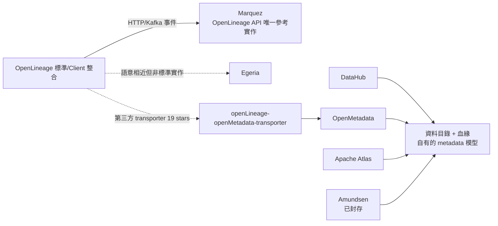

# Marquez 的 FOSS 替代方案：誰是 OpenLineage 的「其他實作」？

## 摘要

Marquez 是 LF AI & Data 基金會旗下的畢業專案，被 OpenLineage 官方文件明確定義為「OpenLineage API 的參考實作」(reference implementation)[^ol-readme][^marquez-repo]。本次研究想尋找「其他實作 OpenLineage 的開源專案」，結論是：**截至 2026-10-13，市場上幾乎不存在第二個完整、獨立實作 OpenLineage 伺服器端 API 的開源專案**。現有的 FOSS 替代品可分為兩類：

1. **資料目錄/血緣平台**（功能與 Marquez 重疊，但不實作 OpenLineage API）：DataHub、OpenMetadata、Apache Atlas、Amundsen、Egeria。
2. **橋接工具**（把 OpenLineage 事件轉送到其他平台的 transporter）：如 `openLineage-openMetadata-transporter`。

若需求是「接收 OpenLineage HTTP 事件並儲存/視覺化」，目前在開源世界沒有 Marquez 以外的成熟選擇；若需求是「資料目錄 + 血緣」，則有多個更大型的替代品。

## 背景：Marquez 是什麼

Marquez 是一個開源中繼資料服務，用於收集、彙整並視覺化資料生態系的 metadata（資料集、任務、run 的中繼資料），由 WeWork 開源釋出，現為 LF AI & Data 基金會畢業專案，採用 Apache-2.0 授權，GitHub 約 2.3k stars[^marquez-repo]。它透過 HTTP API 接收 OpenLineage 格式的 lineage 事件（`OpenLineageResource.java`），並提供 Web UI 與 GraphQL 介面[^marquez-repo][^ol-readme]。已知採用者有 Astronomer、Datakin、Northwestern Mutual、Ilum、CsvPath 等[^marquez-repo]。

## OpenLineage 所謂的「backend / 實作」結構

OpenLineage 是 LF AI & Data 的畢業專案，定義了 lineage metadata 的開放標準（spec），並提供 Python/Java client 與 Spark、Airflow、dbt、Flink 等整合，事件可經由 HTTP、Kafka 等協定送出；但 OpenLineage 本身**不包含**儲存與視覺化事件的伺服器端——那是 Marquez 的職責[^ol-readme][^ol-integrations]。官方 README 的「相關專案」欄位只列了兩個：Marquez（OpenLineage API 的參考實作）與 Egeria[^ol-readme]。

## FOSS 替代品逐一說明

### 1. DataHub（datahub-project/datahub）

- **定位**：LinkedIn 開發、Acellan 商業化的「資料環境 Context 平台」，Apache-2.0，GitHub 約 12.8k stars[^datahub]。
- **OpenLineage 支援**：**未能證實**。本次研究嘗試查詢官方文件中的 OpenLineage source/ingestion 頁面（https://datahubproject.io/docs/metadata-ingestion/source_docs/openlineage 等）均回傳 404；於資料庫中搜尋 openlineage 相關程式碼亦無結果。DataHub 以自有的 metadata 事件模型（MCE/MCP）運作，並提供 50+ 來源的 ingestion 與 SDK push 方式[^datahub-docs][^datahub]。
- **結論**：是 Marquez 的功能性替代（更大型的目錄 + 血緣），但**不是** OpenLineage API 的實作；若要與 OpenLineage 生態互通需自行轉接。

### 2. OpenMetadata（open-metadata/OpenMetadata）

- **定位**：開源 metadata 平台（資料目錄、血緣、資料品質、治理），Apache-2.0，GitHub 約 15.5k stars[^openmetadata]。
- **OpenLineage 支援**：透過其 Airflow Lineage Backend 從 Airflow 抓取血緣[^om-airflow]；另存在第三方專案 `openLineage-openMetadata-transporter`（Apache-2.0，僅 19 stars）可將 OpenLineage 事件轉入 OpenMetadata[^transporter]。官方文件與原始碼中未見原生接收 OpenLineage API 的伺服器端。
- **結論**：是功能豐富的功能性替代，但需經 transporter 才能吃 OpenLineage 事件。

### 3. Apache Atlas（apache/atlas）

- **定位**：Apache 基金會的 metadata 管理與治理專案，聚焦 Hadoop 生態，Apache-2.0，GitHub 約 2.2k stars[^atlas]。
- **OpenLineage 支援**：未發現任何 OpenLineage 整合或實作。
- **結論**：老牌的治理/血緣平台，但不屬 OpenLineage 生態。

### 4. Egeria（odpi/egeria）

- **定位**：LF AI & Data 旗下、由 ODPi 維護的開源 metadata 與治理平台，強調跨廠商自動交換 metadata，Apache-2.0，GitHub 約 925 stars[^egeria]。是 OpenLineage 官方 README 唯一列出的「相關專案」之一[^ol-readme]。
- **OpenLineage 支援**：OpenLineage 官方將其列為相關專案，暗示有語意層面的互通，但本次研究時間有限，未能深入驗證其 OpenLineage connector 的實作細節。
- **結論**：值得追蹤的候選，但成熟度與社群規模遠小於 Marquez。

### 5. Amundsen（amundsen-io/amundsen）

- **定位**：Lyft 發起的 metadata 驅動資料發現工具，Apache-2.0，GitHub 約 4.8k stars，**已被官方封存 (archived)**[^amundsen]。
- **OpenLineage 支援**：無。
- **結論**：不建議新專案採用（已封存）。

### 6. 橋接工具：openLineage-openMetadata-transporter

- 由 Natural-Intelligence 開發的 Java 專案，Apache-2.0，僅 19 stars，最後 push 於 2025-09，將 OpenLineage 事件轉送進 OpenMetadata[^transporter]。屬於「事件轉接器」而非獨立後端。

## 資料來源品質與限制

- 本報告的星數、授權、封存狀態均直接取自 GitHub 官網或 GitHub API（擷取日 2026-10-13），可信度高。
- **主要限制**：DataHub 是否原生支援 OpenLineage ingestion 無法以官方文件證實（相關文件頁面 404），僅能以「未見官方支援」呈現；Egeria 的 OpenLineage connector 細節亦因時間限制未深度驗證。
- OpenLineage 官方文檔明確指認 Marquez 為參考實作，「其他 OpenLineage 實作」在開源社群中確實極度稀少，此結論有官方來源背書，而非僅為推測[^ol-readme]。

## 建議

- **需要 OpenLineage 相容後端** → 目前仍以 Marquez 為唯一成熟選擇。
- **需要大型資料目錄 + 血緣，且不強求 OpenLineage 協定** → DataHub 或 OpenMetadata。
- **需要治理導向、Hadoop 生態** → Apache Atlas。
- **關注跨廠商 metadata 交換標準** → Egeria（但需自行驗證 OpenLineage 深度）。

---

[^marquez-repo]: Marquez Project. (n.d.). *Marquez: Collect, aggregate, and visualize a data ecosystem's metadata*. GitHub. Retrieved 2026-10-13, from https://github.com/MarquezProject/marquez

[^ol-readme]: OpenLineage. (n.d.). *An Open Standard for lineage metadata collection* (README). GitHub. Retrieved 2026-10-13, from https://github.com/OpenLineage/OpenLineage

[^ol-integrations]: OpenLineage. (n.d.). *OpenLineage Integrations*. OpenLineage Docs. Retrieved 2026-10-13, from https://openlineage.io/docs/integrations/

[^datahub]: DataHub Project. (n.d.). *The Context Platform for your Data and AI Stack*. GitHub. Retrieved 2026-10-13, from https://github.com/datahub-project/datahub

[^datahub-docs]: DataHub Project. (n.d.). *DataHub SDK and CLI / Metadata Ingestion*. DataHub Project Docs. Retrieved 2026-10-13, from https://datahubproject.io/docs/metadata-ingestion/

[^openmetadata]: OpenMetadata. (n.d.). *The Open Context Layer for Data and AI*. GitHub. Retrieved 2026-10-13, from https://github.com/open-metadata/OpenMetadata

[^om-airflow]: OpenMetadata. (n.d.). *Airflow Lineage Backend*. OpenMetadata Documentation. Retrieved 2026-10-13, from https://docs.open-metadata.org/latest/connectors/pipeline/airflow/lineage-backend

[^atlas]: Apache Software Foundation. (n.d.). *Apache Atlas: Open Metadata Management and Governance capabilities across the Hadoop platform and beyond*. GitHub. Retrieved 2026-10-13, from https://github.com/apache/atlas

[^egeria]: ODPi. (n.d.). *Egeria core*. GitHub. Retrieved 2026-10-13, from https://github.com/odpi/egeria

[^amundsen]: Amundsen Project. (n.d.). *Amundsen: a metadata driven application for improving the productivity of data analysts, data scientists and engineers*. GitHub. Retrieved 2026-10-13, from https://github.com/amundsen-io/amundsen（API 回傳 archived: true）

[^transporter]: Natural-Intelligence. (n.d.). *openLineage-openMetadata-transporter*. GitHub. Retrieved 2026-10-13, from https://github.com/Natural-Intelligence/openLineage-openMetadata-transporter