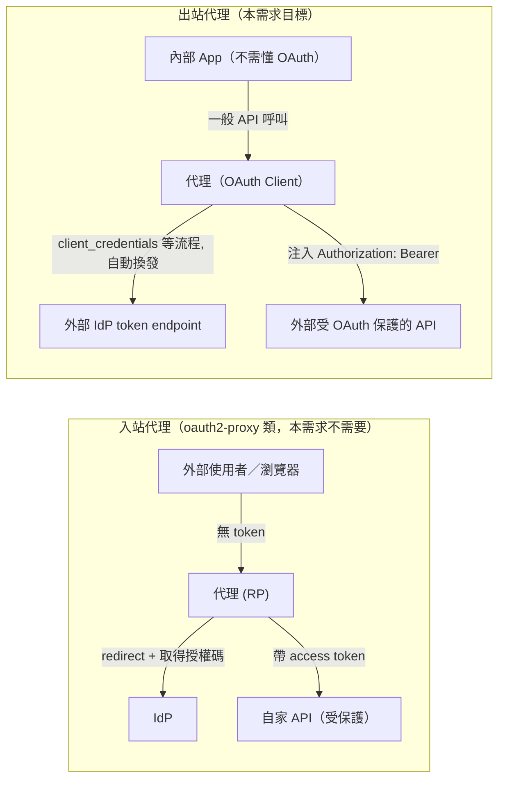
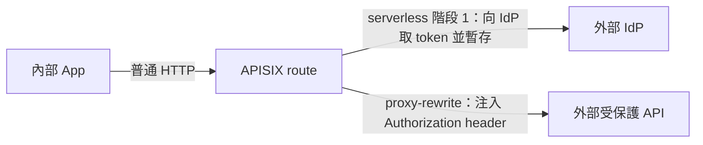

# FOSS「反向 OAuth 代理」(OAuth Egress Proxy) 方案調查，與 Apache APISIX 的適用性評估

## 摘要

使用者需要的是**出站（egress）方向**的 OAuth 代理：外部 API 受 OAuth 保護，代理／閘道負責實作 OAuth Client 協定（取得 access token、自動換發 refresh token、注入 `Authorization` header），內部應用只呼叫代理提供的「普通 API」，完全不需要實作 OAuth 邏輯。這與常見的 `oauth2-proxy` 類工具（**入站／ingress** 方向、用 IdP 保護自家服務）相反。本報告調查可滿足此需求的 FOSS 專案，並針對「Apache APISIX 是否可行」給出結論：**可以，但仍須自行組合或開發少量程式**，因為 APISIX 現成的 `openid-connect` 外掛以驗證入站 token 為主，沒有現成的「以 Client Credentials 向 token endpoint 取 token 並注入 upstream」外掛。

## 概念釐清：Ingress 與 Egress 的 OAuth 代理

- **Ingress proxy**（如 `oauth2-proxy`、`louketo-proxy`、APISIX `openid-connect` 的典型用法）：保護自己的服務，對內後端「不用實作 AuthN」。
- **Egress proxy**（本需求）：對外呼叫受保護 API 時，代理身兼 **OAuth2 Client**，替內部 App 完成 `client_credentials` 授權（或代管 refresh），把 token 注入轉發請求；內部 App 因此「不用實作 OAuth Client 邏輯」。

## 候選方案一覽

| 名稱 | 授權／形式 | 定位 | 是否原生支援 Egress 情境 | GitHub Stars |
|---|---|---|---|---|
| Envoy `credential_injector`＋`oauth2` injected credential | Apache-2.0，CNCF | 資料面代理的 HTTP filter | ✅ 原生支援（client_credentials, mTLS/RFC 8705, JWT assertion） | Envoy 本身約 25k+ |
| KrakenD `auth/client-credentials` | Apache-2.0 | API 閘道 backend 層注入 | ✅ 原生支援（含自動 refresh） | KrakenD 約 7k+ |
| Apache APISIX `openid-connect` | Apache-2.0 | API 閘道 | ⚠️ 部分：驗證用為主，Client Credentials 僅限於驗證被動 token | APISIX 約 14k+ |
| `oauth2-client-credentials-api-sidecar` (surfkansas) | MIT | Sidecar proxy (Go) | ✅ 原生支援 | 約 7 |
| `krakend-oauth2-clientcredentials` | Apache-2.0 | KrakenD plugin | ✅ | 隨 KrakenD |

> 說明：Stars 數據取自本報告撰寫當日（2026-10-13）GitHub API 搜尋結果，僅供相對參考[^gh1][^gh2][^gh3]。

## 詳細評估與重點專案

### 1. Envoy：`envoy.filters.http.credential_injector` + `envoy.http.injected_credentials.oauth2`

Envoy 於 2022 年的 issue #21851 提出「credential injection」需求，並在後來加入正式 filter[^env1][^env2]。架構上分為兩層：

1. **`envoy.filters.http.credential_injector`**（HTTP filter）：把取得的 credential 以 `Authorization` header（或自訂 header）注入轉發至 upstream 的請求。
2. **`envoy.http.injected_credentials.oauth2`**（injected credentials extension）：實作 OAuth 2.0 Client Credentials 流程，向設定的 `token_endpoint` 以 `client_secret_basic`／`client_secret_post`、mTLS（RFC 8705）或 `private_key_jwt`（RFC 7523）取得 access token，再以 Bearer token 形式交給 injector[^env3]。

特性：

- 原生支援**非互動、機器對機器（M2M）**的出站授權，正是本需求的核心情境。
- 支援自動於 token 到期前重新取得（依 `expires_in`）。
- 與 `envoy.filters.http.oauth2`（authorization code＋瀏覽器登入流程）明確分工，後者**不**提供 client_credentials。
- 因為要自行撰寫 YAML（route、cluster、filter chain）與管理 SDS secret，組態門檻中等，但無需寫程式。

環境支援：獨立的 Envoy、Istio（需額外 filter 設定）、Envoy Gateway（有 `credential-injection` 教學）[^env4]。

### 2. KrakenD：`auth/client-credentials`

KrakenD 是 Go 撰寫的 API 閘道，其 backend 層提供 `auth/client-credentials`（`auth` 命名空間下的 `client-credentials` 組態），由 `krakend-oauth2-clientcredentials` 外掛實作[^kr1][^kr2]。運作方式：

- 在 backend 組態中設定 `token_endpoint`、`client_id`、`client_secret`、`scopes`。
- 閘道在呼叫 upstream 前先向 token endpoint 以 client_credentials 取得 token，並以 `Authorization: Bearer` 注入。
- 原生實作 **token 快取與自動 refresh**（`cache` 相關組態），避免每個請求都打 IdP。

對本需求的契合度極高：內部 App 只需設定 KrakenD 的 endpoint，把「需要 OAuth 的外部 API」包裝成「內部普通 API」。文件位置：https://www.krakend.io/docs/authorization/client-credentials/ [^kr1]

### 3. `oauth2-client-credentials-api-sidecar`（surfkansas）

一個極輕量的 Go sidecar proxy，描述即為「A sidecar proxy that manages OAuth2 Client Credentials on outbound calls to other APIs」[^sc1]。特色：

- 與 Kubernetes sidecar 部署搭配，應用程式把 HTTP 請求送往 localhost sidecar，sidecar 負責取得／換發 token 並轉發到外部 API。
- 專案規模小（stars 個位數、最後 push 於 2021 年），屬個人維護，**不建議**直接上生產，但可作為自製解決方案的架構參考。

### 4. 其他權衡與生態觀察

- `oauth2-proxy`（約 10k stars）與 `louketo-proxy`（Keycloak Gatekeeper 後繼）都是**入站**方向，即使名稱含「proxy」，也無法直接解決出站需求[^gh4]。
- 除了「閘道／代理注入」路線，另有「OAuth 感知的 HTTP client 函式庫」路線（如 `coreos/go-oidc`、Spring Security OAuth2 Client），但那需要應用內嵌邏輯，與本需求「App 不碰 OAuth」的前提相左。
- 大型企業級替代：Google 的 `gcp-auth-sidecar`、AWS 的 SigV4 代理均為雲端綁定，不符合「通用 FOSS」前提。

## Apache APISIX 能否滿足本需求？── 結論：可達成，但需自行組合或寫少許程式

### 現況分析

APISIX 的 `openid-connect` 外掛（基於 `lua-resty-openidc`）核心職責是**作為 Relying Party（驗證入站使用者）或 Resource Server（驗證入站 bearer token）**，也就是 ingress 方向的 AuthN[^ap1][^ap2]。它支援 bearer_only、introspection、JWKS 驗證、授權碼流程等，但都是「吃掉客戶端帶來的 token」。文件中關於 client credentials 的內容僅限於驗證情境（例如以 client credentials 取得的 token 由客戶端自行帶來、APISIX 用 introspection 驗證）[^ap3]。

### 可行的組合方案

1. **`serverless-pre-function` 外掛**：在 `access` 階段用 Lua 呼叫 `resty.http` 打 token endpoint 的 `client_credentials` grant，並在 process 級 shared dict（`lua_shared_dict`）或 etcd 快取 token，直到 `expires_in` 過期。
2. **`proxy-rewrite` 外掛**：把取得的 token 寫入轉發 upstream（即外部 API）的 `Authorization: Bearer ...` header。
3. 需要自行維護的項目：token 快取、到期前一併重新取得（避免多 worker 同時打 IdP）、錯誤處理（401 重試一次）。

這種做法不需要修改 APISIX 原始碼，只寫 Lua 設定檔片段；但「出站 OAuth 代理」目前不是 APISIX 的內建能力，社群亦未見正式 plugin hub 收錄此類外掛（截至 2026-10-13 搜尋結果）[^ap4]。

### 對照建議

- **工程量最小**：KrakenD 的 `auth/client-credentials` 開箱即用（含 refresh 快取）。
- **平台整合最佳**：若環境已是 Istio／Envoy 體系，用 Envoy `credential_injector` 不需自寫程式，組態即可。
- **已經是 APISIX 主力閘道、且能接受少量自訂 Lua**：APISIX 可用 `serverless-pre-function` + `proxy-rewrite` 達成，但需自行承擔 token 生命週期管理。

## 參考資料

[^gh1]: GitHub. (2026). *apache/apisix*. Retrieved 2026-10-13, from https://github.com/apache/apisix
[^gh2]: GitHub. (2026). *envoyproxy/envoy*. Retrieved 2026-10-13, from https://github.com/envoyproxy/envoy
[^gh3]: GitHub. (2026). *krakend/krakend*. Retrieved 2026-10-13, from https://github.com/krakend/krakend
[^gh4]: oauth2-proxy/oauth2-proxy. (n.d.). *A reverse proxy that provides authentication with Google, Azure, OpenID Connect and many more identity providers*. Retrieved 2026-10-13, from https://github.com/oauth2-proxy/oauth2-proxy
[^env1]: Envoy Project. (2026). *Injected credentials filter*. Retrieved 2026-10-13, from https://www.envoyproxy.io/docs/envoy/latest/configuration/http/http_filters/credential_injector_filter
[^env2]: Envoy Project. (2022). *Add OAuth credential injection to the proxy (#21851)*. Retrieved 2026-10-13, from https://github.com/envoyproxy/envoy/issues/21851
[^env3]: Envoy Project. (2026). *OAuth2 injected credentials (eno).* Retrieved 2026-10-13, from https://github.com/envoyproxy/envoy/blob/main/api/envoy/extensions/http/injected_credentials/oauth2/v3/oauth2.proto
[^env4]: Envoy Gateway. (2026). *Credential injection task page*. Retrieved 2026-10-13, from https://gateway.envoyproxy.io/v1.9/tasks/security/credential-injection/
[^kr1]: KrakenD. (2026). *Client Credentials: OAuth 2.0 backend*. Retrieved 2026-10-13, from https://www.krakend.io/docs/authorization/client-credentials/
[^kr2]: KrakenD Community. (2026). *krakend-oauth2-clientcredentials*. Retrieved 2026-10-13, from https://github.com/krakend/krakend-oauth2-clientcredentials
[^sc1]: surfkansas. (2021). *oauth2-client-credentials-api-sidecar*. Retrieved 2026-10-13, from https://github.com/surfkansas/oauth2-client-credentials-api-sidecar
[^ap1]: Apache APISIX. (2026). *openid-connect plugin*. Retrieved 2026-10-13, from https://apisix.apache.org/docs/apisix/plugins/openid-connect/
[^ap2]: ZmartZone IAM. (2026). *lua-resty-openidc (README)*. Retrieved 2026-10-13, from https://github.com/zmartzone/lua-resty-openidc
[^ap3]: Apache APISIX. (2026). *GitHub issue #13819: refresh Keycloak OIDC tutorial (client credentials via JWKS/introspection validation)*. Retrieved 2026-10-13, from https://github.com/apache/apisix/issues/13819
[^ap4]: Apache APISIX. (2026). *GitHub search: "client credentials" in apache/apisix issues*. Retrieved 2026-10-13, from https://github.com/search?q=repo%3Aapache%2Fapisix+%22client+credentials%22&type=issues