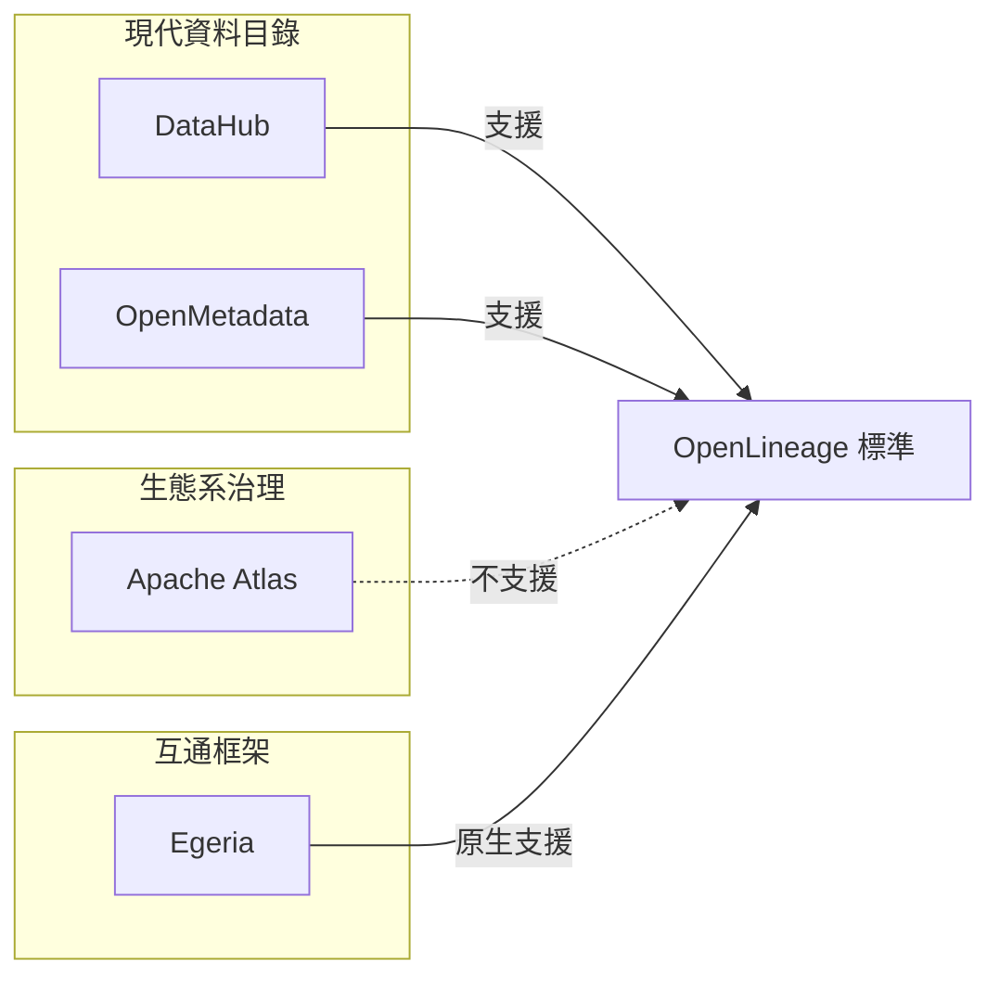

# 資料血緣 (Data Lineage) 解決方案比較：DataHub、OpenMetadata、Apache Atlas、Egeria

## 摘要

本文比較四個開放原始碼資料血緣與資料治理平台：DataHub、OpenMetadata、Apache Atlas 與 Egeria。四個專案皆採用 Apache 2.0 授權，但定位截然不同：DataHub 與 OpenMetadata 是現代化的全方位資料目錄（data catalog），血緣能力強、部署以容器為主；Apache Atlas 是 Hadoop 生態系的治理平台，血緣靠引擎掛鉤（hook）擷取；Egeria 則是以互通性為核心的中繼框架，本身不是開箱即用的產品。選型關鍵在於團隊的技術棧與維運能力。

## 背景：為什麼資料血緣重要

資料血緣描述資料從來源到消費端的流動軌跡，涵蓋資料表（table）、欄位（column）、資料管線（pipeline）、儀表板與機器學習模型之間的依賴關係。企業導入資料血緣的目的包括衝擊分析（impact analysis）、監理遵循（regulatory compliance）、除錯與資料治理[^pistack-guide]。血緣可分為「設計血緣」（由定義階段取得，如 dbt 模型）與「執行血緣」（由實際執行的查詢與管線取得），四套解決方案各有不同取徑。

## 專案總覽

下表列出生態系與專案基本資料（統計截至 2026-10-13，取自 GitHub API）。

| 專案 | 組織／起源 | GitHub Stars | Fork | 主要語言 | 首版時間 | 定位 |
|---|---|---|---|---|---|---|
| DataHub | LinkedIn 發起，現由 Acryl Data 主導[^datahub-readme] | 12,826[^gh-datahub] | 3,712[^gh-datahub] | Python（核心 Java）[^gh-datahub] | 2015 年開始的專案，2019 年起以資料目錄定位發展[^datahub-readme] | 資料上下文平台（context platform），含資料目錄、治理、可觀測性 |
| OpenMetadata | 前 Uber Databook 團隊創辦，Collate 提供商業版[^om-readme] | 15,461[^gh-om] | 2,451[^gh-om] | TypeScript（後端 Java）[^gh-om] | 2021 年[^gh-om] | 開放上下文層（open context layer），資料目錄＋資料品質 |
| Apache Atlas | Hortonworks 捐贈，Apache 頂級專案[^atlas-apex] | 2,153[^gh-atlas] | 908[^gh-atlas] | Java[^gh-atlas] | 2015 年進入 Apache Incubator，2017 年畢業[^desosa-atlas] | Hadoop 生態系元資料管理與治理 |
| Egeria | ODPI（Open Data Platform Initiative），現屬 Linux Foundation AI & Data[^egeria-readme] | 925[^gh-egeria] | 262[^gh-egeria] | Java[^gh-egeria] | 2018 年[^gh-egeria] | 開放元資料互通框架（metadata interoperability） |

## DataHub

### 血緣擷取方式

DataHub 的血緣擷取仰賴約 150+ 個整合來源[^datahub-readme]與內建的 SQL 剖析器：

- **SQL 剖析**：以 sqlglot 為基礎的 schema-aware 剖析器，支援 20+ SQL 方言，可從查詢日誌（BigQuery、Snowflake、Redshift、Databricks、Trino 等）與 dbt manifest 擷取欄位級血緣，官方宣稱準確率 97–99%，並可處理 `SELECT *` 展開、BigQuery 分表正規化等情況[^dh-sqlparse][^dh-auto-lineage]。
- **OpenLineage 支援**：提供 REST endpoint（`POST /openapi/openlineage/api/v1/lineage`）接收 OpenLineage 事件，並提供 Spark Event Listener 插件強化欄位級血緣、PathSpec 支援、patch 語意等功能[^dh-openlineage]。
- **原生整合**：BigQuery、Snowflake、Redshift、dbt、Looker、Tableau、Power BI、Airflow 等來源皆支援開箱即用的資料表與欄位級血緣[^dh-auto-lineage]。

### 血緣粒度與儲存

血緣支援資料表級與欄位級[^dh-auto-lineage][^pistack-mesh]。架構上採用三層儲存：MySQL（主要元資料）、Elasticsearch（搜尋）、Neo4j 或 MySQL（血緣圖）、Kafka 作為所有元資料變更的事件匯流排[^pistack-mesh][^kirsch]。血緣預設以圖資料庫查詢，官方聲稱可處理數千節點的圖而效能不墜[^pistack-mesh]。

### 部署複雜度與目標用戶

部署複雜度高：至少 7–10 個服務（GMS、frontend、Kafka、Elasticsearch、MySQL、Neo4j、consumers），生產環境需要專責基礎設施人力[^pistack-mesh][^kirsch]。目標用戶為大型企業、Kafka 為中心、擁有平台工程團隊的組織。DataHub 在生產環境管理超過一千萬個資產[^datahub-readme]。

## OpenMetadata

### 血緣擷取方式

- **SQL 剖析**：使用 sqllineage 的分支（schema-naive、dialect-aware），從查詢與 dbt 模型擷取資料表與欄位級血緣；欄位級血緣自 v0.11（2022 年 7 月）起提供[^atlan-om-vs-dh][^pistack-mesh]。
- **OpenLineage 連接器**：從 Kafka broker 或 AWS Kinesis 消費 OpenLineage 事件（支援 Airflow 與 Spark 傳輸），並轉換為 OpenMetadata 血緣；官方標示通過 OpenLineage 1.7.0 相容測試[^om-openlineage]。
- **Airflow lineage backend**：透過 openmetadata-airflow-provider 在執行期擷取 DAG 血緣[^pistack-mesh]。
- 共 130+ 個資料服務連接器[^om-readme][^om-connectors]。

### 血緣粒度與儲存

支援資料表級與欄位級血緣（Snowflake、BigQuery、Redshift 等主要資料倉儲）[^pistack-mesh]。架構刻意簡化：單一 Java 伺服器＋MySQL（或 PostgreSQL）儲存所有元資料＋Elasticsearch/OpenSearch 搜尋，**不需要 Kafka 或專用圖資料庫**，血緣關係存放在關聯式資料庫中[^pistack-mesh]。

### 部署複雜度與目標用戶

部署門檻低：僅 3–4 個服務，數小時內可完成設定，Docker compose 即可支撐小型生產環境[^pistack-mesh][^kirsch]。內建資料品質框架（測試、profiling）與資料契約（data contract）[^pistack-mesh]。目標用戶為中型團隊（5–20 位工程師），追求現代化技術棧與簡單部署。已知限制包括：深度血緣圖（單一檢視超過 500 節點）因依賴關聯式資料庫可能卡頓，規模上限為數萬個實體（實證），超越此規模未經測試[^pistack-mesh]。

## Apache Atlas

### 血緣擷取方式

- **引擎掛鉤（hooks）**：Hive、HBase、Sqoop、Storm、Kafka、Impala、Spark、Falcon、Couchbase 等 Hadoop 生態引擎在查詢執行時發布元資料事件至 **Kafka**（主題名 `ATLAS_HOOK`），Atlas 的非同步消費者更新圖形[^atlas-notifications][^atlas-arch]。血緣以 Process 實體表示（如 `hive_process`），欄位級血緣以 `hive_column_lineage` 子型別記錄（SIMPLE、EXPRESSION、SCRIPT 依賴型別）[^atlas-hive-hook]。
- **REST API（v2，含 LineageREST）**與 bridges 支援批次匯入[^atlas-lineage-api]。
- **沒有 OpenLineage 支援**，血緣僅來自引擎儀器化，非 SQL 剖析[^pistack-guide]。

### 血緣粒度與儲存

支援資料表級與欄位級，但「僅限 Hadoop 原生來源」；延伸至非 Hadoop 來源需要自訂工程[^pistack-guide]。架構為 Java 服務＋JanusGraph 圖資料庫（預設建置於 HBase 之上）＋Apache Solr（或 Elasticsearch）搜尋＋Kafka 通知[^pistack-mesh][^atlas-readme]。2.5.0 版（2026 年 4 月 30 日）新增 **PostgreSQL 作為 JanusGraph 後端**的選項（ATLAS-5059），移除 HBase/HDFS 依賴、大幅縮減基礎設施佔用[^atlas-250][^atlas-release-catalog]。

### 部署複雜度與目標用戶

部署複雜度高：JanusGraph＋HBase＋Solr＋Kafka＋Atlas server 至少 3 個以上服務，沒有官方 Docker image（僅社群建置），生產環境通常部署在 Hadoop 叢集旁的專用 VM[^pistack-guide]。目標用戶為 Hadoop/Hive 為中心的企業；Cloudera Data Platform 內嵌 Atlas，且與 Apache Ranger 深度整合（以分類驅動標籤式安全政策）[^pistack-guide][^atlas-arch]。**Azure Microsoft Purview 的 API 與 Atlan 的後端 Fork 皆以 Atlas 為基礎**，顯示其生產穩定性[^atlas-apex]。但釋出步調緩慢：2.3.0（2022 年 12 月）到 2.4.0（2025 年 1 月）相隔超過兩年；2.5.0（2026 年 4 月）導入 React UI 遷移與 Trino 連接器（首個雲端常見來源）後社群復甦[^atlas-250][^atlas-240][^atlas-apex]。缺點包括沒有 Snowflake/BigQuery/Redshift/dbt/BI 工具連接器、UI 老舊、無協作功能[^pistack-guide][^atlas-apex]。

## Egeria

### 血緣擷取方式

Egeria 是「標準優先」的中繼/互通框架，其血緣能力以 **OpenLineage 為一等公民**，由整合常駐程式（integration daemon）提供 5 個預建 OpenLineage 連接器[^egeria-openlineage]：

1. **OpenLineage Event Receiver**：從 Kafka 主題接收 OpenLineage 事件。
2. **Governance Action Open Lineage**：將 Egeria 自身的治理動作轉換為 OpenLineage 事件。
3. **API-based Open Lineage Log Store**：把事件轉送至實作 OpenLineage API 的遠端伺服器（如 Marquez）。
4. **File-based Open Lineage Log Store**：把事件寫入 JSON 檔案。
5. **Open Lineage Cataloguer**：把事件對映至開放元資料——job 變成 Process 實體、資料集變成資料資產（盡可能與既有目錄資產比對）、輸入輸出以 DataFlow 關係串接；欄位級血緣對映至 `DataMapping` 關係[^egeria-openlineage]。

血緣可為設計血緣或執行血緣，甚至可以轉送事件到 **Marquez** 作為日誌儲存與視覺化工具[^egeria-openlineage][^pistack-mesh]。支援本地 OpenLineage API endpoint（`/api/v1/lineage`），因此處理引擎可直接把事件送給 Egeria，無需 proxy backend 或 Kafka[^egeria-openlineage]。

### 血緣粒度與儲存

支援欄位/資料行級血緣與更上層的資訊供應鏈（information supply chain）彙總。架構為 OMAG Server Platform（Java/Spring Boot、多租戶），標準持久化使用 PostgreSQL OMRS repository connector（雙時間儲存），但**元資料是聯邦式（federated）的**——不集中於單一資料庫，而是透過 OMRS cohorts 與 Kafka 事件主題在多個儲存庫間共享組成[^pistack-mesh][^egeria-postgres]。

### 部署複雜度與目標用戶

部署複雜且概念要求高：需要多個 OMAG 伺服器（metadata servers、access points、integration daemons、engine hosts、view servers）、cohorts、Kafka 主題；以 Gradle/Maven 建置或以 Kubernetes/Helm 部署[^pistack-mesh]。血緣拼接高度依賴人工治理（stewardship）以協調跨工具的命名差異[^pistack-mesh]。目標用戶為需要**廠商中立元資料聯邦/互通**的大型企業（IBM 血統、600–800 種開放元資料型別、OMAS access services）[^pistack-mesh]。

**採用面數據**：Egeria 僅約 925 stars，遠低於其他三者；其 TSC 2020 年的文件坦言「加速 Egeria 採納是主要目標」[^egeria-adoption]。獨立技術分析（DESOSA 2022）指出主分支單元測試覆蓋率約 12%、`OpenMetadataAPIGenericHandler` 類別超過 9,000 行且有 227 個 code smells[^desosa-egeria]。Egeria 6.0 官方部落格也承認「開源元資料平台有越長越大的名聲問題……最終治理平台本身也需要被治理」，並啟動「radical simplification」專案縮減一半的 footprint[^egeria-radical]。

## 比較總結

| 面向 | DataHub | OpenMetadata | Apache Atlas | Egeria |
|---|---|---|---|---|
| 血緣擷取 | SQL 剖析、OpenLineage REST/Spark 插件、150+ 連接器 | SQL 剖析、OpenLineage（Kafka/Kinesis）、Airflow provider、130+ 連接器 | Hadoop 引擎 hooks → Kafka | OpenLineage 5 連接器、本地 API endpoint |
| 血緣粒度 | 資料表＋欄位（20+ 來源） | 資料表＋欄位（主要資料倉儲） | 資料表＋欄位（僅 Hadoop 原生） | 欄位/資料行＋資訊供應鏈彙總 |
| OpenLineage | 支援（REST endpoint＋Spark 插件） | 支援（Kafka/Kinesis 連接器） | **不支援** | 支援（原生、5 連接器） |
| 儲存後端 | MySQL＋Elasticsearch＋Neo4j（或 MySQL）＋Kafka | MySQL/PostgreSQL＋Elasticsearch（無 Kafka、無圖資料庫） | JanusGraph/HBase＋Solr＋Kafka（2.5.0 起可選 PostgreSQL） | OMAG 平台＋PostgreSQL repository connector（聯邦式） |
| 部署複雜度 | 高（7–10+ 服務） | 低–中（3–4 服務） | 高（需 Hadoop 堆疊） | 高且概念複雜（多伺服器 OMAG） |
| 資料品質／治理 | 資料契約、assertions、存取政策 | 內建資料品質測試、profiling、資料契約 | Ranger 標籤式安全（外部整合） | 治理動作服務（governance action services） |
| UI 血緣視覺化 | React 血緣圖、衝擊分析 | 血緣瀏覽器（被評為最精緻） | 圖形化血緣（UI 老舊） | Lineage Explorer（Mermaid 渲染）、時間軸回顧 |
| 最適合 | 大型 Kafka 中心企業、跨系統血緣 | 中型現代化技術棧團隊 | Hadoop/Hive＋Ranger 環境 | 異質企業元資料聯邦互通 |
| 主要弱點 | 維運成本高、非標準來源設定複雜 | 深度血緣圖效能瓶頸、未證實超大規模 | 功能演進緩慢、無現代倉儲連接器 | 採用率低、學習曲線陡峭、需人工拼接血緣 |

### 定位示意圖

## 選型建議

- 若團隊已使用或計畫使用 Kafka 與現代資料堆疊、需要跨系統的欄位級血緣與企業規模擴展，**DataHub** 是最完整的選擇，但須投入維運資源[^pistack-mesh][^kirsch]。
- 若追求快速上線、內建資料品質、部署精簡，**OpenMetadata** 是務實選擇；需留意其大規模血緣圖與社區規模的限制[^pistack-mesh][^kirsch]。
- 若環境是 Hadoop/Hive 中心且已依賴 Ranger 安全控制，**Apache Atlas** 仍是標準選項；若已轉向雲端資料倉儲，則不建議評估 Atlas[^pistack-guide]。
- **Egeria** 不是開箱即用的血緣產品，而是用於跨工具、跨廠商元資料交換的框架，適合極少數迫切需要元資料聯邦的大型治理平台團隊[^pistack-mesh][^desosa-egeria]。

## 對來源的批判性反思

本報告的事實主要取自官方文件、GitHub API 與第三方比較文章，各有偏誤需要注意：(1) 專案官方 README 與文件可能誇大能力（例如 DataHub 的「97–99% 準確率」與 OpenMetadata 的「130+ 連接器」均為官方自述，未經獨立標竿驗證）；(2) Atlan 的比較文章本身是商業供應商內容，其對 OpenMetadata 的限制描述（如規模上限）可能有競爭動機，但與其他獨立來源（Ryan Kirsch、Pi Stack）的觀察一致[^atlan-om-vs-dh][^kirsch]；(3) DESOSA 2022 對 Egeria 的分析距今已逾四年，Egeria 6.0 的「radical simplification」可能已改善部分問題，故相關批評以「史實」看待；本報告盡量以多重來源交叉驗證，並於 superscript 標註各主張的具體來源。

## 參考文獻

[^pistack-guide]: Pi Stack. (2026). *OpenLineage vs DataHub vs Apache Atlas: Self-hosted data lineage guide 2026*. Retrieved 2026-10-13, from https://www.pistack.xyz/posts/2026-04-20-openlineage-vs-datahub-vs-apache-atlas-self-hosted-data-lineage-guide-2026/

[^pistack-mesh]: Pi Stack. (2026). *Self-hosted data mesh platforms: OpenMetadata vs Apache Atlas vs DataHub guide*. Retrieved 2026-10-13, from https://www.pistack.xyz/posts/2026-05-17-self-hosted-data-mesh-platforms-openmetadata-atlas-datahub-guide/

[^gh-datahub]: GitHub. (n.d.). *datahub-project/datahub repository*. Retrieved 2026-10-13, from https://api.github.com/repos/datahub-project/datahub

[^gh-om]: GitHub. (n.d.). *open-metadata/OpenMetadata repository*. Retrieved 2026-10-13, from https://api.github.com/repos/open-metadata/OpenMetadata

[^gh-atlas]: GitHub. (n.d.). *apache/atlas repository*. Retrieved 2026-10-13, from https://api.github.com/repos/apache/atlas

[^gh-egeria]: GitHub. (n.d.). *odpi/egeria repository*. Retrieved 2026-10-13, from https://api.github.com/repos/odpi/egeria

[^datahub-readme]: DataHub Project. (n.d.). *DataHub README*. Retrieved 2026-10-13, from https://github.com/datahub-project/datahub

[^om-readme]: OpenMetadata Project. (n.d.). *OpenMetadata README*. Retrieved 2026-10-13, from https://github.com/open-metadata/OpenMetadata

[^atlas-readme]: Apache Software Foundation. (n.d.). *Apache Atlas README*. Retrieved 2026-10-13, from https://github.com/apache/atlas

[^egeria-readme]: Egeria Project. (n.d.). *Egeria README*. Retrieved 2026-10-13, from https://github.com/odpi/egeria

[^dh-sqlparse]: DataHub Project. (n.d.). *SQL Parsing*. Retrieved 2026-10-13, from https://docs.datahub.com/docs/lineage/sql_parsing

[^dh-auto-lineage]: DataHub Project. (n.d.). *Automatic Lineage Extraction*. Retrieved 2026-10-13, from https://docs.datahub.com/docs/generated/lineage/automatic-lineage-extraction/

[^dh-openlineage]: DataHub Project. (n.d.). *OpenLineage – DataHub documentation*. Retrieved 2026-10-13, from https://docs.datahub.com/docs/lineage/openlineage/

[^om-openlineage]: OpenMetadata Project. (n.d.). *OpenLineage Connector*. Retrieved 2026-10-13, from https://docs.open-metadata.org/v2.0.x/connectors/pipeline/openlineage

[^om-connectors]: OpenMetadata Project. (n.d.). *OpenMetadata homepage – 130+ data connectors*. Retrieved 2026-10-13, from https://open-metadata.org/

[^kirsch]: Kirsch, R. (2026). *Data lineage catalog tools: DataHub vs OpenMetadata*. Retrieved 2026-10-13, from https://www.ryankirsch.dev/blog/data-lineage-catalog-tools

[^atlan-om-vs-dh]: Atlan. (n.d.). *OpenMetadata vs DataHub: Lineage feature depth*. Retrieved 2026-10-13, from https://atlan.com/openmetadata-vs-datahub/

[^atlas-apex]: Atlan. (n.d.). *What is Apache Atlas? Maturity, slowdown, and revival*. Retrieved 2026-10-13, from https://atlan.com/what-is-apache-atlas/

[^atlas-notifications]: Apache Atlas. (n.d.). *Atlas Notifications (ATLAS_HOOK Kafka topic)*. Retrieved 2026-10-13, from https://atlas.apache.org/2.0.0/Notifications.html

[^atlas-arch]: Apache Atlas. (n.d.). *Atlas Architecture: hook/messaging, Kafka notification server*. Retrieved 2026-10-13, from https://atlas.apache.org/2.0.0/Architecture.html

[^atlas-hive-hook]: Apache Atlas. (n.d.). *Atlas Hive Hook: process entities and column-level lineage*. Retrieved 2026-10-13, from https://atlas.apache.org/2.0.0/Hook-Hive.html

[^atlas-lineage-api]: Apache Atlas. (n.d.). *Lineage REST API (v2)*. Retrieved 2026-10-13, from https://atlas.apache.org/2.0.0/LineageREST.html

[^atlas-250]: Neethiraj, M. (2026). *Apache Atlas 2.5.0 release discussion (150+ commits, PostgreSQL backend, React UI, Trino extractor)*. Retrieved 2026-10-13, from https://www.mail-archive.com/dev@atlas.apache.org/msg33694.html

[^atlas-240]: Neethiraj, M. (2025). *Apache Atlas 2.4.0 release discussion (2-year gap since 2.3.0)*. Retrieved 2026-10-13, from https://www.mail-archive.com/dev@atlas.apache.org/msg31302.html

[^atlas-release-catalog]: Apache Software Foundation. (n.d.). *Apache Release Catalog: Atlas*. Retrieved 2026-10-13, from https://release-catalog.apache.org/atlas/index.html

[^desosa-atlas]: DESOSA. (n.d.). *Apache Atlas project overview*. Retrieved 2026-10-13, from https://desosa2021.netlify.app/projects/apache-atlas/

[^egeria-openlineage]: Egeria Project. (n.d.). *Leveraging Open Lineage: the five Open Lineage connectors*. Retrieved 2026-10-13, from https://egeria-project.org/egeria-solutions/leveraging-open-lineage/overview/

[^egeria-postgres]: Egeria Project. (n.d.). *PostgreSQL OMRS Repository Connector*. Retrieved 2026-10-13, from https://github.com/odpi/egeria/blob/main/open-metadata-implementation/adapters/open-connectors/repository-services-connectors/open-metadata-collection-store-connectors/postgres-repository-connector/README.md

[^egeria-radical]: Chessell, M. (2026). *Egeria 6.0: Doing more with half the footprint*. LF AI & Data. Retrieved 2026-10-13, from https://lfaidata.foundation/communityblog/2026/08/20/egeria-6-0-doing-more-with-half-the-footprint/

[^egeria-adoption]: Egeria TSC. (2020). *Egeria Adoption page (ODPi LF AI & Data Confluence)*. Retrieved 2026-10-13, from https://lf-aidata.atlassian.net/wiki/spaces/EG/pages/14647701/Adoption

[^desosa-egeria]: DESOSA. (2022). *Egeria quality and evolution (test coverage ~12%, code smells)*. Retrieved 2026-10-13, from https://desosa2022.netlify.app/projects/egeria/posts/egeria-quality-and-evolution/