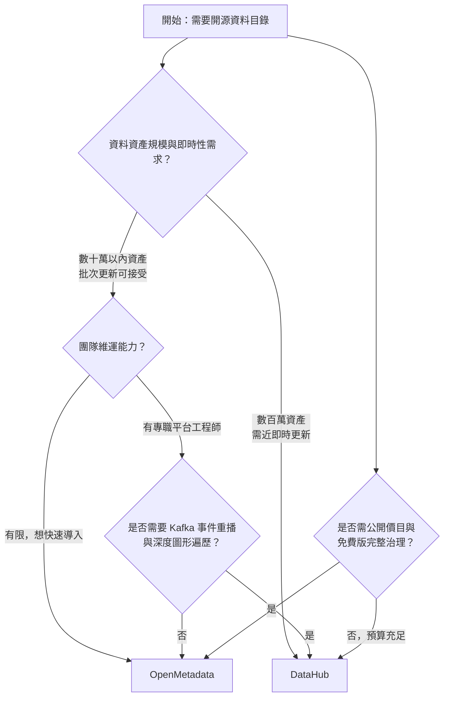

# OpenMetadata 與 DataHub：開源資料目錄與中繼資料管理平台之比較分析

## 摘要

本報告比較兩個主流的開源資料目錄（data catalog）與中繼資料（metadata）管理平台：**OpenMetadata**（由 open-metadata 組織維護）與 **DataHub**（由 datahub-project 組織維護）。兩者皆以 Apache License 2.0 釋出核心程式碼，皆提供資料探索、血緣追蹤（lineage）、治理（governance）與資料品質（data quality）能力，並各自有對應的商業託管版本（OpenMetadata 對應 Collate，DataHub 對應 DataHub Cloud）。

本報告的核心結論是：**DataHub 偏向「事件驅動、可橫向擴展、適合大型工程組織」的重型架構；OpenMetadata 偏向「部署簡單、功能整合、適合中小型與快速導入團隊」的輕量架構**。選擇的關鍵不在於絕對優劣，而在於組織的資料規模、維運能力、即時性需求與預算。

---

## 一、背景說明：什麼是資料目錄與中繼資料管理

在現代資料架構中，一個組織的資料散落在資料庫、資料倉儲、資料湖、儀表板、訊息佇列、ETL 流程與機器學習模型中。**中繼資料（metadata）** 就是「描述資料的資料」，例如某張表的欄位定義、擁有者、更新頻率、上下游依賴關係等。**資料目錄（data catalog）** 則是集中蒐集、索引、呈現這些中繼資料的平台，讓資料使用者能搜尋、理解並信任手上的資料[^catalog-def]。

近年資料目錄的定位進一步演化為「AI 與代理（agent）的上下文層（context layer）」，亦即提供經治理的語意脈絡給大型語言模型與 AI 助理使用。OpenMetadata 自稱為「資料與 AI 的開放上下文層」（The Open Context Layer for Data and AI）[^om-readme]，DataHub 則自稱「為資料與 AI 堆疊打造的上下文平台」（The Context Platform for your Data and AI Stack）[^dh-readme]。兩者的市場定位高度重疊。

---

## 二、專案概觀與量化指標

以下數據為擷取當日（2026-10-13）之觀測值，會隨時間變動。

| 項目 | OpenMetadata | DataHub |
|---|---|---|
| GitHub 儲存庫 | `open-metadata/OpenMetadata` | `datahub-project/datahub` |
| 星星數（stars） | 約 15,469[^om-repo] | 約 12,835[^dh-repo] |
| 分支數（forks） | 約 2,451[^om-repo] | 約 3,713[^dh-repo] |
| 貢獻者數 | 約 426（API 推算），官方宣稱 450+[^om-repo][^om-site] | 官方宣稱 750+[^dh-readme] |
| 主要語言（依位元組） | TypeScript、Java、Python[^om-lang] | Python、Java、TypeScript[^dh-lang] |
| 授權 | Apache License 2.0（核心）[^om-readme] | Apache License 2.0[^dh-readme] |
| 最新穩定版本 | 2.0.5-release（2026-10-08）[^om-releases] | v1.7.0.1（2026-09-03）；LTS 線 v1.6.0.3（2026-09-25）[^dh-releases] |
| 成立時間 | 2021 年[^om-repo][^collate-seriesa] | 2019 年於 LinkedIn 起源[^dh-readme] |
| 商業版本 | Collate[^collate-pricing] | DataHub Cloud（原 Acryl Data）[^dh-corecloud] |

值得注意：OpenMetadata 的星星數略高於 DataHub，但 DataHub 的分支數與貢獻者數更高，反映 DataHub 有更廣泛的社群貢獻基礎；而 OpenMetadata 的提交數（約 19,754 次）與發版頻率則顯示其開發節奏相當積極[^om-repo][^dh-repo]。

---

## 三、架構比較

架構差異是兩者最根本的分野。

### 3.1 DataHub：事件驅動、串流優先

DataHub 採用「串流優先（streaming-first）、API 優先」的設計，最初由 LinkedIn 內部建構[^dh-readme]。其核心元件包含：

- **中繼資料服務（GMS, General Metadata Service）**：以 Java（Spring）撰寫，對外提供 Rest.li 與 GraphQL API[^dh-components]。
- **關聯式儲存**：MySQL，用於儲存實體（entity）與面向（aspect）[^dh-components]。
- **搜尋引擎**：Elasticsearch 或 OpenSearch，用於建立搜尋索引[^dh-components]。
- **訊息串流**：**Kafka 是核心而非選配**；GMS 之間透過 Kafka 主題（MCE/MCL/MAE）交換變更事件，使中繼資料更新能在數秒內反映[^dh-arch]。
- **圖形資料庫**：可選用 Neo4j，用於加速圖形遍歷[^dh-components]。

其 quickstart 的 Docker Compose 預設會啟動約 7 個容器，包含 `kafka-broker`、`mysql`、`opensearch`、`datahub-gms`、`datahub-frontend-react`、`datahub-actions` 與一個系統更新任務[^dh-compose]。在正式環境則建議以 Kubernetes/Helm 部署 Kafka、Elasticsearch、MySQL 等有狀態服務[^dh-k8s]。

### 3.2 OpenMetadata：REST 中心、結構描述優先

OpenMetadata 的架構相對精簡，以 REST API 為核心支柱，並以 JSON Schema 作為單一事實來源（共 700+ 個結構描述）[^om-hld][^om-standard]。其核心元件包含：

- **REST API 服務**：Java（Dropwizard/Jetty、JAX-RS）撰寫[^om-arch]。
- **關聯式儲存**：MySQL 8.x 或 PostgreSQL，實體以 JSON 文件儲存，關聯則放在獨立的 `entity_relationship` 圖形表[^om-hld]。
- **搜尋引擎**：Elasticsearch 7.x 或 OpenSearch[^om-hld]。
- **Python 擷取框架（ingestion framework）**：130+ 個連接器，透過 REST API 將外部中繼資料推送進後端[^om-readme][^om-connectors]。
- **工作流程協調器**：Docker 部署會附帶一個 Apache Airflow 容器，用於排程擷取管線[^om-compose]。

**關鍵差異**：OpenMetadata 的預設部署**不需要 Kafka，也不需要圖形資料庫**。其 quickstart 僅需 MySQL、Elasticsearch、openmetadata-server 與一個 Airflow 擷取容器[^om-compose]。OpenMetadata 共同創辦人（本身是 Kafka 提交者）曾公開表示：「Kafka 對 99% 的使用情境而言是不必要的營運負擔。」[^hn-om]

### 3.3 架構比較總表

| 面向 | OpenMetadata | DataHub |
|---|---|---|
| 架構典範 | REST 中心、結構描述優先[^om-hld] | 事件驅動、串流優先[^dh-arch] |
| 訊息佇列 | 不需要（Kafka 非依賴）[^om-compose][^hn-om] | Kafka 為核心依賴[^dh-arch] |
| 圖形資料庫 | 無（以關聯表模擬）[^om-hld] | 可選 Neo4j[^dh-components] |
| 最小服務數 | 約 3–4 個（DB、搜尋、服務、擷取）[^om-compose] | 約 7 個以上[^dh-compose] |
| 中繼資料更新即時性 | 週期性／批次拉取[^thedataguy] | 事件驅動、近即時[^dh-arch] |

---

## 四、功能比較

### 4.1 資料探索與搜尋

兩者皆提供全文搜尋與資料剖析（profiling）。OpenMetadata 提供語意搜尋（依語意而非僅關鍵字尋找資產）與 MCP 工具支援[^om-readme]；DataHub 提供自然語言搜尋與欄位級血緣[^dh-readme]。

### 4.2 血緣追蹤（Lineage）

- **DataHub**：支援表級與**欄位級血緣**、資料管線（任務級）血緣、跨平台血緣，並提供互動式 Explorer 與影響分析（Impact Analysis）工具，支援時間窗篩選，自 v0.9.5 起可在 UI 手動編輯血緣[^dh-lineage]。其 SQL 解析器（基於 SQLGlot）被廠商宣稱準確率達 97–99%[^dsi]。
- **OpenMetadata**：支援表、欄位、儀表板、管線、指標與 ML 模型血緣，提供拖拉式手動血緣編輯器、dbt 整合與 OpenLineage 支援[^om-features]。近期 2.0.5 版本修復了 Databricks 與 Mode 的欄位級血緣問題[^om-releases]。

第三方實測指出，OpenMetadata 的血緣 UI 較清爽，但在非常深的血緣圖（500+ 節點）上會出現卡頓，因其缺乏圖形資料庫；DataHub 則因 Neo4j 支援而有較快的圖形遍歷速度[^fastero]。

### 4.3 治理（Governance）

- **OpenMetadata（開源版）**：內建業務詞彙表（glossary）、分類（classifications，如 PII）、標籤、指標/KPI、領域（domains）、資料產品、政策、角色、RBAC、認證、生命週期狀態、**資料契約（ODCS 3.1）**、資料品質測試與異常事件[^om-features]。
- **DataHub**：提供業務詞彙表、領域、資料產品、標籤、擁有權、存取政策，以及（Core 版）資料契約、斷言（assertions）與事件。但更進階的治理功能（合規表單、工作流程引擎、中繼資料測試、變更提案、存取請求流程、細粒度存取控制、稽核軌跡）為 **Cloud 專屬**[^dh-corecloud]。

### 4.4 資料品質與可觀測性

OpenMetadata 在**免費開源版即內建**資料品質測試、剖析器與新鮮度檢查，且支援超過 40 種測試類型並可整合 Great Expectations[^om-features][^pistack]。DataHub 本身不自帶測試執行引擎，較偏向整合外部工具（如 GE、dbt），並以 Assertions 與新鮮度監控為主[^fastero]。

### 4.5 AI 與代理整合

- **OpenMetadata**：提供 MCP 伺服器（`/mcp`），支援 LangChain 與 OpenAI function calling 整合，並有 Python/TypeScript AI SDK[^om-readme]。
- **DataHub**：提供官方 MCP 伺服器、Context Intelligence（從查詢歷史挖掘語意）、Context Hub（人工審核 AI 產生的上下文中繼資料）等 AI 治理能力[^dh-readme][^dh-corecloud]。TheDataGuy 的分析認為 DataHub 的 MCP 伺服器將其從「被動的人類工具」轉為「主動的機器面向治理層」[^thedataguy]。

---

## 五、生態系與連接器

| 面向 | OpenMetadata | DataHub |
|---|---|---|
| 官方連接器數 | 130+[^om-readme][^om-connectors] | 官方宣稱 140+ 來源連接器、150+ 整合；CLI 文件則稱 50+ 現成連接器[^dh-corecloud][^dh-ingest] |
| 推送式整合 | OpenLineage、Airflow、dbt、Spark[^om-features] | 推送式 Python/Java SDK、Spark/Flink、OpenLineage 消費者[^dsi] |
| 開放標準 | DCAT/DPROD、PROV-O、RDF/OWL、JSON-LD、SHACL、ODCS 3.1[^om-readme] | MCP、GraphQL、REST、OpenLineage[^dh-readme] |

兩者的連接器數量統計口徑不同（教育用戶時應注意「連接器」是否計入推送式 SDK 與文件型來源）。第三方獨立比較 Fastero 的實測則給出 OpenMetadata 約 50 個連接器、DataHub 約 80+ 個連接器，與官方數字有落差，反映統計方法差異[^fastero]。

---

## 六、部署與維運複雜度

- **OpenMetadata**：官方標榜「5 分鐘從 0 到 OpenMetadata」，以 docker compose 或託管沙箱啟動；正式環境支援 AWS EKS、Azure AKS、GKE、地端 Kubernetes（Helm）與裸機部署[^om-deploy]。生產最低需求（單一複本）為：伺服器 4 vCPU / 16 GiB RAM，資料庫 4 vCPU / 16 GiB RAM，Elasticsearch 2 vCPU / 8 GiB RAM[^om-deploy]。
- **DataHub**：本機 quickstart 以 `datahub docker quickstart` 啟動，需求 Docker、Python 3.10+、約 8GB RAM 與 13GB 磁碟；官方明確警告 quickstart **不適用於正式環境**，正式環境需以 Kubernetes/Helm 分開管理 Kafka、Elasticsearch/OpenSearch 與 MySQL[^dh-quickstart]。

第三方實測 Fastero 的作者表示：DataHub 需要「三天的時間」才能達到團隊信任的狀態，而 OpenMetadata「只花了一個下午」；DataHub 至少需要 7 個容器、10+（含監控），且建議第一季配置專職基礎設施人員[^fastero]。

---

## 七、授權與商業模式

### 7.1 開源授權

兩者核心皆為 Apache License 2.0。但須注意一項重要差異：**OpenMetadata 的擷取框架與連接器自 2024 年 9 月起改採 Collate Community License**，該授權允許使用、修改與散布，但**限制將其作為競品託管服務提供**[^dsi][^om-repo]。這意味著若企業打算以 OpenMetadata 為基礎打造對外商業服務，需先進行法務評估。DataHub 的核心與擷取框架則維持 Apache 2.0[^dsi]。

### 7.2 商業版本

- **DataHub Cloud（原 Acryl Data）**：背後公司創辦人為 Shirshanka Das 與 Swaroop Jagadish，由 LinkedIn、8VC、Bessemer 等投資[^dh-about]。採開源核心（open-core）模式，Cloud 版新增 AI 文件生成、Ask DataHub AI 代理、託管 MCP 伺服器、資料可觀測性、合規工作流程、細粒度存取控制、99.5% SLA 等[^dh-corecloud]。**無公開價目表**，採業務洽談（sales-led）模式，提供 21 天免費試用[^dh-trial][^dh-about]。
- **Collate**：為 OpenMetadata 創作者的公司（Collate Inc.）推出的託管版本，創辦人 Suresh Srinivas 與 Sriharsha Chintalapani 為 Apache Hadoop、Kafka、Hortonworks 的老將[^collate-seriesa]。**有公開價目表**：Free（5 使用者、500 資產）、Premium（25 使用者、5,000 資產）、Enterprise（50+ 使用者、10,000+ 資產），並提供 Collate AI 加購[^collate-pricing]。部署模式涵蓋多租戶 SaaS、單租戶 SaaS、混合雲與私有 BYOC。2025 年 7 月完成 1,000 萬美元 A 輪募資，由 Venrock 領投[^collate-seriesa]。

---

## 八、開發活躍度與發版節奏

### OpenMetadata

- **補丁版頻繁**：約每月 1–3 次；2.0.x 線在約六週內從 2.0.0 走到 2.0.5[^om-releases]。
- **次要版本**：約每 2–3 個月一次（1.12.0 → 1.13.0 約 3 個月；1.13.0 於 2026-06，2.0.0 於 2026-08）[^om-releases]。
- **並行維護**：同時維護 v1.13.x 與 v2.0.x 兩條線，發版由自動化機器人執行[^om-releases]。

### DataHub

- **次要版本**：約每 1.5–2.5 個月一次（約每季 1–2 次）[^dh-releases]。
- **候選版（RC）**：每條次要線會經過多次 RC（例如 v1.4.0 有 12 個 RC）[^dh-releases]。
- **補丁版**：因安全/CVE 回溯而頻繁發布[^dh-releases]。
- **LTS**：自 v1.6.0 起引入長期支援（LTS）線，並有 .1/.2/.3 補丁[^dh-releases]。

整體而言，兩者開發都相當活躍，OpenMetadata 的整體發版密度略高，DataHub 則有五版本節奏較為規律並提供 LTS 承諾。

---

## 九、第三方評價與使用者經驗

### 9.1 獨立評測

- **Fastero（2026-07-26）**：作者在生產環境自架兩者。結論：「多數團隊並沒有 LinkedIn 規模的中繼資料問題……在這種規模下，OpenMetadata 是務實的選擇。」同時指出 DataHub 的列級血緣更成熟、文件「相當複雜」，且隨著 Acryl 專注於託管產品，開源版的打磨「會先出現在 Acryl Cloud」[^fastero]。
- **TheDataGuy（2025-08-13）**：以 TCO 評分，OpenMetadata 的部署約需 2–4 週、基礎設施成本中；DataHub 約需 4–8 週、成本高且需 Kafka/分散式系統專長。對現代雲原生組織，OpenMetadata 契合度評為 5/5，DataHub 為 3/5[^thedataguy]。
- **Pi Stack（2026-05-17）**：稱 OpenMetadata 為「開箱即用最現代、最友善的 UI」，DataHub 則有「最豐富的擷取生態系」與 Actions 事件驅動自動化框架[^pistack]。
- **Data Stack Index**：指出兩者在 9/9 項目錄探索能力上看法一致，但再次點出 OpenMetadata 連接器授權縮窄的問題[^dsi]。
- **Modern DataTools（約 2026-10）**：引用 IDC 於 2026 年 3 月針對 DataHub Cloud 的研究，稱其達成「59% 更快的故障排除、119% 更多 AI/ML 模型進入生產、每年 25–30 萬美元儲存節省」，並註明「OpenMetadata 沒有對應的研究」。此研究由廠商委託，解讀時應注意其立場[^mdt]。

### 9.2 使用者社群意見（Reddit、Hacker News）

- 一位選擇 OpenMetadata 的金融科技使用者表示：「我們用 OpenMetadata，很喜歡。我們在 Datahub 與它之間選了它。部署與營運很簡單，已擴展到超過 10 萬個資料資產、近 1,000 名使用者。」[^reddit-2025]
- 一位 DataHub 使用者則說：「Open metadata 看起來很棒，但超級多 bug 且很難除錯。Datahub 非常透明，連自訂擷取都很容易除錯。」[^reddit-2023]
- 另有使用者對兩者皆表達不滿：「我們試過 openmetadata、secoda、datahub——幾乎都功能不完整、一堆 bug、UI/UX 很差……我們有近 6 萬張表、PB 級資料，最後還是自己寫了最小方案。」[^reddit-bugs]
- **重要的可信度警示**：2025 年 12 月有使用者提出研究證據，指 OpenMetadata 的員工或關係人在 Reddit 上以「一般社群成員」身分發表推廣內容（亦即在 Hacker News 的發布串中也有類似模式）[^reddit-astroturf]。因此，部分對 OpenMetadata 的熱烈「真實使用者」好評可能帶有人為操作成分，閱讀時應一併考量。相對地，也有 DataHub 工程師在社群中評論 OpenMetadata 的連接器設定與 UI「與 DataHub 非常相似」[^reddit-bigdata]。

### 9.3 已記錄的實務問題

第三方實地記錄（perun.au）指出 OpenMetadata 的數種生產環境失效模式：擷取管線逾時導致中繼資料陳舊且無擁有者告警；大型 dbt DAG（500+ 模型）血緣圖在逾時後被截斷；PII 分類因過寬的正規表示式誤判而錯誤封鎖存取；詞彙表棄用未傳播到子詞彙與被標記資產；升級後若跳過重建索引，Elasticsearch 索引會不同步（重建 100 萬+ 資產需 30–90 分鐘）[^perun]。這些屬於 DataHub 一方引用的批評，但也點出大規模部署的實際風險。

---

## 十、選擇建議

下圖為依情境的決策流程示意（Mermaid）：

具體建議如下：

**優先選擇 OpenMetadata 的情境**：
- 希望**部署與營運簡單**，不想承担 Kafka 與圖形資料庫的維運負擔[^fastero][^hn-om]。
- 需要**免費版即內建**資料品質、剖析與資料契約（ODCS）[^om-features]。
- 需要**公開透明的價目**以進行預算規劃（Collate 有公開分級）[^collate-pricing]。
- 重視開放標準互通性（RDF/OWL、SHACL、DCAT/DPROD、JSON-LD）[^om-readme]。
- 資料資產規模在數十萬以內、使用者約數千人[^reddit-2025]。

**優先選擇 DataHub 的情境**：
- 需要**事件驅動、近即時**的中繼資料更新，以及 Kafka 事件重播能力[^dh-arch]。
- 追求**超大規模**（LinkedIn 等級，數百萬資產），且已有 Kafka/Elasticsearch 維運能力[^fastero]。
- 以**成熟的列級血緣與影響分析**為首要目標[^dh-lineage]。
- 需要 LTS 長期支援承諾與規律的版本節奏[^dh-releases]。
- 團隊有專職平台工程師，能承擔較高的學習曲線與 TCO[^thedataguy]。

**共同的注意事項**：
- 兩者從開源版遷移到商業版的界線不同：DataHub 將進階治理與可觀測性放在 Cloud 版[^dh-corecloud]；OpenMetadata 將 AI 相關功能放在 Collate 版[^collate-pricing]。
- 若計畫以平台為基礎對外提供商業服務，務必確認 OpenMetadata 連接器的 Collate Community License 限制[^dsi]。
- 兩者的社群評價都存在可信度雜訊（OpenMetadata 有員工推廣爭議，DataHub 的 ROI 研究由廠商委託），建議以自家環境的 PoC 實測為準[^reddit-astroturf][^mdt]。

---

## 十一、資料來源品質反思

本報告刻意區分三類來源並據此調整權重：

1. **一手來源（最高可信度）**：GitHub 儲存庫與 API、官方文件（docs.datahub.com、docs.open-metadata.org）、官方 docker-compose 檔案、官方定價頁。這些用於架構、授權、版本與功能等客觀事實。
2. **獨立第三方評測（中高可信度）**：Fastero、TheDataGuy、Pi Stack、Data Stack Index 等聲明無付費置入的實測與分析。其主觀判斷仍屬個別經驗，但方法透明。
3. **廠商與商業對手來源（需保留）**：DataHub 自家比較頁、競爭廠商（OvalEdge、CastorDoc、Atlan）的比較文、以及由 DataHub 委託的 IDC 研究，均存在立場偏誤。

此外，**社群平台（Reddit、Hacker News）的內容存在已被記錄的人為操作問題**，本報告在引用時已標註此一限制。

本報告未採用任何未經查證的記憶性敘述；所有事實性主張均附註腳並可回溯至對應來源。

---

## 參考文獻

Aditya, F. (2026, July 26). DataHub vs OpenMetadata: Which open-source data catalog? (2026) [Blog post]. Retrieved 2026-10-13, from https://fastero.com/blog/datahub-vs-openmetadata-open-source-data-catalogs

CastorDoc. (2025, March 6). OpenMetadata vs. DataHub [Blog post]. Retrieved 2026-10-13, from https://www.castordoc.com/data-strategy/openmetadata-vs-datahub

Collate. (n.d.). Pricing. Retrieved 2026-10-13, from https://getcollate.io/pricing

DataHub. (n.d.). About. Retrieved 2026-10-13, from https://datahub.com/about/

DataHub. (n.d.). DataHub Cloud vs. DataHub Core. Retrieved 2026-10-13, from https://docs.datahub.com/docs/managed-datahub/managed-datahub-overview

DataHub. (n.d.). DataHub components. Retrieved 2026-10-13, from https://docs.datahub.com/docs/components

DataHub. (n.d.). DataHub quickstart. Retrieved 2026-10-13, from https://docs.datahub.com/docs/quickstart

DataHub. (n.d.). Docker Compose quickstart profile [Source code file]. Retrieved 2026-10-13, from https://raw.githubusercontent.com/datahub-project/datahub/master/docker/quickstart/docker-compose.quickstart-profile.yml

DataHub. (n.d.). Free trial. Retrieved 2026-10-13, from https://datahub.com/free-trial/

DataHub. (n.d.). Kubernetes deployment. Retrieved 2026-10-13, from https://docs.datahub.com/docs/deploy/kubernetes

DataHub. (n.d.). Lineage. Retrieved 2026-10-13, from https://docs.datahub.com/docs/features/feature-guides/lineage

DataHub. (n.d.). Metadata ingestion. Retrieved 2026-10-13, from https://docs.datahub.com/docs/metadata-ingestion

DataHub. (n.d.). Releases [GitHub releases page]. Retrieved 2026-10-13, from https://github.com/datahub-project/datahub/releases

DataHub Project. (n.d.). datahub [Source code repository]. Retrieved 2026-10-13, from https://github.com/datahub-project/datahub

Data Stack Index. (n.d.). DataHub vs OpenMetadata. Retrieved 2026-10-13, from https://datastackindex.com/data-observability/compare/datahub-vs-openmetadata/

Inference Systems. (n.d.). OpenMetadata vs DataHub: In-depth comparison. Retrieved 2026-10-13, from https://inferensys.com/comparisons/ai-governance-and-compliance-platforms/openmetadata-vs-datahub

Modern DataTools. (n.d.). DataHub vs OpenMetadata: AI features or connectors (2026). Retrieved 2026-10-13, from https://www.modern-datatools.com/compare/datahub-vs-openmetadata

OpenMetadata. (n.d.). Architecture. Retrieved 2026-10-13, from https://docs.open-metadata.org/latest/developers/architecture

OpenMetadata. (n.d.). Connectors. Retrieved 2026-10-13, from https://docs.open-metadata.org/latest/connectors

OpenMetadata. (n.d.). Deployment. Retrieved 2026-10-13, from https://docs.open-metadata.org/latest/deployment

OpenMetadata. (n.d.). Docker Compose quickstart [Source code file]. Retrieved 2026-10-13, from https://raw.githubusercontent.com/open-metadata/OpenMetadata/main/docker/docker-compose-quickstart/docker-compose.yml

OpenMetadata. (n.d.). Features. Retrieved 2026-10-13, from https://docs.open-metadata.org/latest/features

OpenMetadata. (n.d.). High level design. Retrieved 2026-10-13, from https://docs.open-metadata.org/latest/main-concepts/high-level-design

OpenMetadata. (n.d.). Metadata standard. Retrieved 2026-10-13, from https://docs.open-metadata.org/latest/main-concepts/metadata-standard

OpenMetadata. (n.d.). Releases [GitHub releases page]. Retrieved 2026-10-13, from https://github.com/open-metadata/OpenMetadata/releases

OpenMetadata. (n.d.). The Open Context Layer for Data and AI [Project homepage]. Retrieved 2026-10-13, from https://open-metadata.org/

Open Metadata. (n.d.). OpenMetadata [Source code repository]. Retrieved 2026-10-13, from https://github.com/open-metadata/OpenMetadata

OvalEdge. (2026, January 9). OpenMetadata vs DataHub: Which open-source data catalog is right for your team? [Blog post]. Retrieved 2026-10-13, from https://www.ovaledge.com/blog/openmetadata-vs-datahub

Perun. (n.d.). OpenMetadata in production. Retrieved 2026-10-13, from https://perun.au/insights/openmetadata-production/

Pi Stack. (2026, May 17). Self-hosted data mesh platforms: OpenMetadata vs Apache Atlas vs DataHub 2026 [Blog post]. Retrieved 2026-10-13, from https://www.pistack.xyz/posts/2026-05-17-self-hosted-data-mesh-platforms-openmetadata-atlas-datahub-guide/

PR Newswire. (2025, July 15). Collate raises $10M Series A to solve the data intelligence challenges for enterprise customers. Retrieved 2026-10-13, from https://www.prnewswire.com/news-releases/collate-raises-10m-series-a-to-solve-the-data-intelligence-challenges-for-enterprise-customers-302505020.html

TheDataGuy. (2025, August 13). Open-source data governance frameworks [Blog post]. Retrieved 2026-10-13, from https://thedataguy.pro/writing/2025/08/open-source-data-governance-frameworks/

[^catalog-def]: 資料目錄與中繼資料的基本定義，為本報告之背景說明，綜合兩專案官方文件的共同敘述。See OpenMetadata (n.d.) High level design; DataHub (n.d.) DataHub components.

[^om-readme]: OpenMetadata. (n.d.). OpenMetadata [Source code repository, README]. Retrieved 2026-10-13, from https://github.com/open-metadata/OpenMetadata

[^dh-readme]: DataHub Project. (n.d.). datahub [Source code repository, README]. Retrieved 2026-10-13, from https://github.com/datahub-project/datahub

[^om-repo]: Open Metadata. (n.d.). OpenMetadata [Source code repository]. Retrieved 2026-10-13, from https://github.com/open-metadata/OpenMetadata

[^dh-repo]: DataHub Project. (n.d.). datahub [Source code repository]. Retrieved 2026-10-13, from https://github.com/datahub-project/datahub

[^om-site]: OpenMetadata. (n.d.). The Open Context Layer for Data and AI [Project homepage]. Retrieved 2026-10-13, from https://open-metadata.org/

[^om-lang]: GitHub. (n.d.). OpenMetadata repository languages [API data]. Retrieved 2026-10-13, from https://api.github.com/repos/open-metadata/OpenMetadata/languages

[^dh-lang]: GitHub. (n.d.). DataHub repository languages [API data]. Retrieved 2026-10-13, from https://api.github.com/repos/datahub-project/datahub/languages

[^om-releases]: OpenMetadata. (n.d.). Releases [GitHub releases page]. Retrieved 2026-10-13, from https://github.com/open-metadata/OpenMetadata/releases

[^dh-releases]: DataHub. (n.d.). Releases [GitHub releases page]. Retrieved 2026-10-13, from https://github.com/datahub-project/datahub/releases

[^collate-seriesa]: PR Newswire. (2025, July 15). Collate raises $10M Series A to solve the data intelligence challenges for enterprise customers. Retrieved 2026-10-13, from https://www.prnewswire.com/news-releases/collate-raises-10m-series-a-to-solve-the-data-intelligence-challenges-for-enterprise-customers-302505020.html

[^collate-pricing]: Collate. (n.d.). Pricing. Retrieved 2026-10-13, from https://getcollate.io/pricing

[^dh-corecloud]: DataHub. (n.d.). DataHub Cloud vs. DataHub Core. Retrieved 2026-10-13, from https://docs.datahub.com/docs/managed-datahub/managed-datahub-overview

[^dh-components]: DataHub. (n.d.). DataHub components. Retrieved 2026-10-13, from https://docs.datahub.com/docs/components

[^dh-arch]: DataHub. (n.d.). Architecture overview. Retrieved 2026-10-13, from https://docs.datahub.com/docs/architecture/architecture

[^dh-compose]: DataHub. (n.d.). Docker Compose quickstart profile [Source code file]. Retrieved 2026-10-13, from https://raw.githubusercontent.com/datahub-project/datahub/master/docker/quickstart/docker-compose.quickstart-profile.yml

[^dh-k8s]: DataHub. (n.d.). Kubernetes deployment. Retrieved 2026-10-13, from https://docs.datahub.com/docs/deploy/kubernetes

[^om-hld]: OpenMetadata. (n.d.). High level design. Retrieved 2026-10-13, from https://docs.open-metadata.org/latest/main-concepts/high-level-design

[^om-standard]: OpenMetadata. (n.d.). Metadata standard. Retrieved 2026-10-13, from https://docs.open-metadata.org/latest/main-concepts/metadata-standard

[^om-arch]: OpenMetadata. (n.d.). Architecture. Retrieved 2026-10-13, from https://docs.open-metadata.org/latest/developers/architecture

[^om-connectors]: OpenMetadata. (n.d.). Connectors. Retrieved 2026-10-13, from https://docs.open-metadata.org/latest/connectors

[^om-compose]: OpenMetadata. (n.d.). Docker Compose quickstart [Source code file]. Retrieved 2026-10-13, from https://raw.githubusercontent.com/open-metadata/OpenMetadata/main/docker/docker-compose-quickstart/docker-compose.yml

[^hn-om]: Hacker News. (2024, July 17). Show HN: OpenMetadata - OSS platform for data discovery observability governance [Discussion thread]. Retrieved 2026-10-13, from https://news.ycombinator.com/item?id=40987501

[^thedataguy]: TheDataGuy. (2025, August 13). Open-source data governance frameworks [Blog post]. Retrieved 2026-10-13, from https://thedataguy.pro/writing/2025/08/open-source-data-governance-frameworks/

[^dh-lineage]: DataHub. (n.d.). Lineage. Retrieved 2026-10-13, from https://docs.datahub.com/docs/features/feature-guides/lineage

[^om-features]: OpenMetadata. (n.d.). Features. Retrieved 2026-10-13, from https://docs.open-metadata.org/latest/features

[^fastero]: Aditya, F. (2026, July 26). DataHub vs OpenMetadata: Which open-source data catalog? (2026) [Blog post]. Retrieved 2026-10-13, from https://fastero.com/blog/datahub-vs-openmetadata-open-source-data-catalogs

[^pistack]: Pi Stack. (2026, May 17). Self-hosted data mesh platforms: OpenMetadata vs Apache Atlas vs DataHub 2026 [Blog post]. Retrieved 2026-10-13, from https://www.pistack.xyz/posts/2026-05-17-self-hosted-data-mesh-platforms-openmetadata-atlas-datahub-guide/

[^dh-ingest]: DataHub. (n.d.). Metadata ingestion. Retrieved 2026-10-13, from https://docs.datahub.com/docs/metadata-ingestion

[^dsi]: Data Stack Index. (n.d.). DataHub vs OpenMetadata. Retrieved 2026-10-13, from https://datastackindex.com/data-observability/compare/datahub-vs-openmetadata/

[^om-deploy]: OpenMetadata. (n.d.). Deployment. Retrieved 2026-10-13, from https://docs.open-metadata.org/latest/deployment

[^dh-quickstart]: DataHub. (n.d.). DataHub quickstart. Retrieved 2026-10-13, from https://docs.datahub.com/docs/quickstart

[^dh-about]: DataHub. (n.d.). About. Retrieved 2026-10-13, from https://datahub.com/about/

[^dh-trial]: DataHub. (n.d.). Free trial. Retrieved 2026-10-13, from https://datahub.com/free-trial/

[^mdt]: Modern DataTools. (n.d.). DataHub vs OpenMetadata: AI features or connectors (2026). Retrieved 2026-10-13, from https://www.modern-datatools.com/compare/datahub-vs-openmetadata

[^reddit-2025]: r/dataengineering. (2025, April 12). Thoughts on Acryl vs other metadata platforms [Online forum post]. Retrieved 2026-10-13, from https://www.reddit.com/r/dataengineering/comments/1jxtvbu/thoughts_on_acryl_vs_other_metadata_platforms/

[^reddit-2023]: r/dataengineering. (2023, January 21). Open source data catalog [Online forum post]. Retrieved 2026-10-13, from https://www.reddit.com/r/dataengineering/comments/10hx1gb/open_source_data_catalog/

[^reddit-bugs]: r/dataengineering. (2025, November 19). Why all data catalogs suck? [Online forum post]. Retrieved 2026-10-13, from https://www.reddit.com/r/dataengineering/comments/1p1jxkz/why_all_data_catalogs_suck/

[^reddit-astroturf]: r/dataengineering. (2025, December 9). Evidence of undisclosed OpenMetadata employee promotion on r/dataengineering [Online forum post]. Retrieved 2026-10-13, from https://www.reddit.com/r/dataengineering/comments/1pil0yt/evidence_of_undisclosed_openmetadata_employee/

[^reddit-bigdata]: r/bigdata. (2025, November 4). How OpenMetadata is shaping modern data [Online forum post]. Retrieved 2026-10-13, from https://www.reddit.com/r/bigdata/comments/1oo2teh/how_openmetadata_is_shaping_modern_data/

[^perun]: Perun. (n.d.). OpenMetadata in production. Retrieved 2026-10-13, from https://perun.au/insights/openmetadata-production/
