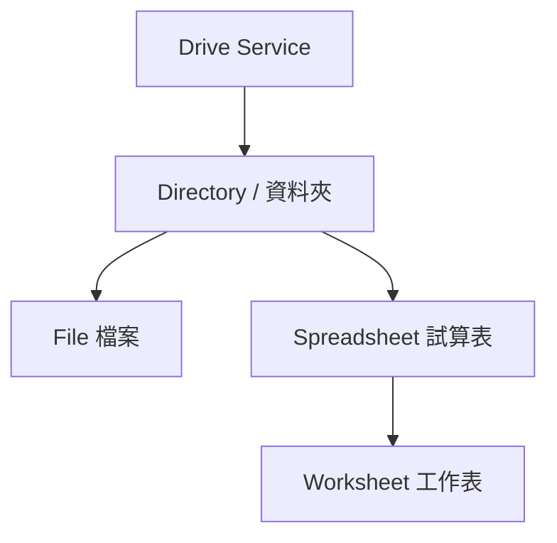
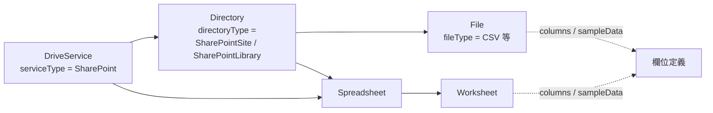
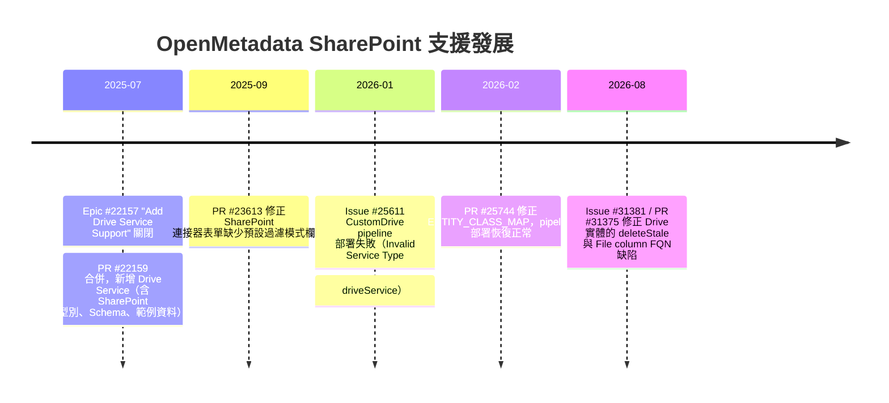

# OpenMetadata 如何處理 SharePoint 這個資料實體

## 摘要

OpenMetadata 是 OpenMetadata 基金會 (前身 Collate) 開發的開源中繼資料 (metadata) 平台，採 Apache 2.0 授權[^repo]。在 OpenMetadata 的資料模型中，**SharePoint 並不是一個獨立的頂層連接器 (connector)，而是被歸類在「Drive Service」(雲端硬碟服務) 這個服務家族之下的一種服務型別 (service type)**[^driveservice-schema]。OpenMetadata 為 SharePoint 定義了完整的服務型別、連線設定 (Schema)、實體模型與 UI 表單，但**負責實際向 SharePoint 抓取資料的 Python 擷取器 (ingestion source) 截至目前尚未合併進主分支**，官方文件也未列出 SharePoint 連接器[^docs-drive][^ingestion-dir]。因此在實務上，若今天就要把 SharePoint 的檔案與資料夾收進 OpenMetadata 目錄，官方建議的路徑是使用「Custom Drive」自訂連接器，自行以 Python 實作抓取邏輯[^docs-customdrive]。

本報告會依序說明：Drive Service 的概念、SharePoint 在其中的定位、相關的實體 (entity) 模型、連線設定欄位、擷取框架的抽象介面，以及目前的實作缺口與可行的替代方案。

---

## 一、背景：OpenMetadata 專案概況

OpenMetadata 專案位於 GitHub 上的 `open-metadata/OpenMetadata` 儲存庫，截至 2026-10-14 約有 **15,469 顆星**、2,451 個 fork，主要語言為 TypeScript，預設分支為 `main`[^repo-api]。專案自我描述為「資料與 AI 的開放情境層 (The Open Context Layer for Data and AI)」，核心功能包含資料目錄、資料血緣 (lineage)、資料治理、資料品質與可觀測性[^repo-api]。

OpenMetadata 的最新版本為 **2.0.5**（2026-10-08 發布），該版本說明為「專注於連接器與血緣可靠性的維護版本」[^release]。

---

## 二、Drive Service 是什麼

OpenMetadata 傳統上支援多種服務 (service) 類型，例如 Database、Dashboard、Messaging、Pipeline、ML Model、Storage 等。**Drive Service 是後來新增的一類服務，用來代表雲端文件管理與檔案共享平台**，例如 Google Drive、OneDrive、SharePoint、Dropbox 等[^git-epic]。

> 上段的 Google Drive、OneDrive、Dropbox 等屬於平台層面的舉例，OpenMetadata 程式碼中明確列出的型別以本報告第三章為準。

Drive Service 的實體結構 (hierarchy) 如下圖所示，服務之下可包含目錄 (Directory)，目錄之下可包含檔案 (File) 與試算表 (Spreadsheet)，試算表之下再包含工作表 (Worksheet)[^drive-service-py][^standards-drive]：



---

## 三、SharePoint 在 OpenMetadata 中的定位

### 3.1 服務型別 (service type)

在 `driveService.json` 這份 Schema 中，`driveServiceType` 這個列舉 (enum) 定義了四種 Drive 服務型別[^driveservice-schema]：

| 型別 | 說明 |
| --- | --- |
| `GoogleDrive` | Google Drive |
| `SharePoint` | Microsoft SharePoint |
| `Sftp` | SFTP 伺服器 |
| `CustomDrive` | 自訂 Drive 服務 |

也就是說，**SharePoint 是 `DriveService` 實體的四種合法型別之一**，與 Google Drive、SFTP 並列[^driveservice-schema]。同一個 Schema 的 `driveConnection.config` 使用 `oneOf` 指向四種連線設定檔，其中 SharePoint 對應的是 `connections/drive/sharePointConnection.json`[^driveservice-schema]。

### 3.2 UI 顯示名稱

在 OpenMetadata 前端 (UI) 的型別格式化列舉 `FormattedDriveServiceType` 中，`SharePoint` 被映射為顯示字串 `'Share Point'`[^ui-formatted-type]：

```typescript
export enum FormattedDriveServiceType {
  CustomDrive = 'Custom Drive',
  GoogleDrive = 'Google Drive',
  SharePoint = 'Share Point',
}
```

這代表 SharePoint 在服務新增精靈 (Add Service Wizard) 中是可以被選到的服務型別，UI 層的表單與字串都已接好[^ui-formatted-type][^pr-ui-form]。

### 3.3 一個容易混淆的點

「Drive Service」是 OpenMetadata 特有的命名。它與 OpenMetadata 既有的「Storage Service」(物件儲存，如 S3、GCS、ADLS) **不是同一個東西**：Storage Service 處理的是物件儲存桶與容器，Drive Service 處理的是雲端硬碟式的檔案與資料夾結構[^docs-drive][^standards-drive]。SharePoint 屬於後者的範疇。

---

## 四、SharePoint 內容如何映射到實體 (entity) 模型

SharePoint 上的內容在 OpenMetadata 中被映射成四種實體。這些實體並非 SharePoint 專屬，而是整個 Drive Service 家族共用的模型。

### 4.1 Directory (目錄)

`Directory` 實體代表 Drive 中的資料夾或組織單位，可包含檔案、工作表與其他子目錄[^directory-schema]。其 `directoryType` 列舉特別針對 SharePoint 定義了兩個型別[^directory-schema]：

```
Root, MyDrive, SharedDrive, TeamDrive, Folder, SharePointSite, SharePointLibrary
```

- **`SharePointSite`**：代表一個 SharePoint 網站。
- **`SharePointLibrary`**：代表一個 SharePoint 文件庫 (document library)。

其餘型別 (`MyDrive`、`SharedDrive`、`TeamDrive`) 則主要對應 Google Drive 的語意[^directory-schema]。這清楚顯示 **OpenMetadata 的資料模型是刻意為 SharePoint 保留位置的**。

`Directory` 實體另外包含 `parent` 與 `children` 欄位以表達巢狀結構，並有 `isShared`、`numberOfFiles`、`numberOfSubDirectories`、`totalSize`、`sourceUrl` 等欄位[^directory-schema]。

### 4.2 File (檔案)

`File` 實體代表 Drive 中的文件或資源[^file-schema]。其 `fileType` 列舉包含 `Document`、`Spreadsheet`、`Presentation`、`Image`、`Video`、`Audio`、`PDF`、`Archive`、`Code`、`Data`、`CSV`、`Text`、`Other`[^file-schema]。

值得注意的是 `File` 實體具備 `columns` 欄位，可存放結構化資料檔案 (如 CSV) 的欄位定義，並有 `sampleData`、`mimeType`、`fileExtension`、`path`、`size`、`checksum`、`webViewLink`、`downloadLink`、`fileVersion`、`createdTime`、`modifiedTime`、`lastModifiedBy` 等欄位[^file-schema]。這表示 **OpenMetadata 可以對 SharePoint 上的 CSV 等結構化檔案做欄位層級的中繼資料擷取**。

### 4.3 Spreadsheet (試算表) 與 Worksheet (工作表)

`Spreadsheet` 實體代表內含多個工作表/分頁的試算表檔案，例如 Google Sheets 或 Excel 檔案[^spreadsheet-schema]。其 `spreadsheetMimeType` 列舉涵蓋[^spreadsheet-schema]：

```
application/vnd.google-apps.spreadsheet
application/vnd.openxmlformats-officedocument.spreadsheetml.sheet
application/vnd.ms-excel
application/vnd.oasis.opendocument.spreadsheet
text/csv
text/tab-separated-values
Other
```

其中 `sourceUrl` 欄位的說明文字明確寫道「連結到來源系統中的此試算表 (例如 Google Sheets URL、**SharePoint URL**)」，再次佐證 SharePoint 是設計時就納入的目標[^spreadsheet-schema]。

`Worksheet` 實體代表試算表中的單一分頁，包含 `worksheetId`、`index`、`rowCount`、`columnCount`、`columns`、`sampleData`、`isHidden` 等欄位[^worksheet-schema]。

### 4.4 實體關係圖



---

## 五、SharePoint 連線設定 (SharePointConnection)

`sharePointConnection.json` 定義了連線到 SharePoint 所需的設定[^sp-schema]。這是判斷 OpenMetadata 如何「看待」SharePoint 最直接的證據。

### 5.1 必要欄位

Schema 規定 `clientId`、`clientSecret`、`tenantId`、`siteUrl` 四個欄位為**必填**[^sp-schema]：

| 欄位 | 型別 | 必要 | 說明 |
| --- | --- | --- | --- |
| `clientId` | string | 是 | 來自 Azure Active Directory 的應用程式 (用戶端) ID |
| `clientSecret` | string (password) | 是 | 來自 Azure Active Directory 的應用程式用戶端密碼 |
| `tenantId` | string | 是 | 來自 Azure Active Directory 的目錄 (租用戶) ID |
| `siteUrl` | string (uri) | 是 | SharePoint 網站 URL，預設範例為 `https://yourorg.sharepoint.com/sites/yoursite` |
| `siteName` | string | 否 | SharePoint 網站名稱 |
| `driveId` | string | 否 | SharePoint 磁碟機 ID；若未提供，將使用預設文件庫 |
| `connectionOptions` | object | 否 | 額外連線選項 |
| `connectionArguments` | object | 否 | 額外連線參數 |
| `directoryFilterPattern` | FilterPattern | 否 | 目錄的 include/exclude 正規表達式 |
| `fileFilterPattern` | FilterPattern | 否 | 檔案的 include/exclude 正規表達式 |
| `spreadsheetFilterPattern` | FilterPattern | 否 | 試算表的 include/exclude 正規表達式 |
| `worksheetFilterPattern` | FilterPattern | 否 | 工作表的 include/exclude 正規表達式 |
| `supportsMetadataExtraction` | boolean | 否 | 是否支援中繼資料擷取 |

**這組欄位設計透露了驗證方式**：`clientId` + `clientSecret` + `tenantId` 是典型的 Azure AD 應用程式註冊 (app registration) 用戶端認證流程 (client credentials flow)，也就是說 **OpenMetadata 預期的 SharePoint 存取方式是透過 Microsoft Graph 或 SharePoint REST API 的應用程式權限**[^sp-schema]。`siteUrl` 與 `driveId` 則用來鎖定要擷取的網站與文件庫。

### 5.2 範例設定

儲存庫中提供了一份 SharePoint 服務的範例設定檔 `ingestion/examples/sample_data/drives/sharepoint_service.json`[^sample-data]：

```json
{
  "name": "sample_sharepoint_drive",
  "serviceType": "SharePoint",
  "connection": {
    "config": {
      "type": "SharePoint",
      "clientId": "a1b2c3d4-e5f6-7890-abcd-ef1234567890",
      "clientSecret": "SuperSecretClientSecret123!",
      "tenantId": "12345678-1234-1234-1234-123456789012",
      "siteName": "CompanyIntranet",
      "siteUrl": "https://contoso.sharepoint.com/sites/CompanyIntranet",
      "driveId": "b!vP_zOj2KN0WyIQxEH8cWxe3Cim2BabtJnJDa1IZNrsFQ7rEwXGVRpvkSa4v3zBA"
    }
  }
}
```

（範例中的憑證為示範用假值。）此檔案的存在表示 SharePoint 服務設定已被納入範例與測試資料的維護範圍[^sample-data]。

### 5.3 UI 表單

在 OpenMetadata 的前端，SharePoint 連線設定有對應的 TypeScript 型別 `SharePointConnection` 與 RJSF 表單 Schema[^ui-sp-ts]。此外，曾有 PR 專門修正「CustomDrive 與 SharePoint 連接器缺少預設過濾模式 (Default Filter Pattern) 欄位」的 UI 問題，顯示 SharePoint 的表單確實有在維護[^pr-ui-form]。

---

## 六、擷取 (ingestion) 框架如何為 SharePoint 設計

OpenMetadata 的 Drive 擷取框架定義在 `ingestion/src/metadata/ingestion/source/drive/drive_service.py`，內含兩個關鍵類別[^drive-service-py]。

### 6.1 拓樸 (topology)：DriveServiceTopology

`DriveServiceTopology` 定義了 Drive 服務的階層與節點流程[^drive-service-py]：

```
service -> directory -> file/spreadsheet -> worksheet
```

其 `root` 節點包含三個後處理 (post_process) 步驟：`mark_directories_as_deleted`、`mark_files_as_deleted`、`mark_spreadsheets_as_deleted`；`spreadsheet` 節點則有 `mark_worksheets_as_deleted`[^drive-service-py]。這些步驟負責在來源端刪除項目時，於 OpenMetadata 中進行軟刪除 (soft delete)。

### 6.2 抽象基底類別：DriveServiceSource

`DriveServiceSource` 是抽象基底類別 (ABC)，其 docstring 明確列出它預期支援的服務[^drive-service-py]：

> Base class for Drive Services. It implements the topology and context for drive-based systems like: Google Drive, **SharePoint**, OneDrive, Box, Dropbox etc.

它定義了子類別必須實作的抽象方法[^drive-service-py]：

| 抽象方法 | 職責 |
| --- | --- |
| `get_directory_names()` | 準備要送進階段的目錄名稱，並在此進行過濾 |
| `get_file_names()` | 準備檔案名稱，並在此進行過濾 |
| `yield_directory()` | 產生 `CreateDirectoryRequest`，處理巢狀目錄的父子關係 |
| `yield_file()` | 產生 `CreateFileRequest`，必要時連結到目錄 |
| `yield_spreadsheet()` | 產生 `CreateSpreadsheetRequest` |
| `yield_worksheet()` | 產生 `CreateWorksheetRequest`，連結到父試算表 |
| `get_spreadsheets_list()` | 迭代試算表清單並過濾 |
| `get_spreadsheet_name()` | 取得試算表名稱 |
| `get_spreadsheet_details()` | 取得試算表細節 |

也就是說，**框架層已經為 SharePoint 預留了完整的實作介面，只差一個具體的 SharePoint 子類別把它填滿**[^drive-service-py]。

### 6.3 中繼資料流程設定 (pipeline config)

`driveServiceMetadataPipeline.json` 定義了 Drive 中繼資料擷取的選項[^pipeline-schema]，包含：

- `markDeletedDirectories` / `markDeletedFiles` / `markDeletedSpreadsheets` / `markDeletedWorksheets`：來源刪除時是否軟刪除（預設皆為 `true`）。
- `includeDirectories` / `includeFiles` / `includeSpreadsheets` / `includeWorksheets` / `includeTags` / `includeOwners`：是否擷取各類中繼資料（`includeOwners` 預設為 `false`）。
- `overrideMetadata`：來源的中繼資料是否覆寫 OpenMetadata 中既有的值（預設 `false`）。
- `useFqnForFiltering`：過濾正規表達式是否套用在完整名稱 (FQN，例如 `service_name.directory_name.file_name`) 上，而非原始名稱。
- 四組 `*FilterPattern`：目錄、檔案、試算表、工作表的過濾模式。
- `threads`：平行化擷取使用的執行緒數（預設 1）。

這些選項與 Google Drive 等既有連接器共用同一套設定，因此 SharePoint 一旦實作完成，即可直接沿用這套擷取行為[^pipeline-schema][^docs-googledrive]。

---

## 七、現況：為何目前沒有可用的 SharePoint 擷取器

這是本報告最關鍵的發現。

### 7.1 擷取原始碼目錄中沒有 SharePoint 實作

位於 `ingestion/src/metadata/ingestion/source/drive/` 的目錄中，實際存在的內容為[^ingestion-dir]：

```
drive_service.py          # 抽象基底類別
googledrive/              # Google Drive 實作
sftp/                     # SFTP 實作
```

也就是說，**只有 `googledrive/` 與 `sftp/` 兩個具體實作，並不存在 `sharepoint/` 目錄**[^ingestion-dir][^googledrive-dir][^sftp-dir]。對照之下，`googledrive/` 內含 `connection.py`、`metadata.py`、`models.py`、`service_spec.py` 等完整檔案；SharePoint 則連一個檔案都沒有[^googledrive-dir]。

### 7.2 官方文件未列出 SharePoint

OpenMetadata 官方文件在 Drive Services 分類下只列出三個連接器[^docs-drive][^docs-drive-v21]：

- **Custom Drive**（標記為 PROD）
- **Google Drive**（標記為 BETA）
- **SFTP**（標記為 BETA）

**SharePoint 並不在列表中**，也查不到 SharePoint 連接器的專屬文件頁面[^docs-drive][^docs-drive-v21]。文件頁面末端的標準說明是：「若您希望新增連接器，歡迎透過 Slack 聯繫或在 GitHub 儲存庫開立功能請求」[^docs-drive]。

### 7.3 缺口整理

| 項目 | 狀態 |
| --- | --- |
| `driveServiceType` 列舉含 `SharePoint` | 已完成[^driveservice-schema] |
| `SharePointConnection` Schema | 已完成[^sp-schema] |
| `Directory` 的 `SharePointSite` / `SharePointLibrary` 型別 | 已完成[^directory-schema] |
| 範例設定 `sharepoint_service.json` | 已完成[^sample-data] |
| UI 型別與表單 | 已完成[^ui-sp-ts][^pr-ui-form] |
| 擷取框架抽象介面 (`DriveServiceSource`) | 已完成[^drive-service-py] |
| **SharePoint 專屬的 Python 擷取器** | **尚未實作**[^ingestion-dir] |
| **官方文件頁面** | **尚未提供**[^docs-drive] |
| **SharePoint 專屬血緣 (lineage)** | **尚未實作**[^pipeline-schema] |

換言之，OpenMetadata 對 SharePoint 的支援目前停留在「**Schema 與框架就緒、實作從缺**」的狀態。

---

## 八、目前可行的替代方案：Custom Drive 連接器

既然原生 SharePoint 連接器尚未可用，OpenMetadata 官方提供「Custom Drive」連接器作為擴充點，讓使用者自行以 Python 實作擷取邏輯[^docs-customdrive]。

### 8.1 實作方式

依官方文件，自訂 Drive 連接器需建立一個繼承自 `Source` 的 Python 類別，並實作 `prepare`、`_iter`、`test_connection` 等方法[^docs-customdrive]：

```python
class MyDriveConnector(Source):
    ...
    def _iter(self):
        ...
```

在 `_iter` 中逐一產生 (yield) `CreateEntityRequest` 物件，並以 `Either` 型別包裝成功或錯誤的結果。官方文件給的範例會產生 `CreateDirectoryRequest`、`CreateFileRequest`、`CreateSpreadsheetRequest`、`CreateWorksheetRequest` 等請求[^docs-customdrive]。

### 8.2 部署方式

1. 將自訂連接器打包成 Python 模組 (`setup.py` + `python setup.py sdist`)。
2. 建立基於 `openmetadata/ingestion:<version>` 的 Docker 映像，把模組 `COPY` 進去並 `pip install`。
3. 以自訂映像啟動 OpenMetadata。
4. 在 ingestion YAML 中指定 `type: CustomDrive` 與 `sourcePythonClass`，然後用 `metadata ingest -c <config.yaml>` 執行[^docs-customdrive]。

以下為官方文件提供的 YAML 骨架[^docs-customdrive]：

```yaml
source:
  type: custom-drive
  serviceName: <service_name>
  serviceConnection:
    config:
      type: CustomDrive
      sourcePythonClass: custom_drive.my_drive_connector.MyDriveConnector
  sourceConfig:
    config:
      type: DriveMetadata
sink:
  type: metadata-rest
  config: {}
```

### 8.3 社群實務

這條路徑並非純理論。曾有用戶以 **CustomDrive 服務型別加上 `sourcePythonClass`**，在 `connectionOptions` 中帶入 `tenantId`、`clientId`、`clientSecret`、`siteUrl`、`siteName`、`libraryName`、`extensions` 等參數，實作出 SharePoint 擷取[^issue-25611]：

```json
{
  "type": "CustomDrive",
  "sourcePythonClass": "<custom_source_class>",
  "connectionOptions": {
    "tenantId": "...",
    "clientId": "...",
    "clientSecret": "...",
    "siteUrl": "https://.../sites/...",
    "siteName": "...",
    "libraryName": "Shared Documents",
    "extensions": ".csv,.xlsx,.xls"
  }
}
```

該做法在 OpenMetadata 1.11.6 版本上遇到 pipeline 部署失敗的問題，後來透過修正 `ENTITY_CLASS_MAP` 才得以部署成功[^issue-25611][^pr-25744]。

---

## 九、相關的 GitHub Issue 與 PR 歷史

以下時間軸整理了 SharePoint 在 OpenMetadata 中的發展脈絡。



### 9.1 Epic #22157：Drive Service 的起點

Epic「Add Drive Service Support to OpenMetadata」由 `harshach` 於 2025-07-05 提出，2025-07-11 關閉[^git-epic]。其內容明確寫道要為雲端檔案儲存服務新增支援，並列出 Google Drive、**SharePoint**、OneDrive、Box、Dropbox 等平台，同時新增 Directory、File、Spreadsheet、Worksheet 四種實體[^git-epic]。

值得注意的是，Epic 中「Future Enhancements」(未來增強) 一節把 **SharePoint、OneDrive、Box、Dropbox 列為尚未支援、待日後新增的服務提供者**[^git-epic]。這與本報告第七章的發現一致：第一階段只實作了 Google Drive。

對應的 PR #22159「Add drive as service」於 2025-07-11 合併，提交訊息包含「Add sample data and ingestion for drives, directories, spreadsheets, worksheets, files」等[^commit-drive]。

### 9.2 PR #23613：UI 表單修正

2025-09-29 的 PR #23613 說明中提到，它為 **CustomDrive 與 SharePoint 連接器補上缺少的「Default Filter Pattern」欄位**，並修正 Add Service Form 中額外屬性欄位的顯示問題，該 PR 於 2025-10-01 合併[^pr-ui-form]。這證明 SharePoint 的 UI 表單並非被廢棄，而是仍有在維護。

### 9.3 Issue #25611 與 PR #25743 / #25744：部署失敗修正

Issue #25611「CustomDrive pipeline deploy fails with `Invalid Service Type: driveService` (1.11.6)」於 2026-01-29 提出[^issue-25611]。問題是：為 DriveService 實體部署擷取 pipeline 時，workflow 產生階段會失敗，錯誤訊息為 `Invalid Service Type: driveService`。原因是 Airflow 相關程式碼中的 `ENTITY_CLASS_MAP` 缺少 `driveService` 項目，導致 `build_source` 查表時回傳 `None`[^issue-25611][^pr-25744]。

PR #25743 與 #25744 由 `AntoineGlacet` 提出修正，在 `ENTITY_CLASS_MAP` 中補上 `"driveService": DriveService`。PR 說明中寫道，作者是以**自訂 SharePoint 連接器**在 OpenMetadata 1.11.8 上實測，套用修正後 pipeline 才得以成功部署與執行[^pr-25744]。PR #25744 於 2026-02-09 合併[^pr-25744]。

### 9.4 Issue #31381 與 PR #31375：Drive 實體層缺陷

Issue #31381「Drive connectors: every ingestion run fails, and re-runs cannot update files」於 2026-08-12 提出[^issue-31381]。報告了兩個位於 Drive 實體層的缺陷[^issue-31381]：

1. **`deleteStale` 未在 Drive 資源上實作**：每次擷取執行結束時都會出現三個 `HTTP 405 Method Not Allowed`（`PUT /v1/drives/{directories,files,spreadsheets}/deleteStale`）。其影響是 `markDeletedDirectories` / `markDeletedFiles` 變成無聲的空操作，來源端刪除的實體永遠不會從目錄中移除。
2. **`FileRepository` 未在寫入路徑設定 column FQN**：導致重新擷取含欄位的檔案時，伺服器端發生 `Column.getFullyQualifiedName()` 為 null 的 NPE，使中繼資料凍結在第一次擷取的狀態。

對應的 PR #31375 於 2026-08-13 合併，修好了這兩個問題[^pr-31375]。**此 PR 的說明特別指出，這兩個缺陷「對 GoogleDrive 與 SharePoint 的影響完全相同 (affect GoogleDrive and SharePoint identically)」**[^pr-31375]，這再次確認 SharePoint 被視為 Drive 家族的一員。

---

## 十、血緣 (lineage) 的處理

目前**沒有任何 SharePoint 專屬的血緣實作**[^pipeline-schema][^docs-drive]。不過 OpenMetadata 的 Drive 中繼資料流程設定中，在 `markDeletedDirectories`、`markDeletedFiles`、`markDeletedSpreadsheets`、`markDeletedWorksheets` 等欄位的說明文字裡，都提到了「與該實體關聯的**血緣**等實體也會一併被刪除」[^pipeline-schema]：

> Optional configuration to soft delete files in OpenMetadata if the source files are deleted. Also, if the file is deleted, all the associated entities like **lineage**, etc., with that file will be deleted.

這表示血緣支援在架構上是「可掛載到 File / Spreadsheet 等實體上」的，但目前並不存在會自動從 SharePoint 產生血緣的來源[^pipeline-schema]。

此外，OpenMetadata 儲存庫中的 `skills/standards/performance.md` 在討論分頁 (pagination) 規範時，把 **SharePoint 這類 OData API 的 `@odata.nextLink`** 列為必須實作分頁的案例之一[^perf-standard]。這屬於開發規範層面的提醒，尚未對應到實際程式碼。

---

## 十一、結論

綜合以上調查，OpenMetadata 對 SharePoint 的處理可歸納為以下幾點：

1. **SharePoint 是 Drive Service 家族的一種服務型別**，與 Google Drive、SFTP、CustomDrive 並列，而非獨立的頂層連接器[^driveservice-schema]。
2. **資料模型已為 SharePoint 量身定義**：`Directory` 實體具備 `SharePointSite` 與 `SharePointLibrary` 兩種型別，`Spreadsheet` 的 `sourceUrl` 說明也直接提到 SharePoint URL[^directory-schema][^spreadsheet-schema]。
3. **連線設定已完整定義**：`SharePointConnection` 以 Azure AD 應用程式認證 (`clientId` + `clientSecret` + `tenantId`) 搭配 `siteUrl`、`driveId` 鎖定網站與文件庫，並支援目錄、檔案、試算表、工作表四類過濾模式[^sp-schema]。
4. **擷取框架已預留介面**：`DriveServiceSource` 抽象類別明確把 SharePoint 列為目標服務，並定義了目錄、檔案、試算表、工作表所需的抽象方法[^drive-service-py]。
5. **但實際擷取器從缺**：`ingestion/src/metadata/ingestion/source/drive/` 下只有 `googledrive/` 與 `sftp/`，官方文件也只列出 Custom Drive、Google Drive、SFTP 三個連接器[^ingestion-dir][^docs-drive]。
6. **官方建議的替代路徑是 Custom Drive 連接器**，即自行以 Python 繼承 `Source` 並實作 `_iter`，再透過 Docker 映像部署[^docs-customdrive]。此做法已有社群實例[^issue-25611][^pr-25744]。
7. **相關的 Drive 實體層缺陷會同時影響 GoogleDrive 與 SharePoint**，這從 Issue #31381 與 PR #31375 的說明可獲得印證[^pr-31375]。

因此，若要用一句話回答「OpenMetadata 如何處理 SharePoint 這個資料實體」：**它把 SharePoint 建模為 Drive Service 的一種型別，備妥了服務型別、連線 Schema、實體模型 (Directory / File / Spreadsheet / Worksheet) 與擷取框架，但尚未提供開箱即用的 SharePoint 連接器；在原生支援到位之前，需透過 Custom Drive 連接器自行實作。**

---

## 參考資料

[^repo]: OpenMetadata. (2026). *open-metadata/OpenMetadata*. GitHub. Retrieved 2026-10-14, from https://github.com/open-metadata/OpenMetadata

[^repo-api]: OpenMetadata. (2026). *open-metadata/OpenMetadata repository metadata* [Data file]. Retrieved 2026-10-14, from https://api.github.com/repos/open-metadata/OpenMetadata

[^release]: OpenMetadata. (2026, October 8). *2.0.5-release*. Retrieved 2026-10-14, from https://github.com/open-metadata/OpenMetadata/releases/tag/2.0.5-release

[^driveservice-schema]: OpenMetadata. (n.d.). *Drive Service schema (driveService.json)*. Retrieved 2026-10-14, from https://raw.githubusercontent.com/open-metadata/OpenMetadata/main/openmetadata-spec/src/main/resources/json/schema/entity/services/driveService.json

[^sp-schema]: OpenMetadata. (n.d.). *SharePoint Connection schema (sharePointConnection.json)*. Retrieved 2026-10-14, from https://raw.githubusercontent.com/open-metadata/OpenMetadata/main/openmetadata-spec/src/main/resources/json/schema/entity/services/connections/drive/sharePointConnection.json

[^directory-schema]: OpenMetadata. (n.d.). *Directory entity schema (directory.json)*. Retrieved 2026-10-14, from https://raw.githubusercontent.com/open-metadata/OpenMetadata/main/openmetadata-spec/src/main/resources/json/schema/entity/data/directory.json

[^file-schema]: OpenMetadata. (n.d.). *File entity schema (file.json)*. Retrieved 2026-10-14, from https://raw.githubusercontent.com/open-metadata/OpenMetadata/main/openmetadata-spec/src/main/resources/json/schema/entity/data/file.json

[^spreadsheet-schema]: OpenMetadata. (n.d.). *Spreadsheet entity schema (spreadsheet.json)*. Retrieved 2026-10-14, from https://raw.githubusercontent.com/open-metadata/OpenMetadata/main/openmetadata-spec/src/main/resources/json/schema/entity/data/spreadsheet.json

[^worksheet-schema]: OpenMetadata. (n.d.). *Worksheet entity schema (worksheet.json)*. Retrieved 2026-10-14, from https://raw.githubusercontent.com/open-metadata/OpenMetadata/main/openmetadata-spec/src/main/resources/json/schema/entity/data/worksheet.json

[^pipeline-schema]: OpenMetadata. (n.d.). *DriveService Metadata Pipeline schema (driveServiceMetadataPipeline.json)*. Retrieved 2026-10-14, from https://raw.githubusercontent.com/open-metadata/OpenMetadata/main/openmetadata-spec/src/main/resources/json/schema/metadataIngestion/driveServiceMetadataPipeline.json

[^drive-service-py]: OpenMetadata. (n.d.). *Base class for ingesting drive services (drive_service.py)*. Retrieved 2026-10-14, from https://raw.githubusercontent.com/open-metadata/OpenMetadata/main/ingestion/src/metadata/ingestion/source/drive/drive_service.py

[^ingestion-dir]: OpenMetadata. (n.d.). *Directory listing: ingestion/src/metadata/ingestion/source/drive* [Data file]. Retrieved 2026-10-14, from https://api.github.com/repos/open-metadata/OpenMetadata/contents/ingestion/src/metadata/ingestion/source/drive

[^googledrive-dir]: OpenMetadata. (n.d.). *Directory listing: ingestion/src/metadata/ingestion/source/drive/googledrive* [Data file]. Retrieved 2026-10-14, from https://api.github.com/repos/open-metadata/OpenMetadata/contents/ingestion/src/metadata/ingestion/source/drive/googledrive

[^sftp-dir]: OpenMetadata. (n.d.). *Directory listing: ingestion/src/metadata/ingestion/source/drive/sftp* [Data file]. Retrieved 2026-10-14, from https://api.github.com/repos/open-metadata/OpenMetadata/contents/ingestion/src/metadata/ingestion/source/drive/sftp

[^sample-data]: OpenMetadata. (n.d.). *Sample SharePoint drive service (sharepoint_service.json)*. Retrieved 2026-10-14, from https://github.com/open-metadata/OpenMetadata/blob/main/ingestion/examples/sample_data/drives/sharepoint_service.json

[^ui-sp-ts]: OpenMetadata. (n.d.). *SharePoint Connection generated TypeScript types (sharePointConnection.ts)*. Retrieved 2026-10-14, from https://github.com/open-metadata/OpenMetadata/blob/main/openmetadata-ui/src/main/resources/ui/src/generated/entity/services/connections/drive/sharePointConnection.ts

[^ui-formatted-type]: OpenMetadata. (n.d.). *EntityUtils.interface.ts (FormattedDriveServiceType)*. Retrieved 2026-10-14, from https://github.com/open-metadata/OpenMetadata/blob/main/openmetadata-ui/src/main/resources/ui/src/utils/EntityUtils.interface.ts

[^docs-drive]: OpenMetadata. (n.d.). *Drive Services | OpenMetadata Drive Integration Guide*. Retrieved 2026-10-14, from https://docs.open-metadata.org/v2.0.x/connectors/drive

[^docs-drive-v21]: OpenMetadata. (n.d.). *Drive Services | OpenMetadata Drive Integration Guide (v2.1.x-SNAPSHOT)*. Retrieved 2026-10-14, from https://docs.open-metadata.org/v2.1.x-SNAPSHOT/connectors/drive

[^docs-googledrive]: OpenMetadata. (n.d.). *Google Drive Connector | OpenMetadata Drive Guide*. Retrieved 2026-10-14, from https://docs.open-metadata.org/v2.0.x/connectors/drive/googledrive

[^docs-customdrive]: OpenMetadata. (n.d.). *Custom Drive Connector | Build & Extend OpenMetadata Easily*. Retrieved 2026-10-14, from https://docs.open-metadata.org/v2.0.x/connectors/drive/custom-drive

[^standards-drive]: OpenMetadata Standards. (n.d.). *Drive Service*. Retrieved 2026-10-14, from https://openmetadatastandards.org/data-assets/storage/drive-service/

[^git-epic]: harshach. (2025, July 5). *Add Drive Service Support to OpenMetadata* [Issue #22157]. Retrieved 2026-10-14, from https://github.com/open-metadata/OpenMetadata/issues/22157

[^commit-drive]: Chintalapani, S. (2025, July 11). *Add drive as service (#22159)* [Commit]. Retrieved 2026-10-14, from https://github.com/open-metadata/OpenMetadata/commit/58cd7daf7eec5db6fd5738ff447da81c04bd2b26

[^pr-ui-form]: Katkar, A. (2025, October 1). *Fix(UI): Add service form bugs (#23613)* [Pull request]. Retrieved 2026-10-14, from https://github.com/open-metadata/OpenMetadata/pull/23613

[^issue-25611]: Glacet, A. (2026, January 29). *CustomDrive pipeline deploy fails with `Invalid Service Type: driveService` (1.11.6)* [Issue #25611]. Retrieved 2026-10-14, from https://github.com/open-metadata/OpenMetadata/issues/25611

[^pr-25744]: Glacet, A. (2026, February 9). *fix(airflow): add DriveService to ENTITY_CLASS_MAP (#25744)* [Pull request]. Retrieved 2026-10-14, from https://github.com/open-metadata/OpenMetadata/pull/25744

[^issue-31381]: Khairajani. (2026, August 12). *Drive connectors: every ingestion run fails, and re-runs cannot update files* [Issue #31381]. Retrieved 2026-10-14, from https://github.com/open-metadata/OpenMetadata/issues/31381

[^pr-31375]: Khairajani. (2026, August 13). *fix(drive): add deleteStale endpoint and set File column FQNs on write (#31375)* [Pull request]. Retrieved 2026-10-14, from https://github.com/open-metadata/OpenMetadata/pull/31375

[^perf-standard]: OpenMetadata. (n.d.). *Connector performance standards (skills/standards/performance.md)*. Retrieved 2026-10-14, from https://github.com/open-metadata/OpenMetadata/blob/main/skills/standards/performance.md
