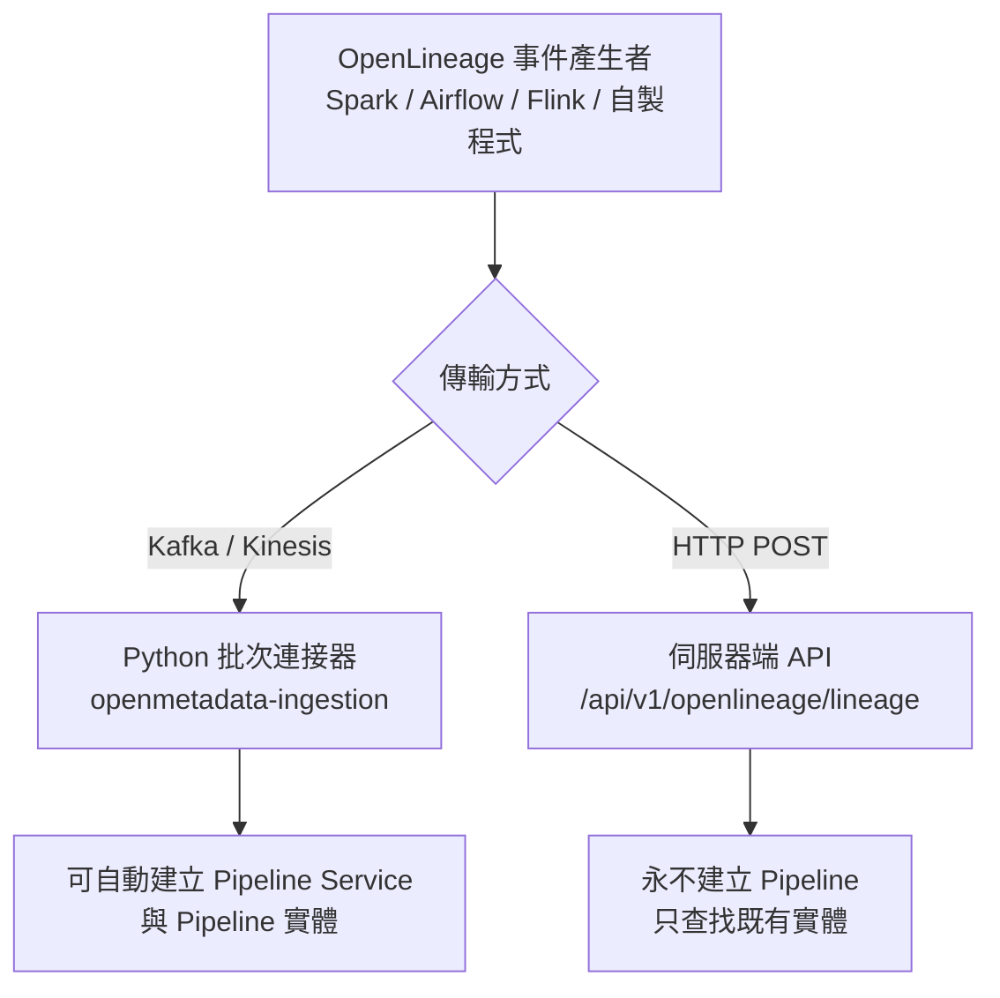
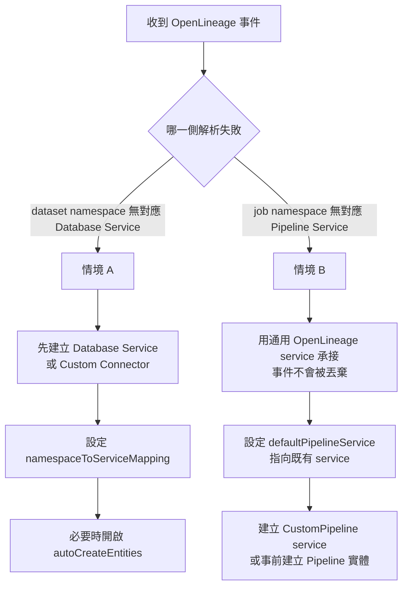

# OpenMetadata 接收 OpenLineage Event 時，遇到「尚未支援的 Service」該怎麼辦？

## 摘要

OpenMetadata 在接收 OpenLineage 事件時，確實需要把事件中的 namespace 映射到特定 Service。但這個映射不是單一步驟：它同時涉及**兩種不同的 namespace**（dataset namespace 與 job namespace），以及**兩條行為差異極大的 ingestion 路徑**（Python 批次連接器、伺服器端 HTTP API）。因此「該 Service 尚未被支援」必須先拆解為「是哪一側的 Service 尚未被支援」，才能決定對策[^settings][^connector-doc]。

本文先釐清 OpenLineage 的命名慣例與 OpenMetadata 的解析邏輯，再分別針對「資料源（Database Service）未支援」與「編排器／工作類型（Pipeline Service）未支援」兩種情境整理可操作的做法，並以決策流程圖與設定範例說明。

---

## 1. 背景：OpenLineage 是格式，不是編排器

OpenLineage 是一套用於資料血緣（data lineage）蒐集與分析的開放框架。其核心是一份可延伸的規格，讓不同系統以一致格式互通血緣中繼資料；除規格本身外，它也提供多種整合，從 Apache Airflow、Apache Spark 等系統蒐集血緣[^connector-doc]。

關鍵認知是：**OpenLineage 是「格式」，不是「編排器」**。任何能產生 OpenLineage 事件的系統都能被接收，不需要 OpenMetadata 事先「支援」那個工具。OpenMetadata 官方 issue 就明確指出：

> OpenLineage is a metadata format, not a pipeline orchestrator. But it's modeled as its own pipelineServiceType, so all ingested pipelines land under a single generic "OpenLineage" service even though the events carry the actual integration identity.[^issue-26734]

換言之，「是否支援某個 service」在 OpenLineage 情境下會轉變成兩個更精確的問題：

1. 事件的 **dataset namespace** 所指向的資料儲存，在 OpenMetadata 中是否已有對應的 **Database Service**？
2. 事件的 **job namespace** 所代表的工作／編排器，要落在哪個 **Pipeline Service**？

---

## 2. 名詞釐清：兩種 namespace，兩種 Service

OpenMetadata 的 OpenLineage 整合裡，「namespace 映射到 service」實際上包含兩條彼此獨立的管線，官方設定檔對兩者的描述完全不同[^settings][^conn-vs]。

| 面向 | Dataset namespace | Job namespace |
| --- | --- | --- |
| 事件中的位置 | `inputs[].namespace` / `outputs[].namespace` | `job.namespace`，或 `run.facets.parent.job.namespace` |
| 典型值 | `mysql://host:3306/db`、`s3://bucket` | `mynamespace`、`airflow`、`databricks_spark` |
| 對應的 OpenMetadata Service | **Database Service**（或 Storage 的 Container） | **Pipeline Service** |
| 主要解析設定 | `namespaceToServiceMapping` | `defaultPipelineService` 與 `job.facets.jobType.integration` |
| 是否會自動建立實體 | 可（需 `autoCreateEntities` 且 namespace 已映射） | 依路徑而異（見第 5 節） |

官方 schema 對 `namespaceToServiceMapping` 的定義：

> Mapping of OpenLineage **dataset** namespaces to OpenMetadata **Database Service** names, matched exactly and then by the longest namespace prefix.[^settings]

`defaultPipelineService` 的定義：

> Name of the Pipeline Service searched for the Pipeline of an OpenLineage job, named '`<namespace>-<job name>`'. Pipelines are never created from OpenLineage events; a job without one is reported in the response and its edges carry no pipeline.[^settings]

由此可見：**`namespaceToServiceMapping` 只處理 dataset（要落到 Database Service）；job 的 namespace 走另一套邏輯。** 混用兩者是最常見的誤解。

---

## 3. OpenLineage 的命名慣例

OpenLineage 官方規格定義，dataset 由 producer、namespace、database 與（選用的）schema 組成，namespace 承載資料儲存類型[^naming]：

| 資料儲存類型 | Namespace | Name |
| --- | --- | --- |
| MySQL | `mysql://{host}:{port}` | `{database}.{table}` |
| Postgres | `postgres://{host}:{port}` | `{database}.{schema}.{table}` |
| Snowflake | `snowflake://{organization}-{account}` | `{database}.{schema}.{table}` |
| AWS Glue Data Catalog | `arn:aws:glue:{region}:{account id}` | `table/{database}/{table}` |
| S3 | `s3://{bucket}` | `{object key}` |
| Kafka | `kafka://{bootstrap host}:{port}` | `{topic}` |

Job 由 **job namespace** 與 **job name** 組成，job name 在其 namespace 內唯一，namespace 通常由 OpenLineage client 設定[^naming]。此外每個事件會在 `job.facets.jobType` 中攜帶整合身分[^jobtype]：

- `processingType`：`BATCH`、`STREAMING`、`SERVICE`
- `integration`：`SPARK`、`DBT`、`AIRFLOW`、`FLINK` 等
- `jobType`：`QUERY`、`COMMAND`、`DAG`、`TASK`、`JOB`、`MODEL` 等

`integration` 正是 OpenMetadata 用來判斷「這筆 job 應歸到哪種 Pipeline Service」的關鍵欄位。

---

## 4. OpenMetadata 的兩條 ingestion 路徑



### 4.1 Python 批次連接器（Kafka / Kinesis）

使用者需建立一個 OpenLineage 類型的 Pipeline Service，並以 `brokerConfig` 指定 Kafka 或 Kinesis。連接器消費事件，並可在必要時 **建立 Pipeline Service 與 Pipeline**[^connector-doc][^conn-vs]。安裝方式為 `openmetadata-ingestion[openlineage]`[^yaml-doc]。

### 4.2 伺服器端 HTTP API

新版 Spark 整合（`io.openlineage:openlineage-spark` listener）可直接以 HTTP transport 將事件送往 `POST /api/v1/openlineage/lineage`[^spark-lineage]。其行為定義為：

> Process a single OpenLineage RunEvent and create lineage edges in OpenMetadata. Only COMPLETE events are processed by default. Datasets that cannot be resolved, or created under a mapped service, are listed in unresolvedDatasets.[^resource]

另有批次端點 `POST /api/v1/openlineage/lineage/batch`。此路徑最關鍵的限制是：

> Pipelines are never created: a job knows too little to describe one, so an unknown job is reported and its edges are written without a pipeline.[^resolver]

---

## 5. Job namespace → Pipeline Service 的解析邏輯

### 5.1 Python 批次連接器：三段式解析

`_resolve_pipeline_service` 依序嘗試三種解析[^metadata-py][^service-resolver]：

1. **Namespace fallback**：先以 `namespace.jobName` 當 pipeline FQN 查詢。若已存在（例如由原生 Airflow connector 匯入），直接沿用其 service，避免重複建立。
2. **Integration type**：從 `job.facets.jobType.integration` 取整合類型，對應到具型別的 service。
3. **Default**：退回使用者設定的 OpenLineage service。

第 2 步的對照表[^service-resolver]：

```python
INTEGRATION_TO_SERVICE_TYPE = {
    "spark":   PipelineServiceType.Spark,
    "flink":   PipelineServiceType.Flink,
    "airflow": PipelineServiceType.Airflow,
    "dbt":     PipelineServiceType.DBTCloud,
    "dagster": PipelineServiceType.Dagster,
}
SERVICE_NAME_SUFFIX = "_openlineage"
```

亦即 Spark job 歸到 `spark_openlineage`、Flink 歸到 `flink_openlineage`，依此類推。這是 2026 年 4 月由 issue #26734 與 PR #26821 引入的行為[^issue-26734][^pr-26821]。

### 5.2 伺服器端 API：只查找，不建立

`OpenLineageEntityResolver.resolvePipeline` 的註解寫得很清楚：pipeline 從不建立，找不到就回報，血緣邊仍會寫入，只是不帶 pipeline 參照[^resolver]。它搜尋的 FQN 是：

```text
defaultPipelineService + "." + "<namespace>-<job name>"
```

pipeline 名稱由 `buildPipelineName` 產生（把 namespace 中非英數字元換成 `_` 後接 job name）；若找不到，會再退一步嘗試原始字串 `namespace + "." + name`[^resolver]。`defaultPipelineService` 預設為 `"openlineage"`[^settings][^resource]。

### 5.3 找不到時的結果

| 情境 | Python 連接器 | 伺服器端 API |
| --- | --- | --- |
| integration 已知（spark/flink/airflow/dbt/dagster） | 建立／沿用 `{integration}_openlineage` service | 不適用（API 不做 integration 對應） |
| integration 未知 | 退回使用者設定的 OpenLineage service | 不適用 |
| 找不到對應 pipeline | 建立 pipeline | 回報 `pipelineNotFound`，血緣邊照寫 |

在 API 路徑上，**Pipeline Service 與 Pipeline 實體都必須事先存在**，否則事件的 job 只會被列在 `unresolvedJobs`[^response][^resource]。

---

## 6. Dataset namespace → Database Service 的解析邏輯

Dataset 這一側才是 `namespaceToServiceMapping` 真正作用的地方。Python 連接器的解析順序[^metadata-py][^table-resolver]：

1. 查 `namespaceToServiceMapping`（先精確比對，再取最長前綴）。
2. 從 namespace 取出 URL scheme，依 scheme 過濾對應型別的 DB service。恰好一個就用它；多個則警告並全部回傳。
3. 都失敗時，退回使用者設定的 `dbServiceNames` 逐一搜尋。

Scheme 對照表涵蓋 `awsathena`、`bigquery`、`cassandra`、`db2`、`hive`、`mssql`、`mysql`、`oracle`、`postgres`、`redshift`、`snowflake`、`sqlserver`（對應 Synapse）、`teradata`、`trino`[^table-resolver]。

伺服器端的比對語意則明確定義於 `OpenLineageNamespaceMapping`：

> A namespace matches an exact key first, then the longest key it starts with, so the answer never depends on map iteration order. Creating entities hangs off this mapping, so a namespace nobody mapped never resolves to a service by guesswork.[^namespace-mapping]

這段話是理解整題的核心：**「建立實體」掛在映射之上；沒有被映射的 namespace 永遠不會靠猜測解析到任何 service。**

---

## 7. 當 Service 尚未被支援時：三種情境與對策



### 情境 A：資料源（Database Service）尚未被支援

dataset 事件指向的資料庫在 OpenMetadata 中沒有對應 service，血緣邊無法落地。可行做法：

1. **先建立對應的 Database Service**。只要 OpenMetadata 有該資料庫型別的 connector，先匯入一次，讓 service 與 table 實體存在。
2. **設定 `namespaceToServiceMapping`**，把 dataset namespace（或其前綴）指向剛建立的 service，例如 `"postgresql://prod-db:5432" -> "prod-postgres"`[^settings]。
3. **視需要開啟 `autoCreateEntities`**。OpenMetadata 會在事件攜帶 schema facet（欄位）時，自動建立缺少的 Table、Database 與 Database Schema[^settings][^creator]。但 schema 明確規定 **Pipelines are never created.**[^settings]
4. **若連 connector 都沒有**：使用 **Custom Connector**。官方文件說明 Custom Connector 是一個繼承 `Source` 的 Python 類別，可用於尚未被支援的來源，且「the process is the same for Pipelines, Dashboard or Messaging services」[^custom-conn]。`customPipelineConnection.json` 的說明更直接：**"Custom Pipeline Service connection to build a source that is not supported by OpenMetadata yet."**[^custom-conn-json]
5. **或走 REST API 直接建立**：`PUT /api/v1/services/databaseServices`、`POST /api/v1/pipelines` 等端點可繞過 ingestion agent[^api-pipeline]。

若 namespace 沒有被映射，伺服器端會回報明確原因[^resolver][^response]：

```text
NAMESPACE_NOT_MAPPED:
"No matching table exists, and namespace '<ns>' has no
 namespaceToServiceMapping entry to create one under"
```

這正是「未支援」在 API 回應中的具體表現。

### 情境 B：工作／編排器（Pipeline Service）尚未被支援

這是使用者問題中最貼近的情境：想透過 OpenLineage 追蹤的對象（例如自製編排器或尚未被支援的工具）不是 OpenMetadata 認得的 service type。可行做法：

1. **仍用通用 OpenLineage service 接收**。Python 連接器在 integration 無法辨識時，會退回使用者設定的 OpenLineage service；伺服器端則以 `defaultPipelineService` 為落點。也就是說，**事件不會因為「不支援」而被丟棄**，只是歸類較泛[^service-resolver][^settings]。
2. **用 `defaultPipelineService` 指定到既有的 pipeline service**。Spark 官方文件明確說：

   > Set `spark.openlineage.namespace` to the OpenLineage job namespace... **This is not the pipeline service name.** ... To group these jobs under a specific service, set `defaultPipelineService` to an existing pipeline service rather than changing the namespace.[^spark-lineage]

3. **建立 `CustomPipeline` 類型的 service** 作為該工具的容器。`PipelineServiceType` 列舉本身即包含 `CustomPipeline`[^pipeline-service-json]，範例程式 `custom_pipeline.py` 展示了以 `CustomPipeline` 建立 service、pipeline 與 task 的完整流程[^custom-pipeline-example]。
4. **事先建立 Pipeline 實體**（僅 API 路徑需要）。因為 API 路徑「never creates pipelines」，未知的 job 只會回報 `pipelineNotFound`，血緣邊仍寫入但不帶 pipeline[^resolver][^response]。
5. **若要一級公民支援**：依官方「Developing a New Connector」流程貢獻 connector（定義 JSON Schema、開發 ingestion 程式、UI 調整、Java ClassConverter、測試、文件），但官方同時提醒，若只是自家特殊需求，**Custom Connector 才是更合適的選擇**[^custom-conn]。

### 情境 C：事件本身格式不合規（連解析都失敗）

若 dataset name 不帶 schema（只有單一 token），或只有物件儲存路徑而無對應 Container，伺服器端會回報[^resolver][^response]：

- `unparsableName`：*"A bare table name carries no schema: it only matches an existing table through namespaceToServiceMapping and is never created"*
- `notFound`：*"No container matches this storage path, and containers are never created"*

此時唯一能讓它解析的辦法，仍是補上 `namespaceToServiceMapping` 並確認對應實體存在。

---

## 8. 如何得知「未支援」：回應中的診斷欄位

伺服器端 API 的回應 schema 提供完整的診斷資訊[^response][^resource]：

| 欄位 | 說明 |
| --- | --- |
| `status` | `success`、`partial_success`、`failure` |
| `lineageEdgesCreated` | 實際建立的血緣邊數量 |
| `unresolvedDatasets` | 無法解析或建立的 dataset；**不涉及它們的邊都不會被建立** |
| `unresolvedJobs` | 找不到對應 Pipeline 的 job；其邊仍建立，但不帶 pipeline 參照 |

`UnresolvedReason` 的完整列舉為[^response]：

```text
unparsableName, namespaceNotMapped, serviceNotFound, missingDatabase,
missingSchema, missingColumns, creationDisabled, createNotAllowed,
notFound, invalidEntity, pipelineNotFound
```

其中 `serviceNotFound` 的訊息即為 *"The namespace maps to database service '%s', which does not exist"*[^creator]，直接對應「該 Service 尚未被支援／尚未建立」的情境。

---

## 9. 設定範例

### 9.1 伺服器端 OpenLineage 設定

```json
{
  "enabled": true,
  "autoCreateEntities": true,
  "defaultPipelineService": "openlineage",
  "namespaceToServiceMapping": {
    "postgresql://prod-db:5432": "prod-postgres",
    "mysql://cluster-a:3306": "mysql-cluster-a"
  }
}
```

`autoCreateEntities`、`defaultPipelineService`、`namespaceToServiceMapping` 三者皆為 `OpenLineageSettings` 的欄位，預設值分別是 `true`、`"openlineage"`、空[^settings][^resource]。

### 9.2 連接器端（Python）設定

```yaml
source:
  type: openlineage
  serviceName: my-openlineage
  serviceConnection:
    config:
      type: OpenLineage
      brokerConfig:
        brokersUrl: broker1:9092,broker2:9092
        topicName: openlineage-events
      namespaceToServiceMapping:
        "mysql://cluster-a:3306": mysql-cluster-a
sourceConfig:
  config:
    dbServiceNames:
      - mysql-cluster-a
```

`namespaceToServiceMapping` 亦存在於連接器端的 `OpenLineageConnection` schema[^conn-vs]；`dbServiceNames` 則來自 pipeline 的 source config[^yaml-doc]。

---

## 10. 結論

| 問題 | 答案 |
| --- | --- |
| 事件會不會因為 service 未支援而被丟棄？ | 不會。job 會退回通用 OpenLineage／`defaultPipelineService`；dataset 未解析則進入 `unresolvedDatasets`[^service-resolver][^response] |
| 沒支援的資料庫怎麼辦？ | 建 Database Service 或 Custom Connector，再設 `namespaceToServiceMapping`；必要時開 `autoCreateEntities`[^settings][^custom-conn] |
| 沒支援的編排器怎麼辦？ | 用通用 OpenLineage service 承接，或以 `CustomPipeline` 建立容器；API 路徑需事前建好 Pipeline 實體[^pipeline-service-json][^resolver] |
| 為什麼設了 mapping 還是沒生效？ | 可能把 dataset namespace 的 mapping 誤用於 job namespace，或設定的 service 不在 `dbServiceNames` 內[^metadata-py][^settings] |
| Pipeline 會被自動建立嗎？ | 只有 Python 批次路徑會；伺服器端 API **永不**建立 pipeline[^resolver][^settings] |

核心結論：**OpenLineage 是傳輸格式，不是受支援清單**。OpenMetadata 對未支援 service 的設計是「**優雅降級而非拒絕**」——以通用 service 承接、以 `unresolved*` 欄位回報、並要求操作者以 `namespaceToServiceMapping` 或 Custom Connector 明確補上對應關係，而**不做任何猜測**（"a namespace nobody mapped never resolves to a service by guesswork"）[^namespace-mapping]。

---

## 參考資料

[^connector-doc]: OpenMetadata. (n.d.). *OpenLineage | OpenMetadata Data Lineage Pipeline*. Retrieved 2026-10-13, from https://docs.open-metadata.org/latest/connectors/pipeline/openlineage

[^settings]: OpenMetadata. (n.d.). *openLineageSettings.json*. Retrieved 2026-10-13, from https://github.com/open-metadata/OpenMetadata/blob/main/openmetadata-spec/src/main/resources/json/schema/configuration/openLineageSettings.json

[^conn-vs]: OpenMetadata. (n.d.). *openLineageConnection.json*. Retrieved 2026-10-13, from https://github.com/open-metadata/OpenMetadata/blob/main/openmetadata-spec/src/main/resources/json/schema/entity/services/connections/pipeline/openLineageConnection.json

[^naming]: OpenLineage. (n.d.). *Naming Conventions* (Version 1.54.0). Retrieved 2026-10-13, from https://openlineage.io/docs/spec/naming

[^jobtype]: OpenLineage. (n.d.). *Job type Job Facet* (Version 1.54.0). Retrieved 2026-10-13, from https://openlineage.io/docs/spec/facets/job-facets/job-type

[^resource]: OpenMetadata. (n.d.). *OpenLineageResource.java*. Retrieved 2026-10-13, from https://github.com/open-metadata/OpenMetadata/blob/main/openmetadata-service/src/main/java/org/openmetadata/service/resources/lineage/OpenLineageResource.java

[^resolver]: OpenMetadata. (n.d.). *OpenLineageEntityResolver.java*. Retrieved 2026-10-13, from https://github.com/open-metadata/OpenMetadata/blob/main/openmetadata-service/src/main/java/org/openmetadata/service/openlineage/OpenLineageEntityResolver.java

[^namespace-mapping]: OpenMetadata. (n.d.). *OpenLineageNamespaceMapping.java*. Retrieved 2026-10-13, from https://github.com/open-metadata/OpenMetadata/blob/main/openmetadata-service/src/main/java/org/openmetadata/service/openlineage/OpenLineageNamespaceMapping.java

[^creator]: OpenMetadata. (n.d.). *OpenLineageEntityCreator.java*. Retrieved 2026-10-13, from https://github.com/open-metadata/OpenMetadata/blob/main/openmetadata-service/src/main/java/org/openmetadata/service/openlineage/OpenLineageEntityCreator.java

[^response]: OpenMetadata. (n.d.). *openLineageResponse.json*. Retrieved 2026-10-13, from https://github.com/open-metadata/OpenMetadata/blob/main/openmetadata-spec/src/main/resources/json/schema/api/lineage/openlineage/openLineageResponse.json

[^service-resolver]: OpenMetadata. (n.d.). *service_resolver.py*. Retrieved 2026-10-13, from https://github.com/open-metadata/OpenMetadata/blob/main/ingestion/src/metadata/ingestion/source/pipeline/openlineage/service_resolver.py

[^table-resolver]: OpenMetadata. (n.d.). *table_resolver.py*. Retrieved 2026-10-13, from https://github.com/open-metadata/OpenMetadata/blob/main/ingestion/src/metadata/ingestion/source/pipeline/openlineage/table_resolver.py

[^metadata-py]: OpenMetadata. (n.d.). *metadata.py*. Retrieved 2026-10-13, from https://github.com/open-metadata/OpenMetadata/blob/main/ingestion/src/metadata/ingestion/source/pipeline/openlineage/metadata.py

[^pipeline-service-json]: OpenMetadata. (n.d.). *pipelineService.json*. Retrieved 2026-10-13, from https://github.com/open-metadata/OpenMetadata/blob/main/openmetadata-spec/src/main/resources/json/schema/entity/services/pipelineService.json

[^custom-conn-json]: OpenMetadata. (n.d.). *customPipelineConnection.json*. Retrieved 2026-10-13, from https://github.com/open-metadata/OpenMetadata/blob/main/openmetadata-spec/src/main/resources/json/schema/entity/services/connections/pipeline/customPipelineConnection.json

[^custom-conn]: OpenMetadata. (n.d.). *Custom Connectors | Build & Extend OpenMetadata Easily*. Retrieved 2026-10-13, from https://docs.open-metadata.org/v2.0.x/connectors/custom-connectors

[^custom-pipeline-example]: OpenMetadata. (n.d.). *custom_pipeline.py*. Retrieved 2026-10-13, from https://github.com/open-metadata/OpenMetadata/blob/main/ingestion/tests/integration/custom_connectors/custom_pipeline.py

[^spark-lineage]: OpenMetadata. (n.d.). *Spark Lineage Ingestion*. Retrieved 2026-10-13, from https://docs.open-metadata.org/v2.0.x/connectors/ingestion/lineage/spark-lineage

[^yaml-doc]: OpenMetadata. (n.d.). *Run the OpenLineage Connector Externally*. Retrieved 2026-10-13, from https://docs.open-metadata.org/v2.0.x/connectors/pipeline/openlineage/yaml

[^api-pipeline]: OpenMetadata. (n.d.). *Create a Pipeline* and *Create a Pipeline Service* (API Reference). Retrieved 2026-10-13, from https://docs.open-metadata.org/v2.0.x/api-reference/data-assets/pipelines/create

[^issue-26734]: jsingh-yelp. (2026, March 24). *OpenLineage ingestion should auto-resolve pipeline service type and name from event metadata* (Issue #26734). GitHub. Retrieved 2026-10-13, from https://github.com/open-metadata/OpenMetadata/issues/26734

[^pr-26821]: jsingh-yelp. (2026, March 27). *Fixes 26434: [openlineage] Resolve openlineage pipeline/job to its integration type* (Pull Request #26821). GitHub. Retrieved 2026-10-13, from https://github.com/open-metadata/OpenMetadata/pull/26821

[^repo]: open-metadata. (n.d.). *OpenMetadata* [Repository metadata: 15,469 stars, 2,451 forks, Apache-2.0; latest release 2.0.5 on 2026-10-08]. Retrieved 2026-10-13, from https://github.com/open-metadata/OpenMetadata
