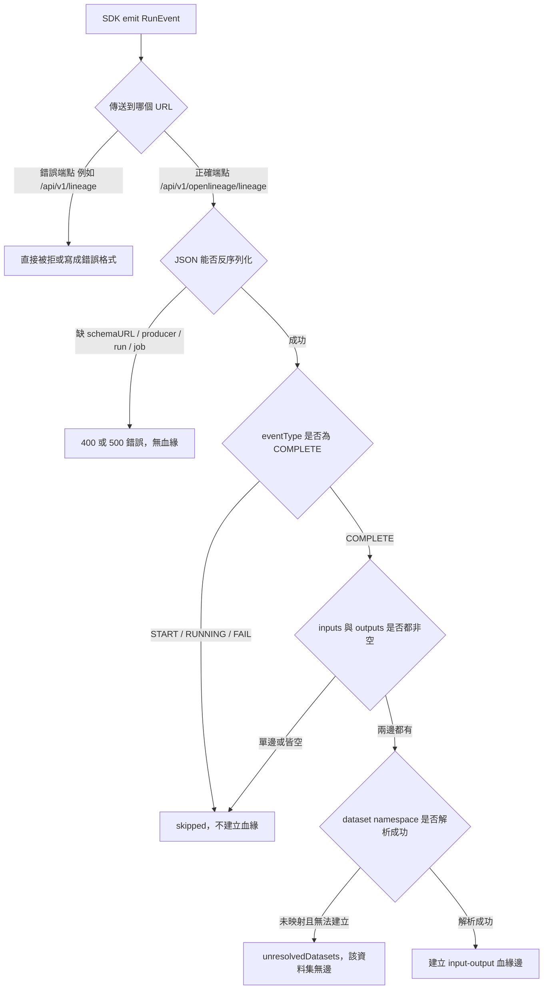
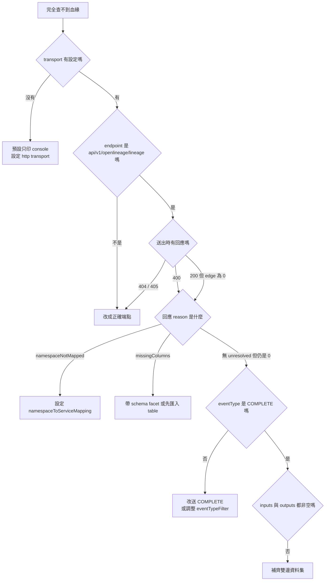

# 用 OpenLineage Python SDK 送 Run 進 OpenMetadata 卻查不到血緣：診斷與排除指南

## 摘要

「OpenMetadata 不會因為 service 未支援而丟棄事件」這個說法，只有在**事件確實被正確的端點接收，且能解析出至少一條 input/output 配對**時才成立。若使用 OpenLineage Python SDK 直接發送事件，最常見的失敗原因其實發生在更早的環節——**事件根本沒有送到 OpenMetadata 的 OpenLineage 端點**，或送到了但因為缺少 `schemaURL`／`producer`、只有單邊資料集、或 namespace 未映射而**沒有任何血緣邊被寫入**[^resource][^mapper][^schema-event]。

本文是一份獨立的疑難排解指南：先說明 OpenMetadata 接收 OpenLineage 事件的完整判定鏈，再逐項列出「送了一堆 Run 卻完全找不到血緣」的可能原因與對應的驗證方法。

---

## 1. 問題陳述

使用者以 OpenLineage Python SDK 發送多筆 RunEvent，但在 OpenMetadata 介面上完全找不到任何血緣紀錄。這種「全有或全無」的症狀，通常不是「某些邊被略過」，而是**整批事件從未進入 OpenMetadata 的血緣管線**。

要定位問題，必須先回答兩個問題：

1. 事件有沒有真的送到 `/api/v1/openlineage/lineage`？
2. 事件即使送到了，有沒有通過「可處理」的條件？

---

## 2. OpenMetadata 接收 OpenLineage 的判定鏈

伺服器端由 `POST /api/v1/openlineage/lineage` 接收單一事件，其描述為[^resource]：

> Process a single OpenLineage RunEvent and create lineage edges in OpenMetadata. Only COMPLETE events are processed by default. Datasets that cannot be resolved, or created under a mapped service, are listed in unresolvedDatasets.

一筆事件從進來到寫入血緣，必須連續通過下列關卡；**任何一關失敗，就可能導致「完全看不到血緣」**：



以下逐一說明每一關。

---

## 3. 失敗點一：送錯端點（最常見）

這是 OpenLineage Python SDK 的**預設行為陷阱**。

OpenLineage Python client 的 HTTP transport 文件寫明[^ol-config]：

> **endpoint** - string specifying the endpoint to which events are sent, appended to url. Optional, **default: api/v1/lineage**.

也就是說，如果你設定的是：

```yaml
transport:
  type: http
  url: http://localhost:8585
```

SDK 會把事件 POST 到 `http://localhost:8585/api/v1/lineage`。而這**不是** OpenMetadata 的 OpenLineage 端點——`/api/v1/lineage` 是 OpenMetadata 原生的血緣資源 `LineageResource`，其新增血緣用的是 **`PUT`**，且請求主體是 `AddLineage` 結構（`fromEntity` / `toEntity` / `lineageDetails`），不是 OpenLineage RunEvent[^lineage-resource]。

正確的端點是 `POST /api/v1/openlineage/lineage`[^resource]。OpenMetadata 官方 Spark 文件亦明確要求設定[^spark-lineage]：

> `spark.openlineage.transport.endpoint` — Set to `/api/v1/openlineage/lineage`, OpenMetadata's native OpenLineage ingestion endpoint.

**正確設定範例**（YAML）：

```yaml
transport:
  type: http
  url: http://localhost:8585
  endpoint: api/v1/openlineage/lineage
  auth:
    type: api_key
    apiKey: <OPENMETADATA_BOT_JWT>
```

或以環境變數[^ol-config]：

```bash
OPENLINEAGE__TRANSPORT__TYPE=http
OPENLINEAGE__TRANSPORT__URL=http://localhost:8585
OPENLINEAGE__TRANSPORT__ENDPOINT=api/v1/openlineage/lineage
OPENLINEAGE__TRANSPORT__AUTH__TYPE=api_key
OPENLINEAGE__TRANSPORT__AUTH__APIKEY=<OPENMETADATA_BOT_JWT>
```

### 3.1 驗證方法

直接確認事件有沒有到正確的端點：

1. 檢視 OpenMetadata 伺服器日誌，確認有無 `Error processing OpenLineage event` 或 405／404 的請求紀錄。
2. 以 `curl` 對正確端點手送一筆最小事件，觀察回應 JSON 的 `status` 欄位。

正確端點的成功回應會包含 `status: success` 與 `lineageEdgesCreated`[^response]；若端點錯誤，通常得到 404 或 405。

---

## 4. 失敗點二：SDK 根本沒有送出事件

若完全沒有設定任何 transport，OpenLineage Python client 的預設行為是**只印到主控台**，不會送到任何後端[^ol-config]：

> **If no configuration is found, ConsoleTransport is used by default, and events are printed to the console.**

這對應到「以為送進去了，其實只印在本地終端機」的情境。此外還有兩個容易忽略的開關[^ol-config]：

- `OPENLINEAGE_DISABLED=true`：完全停用事件發送。
- 設定檔只在**建立 client 時讀取一次**：*"Configuration is read only at client creation time; any changes to configuration environment variables or the configuration file made after a client has been created will have no effect."*

### 4.1 驗證方法

把 transport 暫時改為 `console`，或改用 `composite` 同時送往 console 與 OpenMetadata，確認事件確實有被產生：

```yaml
transport:
  type: composite
  transports:
    first:
      type: console
    second:
      type: http
      url: http://localhost:8585
      endpoint: api/v1/openlineage/lineage
      auth:
        type: api_key
        apiKey: <OPENMETADATA_BOT_JWT>
```

---

## 5. 失敗點三：事件缺少必要欄位

OpenMetadata 的 `OpenLineageRunEvent` schema 明確要求五個欄位[^schema-event]：

> `required`: `["eventTime", "producer", "schemaURL", "run", "job"]`

且根物件設有 `additionalProperties: false`。其中 **`schemaURL` 是最容易漏掉的欄位**：OpenLineage SDK 的 `RunEvent` 物件本身帶有 `schemaURL`，但若使用者以手工組 JSON、或使用 `event_v2` 之外的封裝，就可能遺漏。

`run` 物件亦有要求[^schema-event]：

> `openLineageRun`: `required`: `["runId"]`

`job` 物件要求[^schema-event]：

> `openLineageJob`: `required`: `["namespace", "name"]`

若這些欄位缺失或型別不符，請求會在反序列化階段失敗，回應為 `status: failure` 或 HTTP 500，且**不會寫入任何血緣**[^resource]。

### 5.1 驗證方法

先送一筆最小但完整的事件，確認格式正確：

```json
{
  "eventTime": "2026-10-13T00:00:00Z",
  "producer": "https://github.com/my-org/my-emitter",
  "schemaURL": "https://openlineage.io/spec/2-0-2/OpenLineage.json#/$defs/RunEvent",
  "eventType": "COMPLETE",
  "run": { "runId": "00000000-0000-0000-0000-000000000001" },
  "job": { "namespace": "my_namespace", "name": "my_job" },
  "inputs":  [ { "namespace": "postgres://prod-db:5432", "name": "public.orders" } ],
  "outputs": [ { "namespace": "postgres://prod-db:5432", "name": "public.orders_agg" } ]
}
```

注意 `schemaURL` 必須是合法的 URI 格式（schema 標記為 `format: uri`）[^schema-event]。

---

## 6. 失敗點四：只有 START，沒有 COMPLETE

OpenMetadata 預設**只處理 `COMPLETE` 事件**[^mapper][^settings]。`OpenLineageMapper` 的判定邏輯是：

```java
if (settings != null && settings.getEventTypeFilter() != null && !settings.getEventTypeFilter().isEmpty()) {
    this.allowedEventTypes = settings.getEventTypeFilter().stream() ... ;
} else {
    this.allowedEventTypes = Set.of("COMPLETE");
}
```

而事件類型不符時會被標記為 skipped，不產生任何血緣[^mapper]：

> `LOG.debug("Skipping OpenLineage event: filtered event type, or no inputs or outputs");`

OpenLineage 的標準用法會為同一 run 發出 `START` 與 `COMPLETE` 兩個事件[^ol-usage]。**血緣資訊通常在 `COMPLETE` 上**，因為只有完成時才確定輸出資料集。

此外，若使用 **Async HTTP transport**，還有額外的排序限制[^ol-config]：

> Events are queued for processing (START events immediately, other events wait until corresponding START event is send)

若只發 `COMPLETE` 而沒有先發對應的 `START`，該 `COMPLETE` 會**一直卡在佇列中**，永遠不會被送出[^ol-config]。同步的 `http` transport 沒有此限制。

### 6.1 驗證方法

- 確認你送的是 `eventType: COMPLETE`。
- 若要放寬，可調整 OpenMetadata 的 `eventTypeFilter` 設定[^settings]：

```json
{
  "eventTypeFilter": ["START", "RUNNING", "COMPLETE"],
  "enabled": true
}
```

- 若使用 `async_http`，務必先送 `START` 再送 `COMPLETE`；或改用同步 `http`。

---

## 7. 失敗點五：inputs 或 outputs 為空

`OpenLineageMapper.isProcessable` 要求 `inputs` 與 `outputs` **兩者都非空**[^mapper]：

> `!nullOrEmpty(event.getInputs()) && !nullOrEmpty(event.getOutputs())`

也就是說：

- 只帶 `inputs`（純讀取）→ 不建立血緣。
- 只帶 `outputs`（純寫入）→ 不建立血緣。
- 兩者皆空 → 不建立血緣。

這與 Python 批次連接器不同。批次連接器支援**單邊事件**，會建立 pipeline-as-node 的邊[^metadata-py]；但**伺服器端 HTTP API 不支援**。若你的 emitter 習慣只送單邊，事件會被靜默略過。

### 7.1 驗證方法

確認事件同時帶有 `inputs` 與 `outputs`，且各自至少一個資料集。

---

## 8. 失敗點六：資料集 namespace 未映射，無法解析

即使事件通過前述所有關卡，**dataset 仍必須解析到 OpenMetadata 中既有的 Table**，否則不會有邊。這正是後續章節要處理的核心。

伺服器端的解析嚴格禁止猜測[^namespace-mapping]：

> A namespace matches an exact key first, then the longest key it starts with, so the answer never depends on map iteration order. Creating entities hangs off this mapping, so a namespace nobody mapped never resolves to a service by guesswork.

當找不到對應 table，且 namespace 沒有映射時，回應為[^resolver]：

```text
NAMESPACE_NOT_MAPPED:
"No matching table exists, and namespace '<ns>' has no
 namespaceToServiceMapping entry to create one under"
```

`resolveDatasets` 對無法解析的資料集只把它放進 `unresolvedDatasets`，**不建立任何觸及它的邊**[^mapper][^response]。

**關鍵推論**：如果事件中的所有 dataset 都解析失敗，則 `lineageEdgesCreated` 為 0；若 `status` 變成 `failure`，回應即為 HTTP 400[^resource][^response]。這就是「完全查不到血緣」的最直接解釋。

### 8.1 兩條能讓 dataset 解析成功的路

**路 A：資料集已存在**

先在 OpenMetadata 中把該資料庫匯入（建立 Database Service 與 Table），再把 namespace 映射過去[^settings]：

```json
{
  "namespaceToServiceMapping": {
    "postgres://prod-db:5432": "prod-postgres"
  }
}
```

**路 B：自動建立（需滿足多個條件）**

開啟 `autoCreateEntities` 後，OpenMetadata 可自動建立 Table、Database 與 Database Schema，但條件嚴格[^settings][^creator]：

> Create a Table that an OpenLineage event references but OpenMetadata lacks, along with its missing Database and Database Schema, **when the dataset namespace maps to a Database Service through namespaceToServiceMapping and the event carries the table's columns in its schema facet.**

也就是必須同時滿足：

1. `autoCreateEntities` 為 `true`（預設即為 true）[^settings]。
2. namespace **有** `namespaceToServiceMapping` 條目。
3. 該映射指向的 Database Service **存在**（否則 `serviceNotFound`）[^creator]。
4. 事件攜帶該 table 的 **schema facet（欄位）**（否則 `missingColumns`）[^creator]。

`OpenLineageEntityCreator.createTable` 的邏輯[^creator]：

```java
if (columns.isEmpty()) {
    result = unresolved(MISSING_COLUMNS,
        "No matching table exists and the event carries no schema facet fields to create one with");
}
```

**這是「送了一堆 Run 卻沒有血緣」的第二常見原因**：事件帶的 dataset 在 OpenMetadata 中不存在，又沒有 schema facet，因此既找不到、也建不出來。

### 8.2 驗證方法

檢查回應中的 `unresolvedDatasets`，每一筆都會帶 `reason` 與 `message`[^response]。常見 reason 對照：

| reason | 意義 | 對策 |
| --- | --- | --- |
| `namespaceNotMapped` | namespace 無映射條目 | 補 `namespaceToServiceMapping` |
| `serviceNotFound` | 映射指向的 service 不存在 | 先建立該 Database Service |
| `missingColumns` | 事件無 schema facet | 讓 emitter 帶 `schema` facet，或先匯入 table |
| `creationDisabled` | `autoCreateEntities` 為 false | 開啟或事先建 table |
| `unparsableName` | dataset name 無 schema（裸 token） | 補映射並確認 table 存在 |
| `notFound` | 無對應 container | 確認 Storage Service 已匯入 |

---

## 9. 快速診斷清單



依序檢查：

1. **transport 是否設定？** 未設定 → 只印 console[^ol-config]。
2. **endpoint 是否為 `api/v1/openlineage/lineage`？** SDK 預設是 `api/v1/lineage`[^ol-config]，兩者不同。
3. **有帶 JWT 嗎？** 端點需要 `EDIT_LINEAGE` 權限[^resource]。
4. **`schemaURL`、`producer`、`run.runId`、`job.namespace`、`job.name` 是否齊全？**[^schema-event]
5. **`eventType` 是否為 `COMPLETE`？**[^mapper]
6. **`inputs` 與 `outputs` 是否都非空？**[^mapper]
7. **回應的 `unresolvedDatasets` 說了什麼？**[^response]
8. **`namespaceToServiceMapping` 是否設定，且指向的 service 存在？**[^settings][^creator]

---

## 10. 完整可用的發送範例

以下以 `openlineage-python` 送出一個能被 OpenMetadata 接受的 `COMPLETE` 事件。

```python
from datetime import datetime, timezone

from openlineage.client import OpenLineageClient
from openlineage.client.event_v2 import (
    Dataset, InputDataset, Job, OutputDataset, Run, RunEvent, RunState,
)
from openlineage.client.facet_v2 import schema_dataset
from openlineage.client.uuid import generate_new_uuid

PRODUCER = "https://github.com/my-org/my-emitter"

# endpoint 必須是 OpenMetadata 的 OpenLineage 端點，不是 SDK 的預設值
client = OpenLineageClient(config={
    "transport": {
        "type": "http",
        "url": "http://localhost:8585",
        "endpoint": "api/v1/openlineage/lineage",
        "auth": {"type": "api_key", "apiKey": "<OPENMETADATA_BOT_JWT>"},
    }
})

# namespace 必須與 namespaceToServiceMapping 的鍵一致
namespace = "postgres://prod-db:5432"

orders = InputDataset(
    namespace=namespace,
    name="public.orders",
)
orders_agg = OutputDataset(
    namespace=namespace,
    name="public.orders_agg",
    # 若 table 尚未匯入，schema facet 是自動建立的必要條件
    facets={
        "schema": schema_dataset.SchemaDatasetFacet(fields=[
            schema_dataset.SchemaDatasetFacetFields(name="customer_id", type="BIGINT"),
            schema_dataset.SchemaDatasetFacetFields(name="total", type="DOUBLE"),
        ]),
    },
)

job = Job(namespace="my_namespace", name="daily_orders_agg")
run = Run(runId=str(generate_new_uuid()))

# 先 START
client.emit(RunEvent(
    eventType=RunState.START,
    eventTime=datetime.now(timezone.utc).isoformat(),
    run=run, job=job, producer=PRODUCER,
))

# 再 COMPLETE（血緣在此建立）
client.emit(RunEvent(
    eventType=RunState.COMPLETE,
    eventTime=datetime.now(timezone.utc).isoformat(),
    run=run, job=job, producer=PRODUCER,
    inputs=[orders], outputs=[orders_agg],
))
```

對應的伺服器端設定：

```json
{
  "enabled": true,
  "autoCreateEntities": true,
  "eventTypeFilter": ["COMPLETE"],
  "defaultPipelineService": "openlineage",
  "namespaceToServiceMapping": {
    "postgres://prod-db:5432": "prod-postgres"
  }
}
```

並確保 `prod-postgres` 這個 Database Service 已存在[^creator]。

---

## 11. 結論

| 症狀 | 最可能原因 | 驗證方式 |
| --- | --- | --- |
| 完全沒有任何請求紀錄 | SDK 未設定 transport，只印 console[^ol-config] | 改 `console` 或 `composite` 觀察 |
| 請求得到 404／405 | 端點用了 SDK 預設的 `api/v1/lineage`[^ol-config] | 改為 `api/v1/openlineage/lineage` |
| 請求得到 400 或 500 | 缺少 `schemaURL`／`producer` 等必填欄位[^schema-event] | 對照必填清單 |
| 回應 200 但 `lineageEdgesCreated` 為 0 且無 `unresolved` | `eventType` 非 `COMPLETE`，或 `inputs`／`outputs` 有其一為空[^mapper] | 檢查事件內容 |
| 回應列出 `unresolvedDatasets` | namespace 未映射，或 table 不存在且無 schema facet[^resolver][^creator] | 設定 `namespaceToServiceMapping` |
| `async_http` 送出後毫無動靜 | 沒先送 `START`，`COMPLETE` 卡在佇列[^ol-config] | 補送 `START` 或改用同步 `http` |

**核心結論**：「不支援的 service 不會讓事件消失」這句話只適用於 *job（Pipeline）* 這一側。**dataset 這一側若解析失敗，血緣邊確實不會被建立**；而更上游的「端點錯誤」與「必填欄位缺失」則會讓事件從未進入 OpenMetadata。診斷時務必從最上游的 transport 與 endpoint 開始檢查，而非直接懷疑 namespace 映射[^resource][^ol-config][^mapper]。

---

## 參考資料

[^resource]: OpenMetadata. (n.d.). *OpenLineageResource.java*. Retrieved 2026-10-13, from https://github.com/open-metadata/OpenMetadata/blob/main/openmetadata-service/src/main/java/org/openmetadata/service/resources/lineage/OpenLineageResource.java

[^mapper]: OpenMetadata. (n.d.). *OpenLineageMapper.java*. Retrieved 2026-10-13, from https://github.com/open-metadata/OpenMetadata/blob/main/openmetadata-service/src/main/java/org/openmetadata/service/openlineage/OpenLineageMapper.java

[^resolver]: OpenMetadata. (n.d.). *OpenLineageEntityResolver.java*. Retrieved 2026-10-13, from https://github.com/open-metadata/OpenMetadata/blob/main/openmetadata-service/src/main/java/org/openmetadata/service/openlineage/OpenLineageEntityResolver.java

[^creator]: OpenMetadata. (n.d.). *OpenLineageEntityCreator.java*. Retrieved 2026-10-13, from https://github.com/open-metadata/OpenMetadata/blob/main/openmetadata-service/src/main/java/org/openmetadata/service/openlineage/OpenLineageEntityCreator.java

[^namespace-mapping]: OpenMetadata. (n.d.). *OpenLineageNamespaceMapping.java*. Retrieved 2026-10-13, from https://github.com/open-metadata/OpenMetadata/blob/main/openmetadata-service/src/main/java/org/openmetadata/service/openlineage/OpenLineageNamespaceMapping.java

[^settings]: OpenMetadata. (n.d.). *openLineageSettings.json*. Retrieved 2026-10-13, from https://github.com/open-metadata/OpenMetadata/blob/main/openmetadata-spec/src/main/resources/json/schema/configuration/openLineageSettings.json

[^schema-event]: OpenMetadata. (n.d.). *openLineageRunEvent.json*. Retrieved 2026-10-13, from https://github.com/open-metadata/OpenMetadata/blob/main/openmetadata-spec/src/main/resources/json/schema/api/lineage/openlineage/openLineageRunEvent.json

[^schema-facets]: OpenMetadata. (n.d.). *openLineageFacets.json*. Retrieved 2026-10-13, from https://github.com/open-metadata/OpenMetadata/blob/main/openmetadata-spec/src/main/resources/json/schema/api/lineage/openlineage/openLineageFacets.json

[^response]: OpenMetadata. (n.d.). *openLineageResponse.json*. Retrieved 2026-10-13, from https://github.com/open-metadata/OpenMetadata/blob/main/openmetadata-spec/src/main/resources/json/schema/api/lineage/openlineage/openLineageResponse.json

[^lineage-resource]: OpenMetadata. (n.d.). *LineageResource.java*. Retrieved 2026-10-13, from https://github.com/open-metadata/OpenMetadata/blob/main/openmetadata-service/src/main/java/org/openmetadata/service/resources/lineage/LineageResource.java

[^metadata-py]: OpenMetadata. (n.d.). *metadata.py*. Retrieved 2026-10-13, from https://github.com/open-metadata/OpenMetadata/blob/main/ingestion/src/metadata/ingestion/source/pipeline/openlineage/metadata.py

[^spark-lineage]: OpenMetadata. (n.d.). *Spark Lineage Ingestion*. Retrieved 2026-10-13, from https://docs.open-metadata.org/v2.0.x/connectors/ingestion/lineage/spark-lineage

[^ol-config]: OpenLineage. (n.d.). *Configuration* (Version 1.54.0). Retrieved 2026-10-13, from https://openlineage.io/docs/client/python/configuration

[^ol-usage]: OpenLineage. (n.d.). *Usage Example* (Version 1.54.0). Retrieved 2026-10-13, from https://openlineage.io/docs/client/python/usage

[^naming]: OpenLineage. (n.d.). *Naming Conventions* (Version 1.54.0). Retrieved 2026-10-13, from https://openlineage.io/docs/spec/naming
