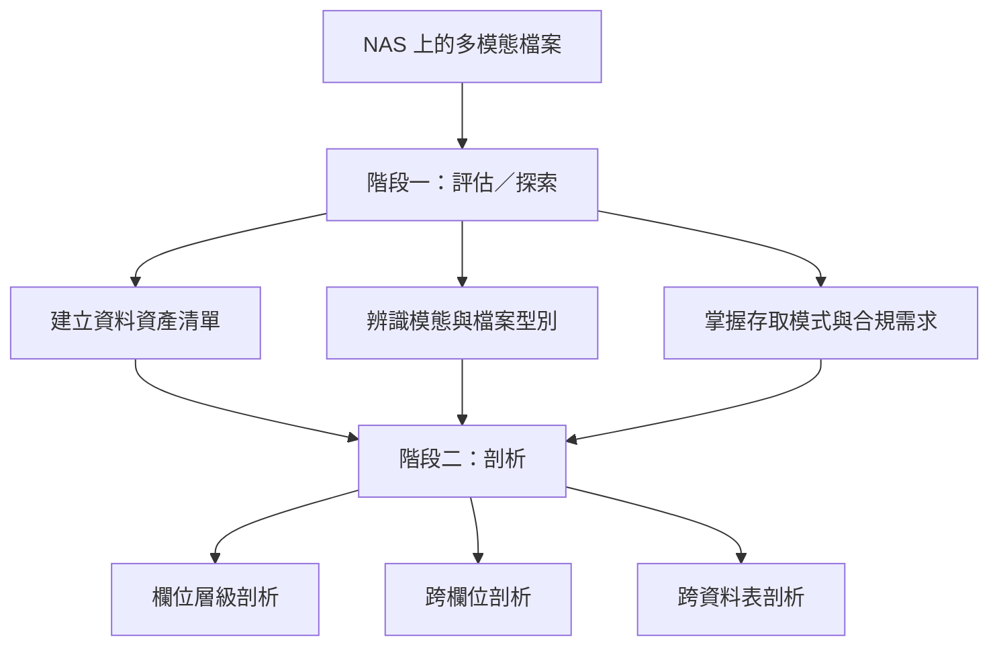
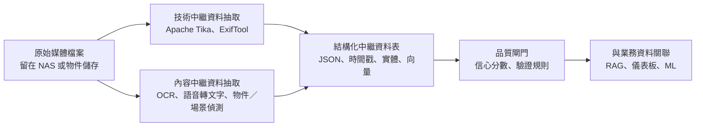
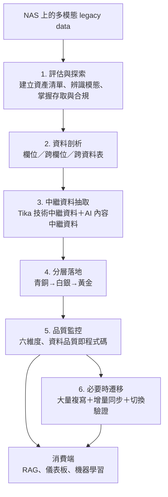

# 如何在 Data Project 中分析 Legacy Data：以 NAS 上堆積的多模態資料為例

## 摘要

企業在推動資料專案 (Data Project) 時，常會遇到一類棘手情境：多年累積在網路附加儲存 (NAS, Network Attached Storage) 上的「遺留資料」(legacy data)，內容混雜了圖片、影音、音訊、文件、試算表等多種模態 (multimodal)。這類資料既沒有統一結構，也缺乏可靠的中繼資料 (metadata)，往往被視為「資料沼澤」(data swamp) 而難以運用。本報告整理雲端廠商與資料治理實務的公開指引，說明一套可操作的分析流程：先盤點與剖析、再抽取多模態中繼資料、以分層湖倉架構落地、最後以品質維度持續監控。報告預設讀者沒有任何背景知識，所有需要的上下文都收錄於本文之中。

---

## 一、問題的定義：什麼是 legacy data 與多模態資料

在資料工程的語境中，legacy data 指的是「存在於舊系統、舊格式、或舊儲存位置上，尚未被整合進現代資料平台」的資料。它通常具有以下特徵：格式不統一、缺乏檔案層級的描述性中繼資料、產生年代橫跨許多年、且與現行業務系統脫鉤。

而「多模態資料」(multimodal data) 指的是同時存在多種資料型態的資料集合，例如文字、圖像、音訊、視訊與感測器訊號。IBM 將多模態 AI 定義為能同時處理並整合多種模態的系統，並指出其整合時會面臨表徵 (representation)、對齊 (alignment，含時間與空間對齊) 與推理 (reasoning) 等挑戰[^ibmmultimodal]。企業資料中約九成屬於非結構化或半結構化資料，例如文字、圖像、音訊、視訊與物聯網感測資料，這些資料通常存放在檔案系統、NoSQL 資料庫或資料湖中[^ibmunstructured]。

NAS 正是這類資料最典型的落腳處。NAS 讓多台伺服器或使用者透過網路檔案系統 (NFS)、通用網際網路檔案系統 (CIFS) 或伺服器訊息區塊 (SMB) 等協定共用檔案，這使得它成為跨部門、跨年份堆積檔案的自然場所[^awssfs]。問題在於：NAS 提供的只是「檔案層級」的視野，它知道檔名、大小與時間戳，卻不理解檔案內容。要在 Data Project 中運用這些資料，就必須把「檔案」轉譯成「可查詢、可治理的資料資產」。

---

## 二、核心心法：先盤點，後分析

在所有技術手段之前，最重要的是心態與順序。資料治理實務反覆強調一個原則：**你無法治理你不理解的東西**。資料剖析 (data profiling) 應在建立品質規則、設計資料模型、以及遷移遺留系統之前完成，因為它提供的是「實證基礎」而非「文件假設」[^governor]。

對 NAS 這種無結構的儲存而言，這個原則更具體化為兩個動作：

1. **資料探索 (data discovery)**：從多個分散來源蒐集、評估並檢視資料，找出被埋沒或孤島化的資料，並在進行分析前先確認其特徵、格式、血緣 (lineage) 與品質[^ibmdiscovery]。
2. **資料剖析 (data profiling)**：以統計方式描述資料實際長什麼樣子，而非它「應該」長什麼樣子。它回答的是「這份資料裡實際有什麼、以什麼頻率與樣式出現、有哪些異常」，屬於描述性工作，不做判斷與轉換[^governor]。

換言之，剖析是「功課」，品質規則是後續才依據功課結果訂出的「標準」。若跳過剖析，直接依需求文件建立規則，往往會建立在過時或錯誤的假設上而失敗[^governor]。

---

## 三、步驟一：建立資料資產清單 (Assessment / Discovery)

微軟在其非結構化資料遷移指引中，把整個流程拆為評估 (assessment)、目標選擇、規劃、工具選擇、執行等階段，並指出評估階段的核心是建立一份**涵蓋所有資料資產與來源的目錄或清單**，同時要辨識與理解資料型態與存取模式、了解可靠性與效能需求、評估複寫與變更率、以及釐清安全與合規要求[^msmigration]。

對 NAS 多模態資料而言，一份可用的清單至少應記錄：

| 項目 | 說明 |
| --- | --- |
| 檔案路徑與大小 | 檔案在 NAS 上的位置與容量 |
| 模態／檔案型別 | 影像、視訊、音訊、PDF、Office 文件等 |
| 建立與修改時間 | 用於判斷資料新鮮度與生命週期 |
| 擁有者與存取權限 | 釐清資料責任歸屬與敏感性 |
| 存取模式 | 誰在用、多久用一次、是否仍被業務依賴 |
| 敏感等級 | 是否含個人可識別資訊 (PII) 或機密內容 |

在大型環境中，評估階段可借助商業工具（如 Komprise、Cirata、Data Dynamics、Atempo 等）自動化執行，因為人工盤點在資料量龐大時成本極高[^msmigration]。OpenMetadata 這類開源且與供應商中立的中繼資料平台，也可透過多種連接器擷取中繼資料，支援資料探索、血緣、資料品質與可觀測性[^openmetadata]（該專案於 2026-10-14 檢查時約有 15.5k 顆 GitHub 星[^ghstar]）。

一個常被忽略但關鍵的盤點指標是**檔案大小分布**。微軟指出，平均檔案越小，遷移所需時間越長；若存在大量小檔案，建議在可行時將其封裝成較大的 .tar 或 .zip 檔，以縮短整體傳輸時間[^msmigration]。這在 NAS 上尤為常見，因為許多人會把成千上萬張小圖或掃描檔直接攤平堆疊。

---

## 四、步驟二：資料剖析的三個層次

剖析的技術可區分為三個層次，每一層回答不同的問題[^governor]：

- **欄位剖析 (column profiling)**：以單一欄位為對象產生彙總統計。數值欄位看最小值、最大值、平均、中位數、標準差與分布形狀；文字欄位看長度分布、字元集、樣式比對與相異值頻率；日期欄位看範圍、完整性與時間分布。它最適合用在應該被標準化的欄位，例如識別碼、代碼、日期與數值量測[^governor]。
- **跨欄位剖析 (cross-column profiling)**：檢視同一張表中多個欄位之間的邏輯一致性與相依性，例如檢查「結束日期是否總是大於開始日期」而揭露邏輯矛盾[^governor]。
- **跨資料表剖析 (cross-table profiling)**：檢視資料表之間的關聯，包含外鍵、參照完整性、彙總一致性與時間對齊，例如「交易表中的每個客戶編號是否都存在于客戶主檔」[^governor]。

同樣的三個角度也可對應到多模態檔案：以「中繼資料表」的角度，每個抽取出來的欄位（如拍攝時間、檔案雜湊、型別、標籤）都可做欄位剖析；不同欄位間（如副檔名與實際 MIME 型別是否一致）可做跨欄位剖析；而不同批次、不同年份或不同子目錄的檔案群之間，則可做跨資料表剖析。

剖析結果的價值在於**轉化為品質規則**。技術性事實可直接變成規則（例如某欄位 0% 為空，便可訂立非空規則）；而樣式與異常則需要業務解讀，需與資料擁有者確認哪些是合法值、哪些是系統預設或測試資料[^governor]。實務上常見的剖析陷阱包括：脫離業務脈絡使用工具、只剖析一次而非定期重新剖析、把剖析與修復混為一談、低估空值 (null) 處理的複雜度，以及過度依賴工具自動偵測出的樣式[^governor]。

---

## 五、步驟三：抽取多模態檔案的中繼資料

要把 NAS 上的圖片、影音與文件變成可分析的資料，下一步是**把非結構化媒體轉譯為結構化、可查詢的中繼資料**。這一步可拆成兩類抽取：

### 5.1 技術性中繼資料

Apache Tika 是一套內容分析工具包，可從超過一千種檔案型別（如 PPT、XLS、PDF）偵測並抽取中繼資料與文字，且可透過單一介面解析所有這些型別，因此適合用於搜尋引擎索引、內容分析與翻譯[^tika]（該專案於 2026-10-14 檢查時約有 4.1k 顆 GitHub 星[^ghstar]）。Tika 近年版本已支援將解析工作移到可隔離崩潰的獨立行程、加入視覺語言模型解析器與內建 Tesseract OCR，並將預設輸出改為 Markdown[^tika]。

### 5.2 內容性中繼資料

對於影像與影音，雲端平台提供了更進一步的內容理解能力。以 Azure 的影像與視訊處理指引為例：

- **Azure Vision** 提供光學字元辨識 (OCR)、影像分析與人臉偵測，可抽取印刷體與手寫文字，並分析物件、人臉與自動生成描述[^azvideo]。
- **Azure Content Understanding** 以生成式 AI 依使用者定義的 schema 從影像與視訊抽取結構化欄位，並產生 JSON 或可直接用於檢索增強生成 (RAG) 的 Markdown，同時提供信心分數與依據 (grounding)，以支援需人工複核的自動化流程；其視訊能力包含關鍵幀抽取、鏡頭偵測與場景分段[^azvideo]。
- **Azure AI Video Indexer** 可從視訊與音訊抽取深度洞察，支援超過五十種語言的語音轉文字、說話者列舉、物件偵測、視訊中的 OCR、場景與鏡頭偵測、關鍵詞與具名實體抽取、情感分析及音訊事件偵測，並可透過 Azure Arc 部署至邊緣以滿足資料落地或低延遲要求[^azvideo]。

在 AWS 方面，其「多模態資料處理」解決方案提供文件、影像、音訊與視訊的統一推論 API，採事件驅動架構（S3 觸發 EventBridge、Lambda，再呼叫 Bedrock Data Automation），涵蓋文件切分、分類、欄位抽取、正規化與驗證，並將低信心的項目標記出來交由人工複核[^awsmm]。

一個值得借鏡的設計模式是「**媒體檔案留在原地，只把抽取出的結構化情報存入資料表**」。Snowflake 的做法是把媒體檔留在 S3／GCS 等儲存上，僅將抽取出的 JSON、時間戳與實體等結構化情報存入資料表，再與 CRM 或交易資料直接關聯，達成批次、可預測的處理[^snowmm]。

### 5.3 抽取流程示意

值得強調的是，機器自動抽取的中繼資料本身也需要治理。IBM 指出，非結構化資料在使用前必須被分類、品質評估、過濾 PII 並去除重複[^ibmunstructured]。

---

## 六、步驟四：以分層架構落地 (Medallion Architecture)

抽取出的中繼資料需要有個可治理的容身之處。資料生態圈普遍採用「分層湖倉」設計，也就是 Medallion 架構（又稱多跳架構，multi-hop architecture），把資料依品質分成青銅 (Bronze)、白銀 (Silver)、黃金 (Gold) 三層，隨資料流經每一層而逐步提升結構與品質[^medallion]。

| 層級 | 主要工作 | 目標使用者 |
| --- | --- | --- |
| 青銅 (Bronze／Raw) | 原始資料擷取，維持來源原始格式，僅附加來源與時間等中繼資料欄位 | 資料工程師、資料營運、合規與稽核團隊 |
| 白銀 (Silver／Validated) | 資料清理與驗證、去重、結構化、型別轉換、資料品質檢查 | 資料工程師、分析師、資料科學家 |
| 黃金 (Gold／Enriched) | 維度建模與聚合、面向業務的資料集 | 業務分析師、BI 開發者、ML 工程師、決策者 |

Azure Databricks 的指引進一步建議：青銅層應盡量保留原始保真度，為避免非預期的 schema 變更導致資料遺失，建議把多數字段以 string、VARIANT 或 binary 儲存，並可附加如 `_metadata.file_name` 的來源中繼資料欄位；白銀層才進行 schema 強制、空值處理、去重、遲到資料處理與品質檢查；黃金層則對應業務邏輯進行聚合并針對查詢效能最佳化[^azmedallion]。

對 NAS 多模態資料的對應方式是：

- **青銅層**：NAS 原始檔案本身（或複製到物件儲存後的原始副本）＋一份僅含檔案層級事實的目錄表（路徑、大小、時間戳、雜湊）。
- **白銀層**：由 Tika 與雲端 AI 服務抽取出的中繼資料表；完成型別校正、去重、MIME 與副檔名一致性檢查。
- **黃金層**：面向業務的聚合，例如「各部門每年掃描文件量」、「影音資產的場景標籤分布」、「依時間軸的媒體資產地圖」等。

需要警惕的是，資料湖若缺乏編目與治理，會退化成「資料沼澤」——資料明明存在卻難以發現或誤解；因此中繼資料管理、編目與治理框架對資料湖至關重要[^azdatalake]。

---

## 七、步驟五：以品質維度持續監控

分析不是一次性的。DAMA 架構下的資料品質可分為六個核心維度：準確性 (accuracy)、完整性 (completeness)、一致性 (consistency)、時效性 (timeliness)、有效性 (validity) 與唯一性 (uniqueness)，其根源可追溯至 Wang 與 Strong 於 1996 年的研究；落實步驟為：評估與定義（以剖析建立基準、定義規則與門檻）、量測與監控（儀表板與異常偵測）、修正與持續改善（清理、擴充與去重）[^ibmdq]。

開源工具可協助把品質規則「程式化」。Great Expectations 提倡「資料品質即程式碼」(data quality as code)，將期望與驗證套件納入版本控制，可嵌入擷取管線中（例如 OCR 管線的 Tesseract → pandas → Great Expectations → Airflow 模式）[^greatexpectations]（該專案於 2026-10-14 檢查時約有 11.9k 顆 GitHub 星，且已轉移至 Fivetran 組織[^ghstar]）。OpenMetadata 亦提供維度驗證與資料品質觀測能力[^openmetadata]。

剖析實務建議：主要資料來源每年至少重新剖析一次，新系統或大幅修改的系統則更頻繁；並在重大遷移或整併專案前後都進行剖析，以驗證成功[^governor]。

---

## 八、步驟六：必要時的遷移

若最終目標是把 NAS 資料遷入雲端資料湖，微軟建議採「初次大量複寫，再進行數次增量同步，最後才切換」的節奏，以降低停機與風險；並提醒遷移時間取決於資料總量與檔案大小分布[^msmigration]。AWS 則針對共用檔案系統提出五階段流程：探索 (discover)、規劃 (plan)、準備 (prepare)、切換 (cut over)、驗證 (validate)，並提醒這類系統無法用一般的伺服器遷移工具處理，必須單獨規劃[^awssfs]。驗證階段建議比對來源與目標的檔案清單與權限，並在重新掛載後執行功能與效能測試[^awssfs]。

對照到本報告的情境，遷移只是整個 Data Project 的一環；若盤點、剖析與中繼資料抽取做得扎實，遷移時便能事先知道哪些欄位混雜格式、哪些欄位實際上有大量空值，並讓遷移邏輯「面對現實而非面對理想」[^governor]。

---

## 九、整體流程總覽

---

## 十、實務要點整理

1. **剖析先於一切**：不要根據需求文件或既有 schema 的假設建立品質規則，要先看資料實際長什麼樣子[^governor]。
2. **盤點要含非技術資訊**：除了檔案大小與型別，還要記錄擁有者、存取模式與敏感性，並將檔案大小分布視為規劃傳輸時間的關鍵指標[^msmigration]。
3. **媒體留原地、情報入表**：僅把抽取出的結構化情報存入資料表，避免為了分析而搬動所有原始媒體，可降低成本並保持批次處理的穩定性[^snowmm]。
4. **技術與內容中繼資料並重**：Tika 與 ExifTool 處理格式層面，OCR、語音轉文字與場景偵測處理語意層面，兩者互補[^tika][^azvideo]。
5. **分層治理不可省**：青銅層保留原始保真、白銀層清理驗證、黃金層面向業務，缺少編目與治理的湖會變成沼澤[^medallion][^azdatalake]。
6. **自動抽取的結果也需治理**：尤其是信心分數、PII 過濾與去重，因為模型輸出同樣可能出錯[^ibmunstructured]。
7. **持續而非一次性**：剖析與品質監控都應常態化，並在重大變更前後重新執行[^governor]。

---

## 參考文獻

[^ibmmultimodal]: IBM. (n.d.). *What is multimodal AI?* Retrieved 2026-10-14, from https://www.ibm.com/think/topics/multimodal-ai

[^ibmunstructured]: IBM. (n.d.). *What is unstructured data?* Retrieved 2026-10-14, from https://www.ibm.com/think/topics/unstructured-data

[^awssfs]: Rudraraju, A., Apa, S., Balla, B., Lu, W., & Prakasam, S. (n.d.). *Migrate shared file systems in an AWS large migration.* AWS Prescriptive Guidance. Retrieved 2026-10-14, from https://docs.aws.amazon.com/prescriptive-guidance/latest/patterns/migrate-shared-file-systems-in-an-aws-large-migration.html

[^governor]: Munkres, C. (2026, June 15). *Data profiling: Techniques, tools, and best practices.* The Data Governor. Retrieved 2026-10-14, from https://thedatagovernor.com/data-profiling/

[^ibmdiscovery]: IBM. (n.d.). *What is data discovery?* Retrieved 2026-10-14, from https://www.ibm.com/think/topics/data-discovery

[^msmigration]: Microsoft. (2025, September 25). *Migrating your data to Azure - overview.* Microsoft Learn. Retrieved 2026-10-14, from https://learn.microsoft.com/en-us/azure/storage/common/storage-migration-overview

[^openmetadata]: OpenMetadata. (n.d.). *OpenMetadata documentation.* Retrieved 2026-10-14, from https://docs.open-metadata.org/latest/

[^ghstar]: GitHub. (2026, October 14). *Repository star counts for apache/tika, open-metadata/OpenMetadata, and great-expectations/great_expectations* [Source code repositories]. Retrieved 2026-10-14, from https://github.com/apache/tika

[^tika]: Apache Software Foundation. (2026, October 13). *Apache Tika - a content analysis toolkit.* Retrieved 2026-10-14, from https://tika.apache.org/

[^azvideo]: Microsoft. (2026, September 1). *Choose an Azure AI image and video processing and generation technology.* Microsoft Learn. Retrieved 2026-10-14, from https://learn.microsoft.com/en-us/azure/architecture/data-guide/ai-services/image-video-processing

[^awsmm]: Amazon Web Services. (n.d.). *Guidance for multimodal data processing using Amazon Bedrock Data Automation.* Retrieved 2026-10-14, from https://docs.aws.amazon.com/solutions/multimodal-data-processing-using-amazon-bedrock-data-automation/

[^snowmm]: Snowflake. (n.d.). *Multimodal analytics: Decode video, audio and images.* Retrieved 2026-10-14, from https://www.snowflake.com/en/blog/multimodal-analytics-ai-video-audio-images/

[^medallion]: Databricks. (n.d.). *What is medallion architecture?* Retrieved 2026-10-14, from https://www.databricks.com/glossary/medallion-architecture

[^azmedallion]: Microsoft. (2026, September 11). *What is the medallion lakehouse architecture?* Microsoft Learn. Retrieved 2026-10-14, from https://learn.microsoft.com/en-us/azure/databricks/lakehouse/medallion

[^azdatalake]: Prasad, A., & Sayegh, R. (2026, April 21). *What is a data lake?* Microsoft Learn. Retrieved 2026-10-14, from https://learn.microsoft.com/en-us/azure/architecture/data-guide/scenarios/data-lake

[^ibmdq]: IBM. (n.d.). *What are data quality dimensions?* Retrieved 2026-10-14, from https://www.ibm.com/think/topics/data-quality-dimensions

[^greatexpectations]: Great Expectations. (n.d.). *Great Expectations documentation.* Retrieved 2026-10-14, from https://docs.greatexpectations.io/docs/
