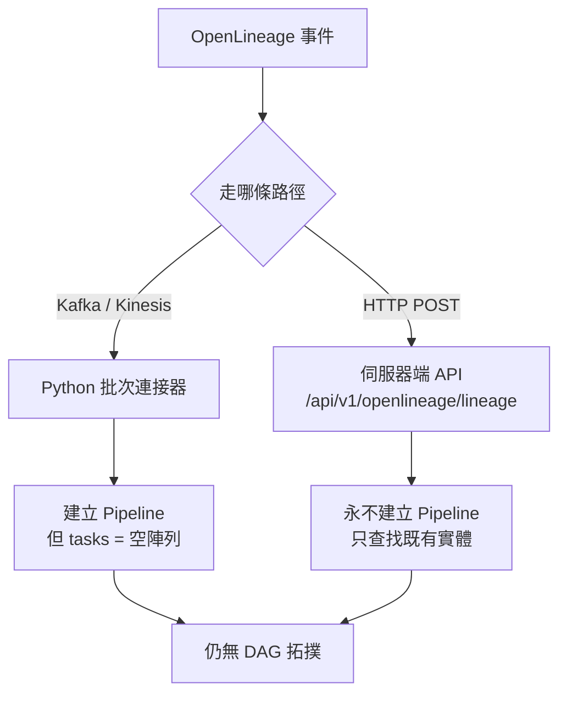
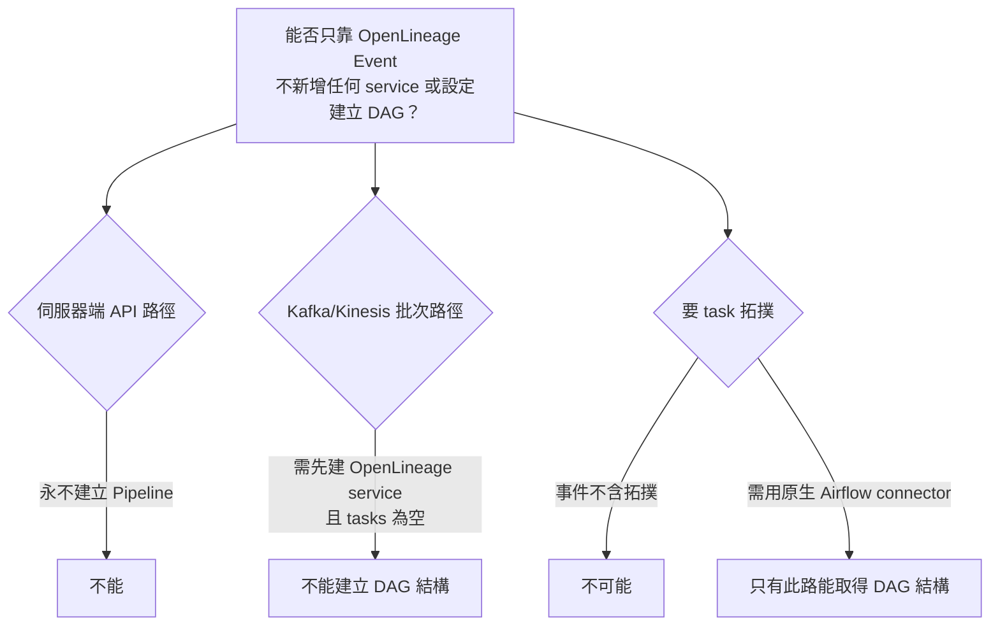

# 能否只靠 OpenLineage Event、不新增任何 Service 或設定，就在 OpenMetadata 建立 DAG？

## 摘要

**不能。** 這個結論有兩個彼此獨立的阻礙：

1. **OpenLineage 事件本身不攜帶 DAG／task 結構。** OpenMetadata 的 DAG 呈現，對應的是 `Pipeline` 實體及其內嵌的 `tasks[]`。OpenLineage 事件描述的是 *job 的一次 run*（輸入、輸出、run facets），其中沒有 task 拓撲可供還原。由 OpenLineage 建立的 Pipeline 在程式碼中是 `tasks=[]` 的**空殼**[^metadata-py][^issue-34949]。
2. **兩條 ingestion 路徑都不支援「零設定自動生成」。** 伺服器端 HTTP API **永不建立 Pipeline**；Python 批次連接器雖會建立 Pipeline，但你必須先建立一個 OpenLineage 型別的 Pipeline Service（含 `brokerConfig`）才能啟動 ingestion[^resolver][^settings][^connector-doc]。

若目標是「在 OpenMetadata 看到有 task 結構的 DAG」，唯一可靠的做法是使用**原生 Airflow connector**，而其文件明確指出它「captures DAG topology and task structure」[^airflow-rest]。OpenLineage 的角色是補上**血緣**，不是建立 DAG。

---

## 1. 先釐清「DAG」在 OpenMetadata 中是什麼

在 OpenMetadata 的資料模型裡，使用者介面上看到的 DAG 圖，對應的是 `Pipeline` 實體。`Pipeline` 內部以 `tasks[]` 欄位承載任務拓撲（每個 task 有名稱、`taskType`、`downstreamTasks` 等），血緣邊則記錄在獨立的 lineage 儲存中。

因此「建立 DAG」實際上等於兩件事：

| 需求 | 對應的 OpenMetadata 實體／欄位 |
| --- | --- |
| 一個可瀏覽的 DAG 節點 | `Pipeline` 實體 |
| DAG 內部的任務與相依關係 | `Pipeline.tasks[]` |
| 資料流（誰讀誰寫） | lineage edges |

任何「只靠 OpenLineage 事件建立 DAG」的評估，都必須分別檢查這三項能否由事件推導出來。

---

## 2. OpenLineage 事件到底描述了什麼

OpenLineage 的資料模型是 `RunEvent`，其核心欄位為 `eventType`、`eventTime`、`run`（含 `runId`）、`job`（含 `namespace`、`name`）、`inputs`、`outputs`[^schema-event]。

關於 job 的階層，OpenLineage 規格另提供 **ParentRunFacet**：對於給定的一次 run，它描述「是哪個 run 觸發了它」[^job-hierarchy]：

> The tool OpenLineage provides for that is the ParentRunFacet. For a given run, it describes what other run spawned it.

規格文件並以 Airflow 為例說明這個階層如何對應到 DAG 與 task[^job-hierarchy]：

> Schedulers, for instance, use large, schedulable units like Airflow DAGs, which in turn comprise smaller, executable units like Airflow Tasks. OpenLineage seamlessly reflects this natural organization by mirroring the job hierarchy within its model.

關鍵在於：這個階層是透過 **run 之間的父子參照**表達的（parent run 指向 parent job），**而不是**一份可枚舉的 task 清單與拓撲。OpenMetadata 目前對這個資訊的用法僅止於**命名**，而非還原結構（見第 4 節）。

此外，`job.facets.jobType` 提供 `integration`（`SPARK`、`AIRFLOW`、`FLINK`、`DBT` 等）與 `jobType`（`DAG`、`TASK`、`JOB` 等）[^job-type]。這些可用於**分類**，但同樣不含拓撲。

---

## 3. 兩條 ingestion 路徑的行為差異

OpenMetadata 有兩條接收 OpenLineage 事件的路徑，對「建立 Pipeline」的態度完全相反[^connector-doc][^resource]。



### 3.1 伺服器端 HTTP API：永不建立 Pipeline

`OpenLineageEntityResolver.resolvePipeline` 的註解寫得非常直白[^resolver]：

> Pipelines are never created: a job knows too little to describe one, so an unknown job is reported and its edges are written without a pipeline.

`openLineageSettings.json` 對 `defaultPipelineService` 的說明也重申同一限制[^settings]：

> Pipelines are never created from OpenLineage events; a job without one is reported in the response and its edges carry no pipeline.

因此，若你走 HTTP API 路徑，事件的 job 只會被拿去**查找**一個名稱符合 `<namespace>-<job name>` 的既有 Pipeline；找不到就回報 `pipelineNotFound`[^resolver][^response]。這條路徑**不可能**為你建立任何 Pipeline，更不用說 DAG。

### 3.2 Python 批次連接器：會建立 Pipeline，但是空殼

Python 連接器的 `yield_pipeline` 確實會產生 `CreatePipelineRequest`，但其中的 task 清單被硬編碼為空[^metadata-py]：

```python
request = CreatePipelineRequest(
    name=pipeline_name,
    service=self._current_pipeline_service,
    description=description,
    tasks=[],
    owners=owners,
)
```

程式碼中沒有任何 task 抽取邏輯。也就是說，即使這條路徑建立了 Pipeline，它也是一個**只有名稱與描述、沒有內部結構**的實體。

其 pipeline 名稱來自 `_render_pipeline_name`：優先取 `run.facets.parent.job` 的 namespace 與 name，否則退回事件自身的 job namespace 與 name[^metadata-py]：

> If the event's run facet contains a parent job reference, the pipeline name is derived from the parent's namespace and name. Otherwise, it falls back to the top-level job's namespace and name.

**parent job 只用於命名，不用於建立父子實體或 task 清單。**

### 3.3 而且這條路徑仍需要你先設定

Python 批次連接器要能執行，你必須先建立一個 `OpenLineage` 型別的 Pipeline Service，並在 `brokerConfig` 中指定 Kafka 或 Kinesis（`brokerConfig` 是 schema 的必填欄位）[^conn-vs]。官方文件也說明此連接器「consumes OpenLineage events from either a Kafka broker or AWS Kinesis Data Streams」[^connector-doc]。

換言之，**「不新增任何 service 或設定」在 Python 路徑上也不成立**——沒有那個 service，ingestion workflow 根本無法啟動。

---

## 4. 為什麼事件無法還原 DAG 拓撲

即使忽略上述限制，事件資料本身也不足以重建 DAG：

| DAG 需要的資訊 | OpenLineage 事件是否提供 | 說明 |
| --- | --- | --- |
| 有哪些 task | 間接、不完整 | task 以獨立 run 出現；事件流中是否涵蓋所有 task 取決於執行情形[^job-hierarchy] |
| task 之間的上下游關係 | 無 | ParentRunFacet 只表達父子 run，不表達同層相依[^job-hierarchy] |
| task 的靜態定義（即便未執行） | 無 | 事件只在執行時產生；未執行的 task 不會有事件 |
| task 的排程／週期 | 無 | 屬編排器內部狀態 |
| DAG 的識別與邊界 | 僅能以 parent job 名稱推測 | 用於命名，非結構[^metadata-py] |

一個 DAG 中未被執行的 task，不會產生任何事件，因此無論如何都無法從事件流中得知它的存在。這是原理上的缺口，不是設定問題。

---

## 5. 那麼，DAG 結構要從哪裡來

官方 Airflow connector 的文件明確區分兩種連接方式的能力。在 REST API 連接的說明中[^airflow-rest]：

> **What the REST API connection captures**
> - DAG topology and task structure
> - Pipeline schedules and run statuses
> - DAG owners and tags
> - Pipeline status history (configurable look-back window)

同一頁並指出血緣不在 REST API 的範疇[^airflow-rest]：

> **Lineage is not captured through the REST API alone.** Table-level lineage (table → DAG → table edges) requires the Apache Airflow OpenLineage provider (`apache-airflow-providers-openlineage`) to push OpenLineage events to OpenMetadata's endpoint.

這正是分工的結論：

- **DAG 拓撲與 task 結構** → 原生 Airflow connector（讀取編排器的中繼資料）。
- **資料血緣** → OpenLineage provider 把事件推送到 `POST /api/v1/openlineage/lineage`。

兩者互補，而非替代。Airflow 端設定的 namespace「Should match the pipeline service name」，正是為了讓血緣事件能掛到由原生 connector 建立的那個 Pipeline 上[^airflow-rest]。

### 5.1 Python 連接器其實已為此設計了 fallback

耐人尋味的是，Python 連接器的解析順序中，第一順位就是「namespace fallback」——先嘗試用 `namespace.jobName` 當 pipeline FQN 查詢，若已存在（例如由原生 Airflow connector 匯入）就直接沿用該 service，以避免重複建立[^service-resolver][^metadata-py]：

> When pipelines are ingested by native connectors (e.g. Airflow), the OL job namespace often matches the pipeline service name already present in OMD. Checking this first avoids creating duplicate pipelines under a new service.

這個設計恰恰印證了官方預期：**Pipeline 應由原生 connector 建立，OpenLineage 負責掛上血緣。**

---

## 6. 關於「未映射就失敗」與「不會消失」的矛盾

先前的說法確實需要更精確的區分。兩句話都來自同一份官方 schema `openLineageResponse.json`，只是分別描述**不同類別的實體**[^response]：

> **unresolvedDatasets**: Datasets that could not be resolved to, or created as, OpenMetadata entities. **No edge touching them was created.**

> **unresolvedJobs**: Jobs with no matching OpenMetadata Pipeline. **Their edges were created without a pipeline reference.**

因此正確的表述是：

| 實體類別 | 解析失敗時的結果 | 血緣是否保留 |
| --- | --- | --- |
| **Job**（Pipeline） | 記入 `unresolvedJobs`，回報 `pipelineNotFound` | **保留**，只是邊不帶 pipeline 參照 |
| **Dataset**（Table／Topic／Container） | 記入 `unresolvedDatasets` | **不保留**，觸及它的邊全部不建立 |

官方 v1.13.x 連接器文件對此有更口語的說明[^v113-doc]：

> If a dataset in an OpenLineage event cannot be resolved to an existing OpenMetadata entity, it is skipped with a warning in the ingestion logs. The rest of the event is still processed.

所以兩句話不矛盾，而是**依實體類別分治**：**Pipeline 是選配的裝飾，Dataset 是必要的端點**。沒有 Dataset，就沒有邊；沒有 Pipeline，邊仍然成立。這也解釋了為何「血緣完全查不到」通常肇因於 dataset 端，而非 pipeline 端。

Python 批次路徑的時間點差異也值得一提：v1.13.x 文件記載 table resolution 是唯讀的[^v113-doc]：

> The connector can create pipeline services and pipeline entities from incoming OpenLineage job metadata, but table resolution is read-only: tables, schemas, and databases must already exist in OpenMetadata. **Ingest your database sources before running the OpenLineage pipeline** or lineage edges will not attach.

後續伺服器端路徑加入了 `autoCreateEntities`，可在 namespace 已映射且有 schema facet 時自動建立 Table／Database／Schema，但仍明確排除 Pipeline[^settings][^creator]。

---

## 7. 直接回答問題



| 問題 | 答案 |
| --- | --- |
| 不新增任何 service，能建立 DAG 嗎？ | **不能**。批次路徑需先有 OpenLineage service；API 路徑永不建立 Pipeline[^conn-vs][^resolver] |
| 靠事件能建立 `Pipeline` 實體嗎？ | 批次路徑可以，但結果是 `tasks=[]` 的空殼[^metadata-py] |
| 靠事件能得到 task 拓撲嗎？ | **不能**。事件只提供 parent job 的命名線索，不含 task 清單與相依[^job-hierarchy][^metadata-py] |
| 那 DAG 該怎麼進 OpenMetadata？ | 用原生 Airflow connector，它「captures DAG topology and task structure」[^airflow-rest] |
| OpenLineage 的價值是什麼？ | 補上 table → DAG → table 的血緣，這是 REST API 連接單獨做不到的[^airflow-rest] |

### 7.1 補充：task 層級血緣目前尚未實作

若你的期待更進一步，是「DAG 內每個 task 各自的血緣」，那在 2.0.x 同樣不可得。相關 issue 指出[^issue-34949]：

> `Pipeline.tasks[]` is an embedded struct: a task has no id or entity type, so it cannot be `fromEntity`/`toEntity` of an edge.

> We ingest Airflow and Spark lineage from OpenLineage events, which carry the producing task for every dataset edge. Today the most we can store is `lineageDetails.pipeline` = the DAG plus the task name in the edge `description`.

該 issue 並指出，當同一 DAG 的多個 task 寫入同一組 `(from, to)` 時，只會存在一列邊，最後寫入者的描述會覆蓋先前的，因此「哪個 task 產出了這張表」的資訊會遺失[^issue-34949]。

---

## 8. 建議做法

若目標是「在 OpenMetadata 看到含有 task 結構的 DAG，並附帶血緣」：

1. **先建立原生 Airflow connector**，讓 DAG 與 task 結構進入 OpenMetadata（使用 REST API 或 DB backend 連接）[^airflow-rest]。
2. **再設定 OpenLineage provider**，將事件推送到 `POST /api/v1/openlineage/lineage`；namespace 設為與該 pipeline service 名稱一致，使血緣能掛到既有 Pipeline[^airflow-rest]。
3. **確保資料端已就緒**。v1.13.x 文件建議先匯入資料庫來源，否則血緣邊不會附著[^v113-doc]；在伺服器端路徑上則可透過 `namespaceToServiceMapping` 加 `autoCreateEntities` 讓缺失的 Table 自動建立[^settings]。
4. **若編排器不是 Airflow**，則需要一個能讀取該編排器中繼資料的 connector（原生或 Custom Connector）來提供 DAG 結構；OpenLineage 事件無法取代這個角色。

---

## 參考資料

[^response]: OpenMetadata. (n.d.). *openLineageResponse.json*. Retrieved 2026-10-13, from https://github.com/open-metadata/OpenMetadata/blob/main/openmetadata-spec/src/main/resources/json/schema/api/lineage/openlineage/openLineageResponse.json

[^settings]: OpenMetadata. (n.d.). *openLineageSettings.json*. Retrieved 2026-10-13, from https://github.com/open-metadata/OpenMetadata/blob/main/openmetadata-spec/src/main/resources/json/schema/configuration/openLineageSettings.json

[^conn-vs]: OpenMetadata. (n.d.). *openLineageConnection.json*. Retrieved 2026-10-13, from https://github.com/open-metadata/OpenMetadata/blob/main/openmetadata-spec/src/main/resources/json/schema/entity/services/connections/pipeline/openLineageConnection.json

[^schema-event]: OpenMetadata. (n.d.). *openLineageRunEvent.json*. Retrieved 2026-10-13, from https://github.com/open-metadata/OpenMetadata/blob/main/openmetadata-spec/src/main/resources/json/schema/api/lineage/openlineage/openLineageRunEvent.json

[^resolver]: OpenMetadata. (n.d.). *OpenLineageEntityResolver.java*. Retrieved 2026-10-13, from https://github.com/open-metadata/OpenMetadata/blob/main/openmetadata-service/src/main/java/org/openmetadata/service/openlineage/OpenLineageEntityResolver.java

[^creator]: OpenMetadata. (n.d.). *OpenLineageEntityCreator.java*. Retrieved 2026-10-13, from https://github.com/open-metadata/OpenMetadata/blob/main/openmetadata-service/src/main/java/org/openmetadata/service/openlineage/OpenLineageEntityCreator.java

[^resource]: OpenMetadata. (n.d.). *OpenLineageResource.java*. Retrieved 2026-10-13, from https://github.com/open-metadata/OpenMetadata/blob/main/openmetadata-service/src/main/java/org/openmetadata/service/resources/lineage/OpenLineageResource.java

[^metadata-py]: OpenMetadata. (n.d.). *metadata.py*. Retrieved 2026-10-13, from https://github.com/open-metadata/OpenMetadata/blob/main/ingestion/src/metadata/ingestion/source/pipeline/openlineage/metadata.py

[^service-resolver]: OpenMetadata. (n.d.). *service_resolver.py*. Retrieved 2026-10-13, from https://github.com/open-metadata/OpenMetadata/blob/main/ingestion/src/metadata/ingestion/source/pipeline/openlineage/service_resolver.py

[^connector-doc]: OpenMetadata. (n.d.). *OpenLineage | OpenMetadata Data Lineage Pipeline*. Retrieved 2026-10-13, from https://docs.open-metadata.org/latest/connectors/pipeline/openlineage

[^v113-doc]: OpenMetadata. (n.d.). *OpenLineage | OpenMetadata Data Lineage Pipeline* (v1.13.x). Retrieved 2026-10-13, from https://docs.open-metadata.org/v1.13.x/connectors/pipeline/openlineage

[^airflow-rest]: OpenMetadata. (n.d.). *Airflow REST API Connection | Authentication & OpenLineage Setup*. Retrieved 2026-10-13, from https://docs.open-metadata.org/latest/connectors/pipeline/airflow/rest-api-connection

[^job-hierarchy]: OpenLineage. (n.d.). *Job Hierarchy* (Version 1.54.0). Retrieved 2026-10-13, from https://openlineage.io/docs/spec/job-hierarchy

[^job-type]: OpenLineage. (n.d.). *Job type Job Facet* (Version 1.54.0). Retrieved 2026-10-13, from https://openlineage.io/docs/spec/facets/job-facets/job-type

[^naming]: OpenLineage. (n.d.). *Naming Conventions* (Version 1.54.0). Retrieved 2026-10-13, from https://openlineage.io/docs/spec/naming

[^issue-34949]: Udbv. (2026, October 8). *Task-level lineage for pipelines: documented in OpenMetadata Standards, not implemented in 2.0.x* (Issue #34949). GitHub. Retrieved 2026-10-13, from https://github.com/open-metadata/OpenMetadata/issues/34949

[^issue-26734]: jsingh-yelp. (2026, March 24). *OpenLineage ingestion should auto-resolve pipeline service type and name from event metadata* (Issue #26734). GitHub. Retrieved 2026-10-13, from https://github.com/open-metadata/OpenMetadata/issues/26734

[^pr-26821]: jsingh-yelp. (2026, March 27). *Fixes 26434: [openlineage] Resolve openlineage pipeline/job to its integration type* (Pull Request #26821). GitHub. Retrieved 2026-10-13, from https://github.com/open-metadata/OpenMetadata/pull/26821
