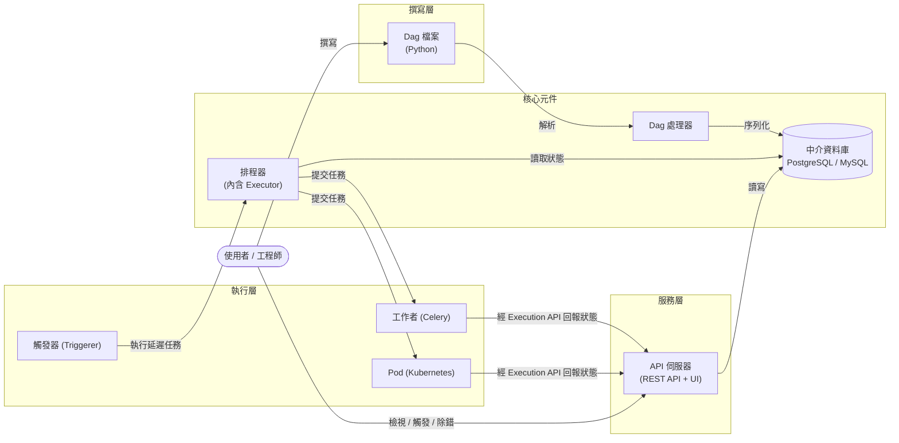
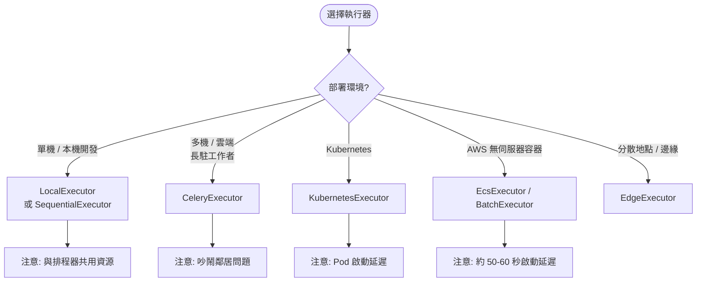

# Apache Airflow 介紹

## 摘要

Apache Airflow 是一套以 Python 為核心的開源工作流程（workflow）編排平台，用於開發、排程與監控批次（batch）工作流程[^whatis]。它的核心設計哲學是「工作流程即程式碼」（workflows-as-code），讓工程師能以純 Python 定義具備相依關係的任務流程，並透過內建的網頁介面視覺化、管理與除錯這些流程[^whatis]。Airflow 由 Maxime Beauchemin 於 2014 年 10 月在 Airbnb 內部發起，2016 年 3 月進入 Apache 軟體基金會（ASF）的孵化器，並於 2019 年 1 月成為頂級專案（Top-Level Project）[^history]。時至今日，Airflow 已成為資料工程領域事實上的（de facto）工作流程編排標準，被眾多《財星》500 大企業採用[^venturebeat]。

本報告為獨立文件，涵蓋 Airflow 的定位與用途、歷史演進、架構組成、核心概念、執行器類型、優缺點與適用情境，所有事實皆附上可追溯的引用來源。

---

## 1. 什麼是 Apache Airflow

Apache Airflow 是一套開源平台，用於**開發、排程與監控工作流程**[^whatis]。其工作流程完全以 Python 撰寫，因此具備以下特性[^whatis]：

- **動態（Dynamic）**：流程可動態產生並參數化，而非只能使用靜態設定檔。
- **可擴充（Extensible）**：內建大量運算子（operator），並可依需求自行擴充。
- **彈性（Flexible）**：透過 Jinja 模板引擎支援客製化。

Airflow 內建網頁式使用者介面（web UI），可視覺化、管理與除錯工作流程，且其部署規模極具彈性，從「筆電上的單一行程」到「能處理龐大工作負載的分散式系統」皆可運行[^whatis]。

Airflow 特別適合**具有明確起點與終點、且依排程執行**的批次工作流程，官方列舉的典型情境包括：以時間為基礎或事件觸發的批次導向資料管線、機器學習與模型訓練，以及近年新增的代理式（agentic）或基於大型語言模型（LLM）的工作負載[^whatis]。

> 一句話總結：Airflow 是「批次工作流程的編排平台」（a platform for orchestrating batch workflows）[^whatis]。

---

## 2. 為何而生：歷史與背景

### 2.1 起源：Airbnb 的痛點

Airflow 由 Maxime Beauchemin 於 **2014 年 10 月**在 Airbnb 內部發起[^history]。當時 Airbnb 的資料團隊面臨的困境是：日益複雜的工作流程難以透過傳統的 cron 指令碼（cron scripts）來編寫與排程，也缺乏一套能集中監控的介面[^wikipedia]。因此 Airflow 的設計目標是：能**以程式化方式撰寫（programmatically author）並排程工作流程，並透過內建 UI 監控**[^wikipedia]。

Airflow 自第一個 commit 起即為開源，並於 **2015 年 6 月**在 Airbnb 的 GitHub 上對外發布[^history]。

### 2.2 進入 Apache 生態

- **2016 年 3 月**：Airflow 加入 Apache 軟體基金會的孵化器計畫（Incubator program）[^history]。
- **2019 年 1 月**：Apache 宣布 Airflow 畢業成為頂級專案（Top-Level Project）[^history]。

### 2.3 版本里程碑

| 版本 | 發布日期 | 重點 |
|---|---|---|
| 1.0.0 | 2015-06-03 | 首個公開發行版本[^wikipedia] |
| 2.0.0 | 2020-12-17 | 重大改寫，帶來高可用（HA）排程器、完整 REST API 等[^wikipedia] |
| 3.0.0 | 2025-04-22 | Airflow 史上最大改版，全面重寫的 React UI、事件驅動排程、Data Assets、Task SDK（支援多語言執行任務）等[^wikipedia] |

截至本報告撰寫時，GitHub 上標示的穩定版本為 **3.3.2**[^github]。在 2.0（2020）與 3.0（2025）之間，Airflow 採季度發布節奏（例如 2.10 於 2024 年第四季推出）；3.0 於 2024 年 9 月的 Airflow Summit 上宣布，凝聚了超過 300 位社群貢獻者[^wikipedia]。

### 2.4 治理模式

Airflow 遵循 Apache 軟體基金會的標準治理模式[^wikipedia]：

- 由**專案管理委員會（PMC, Project Management Committee）**負責技術指導，決定專案藍圖、投票通過軟體發行、決定新增的提交者（committer）與 PMC 成員，並每季向 ASF 董事會報告。
- PMC 之下為具備寫入權限的**提交者（committers）**與一般**貢獻者（contributors）**，決策公開透明並以共識決（consensus）為原則。
- Airflow 如何套用 ASF 治理規則，記錄於專案倉庫的 `GOVERNANCE.md` 與 `COMMITTERS.rst` 檔案中。

---

## 3. 架構（Architecture）

Airflow 是一套讓使用者建構並執行工作流程的平台。工作流程以 **Dag（Directed Acyclic Graph，有向無環圖）** 表示，內含稱為 **Task** 的個別工作單元，並考慮彼此之間的相依性與資料流[^arch]。

### 3.1 必要元件

一套最小可運作的 Airflow 安裝包含以下元件[^arch]：

- **排程器（Scheduler）**：負責觸發排程工作流程，並將任務提交給執行器（executor）執行[^arch]。
- **Dag 處理器（Dag processor）**：解析 Dag bundle 中的 Dag 檔案，並將其序列化寫入中介資料庫（metadata database）。在 Airflow 3 中它**一律是獨立行程**，因此排程器永遠不會直接執行撰寫 Dag 的程式碼[^arch]。
- **Dag bundle**：Dag 檔案的來源，供處理器與工作者（worker）讀取；預設是磁碟上的本機資料夾[^arch]。
- **API 伺服器（API server，即網頁伺服器）**：提供 REST API 與使用者介面，用於檢視、觸發與除錯 Dag 及任務；任務本身也會透過 Task SDK 使用它回報狀態[^arch]。
- **中介資料庫（Metadata database）**：通常為 **PostgreSQL 或 MySQL**，儲存任務、Dag 與變數（variables）的狀態[^arch]。

值得注意的是，**執行器（Executor）並非獨立元件，而是排程器的一項設定屬性，運行於排程器行程之內**[^arch][^executor]。

### 3.2 選用元件

- **工作者（Worker）**：執行排程器所指派的任務。在 `CeleryExecutor` 下是長駐行程，在 `KubernetesExecutor` 下則是一個 Pod[^arch]。
- **觸發器（Triggerer）**：以 asyncio 事件迴圈執行被延遲（deferred）的任務[^arch]。
- **外掛（Plugins）**：用以擴充 Airflow 功能的資料夾[^arch]。

### 3.3 架構示意圖

以下以 Mermaid 呈現 Airflow 的主要元件與資料流關係：

### 3.4 任務執行架構的關鍵設計

Airflow 在任務執行上有一個重要設計：**工作者永遠不會在自己的行程中執行任務程式碼**。「針對每個任務實例（task instance），它會啟動一個全新子行程，監督它，並在任務完成後將其拆除」——例如 fork 一個新的 Python 直譯器、啟動一個新的 JVM，或執行一個新的 Go 執行檔[^arch]。任務實例之間不會共用或重複使用任何資源，因此同時執行 N 個任務就會付出 N 個子行程的成本[^arch]。

此外，工作者是透過 **Execution API** 與系統溝通，**任務程式碼永遠不會直接存取中介資料庫**[^arch]。這項隔離設計提升了安全性與可維護性。

---

## 4. 核心概念

### 4.1 Dag（有向無環圖）

> 「Dag 是一個模型，封裝了執行工作流程所需的一切。」[^concepts]

Dag 的關鍵屬性包含：**排程（Schedule）**、**任務（Tasks）**、**任務相依性（Task Dependencies）**、**回呼（Callbacks）** 以及其他運作參數[^concepts]。Dag 本身「不在乎任務內部的內容是什麼，它只關切這些任務該**如何**執行」[^concepts]。

需要留意的是，官方指出「DAG」一詞雖源自數學概念「有向無環圖」，但在 Airflow 中的意義已遠超出單純的資料結構，因此決定在 Airflow 中使用大寫的 **Dag** 一詞[^concepts]。

Dag 可以用 `with DAG(...)` 上下文管理器、`DAG(...)` 建構子，或 `@dag` 裝飾器宣告[^concepts]。每一次 Dag 的執行會產生一個 **Dag Run**，它擁有自己的**資料區間（data interval）**——「任務應操作的資料期間」——以及**邏輯日期（logical date）**（舊稱執行日期 execution date）[^concepts]。

### 4.2 Task（任務）

> 「Task 是 Airflow 中的基本執行單元。任務被安排進 Dag 中，然後在它們之間設定上下游相依性，以表達它們應執行的順序。」[^concepts]

任務有三種基本型態[^concepts]：

1. **運算子（Operators）**：預先定義好的任務模板。
2. **感測器（Sensors）**：運算子的特殊子類，專門用於「等待」外部事件發生。
3. **TaskFlow 裝飾的 `@task`**：將自訂 Python 函式包裝成任務。

在內部，這三者實際上全都是 Airflow `BaseOperator` 的子類；運算子與感測器是「模板」，當你在 Dag 檔案中呼叫它們時，你建立的是任務[^concepts]。

一個**任務實例（Task Instance）** 是「該任務在某個給定 Dag（因而在某個給定資料區間）中的一次特定執行」，是任務「帶有狀態」的表現形式[^concepts]。其狀態包括 `none`、`scheduled`、`queued`、`running`、`success`、`failed`、`skipped`、`upstream_failed`、`up_for_retry`、`up_for_reschedule`、`deferred` 等[^concepts]。任務之間預設不會互相傳遞資訊，需透過 **XComs** 進行[^concepts]。

### 4.3 Operator（運算子）

> 「運算子在概念上是一種預先定義任務的模板，你可以直接在 Dag 中以宣告式方式定義它。」[^concepts]

「當我們談到**運算子**時，指的是可重複使用、事先製作好的任務模板，其邏輯已為你完成，只需要一些參數。」[^concepts]

核心範例包括 `BashOperator`（執行 bash 指令）、`PythonOperator`（呼叫任意 Python 函式）；來自 provider 套件的則有 `EmailOperator`、`HttpOperator`、`SQLExecuteQueryOperator`、`DockerOperator` 等[^concepts][^operators]。運算子支援 **Jinja 模板**（例如 `{{ ds }}`）以及 `pre_execute` / `post_execute` 掛鉤[^operators]。

### 4.4 Sensor（感測器）

> 「感測器是一種特殊型態的運算子，設計上只做一件事——等待某件事發生。它可以是基於時間、等待檔案，或等待外部事件，但它們所做的就只是等待，直到某件事發生後便**成功**，讓下游任務得以執行；或者……當該事件未在設定的逾時時間內發生時便**失敗**……」[^concepts]

感測器有兩種運行模式[^concepts]：

- **`poke`（預設）**：感測器在整個執行期間都會佔用一個工作者名額（worker slot）。
- **`reschedule`**：感測器僅在檢查時佔用工作者名額，兩次檢查之間會休眠一段設定的時間。

`BaseSensorOperator` 的常用參數包括 `poke_interval`、`timeout`、`mode`、`soft_fail`、`exponential_backoff`、`max_wait`[^concepts]。常見範例有 `FileSensor`、`BashSensor`、`PythonSensor`、`TimeSensor`、`ExternalTaskSensor`[^concepts]。

### 4.5 Hook（鉤子）

> 「Hook 是外部平台的高階介面，讓你能快速且輕鬆地與之溝通，無須撰寫會直接存取其 API 或使用特殊函式庫的低階程式碼。它們通常也是運算子的建構積木。」[^concepts]

Hook 會「與 **Connection（連線）** 整合以取得認證資訊」；Connection 是「一組參數——例如使用者名稱、密碼與主機名——連同所連接系統的類型，以及一個獨特名稱，稱為 `conn_id`」[^concepts]。許多 Hook 具備預設的 `conn_id`（例如 `PostgresHook` 預設為 `postgres_default`）[^concepts]。

### 4.6 TaskFlow API

> 「如果你的 Dag 大多以純 Python 程式碼而非運算子撰寫，TaskFlow API 將讓你更容易撰寫乾淨、不含多餘樣板程式碼（boilerplate）的 Dag，一切只要使用 `@task` 裝飾器。」[^concepts]

TaskFlow API 於 **Airflow 2.0** 引入（對應 AIP-31）[^concepts]。其關鍵特性是[^concepts]：

- 自動為你透過 **XComs** 在任務之間傳遞輸入與輸出。
- 自動計算相依性——當你在 Dag 檔案中呼叫一個 TaskFlow 函式時，它不會立即執行，而是回傳一個代表結果 XCom 的物件（`XComArg`），你可將其作為下游任務或運算子的輸入。

它亦支援多重輸出（`@task(multiple_outputs=True)`）、情境注入（context injection）、以 Python logging 記錄日誌，以及傳遞任意（可序列化的）物件作為參數[^concepts]。

### 4.7 排程（Scheduling）

> 「Dag 會以兩種方式之一執行：當它們被手動或經由 API **觸發**時；或依照 Dag 中定義的**排程**執行。」[^concepts]

「Dag 並非**必須**有排程，但定義排程非常常見」，方式是透過 `schedule` 參數——其值可為 cron 表達式（如 `"0 0 * * *"`）或預設集（preset，如 `"@daily"`、`"@once"`、`"@continuous"`）[^concepts]。排程細節包括[^concepts]：

- 每一次排程執行都有**資料區間**與**邏輯日期**（資料區間的起點；一次執行的開始時間等於邏輯日期加上排程區間）。
- **排程器**同時「負責觸發排程工作流程，並將任務提交給執行器執行」。
- Dag 可以被**回填（backfill）**（為過去某段範圍內的每一天執行一份副本）、可平行執行，也可暫停／恢復（暫停的 Dag 不會被排程）。

進階排程選項包含 cron／時間間隔、時區、資產感知排程（asset-aware scheduling）、時間表（timetables）與事件驅動排程[^concepts]。

### 4.8 控制流與資料流

- **控制流**：相依性以 `>>` / `<<` 運算子或 `set_upstream` / `set_downstream` 宣告；預設上，任務會等待所有上游任務成功，這點可透過觸發規則（Trigger Rules）、分支（Branching）、LatestOnly、Depends On Past 等機制調整[^arch]。
- **資料流**：任務之間透過 XComs、共享儲存檔案，或 TaskFlow API 來傳遞資料[^arch]。

---

## 5. 執行器（Executor）類型

執行器透過設定檔 `[core]` 區段的 `executor` 選項設定，所有執行器邏輯都在排程器行程內運行[^executor]。官方將執行器區分為**本機（Local）** 與**遠端（Remote）**，遠端再細分為**佇列／批次（Queued/Batch）** 與**容器化（Containerized）** 兩類[^executor]。

### 5.1 本機執行器

**LocalExecutor**（安裝 Airflow 時的預設、最簡單的選項）[^executor]：

- 在排程器行程／節點內衍生行程來執行任務；`[core] parallelism` 選項（預設 32）限制並行行程數。
- 優點：「非常易用、快速、延遲極低，且設定需求很少。」
- 缺點：「能力受限，且與 Airflow 排程器共用資源」——在排程器中運行大量行程可能影響排程器效能（在容器中甚至可能導致 OOM 重啟）。
- 適用情境：小型單機生產環境，或需要平行執行的本機測試。多個排程器可各自運行 LocalExecutor，將任務處理分散到多台機器。無限制平行（`parallelism = 0`）已在 Airflow 3.0.0 移除。

**SequentialExecutor**[^executor]：

- 一次僅執行一個任務實例。「它是唯一能與 `sqlite` 搭配使用的執行器，因為 sqlite 不支援多重連線。」
- 適用情境：初次安裝／學習、除錯與本機開發。「生產環境請使用其他執行器。」

**DebugExecutor**（Airflow ≥ 2.2 已棄用，由 `dag.test()` 取代）[^executor]：

- 單一行程執行器，供 IDE 除錯使用，支援 fail-fast 模式。
- 官方現建議改用 `dag.test()`：「完全不需要運行執行器」，速度更快（無排程器迴圈）且能快速失敗。僅供本機除錯，絕不用於生產。

### 5.2 遠端執行器：佇列／批次

**CeleryExecutor**[^executor]：

- 以 Celery 後端（RabbitMQ、Redis、Redis Sentinel 等）水平擴展工作者。排程器將指令放入**代理（broker）**；長駐工作者（`airflow celery worker`）拉取任務並將狀態回報至**結果後端（result backend）**；支援透過 `queue` 屬性將任務路由到特定工作者，並可用 Celery Flower 監控。
- 優點：因工作者與排程器行程解耦而更強健；工作者是可平行消化大量任務的大型主機、具成本效益、延遲低（工作者持續運行）。
- 缺點：「共享工作者會有吵鬧鄰居（noisy neighbor）問題」；若工作負載不穩定，可能因閒置／過度擴展的工作者而昂貴。
- 適用情境：多機或雲端生產環境，且工作負載相對穩定、高吞吐，需要低延遲與在長駐工作者上平行執行。

**BatchExecutor（AWS Batch）**（屬於 `apache-airflow-providers-amazon`）[^executor]：

- 每個任務在由 AWS Batch 排程的獨立容器中執行；具備動態自動擴展資源（降低成本）、作業佇列／優先序、支援 Fargate / EC2 / EKS 運算環境等優點。
- 適用情境：以 AWS 為核心、工作負載具爆發性（bursty）且希望在 AWS 上自動擴展與逐作業控制資源的生產環境。

**EdgeExecutor**（屬於 `apache-airflow-providers-edge3`）[^executor]：

- 透過 API 將任務分散到位於不同地點的工作守護行程（「邊緣工作者」），可與其他執行器搭配（多執行器功能併用），支援以佇列路由及多團隊隔離。
- 適用情境：需要在分散地點或中央叢集以外的工作者上執行任務時。

### 5.3 遠端執行器：容器化

**KubernetesExecutor**（屬於 `apache-airflow-providers-cncf-kubernetes`）[^executor]：

- 「在 Kubernetes 叢集上為每個任務實例運行各自的 Pod。」排程器提交任務時向 K8s API 請求一個工作者 Pod；Pod 執行任務、回報結果後終止。支援透過 `pod_template_file` 與 `pod_override` 進行逐任務客製化（例如 sidecar 容器、掛載磁碟區）。需要非 SQLite 的資料庫。
- 優點：任務隔離（無吵鬧鄰居）、可逐任務客製執行環境（映像檔、資源、函式庫）、成本效益高（工作者僅在任務期間存在）。
- 缺點：Pod 部署期間有啟動延遲；對大量短小任務可能昂貴；需自行管理 Kubernetes 叢集。
- 適用情境：需要逐任務隔離、客製映像檔／環境，或長時／爆發性工作負載的 Kubernetes 環境。

**EcsExecutor（AWS ECS）**（屬於 `apache-airflow-providers-amazon`）[^executor]：

- 每個任務在各自的 ECS 容器中執行（Fargate 或 EC2 啟動類型）。具備任務隔離、逐任務客製容器映像檔、成本效益高等優點。每個任務約增加 50–60 秒啟動延遲；支援高並行（經測試可達約 500 個平行任務）；任務完成後需啟用遠端日誌才能檢視日誌。
- 適用情境：以 AWS 為核心、需要逐任務隔離與客製環境，但不願管理 Kubernetes 叢集的生產環境。

### 5.4 已棄用／移除的執行器

- **DaskExecutor**：曾列於 2.x 的執行器文件中，後已淘汰；現代替代方案為 Celery 與 Edge 執行器[^executor]。
- **LocalKubernetesExecutor** 與 **CeleryKubernetesExecutor**：屬「靜態寫死」的混合型執行器，**自 Airflow 3.0.0 起不再支援**。應改用**多執行器併用（Multiple Executors Concurrently）** 功能（例如 `executor = LocalExecutor,CeleryExecutor`，並透過逐任務／逐 Dag 的 `executor=` 指定）[^executor]。

### 5.5 執行器選擇示意

---

## 6. 主要使用情境

Airflow 的典型應用包括[^whatis]：

- **資料管線（ETL / ELT）**：依排程或事件觸發執行。
- **機器學習模型訓練管線**。
- **代理式 / LLM 工作負載**。
- **通用任務自動化**：執行 Spark 作業、在儲存桶之間搬移檔案、發送通知郵件，並透過 provider 與幾乎任何技術協調。

根據 Apache 基金會發布時的說明，採用 Airflow 的組織超過 **200 家**，其中包括 Adobe、Airbnb、Astronomer、Etsy、Google、ING、Lyft、PayPal、Reddit、Twitter 與 United Airlines[^whatis]。而 Airflow 專案 README 則提到約有 **500 個已知組織** 使用 Apache Airflow[^github]。

VentureBeat（2025）則將 Airflow 描述為資料工程領域的**事實標準（de facto tool）**，並被《財星》500 大企業廣泛採用[^venturebeat]。

---

## 7. 專案現況與社群指標

- **GitHub 倉庫**：[apache/airflow](https://github.com/apache/airflow)[^github]
- **授權**：Apache-2.0[^github]
- **星數（stars）**：約 **47.2k**[^github]
- **分支數（forks）**：約 **18.0k**[^github]
- **提交數（commits）**：約 42,025[^github]
- **支援的 Python 版本**：開發主線為 3.11–3.14；穩定版為 3.10–3.14[^github]
- **語言**：以 Python 為主，並提供 Go、Java 與 TypeScript（ts-sdk）等輔助 SDK[^github]

高星數與龐大的貢獻生態，佐證了 Airflow 在資料編排領域的領導地位。

---

## 8. 優勢與限制

### 8.1 優勢

- **以程式碼定義流程**：Dag 用 Python 撰寫，易於版本控制、測試與程式碼審查[^whatis]。
- **動態與可參數化**：可在執行期動態產生流程[^whatis]。
- **豐富生態**：內建大量運算子、感測器與 Hook，並有眾多 provider 套件可連接幾乎任何外部系統[^concepts]。
- **內建 UI 與 REST API**：便於檢視、觸發與除錯[^arch]。
- **部署規模彈性**：從筆電單一行程到分散式大規模系統皆可[^whatis]。
- **多語言任務執行**：Airflow 3 引入 Task SDK，任務可用 Go、Java 等語言執行[^github]。

### 8.2 限制與取捨

- **針對批次設計**：Airflow 專注於有明確起點與終點的批次流程，對串流（streaming）或長時間常駐服務並非最佳選擇[^whatis]。
- **執行器取捨各異**：LocalExecutor 與排程器共用資源；CeleryExecutor 有吵鬧鄰居問題；KubernetesExecutor 與 EcsExecutor 有啟動延遲[^executor]。
- **資源成本模型**：每個任務實例都會啟動全新子行程，N 個並行任務即為 N 個子行程，資源用量隨並行度線性成長[^arch]。
- **架構複雜度**：完整分散式部署需管理排程器、Dag 處理器、API 伺服器、中介資料庫、工作者與觸發器等多個元件[^arch]。

---

## 9. 結論

Apache Airflow 自 2014 年於 Airbnb 誕生以來，歷經 2016 年進入 Apache 孵化器、2019 年成為頂級專案，並在 2020 年（2.0）與 2025 年（3.0）兩次重大改版後持續演進[^history][^wikipedia]。它把工作流程定義轉化為可版本控制、可測試的 Python 程式碼，並以「排程器＋執行器＋中介資料庫＋API 伺服器＋Dag 處理器」的核心架構支撐從單機到分散式的各種規模[^arch][^whatis]。憑藉約 47.2k 的 GitHub 星數與超過 500 個已知採用組織[^github]，Airflow 已穩固成為現代資料工程與批次工作流程編排的事實標準[^venturebeat]。

---

## 參考文獻

[^whatis]: Apache Software Foundation. (n.d.). *What is Airflow®? — Apache Airflow Documentation*. Retrieved 2026-10-13, from https://airflow.apache.org/docs/apache-airflow/stable/index.html

[^history]: Apache Software Foundation. (n.d.). *Project — Apache Airflow Documentation*. Retrieved 2026-10-13, from https://airflow.apache.org/docs/apache-airflow/stable/project.html

[^arch]: Apache Software Foundation. (n.d.). *Architecture Overview — Apache Airflow Documentation*. Retrieved 2026-10-13, from https://airflow.apache.org/docs/apache-airflow/stable/core-concepts/overview.html

[^concepts]: Apache Software Foundation. (n.d.). *Core Concepts — Apache Airflow Documentation*. Retrieved 2026-10-13, from https://airflow.apache.org/docs/apache-airflow/stable/core-concepts/index.html

[^operators]: Apache Software Foundation. (n.d.). *Operators — Apache Airflow Documentation*. Retrieved 2026-10-13, from https://airflow.apache.org/docs/apache-airflow/stable/core-concepts/operators.html

[^executor]: Apache Software Foundation. (n.d.). *Executor — Apache Airflow Documentation*. Retrieved 2026-10-13, from https://airflow.apache.org/docs/apache-airflow/stable/core-concepts/executor/index.html

[^wikipedia]: Wikimedia Foundation. (n.d.). *Apache Airflow*. Wikipedia. Retrieved 2026-10-13, from https://en.wikipedia.org/wiki/Apache_Airflow

[^github]: Apache Software Foundation. (n.d.). *apache/airflow: Apache Airflow - A platform to programmatically author, schedule, and monitor workflows*. GitHub. Retrieved 2026-10-13, from https://github.com/apache/airflow

[^venturebeat]: VentureBeat. (2025). *Apache Airflow 3.0 announcement coverage*. Retrieved 2026-10-13, from https://airflow.apache.org/blog/airflow-three-point-oh-is-here/
