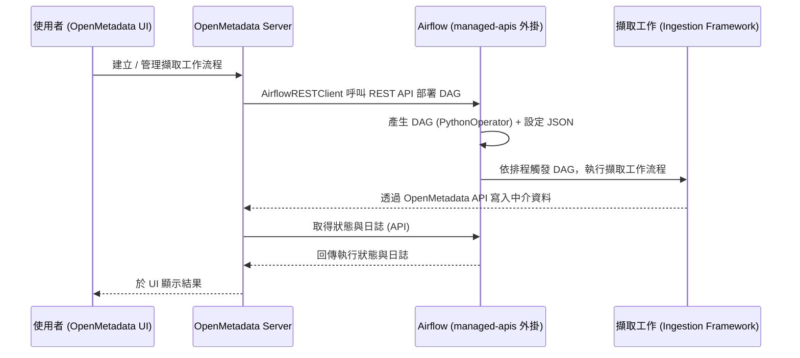

# OpenMetadata 與 Apache Airflow 的關係

## 摘要

OpenMetadata 與 Apache Airflow 之間的關係可以歸納為三種角色重疊的連結：**Airflow 是 OpenMetadata 執行資料擷取（ingestion）工作流程時預設的排程與編排引擎**；在反向的另一面，**Airflow 本身也能被 OpenMetadata 當作一種「資料來源」來擷取 Pipeline 中介資料（DAG、Task、執行狀態與血緣）**；此外，兩者透過 `openmetadata-managed-apis` 這個 Airflow 外掛與 `AirflowRESTClient` 這個伺服器端用戶端，形成一套「OpenMetadata 伺服器下命令、Airflow 執行」的控制鏈[^internal][^external][^connaware]。本報告將逐一拆解這三條關係線，說明其技術實作、可替代方案與版本耦合限制。

## 背景：兩個專案各自是什麼

### Apache Airflow

Apache Airflow 是一套開源的**工作流程開發、排程與監控平台**，用來處理如時間觸發或事件觸發的批次導向資料管線、機器學習模型訓練，以及近年延伸到的代理式（agentic）或 LLM 工作負載[^airflow]。它以 Python 撰寫工作流程（「workflows as code」），核心抽象是 **DAG（Directed Acyclic Graph，有向無環圖）**，一個 DAG 封裝了排程、任務（Task）、任務相依性、回呼與其他運行參數；任務之間以 `>>` 運算子表達相依順序[^airflow]。

Airflow 起源於 2014 年 10 月，由 Maxime Beauchemin 在 Airbnb 發起，2016 年 3 月進入 Apache 軟體基金會（ASF）的 Incubator 計畫，並於 2019 年 1 月成為 ASF 的頂層專案（Top-Level Project），授權條款為 Apache License 2.0[^airflowlic]。目前穩定文件對應的版本為 Airflow 3.x 系列（例如 `openmetadata-ingestion` 的 `airflow` extra 會安裝 `apache-airflow==3.3.2`）[^airflow][^ingestion]。

### OpenMetadata

OpenMetadata 是一套開源的**中介資料（metadata）平台**，自我定位為「為資料與 AI 打造的開放脈絡層（Open Context Layer）」，用於建立可信的資料脈絡、組織記憶與商業語意，服務對象包含資料使用者、AI 助理與代理[^gh]。其主要 GitHub 儲存庫 `open-metadata/OpenMetadata` 約有 **15.5k 顆星**、2.5k 次 fork，授權條款為 Apache License 2.0；以程式語言占比而言，主要為 TypeScript（前端）、Java（伺服器）與 Python（擷取框架）[^gh]。

## 關係線一：Airflow 作為 OpenMetadata 擷取工作流程的編排引擎

### 為什麼需要 Airflow

OpenMetadata 要能呈現資料資產的技術中介資料、血緣（lineage）、使用統計、資料剖析（profiler）與資料品質等資訊，必須先有人「把中介資料抓進來」。這項工作由 **Ingestion Framework（擷取框架）** 負責，它是一個 Python 模組，透過 OpenMetadata 的 API 把各系統的中介資料匯入平台[^ingestion]。然而，當使用者從 OpenMetadata 的圖形介面（UI）建立與管理這些擷取工作流程時，平台本身需要一套具備「建立、執行、取得日誌」等一組 API 的編排系統來承接，Airflow 正是提供這層排程與執行環境的預設角色[^internal]。

官方文件明確描述：

> 「開箱即用，OpenMetadata 內建與 Airflow 的整合……傳統做法（traditional approach）使用 Airflow DAG 來管理管線。」[^internal]

### 技術架構：控制鏈如何成立

整個機制可拆為伺服器端與執行端兩部分。

**伺服器端（OpenMetadata Server）**：伺服器在 `openmetadata.yaml` 中透過 `pipelineServiceClientConfiguration` 區段指向 Airflow，預設的用戶端類別為 `org.openmetadata.service.clients.pipeline.airflow.AirflowRESTClient`，並設定 Airflow 網頁伺服器的位址（`apiEndpoint`，預設 `http://localhost:8080`）、中介資料 API 位址，以及 Basic Auth 的帳號密碼與逾時[^airflowcfg]。這個用戶端其實是 Java 介面 `PipelineServiceClient` 的一個實作；同一個介面另有 Kubernetes 實作 `K8sPipelineClient`，因此「編排引擎」在架構上是可抽換的[^airflowcfg]。

**執行端（Airflow Host）**：Airflow 主機上需要安裝兩個元件的相同版本：

- `openmetadata-ingestion[<connector>]==x.y.z`：安裝對應連接器（如 `mysql`、`snowflake`、`s3`）的擷取程式庫，讓 DAG 內以 `PythonOperator` 執行的擷取任務有相依套件可用[^external]。
- `openmetadata-managed-apis==x.y.z`：一個 Apache Airflow 外掛，在 Airflow 上額外掛載 HTTP 端點，供 OpenMetadata 的 UI／伺服器呼叫，藉此**部署 DAG、管理 DAG 與任務**[^managed]。

`openmetadata-managed-apis` 的前身是 `openmetadata-airflow-apis`。後者原本是獨立儲存庫 `open-metadata/openmetadata-airflow-apis`，已於 2022 年 5 月 8 日封存（archived，轉為唯讀），儲存庫頁面標註「此儲存庫已棄用，新更新請見主 OpenMetadata 儲存庫」，該舊儲存庫僅有約 2 顆星[^legacy]。相關程式碼現已移入主儲存庫的 `openmetadata-airflow-apis/` 目錄。

以下是從 UI 建立擷取流程到 Airflow 執行完成的控制流程：

### 部署方式與設定細節

Airflow 端有兩種常見部署路徑：

1. **官方 Docker 映像（最簡便）**：`openmetadata/ingestion` 映像以 Airflow 基礎映像為底，已內含擷取套件與自訂 Airflow API；在 Kubernetes 上則以社群 Airflow Chart 搭配修改後的基礎映像，扮演 scheduler、webserver 與 worker 三種角色。使用此映像時只需設定 OpenMetadata 伺服器端即可，例如 Docker 環境下把 `PIPELINE_SERVICE_CLIENT_ENDPOINT` 設為 `http://ingestion:8080`、`SERVER_HOST_API_URL` 設為 `http://openmetadata-server:8585/api`[^internal]。

2. **自建 Airflow**：需安裝前述兩個套件，並進行下列設定[^internal][^airflowcfg]：
   - 設定 `AIRFLOW_HOME`，讓 API 知道動態產生的 DAG 要放在何處。
   - 為 Airflow API 啟用 Basic Auth（Airflow 3.x 為 `[api] auth_backends = airflow.api_fastapi.auth.backend.basic_auth`）。
   - 指定 DAG 設定 JSON 目錄，預設為 `${AIRFLOW_HOME}/dag_generated_configs`（通常為 `/opt/airflow/dag_generated_configs`），可用環境變數 `AIRFLOW__OPENMETADATA_AIRFLOW_APIS__DAG_GENERATED_CONFIGS` 或 `airflow.cfg` 的 `[openmetadata_airflow_apis] dag_generated_configs=...` 覆寫；可用 `airflow config get-value openmetadata_airflow_apis dag_generated_configs` 驗證。
   - 授予 Airflow 使用者對 `RESOURCE_DAG` 的建立／編輯／讀取／刪除權限（一般「User」層級即可）。
   - Webserver、Scheduler 與 Worker 必須共用具備 RWX 權限的磁碟區，以共享 DAG 與日誌。

每次建立 DAG 時，OpenMetadata 也會在 `dag_generated_configs` 目錄寫入一個 JSON 檔，描述該次要執行的工作流程內容[^internal]。

### 版本耦合的限制

這條關係線有一個實務上很重要的限制：**`openmetadata-ingestion` 的版本必須與 OpenMetadata 伺服器版本相符**（例如伺服器為 `2.0.5.0` 時，Airflow 端也須安裝 `2.0.5.0`）[^external][^managed]。截至 2026 年 10 月 8 日，`openmetadata-ingestion` 與 `openmetadata-managed-apis` 的最新版本皆為 **2.0.5.0**[^ingestion][^managed]。

## 關係線二：使用「外部自有 Airflow」執行擷取

OpenMetadata 文件把執行擷取的方式分為兩大類：**內部（internally）由 OpenMetadata 管理工作流程**，以及**外部（externally）使用任何能執行 Python 程式的工具**[^external]。上一節描述的是內部模式，也就是由 OpenMetadata 部署並管理的 Airflow 實例。

外部模式則讓使用者**使用自己既有的 Apache Airflow**，把擷取邏輯當成一般的 Python 程式碼來執行。典型做法是撰寫一個 DAG，內含 `PythonOperator`，其 `python_callable` 指向一段函式：先以 `yaml.safe_load(config)` 讀取食譜（recipe）YAML，再以 `MetadataWorkflow.create(workflow_config)` 建立工作流程，接著依序呼叫 `workflow.execute()`、`workflow.raise_from_status()`（失敗時拋出例外）、`workflow.print_status()` 與 `workflow.stop()`[^external]。此模式與內部模式的唯一耦合點，仍是 `openmetadata-ingestion` 版本需與伺服器相符；它不依賴 OpenMetadata 管理的排程器[^external]。

若無法在 Airflow 環境預先安裝相依套件，官方另提供 `DockerOperator` 與 `PythonVirtualenvOperator` 的隔離式執行選項[^external]。

## 關係線三：Airflow 作為 OpenMetadata 的資料來源（Pipeline 連接器）

前述兩條線是「Airflow 幫 OpenMetadata 跑擷取任務」；這一條則相反：**OpenMetadata 也能把 Airflow 本身當成被觀測的物件**，透過 **Airflow 連接器**把 Airflow 的 DAG 與任務當作「Pipeline（管線）」資產匯入平台[^connaware]。

在 OpenMetadata 中，**Pipeline 等同於 Airflow 的 DAG**；連接器的設定路徑為「Settings → Services → Pipeline Services → Airflow」，註冊後由 Metadata Agent 排程執行擷取[^connaware]。此連接器的連線類型依情境分為四種[^connaware]：

| 情境 | 連線類型 |
|---|---|
| 受管的 Airflow（MWAA、Cloud Composer、Astronomer） | `RestAPI` |
| 自架 Airflow，且由 OpenMetadata UI／agent 排程擷取 | `RestAPI` |
| 擷取以 DAG 形式在「被擷取的 Airflow 內部」執行（local ingestion） | `Backend`（不可由 UI 使用；直接讀 Airflow 自身的 SQLAlchemy 中介資料庫） |
| Web server API 停用或不可達，但中介資料庫可達 | `MySQL`、`Postgres` 或 `SQLite`（直接讀資料庫） |

`RestAPI` 為建議且主要的方式，透過 HTTP/HTTPS 與 Airflow web server 溝通，不需資料庫存取，支援 Basic Auth、Access Token、GCP Service Account、MWAA 設定等多種驗證，且僅需要 **Viewer** 角色的 Airflow 使用者（讀取權限）[^connaware]。

此連接器擷取的內容包含[^connaware]：

- **DAG（即 Pipeline）**：DAG ID（作為 pipeline 名稱）、描述、來源 URL（`{host}/dags/{dag_id}`）、狀態（依 `is_paused` 推導為 Active/Inactive）、並行度（`max_active_runs`）、Pipeline 位置（`fileloc`）、起始日期、排程間隔、擁有者與標籤。
- **Task**：`task_id`、描述（`doc_md`）、來源 URL、下游任務 ID（`downstream_task_ids`，即任務相依拓撲）、起訖日期與任務型別（operator 的 `class_name`）。
- **執行狀態**：以 `numberOfStatus` 與 Status Lookback Days 讀取 DAG run 與 task instance，狀態對應如 `success→Successful`、`failed→Failed`、`queued→running→Pending`、`skipped→Skipped`、`upstream_failed→Failed`。
- **血緣（lineage）**：視連線類型而定。使用 `Backend`／`MySQL`／`Postgres`／`SQLite` 或本地 DAG 擷取包時，血緣來自 DAG 的 inlets 與 outlets（`lineage_parser.py` 解析任務上宣告的 `inlets`/`outlets`）。使用 `RestAPI` 時，單靠 REST API **無法**取得表層級血緣，需搭配 **Apache Airflow OpenLineage provider**（`apache-airflow-providers-openlineage`），由 Airflow 主動把 OpenLineage 事件推送到 OpenMetadata 的 `POST /api/v1/openlineage/lineage` 端點；此設定需要 `AIRFLOW__OPENLINEAGE__NAMESPACE` 與 `AIRFLOW__OPENLINEAGE__TRANSPORT`（包含 OpenMetadata 基礎 URL 與 OpenMetadata bot 的 JWT），且注意此血緣用的 JWT 與擷取用的驗證權杖是不同憑證[^connaware]。

## 可替代方案：Kubernetes Native Orchestrator

Airflow 雖是 OpenMetadata 的預設編排後端，但並非唯一選項。自 **1.12 版**起，OpenMetadata 提供 **Kubernetes Native Orchestrator**，以 Kubernetes 原生的 Job／CronJob 執行擷取，讓 K8s 使用者可以完全不依賴 Airflow[^internal]。這也呼應了伺服器端 `PipelineServiceClient` 介面的設計，Airflow（`AirflowRESTClient`）與 Kubernetes（`K8sPipelineClient`）只是同一介面的兩種實作[^airflowcfg]。

## 三個關係對照

| 面向 | 關係線 | 方向 | 關鍵元件 |
|---|---|---|---|
| 編排引擎（內部） | Airflow 執行 OpenMetadata 的擷取 DAG | Airflow 服務 OpenMetadata | `AirflowRESTClient`、`openmetadata-managed-apis`、`openmetadata/ingestion` 映像 |
| 外部執行 | 自有 Airflow 執行擷取的 Python 程式 | Airflow 服務 OpenMetadata | `openmetadata-ingestion`、`PythonOperator` |
| 資料來源 | OpenMetadata 擷取 Airflow 的中介資料 | OpenMetadata 觀測 Airflow | Airflow Pipeline 連接器、OpenLineage provider |
| 替代方案 | Kubernetes 原生編排，取代 Airflow | 無 Airflow | `K8sPipelineClient`、K8s Job／CronJob |

## 來源評估與批判性反思

- **官方文件為主要依據**：本報告多數事實來自 OpenMetadata 官方文件與 PyPI 套件頁面，這些是第一手且具權威性的來源；但它們是專案自身的行銷與技術文件，對「為什麼選 Airflow 作為預設」這類設計取捨的說明偏向功能描述，較少觸及缺點或替代方案的比較細節，讀者宜留意其立場。
- **版本時效性**：套件版本（`2.0.5.0`，2026-10-08 發布）與 Airflow 版本（3.3.2）為擷取當下的狀態，兩個專案迭代皆快，實際部署前應再次核對版本對應表[^ingestion][^managed]。
- **星數與活躍度的佐證**：主儲存庫約 15.5k 星[^gh]，而舊的 `openmetadata-airflow-apis` 儲存庫僅 2 星且已封存[^legacy]，兩者形成對比，說明此整合已從獨立專案整併回主線維護，可靠性提高。
- **未完全證實之處**：本報告未逐一驗證「Kubernetes Native Orchestrator 自 1.12 起」之外的版本細節，亦未實測 Airflow 3.x 與舊版 2.x 在 managed-apis 外掛上是否有行為差異；文件中對 Airflow 支援版本僅概括為 2.x 與 3.x[^connaware]。

## 參考文獻

[^airflow]: Apache Software Foundation. (n.d.). *Apache Airflow documentation (stable)*. Retrieved 2026-10-13, from https://airflow.apache.org/docs/apache-airflow/stable/index.html

[^airflowlic]: Apache Software Foundation. (n.d.). *License — Apache Airflow documentation*. Retrieved 2026-10-13, from https://airflow.apache.org/docs/apache-airflow/stable/license.html

[^internal]: OpenMetadata. (n.d.). *Run ingestion from the OpenMetadata UI*. Retrieved 2026-10-13, from https://docs.open-metadata.org/latest/deployment/ingestion/openmetadata

[^external]: OpenMetadata. (n.d.). *Run ingestion from your own Airflow*. Retrieved 2026-10-13, from https://docs.open-metadata.org/latest/deployment/ingestion/external/airflow

[^airflowcfg]: OpenMetadata. (n.d.). *Ingestion Framework Deployment*. Retrieved 2026-10-13, from https://docs.open-metadata.org/latest/deployment/ingestion

[^ingestion]: OpenMetadata Committers. (n.d.). *openmetadata-ingestion*. PyPI. Retrieved 2026-10-13, from https://pypi.org/project/openmetadata-ingestion/

[^managed]: OpenMetadata Committers. (n.d.). *openmetadata-managed-apis*. PyPI. Retrieved 2026-10-13, from https://pypi.org/project/openmetadata-managed-apis/

[^legacy]: Open Metadata. (n.d.). *openmetadata-airflow-apis* [GitHub repository, archived]. Retrieved 2026-10-13, from https://github.com/open-metadata/openmetadata-airflow-apis

[^gh]: Open Metadata. (n.d.). *OpenMetadata* [GitHub repository]. Retrieved 2026-10-13, from https://github.com/open-metadata/OpenMetadata

[^connaware]: OpenMetadata. (n.d.). *Airflow — Pipeline connector*. Retrieved 2026-10-13, from https://docs.open-metadata.org/latest/connectors/pipeline/airflow
