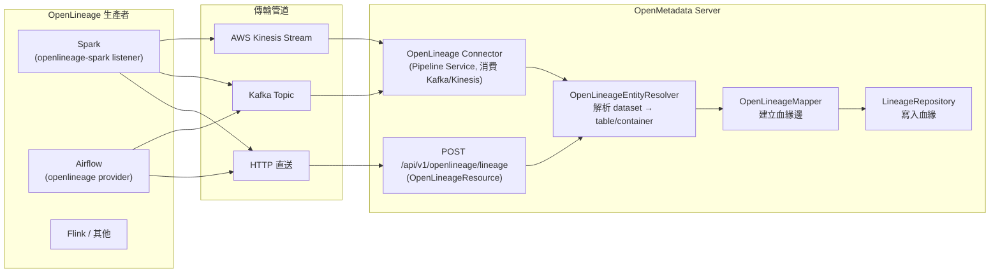
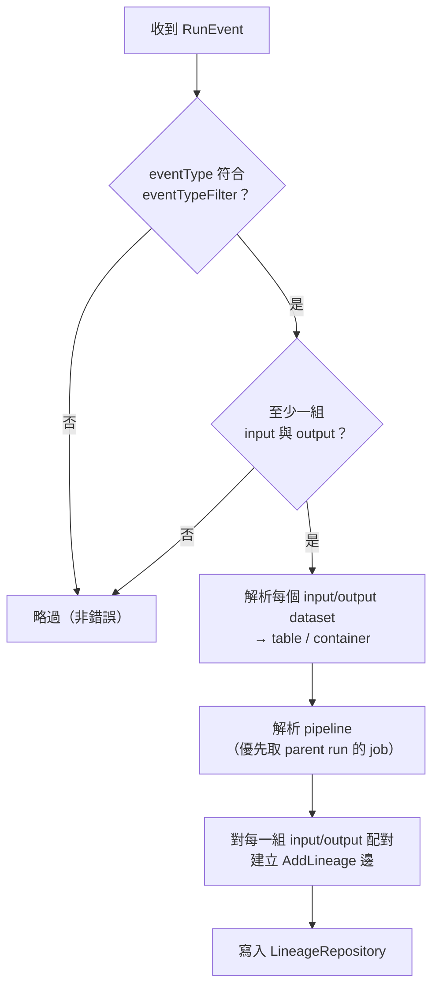

# OpenLineage 在 OpenMetadata 中的運作原理

## 摘要

**OpenLineage** 是一套用於蒐集與分析資料血緣（data lineage）的開放框架，其核心是一份可擴充的規格（specification），定義了 Job、Run、Dataset 三個核心實體與可擴充的 facet 模型[^ol-docs]。**OpenMetadata** 則是一套開放的中繼資料（metadata）平台，負責治理資料資產、血緣與品質[^om-repo]。

兩者的關係並非「OpenMetadata 內建 OpenLineage」，而是 **OpenMetadata 作為 OpenLineage 事件的消費者（consumer）**，把來自 Spark、Airflow、Flink 等生產者送出的 OpenLineage 事件，翻譯成 OpenMetadata 內部的血緣（lineage）與管線（pipeline）實體。本文說明此整合的整體架構、事件處理流程、伺服器端設定、資料集解析邏輯，以及它與另一條「Airflow Lineage Backend」路線的差異。

整合目前支援的 OpenLineage 版本為 **1.7.0**，並宣稱可向前相容於未來版本[^om-openlineage]。

---

## 一、背景：OpenLineage 的物件模型

在理解整合之前，需先掌握 OpenLineage 的資料模型。OpenLineage 以三個核心實體描述一次資料處理的過程[^ol-objectmodel]：

| 實體 | 定義 | 識別方式 |
|---|---|---|
| **Job** | 一個會消費（input）與生產（output）資料集的流程定義 | Namespace + Name（在同一 namespace 內唯一） |
| **Run** | Job 的一次執行實例，帶有開始與結束／失敗時間 | 全域唯一 UUID |
| **Dataset** | 資料的抽象表示，名稱由其物理位置推導 | Namespace（資料來源 URI）+ Name |

OpenLineage 定義三種事件類型[^ol-objectmodel]：

- **RunEvent**：描述 Job 的執行（runtime），至少需送出 `START` 與 `COMPLETE`／`FAIL`／`ABORT` 其中一個結束事件。
- **JobEvent**：描述 Job 的靜態中繼資料（design-time），不綁定 Run。
- **DatasetEvent**：描述 Dataset 的中繼資料變更（design-time），不綁定 Run。

每個事件可附帶 **facet**（附加於 Run、Job、Dataset 的原子化中繼資料）。標準 facet 包含 Run 的 `sql`、`nominalTime`、`parent`，Job 的 `sourceCodeLocation`、`ownership`，Dataset 的 `schema`、`dataSource`、`columnLineage` 等[^ol-objectmodel]。**這點對 OpenMetadata 整合至關重要**：OpenMetadata 正是從 `sql`、`parent`、`columnLineage`、`schema` 等 facet 萃取管線、SQL 查詢與欄位級血緣。

命名慣例上，Job 的 namespace 由**排程器（scheduler）** 推導，Dataset 的 namespace 由**資料來源（datasource）** 推導[^ol-naming]。例如：

- Airflow task job name：`{dag_id}.{task_id}`
- Postgres dataset namespace：`postgres://{host}:{port}`，name 為 `{database}.{schema}.{table}[^ol-naming]`

---

## 二、整合架構：三條攝取路徑

OpenMetadata 消費 OpenLineage 事件主要有三條路徑，可依部署情境選擇。



### 2.1 路徑 A：原生 HTTP 端點（Spark 推薦）

OpenMetadata 伺服器提供一個原生的 OpenLineage 端點：**`POST /api/v1/openlineage/lineage`**[^om-spark]。這是官方目前推薦的 Spark 整合方式，取代了舊版的 `openmetadata-spark-agent.jar`。上游標準的 `io.openlineage:openlineage-spark` listener 直接指向此端點即可[^om-spark]。

Spark 端設定的關鍵屬性如下[^om-spark]：

| 屬性 | 值／用途 |
|---|---|
| `spark.jars.packages` | `io.openlineage:openlineage-spark_2.12:<version>` |
| `spark.extraListeners` | `io.openlineage.spark.agent.OpenLineageSparkListener` |
| `spark.openlineage.transport.type` | `http` |
| `spark.openlineage.transport.url` | OpenMetadata 實例的 base URL |
| `spark.openlineage.transport.endpoint` | `/api/v1/openlineage/lineage` |
| `spark.openlineage.transport.auth.type` | `api_key` |
| `spark.openlineage.transport.auth.apiKey` | OpenMetadata bot JWT |
| `spark.openlineage.namespace` | OpenLineage **job namespace**（非 pipeline service 名稱） |
| `spark.openlineage.parentJobName` / `parentRunId` | 選用，提供穩定的 job 名稱與 run 識別 |

版本選擇：Spark 3.x 使用最新版（例如 `1.37.0`），Spark 2.4.x 需綁定 `1.36.0`（最後支援 Spark 2 的版本）[^om-spark]。

### 2.2 路徑 B：Kafka / Kinesis 連接器

OpenMetadata 也提供一個名為 **OpenLineage 的 Pipeline Service 連接器**，它從 **Kafka broker** 或 **AWS Kinesis Data Streams** 消費 OpenLineage 事件，再翻譯為 OpenMetadata 的血緣資訊[^om-connector]。

- **Kafka 情境**：Airflow 安裝 Apache Airflow OpenLineage provider 並採用 `kafka` transport；Spark 則設定 `spark.openlineage.transport.type=kafka`[^om-connector]。
- **Kinesis 情境**：需要一個接收事件的 Kinesis Data Stream，以及具備 `kinesis:GetRecords`、`kinesis:GetShardIterator`、`kinesis:DescribeStream`、`kinesis:ListShards` 權限的 AWS 憑證[^om-connector]。

此連接器以 OpenMetadata 的 Pipeline Service 形式建立（`serviceType=OpenLineage`），可透過 UI（Settings → Services → Add New Service → Pipeline Services → OpenLineage）或 Python SDK 以 `KafkaBrokerConfig` / `KinesisBrokerConfig` 設定[^om-connector]。

### 2.3 路徑 C：Airflow REST API 連線

對於受管 Airflow（Astronomer、Composer、MWAA），僅靠 REST API 無法取得血緣；官方指出「表級血緣（table → DAG → table）需要 Apache Airflow OpenLineage provider 將事件推送到 `POST /api/v1/openlineage/lineage`」[^om-airflow-rest]。設定使用 `[openlineage]` 區段與 JSON transport：

```ini
[openlineage]
namespace = my-airflow-instance
transport = {"type": "http", "url": "http://your-openmetadata-host:8585/api/v1/openlineage/",
             "endpoint": "lineage",
             "auth": {"type": "api_key", "api_key": "<OpenMetadata bot JWT>"}}
```

---

## 三、伺服器端處理流程

### 3.1 REST 資源與端點

伺服器端由 Java 類別 `org.openmetadata.service.resources.lineage.OpenLineageResource` 實作，掛載於 `@Path("/v1/openlineage")`，提供兩個端點[^om-resource]：

| 端點 | 方法 | operationId | 用途 |
|---|---|---|---|
| `POST /v1/openlineage/lineage` | `postLineage` | `postOpenLineageEvent` | 處理單一 `OpenLineageRunEvent` |
| `POST /v1/openlineage/lineage/batch` | `postLineageBatch` | `postOpenLineageBatch` | 批次處理多個事件 |

兩個端點都會先做授權與設定檢查[^om-resource]：

1. **授權**：要求呼叫端在 `TABLE` 上具備 `EDIT_LINEAGE` 權限。
2. **啟用檢查**：若 `OpenLineageSettings.enabled` 非 true，回傳 **503 SERVICE_UNAVAILABLE**。

單一事件流程為：授權 → 建立 mapper → `mapper.mapRunEvent(event, updatedBy)` 產生 `OpenLineageEventPlan` → `addLineageEdges(plan, updatedBy)` 逐一呼叫 `lineageRepository.addLineage(...)` 寫入血緣邊。回應狀態為 200；若狀態為 FAILURE 則回 400；未預期例外回 500[^om-resource]。

### 3.2 事件處理的六個步驟

每個事件在伺服器端會經過下列處理[^om-spark]：



1. **可處理性檢查**：事件的 `eventType` 需符合篩選條件（**預設只處理 `COMPLETE`**），且需**至少各有一個 input 與 output**，否則直接略過（不算錯誤）[^om-spark]。
2. **資料集解析**：將每個 input 與 output 解析為 OpenMetadata 實體參考（已存在的 table/container，或自動建立的 table）[^om-spark]。
3. **管線解析**：優先採用 run 的 `parent` facet 所指的 job，其次才是事件本身的 job；以 `<namespace>-<job name>` 在 `defaultPipelineService` 下查詢對應的 Pipeline[^om-spark]。
4. **建立血緣邊**：對每一組「兩端都成功解析」的 input/output 配對，透過 `LineageRepository.addLineage` 寫入一條 `AddLineage` 邊[^om-spark]。
5. **附加細節（LineageDetails）**[^om-spark]：
   - `source = OPEN_LINEAGE`
   - `description`：`Lineage from OpenLineage event for job: ns/name (run: runId)`
   - `pipeline`：解析出的 pipeline 參考（若有）
   - `sqlQuery`：取自 job 的 `sql` facet
   - `columnsLineage`：取自 output 的 `columnLineage` facet（先查 `outputFacets`，再退回 dataset 的 `facets`），把欄位級血緣轉成 `fromColumns = inputFqn.field`、`toColumn = outputFqn.outputColumn`，並以 `transformationDescription` 作為轉換函式
   - `createdAt`/`updatedAt`：使用**事件時間**（`eventTime`，其次 run 的 `nominalTime`，最後才用現在時間），以保留真實的管線時間軸
   - `createdBy`/`updatedBy`：固定為 `"openlineage"`
6. **結果回應**：未解析的資料集／job 會在 `OpenLineageResponse` 中以原因回報（見 3.4）。

### 3.3 管線的命名與建立規則

一個容易誤解的重點：**OpenLineage 事件不會自動建立 Pipeline**。伺服器端會以 `<namespace>-<job name>` 的形式，在設定中的 `defaultPipelineService`（預設名為 `openlineage`）下尋找既有的 Pipeline；找不到時該 job 會被回報，且其血緣邊不帶 pipeline 資訊[^om-settings]。

- `spark.openlineage.namespace` 是 OpenLineage 的 **job namespace**，**不是** pipeline service 的名稱[^om-spark]。
- 官方文件中，當 OpenMetadata 自動建立 pipeline 時，命名為 `<namespace>-<parentJobName>`；伺服器端實際以 `namespace.replaceAll("[^a-zA-Z0-9_-]","_") + "-" + name` 生成 pipeline 名稱，FQN 為 `defaultPipelineService + "." + pipelineName`[^om-spark]。

### 3.4 資料集解析順序

資料集解析由 `OpenLineageEntityResolver` 負責，順序如下[^om-spark]：

1. 將資料集名稱解析為候選：`schema.table`、`catalog.schema.table`、Glue 的 table/db/table ARN、或 Hive warehouse 路徑。
2. 透過 **namespace 對應**解析：以 `mappedService.database.schema.table`（再試 `mappedService.%.schema.table`）比對，對應採**先精確、再最長前綴**比對 `namespaceToServiceMapping`。
3. 透過 `dataSource` facet 的名稱解析。
4. 以 `database.schema.table` 做 FQN 後綴搜尋。
5. 以 `datasourceName.%.schema.table` 做 FQN 樣式比對。
6. 以 `schema.table` 做 FQN 後綴搜尋。

其他規則[^om-spark]：

- 純 token（只有表名、無 schema）只會在對應的 service 中尋找**唯一**同名表，否則該邊被丟棄，**不會**自動建立。
- Storage namespace（如 `s3://`、`gs://`）以 `fullPath` 解析為 Container（container 永不建立）。
- 若無法解析且開啟自動建立，則**僅在 namespace 對應到的 service 下**、且事件帶有欄位（schema facet）時才建立缺漏的 table。
- 未解析的資料集／job 會以原因回報：`NOT_FOUND`、`NAMESPACE_NOT_MAPPED`、`CREATION_DISABLED`、`UNPARSABLE_NAME`、`PIPELINE_NOT_FOUND`。

---

## 四、伺服器端設定（OpenLineageSettings）

整合行為由設定物件 `OpenLineageSettings`（Java 型別 `org.openmetadata.schema.configuration.OpenLineageSettings`）控制，其用途是「設定 OpenMetadata 如何接收與處理來自 Spark、Airflow、Flink 等外部系統的血緣事件」[^om-settings]：

| 欄位 | 型別 | 預設 | 說明 |
|---|---|---|---|
| `enabled` | boolean | `true` | 啟用／停用 OpenLineage HTTP API 端點 |
| `autoCreateEntities` | boolean | `true` | 當事件參考的 table 不存在、且 namespace 已對應到 service、且事件帶有 schema facet 時，連同缺漏的 Database／Schema 一併建立；**pipeline 永不建立** |
| `eventTypeFilter` | string[] | 只處理 `COMPLETE` | 要處理的事件類型清單；可選 `START`、`RUNNING`、`COMPLETE`、`ABORT`、`FAIL`、`OTHER` |
| `ownershipUpdateMode` | enum | `replace` | job ownership facet 對 Pipeline owner 的更新方式：`replace` 取代、`append` 附加 |
| `defaultPipelineService` | string | `"openlineage"` | 尋找 OpenLineage job 之 Pipeline 所用的 Pipeline Service 名稱（命名為 `<namespace>-<job name>`） |
| `namespaceToServiceMapping` | object（string→string） | 無 | OpenLineage dataset namespace 對應到 OpenMetadata Database Service 名稱，先精確再最長前綴；例：`'postgresql://prod-db:5432' -> 'prod-postgres'` |

在 **Kafka/Kinesis 連接器**路徑中，還有數個 agent 層級的設定欄位[^om-connector]：

| 欄位 | 預設 | 說明 |
|---|---|---|
| Ownership Update Mode | `replace` | 來源 owners 更新 Pipeline owners 的方式 |
| Db / Storage / Messaging Service Names | 無 | 用於血緣解析的服務名稱清單 |
| Status Lookback Days | `1` | 僅攝取近 N 天的 pipeline run 狀態 |
| Include Lineage | 開 | 關閉則停止從 pipeline 取得血緣 |
| Mark Deleted Pipeline | 開 | 來源移除時軟刪除 OpenMetadata 中的 pipeline |
| Include UnDeployed Pipelines | 開 | 是否攝取未部署的 pipeline |

---

## 五、與 Airflow Lineage Backend 的差異

OpenMetadata 另有一條與 Airflow 的整合路線叫 **Lineage Backend**，它與 OpenLineage 路線常被混淆，但機制完全不同。Lineage Backend 是 Airflow 原生 `LineageBackend` 介面的實作（`OpenMetadataLineageBackend`），在每個 task 執行後由 Airflow 呼叫 `send_lineage()`，從任務宣告的 `inlets`／`outlets` 解析血緣並推送到 OpenMetadata[^om-airflow-lb]。

兩者差異整理如下：

| 面向 | Airflow Lineage Backend | OpenLineage 路線 |
|---|---|---|
| 機制 | 實作 Airflow 原生 `LineageBackend` hook | OpenLineage provider／listener 發出標準事件 |
| 設定位置 | `[lineage]` 區段 / `AIRFLOW__LINEAGE__*` | `[openlineage]` 區段 / `AIRFLOW__OPENLINEAGE__*` |
| 血緣來源 | 依賴程式碼宣告 `inlets`／`outlets`，再於 DAG 層級彙整 | 自動 instrument SQL 原生 operator；Python `@task` 需顯式發出事件 |
| 捕捉內容 | Pipeline 實體、task 關係、run 狀態、DAG 層級血緣 | OpenLineage 事件（含 facet、可含欄位級血緣） |
| 格式 | OpenMetadata 專屬的 `OMEntity`／dict xlet 格式 | 開放 OpenLineage 規格，可與任何消費者互通 |
| 適用情境 | 自架 Airflow 且已安裝 ingestion 套件 | 受管 Airflow（MWAA、Composer、Astronomer）或需要標準化事件 |

Lineage Backend 的 `[lineage]` 設定範例[^om-airflow-lb]：

```ini
[lineage]
backend = airflow_provider_openmetadata.lineage.backend.OpenMetadataLineageBackend
airflow_service_name = local_airflow
openmetadata_api_endpoint = http://localhost:8585/api
jwt_token = <your-token>
```

其中可選的 `only_keep_dag_lineage` 會在每次執行時清除 inlets／outlets 未涵蓋的表血緣；`max_status` 控制每次攝取的 run 狀態數量（預設 10）[^om-airflow-lb]。血緣是**在 DAG 層級彙整**，與宣告於哪個 task 無關[^om-airflow-lb]。

---

## 六、實務注意事項與限制

- **版本**：目前支援 OpenLineage 至 1.7.0，官方表示對未來版本持續相容[^om-connector]；Spark 2.4.x 必須使用 `openlineage-spark` 1.36.0[^om-spark]。
- **Pipeline 不自動建立**：事件只會尋找既有 Pipeline，找不到時血緣邊仍會寫入但不帶 pipeline[^om-settings]。
- **預設只處理 COMPLETE 事件**：若要處理其他事件類型，需調整 `eventTypeFilter`[^om-settings]。
- **授權**：呼叫端需具備 `TABLE` 上的 `EDIT_LINEAGE`；自動建立實體時另需對應的 `CREATE` 權限與 limits 檢查[^om-resource]。
- **時序正確性**：血緣時間戳記使用事件時間而非寫入時間，因此可正確重播歷史（historical replay）[^om-spark]。
- **未解析即丟棄**：無 schema 的表名或無法對應 namespace 的資料集會被丟棄或回報原因，不會靜默產生錯誤血緣[^om-spark]。

---

## 參考文獻

[^ol-docs]: OpenLineage. (n.d.). *OpenLineage documentation*. Retrieved 2026-10-13, from https://openlineage.io/docs/

[^ol-objectmodel]: OpenLineage. (n.d.). *Object model*. Retrieved 2026-10-13, from https://openlineage.io/docs/spec/object-model

[^ol-naming]: OpenLineage. (n.d.). *Naming*. Retrieved 2026-10-13, from https://openlineage.io/docs/spec/naming

[^om-repo]: OpenMetadata. (n.d.). *open-metadata/OpenMetadata*. GitHub. Retrieved 2026-10-13, from https://github.com/open-metadata/OpenMetadata

[^om-openlineage]: OpenMetadata Documentation. (n.d.). *OpenLineage connector*. Retrieved 2026-10-13, from https://docs.open-metadata.org/v2.0.x/connectors/pipeline/openlineage

[^om-connector]: OpenMetadata Documentation. (n.d.). *OpenLineage connector*. Retrieved 2026-10-13, from https://docs.open-metadata.org/v2.0.x/connectors/pipeline/openlineage

[^om-spark]: OpenMetadata Documentation. (n.d.). *Spark lineage ingestion*. Retrieved 2026-10-13, from https://docs.open-metadata.org/v2.0.x/connectors/ingestion/lineage/spark-lineage

[^om-resource]: OpenMetadata. (n.d.). *OpenLineageResource.java*. GitHub. Retrieved 2026-10-13, from https://github.com/open-metadata/OpenMetadata/blob/main/openmetadata-service/src/main/java/org/openmetadata/service/resources/lineage/OpenLineageResource.java

[^om-settings]: OpenMetadata. (n.d.). *openLineageSettings.json*. GitHub. Retrieved 2026-10-13, from https://github.com/open-metadata/OpenMetadata/blob/main/openmetadata-spec/src/main/resources/json/schema/configuration/openLineageSettings.json

[^om-airflow-lb]: OpenMetadata Documentation. (n.d.). *Airflow lineage backend*. Retrieved 2026-10-13, from https://docs.open-metadata.org/v2.0.x/connectors/pipeline/airflow/lineage-backend

[^om-airflow-rest]: OpenMetadata Documentation. (n.d.). *Airflow REST API connection*. Retrieved 2026-10-13, from https://docs.open-metadata.org/v2.0.x/connectors/pipeline/airflow/rest-api-connection
